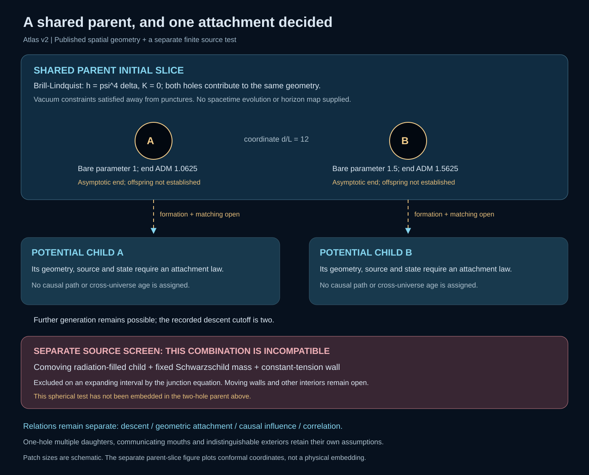
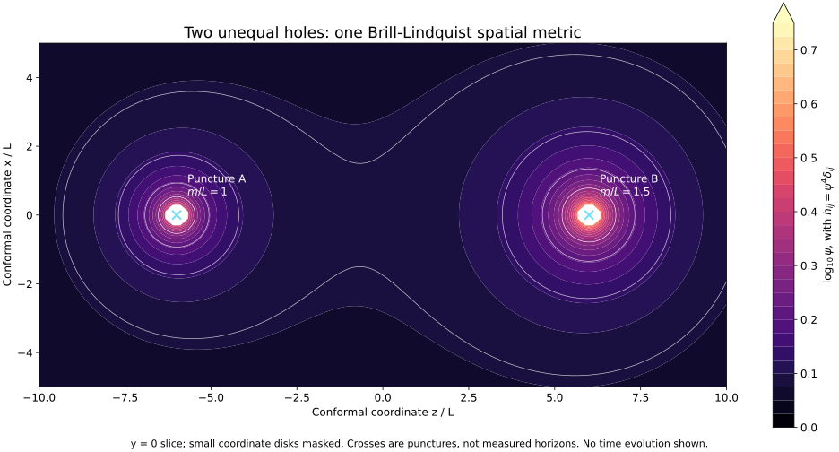
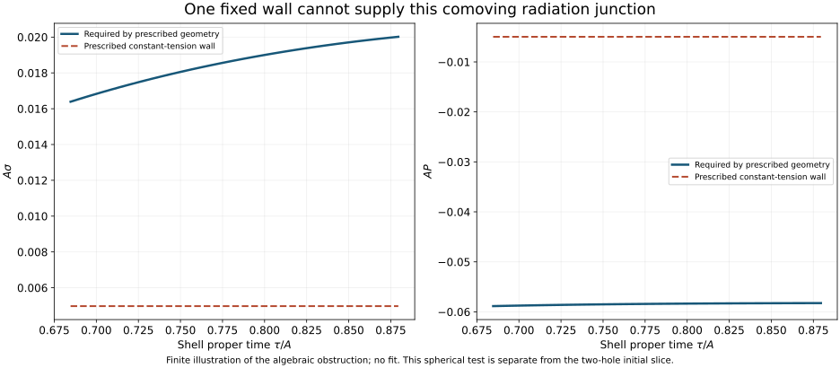

# A shared parent, and one attachment decided

The parent is now a published spatial initial-data construction containing two
unequal punctures. Additional ends are part of its topology; their formation
as children and communication are not established. The same metric contains
both holes, so companion-induced angular dependence is retained.

The bare parameters are [1.0, 1.5]; the outer ADM mass is
2.5 and the two end masses are
[1.0625, 1.5625], in the chosen geometric unit. These are
imported initial-data quantities, not inherited cosmological constants.
The plot is a conformal-coordinate section, not a spatial embedding.

## A source question with an answer

The source verdict is **INCOMPATIBLE_FIXED_SOURCE**, within its declared assumptions.
A closed radiation FLRW region, a comoving shell, a fixed Schwarzschild mass
and a constant-tension wall cannot satisfy the angular junction throughout an
open interval of changing radius. With k=4 pi sigma and b=cos(chi), it would
require k^2 R^4 - 2 b k R^3 + 2 M R - A^2 sin(chi)^4 = 0 identically.
Its nonzero constant coefficient excludes that identity for A>0 and
0<chi<pi. The independent temporal-curvature and conservation checks support
the implementation; the polynomial argument supplies the interval result.

This is an application of established matching theory, without a priority
claim. The spherical test is not an attachment to the Brill-Lindquist slice.
Moving boundaries, other interiors and other physically specified sources
remain separate possibilities. The earlier adjusted composite layers still
lack a derived fill and exchange law.

## Alternatives remain visible

The one-hole multiple-daughter, communicating-mouth and response-equivalence
branches preserve their v1 assumptions. No shared ancestry or initial spatial
connection acquires a signal delay. The existing response adapter still needs
a physically supplied Hamiltonian and observer clock before a local prediction.

## Recorded inputs and replay

[atlas.json](atlas.json), [parent.json](parent.json) and [junction.json](junction.json)
contain the scenario map, source/domain cards, fixed inputs, admission records,
sampled outputs and checks. [manifest.json](manifest.json) binds sources and
outputs. The producer is creation-only; --check replays without rewriting.
The [working manuscript](../../../../paper/atlas-working-draft.md) develops
the argument and distinguishes imported mathematics, this scoped exclusion,
and open physical connections. No dark-sector fraction, antimatter asymmetry,
cross-universe age or constant-inheritance law has been predicted.
