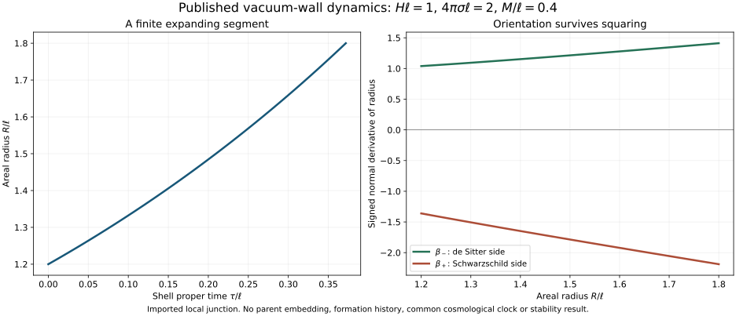

# A boundary needs a source; a shared parent needs compatible data

The explicit Brill-Lindquist parent remains our sampled baseline. A published
many-body gluing theorem supplies a different family with two unequal, exactly
spherical Schwarzschild body regions at sufficiently large separation. The
theorem is imported; its unknown separation bound is not replaced by the
baseline's coordinate distance.

For the radiation-filled candidate, a fixed pure-tension wall has no intrinsic
stress divergence. With vacuum outside, conservation forces its speed relative
to the radiation to vanish. Motion alone therefore does not evade the previous
comoving-wall obstruction. This is a scoped application of known conservation.

A de Sitter interior has rho+p=0 and avoids that particular flux obstruction.
Its published constant-tension junction supplies this finite expanding segment.
The negative Schwarzschild-side normal derivative is retained: replacing it by
a positive square root would describe the wrong attachment. Proper time belongs
to this wall only. Local matching does not prove offspring formation or stability.

The next interface is complete initial data: a spacelike slice through the wall,
the correct Schwarzschild side, matching spatial metric and extrinsic curvature,
and a source regularity class covered by the chosen gluing result. The smooth
non-time-symmetric many-body theorem is promising, but does not automatically
include a distributional Israel layer. We have not attached the wall to either
shared parent.

[atlas.json](atlas.json), [moving-boundary.json](moving-boundary.json),
[parent-gluing.json](parent-gluing.json) and [manifest.json](manifest.json)
record the scenarios, borrowed mathematics, finite checks and provenance.
The [working manuscript v3](../../../../paper/atlas-working-draft-v3.md)
develops the mathematical narrative. The three independent v1 alternatives,
unequal potential children and the finite grandchild remain visible; no new
causal path or local dark-sector consequence is assigned.
