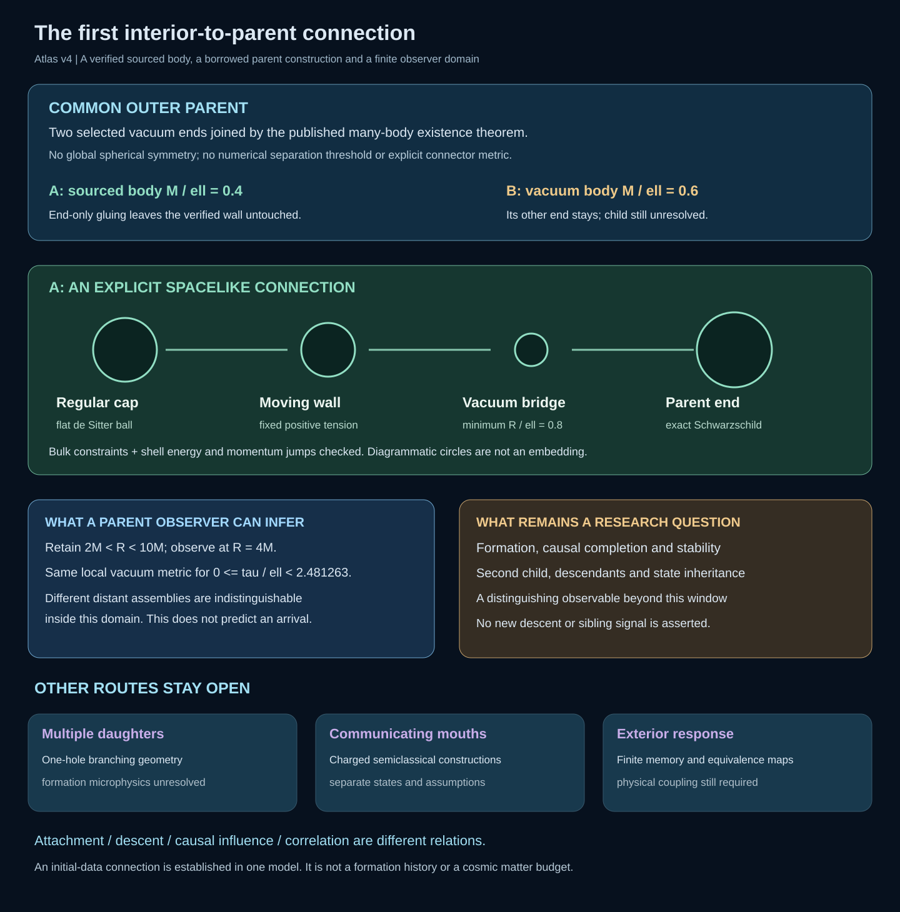
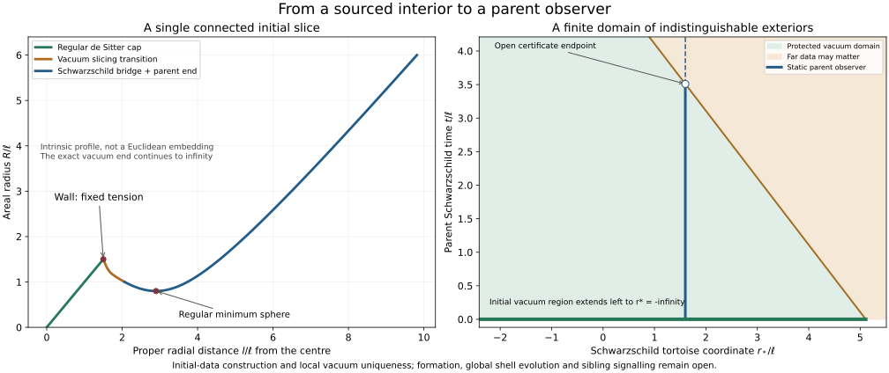

# A first interior connection, and what a parent observer can know

The first sourced body now has one connected initial slice: a regular expanding
de Sitter cap, its fixed positive-tension wall, a Schwarzschild vacuum transition,
a regular minimum sphere, and an exact asymptotically Euclidean end. The wall
source H ell=1, k ell=2 and state M/ell=0.4 are unchanged from v3. The transition
changes the slicing of vacuum Schwarzschild, not its matter content.

Both bulk constraints and the wall's distributional energy/momentum constraints
pass. An independent metric-derivative calculation checks the vacuum residuals.
The cap is a flat spatial ball, not an assumed closed S3 cosmos. The spatial
bridge is not a demonstrated signal channel or a black-hole formation history.

The many-body theorem can operate on the smooth vacuum end alone. Its unchanged
open overlap reattaches the sourced body without imposing a global smoothness
condition on the wall. Pairing this body with an unequal ordinary Schwarzschild
bridge gives a justified initial-data existence family: a common outer parent
and B's retained other end. The connector metric and separation threshold have
not been calculated. The old explicit Brill-Lindquist data remain a separate
candidate and are not replaced by a claimed spherical version of themselves.

A static observer at R/ell=1.6 is protected by the retained right vacuum initial
region 0.8<R/ell<4. The open bound is t/ell <
3.509035488896, or local proper time
tau_obs/ell < 2.481262789623.
Different far assemblies that preserve those initial data give the same vacuum
geometry inside this domain. This is an explicit local degeneracy, not a
predicted arrival or a cross-universe age. Independent field/state data can
still differ. The inward optical endpoint lies at minus infinity.

The next question is the sourced body's causal completion and stability, or an
observable capable of breaking this finite equivalence. Known completions and
obstructions should be imported before a new calculation is admitted. The
other branching, communicating-mouth and exterior-response routes remain open.

[Slice record](connection-slice.json), [parent assembly](parent-assembly.json),
[observer window](causal-window.json), [atlas](atlas.json), and
[manifest](manifest.json) retain inputs, scope and evidence. The
[working paper v4](../../../../paper/atlas-working-draft-v4.md) explains the
equations and the preserved alternatives. This closes a project interface in
one model; no new-to-world cosmological discovery is claimed.
