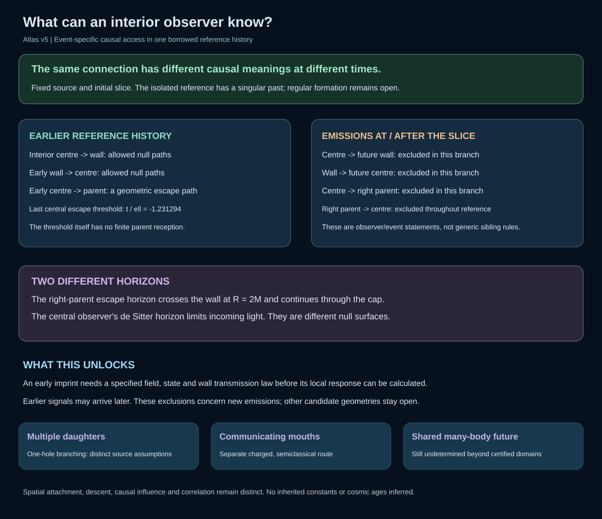
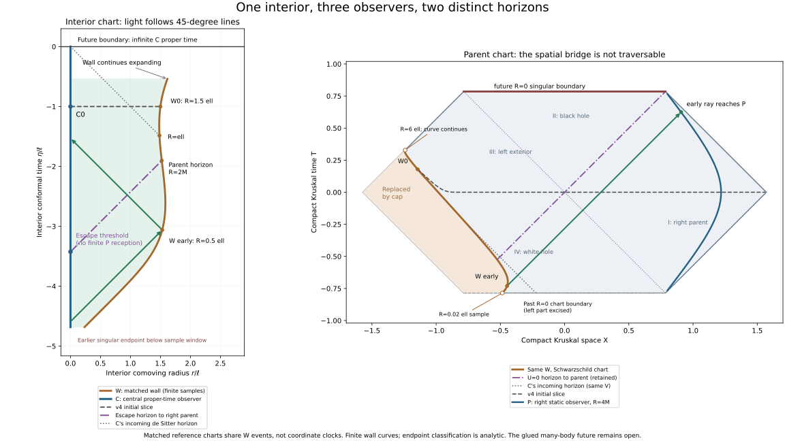

# The geometry seen by an interior observer

The fixed wall belongs to a published monotonic expanding reference branch.
Its past reaches a Schwarzschild singular boundary; its late interior expands.
This is a causal completion of the isolated spherical body, not a regular
formation mechanism or a computed evolution of the glued many-body parent.

The centre C, wall W and right static parent P carry different proper clocks.
The panels share wall events while retaining their own coordinates. The
initial slice matches v4. Horizon curves stop at their matching wall events;
the dotted central horizon continues across both panels. The faint dashed
past Schwarzschild boundary is uncut chart context, partly excised by the cap.
Green rays illustrate earlier geometric access:
light can travel from C to the early wall, from the early wall back to C,
and from the early wall through the white-hole sector to P. A field's actual
transmission and amplitude require additional matter/state data.

The central escape threshold to the right parent is
t_C/ell=-1.231294452474. Earlier emissions within the certified history can
escape; equality follows a horizon generator and does not reach P at finite
proper time. The parent's horizon continues through the cap and is not a
constant-radius sphere there. It differs from C's incoming de Sitter horizon.

Emissions at or after the chosen slice cannot travel from C to the future wall,
from the wall to C, or from C to P in this fixed branch. Earlier wall emissions
can reach C arbitrarily late; these exclusions do not erase incoming history.
P cannot reach the wall or C anywhere in this reference history. These are
specific observer and emission-domain conclusions, not a generic rule for all
black holes, siblings or nested geometries.

[Observer access table](observer-access.md) records every verdict and basis.
[causal-map.json](causal-map.json), [observer-access.json](observer-access.json),
[atlas.json](atlas.json) and [manifest.json](manifest.json) retain exact inputs
and provenance. The [paper v5](../../../../paper/atlas-working-draft-v5.md)
connects these results to the prior spatial atlas.

The shared parent's future, second cosmological child and descendants remain
unresolved. Multiple-daughter, communicating-mouth and exterior-response
models remain separate routes. The next response question can concern a
specified early field imprint or a different attachment with its own causal
channel. No late-parent driving, inherited constant or cosmic age is inferred
from this reference. Known junction and causality mathematics is borrowed;
the new work closes a project-level observer map.
