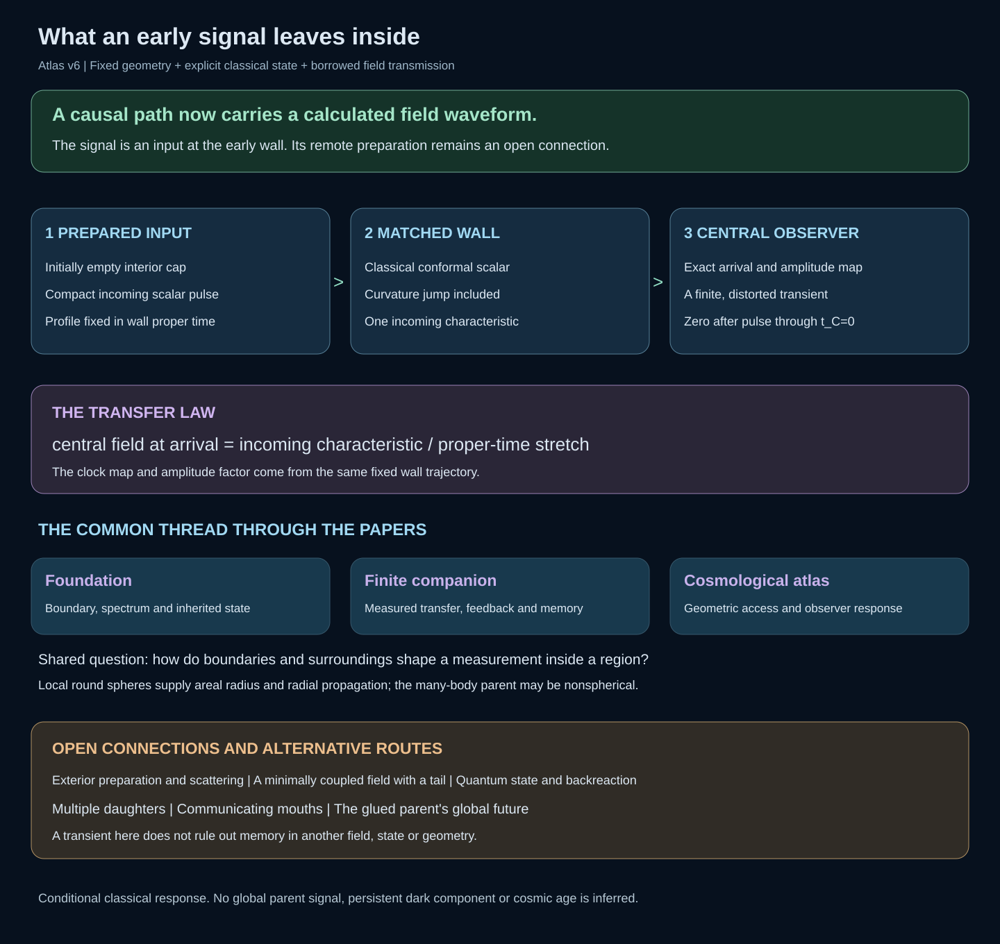
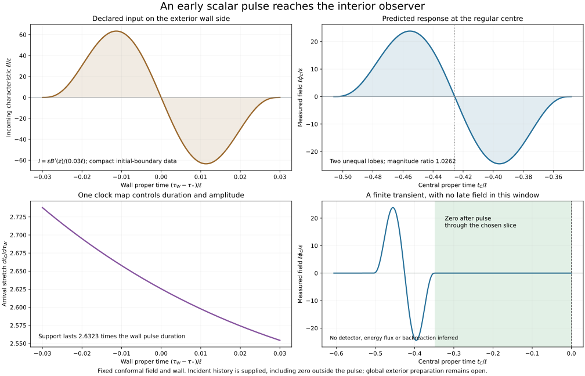

# From a causal connection to an interior field measurement

The new connection carries a classical massless conformal scalar in its
spherical mode. The fixed wall's curvature distribution is included. It
gives continuity of the reduced field R phi and its normal derivative;
it does not erase smooth Schwarzschild scattering outside the wall.

The cap begins with zero classical field and time derivative. A single
exterior-side incoming characteristic is prescribed on the wall. Its compact
profile is fixed in wall proper time around the early R/ell=0.5 event.
This is an initial-boundary state, not a derived remote source or quantum
vacuum. The right-parent causal exclusion in atlas v5 remains unchanged.

The exact conditional transfer is phi_C[T(tau_W)]=I(tau_W)/Tprime(tau_W).
It predicts a finite transient and a proper-time distortion of the supplied
profile. The central field returns to zero after this pulse within the stated
observation window. Squared-amplitude integrals are waveform diagnostics,
not a stress-energy or dark-matter calculation. Exterior tails have not been
computed; zero incoming trace outside the pulse is part of the input.

The common thread is a local observer's response to regional boundaries,
geometry and state. The foundation proposes inheritance; the finite companion
computes transport and memory under its own assumptions; the atlas supplies
physical geometry and causal access. The companion's unresolved mode-space
complement has not been identified with a cosmological parent. Round local
spheres are compatible with a nonspherical multi-hole assembly.

[field-transfer.json](field-transfer.json) records the state, response and
checks; [atlas.json](atlas.json) preserves all earlier scenarios;
[manifest.json](manifest.json) binds their sources. The
[paper v6](../../../../paper/atlas-working-draft-v6.md) develops the argument.
The minimally coupled field with a bulk tail, exterior-state construction,
multiple-daughter and communicating-mouth routes remain open.
