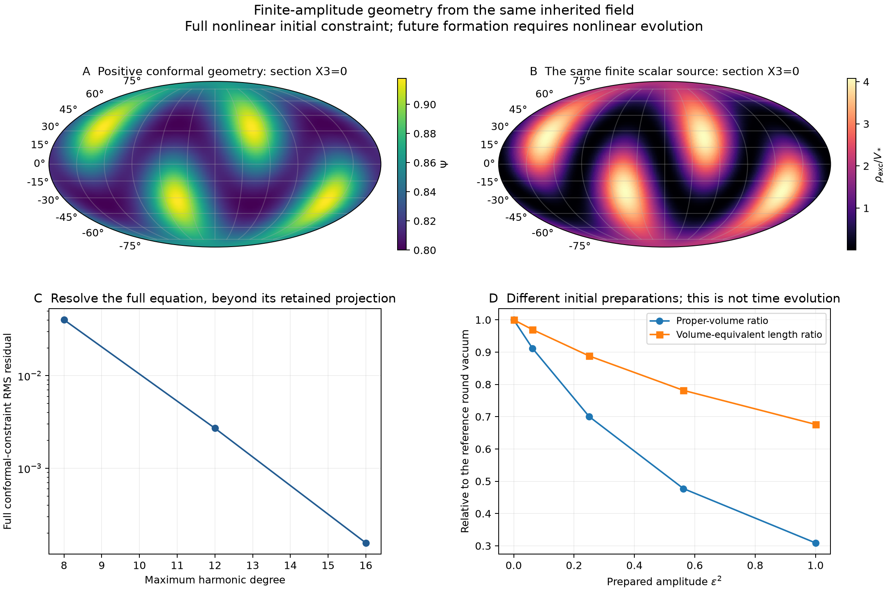

# Finite-amplitude inherited parent data

The [coupled perturbative parent](nsc-atlas-parent-backreaction.md) now has
finite-amplitude initial data from the full nonlinear gravitational
constraint. The field, action, internal vacuum and nonspherical profile
are retained. A weighted equivariant Yamabe argument proves existence for
every amplitude 0<=epsilon<=1. Three independent spectral resolutions
calculate a continued numerical branch and its physical volume/energy.
The [compact record](../results/summaries/nsc-atlas-finite-parent-data-v1.json)
retains the theorem inputs, finite results and source bindings.

## Choice, source and domain

Scaling the old perturbative metric would not satisfy the full constraint.
A spherical average would change the prepared field. We instead solve
the exact conformal constraint on the same compact S3, using its existing
discrete symmetries and three generated spatial directions. No physical
shell or outer cutoff is introduced.

At the initial time-symmetric event, set

$$
h_{ij}=a_0^2\Psi^4\gamma_{ij},\quad a_0=H^{-1},\quad K_{ij}=0,
\quad s=s_*,\quad n(s)=0,\quad \chi=\epsilon f,\quad n(\chi)=0,
$$

where f=a X1+b X2X4 is the unchanged two-harmonic source. Here
a=C1 q10 and b=C2 q20; a0 is a length, while a,b are field coefficients.
Define z=mu^2/H^2=8329.074464994 and P=|Df|^2 on unit S3.
The full constraint is

$$
-8\Delta\Psi+6\Psi-6\Psi^5
-\kappa\epsilon^2\left(P\Psi+z f^2\Psi^5\right)=0.
$$

The momentum constraint is exactly zero. The same equation's quadratic
expansion recovers the old conformal corrector. No radius or mass is reset.
For the numerical benchmark epsilon=1 means equal excitation/vacuum mean
energy on the reference round geometry. It is supplied, not selected by
inheritance. The physical mean is recalculated with the solved geometry.

## 1. A finite-amplitude existence theorem

**Statement.** For this normalized two-harmonic family with z>33 and
0<=epsilon<=1, the full constraint has at least one smooth positive
solution invariant under the existing source symmetries. Neither global
uniqueness nor membership in one continuous branch is asserted.

Let tau=epsilon^2, A=6-kappa tau P and B=6+kappa tau z f^2. On invariant
functions consider

$$
\mathcal Q(w)=\frac{\int(8|Dw|^2+Aw^2)\,dV_\gamma}
{\left(\int B|w|^6\,dV_\gamma\right)^{1/3}}.
$$

The eight-element group is generated by paired flips (X1,X2), (X1,X4)
and reflection X3. Both A and B are invariant. There is no common fixed
point on S3 and the minimum orbit size is two. Every degree-one harmonic
is excluded from the invariant space, at all nonlinear orders.

The equal-energy source normalization gives exact pi-free identities:

$$
\kappa a^2=\frac{12}{z+3},\qquad
\kappa b^2=\frac{72}{z+8},\qquad
\kappa\langle P\rangle=\frac9{z+3}+\frac{24}{z+8}<\frac{33}{z}.
$$

Also P<=a^2+b^2, so A>6-84/33=38/11>0 throughout the stated interval.
This makes the numerator coercive. Since a<b, the exact field maximum
is f_max=(a^2+b^2)/(2b), and

$$
\kappa z f_{\max}^2
=\frac{z(7z+26)^2}{2(z+3)^2(z+8)}<\frac{49}{2}.
$$

The last inequality follows because the denominator comparison leaves
322z^2+2117z+3528>0. Meanwhile

$$
\kappa z\langle f^2\rangle=6-\kappa\langle P\rangle>5.
$$

The ratio B_max/<B> increases with tau, and is therefore less than
(6+49/2)/(6+5)=61/22 for tau<=1.

Let Y(S3)=6(2pi^2)^(2/3) be the round Yamabe constant. An invariant
concentration of weighted L6 mass must occur at an orbit of at least
two points, so its cost is at least

$$
T=\frac{2^{2/3}Y(S^3)}{B_{\max}^{1/3}}.
$$

The constant trial gives a strict bound independent of numerical solving:

$$
\left(\frac{\mathcal Q(1)}{T}\right)^3
=\left(\frac{\langle A\rangle}{6}\right)^3
\frac{B_{\max}}{4\langle B\rangle}
<\frac{61}{88}<1.
$$

**Weighted compactness argument.** Normalize integral B|w|^6=1 and take
a minimizing sequence. Coercivity gives an H1 weak limit and compact
lower-exponent convergence. Any lost critical mass occurs in invariant
concentration orbits; its energy is at least T times its mass to the
power1/3. If the weak limit carries mass alpha and the infimum is I<T,
splitting would require energy at least I alpha^(1/3)+T(1-alpha)^(1/3),
which exceeds I for 0<=alpha<1. Thus no mass is lost. The minimizer is
attained. Standard critical elliptic regularity and positivity apply.
Averaging test functions over the finite group gives the full
Euler--Lagrange equation, and rescaling the normalized minimizer by
I^(1/4) yields -8DeltaPsi+A Psi=B Psi^5.

The strict orbit-threshold compactness mechanism is borrowed from
[Hebey, Theorem2 and proof, pp.380 and388--389](https://scispace.com/pdf/from-the-yamabe-problem-to-the-equivariant-yamabe-problem-31pty46vb7.pdf),
with [publisher attribution](https://smf.emath.fr/publications/yamabe-problem-equivariant-yamabe-problem).
The variable A,B adaptation, source normalization and rational certificate
are given explicitly above. We do not quote a constant-curvature theorem
as though it already solved this sourced equation.

At the actual retained source and epsilon=1, the constant-trial threshold
ratio is .859057615839. This proves existence of some admissible geometry,
not dynamical selection of the minimizer or uniqueness of the numerically
continued branch.

## 2. Solving the full equation at finite contrast

The real orthonormal S3 harmonics use even j, cosine azimuthal modes and
even l+m. The resulting bases have45,119 and249 modes at maximum
degrees8,12 and16. A positive-branch Newton/Krylov continuation reaches
epsilon=1. Its intermediate amplitudes are numerical continuation steps,
not fitted states or observations.

The nonlinear projection is overintegrated through degree6L+4. More
importantly, validation integrates the full conformal residual squared,
of degree10L+8, on a separate higher-order rule. The residual outside the
retained harmonic space is therefore not hidden by a small Newton residual.

| Maximum degree | Full conformal RMS | Physical Hamiltonian RMS / H^2 | Proper-volume ratio |
| --- | --- | --- | --- |
| 8 | .04018723122 | .10107995850 | .309005429271 |
| 12 | .002707474175 | .006763175870 | .309002236108 |
| 16 | .000156298780 | .000390413448 | .309002226021 |

The full conformal residual shrinks by factors14.84 and17.32. Retained
projection residuals are about1e-13 but are not used as the full-PDE error.
The conformal residual-square rule is polynomial-exact before floating-point
error. The physical proper-volume-weighted residual contains inverse
powers of Psi and is reported as a numerical quadrature estimate.

The spherical addition theorem gives a global lower bound for each finite
expansion from its per-degree coefficient norms. On the finest computed
geometry it is .604021706970; the independently sampled minimum is
.756482449611. Positivity of the finite expansion is not inferred solely
from collocation points.

## 3. What the finite geometry measures

Use the actual metric measure, not the reference normalization:

$$
\mathcal V=a_0^3\int\Psi^6dV_\gamma,\qquad
E_{\rm exc}=\frac{\epsilon^2a_0^3}{2}
\int\left(H^2\Psi^2P+\mu^2\Psi^6f^2\right)dV_\gamma.
$$

At epsilon=1:

| Readout | Finest value | Fine--middle spread |
| --- | --- | --- |
| Proper volume / round reference volume | .309002226021 | 1.01e-8 |
| Volume-equivalent length / reference length | .676063053609 | 7.36e-9 |
| Mean excitation density / vacuum density | 1.228530389054 | 6.91e-8 |

The spreads are empirical refinement indicators, not certified bounds on
the exact solution. A volume-equivalent length is defined by the cube
root of volume; it is not an actual horizon radius. The initial vacuum
share of total field energy is 1/(1+1.228530389054)=.448726212087.
Present cosmological density parameters require future evolution and
observer inference.

The reference-energy normalization does not survive unchanged as the
proper mean. Likewise, comparing different prepared initial volumes is
not time evolution. Earlier perturbative clock coefficients are not
extrapolated to epsilon=1. At this time-symmetric event the canonical equations
give exactly

$$
\theta=0,\qquad
n(\theta)=\kappa\left(V_*+\frac12\mu^2\epsilon^2f^2\right)>0.
$$

At the initial scalar maximum n(theta)/H^2=15.240343668940. Both normal
field momenta vanish, so there is initially positive trace-expansion
acceleration. For any two-sided closed surface the two future null
expansions are opposites on this slice; it has no strictly future-trapped
surface. Minimal marginal surfaces are not excluded. Formation or later
collapse cannot be inferred from density or initial volume alone.



## 4. A compatible handoff to nonlinear evolution

[Lindblom--Szilagyi--Taylor, 1312.0701v2](https://arxiv.org/html/1312.0701v2)
provides a spatially covariant first-order symmetric-hyperbolic GH system
and compact-S3 Einstein--scalar tests. We use the published equations and
topology method as inputs. Its Einstein-static background and test-mode
suppression are not substituted for the present dynamical system.

For S=sqrt(K_s)(s-s_star) and chi, replace its quadratic complex potential
by W(S,chi)=V(s)+mu^2(s)chi^2/2. The two canonical wave principal parts
remain, while W and its gradients supply the lower-order stress/source.
This potential has no inherited complex U(1) symmetry. Include V_star in
the matter potential or as a separate Lambda term once.

A static product reference -dt^2+a0^2 gamma permits explicit compatible
initial gauge data. In its orthonormal frame let p_i=Dbar_i lnPsi. With
initial gauge source H_a=0, choose

$$
g_{00}=-1,\quad g_{0i}=0,\quad g_{ij}=\Psi^4\delta_{ij},
\qquad \Pi_{0i}=2p_i,\quad \Pi_{00}=\Pi_{ij}=0,
$$

$$
\Phi_{ijk}=4p_i\Psi^4\delta_{jk},\qquad
\Phi_{i00}=\Phi_{i0j}=0.
$$

Here Pi=-Dbar_t g and Phi_i=Dbar_i g. Direct contraction of the connection
difference gives g^bc DeltaGamma^a_bc=0. The mixed Pi terms cancel the
spatial conformal connection; zero extrinsic curvature does not set them
to zero. The unit-S3 derivative must be divided by a0 in this frame.
This algebra is implemented and independently checked for arbitrary
positive Psi and reference gradient. Its spatial-gradient evaluator,
future gauge and nonlinear evolution operator remain to be implemented.

The variational theorem gives smooth exact constrained data, and the
canonical system has the standard local hyperbolic Cauchy formulation.
A local Einstein--two-scalar development therefore exists. No numerical
lifetime, long-time control or concentration result follows from this
local existence statement. The earlier spherical solvers do not evolve
the same nonspherical data or potential and are not used as substitutes.

## Reproduction and stopping condition

```powershell
python scripts/run_python.py scripts/check_nsc_atlas_finite_parent_data.py --output .build/finite-parent-data-reproduced.json
python scripts/run_python.py -m pytest -q tests/test_nsc_atlas_finite_parent_data.py tests/test_nsc_atlas_finite_parent_algebra.py tests/test_nsc_atlas_s3_spectral.py
python scripts/run_python.py scripts/plot_nsc_atlas_finite_parent_data.py
```

Three independent resolutions use three processes and two BLAS threads
each, taking about29seconds within240seconds. Arrays regenerate; only
summaries are retained. Main failure risks are a missed high-mode residual,
incorrect proper-volume factors and unconstrained gauge initial data.
Independent full residual quadrature, known-limit/perturbative controls
and the contracted-connection check address those. No further initial
resolution is required for the quoted empirical spreads. The next
calculation is full nonlinear evolution using these same fields and
compatible gauge, with all Einstein/matter constraints monitored.
