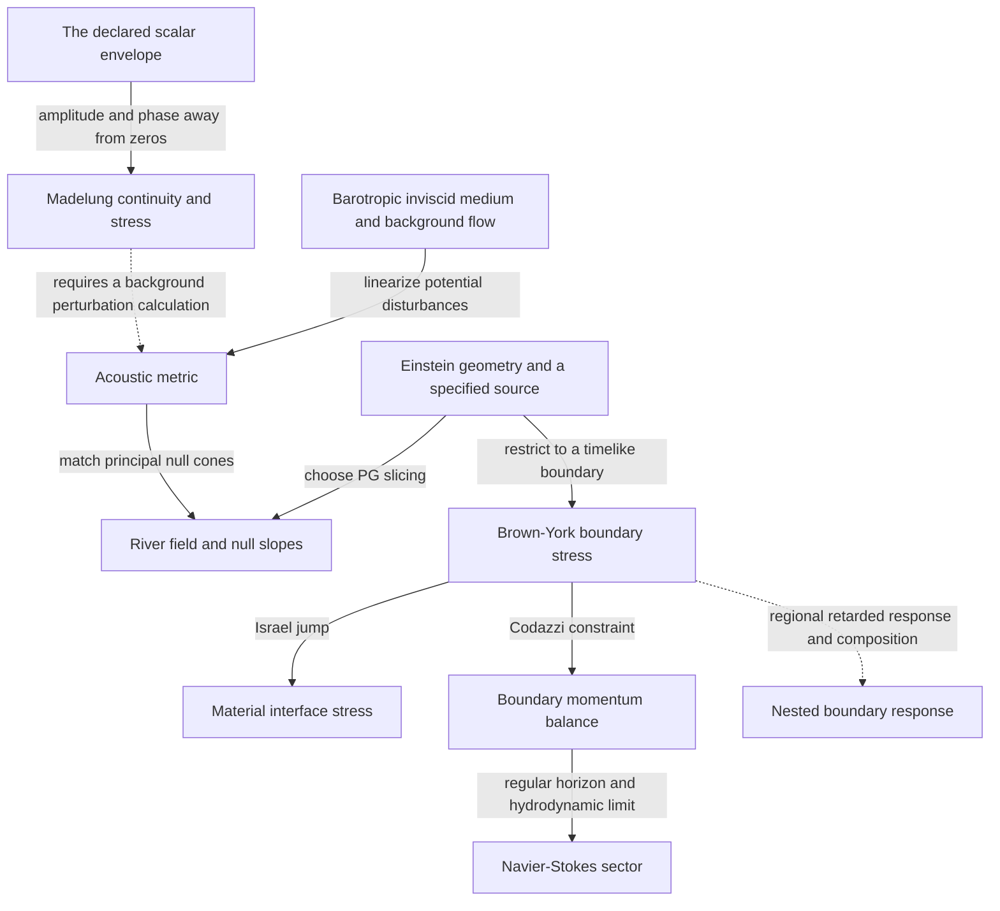

# Flows, horizons and boundary fluids in the atlas

This is a connecting entry of the [atlas programme](nsc-cosmological-atlas.md).
It places river coordinates, acoustic geometry, horizon fluids and the scalar
envelope on a common mathematical map. The existing constant-tension wall is
one candidate interface. An alternative with a different constitutive law
remains available; preserving that wall is not the objective of the atlas.

## Preparation and choice of connection

The end state is a map whose edges specify actual transformations, limits or
matching laws. Considered routes were to force all examples through the current
wall, to identify their fluid variables by name, or to connect their metric,
boundary stress and wave operators explicitly. The third route retains more
constructions and makes the required source and state data visible.

Completed here: the river/light-cone dictionary, an acoustic realization, the
Israel--Brown--York stress connection and a near-horizon pressure limit. These
are attributed applications of established mathematics, not new discoveries of
river coordinates, acoustic gravity or horizon hydrodynamics. The active next
connection is a regional gravitational boundary-response operator; the existing
formed-source/observer evidence remains valid in its original domain.

The finite checks use symbolic contractions and the existing signed shell at
three radii. The allowance is 30 CPU seconds for those checks, no field grids.
Likely failures are a reversed normal sign, confusing conformally identical
cones with identical wave operators, and importing a fluid limit outside its
boundary/long-wavelength assumptions. Each has a separate check below. A later
finite-frequency boundary response that fails the claimed fluid limit would
falsify that proposed connection, even if the schematic map looks attractive.

## The map and the connecting operations



The Madelung-to-acoustic arrow requires a separate perturbation calculation;
the dispersive gradient stress need not have a nondispersive acoustic metric.
The last arrow is the next calculation, not a completed response kernel.
Dashed edges mark these remaining connections.

| Piece | What is shared | What its attachment must specify |
| --- | --- | --- |
| PG river | The same spacetime metric in a selected slicing | Time orientation, spatial chart and observer congruence |
| Acoustic geometry | A linear perturbation operator and its characteristics | Medium, density, sound speed, background forcing and dispersion range |
| Brown--York stress | A tensor calculated from a region's boundary geometry | Normal, cutoff, subtraction convention and boundary clock |
| Israel interface | The jump of boundary stress | Interface action/state, induced metric and bulk exchange |
| Horizon/Navier--Stokes sector | A controlled gravitational boundary limit | Horizon regularity, perturbation scaling, boundary conditions and transport coefficients |
| Madelung variables | The supplied scalar evolution written through amplitude and phase | Nodes, phase topology and the full gradient-stress term |

This organization also admits gravastars, rotating horizons, superfluids and
different interface actions as separate compatible blocks when their attachment
data are supplied. It does not identify every block with one material medium.
Chart coverage is a separate joint: a throat or a closed parent can require
multiple areal-radius sheets, curved spatial slices or a nonconstant lapse.
If one flat PG chart fails, first change the representation and examine the
invariant matching data; that chart failure alone does not reject the geometry.

## 1. A river gives an exact causal dictionary

Use signature -+++ and G=c=1. The spherical unit-lapse flat-slice metric is

$$
ds^2=-dt^2+(dr-v\,dt)^2+r^2d\Omega^2.
\tag{F1}
$$

Its radial null directions and normalized null expansions are

$$
k_\pm=\partial_t+(v\pm1)\partial_r,\qquad
\theta_\pm=\frac{2}{r}(v\pm1),\qquad
m_{\rm MS}=\frac{rv^2}{2}.
\tag{F2}
$$

The vectors have k_+ dot k_-=-2; they need not be affinely parametrized.
The mass follows directly from 1-2m_MS/r=g^{ab}(partial_a r)(partial_b r).
Thus v<-1 gives two negative expansions and future trapping; v>1 gives
two positive expansions and an anti-trapped sphere. The stationary examples
have v=-sqrt(2M/r) for the ingoing Schwarzschild sheet and v=Hr for the
expanding de Sitter sheet. Their marginal radii are 2M and 1/H.
[Hamilton--Lisle, equations 1--2](https://arxiv.org/html/gr-qc/0411060v2)
supplies the river construction. A radial river has zero ordinary circulation
away from excluded singular points. Rotational/vortex structure adds variables;
the rotating river construction is not just an azimuthal swirl appended to F1.

The change r=a(t) chi transforms flat FLRW exactly into F1 with v=H(t)r.
Consequently 2m_MS/r=H^2r^2 and the FLRW apparent-horizon radius is 1/|H|.
This does not require de Sitter matter. Only with constant H and vacuum stress
does Lambda=3H^2 follow. In particular a dust parent can have this apparent
horizon with Lambda=0. A marginal sphere in a general evolving geometry need
not be a global event horizon or a material wall.

This also explains the density/radius correlation in the earlier discussion:
at the Hubble radius the flat Friedmann mass obeys 2m_MS=r. It is an identity
of this geometry, not an independent determination of the physical Hubble scale.

## 2. An explicit acoustic block, with its source exposed

For irrotational barotropic inviscid flow, linear potential disturbances obey
the massless wave equation in the acoustic metric

$$
ds_{\rm ac}^2=\frac{\rho}{c_s}
\left[-c_s^2dt^2+(dr-u\,dt)^2+r^2d\Omega^2\right].
\tag{F3}
$$

[Visser, Sections 2, 4, 5 and 7](https://arxiv.org/html/gr-qc/9712010v2)
derives the operator, normal-flow horizon condition and draining-vortex cases.
The horizon uses the normal flow component; a large tangential speed can instead
produce an ergoregion. This distinction makes rotating blocks usable in the map.

There is a constructive steady spherical example on any finite annulus r>0:

$$
u=-\sqrt{\frac{2\mu}{r}},\qquad c_s=\hbox{constant},\qquad
\rho=\rho_0(r/r_0)^{-3/2},\qquad p=c_s^2\rho,
\tag{F4}
$$

$$
U(r)=-\frac{\mu}{r}+\frac{3c_s^2}{2}\log(r/r_0).
\tag{F5}
$$

It satisfies (r^2 rho u)'=0 and u u'=-p'/rho-U'. The body-force potential
U is a supplied preparation, not gravity derived from this medium. Its sound
cones have Schwarzschild form with acoustic radius 2mu/c_s^2. The density
factor is nonconstant: F3 is conformal to that PG metric. In 3+1 dimensions
the full minimally coupled wave operator also depends on this factor. Matching
the cones therefore supplies a precise connection without claiming an identical
scattering amplitude or a common Einstein stress tensor.

The experiments occupy this effective-geometry branch: water-wave
[stimulated Hawking conversion](https://arxiv.org/abs/1008.1911),
[rotational amplification](https://www.nature.com/articles/nphys4151), and
reported condensate [quantum Hawking correlations](https://arxiv.org/abs/1510.00621).
They test different predictions and preparations, rather than one experiment
establishing the whole combined atlas.

## 3. The exact connector: boundary stress

On a timelike interface choose one spacelike normal n from minus to plus and
K_ab=h_a^mu h_b^nu nabla_mu n_nu. With no reference subtraction define

$$
t^{\rm BY}_{ab}=\frac{K h_{ab}-K_{ab}}{8\pi G}.
\tag{F6}
$$

This is a Brown--York sign/normal convention; opposite conventions change
individual displayed signs consistently. The Israel and Codazzi equations give

$$
[K_{ab}]-[K]h_{ab}=-8\pi G S_{ab}
\quad\Longleftrightarrow\quad
[t^{\rm BY}_{ab}]=S_{ab},
\tag{F7}
$$

$$
D_a(t^{\rm BY})^a{}_b=-T_{\mu\nu}n^\mu h^\nu{}_b,\qquad
D_aS^a{}_b=-[T_{\mu\nu}n^\mu h^\nu{}_b].
\tag{F8}
$$

[Brown--York](https://arxiv.org/abs/gr-qc/9209012) supplies the boundary
stress construction. A common continuous intrinsic reference term cancels in
F7; unrelated subtractions on opposite sides would add a term that must be kept.
For the retained pure tension, [K^a_b]=-k delta^a_b and k=4piG sigma,
so F7 gives [tBY^a_b]=-sigma delta^a_b, exactly S^a_b. This is the same
interface already computed by `tension_wall`, now attached to the boundary-fluid
language. An inherited elastic, viscous or field-carrying interface changes S_ab
and its evolution; F7 and F8 still supply its connecting equations.

The current outer wall has f_-<0 and a negative exterior signed normal. It is
moving and does not represent a static ordinary gravastar. This limits that
candidate's interpretation, not the atlas's available interface families.
Two local PG charts also need their wall proper times identified; assigning
opposite river signs does not perform the matching. The existing signed
extrinsic curvatures are invariant inputs to F7 regardless of that chart choice.

## 4. From the same boundary object toward Navier--Stokes

For a static spherical metric with f>0, place a timelike cutoff at R and choose
n=+sqrt(f) partial_r. Restore G in the stress normalization while keeping M
as a geometric length (G times physical mass when c=1). Direct contraction gives

$$
K^t{}_t=\frac{f'}{2\sqrt f},\qquad
K^\theta{}_\theta=\frac{\sqrt f}{R},\qquad
\varepsilon_{\rm BY}=-\frac{\sqrt f}{4\pi G R},\qquad
p_{\rm BY}=\frac{f'/(2\sqrt f)+\sqrt f/R}{8\pi G}.
\tag{F9}
$$

The negative unsubtracted energy is convention/reference dependent; it is not
a negative material density installed in the bulk. For Schwarzschild,
alpha=sqrt(f) tends to zero at r_h=2M, and

$$
\lim_{R\to r_h^+}\alpha p_{\rm BY}
=\frac{\kappa_H}{8\pi G},\qquad \kappa_H=\frac1{4M}.
\tag{F10}
$$

This is the redshifted horizon pressure. A nonextremal horizon has a local
Rindler limit; its shear perturbations with horizon regularity lead to the
membrane shear coefficient eta=1/(16piG) in c=1 units. Bredberg et al.
[Sections 3--5 and 8](https://arxiv.org/html/1101.2451v2) construct the
incompressible Navier--Stokes/Einstein connection with specified cutoff and
hydrodynamic/near-horizon expansions. F8 is the momentum constraint that
enters such a construction. It becomes a fluid evolution system after the
constitutive response and scaling are supplied; F8 alone does not fix viscosity.

Thus horizon fluid and material wall can both enter one atlas through F6--F8.
They can occupy different surfaces and have different state laws. A finite
spherical or evolving interface requires its curvature, forcing and finite
frequency corrections rather than silently retaining a planar stationary limit.
The KSS value [eta/s=hbar/(4pi k_B)](https://arxiv.org/abs/hep-th/0405231)
belongs to its stated gravitational-duality class, not every fluid in this map.

There is also a direct coefficient check. Take the linear-velocity part of
Bredberg et al.'s equation 14 about the ingoing Rindler metric,

$$
ds^2=-r\,d\tau^2+2d\tau dr+dx_i dx^i
-2(1-r/r_c)v_i dx^i d\tau-\frac{2v_i}{r_c}dx^i dr+\cdots.
\tag{F11}
$$

On r=r_c choose divergence-free shear v_x=a y, v_y=b x and keep first order
in its amplitude and first spatial derivative. Direct Christoffel contraction
gives Gamma^r_xy=-(a+b)/2, so tBY_xy=-(a+b)/(16piG sqrt(r_c)).
Proper boundary time is sqrt(r_c) tau and physical velocity is V_i=v_i/sqrt(r_c).
With strain sigma_xy=(a+b)/(2sqrt(r_c)), the relation tBY_xy=-2 eta sigma_xy
therefore yields eta=1/(16piG). This applies the published metric and response;
the symbolic check is in the same test file. The kinematic coefficient in
Bredberg et al.'s coordinate-time Navier--Stokes equation is r_c, whereas the
proper-time kinematic coefficient is sqrt(r_c). These are distinct from the
dynamic shear viscosity eta just extracted. Their clock and normalization
conversion is part of the connection.

## 5. Scalar flow and the next calculable joint

The [formed-source envelope](nsc-atlas-seed-collapse.md) already has a conserved
scalar current. Writing f=sqrt(n) exp(iS) expresses its evolution as continuity
plus a phase/force equation with gradient stress. The
[Madelung construction](https://doi.org/10.1007/BF01400372) is the reusable
algebraic precedent. Keeping that stress and tracking zeros/phase topology is
essential. Dissipative Navier--Stokes, circulation quantization, fermion
statistics and a horizon for scalar excitations require their own specified
connections. Spherical radial evolution does not yet construct a vortex.

The next high-value joint is a regional retarded map delta h_ab -> delta tBY_ab:
perturb the boundary metric, solve the region's gravitational response with
its actual state and boundary conditions, and return its boundary traction.
Check the isolated nonextremal horizon limit first, using the published fluid
coefficient as a known limit. Then replace the remote termination by a declared
parent/child interface and calculate the change in the response. Schur
composition can organize regional response operators once their physical
variables and constraints agree; the existing fermion operator is not already
this gravitational kernel.

That calculation can supply a viscosity, memory, transmission or resonant
coefficient changed by nesting. A vacuum/trace term requires its own tensor
identification and normalization; F10's boundary pressure alone does not select
bulk Lambda. No frozen P004 forecast, source history or supplied vacuum scale
is changed by adding these blocks to the map.

Independent controls for F1--F10 and the retained interface are in
[the flow-dictionary checks](../tests/test_nsc_atlas_flow_dictionary.py):

```powershell
python scripts/run_python.py -m pytest -q tests/test_nsc_atlas_flow_dictionary.py tests/test_nsc_atlas_parent_observables.py
```

Result on 27 October 2026: all eight new controls and 23 retained parent
controls pass (31 total, 1.39 seconds pytest elapsed). No field evolution,
fit, forecast tolerance or parameter was changed for this connection.
