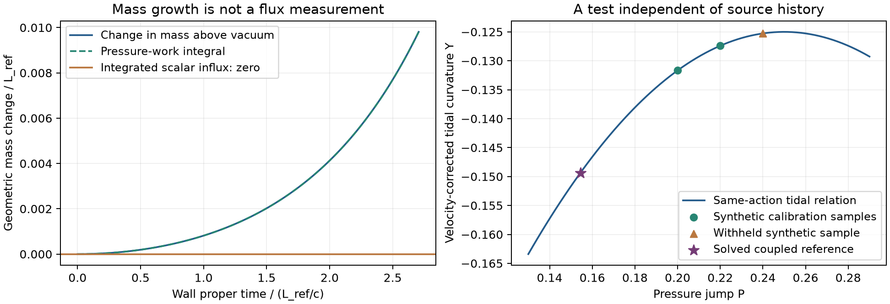

# What one side of the wall can determine

The charged scalar membrane supplies an exact observer connection beyond
the [short-time source limit](nsc-atlas-parent-source.md). With the action
fixed, child-side wall geometry determines the scalar value, its proper-time
derivative and the energy flux. An independent tidal measurement must then
obey a quadratic relation that contains no unknown incident waveform.

The calculation also separates gravitational mass growth from energy
crossing the wall. In the existing evolved regular preparation, mass above
the vacuum contribution grows by .009809732745 L_ref while scalar influx
is exactly zero. Independent pressure-work integration accounts for it.

A further algebraic result connects this local test to inheritance. Two
different parameter sets have identical reduced classical dynamics for one
parent--child interface, yet give next-sector vacuum values 1/32 and 49/32.
A third comparable ground-vacuum value can distinguish them and determine
the charge magnitude and mixing ratio under the shared-law assumptions.
This entry alone does not construct the third physical region. The
[subsequent shared-slice construction](nsc-atlas-shared-scalar-slice.md) now
supplies it on one compact constrained slice, and strengthens the alternative
law exclusion to every canonical scalar state and integer charge sector.

## Decision, prior work and finite calculation

The alternatives were full nonlinear evolution, exact energy accounting,
and a test that eliminates preparation history. The selected contribution
combines the last two. It moves toward an observer-facing relation while
giving the future coupled evolution exact checks. It adds no physical
coupling, state-selection law or incoming waveform. A single record of
wall geometry and derivatives owns the inputs; action parameters are
separate. The existing regular solution is reused without a new grid or
precision campaign.

Scalar reconstruction from curvature is established mathematics.
[Krongos and Torre, Section 3](https://arxiv.org/html/1503.06311) give
Rainich-type algebraic and differential conditions for scalar-field
geometrization, including self-interaction. Their full conditions are
stronger than the local tests below. In particular, a quadratic potential
does not have a global single-valued inverse. Here the charged wall's
linear pressure relation determines the field branch. It does not
automatically determine the sign of its normal derivative.

The mass law reuses the energy-supply and work decomposition in
[Hayward, equation 2.7](https://arxiv.org/html/gr-qc/9710089). The contribution
here is its signed wall-frame form, the one-sided scalar inverse and tidal
relation for the declared action, and their connection to the inherited
vacuum sectors. These general geometrization and mass-conservation methods
are attributed inputs, not new inventions of NSC.

The bounded calculation uses one existing cap solve, three proper times
on its known continuation, one independent work quadrature, symbolic
identities and a labelled synthetic calibration/rejection check. The
producer has a 120 CPU-second budget and stores only compact results and
hashes. Failure of the physical reconstruction or work balance stops this
entry; a successful check does not admit another local refinement campaign.

## Geometry and normal conventions

Let the timelike material wall have intrinsic metric

$$
ds_\Sigma^2=-d\tau^2+R(\tau)^2d\Omega_2^2,
\qquad K^a{}_b=\operatorname{diag}(A,B,B).
\tag{G1}
$$

All unlabelled quantities are evaluated from the child side. The normal
n points from child to parent. A=n.acceleration is the normal proper
acceleration of a wall observer; B=n(R)/R is the angular extrinsic
curvature. Neither is generally R'' or R'/R. Dots below mean wall
proper-time derivatives, H=R'/R, and k=kappa sigma/2.

For the fixed constant tension, Israel gives A_o=A-k and B_o=B-k.
The actual-field force therefore needs no parent-side metric measurement:

$$
P=\sigma\left(A+2B-\frac{3k}{2}\right)
=e\left(q_p+\mu\phi_W-\frac{e}{2}\right).
\tag{G2}
$$

This uses the unchanged canonical scalar/four-form action, continuous
field and common normal derivative, and no scalar surface interaction.
It is not a law for an arbitrary causal horizon or arbitrary surface stress.

## The local inverse and a necessary stress test

Define S=mu e and the pressure at the child scalar minimum,
P_c=e(epsilon q_c+e/2). For S nonzero, G2 gives

$$
\chi_W=\phi_W-\phi_*(q_c)=\frac{P-P_c}{S},\qquad
\Pi=\frac{d\phi_W}{d\tau}=\frac{\dot P}{S}.
\tag{G3}
$$

In Gaussian coordinates ds^2=-N^2 d tau^2+dn^2+R^2 dOmega_2^2,
N=1 at the wall, N_n=A and R_n=BR. Direct Gauss and Codazzi
projections give

$$
\kappa p_n=-\frac{2\ddot R}{R}
-\frac{1+\dot R^2}{R^2}+2AB+B^2,
\tag{G4}
$$
$$
\kappa F_{\rm in}=2\left[H(A-B)-\dot B\right],
\qquad F_{\rm in}=T(n,u).
\tag{G5}
$$

For this scalar, with Phi=n(phi) and U evaluated in the child sector,

$$
Q=2(p_n+U)-\Pi^2=\Phi^2\ge0,\qquad
F_{\rm in}^2=\Pi^2Q.
\tag{G6}
$$

When Pi is nonzero the signed normal derivative is F_in/Pi. When
Pi=0, consistency requires F_in=0 and only its magnitude sqrt(Q)
is identified by these inputs. Additional curvature derivatives or
field data can carry further information. The reconstruction does not silently choose
the sign from the previously computed field. Near Pi=0 its sensitivity
to flux error grows as 1/|Pi|. If mu e=0, the pressure does not identify
the scalar at all. These are genuine degeneracies of this inverse.

G6 is necessary, not sufficient for a scalar spacetime. For example,
a static sphere in flat spacetime can satisfy the algebraic G6 test
for the field value inferred from this membrane law, while failing
the independent Ricci prediction below. Bulk integrability, the other
Einstein components, the scalar equation and global attachments remain
additional requirements.

## An independent tidal relation with no source history

The Einstein-scalar Ricci tensor is
R_munu=kappa(phi_mu phi_nu+U g_munu). An independent one-sided
tidal contraction with the wall observer's four-velocity must satisfy

$$
R_{uu}=\kappa(\Pi^2-U),\qquad
U=\frac{\Lambda_c}{\kappa}+\frac{\omega^2}{2S^2}(P-P_c)^2.
\tag{G7}
$$

Consequently define the velocity-corrected tidal quantity

$$
Y=R_{uu}-\frac{\kappa}{S^2}\dot P^2
=-\Lambda_c-C(P-P_c)^2,\qquad
C=\frac{\kappa\omega^2}{2S^2}
=\frac{\kappa}{2(1-\epsilon)e^2}.
\tag{G8}
$$

For any three distinct pressures, the second divided difference of
Y with respect to P is exactly -C. In the declared reference,

$$
C=\frac83,\qquad Y[P_1,P_2,P_3]=-\frac83.
\tag{G9}
$$

This is valid on any regular finite interval of an actual solution,
not only at the initial weak corner. The unknown history that created
the field has disappeared. The action and its couplings have not.
There is no assertion that this relation is unique to nesting among
all possible matter theories.

Operationally the inputs include wall area, proper time, child-side
normal derivatives of the metric and their time dependence. Nearby
radial distances and clocks are needed to determine B and A. The
independent R_uu is bulk curvature information, obtainable in principle
from local tidal measurements. Radius or cosmological expansion alone
does not supply these data. Instrument noise and derivative covariances
must be included before an observational test is assigned a significance.

### Calibration is not a new prediction of the vacuum scale

With S and C fixed independently, let Z=Y+CP^2. Two distinct
calibration pressures determine the slope and intercept of

$$
Z=2CP_cP-\Lambda_c-CP_c^2.
\tag{G10}
$$

The action also requires

$$
q_c=\frac{P_c/e-e/2}{\epsilon},\qquad
\Lambda_c=\kappa\rho_b+
\frac{\kappa}{2\epsilon}(P_c/e-e/2)^2.
\tag{G11}
$$

A fitted vertex that fails G11 is not accepted by independently
retuning the declared bare term. With all parameters already fixed,
there is nothing to calibrate. If C or S is unknown, two samples do
not by themselves provide the same test. Nearly equal calibration
pressures also make parameter inference ill-conditioned.

The software's synthetic samples have P=.20,.22,.24 and independently
specified local scalar velocities .03,.04,.02. The first two recover
P_c=.25, Lambda_c=.125 and q_c=1; the withheld tidal value is
-.1248666666667. A deliberate +.001 change is detected. This is an
algebraic recovery/rejection test, not observational evidence or a
newly evolved spacetime. Inferring Lambda from such curvature data is
not deriving the observed cosmological constant from nesting.

## The existing coupled geometry checks the inverse

For the [regular evolving layer](nsc-atlas-scalar-preparation.md),
A=B=.307400296636, P=.154440177982 and Pi=0 throughout the checked
interval 0<=eta<=1. The radius changes as R=R_* cosh(eta), with
tau=R_* eta and R_*=2.706345313217. Geometry alone reconstructs

$$
\phi_W=-.0543355679824,\qquad
|\Phi|=.215595888250.
\tag{G12}
$$

The normal sign remains unidentified by the local inverse; the original
regular-cap data select the negative sign. An independent calculation
from a, a' and a'' gives R_uu=-.149351145558. Subtracting the derived
potential excitation .024351145558 recovers Lambda_c=.125.
Interpreting the whole tidal magnitude as vacuum would overestimate
that vacuum by about19.48 percent. This is a model check at one wall,
not a measurement of cosmic dark energy.

All sampled eta values repeat the same P and Y. They therefore check
the inverse along a finite evolving geometry but do not constitute
three distinct points identifying the parabola. The synthetic samples
above are labelled separately for precisely that reason.

## Mass growth, flux and pressure work

The child-side geometric Misner--Sharp mass is

$$
m=\frac{R}{2}\left[1+\dot R^2-(BR)^2\right].
\tag{G13}
$$

Differentiating and using G4--G5 gives the exact finite-time law

$$
\dot m=\frac{\kappa R^2}{2}
\left[BR F_{\rm in}-\dot R p_n\right].
\tag{G14}
$$

This is Hayward's mass balance in the wall frame. The factor BR
weights the rest-frame flux in the geometric mass, and the second
term is pressure work. Removing the constant vacuum contribution
does not remove the excitation pressure:

$$
m_{\rm exc}=m-\frac{\Lambda_cR^3}{6},\qquad
\dot m_{\rm exc}=\frac{\kappa R^2}{2}
\left[BR F_{\rm in}-\dot R(p_n+\Lambda_c/\kappa)\right].
\tag{G15}
$$

On the regular reference, scalar rest-frame influx is identically
zero. Nevertheless m_exc grows from .003668251239 to .013477983984
over 0<=tau<=2.706345313217. Integrating the pressure from the
independently known scalar field gives .00980973274508, agreeing
with the geometric mass change to 1.8e-15. This is a finite coupled
counterexample to interpreting growth of enclosed mass as accretion.
The geometric mass is not the proper-volume energy integral used
for the prepared packet. These identities also do not certify the
different conformal-scalar/P001 numerical campaign.



The left panel uses the actual solved continuation. The star on the
right is its single pressure/curvature point. The other three markers
are explicitly synthetic calibration and withholding checks.

## Why one wall cannot determine the inherited couplings

The local observable law does not identify every parameter separately.
Consider two fixed parameter choices in the same scalar/four-form family,
both with omega=20, kappa=1, sigma=.2 and rho_b=0:

| Candidate | epsilon | e | q_child | q_parent |
| --- | --- | --- | --- | --- |
| A | 1/4 | 1/2 | 1 | 3/2 |
| B | 25/28 | sqrt(7)/2 | -sqrt(7)/5 | 3sqrt(7)/10 |

Let delta=3sqrt(3)/100. Direct expansion of the two potentials proves

$$
U_B\left(\phi+\delta,\sqrt7(q-6/5)\right)-U_A(\phi,q)
=3(q-1)(q-3/2).
\tag{G16}
$$

For q=1 and q=3/2 the difference vanishes for every phi. The kinetic
term is unchanged by the constant field translation. Both models
also have the same omega, S=mu e, tension, two vacuum densities,
wall force, pressure P_c and tidal coefficient C. Hence their
reduced classical one-interface scalar/gravity equations and matching
conditions are identical under the field translation. This holds
for mapped time-dependent states, not just the regular snapshot.

The equivalence does not include an independent charge measurement,
additional matter couplings that establish an absolute field origin,
or quantum preparation amplitudes. It does establish that improving
one-wall gravitational measurements alone cannot distinguish this pair.

Apply one further charge step with each candidate's unchanged e.
Their ground-vacuum sequences are

$$
\text{A}:\quad (9/32,\ 1/8,\ 1/32),\qquad
\text{B}:\quad (9/32,\ 1/8,\ 49/32).
\tag{G17}
$$

The third-sector prediction differs despite identical first-interface
classical dynamics. Candidate B's next ground transition is upward;
the ordinary descending-cap preparation cannot simply be copied to
that step. G17 is a potential-level prediction, not a constructed
three-region geometry or a claim that either transition occurs.

For a common inherited action and equal oriented charge steps,
three relaxed vacuum values in a common normalization have

$$
D=\Delta^2\Lambda=\kappa\epsilon e^2,\qquad
\frac{CD}{\kappa^2}=\frac{\epsilon}{2(1-\epsilon)}.
\tag{G18}
$$

If C and D are independently determined, they resolve the mixing
and charge magnitude:

$$
e^2=\frac{D}{\kappa}+\frac{\kappa}{2C},\qquad
\epsilon=\frac{D/\kappa}{D/\kappa+\kappa/(2C)}.
\tag{G19}
$$

Both examples have C=8/3. Their D values are 1/16 and 25/16,
giving the two respective parameter sets back. This makes the value
of additional nested structure precise: it supplies information
absent from one interface. Observing and physically composing those
regions, comparing their scales, and establishing the inherited law
remain separate tasks. A shared-law assumption is being tested here,
not proved merely by writing equal couplings into the potential.

## Verification and next decision

The [compact record](../results/summaries/nsc-atlas-geometric-observer-v1.json)
contains symbolic mass, scalar, tidal and inheritance identities;
geometry-only reconstruction checked against the separately read
field; independent bulk Ricci and work integration; a synthetic
signed-gradient recovery; and rejection of deliberately inconsistent
geometry or tidal samples. The largest recorded numerical comparison
error is below4e-14 with a conservative comparison tolerance2e-8.
These are numerical checks, not measurement uncertainties or a new
interval-existence theorem.

The coupled excited-parent evolution still needs to be constructed.
It now has exact finite-time flux/work and independent tidal checks.
The inheritance problem has a distinct requirement: a physically
compatible second transition, or independent information about the
charge/mixing, rather than more precision at the same wall. Likely
failure points are missing normal geometry in an observation,
ill-conditioned derivative/calibration data, or failure to compose
the next transition with the same couplings. Each changes the actual
mathematical test; none is resolved by adjusting a free incoming history.

```
python scripts/run_python.py scripts/check_nsc_atlas_geometric_observer.py
python scripts/run_python.py -m pytest tests/test_nsc_atlas_geometric_observer.py -q
python scripts/run_python.py scripts/plot_nsc_atlas_geometric_observer.py
```
