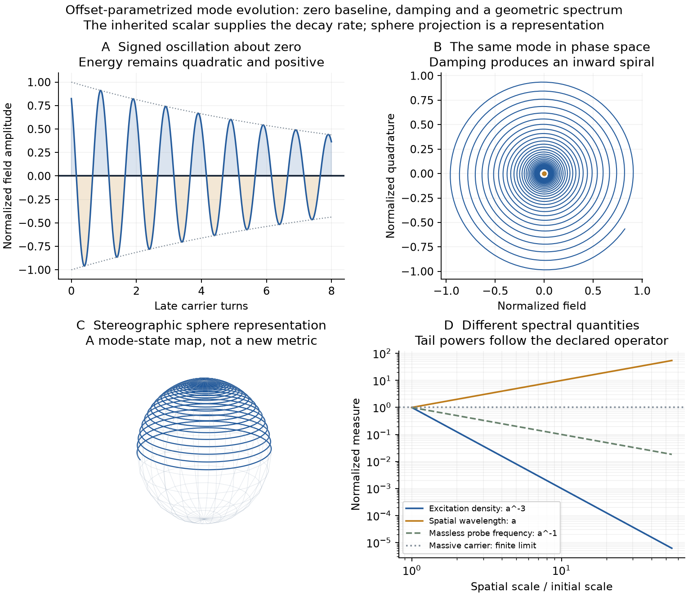

# Offset, the zero line, thermodynamic decay and a conformal handoff

Douglas's picture organizes the calculation around a signed oscillation,
its zero baseline, energy exchange with a counter side, and continuing
structure across scales. The retained parent now gives an explicit damped
mode, a spiral representation, a late spectrum and a conformal comparison.
The [calculation record](../results/summaries/nsc-atlas-zero-interface-v1.json)
keeps actual model results separate from comparison-only detector constants.

The generating description is **one spatial seed with repeated offset
accumulation**, whose stated metric completion has three spatial directions.
The parent evolves with an offset parameter; proper duration is a readout.
Covariant formulas may use one offset argument and three spatial arguments.
That representation does not add a fourth primitive spatial direction.
The earlier auxiliary bulk/internal geometries retain their own explicit
coordinate counts and assumptions.

## Mathematical dictionary

For the oriented regional construction, plus labels the energy/source
side, minus the counter/receiving side, and positive flux goes plus to minus.
The horizon is a smooth zero interface with no surface tension. On the
oscilloscope, zero is the signed field baseline and its two lobes lie above
and below it. Those definitions must be linked by equations when the model
identifies them physically.

| Object | Defining equation or operation |
| --- | --- |
| Signed mode baseline | q=0; kinetic energy need not vanish there |
| Geometric horizon zero | z_H=1-HR=0 in the expanding de Sitter river chart |
| Conformal future zero | Omega_c=cos eta=0 |
| Opposite internal winding | complex conjugation of the geometric mode |
| Negative pressure | p=-rho for the vacuum stress, with rho positive |

The regional signs are orientation labels, not signs of energy. Reversing
an amplitude shifts a phase by pi; it does not reverse a winding charge.
The literal equality of all these objects is a further physical connection
to derive, not a consequence of their shared written zero or minus sign.

## 1. The retained action gives the wave's decay

At the retained minimum, H=.271405615400 and mu^2=613.528021389.
Each normalized spatial mode obeys

$$
\ddot q_l+3h\dot q_l+
\left(\mu^2+\frac{l(l+2)}{a^2}\right)q_l=0,
\qquad a=\frac{\cosh(Ht)}{H},\quad h=\dot a/a.
$$

Here t denotes proper readout along the offset-parametrized background.
Let u=Ht, nu^2=mu^2/H^2-9/4 and y=cosh(u)^{3/2}q. The rescaled oscillator
has positive, nonincreasing energy, as derived in the
[same-source horizon response](nsc-atlas-parent-circulation.md#8-the-same-flux-changes-area-and-dynamical-entropy).
Thus

$$
q_l\sim a^{-3/2}\cos(\nu Ht+\delta_l),\qquad
\langle\rho_\chi\rangle\sim a^{-3},\qquad
\lambda_l=\frac{2\pi a}{\sqrt{l(l+2)}}\sim a.
$$

The powers are -3/2, -3 and +1. The massive carrier's limiting frequency
is nu H=24.766151984526, not zero. A massless test mode instead has
frequency proportional to 1/a and conserved-number radiation density
proportional to a^-4. Amplitude, spatial wavelength, temporal frequency
and temperature are different measured quantities in these equations.

For the spatial average of this actual scalar, with V3=2 pi^2,

$$
\rho_\chi=\frac{1}{2V_3}\sum_l
\left[p_l^2+(\mu^2+\lambda_l^{\rm eig}/a^2)q_l^2\right],
$$

$$
p_\chi=\frac{1}{2V_3}\sum_l
\left[p_l^2-\mu^2q_l^2-\frac{\lambda_l^{\rm eig}}{3a^2}q_l^2\right].
$$

The exact leading-field balance on the closed comoving parent is
dE_chi=-p_chi dV, E_chi=V rho_chi, V=V3 a^3. The finite source samples
agree with the independently derived work rate within 2.85e-14 in model
units. The retained observer patch instead loses its Killing energy by
the computed horizon flux. A general region needs its own work, moving
boundary and observer factors; a simple p dV law is not substituted for
those definitions.

The coefficient 3h is precisely dot V/V for the three generated spatial
directions. It is not a separately fitted dissipation constant.

This is the thermodynamic organizing route: geometry specifies modes,
stress determines work and exchange, and that stress feeds back into
geometry. The balance equation alone does not choose a microscopic state
or its occupation statistics.

## 2. A wave, an inward spiral and a sphere representation

The late quadratures (q,(qdot+3hq/2)/(Hnu)) form an inward logarithmic
spiral. Its envelope is proportional to exp(-3u/2), with phase rate nu.
For one carrier turn the amplitude ratio is

$$
\frac{r_{n+1}}{r_n}=e^{-3\pi/\nu}=.901871154627,
\qquad \nu=91.251435413335.
$$

This is mode-amplitude attenuation, not a selected spatial-resolution or
nesting ratio. The spatial wavelength grows by 1.071281657207 per late
carrier turn. A constant phase displacement by itself leaves amplitude
unchanged; the decay above comes from the derived 3h term.

A relative drive/response lag has a more substantive meaning. The late
operator's diagnostic susceptibility is

$$
\chi_R(\omega)=\frac{1}{\mu^2-\omega^2-3iH\omega},\qquad
\langle P\rangle=\frac{F_0^2\omega}{2}\operatorname{Im}\chi_R\geq0.
$$

For the oscillator-density energy (qdot^2+mu^2 q^2)/2, this equals 3H times
the mean squared response velocity, before multiplying by expanding volume. At probe frequency
mu the response lags by pi/2. The phase lag and work transfer are fixed
by the same derived damping term. The weak diagnostic drive is not a new
prepared source. This supplies a precise version of an offset between
mode and counter-response; it does not identify an isolated phase shift
with dissipation or derive an ultimate origin of updates.

The stereographic map

$$
(r,\varphi)\longmapsto
\frac{(2r\cos\varphi,2r\sin\varphi,1-r^2)}{1+r^2}
$$

puts that same phase curve on a unit sphere. Its norm is exactly one
and its spiral bearing is constant for an exponential envelope. This is
a mathematical representation of the mode state. The physical spatial
geometry and horizon are still determined by the metric and field law.
Canonical field evolution remains reversible; damping of an unrescaled
coordinate alone is not a proof of microscopic entropy production. The
earlier horizon area gives a specified coarse-grained monotone record.



## 3. Two geometric zero sets and the break question

The expanding river chart has radial null rates dR/dt=HR plus or minus1.
The inward signal/flow balance z_H=1-HR vanishes at R=1/H. The metric and
curvature remain smooth there. This is an actual horizon zero, not zero
local energy density.

For the future tail put Omega_c=cos eta=sech(Ht). Then

$$
\bar g=\Omega_c^2g=H^{-2}(-d\eta^2+d\Omega_3^2),\qquad
|d\Omega_c|_{\bar g}^2\longrightarrow-H^2.
$$

The observer horizon is null, while the conformal future boundary is
spacelike. The horizon ends at one point on that boundary. They can both
be labelled interfaces in the atlas, but are not the same hypersurface.
[Meissner--Penrose](https://arxiv.org/html/2503.24263v1), introduction and
section II, uses a spacelike CCC crossover; it does not provide the present
massive scalar's conversion law.

Reuse [Camara dS--Alves Lima--Sotkov](https://arxiv.org/html/1604.08032v2),
equations2--5 and section2.1, for a reciprocal background benchmark.
For a_new=Lx^2/a_old, a fluid rho proportional to a^-n maps to n_new=4-n:

| Old state | New effective state under background reciprocity |
| --- | --- |
| Vacuum, w=-1 | Radiation, w=1/3 |
| Averaged dust, w=0 | w=-2/3 |
| Radiation, w=1/3 | Vacuum, w=-1 |

With the declared comparison normalization Lx=1/H and an explicitly
chosen expanding extension after the crossover,

$$
a_+(\tau)=\frac{\sin\tau}{H},\qquad
T_+=\frac{1-\cos\tau}{H},\qquad
\rho_+a_+^4=\frac{3}{\kappa H^2}=40.727110293056.
$$

Tau is the new conformal offset; T_plus is its proper readout. The inherited
unit is H^-1=3.684522144189. The old curvature scalar is .883932096850;
the reciprocal radiation scalar is zero, while its curvature-square
invariants diverge at the physical bang. Smoothness belongs to the
intermediate conformal cylinder. With no new vacuum term this closed
radiation comparison recollapses; it is not a completed eternal chain.
The normalization and expanding orientation are specified comparison
rules, not selections supplied by the fixed action.

### The field data at zero still matter

For the actual massive modes, the weight-one rescaled coefficient is

$$
\frac{q}{\Omega_c}\sim\Omega_c^{1/2}
\cos(\nu\ln\Omega_c+\delta).
$$

It tends to zero but is generically not C1. Along the particular horizon
trace there is an additional spatial node; its faster decay does not
prove full-boundary regularity. The renormalized quadratures of
y=q/Omega_c^{3/2} retain nonzero state data:

| Mode | A_infinity estimate | B_infinity estimate | Tail bound per coefficient |
| --- | --- | --- | --- |
| First | .084295839777 | -.001732192417 | 7.80e-10 |
| Second | .084204156516 | -.004039508956 | 1.82e-9 |

These follow from the integrable sech^2 forcing of the rescaled oscillator.
A field value reaching zero has not erased its inherited phase and action.
The samples Ht=4,6,8 are numerical tail controls, not a selected present
epoch. Their excitation-density ratios are not baryon/photon eta.

With xi denoting curvature coupling, the general weight-one cylinder operator has singular coefficient
m_bare^2/H^2+12xi-2. Mass fade alone does not make the present minimal
operator conformally regular. Two regular comparison operators are the
massless conformal scalar xi=1/6 and the critical minimal mass mu^2=2H^2;
[Friedrich](https://arxiv.org/html/1311.0700v2), section3, treats a coupled
nonzero-mass exception with additional potential assumptions. Here
mu^2/H^2=8329.074464994, so neither comparison is the frozen scalar.
Unit real conformal modes have crossover data (-1,0) and (0,3) for l=1,2.
Those are explicit regular comparison data, not an automatic conversion
of the massive parent state.

**Route disposition:** background reciprocity supplies matching geometry
and radiation normalization; a same-action crossover must still transport
the surviving state into an admissible conformally regular matter sector.

## 4. Winding, one-way flow and the requested residual

The existing internal harmonic pair gives a precise opposite-winding
comparison. For z=A exp(plus or minus i omega t),

$$
Q=-i(z^*\dot z-z\dot z^*),\qquad
E=|\dot z|^2+\omega^2|z|^2,
$$

$$
Q_\pm=\pm2\omega|A|^2,\qquad E_\pm=2\omega^2|A|^2>0,
\qquad E/|Q|=\omega.
$$

A sign flip z to -z preserves Q; conjugation z to z* reverses Q. The
standing sum 2A cos(omega t) has Q=0 but E=4A^2 omega^2. Zero net charge
and zero signal at a crossing do not annihilate energy. Classical charge
amplitudes are continuous; E=hbar omega per excitation additionally uses
quantum action normalization. The current charged mode is a scalar KK
mode, not a derived electron or baryon.

The bound E>=omega|Q| is an exact fixed-charge energy minimum. Equality
requires circular motion of the two real components at constant radius.
This selects a circle under a stated constraint; it does not select the
universe's nonzero charge.

For a neutral state and charge-blind regional selection,

$$
[C,P_{\mathcal R}]=0,\quad C\rho C^{-1}=\rho,\quad
CQ C^{-1}=-Q\quad\Longrightarrow\quad\langle Q_{\mathcal R}\rangle=0.
$$

Conditioning on positive energy flow does not change that result because
the condition is charge-even. The previous nonzero circulation also has
identically zero helicity for its specific vector field. Thus this source
does not yet supply an internal handed selector. Nonzero fluctuations or
globally neutral charge-separated states remain possible; their state
and current have to be given.

The neutral control gives zero mean internal asymmetry. If it were
identified with baryons and a positive photon population, the conditional
eta would be zero, a -100% difference from6.1e-10. Actual n_B/n_gamma is
undefined in the present source action: neither that current identification
nor the photon/thermal conversion is derived.

[Boyle--Finn--Turok](https://arxiv.org/html/1803.08928v3) gives a spacelike
CPT mirror and uses thermal leptogenesis for matter asymmetry, not a
null-horizon charge sorter. [Cohen--Kaplan--Nelson](https://arxiv.org/html/hep-ph/9406345v1)
uses a CP-violating Higgs phase, diffusion and baryon-changing interactions.
Moving the phase boundary supplies nonequilibrium; it does not replace the
charge-bias term. Their entropy-normalized ratio also is not directly
n_B/n_gamma without the thermal/photon history.

### A restored geometric interaction, without fitting the bias

Retaining mixed metric components along an internal Killing vector gives
the KK connection, a published construction attributed to
[Duff](https://arxiv.org/html/hep-th/9410046), equations8,16 and27--30.
For the already assumed round S12 and a 2pi-period rotation,

$$
\langle K^2\rangle=\frac{2r_0^2}{d+1},\qquad
g_{\rm KK}^{-2}=\frac{e^{(d+2)s}\langle K^2\rangle}{2\kappa_{\rm nat}}.
$$

The same radius sets the charged-harmonic mass increment. Their exact
correlation is

$$
\frac{g_{\rm KK}^2}{\kappa_{\rm nat}\Delta M_{\rm KK}^2}
=\frac{d+1}{d}=\frac{13}{12}.
$$

Restoring the project scale parameter g_grav=kappa_nat/L_unit^2,
g_KK^2/g_grav=2.433310295208. Arithmetic kappa=1 does not select
g_grav=1, so the absolute gauge coupling and the SI hierarchy remain
unselected. This is not the membrane three-form coupling or an identified
electromagnetic coupling. It is a leading KK sector; nonlinear consistency
of a finite internal-mode truncation is not established.

At fixed Einstein ruler and reference internal shape, both g_KK^2 and
the KK mass increment squared scale as exp[-14 Delta s]. Their ratio
therefore survives the volume update. The existing comparison s=0 to
s_star changes g_KK by 1.283418829588. This gives a conditional force/mass
modulation law; it does not select that history or the absolute scale.

The covariant derivative couples q=plus or minus1 to this connection.
A gauge-invariant horizon/reference potential could distinguish the
cofrequencies omega-q Phi_K. The retained neutral preparation has mean
internal current and Phi_K both zero. The next missing physical connection
is therefore an inherited orientation-sensitive connection/state, not a
charge sign assigned to an otherwise unchanged energy flow.

In a thermal description a charge-sensitive inherited state can provide
species potentials mu_q=q Phi_K. The work term conjugate to net winding
charge is Phi_K dQ in natural units. This identifies the
specific thermodynamic quantity to derive, rather than assuming that an
energy-flow direction already supplies it.

## 5. Counter pressure, detector clocks and the spectrum's endpoints

The existing positive vacuum has rho=.220983024213, p=-rho and w=-1.
Its active gravitational density rho+3p=-.441966048425. This is a definite
counter-pressure stress, present on both sides of the current smooth
horizon. Pure vacuum has T_kk=0; the nonzero flowing scalar has T_kk>0
where its null derivative is nonzero. Flow is not already vacuum stress.
The late vacuum fraction tends to1. Comparing that future limit with
today's .685 gives a numerical difference45.99%, not a current-epoch
data test. The model still needs a selected epoch/source history to
calculate the observed fraction.

For a supplied annihilation channel at rest producing exactly two
massless quanta, four-momentum conservation gives equal positive energies
mc^2 and opposite momenta. Using the measured electron reference gives
510.99895069keV, frequency1.2355899655e20Hz and wavelength2.4263102354e-12m.
These are [CODATA-based comparison values](https://physics.nist.gov/cuu/pdf/wall_2022.pdf),
not an NSC electron-mass prediction. The scalar model has not supplied the
electron's spin, electromagnetic identity or annihilation rate.

PET records electrical signals and timing, and reconstructs deposited
energies and positions through calibration. The primary
[J-PET readout study](https://arxiv.org/html/1911.12059v1) explicitly uses
time-over-threshold as an energy-loss proxy and notes partial Compton
deposits. Exact antiparallel photons are an ideal centre-of-momentum
kinematic result; real momentum/energy broadening is measured in
[DeBenedetti et al.](https://doi.org/10.1103/PhysRev.77.205).
For detectors1 and2 at plusD and minusD, x=-c(t1-t2)/2 reconstructs the
event's axial position. That timing statistic is not a direct count of
the photon's carrier cycles.

[Lan et al.](https://doi.org/10.1126/science.1230767) relates mass and
phase through an atom interferometer, a frequency comb and a servoed
oscillator. It does not directly count an electron's Compton-frequency
cycles or measure released stored time. A geometric interpretation must
predict the same joint detector statistics; changing a name alone does
not select it.

Finally, compact geometry fixes a smallest positive spatial wave number,
not a highest mode. S3 has eigenvalues l(l+2)/a^2, degeneracy(l+1)^2,
and an allowed constant mode. The finite classical thermal mode count is
(L+1)(L+2)(2L+3)/6 and diverges as L^3. The action must select a physical
cutoff or occupation law before a UV band is a prediction. Absolute zero
sets a thermal occupation limit, not a universal wavelength; Planck length
has not been derived here as a hard shortest wavelength. A resolution
representation by itself is not evidence of a literal simulator.

## Reproduction and next connection

The [volume-feedback successor](nsc-atlas-volume-feedback.md) now derives
the neutral geometric response driven by this actual wave, including
retained memory, pressure/source-work accounting and linked local spectral
and coupling shifts. It does not introduce the still-missing charge bias.

```powershell
python scripts/run_python.py scripts/check_nsc_atlas_zero_interface.py --output .build/zero-interface-reproduced.json
python scripts/run_python.py -m pytest -q tests/test_nsc_atlas_zero_interface.py tests/test_nsc_atlas_zero_numeric.py tests/test_nsc_atlas_s3_polynomials.py
python scripts/run_python.py scripts/plot_nsc_atlas_zero_interface.py
```

The calculation uses the fixed retained action and a 90-second budget.
It returns in about one second with no parameter scan. The primary
failure risks are conflating distinct zero sets, silently turning regional
flow into charge bias, and importing a physical ruler or detector mass
as a model prediction. The normal-norm, symmetry and reference-only
tests address those separately. A later charge-resolved transport result
from a derived inherited connection would test the currently missing link.
