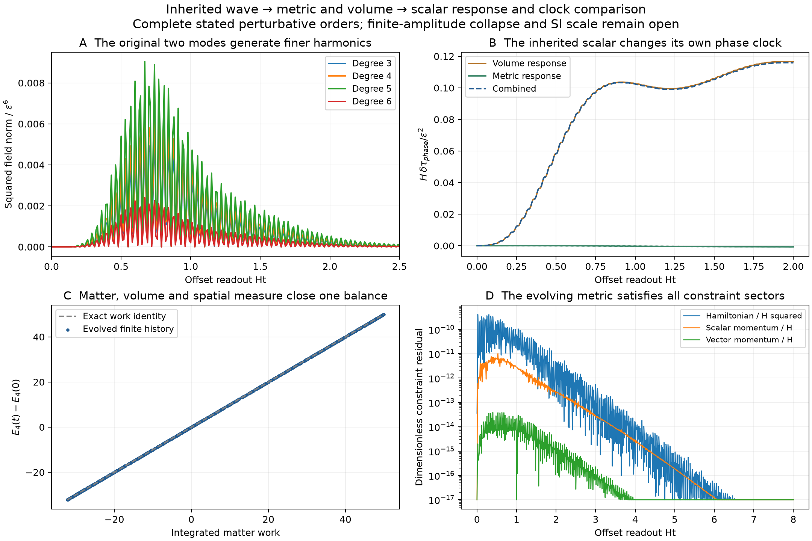

# The inherited geometry acts back on its scalar wave

The [volume response](nsc-atlas-volume-feedback.md) is now connected to the
complete quadratic spatial metric and cubic scalar response on the same
prepared parent. All scalar, compensated vector and transverse tensor
sectors are retained. This closes the fourth-order **matter-excitation**
work identity and produces a new proper-clock readout, linked to the
previous light experiment without choosing an amplitude or SI ruler.
The [compact record](../results/summaries/nsc-atlas-parent-backreaction-v1.json)
contains the finite results and source bindings.

## Decision, inheritance and domain

Three alternatives were considered: keep the field on the old fixed
metric; infer strong-field formation from the volume response alone; or
complete the next coupled perturbative orders with the same data. The last
path supplies the missing feedback without replacing the preparation.
It remains a finite perturbative construction, not a formed daughter or
an exact finite-amplitude spacetime.

The domain is the same round spatial S3, evolved for 0<=u=Ht<=8. Its three
generated spatial directions have offset-parametrized evolution. Gaussian
normal observers start orthogonally from the existing initial slice:

$$
ds^2=-dt^2+a^2(t)(\gamma_{ij}+\epsilon^2 k_{ij})dx^idx^j+O(\epsilon^4),
\qquad a=\cosh(Ht)/H.
$$

The inherited scalar has chi=epsilon phi1+epsilon^3 phi3+O(epsilon^5),
with the same two coherent harmonics and initial energy fraction. The
volume is s=s_star+epsilon^2 s2+O(epsilon^4). Initial metric data are
k=4u_constraint gamma, kdot=0, using the existing quadratic conformal
corrector of the nonlinear constraint-data branch. The subscript
distinguishes that corrector from u=Ht. Initial s2,sdot2,phi3,phi3dot vanish.
No new receiving waveform, charge state or physical length enters.

## 1. All quadratic metric sectors close on eleven tensors

Trace reversal of Einstein's equations gives

$$
\ddot k+3h\dot k+h\gamma\,\mathrm{tr}\dot k
+2a^{-2}(\delta\mathrm{Ric}[k]-2k)
=2\kappa a^{-2}D\phi_1D\phi_1+\kappa\mu_*^2\phi_1^2\gamma.
$$

The five scalar functions S_A and their eigenvalues are exactly those of
the volume-response owner. The metric basis consists of five gamma S_A,
four Hess S_A, symgrad W and one transverse trace-free tensor Z. Here
symgrad W means D_i W_j+D_j W_i, without a factor1/2. W is the previous
compensated circulation. For x=X2,y=X4,B=x^2+y^2,K=x Dy-y Dx,

$$
Z=C_2^2\left[\frac{K\otimes K}{3}
-\frac{Dx\otimes Dx+Dy\otimes Dy}{6}
+\left(\frac19-\frac B6\right)\gamma\right].
$$

Its trace and divergence vanish, rough Laplacian is -6Z, and mean squared
norm is C2^4/108. These are checked by intrinsic identities and an
independent ambient-projector calculation. The curvature term in its
time equation is 8/a^2, not the rough-Laplacian number6.

For scalar coefficients A_A,B_A and vector/tensor coefficients C,D,

$$
\ddot A_A+6h\dot A_A-h\lambda_A\dot B_A
+\frac{\lambda_A-4}{a^2}A_A
=\kappa\mu_*^2 F_A+2\kappa a^{-2}G_{\gamma,A},
$$

$$
\ddot B_A+3h\dot B_A-a^{-2}A_A=2\kappa a^{-2}G_{H,A},
$$

$$
\ddot C+3h\dot C=-\kappa q_1q_2/a^2,\qquad
\ddot D+3h\dot D+8D/a^2=2\kappa q_2^2/a^2.
$$

There is no constant-mode B. With Aq=C1^2q1^2,Bq=C2^2q2^2,E=C1C2q1q2,
the exact sources are F=(Aq/4+Bq/24,Aq,Bq/8,2E,Bq),
G_gamma=(Aq/4+Bq/9,Aq,Bq/2,2E,4Bq/3),
G_H=(Aq/2,Bq/8,2E/3,Bq/3) for the four nonconstant modes.
The pure TT source is q2^2 Z. No spatial-grid cutoff is introduced.

## 2. Constraints propagate and the scalar receives the full response

The modal Hamiltonian and scalar momentum residuals are

$$
\mathcal H_A=2(\lambda_A-3)A_A/a^2
+2h(3\dot A_A-\lambda_A\dot B_A)
-\kappa[P_A+a^{-2}D_A+\mu_*^2F_A],
\qquad m_A=\dot B_A-\dot A_A-\kappa g_A.
$$

P_A are coefficients of phidot1^2, D_A those of |Dphi1|^2, and g_A the
gradient coefficients of phidot1 Dphi1. Their independently verified
propagation is Hdot_A=-6h H_A-2lambda_A m_A/a^2 and
mdot_A=H_A/2-3h m_A. The vector constraint is -5 Cdot-kappa J=0.
The old integral relation is recovered as Cdot=-beta.

At cubic order the same action gives

$$
L_\chi\phi_3=a^{-2}\delta\Delta_k\phi_1
-\frac12\mathrm{tr}(\dot k)\dot\phi_1
+12\mu_*^2s_2\phi_1,
$$

$$
\delta\Delta_k f=-k^{ij}D_iD_jf
-\left(D_i k^{ij}-\frac12D^j\mathrm{tr}k\right)D_jf.
$$

The finite polynomial space is (z,xy,z^3,z(x^2+y^2),z^2xy,
xy(x^2+y^2),zx^2y^2,x^3y^3), with z=X1,x=X2,y=X4. Exact coefficient
reconstruction checks every metric/source product modulo X dot X-1.
Its Laplacian spectrum is -3,-8,-15,-15,-24,-24,-35,-48. The metric and
volume drives are evolved separately and added; this is linear source
decomposition at the stated order, not a change of field or preparation.

| Finite control on 0<=Ht<=8 | Maximum absolute residual/gap |
| --- | --- |
| Hamiltonian constraints | 2.92e-11 |
| Scalar momentum constraints | 1.92e-12 |
| Vector momentum constraint | 1.12e-14 |
| Metric, two independent integrators | 1.64e-12 |
| Cubic scalar, two independent integrators | 9.81e-10 |

The original degree-one/two preparation generates nonzero degree3--6
content. At the old observation event, degree-five and degree-six squared
field coefficients are .003330217100 and .000874116495 times epsilon^6.
This is a mode diagnostic in the anchored normal description; it is not
an invariant ultraviolet cascade, a conserved mode energy or a new space.

## 3. Complete fourth-order matter work needs no fourth-order metric

Subtract the constant vacuum stress using the actual metric. Then
T_excitation^(0)=0 identically, while the remaining field stress is
conserved. Consequently a fourth-order metric multiplying this zero
background contributes nothing, and its action on the quadratic field
stress starts at sixth order. V'_star=0 similarly removes s4 at this order.
This closes a useful part of the problem without claiming Einstein's
fourth-order equation has been solved.

Let rho2,p2 be the leading field density/pressure and rho4,p4 the full
matter/volume corrections. Then

$$
E_4=\int a^3\left(\rho_4+\frac12\mathrm{tr}k\,\rho_2\right)d\Omega_3,
\qquad \frac{dE_4}{dt}=W_4,
$$

$$
W_4=-\int a^3\left[3h\left(p_4+\frac12\mathrm{tr}k\,p_2\right)
+\frac{\dot k(D\phi_1,D\phi_1)}{2a^2}
+\frac{\mathrm{tr}\dot k}{4}
\left(\dot\phi_1^2-a^{-2}|D\phi_1|^2-\mu_*^2\phi_1^2\right)\right]d\Omega_3.
$$

The density correction retains scalar kinetic/gradient/mass cross terms,
the inverse-metric gradient term, the mass-volume interaction, and the
positive volume-mode energy. The perturbed spatial measure is essential.
Its exact tensor Gram matrix includes both the nonorthogonal scalar block
and the vector/tensor norms. Discarding any one is not this balance.

The initial fourth-order coefficient is -238.437812931843, not zero.
An independent conformal-measure expansion gives
E4(0)=a0^3 integral u_constraint[3mu^2 phi1^2+a0^-2|Dphi1|^2].
The full excitation energy is epsilon^2 E2+epsilon^4 E4+O(epsilon^6);
a negative E4 is a perturbative correction, not negative physical energy.

| Endpoint | E4 | Independent integrated work | Absolute balance residual |
| --- | --- | --- | --- |
| Old observation event | -207.556503164 | 30.881309819 | 5.08e-8 |
| Ht=8 | -202.140807251 | 36.297006250 | 5.70e-7 |

These compare E4(t)-E4(0) with the work integral. The largest residual is
2.39e-9 relative to |E4(0)|. It is a finite numerical control, not an
error bound on omitted nonlinear physics. The matter subsystem's pressure
work can have either sign; no irreversible heat bath is asserted.

## 4. A proper scalar clock and a second-channel correlation

Anchor a normal geodesic at the positive maximum of the initial scalar.
Its embedding labels are (.408370765084,.645458487521,0,.645458487521),
defined by the existing field, not fitted to data. Use the same reference
frequency to define its phase readout Z=chi-i normal_derivative(chi)/omega_ref.
At the previous 300-pass reference event, a fixed phase event shifts by

$$
\frac{H\delta\tau_{\rm phase}}{\epsilon^2}=.099091427460.
$$

Metric and volume contributions are -.000453327335 and +.099544754795.
The two-integrator spread is 8.78e-11 in this coefficient. It is a
conditional proper-duration comparison on the declared history, not an
SI clock prediction or an origin-of-time law. Small-amplitude use requires
the field/metric corrections to remain small; no certified finite-amplitude
remainder interval is inferred from solver precision.

For the original held-guide light protocol, transport its worldlines under
x_old=x_normal+epsilon^2 C W. Since Cdot=-beta and C(0)=0, its recovered
coefficient is H Delta tau_light/epsilon^2=1.786000559260e-5. The previous
phase-averaged orientation difference cancels the scalar/tensor metric
terms at this order. Holding new coordinate labels fixed instead would
define a different experiment.

The two readouts therefore obey

$$
\frac{\delta\tau_{\rm phase}}{\Delta\tau_{\rm light}}=5548.23048
$$

at their separately defined protocol events. Amplitude and SI ruler
cancel. The supplied two-mode preparation, action and detector protocols
remain dependencies; this is not a universal source-independent constant
or a comparison with a sky catalogue.



## Attribution, reproduction and the next physical question

The canonical action, ADM/normal-coordinate geometry and perturbation
framework are established inputs cited in the
[parent owner](nsc-atlas-parent-circulation.md#choice-admission-and-scope).
The new contribution is this exact finite spatial closure, inherited
evolution, complete excitation-work coefficient and linked clock/light
readout. No literature result is relabelled as our derived numerical result.

```powershell
python scripts/run_python.py scripts/check_nsc_atlas_parent_backreaction.py --output .build/parent-backreaction-reproduced.json
python scripts/run_python.py -m pytest -q tests/test_nsc_atlas_parent_backreaction.py tests/test_nsc_atlas_parent_backreaction_algebra.py tests/test_nsc_atlas_cubic_operators.py
python scripts/run_python.py scripts/plot_nsc_atlas_parent_backreaction.py
```

Independent integrations run concurrently on two cores. The producer
takes about71seconds within180seconds; full trajectories regenerate and
only compact summaries are retained. The three main failure risks are
an incomplete stress sector, missing measure/initial-energy terms and
coordinate-dependent comparison protocols. Exact tensor identities,
constraint propagation, independent work quadrature and anchored/transported
observers test those separately. Vacuum recovers zero response.

The next scientific question is nonlinear concentration of this actual
inherited state, with admissible constraints and a controlled domain.
The present perturbative mode generation does not establish a trapped
region, regular daughter, microscopic entropy law, charge asymmetry or
the missing SI hierarchy. The declared late vacuum and source assumptions
remain unchanged.
