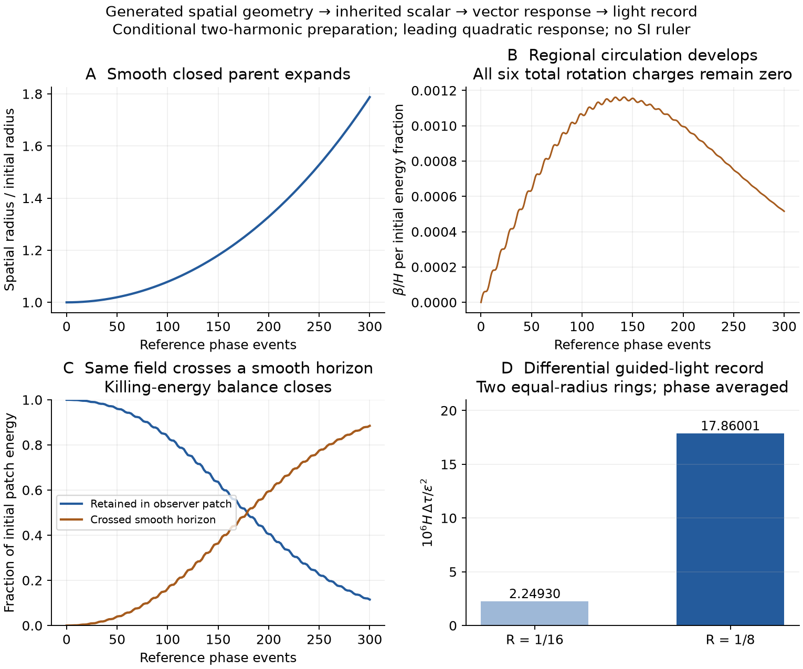
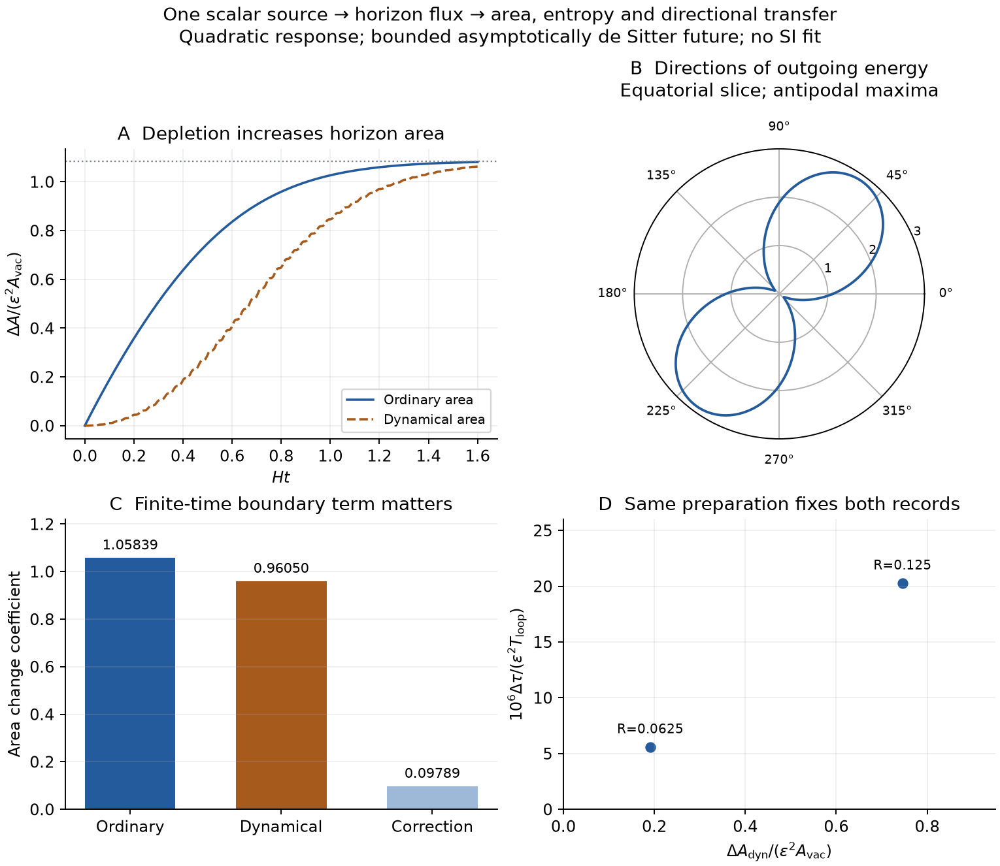

# From the generated space to compensated circulation and a light record

The [offset generator](nsc-atlas-offset-generator.md) supplies a round closed
three-dimensional completion compatible with the retained parent vacuum.
This calculation puts the existing canonical real scalar on that space,
solves its leading vector gravitational response, and computes a differential
proper-time light record. There is no material shell and no extra spatial
coordinate. A coherent preparation is declared rather than inferred from
the observed matter asymmetry.

**Result:** for the specified two nearby test-guide rings,
H Delta tau / epsilon^2 = 1.786000559262e-5. The energy fraction at preparation
is epsilon^2. Global rotation charges and scalar internal charge remain zero.
The [compact record](../results/summaries/nsc-atlas-parent-circulation-v1.json)
binds the equations, state, numerical controls and source hashes.

## Choice, admission and scope

The drawing update is generally not an isometry of its completed space.
Replacing physical field evolution by that update would hide a missing
connection. Extending the separate auxiliary fluid/gravity lift would instead
retain the parent-matching problem. Reusing a material interface would change
the present smooth-horizon branch. We choose the same real scalar on the
generated closed parent, with a phase-parametrized field evolution and an
explicit detector protocol.

Borrowed ingredients are the canonical scalar action, ADM constraints,
spherical harmonics and vector cosmological perturbations. Bardeen's
[gauge-invariant framework](https://doi.org/10.1103/PhysRevD.22.1882) supplies
the wider perturbative context; the signs and spherical identities below are
derived directly. [Losic and Unruh, section III through equation 44](https://arxiv.org/html/gr-qc/0604122v2)
explain why compact-background integral constraints matter. Their massless
quantum-state conclusion is not imported for this massive classical state.

The finite interval is 300 reference phase events, about 4.36 proper model
units. DOP853, Radau and direct null integrations share a 180-second producer
budget. The possible failure points are a forbidden global source, a
coordinate-only delay and a nonmonotone field phase. We check the constraint
kernel and exact initial-data branch, remove common rigid rotation, compare
proper and phase evolution, and check phase monotonicity. The result is a
conditional quadratic observable. A physical small-amplitude error enclosure,
selection of the preparation and a sourced parent-to-child transition are
the next closures; a baryon-to-photon ratio is not calculated here.

## 1. Construction and propagation are different maps

For the generator theta'=theta+alpha, phi'=phi+theta (modulo one), put
a=2 pi alpha. The first three unit directions satisfy exactly

$$
d_{12}^2-d_{01}^2=4\sin^2 a\cos a(1-\cos a).
$$

This is nonzero for the retained alpha. Positions also forget part of the
generating state: (theta,phi) and (-theta,phi+1/2) have the same direction,
but generally produce different next directions. The construction therefore
does not by itself preserve the physical field operator. Its history state
and a law of physical propagation must be retained explicitly.

## 2. Same parent action, two spatial harmonics

At the retained (12,2) minimum, s*=-.035646782553, set
Lambda=V(s*)=.220983024213 and kappa=1. The scalar mass is
mu^2=400 exp(-12 s*)=613.528021389. The expanding background is

$$
ds^2=-dt^2+a(t)^2\gamma_{S^3},\qquad
a(t)=\frac{\cosh(Ht)}{H},\qquad H^2=\frac{\Lambda}{3}.
$$

The four X components below are an embedding of unit S3, with X.X=1;
they are not four independent spatial coordinates. Normalize

$$
Y_1=\frac{\sqrt{2}}{\pi}X_1,\qquad
Y_2=\frac{\sqrt{12}}{\pi}X_2X_4,\qquad
-\Delta Y_1=3Y_1,\qquad -\Delta Y_2=8Y_2.
$$

Each harmonic has unit squared integral on S3 of volume V3=2 pi^2.
For chi=epsilon(q1 Y1+q2 Y2), the existing action gives

$$
\ddot q_i+3h\dot q_i+
\left(\mu^2+\frac{\lambda_i}{a^2}\right)q_i=0,
\qquad h=\frac{\dot a}{a}.
$$

The benchmark has zero initial velocities and
q_i(0)=sqrt[Lambda V3/(mu^2+lambda_i H^2)]. Its mean initial scalar density
is epsilon^2 Lambda with equal mode energies. This supplies relative phase
and energy sharing; it does not prove their primordial selection. Changing
one mode's sign reverses the vector signal. Removing either mode removes it.

The volume mode starts at s* with zero velocity. Its sourced displacement
begins at order epsilon^2. Since V'(s*)=0, its stress and the corrections it
makes to this vector source enter beyond the order retained. Its dynamical
response is not assumed to vanish at finite amplitude.

## 3. Source-generated regional rotation, zero total rotation

Define F=Y1 Y2, C=2 sqrt6/pi^2, and

$$
W_i=Y_1D_iY_2-Y_2D_iY_1-\frac13D_iF.
$$

Direct differentiation gives Delta F=-15F and
div(Y1 DY2-Y2 DY1)=-5F, hence div W=0. The tangent embedding field is

$$
W=\frac{C}{3}(-4X_2X_4,\ 2X_1X_4,\ 0,\ 2X_1X_2).
$$

Its rough Laplacian is D^2 W=-7W and its squared integral is
16/(3 pi^2). It is orthogonal to all six rotation Killing fields. Let

$$
J=\dot q_1q_2-q_1\dot q_2.
$$

Then the scalar momentum and mode equations yield

$$
T_{ti}^{T}=\frac{\varepsilon^2J}{2}W_i,\qquad
\dot J+3hJ=\frac{5q_1q_2}{a^2}.
$$

J starts at zero but has nonzero initial derivative. The eigenvalue split
drives it. This Wronskian is a regional stress coefficient; it is not an
internal conserved particle charge. There is no implication of baryon
number from the sign of a circulation. All total SO(4) rotation charges
remain zero. Equal eigenvalues and equal zero-velocity initial data give
J=0 exactly, a useful independent null control.

Choose spatial vector gauge F_i=0 and g_ti=epsilon^2 a^2 beta W_i.
With K_ij=-h h_ij+(epsilon^2 a^2 beta/2)(D_i W_j+D_j W_i),
the transverse ADM constraint is

$$
-\frac52\beta W_i=-\frac{\kappa J}{2}W_i,
\qquad \beta=\frac{\kappa J}{5}.
$$

There is no Killing-kernel ambiguity in this harmonic. The transverse
divergence of the cross-gradient spatial stress equals (5/2)W_i.
Conservation therefore also gives
beta_dot+3h beta=kappa q1 q2/a^2. This checks the vector evolution as well
as its instantaneous constraint.

## 4. Initial data satisfy the global constraints

At the symmetric start all field momenta and K_ij vanish. A homogeneous
vacuum spatial metric alone would fail the Hamiltonian constraint once the
scalar is added. Use h_ij=a0^2 Psi^4 gamma_ij, a0=1/H, and the fixed initial
profile chi1=q10 Y1+q20 Y2. The full initial constraint is

$$
-8\Delta\Psi+6\Psi-6\Psi^5
-\kappa\varepsilon^2|D\chi_1|^2\Psi
-\kappa a_0^2\mu^2\varepsilon^2\chi_1^2\Psi^5=0.
$$

Write Psi=1+epsilon^2 u+O(epsilon^4). Then

$$
(\Delta+3)u=-\frac{\kappa}{8}
\left(|D\chi_1|^2+\mu^2a_0^2\chi_1^2\right).
$$

Put A=mu^2 a0^2, B1=2q10^2/pi^2, B2=12q20^2/pi^2,
B12=2C q10q20. The solution is
u=c0+c1 X1^2+c2(X2^2+X4^2)+c3 X2^2X4^2+c4 X1X2X4, where

$$
c_1=\frac{\kappa B_1(A-1)}{40},\qquad
c_3=\frac{\kappa B_2(A-4)}{168},
$$

$$
c_2=\frac{\kappa B_2}{40}+\frac{2c_3}{5},\qquad
c_4=\frac{\kappa B_{12}(A-2)}{96},\qquad
c_0=\frac{-\kappa B_1/8-2c_1-4c_2}{3}.
$$

The average is u_mean=-1/4, so the leading mean radius correction is
delta a/a=-epsilon^2/2. The four l=1 kernel modes X_i are absent by symmetry:
paired flips (X1,X2), (X1,X4), and reflection X3 preserve the squared scalar
source, while every X_i is odd under at least one. On invariant C^{k,alpha}
functions (k>=2, 0<alpha<1), the derivative -8(Delta+3) is invertible to
the corresponding C^{k-2,alpha} space. The implicit-function theorem gives
an exact local positive initial-data branch for sufficiently small epsilon.
The momentum constraint remains zero. This establishes admissibility of the
perturbation, without a numerical finite-amplitude existence radius or a
solved nonlinear evolution. The six rotational obstructions vanish; the four
de Sitter boost obstructions are the excluded l=1 density moments.

## 5. The field phase is an evolution parameter, duration is a readout

Let w_ref=sqrt(mu^2+3H^2) and unwrap
Theta=atan2(-p1,w_ref q1), where p1=q1_dot. Then

$$
\dot\Theta=
\frac{w_{\rm ref}[p_1^2+3h q_1p_1+
(\mu^2+3/a^2)q_1^2]}{w_{\rm ref}^2q_1^2+p_1^2}.
$$

The numerator is positive if mu^2+3/a^2>9h^2/4. Here even the conservative
margin mu^2-9H^2/4=613.362284121 is positive. Rewrite all background and field
equations as dy/dTheta=(dy/dt)/Theta_dot and integrate dt/dTheta=1/Theta_dot.
The background variables obey a_dot=v, v_dot=H^2 a and v^2+1-H^2 a^2=0.

One candidate event advances Theta by 2 pi alpha using the retained action
offset. The numerical readout agrees with direct proper-duration evolution
to 1.6e-11 in the sampled states. This is an operational synchronization
with a field clock. It does not derive the reason for updates, a time arrow,
an ultimate origin of time, or a cosmic pass count. The dependence on alpha
is in event labels; the dimensionless light signal does not require alpha.

The scalar energy also carries a work control:

$$
E_\chi=\frac{a^3}{2}\sum_i
\left[p_i^2+(\mu^2+\lambda_i/a^2)q_i^2\right],
$$

$$
\dot E_\chi=\frac{h}{2}\sum_i
\left[-3a^3p_i^2+3a^3\mu^2q_i^2+a\lambda_iq_i^2\right].
$$

The integrated relative residual is below 8.6e-14. It is expansion work,
not an added dissipative law or a computed transfer into another child.

## 6. Two nearby rings give an invariantly specified light record

The negligible-backreaction test guides are held at fixed background labels,
X=(R cos phi,R sin phi,c3,b). Let B=sqrt(1-R^2). Choose equal R=1/8 and
two ring centres separated by alpha_det=pi/6:
(c3,b)=(0,B) and (B sin alpha_det,B cos alpha_det).
Their radius and separation are apparatus choices, not cosmological inputs.
Observers send light in both directions from a uniform set of emission
azimuths and compare their own return proper-time differences.

The source projection is W_phi=C b R^2(1-cos(2phi)/3). Background conformal
time is eta=atan(sinh Ht). A complete loop returns at eta(T)=2 pi R;
for R=1/8, T=asinh(1)/H. At leading order the difference of the two
phase-averaged directional records is

$$
\frac{\mathcal D}{\varepsilon^2}=
2a(T)CBR(1-\cos\alpha_{\rm det})\int_0^T\beta(t)dt.
$$

This integrates the evolving metric over the entire flight. If xi is the
angle travelled and t0 its unperturbed time, the first variation obeys
d(delta t)/d xi=R a_dot delta t + sign a^2 beta W_phi. The integrating
factor 1/a gives d(delta t/a)/d xi=sign a beta W_phi. Finally
d xi=dt/(aR), so the scale factor cancels inside the time integral;
a(T) converts the arrival conformal interval to receiving proper duration.
Freezing the metric at arrival would give 8.458192818195e-5 for D/epsilon^2,
28.53% too high. The integrated result is 6.580558610134e-5 and is checked
by the direct null ODE. A stationary short-loop formula is not used for
this cosmologically long circuit.

Scalar lapse and spatial-metric changes contribute equally to the
opposite-direction phase averages and cancel. A gradient shift has zero
azimuthal mean. Spatial tensor terms are orientation-even in this protocol.
The receiving lapse corrects an already quadratic difference only at fourth
order. A common rigid SO(4) rotation has the same average circulation on
equal-R rings and is removed by subtraction. These statements refer to the
specified anchored apparatus, transformed with the metric under a change of
coordinates. They are not a claim about freely orbiting photon rings.

The midpoint observer can receive both records because
2 pi R+alpha_det/2+asin R<pi/2; the conformal margin is .398270944430.
This is the background causal comparison bound, stable for sufficiently
small perturbations, not a solved perturbed relay experiment.

| Guide radius on unit S3 | H D / epsilon^2 | D/T per initial energy fraction | Phase events at return |
| --- | --- | --- | --- |
| 1/8 | 1.786000559262e-5 | 2.026383120126e-5 | 223.206266117 |
| 1/16 | 2.249302269630e-6 | 5.578630546439e-6 | 102.118288072 |

At R=1/8, the two independent integrators differ in the coefficient by
7.5e-14 relatively. Direct null integration of the vector-only metric at
epsilon=.1 and .05, and with an added common frame rotation, differs from
the quadratic formula by at most 1.3e-8 relatively. This is a numerical
control, not an uncertainty enclosure for omitted nonlinear physics.
No observational target, particle asymmetry or SI ruler selects these
numbers. The contribution is the explicit smooth-parent connection from
the existing scalar's stress to a nonzero differential observable.



## 7. The same state carries energy across the smooth horizon

Choose the north-pole observer X4=1. Its background future horizon is
chi_H=pi/2-atan(sinh Ht), so a sin chi_H=1/H. It has no surface tension.
Set u=tanh Ht, v=sech Ht, X=(v n1,v n2,v n3,u), with n on unit S2.
The generator k=partial_t-a^{-1}partial_chi obeys n_normal.k=-1.
The observer's static Killing vector is

$$
K=\cos\chi\,\partial_t-H\tanh(Ht)\sin\chi\,\partial_\chi,
\qquad K|_{H}=u k.
$$

The angularly integrated null stress, divided by epsilon^2, is exactly

$$
F_H=\frac{4\pi}{3H^2}(A_1^2+A_2^2)\geq0,
$$

$$
A_1=\frac{\sqrt{2}}{\pi}v(p_1-Hu q_1),\qquad
A_2=\frac{\sqrt{12}}{\pi}v[u p_2+H(1-2u^2)q_2].
$$

The scalar potential drops out of T_kk; its effect on q_i remains.
The static-patch energy is E_K=integral T(n_normal,K) dV. Stress conservation
and the moving null boundary give dE_K/dt=-epsilon^2 u F_H. There is no
singular layer or disappearance of energy at the horizon. Independently
integrating this flux and the patch's volume energy gives, at the 300-event
endpoint t=4.364851930252,

| Quantity / epsilon^2 | Model-unit value |
| --- | --- |
| Initial patch Killing energy | 50.266244488798 |
| Energy still inside | 5.793935277813 |
| Energy crossing outward | 44.472309210980 |

Thus **88.4735067504% of this initial patch energy crosses its smooth
horizon**. The relative balance residual is 8.7e-14; the flux quadrature
estimate is below 1.5e-12 of the initial energy, and doubling the volume
quadrature changes it below 8.7e-16 relatively. The geometric and matter
perturbations shift the horizon only at order epsilon^2, giving fourth-order
corrections to this quadratic matter-flux calculation. These are leading
coefficients on a declared classical background, with no finite-amplitude
physical error enclosure.

This is a calculated regional transfer: energy inaccessible to one observer
continues in the same parent geometry. It does not yet produce a daughter,
closed recycling, or Lambda from depletion. The vacuum and the prepared
field were inputs; the transfer and the differential light record follow.

## 8. The same flux changes area and dynamical entropy

The [new response record](../results/summaries/nsc-atlas-horizon-response-v1.json)
continues the same source into the null Einstein equations. It does not
extrapolate a quadratic perturbation into a nonlinear collapse claim.
The immediate missing connection was the geometry's response to the
already calculated transfer. A direct collapse scan would require an
additional concentrated preparation and a controlled finite-amplitude
evolution. The null response needs neither of those new physical inputs.

**Borrowed mathematics.** [Gibbons--Hawking](https://doi.org/10.1103/PhysRevD.15.2738)
supplies the cosmological-horizon first-law framework. [Zhao, 2503.16138v4](https://arxiv.org/html/2503.16138v4),
sections 3--4.2, equations 3.2, 4.8 and 4.16--4.18, supplies the dynamical
entropy and finite-cross-section physical-process law. We reuse those
results and calculate their normalization, boundary term and directional
source for this particular inherited scalar. Raychaudhuri's equation and
the rescaled scalar energy are independently checked below. The future
condition is bounded perturbative null expansion with the retained
asymptotic de Sitter area; full nonlinear future stability of the coupled
volume/scalar action is not proved here.

Let u=Ht, A_vac=4 pi/H^2, and let E_K denote the earlier patch energy
divided by epsilon^2. The horizon generator k has nonaffinity h=H tanh u.
At leading quadratic order Raychaudhuri gives

$$
\dot\theta-h\theta=-\kappa T_{kk}.
$$

Shear and expansion themselves start at order epsilon^2; their squares
enter at fourth order. A null horizon is hypersurface-orthogonal, so it
has zero null-congruence twist even though the source has regional
circulation. The homogeneous response grows as cosh u. Excluding that
unbounded future perturbation selects the future-integral solution.

With F(u)=integral T_kk dA / epsilon^2 from section 7, define

$$
P(u)=\int_u^\infty \tanh v\,F(v)dv,\qquad
S(u)=\int_u^\infty \operatorname{sech}v\,F(v)dv.
$$

Then the ordinary area deficit D and normalized growth rate G are

$$
A=A_{\rm vac}(1-\varepsilon^2 D)+O(\varepsilon^4),\qquad
D=\frac{\kappa}{4\pi}[P-\sinh u\,S],\qquad
G=-D'=\frac{\kappa\cosh u}{4\pi}S\geq0.
$$

The affine parameter from the background bifurcation surface is
v_aff=sinh(Ht)/H. Thus v_aff d/dv_aff=(tanh u/H)d/dt and Zhao's
dynamical-area operator is

$$
A_{\rm dyn}=A-\frac{\tanh u}{H}\dot A.
$$

Our explicit source yields the comparison and physical-process laws

$$
H(A_{\rm vac}-A_{\rm dyn})=\kappa\varepsilon^2 E_K,
\qquad H\Delta A_{\rm dyn}=\kappa\varepsilon^2 E_{\rm out}.
$$

Both equations are through order epsilon^2. With S_dyn=2 pi A_dyn/kappa
and T_H=H/(2 pi), the latter is T_H Delta S_dyn=epsilon^2 E_out.
Ordinary area and dynamical entropy differ during the transfer; omitting
the finite-endpoint derivative would give the wrong energy comparison.

### Exact normalization and a controlled future integral

Set m^2=mu^2/H^2. Integrating the initial scalar's static-patch energy
gives the exact normalized full-future area increase

$$
\frac{A_\infty-A(0)}{\varepsilon^2 A_{\rm vac}}
=c_A=\frac{2(m^2+4)}{5(m^2+3)}
+\frac{12(2m^2+13)}{35(m^2+8)}
=1.085638919782.
$$

The ordinary initial volume integrals reduce to (m^2+4)/5 and
(2m^2+13)/35 after x=sin chi. They independently fix this coefficient;
the future numerical integral is a check, not its definition.

For the future tail put y_i=cosh(u)^{3/2} q_i. The exact scalar equations become

$$
y_i''+\left[\nu^2+b_i\operatorname{sech}^2u\right]y_i=0,
\qquad \nu^2=m^2-\frac{9}{4}>0,\qquad b_i=\lambda_i+\frac{3}{4}.
$$

The rescaled energy
E_yi=[y_i'^2+(nu^2+b_i sech^2u)y_i^2]/2 satisfies
E_yi'=-b_i sech^2u tanh u y_i^2<=0. Consequently q_i decays at least
as a bounded oscillator times cosh(u)^(-3/2). This proves the needed
linear-field decay, without simulating indefinitely or assuming a final
oscillation vanishes at a numerical cutoff.

Let D_i=sqrt(2 E_yi(0))[1+5/(2 nu)]. Direct bounds on the null amplitudes
give F<=B_F sech^5u, with B_F=(4 pi/3) sum C_i^2 D_i^2 and
(C1,C2)=(sqrt2/pi,sqrt12/pi). For a numerical endpoint U,

$$
P_{\rm tail}\leq\frac{32B_F}{5}e^{-5U},\qquad
S_{\rm tail}\leq\frac{64B_F}{6}e^{-6U}.
$$

At U=8 the uncomputed normalized area-deficit tail is below 8.04e-16.
The coefficient's numerical integral differs from its exact expression by
2.12e-12; a tighter source/response solve changes sampled area coefficients
by at most 1.93e-12. An independent future quadrature differs by 1.12e-11.
These are numerical controls and an analytic tail bound for the exact
linear source; they do not bound omitted fourth-order gravitational terms.
The complete producer takes about three seconds here, within 180 seconds.

At the earlier 300-event endpoint u=1.184645324262 the same source gives

| Leading coefficient, divided by epsilon^2 | Value |
| --- | --- |
| Ordinary area increase / A_vac | 1.058388132596 |
| Dynamical area increase / A_vac | .960502822979 |
| Finite-endpoint correction / A_vac | .097885309617 |

The last two sum to the first. The dynamical increase divided by c_A is
the earlier 88.4735067504% energy-loss fraction. This is a source-normalized
depletion/geometry relation, with no membrane or added matter source.

### A monotone record and an amplitude-free light relation

Define Xi=Delta A_dyn/A_vac. Its derivative is

$$
\frac{d\Xi}{du}=\frac{\kappa\varepsilon^2}{4\pi}\tanh u\,F(u)\geq0.
$$

It supplies a monotone geometric record of the chosen expanding history,
even though the scalar's internal charge is zero. The source's transfer
rate can oscillate and fades away. Neither an ultimate origin of updates
nor a continually accelerating time rate has been derived. The expanding
branch and bounded-future condition define this record's orientation.

At the two earlier light-return events, epsilon^2 cancels between the
proper delay and the contemporaneous dynamical area growth:

| Guide radius | (Delta tau/T_loop) / (Delta A_dyn/A_vac) |
| --- | --- |
| 1/8 | 2.717089416415e-5 |
| 1/16 | 2.917459090100e-5 |

The absolute time/length scale also cancels. These are retrospective
cross-observable relations for the same declared preparation and apparatus,
not a sky-data fit or a blinded forecast.

### Directional transfer and the condition for a new region

The positive angular matrix Q_ij=integral_0^infinity tanh u A_i A_j du
gives dE_out/dOmega=epsilon^2 n.Q.n/H^3. Its nonzero eigenvalues are
.009105112022 and .230802659674. The maximum-energy axis is
n=(.598070810823,.801443263894,0), at 53.268145764 degrees in the n1/n2
plane, with an equal antipodal maximum. The maximum intensity is
2.886142346 times the spherical average. Two example 30-degree caps
contain 33.81554946% of the energy on 13.39745962% of the area. Their
angular size is a reporting aperture, not a selected offspring radius.

The source therefore specifies directions and a supply budget for a later
attachment; it does not establish two children. Indeed the background's
future radial expansions at this cosmological horizon are theta_minus=0
and theta_plus=4h>0. On the exact time-symmetric initial-data slice K_ij=0,
the two future expansions of any two-sided surface are opposite, so no
strictly future-trapped surface is initially present. A new compact child
requires a later concentrated state with both future expansions negative,
followed by an admissible interior continuation. The perturbative area
formula is not extrapolated to that regime.



## Reproduction and next connection

```powershell
python scripts/run_python.py scripts/check_nsc_atlas_parent_circulation.py --output .build/parent-circulation-reproduced.json
python scripts/run_python.py -m pytest -q tests/test_nsc_atlas_parent_circulation.py
python scripts/run_python.py scripts/plot_nsc_atlas_parent_circulation.py
python scripts/run_python.py scripts/check_nsc_atlas_horizon_response.py --output .build/horizon-response-reproduced.json
python scripts/run_python.py -m pytest -q tests/test_nsc_atlas_horizon_response.py
python scripts/run_python.py scripts/plot_nsc_atlas_horizon_response.py
```

The null response and distinction from a future-trapped region are now
calculated. The next physical connection is a concentrated incoming state
with its supply taken from the regional transfer, followed by finite
gravitational evolution and an admissible child continuation.
The explicit mode preparation remains conditional until inheritance selects
it. No further grid scan is needed to establish the result above.
