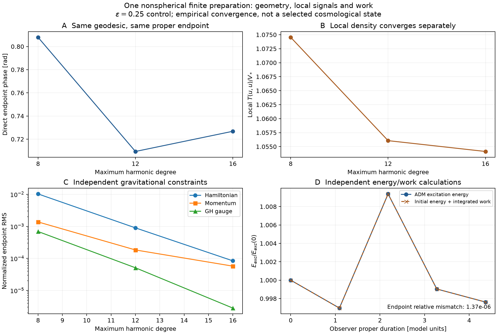

# Nonlinear evolution of the nonspherical inherited parent

The [finite initial-data owner](nsc-atlas-finite-parent-data.md) supplies
the unchanged real scalar, internal vacuum and positive constrained
geometry. A full spatially varying Einstein--two-scalar evolution
implementation now exists in the same package. Its finite-amplitude
physical results remain under qualification; a completed coarse run
with large Einstein residuals is not admitted as a prediction.

## The implemented connection

The evolution uses the covariant second-order GH equation24 of
[Lindblom--Szilagyi--Taylor](https://arxiv.org/html/1312.0701v2), with
static round reference geometry and the canonical fields
S=sqrt(84)(s-s_star), chi. The potential is
W=V(s)+mu^2(s)chi^2/2, including the constant vacuum once.
All metric components and both scalar waves evolve. Constraint damping
vanishes on an Einstein solution; no physical mode is suppressed.

The global unit-S3 frame has [e_i,e_j]=2 epsilon_ijk e_k. Real normalized
Wigner harmonics provide sparse exact coefficient derivative generators,
with Casimir sum D_i^2=-l(l+2). The physical reference derivatives have
the additional factor1/a0. Covariant tensor derivatives retain the frame
connection and curvature; raw ordered second derivatives are not
symmetrized as though the frame commuted.

The preserved proper paired-flip group gives diagonal characters for
each tensor component and scalar. It reduces computation without a
spherical average. The larger evolution sector retains modes absent
from the kernel-free initial-constraint symmetry sector.

Hopf coordinates separate each complex Wigner mode into a radial
factor and two circle phases. Two Fourier transforms and radial
quadrature evaluate/project it without the dense values matrix.
The fast and dense representations agree on independent controls.
This is computational use of circle fibers, not an assumed physical
velocity field or a particle interpretation.

## Implementation owners

| Role | Component |
| --- | --- |
| Real modes and regular frame | [s3_frame](../src/recursive_horizons/nsc_atlas_s3_frame.py) |
| Fast Hopf transform | [s3_hopf](../src/recursive_horizons/nsc_atlas_s3_hopf.py) |
| Parallel local GH/Klein--Gordon equations | [gh_pointwise](../src/recursive_horizons/nsc_atlas_gh_pointwise.py) |
| Independent physical ADM constraints | [gh_constraints](../src/recursive_horizons/nsc_atlas_gh_constraints.py) |
| Nonlinear driver and geodesic observer | [parent_gh](../src/recursive_horizons/nsc_atlas_parent_gh.py) |
| Phase/amplitude-gradient diagnostics | [gh_wave_diagnostics](../src/recursive_horizons/nsc_atlas_gh_wave_diagnostics.py) |
| Normalized local observer stress/phase | [gh_observer](../src/recursive_horizons/nsc_atlas_gh_observer.py) |
| Full matter excitation work | [gh_matter_work](../src/recursive_horizons/nsc_atlas_gh_matter_work.py) |
| Passive stage quadrature | [passive_dop853](../src/recursive_horizons/nsc_atlas_passive_dop853.py) |

The ADM calculator derives physical spatial connection and curvature
directly from Koszul/Riemann formulas, independently of the GH kernel.
The driver checks Hamiltonian, momentum and GH constraints, accepted
metric/lapse validity, spectral-shell power and unresolved accelerations.

## Coordinates and the clock protocol

An observer begins at the original scalar maximum, initially normal to
the inherited slice. Its geodesic, proper duration and field derivative
are evolved with the geometry. Phase is read from the resolved field's
Z=chi-i u(chi)/omega_ref; it does not drive the PDE time-step controller.
The same normalized timelike u is used for its proper derivative, phase
and measured T(u,u). Slice-normal density is reported separately at that
position. Bulk density/volume are diagnostics of the chosen GH slice;
fixing one observer's proper age does not make them local measurements.
The current sampled unwrapping flag is a heuristic, not a certified
winding count. A wrapped increment cannot exclude an extra full turn;
accepted physical comparisons must use directly reconstructed phase or
a separately resolved counting protocol. Exact interference nodes are
not spacetime singularities.

The original prescribed vacuum clock H0=3H tanh(Ht) has a demonstrable
coordinate limitation. For homogeneous lapse N and scale a,

$$
\mathcal C_0=H_0+\partial_t\ln N-3\partial_t\ln a=0,
\qquad N=(a/a_{\rm init})^3\operatorname{sech}^3(Ht).
$$

Thus

$$
\int_0^{\tau(t)}(a_{\rm init}/a)^3d\tau
=\frac{\operatorname{sech}(Ht)\tanh(Ht)+\arctan(\sinh Ht)}{2H}
\leq\frac{\pi}{4H}.
$$

A regular static geometry has a finite proper-time window in that chart.
The zero-H harmonic gauge instead gives
t=integral (a_init/a)^3 d tau, removing that imposed proper-time ceiling.
For de Sitter, N=cosh(H tau)^3 and the finite target proper time remains
reachable. These are coordinate statements, not a change of action or
a conclusion about the finite source's fate.

### Metric-dependent lapse control

The default coordinate source now includes a lapse feedback:

$$
\mathcal H_0=3H\tanh(Ht)+H(N^2-N^{-2}),\qquad \mathcal H_i=0.
$$

It depends on the metric, not its derivatives, preserving the GH wave
principal part. Its full time and spatial chain derivatives are retained.
Independent direct physical-Ricci tests check the reduced equation at
nonuniform lapse. No physical stress or physical-mode damping is added.

For a regular static geometry, y=N^2 satisfies
dy/d(Ht)=2[1-y^2-3tanh(Ht)y]. The interval
[(sqrt(13)-3)/2,1] is invariant, so the lapse stays positive and bounded
and proper time has no imposed finite ceiling. Vacuum de Sitter with
N=1 still satisfies the source exactly. This homogeneous coordinate
control is not a proof of constraint convergence in the finite 3D run.

## Qualification and current limits

The compact-source attempts are preserved in the
[campaign record](../results/summaries/nsc-atlas-gh-campaign-v1.json), with
source-commit verification and no admission of single-resolution physical
predictions. Failed or unresolved comparisons remain explicit.

The local kernel has independent de Sitter, nonlinear flat-coordinate,
anisotropic and matter controls. Frame commutators, orthonormality,
Laplacian spectrum, fast-transform normalization and derivative ordering
are tested separately. Integrated vacuum evolution is compared in proper
duration, not by equating different gauge-coordinate times.

The nonlinear driver evolves a spectral projection of Psi^4 and its gauge
data. It does not preserve the original conformal initial constraint
exactly at finite degree. Initial as well as final ADM/GH errors must
shrink. The full-amplitude coarse diagnostic was underresolved: its late
shells and unresolved acceleration contained substantial power. Higher
resolution and phase/amplitude diagnosis are therefore required before
claiming physical concentration, trapping or a clock prediction.

The gradient diagnostic splits |DZ|^2 into amplitude and phase-gradient
contributions where Z is nonzero. It reports undefined nodes and their
excluded contribution separately. Those are quadrature-gradient powers,
not conserved matter-energy fractions or baryon charge.

### Finite epsilon=.25 control

The [source-bound comparison](../results/summaries/nsc-atlas-gh-comparison-v1.json)
contains three spatial resolutions with the same preparation, coordinate
source, damping and proper endpoint4.364851930252. It also contains a
degree12 time control with tenfold tighter tolerances and half the maximum
step. No source or physical parameter is fitted.

| Degree | Hamiltonian RMS/H^2 | Momentum RMS/H^2 | GH RMS/H | Direct endpoint phase | Local T(u,u)/V_star |
| --- | --- | --- | --- | --- | --- |
| 8 | .0102749961 | .00137413 | .000691073 | .8079240822 | 1.0745357826 |
| 12 | .0008972453 | .000183685 | .0000510295 | .7093917734 | 1.0560681882 |
| 16 | .0000840275 | .0000574418 | .00000282401 | .7268236070 | 1.0541328607 |

Adjacent phase changes contract .0985323 -> .0174318 radians and density
changes .0184676 -> .00193533 V_star. The phase sequence is not monotone.
The local d=12 coefficient g_KK/g_KK(initial)=exp[-7(s-s_initial)] is
1.000406370547 at the fine endpoint, with fine--middle spread .00001616051.
This is the existing internal action coefficient, not an identified
Standard Model coupling. Time refinement at degree12 changes phase by
1.915e-6 radians, density by4.773e-8 V_star and g_KK ratio by2.330e-9.

These are empirical convergence indicators, not rigorous error bounds.
The finest volume acceleration still has unresolved fraction .007636.
No fine-degree time control is inferred from the middle-degree test.
The work mismatches/initial excitation are2.147e-7 for the tight degree12
run and1.367e-6 for degree16 at default tolerance. Their nonmonotone size
does not establish spatial convergence of the passive quadrature itself.
The stronger epsilon=1 campaign remains unresolved and has not been
replaced by this supplied finite benchmark. P001--P005 are unchanged.



The phase and amplitude both contribute in the coarse diagnostic. A
carrier-only or homogeneous replacement is therefore not silently used
to obtain a more convenient finite result. The active target remains
nonlinear evolution of the original nonspherical finite preparation.

### Matter-work and constraint controls

For normal density rho, spatial stress S and momentum j, the compact
matter-energy balance is

$$
\partial_t E=\int\sqrt{h}\left(NK_{ij}S^{ij}-j^iD_iN\right)dV_{\rm ref}.
$$

The global shift flux integrates to zero on S3. Subtracting constant V_star
from density adds N V_star trK to the work integrand. This isolates the
excitation balance instead of letting vacuum expansion dominate its error.
A passive DOP853 stage ledger integrates that work without adding an
adaptive state variable or extra RHS evaluations. The accepted field
steps remain bitwise identical with or without the ledger. Its own
time-quadrature error still needs a temporal control.

For a homogeneous proper slice, K_ij=-h h_ij and the lapse gradient
vanishes. The full energy obeys dE=-p dV; after vacuum subtraction,
dE_exc=-p_exc dV with p_exc=p+V_star. The nonlinear calculation
retains directional stress and lapse-gradient work rather than imposing
that homogeneous reduction. On the complete compact parent there is no
external boundary flux; energy change there is not automatically a loss
into a child. A finite observer region has the additional boundary flux.
The canonical action supplies reversible evolution. A temperature,
entropy current or explicit coarse-graining rule is still required to
calculate irreversible entropy production. This is the connection to the
[thermodynamic organizing picture](nsc-atlas-offset-thermodynamics.md).

### Horizon equation of state

[Jacobson, equations1--6](https://arxiv.org/html/gr-qc/9504004v2)
derives Einstein gravity from local horizon equilibrium, Unruh temperature
and entropy S=eta_A A. It leaves eta_A and Lambda unselected. Its heat
definition uses a causal boundary, without material surface tension.

For the present canonical fields, direct null contraction gives

$$
T_{ab}k^ak^b=(k^a\partial_a S)^2+(k^a\partial_a\chi)^2,
\qquad k^ak_a=0.
$$

Adding a constant to W leaves this expression unchanged. Local null
heat/focusing data therefore cannot fix the additive vacuum constant.
The inherited state must supply the missing entropy normalization and
vacuum information; the existing charge/SI gap remains open. The running
compact-parent work ledger is a different, finite-volume balance.

A separate exact homogeneous constraint calculation gives, on the vacuum
background,

$$
\ddot C_0+(3h+2\gamma)\dot C_0
+[6\gamma h-3(h^2+H^2)]C_0=0.
$$

At the currently used gamma=H, the late rates are0 and-5H. Gamma=2H
would make both late rates negative; early transient growth is still
possible. This is off-constraint stabilization, not a physical term.
The current spatial campaign keeps gamma fixed; no convergence claim
is inferred from this background calculation.

## Running and preserving work

```powershell
python scripts/run_python.py scripts/evolve_nsc_atlas_parent_gh.py --degree 12 --epsilon 1 --threads 8 --budget-seconds 1500 --state-cache .build/gh-L12-state.npz --output .build/gh-L12-summary.json
python scripts/run_python.py -m pytest -q tests/test_nsc_atlas_s3_frame.py tests/test_nsc_atlas_s3_hopf.py tests/test_nsc_atlas_gh_pointwise.py tests/test_nsc_atlas_gh_constraints.py tests/test_nsc_atlas_parent_gh.py tests/test_nsc_atlas_gh_wave_diagnostics.py
```

Regenerate the finite control with epsilon=.25 at degrees8,12,16, keeping
the default tolerances. Repeat degree12 with
`--rtol 3e-9 --atol 3e-11 --max-step 0.025`. Give each
run a fresh output path. `scripts/compare_nsc_atlas_gh_evolution.py` accepts
all four files as repeated --input arguments and a fresh --output path. The stored records
also reproduce the figure directly, without retaining raw arrays:

```powershell
python scripts/run_python.py scripts/plot_nsc_atlas_gh_evolution.py
python scripts/run_python.py -m pytest -q tests/test_nsc_atlas_gh_comparison.py tests/test_nsc_atlas_gh_matter_work.py tests/test_nsc_atlas_passive_dop853.py
```

Small checkpoints stay under .build for diagnosis; compact source-bound
records belong in the result archive, including failed or unresolved
comparisons under their explicit status. A source hash change during a run
is explicitly flagged. Incomplete endpoints retain their status and
cannot satisfy the finite-evolution target. The current action, physical
source, SI-scale gap and charge-selection gap remain unchanged.
