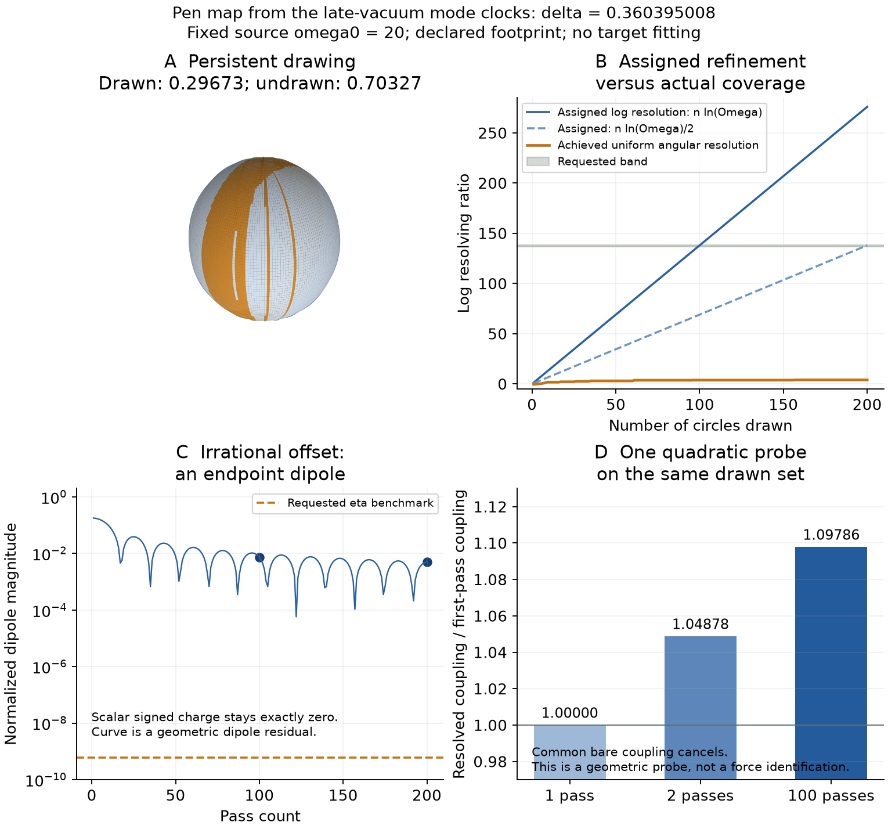

# Constructed pen geometry: phase, resolution, residual and response

This is an explicit kinematic completion of Douglas's drawing picture.
The [calculation](../results/summaries/nsc-atlas-pen-geometry-v1.json) starts
with a map and evaluates its consequences. No target sets a parameter.
The preferred offset is now derived from the two normal modes of the
existing (12,2) action, conditional on its retained source coupling omega0=20.
Mapping the phase section to circles and assigning the finite footprint
remain declared geometric rules. The earlier auxiliary-wheel construction
is preserved as a comparison rather than promoted to an inherited law.

## 1. Two clocks from the existing action and one sphere

At the late vacuum, the scalar displacement chi and the volume displacement
have a diagonal quadratic Hessian. The canonical volume coefficient is K=84.
The existing potential is

$$
V(s,\chi)=7e^{-12s}-\frac{15}{2}e^{-14s}+\frac{25}{32}e^{-24s}
+\frac{\omega_0^2}{2}e^{-12s}\chi^2.
$$

At chi=0 and s=s_star, H_star^2=V_star/3. Each linear fluctuation has
3H_star damping. Multiplying it by a^(3/2) gives two constant-frequency
phase variables with

$$
\nu_s^2=\frac{V_{ss}}{84}-\frac{3V_*}{4},\qquad
\nu_\chi^2=\omega_0^2e^{-12s_*}-\frac{3V_*}{4}.
$$

Sample the volume phase once per scalar period. For x=exp(-2s_star),
stationarity gives 25x^6-140x+112=0, and the frequency ratio reduces exactly to

$$
\delta=2\pi\frac{\nu_s}{\nu_\chi}
=2\pi\sqrt{\frac{475x-468}{32\omega_0^2+75x-84}}.
$$

The polynomial is Eisenstein at7. For rational omega0^2 other than6/19,
the squared ratio is a nonconstant rational fractional-linear function of
irrational x; if that ratio were rational, x would be rational. Thus the
phase increment is an exact irrational rotation. The retained original
parent coupling omega0=20 gives delta=.360395008387051, nu_s=1.42055297048,
nu_chi=24.7661519845 and H_star=.271405615400. No frequency is fitted here.
The construction uses the corresponding sampled phase to select a circle
fiber; the full continuous two-mode trajectory is not a frozen meridian.

At pass k draw the complete great circle

$$
X(u,v)=R(\sin u\cos v,\sin u\sin v,\cos u),\qquad
v_k=k\delta\pmod\pi,\quad 0\leq u<2\pi.
$$

The stroboscopic update selects the circle's plane; u independently
parameterizes the drawn circle. Direct differentiation gives |X|^2=R^2
and |X_u cross X_v|=R^2*|sin(u)|. The continuous two-parameter family is
the sphere. The irrational orientation sequence is dense, so the closure
of the drawn family is the same sphere. This uses the standard
[irrational-rotation result](https://www.math.utah.edu/~chaika/Lecture%201.pdf).
Finite ideal curves have zero area. A filled ball would additionally need
a radial coordinate and a population rule.

The inherited-matter record also contains source-frequency members2000 and
10^9. Their offsets are .00360346331762 and7.20692653791e-9. The smallness
of the latter inherits that already supplied large frequency; it is not
selected by d and j alone. At100 passes its geometric residual is3.60346e-9,
still not a charge asymmetry. These members are controls, not substituted
for the original omega0=20 action to improve a target.

**Missing history link:** prepare and transport these phase clocks through
formation and nesting, and derive the physical phase-to-geometry map.

## 2. A pass count and actual resolving power

Keep Omega=3.973074368754331. Define the footprint of pass k as a geodesic
band of angular halfwidth epsilon_k=Omega^(-(k+1)/p), where p=1 uses the
frequency-scale interpretation and p=2 tests the requested square-root
interpretation. The starting resolution unit is one spherical radius.
Older ink persists; it is not erased by later finer passes. R can be the
Parke radius 240/sqrt(39169), but it cancels from angular fractions.

For the first n circle planes, sort their orientations on a circle of
length pi. If their gaps are g_i, the maximum geodesic distance from a point
of the sphere to the nearest drawn circle is

$$
h_n=\frac{\max_i g_i}{2}\geq\frac{\pi}{2n}.
$$

The maximum occurs on the equator between the widest-spaced planes. Thus
achieving uniform angular resolution epsilon requires at least pi/(2*epsilon)
independent circles, even though every individual circle was drawn continuously.

| Passes and rule | Assigned log resolution | Achieved log(1/h_n) | Miss from 136.84--138.26 (%) |
| --- | ---: | ---: | --- |
| 100, p=1 | 137.95401952 | 3.74112733 | -97.26606 to -97.29414 |
| 200, p=2 | 137.95401952 | 3.90203268 | -97.14847 to -97.17776 |

For either listed assigned resolution, the necessary circle-count lower
bound is exp(138.4056022), about 1.285e60. No such collection is generated
by 100 or 200 one-circle passes. More generally,
n*Omega^(-n/p)<=p/(e*ln(Omega))<pi/2 for both rules, so this ever-refining
one-circle-per-pass construction never covers the sphere at its current
assigned footprint. Irrational rotation also has no exact finite return.
Neither criterion selects a finite cosmological stopping count.

The same late-vacuum clocks give a physical expansion per scalar cycle of
2*pi*H_star/nu_chi=.068855742145. Thus100 and200 cycles correspond to
6.8855742 and13.7711484 e-folds in that linear late-vacuum limit. An
oscillator cycle is not automatically one Omega inheritance step. Neither
calculation supplies an initial inflation event or the stopping time today.

The bound is sharp and supplies a constructive repair: at a refinement
level, draw M=ceil(pi/(2*epsilon)) circles at orientations
v_m=n*delta+m*pi/M. Their largest gap is pi/M, so their fill distance is
pi/(2M)<=epsilon. Thus branching into a large circle family can achieve
the requested resolution. It is a different history rule from one circle
per pass, and it still does not select when the physical evolution stops.

**Missing history link:** a physical stopping event or a branching rule
that produces enough independent circles per refinement level.

## 3. What the offset actually leaves

Let z_k=exp(i*k*delta). A positive orientation at z_k and a negative
orientation shifted to z_(k+1) give the normalized vector moment

$$
D_n=\frac{1}{2n}\sum_{k=0}^{n-1}(z_k-z_{k+1})
=\frac{1-e^{in\delta}}{2n},\qquad
|D_n|=\frac{|\sin(n\delta/2)|}{n}.
$$

The one-pass magnitude is sin(delta/2). It is nonzero at every finite n,
but it is an endpoint dipole: the interior sum telescopes. Every pass
still contains one positive and one negative scalar charge, so net signed
count is exactly zero, independently of irrationality.

| Passes | Geometric residual | Miss if identified with 6.1e-10 (%) |
| ---: | ---: | ---: |
| 100 | .0073780009529 | +1209508252.9 |
| 200 | .0049802928420 | +816441349.5 |

These comparisons test a proposed identification; a geometric vector
moment is not a calculated baryon/photon abundance.

**Missing asymmetry link:** a sourced charge-producing process and its
baryon/photon observable, rather than identifying an endpoint dipole with charge.

## 4. Persistent drawn area and the unresolved complement

The painted set is the union of open geodesic bands
{X: |normal_k dot X/R|<sin(epsilon_k)}. Its area fraction is
computed by integrating the union of longitude intervals at each latitude.
Writing z=|cos(theta)|, each band's interval halfwidth is
asin(min(1,sin(epsilon_k)/sqrt(1-z^2))). If their union length on the
orientation circle of length pi is L_n(z), then

$$
f_n=\int_0^1\frac{L_n(z)}{\pi}\,dz.
$$

The integrand increases with z. Lower and upper Darboux sums on 4096
subintervals enclose the integral, with a stated numerical allowance.
The omitted tail is bounded by sum epsilon_k. Independent adaptive
quadrature supplies the displayed point estimates; its error indicator
does not replace the wider monotone enclosure.

| Drawing | Drawn fraction | Undrawn fraction | Drawn-fraction enclosure |
| --- | ---: | ---: | --- |
| 100 passes, p=1 | .2967343 | .7032657 | [.2966405,.2968324] |
| 200 passes, p=2 | .6289829 | .3710171 | [.6289221,.6290423] |

For p=1 an exact global observation follows without numerical integration:
sum sin(epsilon_k)<=1/(Omega-1)<1. The full infinite ink union is open
and dense, but its complement has area fraction at least
1-1/(Omega-1)=.6636478352. That complement is closed and has no interior,
yet has positive area. Density of drawing paths does not imply full area
coverage. This is a concrete fine-scale unresolved structure.

With constant wall tension, the normalized drawn wall-energy share is the
same f_n, since surface energy is sigma times area. Identifying those
surface shares with cosmological density fractions is a further rule.
The minimal binary assignment (undrawn vacuum, no clustering category,
drawn baryons) gives:

| Drawing | (Omega_Lambda, Omega_c, Omega_b) under that assignment | Miss from (.685,.265,.049) (%) |
| --- | --- | --- |
| 100, p=1 | (.7032657,0,.2967343) | (+2.66652,-100,+505.58025) |
| 200, p=2 | (.3710171,0,.6289829) | (-45.83692,-100,+1183.63853) |

Allowing a clustering fraction chi of the outside gives the family
((1-f)*(1-chi),(1-f)*chi,f). Chi is unselected and cannot fix the excessive
drawn/baryon fraction under this assignment. No value is fitted.

For comparison, viewing all ideal curves at only the *latest* fine width
gives area 1.22273e-58 at 100 passes, p=1. We retain its log, -133.3488493,
and the exact complement form 1-f, rather than rounding that complement
to one. This measures current resolving coverage, not persistent ink.

**Missing fraction link:** derive the footprint/energy measure and the
outside clustering partition from the wall source and observer equations.

## 5. One response read from the same drawing

Couple a declared quadratic probe u to the drawn set with a common bare
coefficient gamma:

$$
E_n(\mathbf{u})=\frac{\gamma}{2}\int_{\mathcal D_n}
(\mathbf{u}\cdot X/R)^2\frac{dA}{4\pi R^2},\qquad
g_z(n)=\gamma\int_0^1 z^2\frac{L_n(z)}{\pi}\,dz.
$$

Here the calligraphic D denotes the painted set, distinct from the earlier
complex dipole D_n. For the p=1 history this action defines the resolved
z-force F_z=-g_z(n)*u_z. The bare gamma
cancels from ratios. The same persistent-area measure gives
g_z(2)/g_z(1)=1.048777, enclosed by [1.04779,1.04980];
g_z(100)/g_z(1)=1.097855. Thus this explicit geometric probe changes
with drawing depth. Total drawn-plus-undrawn z-coupling remains gamma/3.
Between 100 and 200 passes with p=1 the further increase is at most
3.08e-60 in relative terms: report the bound, not a rounded claim of equality.

**Missing force link:** derive the coupling of actual fields to this
geometric probe before assigning it to fundamental interactions.

## Reproduction and finite scope

The first auxiliary construction used two phase-wheel radii sqrt(12) and
sqrt(2) with equal arc speeds, giving delta=2*pi*(sqrt(6)-2). Its100-pass
residual was .00159616, persistent coverage .2897437 and probe ratio1.030132.
Those results remain under `auxiliary_phase_control` in the record. The
action-mode derivation above replaced that unselected phase-wheel rule as
the preferred construction. The footprint was not retuned during this change.
The original auxiliary irrational residual bound also remains independently
checked; it is not transferred to the different action-derived angle.

The phase geometry and footprint are declared without using any target.
The code evaluates at most 200 passes and two footprint rules. Areas use
bounded one-dimensional quadrature; no spacetime evolution or likelihood
fit is run. Tests check sphere rank, irrational residual bounds, stable area
formulas, independent latitude integration, and the analytic single-band
probe. The figure samples the geometry for display, not for area inference.

    python scripts/run_python.py scripts/check_nsc_atlas_pen_geometry.py --output .build/pen-geometry-reproduced.json
    python scripts/run_python.py scripts/plot_nsc_atlas_pen_geometry.py
    python scripts/run_python.py -m pytest -q tests/test_nsc_atlas_pen_geometry.py

## One underlying offset instead of independent starting phases

The [accumulated-offset construction](nsc-atlas-offset-generator.md)
supplies both phase values from a single deterministic history. It proves
the completed geometry under a stated cross-pass metric, rather than
claiming that two freely independent phase coordinates were primitive.
The earlier finite circle and footprint calculations retain their domains.
