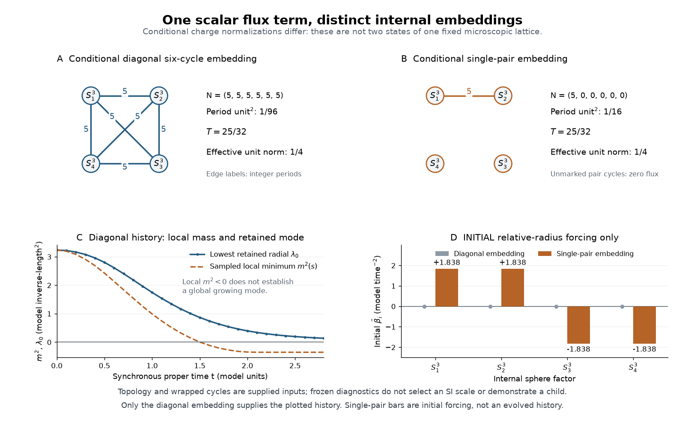

# Inherited SI scale: computed routes and remaining selector

The active question is Douglas's proposed connection between energy contrast,
the local gravitational length and the child's large-scale boundary. The
fixed action is the calculation owner: changing its representation does not
silently add a new gravitational coupling law. Earlier routes remain evidence.

## Energy contrast and the Planck-to-vacuum length ratio

The [retained calculation](../results/summaries/nsc-atlas-contrast-hierarchy-v1.json)
follows energy/state -> gravitational action -> lengths -> dimensionless
comparison. It compares three distinct operations: the Einstein-frame action,
its external Jordan metric, and the positive-vacuum sector sequence. No
extra field, fitted scale, observation fit or numerical evolution is added.

Define the gravitational Planck scale by l_P^2=kappa_nat/(8*pi) and use the
requested L_H=1/sqrt(Lambda). The latter is a positive-vacuum curvature
length; a four-dimensional de Sitter event horizon is sqrt(3)*L_H. The
action does not prove that l_P is a minimum length or a horizon is an
absolute-zero boundary. Scalar exchange would also have to be included
before identifying a measured Cavendish coupling with the Ricci coefficient.

For the d=12 reduction, kappa_E=kappa_D/V0 is constant. In the external
metric g_J=exp(-12s)*g_E, the Ricci coefficient gives

$$
\kappa_J=e^{-12s}\kappa_E,\qquad
\ell_{P,J}=e^{-6s}\ell_{P,E}.
$$

Thus a variable local gravitational length is present in this representation.
At a constant-s vacuum, Lambda_J=exp(12s)*Lambda_E and L_H,J=exp(-6s)*L_H,E.
Both lengths acquire the same factor. The direct action calculation agrees
with the [Dicke frame relation](https://doi.org/10.1103/PhysRev.125.2163) and
the [dimensionless formulation](https://arxiv.org/abs/1407.6874); no conclusion
about a rolling global horizon is imported from that constant-field identity.

Let lambda_hat(s,q)=Lambda_E*L_unit(0)^2 and g=kappa_E/L_unit(0)^2. The
governing dimensionless relation obtained from this action is

$$
\frac{\ell_{P,J}}{L_0}=e^{-6s}\sqrt{\frac{g}{8\pi}},\qquad
\frac{L_{H,J}}{L_0}=\frac{e^{-6s}}{\sqrt{\widehat\lambda(s,q)}},
$$

$$
\ln\frac{L_H}{\ell_P}
=\frac12\ln\frac{8\pi}{\widehat\lambda(s,q)}-\frac12\ln g.
$$

Here L0=L_unit(0). For two positive-vacuum endpoints of the same action,

$$
\frac{\ell_{P,c}^{J}}{\ell_{P,p}^{J}}=e^{-6\Delta s},\qquad
\frac{L_{H,c}^{J}}{L_{H,p}^{J}}
=e^{-6\Delta s}\sqrt{\frac{\Lambda_{E,p}}{\Lambda_{E,c}}},\qquad
\ln\frac{(L_H/\ell_P)_c}{(L_H/\ell_P)_p}
=\frac12\ln\frac{\Lambda_{E,p}}{\Lambda_{E,c}}.
$$

This is a quantitative contrast relation. It gives growth when the child
vacuum is smaller and positive, but does not set the root normalization.
The roll affects lambda_hat through the potential; the common conformal
factor itself cancels from the ratio. No map Delta s(Ui,Uo,sigma) is fixed
by the three thin-wall constants. The volume's initial state, sourced profile
and normal-derivative junction are still required. Time-dependent curvature
also has derivative terms, and a global horizon requires the full geometry.

For the stipulated Parke constants the unsquared wall equation gives the
exact cancellation

$$
\Lambda_i=3\left[R_c^{-2}
-\left(\frac{U_o-U_i}{3\sigma}+\frac{\kappa\sigma}{4}\right)^2\right]
=\kappa U_i.
$$

The exterior density and tension fix R_c, not a new Newton coupling. The
child's curvature-length ratio is 2.3719985906-.5*ln(g). The retained
(12,2) volume minimum gives 2.3669204107-.5*ln(g), as a separate source
evaluation. The Parke endpoints are not that volume solution's vacua.

**Comparable observations and finite controls.** Using Lambda_obs=1.0904e-52
m^-2 and l_P=1.6162550244e-35 m gives ln(L_H/l_P)=139.9343066121; the
actual de Sitter radius gives 140.4836127565. The previous 138.2604 was
minus ln(eta_e0), while 136.8439 was ln(L_P/ell_e_sigma). They are different
quantities and are not interchangeable targets. Setting g=1 only as a
declared control yields the following numbers; g=1 is not inferred by
writing arithmetic kappa=1 in the solver.

| Stipulated vacuum-density control | Density in model units | Log-ratio intercept | Log miss at g=1 (%) |
| --- | ---: | ---: | ---: |
| Parent | 21/32 | 1.8226924463 | -98.69747 |
| Child | 7/32 | 2.3719985906 | -98.30492 |
| Grandchild | 1/32 | 3.3449536652 | -97.60963 |

Every intercept still subtracts .5*ln(g). The parent and child entries are
auxiliary constant-density interpretations of nonstationary scalar snapshots.
Their ratios grow by sqrt(3), then sqrt(7), independent of g. Separately,
the relaxed scalar-only sectors 9/32,1/8,1/32 give growth factors 3/2 and 2.
These do not include the volume stabilizer and are not its descendant vacua.

**Descendant vacua with couplings held fixed.** There is a useful additional
test beyond these controls. Keep UV bare term 215/32, internal curvature
B=15/2, d=12 and scalar screening epsilon=1/4 fixed. Discharge q by e=1/2
and transport the declared j=2 ancestor label, q_A=q+1. Without rematching
any coefficient to a fresh density or equilibrium, the sector potential is

$$
V_q(s)=\left(\frac{215}{32}+\frac{q^2}{8}\right)e^{-12s}
-\frac{15}{2}e^{-14s}+\frac{(q+1)^2}{8}e^{-24s}.
$$

These are conditional homogeneous sectors of the same coupling prescription.
The averaged ancestor sheets and transitions between sectors are not thereby
constructed. Their stationary minima are:

| Region label | q | q_A | s_min | Lambda_hat_min |
| --- | ---: | ---: | ---: | ---: |
| Parent | 3/2 | 5/2 | -.03564678255 | +.220983024213 |
| Child | 1 | 2 | -.12203536150 | -2.452231934854 |
| Grandchild | 1/2 | 3/2 | -.20209261817 | -14.768058238899 |

Both descendant minima have positive second derivative but negative vacuum.
The requested positive-Lambda length is undefined there. This chain does
not produce an increasing sequence of de Sitter horizon/Planck ratios.
Keeping the original ancestor sheet fixed instead gives child/grandchild
minima -.039492243841 and -.213873093913, also negative. These are state
prescriptions, not an assertion about every possible nesting construction.

The signs have an exact check. With x=exp(-2s), V=x^6(A-Bx+Tx^6) and
6A-7Bx+12Tx^6=0 at an extremum. At the minimum,

$$
V_{\min}=x^7\left(\frac{B}{6}-Tx^5\right),\qquad
V_{\min}>0\ \Longleftrightarrow
\left(\frac{6A}{5B}\right)^5>\frac{B}{6T}.
$$

The last comparison uses exact rational coefficients; high-precision roots
independently check the displayed numbers. No absolute hierarchy or physical
percentage miss is predicted without g and a compatible source/state. The
three errors guarded against here are confusing frames with distinct
physics, comparing different length ratios, and silently rematching the
potential at every descendant. Those are the stopping boundaries of this
calculation, not reasons to reject the general nesting programme.

## Charge transport and a Parke-only ruler

The [bounded calculation](../results/summaries/nsc-atlas-charge-inheritance-v1.json)
traces the current action rather than postulating a suppression factor.
There are three different maps:

| Map | Exact charge relation | What is selected? |
| --- | --- | --- |
| Existing four-dimensional flux inheritance | q_child=q_parent-e; kappa and elementary e are unchanged; r=1 | Exact for this map, for any finite depth |
| Different volume-field endpoints in the same Einstein action | eta_child/eta_parent=exp[-6(s_child-s_parent)] | No common per-generation volume increment is supplied |
| One D=16 to 4 reduction | eta_4/eta_D=1/sqrt(v_internal) | Absolute internal volume and UV charge are unselected; this is not a demonstrated repeated spatial nesting rule |

The first relation is implemented by `FluxLaw.inherit` and by the charge
argument of `ScalarFlux.prepare`. It is the distinction between charge and
flux in the [four-form action and membrane jump](https://arxiv.org/html/hep-th/0004134#S2.SS2).
The one-line proof is

$$
\frac{\eta_{\rm child}}{\eta_{\rm parent}}
=\frac{\kappa_{\rm child}}{\kappa_{\rm parent}}
 \frac{e_{\rm child}}{e_{\rm parent}}=1.
$$

The volume extension has kappa_4=kappa_D/V0 and
e_can(s)=e_D*sqrt(V0)*exp(-6s). Its finite-energy thin-wall trace has
[s]=0: across a collar of thickness epsilon, Cauchy--Schwarz bounds the
gradient energy below by K*(Delta s)^2/(2*epsilon). A finite nonzero field
jump would diverge in the thin-wall limit. The normal derivative can jump,
K*[normal derivative s]=-6*sigma. Thus r=1 also holds between the two
one-sided wall traces. This does not require equilibrated interiors to
have the same s; their profile and endpoint values must be solved first.

For any chain within this one reduced action the volume factors telescope:

$$
\prod_{k=1}^{n}r_k=e^{-6(s_n-s_0)},\qquad
\ln\eta_n=\ln\eta_0-6(s_n-s_0).
$$

An n-fold fixed suppression would require a physically derived equal
increment of s at every step. Resetting s=0 at each level does not supply
it. The already computed matched-start-to-minimum evolution instead gives
exp(-6*s_star)=1.2384748901, an increase, not a nesting-step ratio.
Likewise a change of numerical length unit multiplies numerical kappa and
e by opposite squared factors and leaves their product unchanged.

The dimensional reduction gives eta_D=e_D*kappa_D^(4/7) and
v=V0*exp(12s)/kappa_D^(6/7). It therefore gives eta_4=eta_D/sqrt(v),
without fixing v. Repeating a reduction that changes D=16 to D=4 is not
the same operation as traversing nested four-dimensional regions.

The label j=2 selects the ancestor flux 5/2 for the averaged sheet. The
parent flux 3/2 discharges in three half-unit steps to zero; the selected
ancestor flux would take five. Neither count changes e, identifies our
location in a charge-suppression chain, or supplies a root charge.
For the actual fixed-charge map, n*ln(r)=0 for every n. Its only remaining
source of a small eta is the root normalization itself, written as
eta_D/sqrt(v_root) in the reduction. No value is selected for that
combination. A general regional volume ratio remains a separate unsolved
state comparison, not an r=1 theorem about all interiors.

**Parke-only radius ruler.** Define L_P=R_c using the requested constant
vacuum-wall inputs, without the historical R=1.9, M=.12 or C:

$$
\frac{L_P^2}{L_{\rm unit}(0)^2}=\frac{57600}{39169},\qquad
\Lambda_*L_P^2=0.3249667388661.
$$

The second number expresses the retained volume-well value
Lambda_*L_unit(0)^2=.220983024212607 on that ruler. It does not establish
a common solution of the volume source and the stipulated Parke vacua.
The actual auxiliary Parke interior instead has
Lambda_i*L_P^2=12600/39169=.3216829635681, and its exterior has
37800/39169=.9650488907044. These inputs remain declared inputs.
L_P is a wall areal radius; no matter-defined FRW slice or curvature C
is thereby supplied. Source admission and matter delivery stay parked.

On this wall ruler the exact forward relation becomes

$$
\ln\frac{L_P}{\ell_{e\sigma}}
=-1.4166194374-\ln\eta_{e,0}
=-0.7234722568-\frac{1}{2}\ln g.
$$

There are two arithmetic corrections to keep explicit. First, the old
ruler target 138.542 requires ln(g)=-275.1345556 and
ln(eta_e0)=-138.260425, or eta_e0=9.00037e-61; the earlier -137.56
omitted the factor 1/2 in eta=sqrt(g)/2. Second, changing the ruler
changes both the forward intercept and the target by
ln(R_c/a0)=-1.6981944611. Using the observed Lambda only as an inverse
benchmark now gives ln(L_P/ell_e_sigma)=136.8439139446 and
L_P=5.4591689454e25 m. Neither is a prediction. The implied root charge
is unchanged by this ruler conversion. The small difference from
138.542-1.6981944611 comes from rounding the old target.

Result: r=1 for the implemented flux map, selected n absent, predicted
log hierarchy and percentage miss undefined without eta_root. The volume
extension supplies an endpoint law, not a fixed suppressing r. No new
mechanism, field evolution, fit or target-calibrated depth is added.
Verification: symbolic reduction/telescoping/unit identities, exact Parke
fractions, target isolation, and a test that forbids the old preparation
function while evaluating L_P and its coefficient. This is a subsecond
algebraic calculation; useful parallel work is independent review and
publication validation rather than a numerical grid.

## Current audit: the geometric hierarchy and the tunnelling exponent

Retained e112798 audit; its original ruler and targets are historical inputs.

The [retained audit](../results/summaries/nsc-atlas-si-hierarchy-audit-v1.json)
uses b_HM=403.7817410357, V_star=.220983024212607 and the retained
comparison ruler a0=L_ref(0)/L_unit(0)=6.6260770761. No field evolution
or observation fit is needed. With ell_e_sigma=(5/2)*sqrt(kappa_nat),
the same geometry gives

$$
\mathcal R\equiv\frac{L_{\rm ref}(0)}{\ell_{e\sigma}}
=\frac{2.6504308304}{\sqrt g},\qquad
\ln\mathcal R=0.9747222043-\frac{1}{2}\ln g,
$$

$$
\Lambda_*\ell_{e\sigma}^2=1.3811439013g,\qquad
\mathcal R^2\Lambda_*\ell_{e\sigma}^2=9.7022370093.
$$

The reduced action is S/hbar=S_hat/g. Variation with respect to its fields
does not select an overall positive normalization. The record gives g=1
and g=1/4 dimensional completions with the same normalized geometry and
charge/tension data, but different SI rulers and quantum weights. These
are different physical normalizations, not coordinate changes in one fixed
quantum theory. The volume mode transports relative couplings without
selecting their absolute Planck normalization.

**g is not fixed by this geometry; the single missing numerical input is
eta_e0=kappa_nat*e_can(0), the absolute canonical membrane charge in Planck
units at the reference slice, with g=4*eta_e0^2.**

The action supplies a rate per four-volume, Gamma_4=A_4 exp(-B), as in
[Coleman--De Luccia](https://doi.org/10.1103/PhysRevD.21.3305) and the
[HM application](https://link.aps.org/accepted/10.1103/PhysRevD.95.123502).
Since A_4 has dimension length^(-4), a four-volume containing one expected
event has volume 1/Gamma_4. Its volume-equivalent length is therefore
A_4^(-1/4)*exp(B/4). A mean waiting time in a specified fixed three-volume
V_3 is exp(B)/(A_4 V_3). Taking a square root changes the statistic and
can introduce B/2, but supplies no geometric ruler. None has been
identified with L_ref, nor its prefactor length with ell_e_sigma.
**No hierarchy exponent is chosen.** B/4 is derived for an event-volume
statistic; it is not a derived relation for the cosmological ruler.

The requested inverse arithmetic, using the displayed logarithm 138.66:

| Imposed hierarchy | Required B | Required g |
| --- | ---: | ---: |
| exp(B) | 138.66 | 2.9120275569 |
| exp(B/2) | 277.32 | 1.4560137784 |
| exp(B/4) | 554.64 | .7280068892 |

Using the full target hierarchy instead gives ln(R)=138.6626874399 and
g=(2.9119711185,1.4559855592,.7279927796). Substituting those same g
values into the actual geometry gives:

| Exponential divisor | Geometric R | Geometric ln(R) | Logarithm miss (%) | Model Lambda_star ell_e_sigma^2 |
| ---: | ---: | ---: | ---: | ---: |
| 1 | 1.55318413 | .44030710 | -99.68246 | 4.02185115 |
| 2 | 2.19653405 | .78688069 | -99.43252 | 2.01092558 |
| 4 | 3.10636825 | 1.13345428 | -99.18258 | 1.00546279 |

The hierarchy-size misses round to -100%; the record retains the actual
tiny ratios. The observed product is Lambda_obs*ell_e_sigma^2=4.4743e-120.
The three conditional model products exceed it by factors 8.9888e119,
4.4944e119 and 2.2472e119. These are consistency checks on target-inverted
guesses, not physical predictions. No observed value selects g in the audit.

There is also an anchoring distinction. Inverting the requested geometric
hierarchy gives g=2.5453818757e-120 and B_HM=1.5863306991e122. The new
late vacuum then gives Lambda_star*ell_e_sigma^2=3.51553865e-120,
21.42826% below the observed product. This is not an independent prediction
miss: the quoted hierarchy originally used the old vacuum 9/32 and
Lambda*L_ref^2=12.3482524. The late (12,2) coefficient is 9.7022370,
so the supplied pair of target numbers cannot both hold for it. Inverting
Lambda_obs with the late coefficient instead gives g=3.2395640117e-120
and R=1.4725606528e60, ln(R)=138.5421084. Neither inversion is a selector.

Outcome: selected g, selected hierarchy exponent, predicted hierarchy,
predicted SI vacuum and prediction miss remain undefined. The forward
functions and requested inverse diagnostics are computed. Stop here until
eta_e0 is independently derived or supplied; no next route is pursued.

## Earlier source and route records

Checkpoint 485b3b9 and P004/P005 remain preserved. The following sections
describe earlier, explicitly conditional calculations.

## What is fixed before an SI ruler is supplied

The existing source fixes Lambda*L_unit^2=9/32, a0=6.626077076099598 and
Lambda*L_ref^2=12.348252398928544, where L_ref=a0*L_unit is the initial
parent curvature radius. The owner normalization is
phi_hat=sqrt(kappa_nat)*phi, q_hat=sqrt(kappa_nat)*L_unit*q,
e_hat=sqrt(kappa_nat)*L_unit*e and omega_hat=L_unit*omega/c.
Arithmetic kappa=1 has absorbed the gravitational coupling; it does not
identify the numerical simulation unit with one Planck length.

Use CODATA 2022 only for unit conversion: lP^2=hbar*G/c^3 and
kappa_nat=8*pi*lP^2. In mixed SI stress conventions kappa_SI=8*pi*G/c^4,
so kappa_nat=kappa_SI*hbar*c. Substituting kappa_SI directly as a squared
length would be a dimensional error. The independent route audit found
that issue in a draft; no draft SI numbers are promoted to the record.

The computed [route ladder](../results/summaries/nsc-atlas-SI-scale-ladder-v1.json)
and its tests keep target-dependent inverse diagnostics separate from
target-independent conditional predictions.

## A surviving microscopic SI relation, distinct from selecting L_ref

The [coupling-ratio calculation](../results/summaries/nsc-atlas-inherited-microanchors-v1.json)
makes an essential distinction: the free parent curvature scale does not
make every SI coupling combination free. The inherited source has
sigma_hat=kappa_nat*L_unit*sigma_phys and
e_hat=sqrt(kappa_nat)*L_unit*e_phys. Therefore

$$
\frac{e_{\rm phys}}{\sigma_{\rm phys}}
=\frac{\hat e}{\hat\sigma}\sqrt{\kappa_{\rm nat}}
=2.0256752716\times10^{-34}\ {\rm m}.
$$

This microscopic canonical charge/tension length is fixed by the supplied
ratios and G,hbar,c; it is not selected using Lambda_obs.
Canonical charge and tension here are expressed in inverse square and
inverse cubic metres after the hbar=c=1 conversion; the ratio is a length
in that convention. An unconverted SI surface energy must first acquire
its hbar*c factor. These definitions are those of the declared action.
Other fixed SI combinations are (omega_phys/c)/e_phys=1.6205402173e-25 m and
sqrt[(omega_phys/c)/sigma_phys]=5.7294748842e-30 m. They all remain fixed
in the explicit dimensional-completion witnesses while the parent Lambda
changes. Thus they survive as conditional coupling relations, not as a
cosmological-radius closure. The needed parent/microscopic hierarchy would
be 1.6612691531e60 if the target were inserted. That hierarchy is unselected.
In the ladder record, `inherited_SI_scale_selected` refers to the parent
reference scale, not to these microscopic combinations. The target goal
remains unachieved.

## Ranked route ladder

1. **Flux/charge quantization:** q/e=3, screened vacuum levels (9/32,1/8,1/32,0), second difference 1/16; fundamental SI charge and L_ref remain free.
2. **Inherited wall EOS/radius:** e_phys/sigma_phys fixes 2.0256753e-34 m, but frozen stationary radii (1.846303,1.155844) give V_second=(-1.28718,-11.32694); no cosmological-radius hierarchy is selected.
3. **Recursive fixed point/level:** vacuum-length ratios are 1.5 then 2 and the flux-map fixed-point residual is -1/2; no constant geometric ratio/root length or full M,sigma,ell closure is selected.
4. **Scalar frequency/epoch:** Lambda*c^2/omega^2=2.8125e-19 and the calibrated equality redshift is .331586; an SI scalar frequency is absent.
5. **Compact four-cycle period:** the formal added S4 premise gives Lambda*lP^2=1/n; n=1 gives 3.8280731e69 m^-2, while no inherited winding or admissible cycle/contour for the excited parent has been derived.
6. **Semiclassical transition weighting:** isolated pure-flux action coefficients (.6956584,3.1684104,70.9872067) still multiply L_unit^2/kappa_nat and are not the interacting parent's rate or a selector for L_unit.
7. **Quantum occupation/entropy:** a hypothetical one-quantum normalization gives Lambda=9.17759e61 m^-2, but the actual real classical scalar supplies neither that number state nor an inherited occupation.
8. **Anomaly/running/transmutation:** prior added classical vacuum trace is zero; a quantum stationary scale needs a compatible renormalized action/state and subtraction condition which the fixed source does not specify.
9. **Induced gravity/Casimir/compactification:** the stable alternative body's Lambda*M^2=.1144906 still requires an SI mass/modulus/boundary state and uses a different surface action.
10. **Infinite hierarchy/global similarity:** ell_n=r^n ell_0 transports a scale without selecting ell_0 or the observer level.
11. **Legacy S-one spectral fixed point:** the old gap threshold 3*pi/2 and alternative coefficient 18*pi retain a supplied length_anchor and no solved physical fixed point; that action is not the fixed parent.

These are all route classes identified in the existing atlas/source inventory,
not an assertion that every future physical mechanism has been exhausted.
The [stationary-wall calculation](../results/summaries/nsc-atlas-wall-scale-stationary-v1.json)
uses the existing constant-tension potential at the actual initial field.
Its instantaneous frozen representation is not a coupled-future stability
result. The separate stable surface-scalar action is not imported as its EOS.

## Full evaluation of the quantization candidate

Brown--Teitelboim and its quantized-flux extension are reused from
[Bousso--Polchinski, Section 2](https://arxiv.org/html/hep-th/0004134).
Their jump condition and absolute/period quantization are distinct.
In the present scalar source the late actual four-form is F_hat=epsilon*q_hat,
while the displacement q_hat has the electric integer q_hat/e_hat=3.
That integer does not fix a fundamental charge in metres.

The strongest explicit added period candidate assumes a compact Euclidean
S4 of radius sqrt(3/Lambda), an admissible real integration contour and
the period e*integral(F4)=2*pi*n. This is a candidate global preparation,
not a constructed continuation of the excited three-region initial atlas.
Its unit-volume factor is 24*pi^2/Lambda_hat^2. With the owner's field
normalization the period is

$$
\hat e\,\epsilon\hat q\,
\frac{24\pi^2}{\hat\Lambda^2}\frac{L_{\rm unit}^2}{\kappa_{\rm nat}}
=2\pi n,
\qquad
\Lambda\ell_P^2=\frac{3\hat e}{n\hat q}=\frac{1}{n}.
$$

No integer is selected from the target. The minimal illustrative winding
n=1 gives L_ref=5.6795331e-35 m and Lambda=3.8280731e69 m^-2,
3.5107054e121 times the target. Matching the target would require
n approximately 3.5107054e121, which the supplied inheritance does not
produce. The electric integer 3 and this four-cycle winding are different
objects. Equating them is an extra condition, and would still give a
Planck-scale Lambda. Lorentzian/Euclidean contour compatibility and the
actual global saddle must be established before this formal family is a
physical NSC spectrum. This candidate does not survive the requested test.

The existing BT instantons are borrowed, not re-derived. Their finite
pure-flux controls are [Hirano's](https://arxiv.org/html/1804.09985) zero-mass
vacuum setting, not P002 or the interacting scalar parent. For illustration,
inserting the target-derived ruler would make the first exponent
2.7330216e119 in hbar units. Its enormous value is not a selected scale.

## Why assigning the target is not the requested result

Inverting the target would give L_unit=5.0787091733e25 m and
L_ref=3.3651918430e26 m. This would merely force Lambda/Lambda_obs=1.
It is stored as an inverse diagnostic, not a prediction. The corresponding
scalar angular frequency would be 5.9029263e-9 s^-1 (period 33.7294 years),
which is an independent possible physical clock to investigate, not a
measured or derived inherited clock here.

Two exact dimensional completions demonstrate the remaining freedom:
L_ref=1 m and L_ref=2 m reproduce the same normalized q/e=3, charge .5,
flux 1.5 and source geometry, but give Lambda=12.3482524 and 3.08706310
m^-2. They are mathematical witnesses, not proposed astronomical values.
The physical quantum-action normalization changes with this dimensional
completion; no quantum selector is supplied by the frozen classical tests.

No audited route yet returns an inherited, uniquely SI-fixed cosmological
scale. The target remains unresolved. This statement concerns the missing
selector in the fixed realization; it is not a rejection of nesting.

## Proposal for Douglas's review: derive and select the physical charge unit

Status: the approved conditional construction is implemented below. Its
dimension and ancestral source are unselected, as the 29 October audit
proves. The original source, likelihood results and P004/P005 remain fixed.

The unresolved quantity can be expressed as one dimensionless coupling,
g_scale=kappa_nat/L_unit^2, or eta_e=kappa_nat*e_can=ehat*sqrt(g_scale).
For this source Lambda=(9/32)*g_scale/kappa_nat. The target would require
g_scale=2.5453818753e-120 and eta_e=7.9771264803e-61; these are diagnostics,
not values supplied to a selector. The microscopic e/sigma length is
already fixed while this charge magnitude remains free.

The recommended research construction is one physical geometric modulus
of an enclosing parent that controls the canonical charge normalization,
together with its derived dynamics/state. This is new physical content:
the present four-dimensional action treats e,m,sigma as parameters. A
uniform change of units is not a modulus; varying L_unit at fixed hats
changes the physical coupling family. A normalized Gaussian state exists
for many couplings and does not by itself select one.

The alternatives considered are a full-cycle winding/state rule (still
missing its actual cycle, contour and inherited integer), an independently
measured SI clock (a calibration rather than inheritance-alone), and more
classical wall/shape work (retains the scale freedom). The geometric
charge-normalization construction directly addresses the free coupling.
Its credibility depends on deriving the missing sector rather than
postulating a potential with the desired minimum.

Proposed execution after review:

1. Specify a physical parent geometry and one gauge-inequivalent modulus s.
   Derive its kinetic coefficient and the three-form kinetic normalization
   Z(s). Preserve gauge invariance by keeping the topological charge fixed;
   the canonical charge would be e_can=e_UV/sqrt(Z(s)). Derive the Planck
   normalization of e_UV too. Setting e_UV=1 would leave a supplied scale.
2. Derive a selection action Gamma_sel[s] from that same parent and one
   explicit inherited-state prescription. Every geometric, flux, boundary
   and quantum term and every subtraction condition must have an owner.
   If a controlled local potential exists, solve V_eff'(s*)=0 with positive
   kinetic norm and V_eff''(s*)>0. A nonlocal causal action needs its actual
   stability condition instead. Do not assume a minimum or tune coefficients
   using Lambda_obs. State normalization alone is not a selecting equation.
3. Match canonical charge, tension, scalar frequency and the total vacuum
   stress back to the fixed normalized parent. Include the new sector's
   gravitational stress and vacuum energy; do not subtract its minimum by
   hand. A mismatch defines a separate candidate rather than an invisible
   modification of 485b3b9.
4. Only when these equations exist, solve the resulting one-mode problem,
   compute g_scale, L_unit, L_ref and Lambda in SI with uncertainty, then
   compare the target and predict a second observable with calibration held
   fixed. No additional cosmological fit is needed to formulate the selector.

Douglas approved this construction. Implementation ownership remains here
and in the atlas owner. The current scalar/flux modules are frozen matching
references. `nsc_atlas_parent_scale_selector.py` owns the new physical volume
sector and its checks. No extra physics library or field-grid campaign is
needed for this derivation.

Goldberger--Wise's [bulk/boundary modulus stabilization](https://arxiv.org/html/hep-ph/9907447v2)
is a method precedent in a different geometry. Bousso--Polchinski's
[charge normalization and compactification discussion](https://arxiv.org/html/hep-th/0004134#S2.SS5)
identifies microscopic charge and geometry dependencies. Neither paper
supplies this NSC sector or its numerical parameters.

Completion criteria for the proposed selector: one physical scale degree
with a derived selecting equation; no adjustable SI coupling, root integer,
initial modulus value or finite vacuum offset fixing the answer; an isolated
stable state/value with controlled approximation; and explicit matching to
the frozen parent. A claimed prediction is compared with Lambda_obs only
after it is computed. Its second-observable consequence can falsify that
candidate. The existing dimensionless 3*Omega_Lambda/curvature tensions are
separate: changing the overall scale cannot remove them.

Failure forecast:

- The proposed scale mode is gauge or absent from the parent action: the
  construction needs an explicit geometric/theory extension, not a variation
  of a unit choice.
- Z(s), e_UV, a boundary state or a renormalized constant remains freely
  selectable: the hierarchy has been renamed rather than derived.
- The derived state is unstable, gives the wrong scale or fails normalized
  matching/its second observable: record that candidate's failure and move
  to a separately specified mechanism without retuning it to the target.

## Executed: a physical volume, inherited source and moving vacuum

The approved first connection is now explicit. This is a new homogeneous
effective-action candidate, not a modification of checkpoint 485b3b9 or a
claimed SI solution. The [compact calculation](../results/summaries/nsc-atlas-parent-volume-selector-v1.json)
contains its coefficients, two clocks, scalar controls and remaining inputs.

### Dimensional reduction that preserves the source ratios

Take D=4+d Einstein gravity, a canonical bulk scalar Phi, a top-form F_D,
its scalar mixing, and charged (D-2)-branes wrapping the complete compact
Einstein space. The positive-kinetic bulk action has R_D/(2*kappa_D),
-(dPhi)^2/2, -m_D^2*Phi^2/2, -rho_D, -|F_D|^2/2 and the topological
mu_D*Phi*F_D coupling. Here |F_D|^2 includes 1/D!. Use the fixed-displacement
boundary term before eliminating the form, as in the cited four-form work.
Define an internal reference metric gamma, volume V0 and normalized volume
form eta_d with integral one. Set

$$
ds_D^2=e^{-ds}ds_{4,E}^2+e^{2s}\gamma_{ab}dy^a dy^b,
\qquad F_D=F_4\wedge\eta_d,\qquad \phi=\sqrt{V_0}\Phi.
$$

Integration gives kappa_4=kappa_D/V0 and the physical kinetic coefficient
K=d(d+2)/(2*kappa_4), with L_kin=-K*(ds)^2/2. Internal volume changes are
not coordinate transformations. Direct metric contraction gives

$$
Z_3(s)=\frac{e^{ds}}{V_0},\quad
e_{\rm can}=e_D\sqrt{V_0}e^{-ds/2},\quad
\sigma_4=\sigma_D V_0e^{-ds/2},\quad
(m_4,\mu_4)=(m_D,\mu_D)e^{-ds/2}.
$$

The displacement flux scales like e_can. Consequently q/e, epsilon,
sigma/e and omega/e are invariant. The scalar minimum
phi_star=-mu0*q0/omega0^2 is independent of s. The old dimensionless
source hats stay fixed at each constant s using L_unit(s)=L0*exp(ds/2).
This is a physical co-scaling law; it is not yet the full dynamical
inheritance theorem. Keep A3 unrescaled and its topological charge fixed
while s varies; a time-dependent canonical redefinition has derivative
terms. Canonical instantaneous charges alone are not a new gauge action.

The reduced potential is

$$
V(s,\phi)=e^{-ds}U_0(\phi,q_0)-B e^{-(d+2)s}+W(s),
\qquad B=\frac{R[\gamma]}{2\kappa_4}.
$$

U0 contains the old scalar/four-form potential and the UV bulk vacuum.
The bulk and wrapped-source reduction is homogeneous; W below adds an
explicit averaged source. The mathematical reduction and inherited ratios
are independently calculated here. Bousso--Polchinski supplies the
flux/charge-normalization precedent; Goldberger--Wise supplies the
different-geometry modulus-stabilization precedent. Neither source
supplies these NSC coefficients or a selected internal dimension.

### What stress can stabilize the positive vacuum

Write the late scalar-vacuum potential as
V=A*exp(-ds)-B*exp(-(d+2)s)+W. Matching V(0)=rho=9/32 and V_s(0)=0 gives

$$
A=B+\rho-W(0),\quad
B=\frac{d\rho-dW(0)-W_s(0)}{2},
$$

$$
V_{ss}(0)=-d(d+2)\rho+\mathcal S_d[W](0),\qquad
\mathcal S_d[W]=W_{ss}+2(d+1)W_s+d(d+2)W.
$$

For a power exp(-ps), the added stiffness is (p-d)(p-d-2)*W(0).
The original bulk and curvature powers lie in the kernel. Without an
additional source, canonical m_s^2/H_vac^2=-6: the matched positive
vacuum is unstable in every d>0. For d=1 a round internal circle has zero
curvature and cannot even supply the required positive B. This retires
that minimal stabilizer, not nesting.

A localized four-dimensional vacuum sheet has induced volume exp(-2ds).
Its homogeneous internal average therefore supplies W=T*exp(-2ds).
This is a declared additional source, not a proved localized uplift.
The [smooth pair-flux completion below](#smooth-pair-flux-completion-and-its-shape-operator)
now supplies that same exponent in a different explicit higher-dimensional
scalar-sector completion. It does not derive the inherited charge coupling.
Assign T the existing vacuum law epsilon*q_A^2/2 with
q_A=q_parent+j*e. Identifying that sheet with an ancestor's vacuum is
an added coupling/state prescription; flux arithmetic alone does not
construct its location or stress in the higher-dimensional geometry.

The same coherent scalar carries an adiabatic action J=a^3*E/omega.
Thus, in the averaged description, E(s,N)=(3/8)*exp(-3N-ds/2).
Match the actual initial matter, not only the late vacuum. The result is

$$
B=\frac{d}{2}\left(\rho+T+\frac{E_0}{2}\right),\quad
A=B+\rho-T,\quad
V_{{\rm total},ss}(0)=-d(d+2)\rho+d(d-2)T-\frac{d(3d+4)}{4}E_0.
$$

For an ancestor one step above, q_A=2, the last expression times 32/d is -2d-62;
no dimension stabilizes the supplied initial matter state. For an ancestor
two steps above, q_A=5/2, it is 7d-80. The first stable integer in this
specified depth-two family is d=12, giving

$$
A=7,\quad B=\frac{15}{2},\quad T=\frac{25}{32},\quad
K=84,\quad V_{{\rm total},ss}(0)=\frac32.
$$

d=12 is a candidate choice, not an inferred dimension of nature or a
unique ancestry. The required UV bulk term A-rho=215/32 and internal
curvature are matching conditions, not outputs of inherited microscopic
physics. No vacuum minimum is subtracted by hand.

### Coupled evolution, conservation and the oscillator connection

Hold A,B,T fixed. In kappa_4=1 units the averaged equations are

$$
\dot N=H,\quad \dot s=v,\quad
K\dot v=-3HKv-V_s+\frac{d}{2}E,\qquad
H^2=\frac{Kv^2/2+V+E}{3}-C e^{-2N}.
$$

Use the old C=61720739711/2709842745600 and initial N=s=v=0.
The initial Friedmann density and H are exactly the old parent's.
This only matches its homogeneous initial sector: all walls must also
couple to s before claiming a new shared three-region solution.
The new wall variation already fixes a specific necessary datum. With the
normal directed from minus to plus, its scalar junction is

$$
K[\partial_n s]=\frac{d\sigma_4}{ds}=-\frac{d}{2}\sigma_4,
\qquad [\partial_n s]_{s=0}=-\frac{1}{70}.
$$

Thus a globally uniform initial s with zero momentum cannot simply be
appended to the old atlas. A nonuniform collar or an additional inherited
surface state must supply this jump; its gradient energy must enter the
gravitational initial constraints. The calculation here evolves only the
homogeneous sector, without claiming that missing common domain.

The full oscillator instead has E=(Pi^2+omega(s)^2*chi^2)/2,
omega(s)=omega0*exp(-ds/2), chi_dot=Pi and
Pi_dot=-3H*Pi-omega(s)^2*chi. Its volume force is d*omega^2*chi^2/2.
Both systems obey an exact total-energy ledger: rho_dot=-3H*(Kv^2+E)
for the average, and -3H*(Kv^2+Pi^2) for the oscillator.
Initial stationarity applies to the average. The actual coherent phase
Pi=0 gives v_dot(0)=3/112 in the d=12 candidate, instead of zero. The
resolved controls retain that phase; the exact initial force is not
silently replaced by its average.

The corrected-action connection extends the fixed-frequency construction:

$$
D=\frac{a^3 E}{\omega},\quad S=a^3\chi\Pi,\quad
c=\frac{3H-dv/2}{2\omega},\quad I=D+cS,
\qquad \dot D=-c\dot S,\quad \dot I=\dot c S,\quad |S|\leq D.
$$

This identity is exact at variable frequency. If |c|<1, the integral
of |c_dot|/(1-|c|) controls I; endpoint c factors then bound D. The
original P005 bound is not silently imported into the changed dynamics.
Two short resolved controls at omega0=200 and 400, to N=.1, give absolute
s differences from the average 1.417e-7 and 3.680e-8. Their corrected-action
ledger relative residuals are below 2.3e-9. They check the new equations;
they do not certify the complete omega0=1e9 trajectory or extra dimensions.

At N=4, the averaged evolution gives s=-.0356690060, volume ratio
.6517931, charge/tension/frequency ratio 1.2386400 and vacuum density
.2209830695. Proper and expansion clocks differ in s by 1.64e-12;
tighter tolerance changes it by less than 2e-10. The total energy ledger
closes within 2.3e-12. These are numerical controls, not interval proofs.

The late minimum is s_star=-.0356467826, V_star=.2209830242 and
m_s^2/H_vac^2=29.64537. All positive extrema are found from the polynomial
42-52.5*x+9.375*x^6=0, x=exp(-2s), with its one positive turning point;
there is no field-grid scan. The other extremum is a barrier at
s=.0600005350 with V=.3545366775.

At the computed N=4 entry, total energy .2209870955 is below that barrier
by .1335495820. Conditional on this finite entry, the exact averaged
energy law traps the volume in the left compact sublevel component.
H^2 remains at least .07365336 because curvature decays and V is bounded
below by V_star there. Matter then decays, damping removes volume kinetic
energy, and the only limiting stationary point in that component is the
positive minimum. This establishes the averaged basin implication; finite
entry is numerical, and the claim excludes the full scalar and localized
higher-dimensional problem.

### The resulting number and the remaining absolute scale

With the original reference curvature radius L_ref(0)=C^(-1/2)*L_unit(0),
the late vacuum of the declared (d,j)=(12,2) member has
Lambda_star*L_ref(0)^2=9.7022370093, compared
with the matched initial 12.3482523989. This new effective source evolves;
the old supernova/DESI scores and P004/P005 do not validate it.

Let eta_D=e_D*kappa_D^[D/(2(D-2))] and let
v_internal=V0*exp(ds)/kappa_D^[d/(d+2)] be internal volume in parent
Planck units. The exact reduced normalization is

$$
\kappa_4 e_{\rm can}=\frac{\eta_D}{\sqrt{v_{\rm internal}}}.
$$

The calculation determines a relative volume change, not either factor
on the right absolutely. It therefore does not return L_ref in metres
or Lambda_obs. The remaining useful physical work is a parent source/state
construction that fixes eta_D, reference volume, required bulk energy and
the ancestor sheet together. Assigning eta_D=1 or choosing the internal
volume from the target would not complete that work.

Calculation admission: reuse the published Einstein reduction/fixed-flux
method; the missing connection is a physical geometric coupling mode.
Fixed assumptions, coefficients and matching are above. Domain: the
homogeneous averaged branch 0<=N<=4, plus two resolved scalar controls
0<=N<=.1; no spatial or parameter grids. Budget: 180000 RHS calls per
solve, actual largest 4217, and one tolerance/independent-clock comparison.
Independent checks differentiate the action and conservation identities
symbolically. Stop/redirection: retain this conditional connection and
advance to the physical UV/source closure; do not repeat finished volume
precision checks. No claim of SI closure, full localized uplift, other-mode
stability or an unchanged observer likelihood is admitted.

## Selection audit: inheritance permits a family — 29 October 2026

The [general calculation](../results/summaries/nsc-atlas-volume-family-selection-v1.json)
confirms Douglas's independent check: 9.7022370093 is one member's
coefficient. Neither d=12 nor j=2 follows from the current inherited law.
Here j means the depth of the ONE ancestor assigned to the vacuum sheet,
q_A=(3+j)/2. It does not mean that j separate sheet energies were summed.
The physical coupling to that particular ancestor is itself a premise.

With rho=9/32, E0=3/8 and T_j=(j+3)^2/32, differentiating the matched
potential gives the exact general initial stability condition

$$
\frac{32}{d}V_{{\rm total},ss}(0)
=d\left[(j+3)^2-18\right]-2(j+3)^2-30>0.
$$

There is no stable initial member at j=1. At j>=2,

$$
d>\frac{2(j+3)^2+30}{(j+3)^2-18}.
$$

The first stable dimensions for j=2,3,4,5,6,7 are respectively
12,6,5,4,4,3. Every larger integer d at each of those depths also passes
this initial homogeneous test. Hence stability admits infinitely many
pairs; it cannot select (12,2). Minimizing j first and then d gives
(12,2), while minimizing d first and then j gives (3,7). Neither
optimization order is an inheritance equation or a thermodynamic law.

The [normalized-pullback construction](nsc-nested-qualities.md#1-a-concrete-meaning-of-the-inheritance-transformation)
fixes its operator data before proving covariance. Its block dimension is
not identified with the present internal manifold dimension. The physical
top-form reduction likewise preserves q/e, epsilon, sigma/e and omega/e
for every admitted d. Iterating q -> q-e supplies fluxes at a specified
depth; it supplies no preferred ancestral sheet. No equality in those
constructions excludes the alternative pairs.

### Exact family envelope without another evolution campaign

For x=exp(-2s), the stationary equation is

$$
F(x)=dA-(d+2)Bx+2dT x^{d/2}=0.
$$

For d>2, A,B,T>0, F is strictly convex, with F(0)>0,
F(1)=-dE0/2<0 and F tending to positive infinity. Thus it has exactly
two positive zeros, one on either side of one. The larger zero gives
the late local minimum s_star<0. These brackets permit direct root solves.
They do not require a time evolution or a field grid.

The range can also be proved rather than inferred from sampled cases.
Write u=ds and S0=rho+T+E0/2. After matching,

$$
V=e^{-u}\left[\rho-T+\frac{d S_0}{2}(1-e^{-2u/d})+Te^{-u}\right].
$$

At its stationary minimum the implicit derivative through u_star vanishes.
Putting x=exp(-2u/d), the remaining derivatives are

$$
\partial_T V=e^{-u}\left[\frac d2-1-\frac d2 x+x^{d/2}\right]>0,
$$

$$
\partial_d V=\frac{e^{-u} S_0}{2}
\left[1-(1+2u/d)e^{-2u/d}\right]>0.
$$

The first inequality follows from convexity of x^(d/2); the second from
exp(y)>=1+y. Both are strict at u_star<0. Therefore the late minimum
increases with d and with ancestor depth j. This is a relation between
rematched family members, not evolution or minimization over dimensions.

| Internal d | Ancestor depth j | Initial stiffness | Late Lambda_star L_ref(0)^2 |
| ---: | ---: | ---: | ---: |
| 10 | 2 | -25/8 | 9.4081354382 |
| 12 | 2 | 3/2 | 9.7022370093 |
| 16 | 2 | 16 | 10.0059843737 |
| 30 | 2 | 975/8 | 10.3417566076 |
| 12 | 3 | 171/4 | 10.9168326115 |
| 30 | 4 | 6015/8 | 11.6042698624 |
| 6 | 3 | 9/8 | 9.9915736476 |
| 3 | 7 | 3/2 | 10.7279322431 |

Thus the quoted rectangle 10<=d<=30, 2<=j<=4 has extrema
9.4081354382 and 11.6042698624, certified as rectangle corners by
monotonicity. The d=10,j=2 member has a late minimum but an unstable
initial equilibrium. Imposing positive initial stiffness raises this
rectangle's lower endpoint to 9.7022370093. That depends on the chosen
rectangle and does not select a physical member. Eight stationary solutions
are checked independently at 70-digit precision in the original s variable.

### The precise missing connection

There is a stronger mathematical property of the reference point. All
initially stable integer pairs are coordinatewise above at least one of
the five frontier pairs

$$
(12,2),\ (6,3),\ (5,4),\ (4,5),\ (3,7).
$$

This list follows directly from the exact minimum-dimension staircase:
j=2 needs d>=12; j=3 needs d>=6; j=4 needs d>=5; j=5,6 need d>=4;
all j>=7 permit d>=3. Strict monotonicity reduces the whole infinite
family's minimum to these five points. Their late coefficients are
9.7022370, 9.9915736, 10.6351761, 10.7761793 and 10.7279322.
Consequently (12,2) uniquely minimizes the late vacuum among this entire
initially stable, rematched family. This is an extremal theorem; it is
stronger than being the first tested stable example.

The ordering is also enclosed by exact rational arithmetic. With y=exp(-s),
stationarity becomes the integer-power polynomial
dA-(d+2)B*y^2+2dT*y^d=0, including for odd d. Rational bisection brackets
its root above one; termwise interval bounds enclose V/C. The five
outward-rounded intervals are disjoint and establish the strict smallest
value without relying on floating-point equality.

It is not yet a physical selection theorem. Nature minimizing this
particular function over these different actions would be an additional
premise. A common parent theory must first make the branches admissible,
their energy normalization comparable, and their state/transition law
available. Neither inheritance covariance nor the local s equation
provides that global variational principle. No thermodynamic selection
or tunnelling preference has been derived here.

Each family member changes A, B, T and the required bulk energy. Across d,
even the dimensionality of the parent action changes. These are competing
conditional effective actions, not a transition already described by a
single fixed ultraviolet theory. V_s=0 selects a volume within a chosen
action; it is not a variation with respect to d or an ancestral label.

Independent parent data could remove the ambiguity. For example, if A and
B were independently inherited in the same s=0 normalization, matching
would require

$$
T=B+\rho-A,\qquad
j=\sqrt{32T}-3,\qquad
d=\frac{2B}{\rho+T+E_0/2}.
$$

Their values would also need to yield admitted integers and a compatible
parent source. Feeding A=7 and B=15/2 into these equations recovers
(12,2), but those coefficients were originally built from (12,2).
That inversion is circular and supplies no new evidence.

The next physical requirement is a common parent action/geometry and
inherited state that independently supplies the compact space and the
ancestor-sheet coupling. An alternative would be a derived, normalized
selection rule over those physical branches. No such rule is currently
present. A proposed tunnelling weight would require its common action,
state and prefactor before it could rank these different models.

Decision: retain the verified dynamics as a conditional example and stop
treating its numerical coefficient as selected. Complete: exact selection
audit, analytic monotonicity and numerical witnesses. Next: the missing
common parent/source rule, before pursuing an SI scale based on one pair.
This audit uses no new evolution, target fit or additional physical state.

## Smooth pair-flux completion and its shape operator

The [computed completion](../results/summaries/nsc-atlas-sphere-flux-completion-v2.json)
replaces the averaged stabilizer in one explicit candidate. It retains the
existing two-scalar action; it does not complete the original charged
four-form/membrane theory or select its coefficients. The construction is
implemented in `nsc_atlas_sphere_flux_completion.py`.

Take a classical parent action

$$
I_{16}=\int\sqrt{-G}\left[
\frac{R_{16}-2\Lambda_{16}}{2\kappa_{16}}
-\frac12(\partial\Phi)^2-\frac12m_{16}^2\Phi^2
-\frac{F_6^2}{2\,6!}\right].
$$

The matter terms are outside the gravitational prefactor. Choose
gamma=(S3_r)^4, r²=8/5, V0=(2pi²r³)^4, kappa16=V0, Lambda16=7 and m16=20
in the retained classical units. The common quantum action normalization
1/g remains unspecified; this kappa4=1 convention does not determine
kappa_nat/L_unit² or an SI length. With Phi=chi/sqrt(V0), set

$$
ds_{16}^2=e^{-12s(x)}ds_{4,E}^2+e^{2s(x)}\gamma,
\qquad F_6=q\sum_{i<j}\omega_i\wedge\omega_j,
\qquad q=\frac{5/2}{\sqrt{24V_0}}.
$$

Each omega_i is the fixed-reference volume form of its three-sphere,
with pointwise norm1. Its integral is the sphere volume. It is not an
evolving orthonormal form held constant by hand. Exact contractions give

$$
|F_6|_\gamma^2=6q^2,\qquad
\langle\iota_aF_6,\iota_bF_6\rangle=3q^2\delta_{ab}.
$$

Consequently the common-radius internal flux stress vanishes, while its
external stress is -3q² exp(-12s)G_munu. Physical flux amplitudes dilute as
q exp(-6s). Bianchi and Maxwell hold for varying s(x): the reference forms
are closed and parallel, and

$$
*_{16}F_6=\pm e^{-24s}\,\mathrm{vol}_{4,E}\wedge *_\gamma F_6.
$$

The external derivative has degree5 on the four-coordinate base; the
internal derivative vanishes. A5 is patchwise because the flux periods
are nonzero. Mixed and internal tracefree Einstein components are unsourced
on this common-radius ansatz: Ric_gamma=(5/4)gamma and all remaining source
terms are isotropic internally. The retained equations are therefore a
consistent classical sector, not merely an extremum of an averaged action.

Dimensional reduction gives K=84, mu²=400 exp(-12s), and

$$
V(s)=7e^{-12s}-\frac{15}{2}e^{-14s}+\frac{25}{32}e^{-24s}.
$$

In particular, R_gamma/2=15/2 and the flux energy is3V0q²=25/32. The old
T term is replaced, not counted twice. A separate constant-vacuum check
of the internal Einstein equation gives
(5/4)exp(-2s)=1+(25/112)exp(-12s), exactly equivalent to V_s=0.
Topology, flux periods, bulk couplings and scale normalization are supplied.
No dimension selection, charge inheritance, SI prediction or round-S12
Dirac spectrum follows from this replacement.

### The omitted relative radii

Write the four radii as r exp(s+beta_i), sum beta_i=0. Their kinetic term
is -3 sum_i(partial beta_i)²/2 at kappa4=1. Their full potential is

$$
V(s,\beta)=7e^{-12s}
-\frac{15}{8}e^{-14s}\sum_i e^{-2\beta_i}
+\frac{25}{192}e^{-24s}\sum_{i<j}e^{-6(\beta_i+\beta_j)}.
$$

The three canonically normalized traceless shapes have equal local masses

$$
m_\beta^2(s)=-\frac52e^{-14s}+\frac{25}{8}e^{-24s},
\qquad s_{\rm shape}=\frac{\ln(5/4)}{10}=.02231435513.
$$

The mass is3.23397763 at the retained volume minimum and-.11142207 at the
actual driven maximum s=.21037574. That negative local coefficient is not
by itself an instability of the spatially extended parent.

For the admitted directional history, h=q²dchi²+b²sin²chi dOmega² and
u=coschi. The actual frozen-slice shape operator is

$$
\mathcal A=-w^{-1}\partial_u(p\partial_u)+m_\beta^2(s),
\quad w=4\pi\sqrt{1-u^2}\,qb^2,\quad p=w(1-u^2)/q^2.
$$

Smooth scalar functions at both poles are used, with both cap parities.
Angular sectors add the nonnegative term ell(ell+1)/(b²(1-u²)); the ground
can be sought in the radial sector. Degrees32/48 and independent401/601
quadratures on29 saved slices give:

| Proper time | Lowest retained eigenvalue |
| --- | ---: |
| 0 | 3.23397763 |
| 1 | 1.74201332 |
| 2 | .39298896 |
| 2.8 | .13393326 |

The largest degree difference is4.29e-9; the largest quadrature difference
is5.86e-14. These are empirical differences, not continuum error bounds.
Positive Ritz minima cannot exclude unrepresented negative directions;
the sampled positive supersolutions are not whole-interval certificates.
No negative retained direction was found, so the local mass crossing is
not advertised as a global instability. Time-dependent amplification and
physical state selection remain different questions. Exact beta=0 data
stay zero under this equal-flux source.

### What charge inheritance must additionally specify

A compact charge-lattice identification requires the wrapped six-cycle.
Let Nij be integer pair-cycle periods and E² the squared elementary period.
At equal radii,

$$
T=\frac{E^2}{2}\sum_{i<j}N_{ij}^2,\qquad
\ddot\beta_i=E^2e^{-24s}\left[d_i-\frac12\sum_{k<l}N_{kl}^2\right],
\quad d_i=\sum_{j\ne i}N_{ij}^2,
$$

for initially resting equal shapes. Two microscopic charge embeddings give
the same retained T and the same effective inherited unit norm1/4:

| Wrapped class | E² | Integer periods | T | Shape acceleration coefficient, before exp(-24s) |
| --- | ---: | --- | ---: | --- |
| Diagonal combination of all six cycles | 1/96 | (5,5,5,5,5,5) | 25/32 | (0,0,0,0) |
| One pair cycle | 1/16 | (5,0,0,0,0,0) | 25/32 | (25/32,25/32,-25/32,-25/32) |

These are different microscopic period identifications, not two states of
an already fixed primitive charge lattice. The effective step vectors have
squared norm(1/96)*6=(1/16)*1=1/16. Thus the scalar inherited charge and
vacuum energy alone do not select the source's shape forcing. The single-pair
initial relative accelerations would be(+1.83797184,+1.83797184,-1.83797184,
-1.83797184) at s_star. Its subsequent history must be recomputed with
the shapes; the equal-flux trajectory is not reused as that solution.

If the same positive reference charge inner product is inherited, equality
in the triangle inequality for the linear3->4->5 unit-norm ladder requires
collinear initial and step vectors. It does not choose which wrapped
homology class that direction represents. Transporting the charge metric
when shapes change is itself part of the missing inheritance map.

There is an exact transport constraint on that map. For a smoothly
transported closed cycle Sigma6 and dF6=0, Cartan's identity gives

$$
\frac{d}{dt}\int_{\Sigma_6(t)}F_6
=\int_{\Sigma_6(t)}\left[d(\iota_vF_6)+\iota_vdF_6\right]=0.
$$

Thus the period continues unchanged through a smooth horizon on the same
transported homology class. This is a composable conservation law, not a
mechanism that increments its integer. A different effective ancestral
flux must arise from a specified different cycle/resolution, a charged
source, or a justified topology transition. The horizon alone supplies none
of those changes.

The field identity also matters. Reducing the dual ten-form gives a
four-form kinetic coefficient proportional to exp(24s), hence canonical
flux proportional to exp(-12s). The earlier D-form sector instead has
canonical flux proportional to exp(-6s), like the scalar mass. Matching
the same stabilizing potential therefore does not establish interchangeability
of those fields or the old dynamic charge/mass inheritance relation.
The dual comparison uses the fixed-displacement boundary term described
above: V=P²/(2Z)>0 and L_eff=-V. Substituting the Lorentzian four-form
solution directly into its bulk action would give the wrong action sign.

The action-level join below now retains the earlier scalar/top-form sector
and its membrane wrapped over the complete internal space alongside this
stabilizer. Its charge is not the six-form charge. `ScalarFlux` supplies the
existing shifted-minimum and continuous-field handoff identities; the
conditional E0=3/8 preparation remains conditional, not a selected ancestral
state. The six-cycle choice remains an input of the stabilizer completion,
distinct from the complete internal wrapping of the top-form source.
Neither a small spatial mass nor a convenient flux pattern substitutes
for that physical connection. This construction uses the product-flux
methods of [Brown and Dahlen](https://arxiv.org/html/1310.6360); their flux
wraps individual factors and their stability conclusions are not imported
for this pair-cycle model.

For the next formation geometry, compare the explicit compactification
regions and nucleation constructions of [Carroll, Johnson and Randall](https://arxiv.org/abs/0904.3115)
and [Blanco-Pillado, Schwartz-Perlov and Vilenkin](https://arxiv.org/abs/0912.4082).
Their backgrounds and flux ranks are comparison inputs, not a completed
transition for the product-space candidate here. The full source and
regularity hypotheses must be matched before borrowing a formation result.



Reproduce the bounded operator calculation with fresh destinations:

```powershell
python scripts/run_python.py scripts/check_nsc_atlas_sphere_flux_completion.py --run .build/valve-directional-evolution-N96-v1/run.json --run .build/valve-directional-evolution-N96-v2/run.json --raw-directory .build/sphere-flux-operator-fresh --output .build/sphere-flux-completion-fresh.json
python scripts/run_python.py -m pytest -q tests/test_nsc_atlas_sphere_flux_completion.py tests/test_nsc_atlas_shape_operator.py
```

The15 focused tests include full antisymmetric flux contractions, independent
metric scaling and canonical Hessians, the round spectrum including odd
modes, a direct warped-Laplacian integration, and the charge-embedding force.

## Executed charged-parent join and shape transition

The [combined action record](../results/summaries/nsc-atlas-shape-transition-v1.json)
joins the existing scalar/top-form mixing to this smooth six-form source.
The bare scalar mass squared is100, mixing squared300 and bare cosmological
coefficient215/32. These replace the neutral completion's mass20 and
coefficient7; adding both versions would double-count the retained sector.
With Phi=phi/sqrt(V0), q_D=q/sqrt(V0), kappa16=V0*kappa4 and kappa4=1, the
fixed-displacement reduction gives

$$
V(s,\phi,q,\beta)=e^{-12s}\left[\frac{215}{32}+50\phi^2+
\frac{(q+\sqrt{300}\phi)^2}{2}\right]
-\frac{15}{8}e^{-14s}\sum_i e^{-2\beta_i}
+\frac{25}{192}e^{-24s}\sum_{i<j}e^{-6(\beta_i+\beta_j)}.
$$

Here sum beta_i=0. The massive field relaxes to
phi_star(q)=-sqrt(300)*q/400. At q=3/2, chi=phi-phi_star gives exactly the
retained potential plus200 exp(-12s)chi². The old preparation is reused
through `ScalarFlux.prepare`, not reconstructed from a newly selected
waveform. In particular q=2 ->3/2 at fixed s gives relaxed vacuum drop
7/32, initial excitation3/32 and immediate release1/8, all times exp(-12s).
This identity is separate from the source-free profile below.

The fully internally wrapped membrane has sigma=(1/5)exp(-6s), canonical
charge=(1/2)exp(-6s), [n partial s]=-sigma/14 and [n partial phi]=0. It
has no direct traceless-shape source. This is a material charged source;
the smooth horizon convention0 continues to have no surface stress.
The six-form's magnetic periods and this membrane's top-form charge are
different physical data.

For scalar-relaxed, equal-radius states A(q)=215/32+q²/8. The exact
Minkowski and merger thresholds are

$$
A_M=\frac{25}{4}(8/5)^{1/5},\qquad
A_c=\frac{175}{24}(14/15)^{1/5}.
$$

A positive equal-radius local minimum requires
1.08536959848<|q|<1.94523633443. On the supplied half-integer lattice this
leaves q=+/-3/2; |q|<=1 has an AdS minimum, and |q|>=2 has no equal-radius
volume extremum. This classifies that restriction, not all unequal-radius
vacua or the origin of the chosen coefficients/lattice.

Allowing the four radii to vary uncovers an additional transition in this
same action. With u_i=s+beta_i their kinetic metric is
G_ij=3 delta_ij+9/2, and

$$
V(u;q)=e^{-3\sum_i u_i}\left[A(q)-\frac{15}{8}\sum_i e^{-2u_i}
+\frac{25}{192}\sum_{i<j}e^{-6(u_i+u_j)}\right].
$$

The regular fixed-q=3/2 profile in the exact u=(a,b,b,b) sector supplies
both pole states and a connected Lorentzian geometry. Its exit density is
.07054648474, action difference B*g=291.4501763, and interior maximum scale
3.86983365 before recollapse. The [formation owner](nsc-atlas-valve-formation.md#regular-shape-transition-and-derived-exit)
contains the equations, refinement, chart continuation and zero incoming
material-flux result. This is a finite numerical construction, not yet an
admitted decay rate or an energy-fed black-hole child. The quantum factor
g, physical SI ruler, topology and source selection remain open; the
exponent is not a derived length scale.

The [rolling-parent continuation](nsc-atlas-valve-formation.md#the-rolling-parent-at-the-break)
now supplies a second exact connection: the q=2 equal-radius runaway
approaches H16²=11/160 and full-source Ricci33/2, although its Einstein
energy density tends to0. Both external and internal source directions
approach the same rate. Its Einstein equation of state is -3/7, not an
observed dark-energy result. This conditional parent attractor does not
select a finite transition event, quantum state or SI ruler. The exact
material-wall energy jump fixes only a flux difference; individual child
supply still needs the coupled transition geometry and inherited state.
