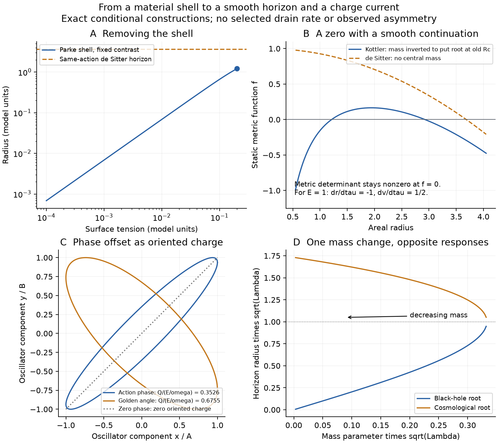

# A smooth horizon: continuation, offset and transferred charge

Douglas's revised construction uses a causal horizon rather than a material
membrane. The calculation follows that change at its source. A horizon can
be crossed by a smooth metric and fields; its zero need not end spacetime.
The [compact calculation](../results/summaries/nsc-atlas-smooth-horizon-v1.json)
separates three constructions: the old shell's zero-tension limit, a smooth
vacuum geometry admitted by the existing effective action, and an explicitly
sourced moving-horizon comparison. No observational number sets an input.

**Decision.** The old constraint was treating the supplied Parke radius as
the handoff in every model. We compared its zero-tension limit, smooth
continuation of one vacuum, and a finite-width source transition. The second
has an immediate exact solution; the third requires a field profile and state.
The old radius is retained as a comparison, not imposed on the new geometry.
The main remaining risks are confusing a coordinate zero with an invariant
singularity, changing a flux without its source, and identifying a phase
residual with baryon number. The checks below distinguish these explicitly.

## 1. What the zero-tension limit actually selects

For the retained constant-vacuum control,

$$
R_c^{-2}=\frac{(U_o-U_i)^2}{9\sigma^2}
+\frac{\kappa(U_i+U_o)}{6}+\frac{\kappa^2\sigma^2}{16}.
$$

At (Ui,Uo,sigma,kappa)=(7/32,21/32,1/5,1), Rc=1.212662645008.
With the contrast fixed, Rc=3 sigma/(Uo-Ui)+O(sigma^3), so Rc tends to zero.
It does not tend to a finite horizon. This is the completed disposition of
the [Parke](nsc-atlas-parke-nucleation.md) limit, not a result against nesting.
The two zero-mass vacuum horizon radii are instead 3.703280399 and 2.138089935.
Neither side has f=0 at the old wall: f_i=.8927723455, f_o=.6783170364.
The specified densities are frozen source snapshots, not newly admitted
stationary vacua of the volume action.

Setting tension to zero also does not remove a membrane's electric charge.
The four-form field equation has the form

$$
d(Z_3\,{*F_4}+\mu\chi)=e\,\delta_{\rm membrane}.
$$

Without that current, its integration constant q is continuous across a
smooth horizon. Keeping the old discrete q jump retains a source, even if
its tension is set to zero. A smooth scalar profile can change local stress;
it must be solved with this field equation, not substituted for a flux jump.

## 2. Continuing through zero in one geometry

Use advanced Eddington--Finkelstein coordinates:

$$
ds^2=-f(r)dv^2+2dv\,dr+r^2d\Omega^2,
\qquad f(r)=1-\frac{2m}{r}-\frac{\Lambda r^2}{3}.
$$

The determinant is -r^4 sin(theta)^2, independent of f. The angular polar
coordinate degeneracy is unrelated to the horizon. For a radial infaller of
positive Killing energy E,

$$
\frac{dr}{d\tau}=-\sqrt{E^2-f},\qquad
\frac{dv}{d\tau}=\frac{1}{E+\sqrt{E^2-f}}.
$$

At f=0 these are -E and 1/(2E); the velocity norm remains -1. Thus the
static chart's zero has an explicit continuation in the same four-dimensional
geometry. It does not by itself add an independent dimension. For m>0 the
central invariant 48m^2/r^6+8 Lambda^2/3 still diverges at r=0; a regular
horizon crossing has not supplied a central bounce.

Two Kottler pieces in this common normalization cannot hide different
constant vacuum densities in a smooth join at finite R. Continuity gives
[m]=-[Lambda]R^3/6, after which [f']=-[Lambda]R. Hence a smooth join requires
[Lambda]=[m]=0. At a null interface the appropriate data are transverse
curvature, not the timelike-shell formula. With generator k=partial_v and
transverse N=-partial_r, C_vv=f'/2 and C_AB=-R times the unit-sphere metric;
a jump in f' produces a null surface pressure. These statements are scoped
to this spherical common-normalization family, not arbitrary sourced joins.
See [Barrabes--Israel](https://doi.org/10.1103/PhysRevD.43.1129) and
[Poisson's formulation](https://arxiv.org/abs/gr-qc/0207101).

At the existing effective-action minimum, s_star=-.035646782553 and
Lambda_star=.220983024213 in model units. Constant fields admit this metric.
Its m=0 de Sitter horizon is **3.684522144189**, 3.03837 times the old Rc.
The conversion Lambda_star Rc^2=.324966738866 remains valid arithmetic;
the old shell no longer selects the new horizon. Forcing a black-hole root
to equal Rc would require m=.540652151655. This is an inversion diagnostic,
not an inherited mass. It then has a cosmological root at 2.925352470402.
The same-action family establishes a smooth crossing, not a formation
history, a selected mass/spin, or a complete parent-child spacetime.

## 3. Zero charge can mean transfer; motion alone does not select it

For a defined current J, the integrated continuity equation is

$$
Q(V_2)-Q(V_1)=-\int_{\partial V}J^\mu d\Sigma_\mu
+\int_{\mathcal V}S_B\,dV.
$$

The boundary includes its motion. Nonzero flux distinguishes charge leaving
a region from no charge being generated. Global Q=0 allows Q_inside=-Q_outside
with either magnitude. A further-dimensional flux requires a higher-dimensional
current and reduction; it cannot be inferred by assigning a meaning to zero.

For an internally charge-conjugation-symmetric state and evolution,

$$
C\rho C^{-1}=\rho,\quad [C,H(t)]=0,\quad CQ_VC^{-1}=-Q_V
\quad\Longrightarrow\quad \langle Q_V(t)\rangle=0.
$$

Here C preserves the selected spatial region. The result holds with a moving
horizon. It is weaker than claiming every state is neutral: charge-separated
initial states need not satisfy it. Global CPT symmetry, which can exchange
regions, is also a different condition. Tracing over an unobserved region
preserves internal C symmetry when the full state has that symmetry; loss of
access alone does not supply a sign bias.

[Boyle--Finn--Turok](https://arxiv.org/html/1803.08928v3) construct a CPT-paired
pre-/post-bang cosmology with specified quantum fields. Their bang continuation
is not an identification of any black-hole null horizon with antimatter.
A relation Q_minus(-t)=-Q_plus(t) permits nonzero regional charge but leaves
its magnitude unspecified by the relation alone. The coordinate r/t role
change is not the charge-conjugation operation on those fields.

[Cohen--Kaplan--Nelson](https://arxiv.org/abs/hep-ph/9302210) use wall dynamics
together with CP-violating particle interactions, transport and baryon-changing
reactions. Motion alone is not their baryogenesis mechanism. Our previous
Parke wall already moved; its zero charge result did not arise from freezing it.
The neutral symmetric control has eta=0, a -100% numerical miss against
6.1e-10 if a positive photon population is supplied. Physical baryon/photon
eta remains unselected: the fixed action does not specify that current,
its inherited state/transport and photon normalization.

## 4. Constructing Douglas's offset as an actual charge

The minimal charged comparison is two equal-frequency real components:

$$
x=A\cos(\omega t),\quad y=B\cos(\omega t-\delta),\qquad
Q=x\dot y-y\dot x=AB\omega\sin\delta.
$$

For L=(xdot^2+ydot^2-omega^2(x^2+y^2))/2, rotations in the (x,y) plane are
a symmetry. Its oriented ellipse carries the Noether charge Q. The energy
is omega^2(A^2+B^2)/2, giving

$$
\frac{Q}{E/\omega}=\frac{2AB}{A^2+B^2}\sin\delta.
$$

This is a constructive realization of phase offset as signed population.
It requires the two-component field and its state. At equal amplitudes,
the retained action phase .360395 and golden angle 2.399963 give
.352643892877 and .675490294262. Against 6.1e-10 their numerical misses
are +5.7810474e10% and +1.1073611e11%, respectively. Each number
is charge per total oscillator quanta, not baryon charge per photon.
The atlas's volume and matter frequencies, 1.420553 and 24.766152, are unequal:
using them as x,y instead gives Qdot=(omega_x^2-omega_y^2)xy. They are not
automatically the degenerate U(1) pair in this comparison.

On a constant-H background, replace the phases by nu t, nu^2=omega^2-9H^2/4,
and multiply both amplitudes by a^(-3/2). Then a^3 Q=AB nu sin(delta)
is constant. Damping reduces density while preserving the inherited signed
charge. A phase sets orientation; the expansion rate sets damping. This
distinguishes charge carried by the offset from charge created at a horizon.

There is also a precise baseline/oscillation split already available for the
neutral quadratic field at the fixed minimum:

$$
\rho=V_*+\frac{\dot\chi^2+\omega^2\chi^2}{2},\qquad
p=-V_*+\frac{\dot\chi^2-\omega^2\chi^2}{2}.
$$

A uniform phase ensemble of chi=A a^(-3/2) cos(nu t+theta) on fixed de Sitter
has rho_osc=A^2 omega^2/(2a^3), p_osc=0 exactly. The baseline has w=-1.
Ordinary fast-time averaging is approximate; a finite self-gravitating
matter fraction needs the coupled evolution. These two stress forms connect
the picture to vacuum-like and matter-like gravity, without selecting their
fractions or distinguishing baryons from dark matter.

## 5. A changing horizon and the drain

As an explicitly added null-source comparison, let m=m(v) in the same
regular metric. Direct calculation of all Einstein-tensor components gives

$$
T_{vv}^{\rm null}=\frac{2m'(v)}{\kappa r^2},\qquad
T^\mu{}_{\mu}=0,\qquad
\frac{dR_h}{dv}=\frac{2m'}{1-\Lambda R_h^2}.
$$

This connects source, geometry and moving marginal horizon without a material
shell. For m'<0 the black-hole root shrinks and cosmological root grows.
In this advanced patch the ingoing energy is negative, so a physical depletion
model must supply the corresponding stress/state and exterior balance. In the
radius-inversion diagnostic above, dR_BH/dm=2.962816968 and
dR_cos/dm=-2.244408020. These are response coefficients, not selected rates.
This Vaidya comparison is not yet sourced by the retained scalar action;
[Nielsen et al.](https://arxiv.org/abs/1007.2990) also distinguish local horizons
from the global event horizon. [Hayward](https://arxiv.org/abs/gr-qc/0506126)
provides a separate regular-core formation/evaporation construction with its
own effective stress, not a source-free extension imported into NSC.

The second derivative also depends on the history:

$$
R_h''=\frac{2m''}{D}+\frac{8\Lambda R_h(m')^2}{D^3},
\qquad D=1-\Lambda R_h^2.
$$

Neither its sign nor its physical time scale follows from a radius alone.
The old material wall has Rddot/R=39169/57600=.6800173611, while its interior
vacuum has a_double_dot/a=7/96=.0729166667. They use different clocks and
describe different observables. A null horizon has no proper-time clock to
which the timelike cosh trajectory can simply be transferred.

The admitted late vacuum has a_double_dot/a=.0736610081 and w=-1. Its flat
vacuum-only control has Omega_Lambda=1, +45.9854% against .685; this is not a
fit or prediction for the observed matter-filled universe. The null drain
has zero trace and adds zero vacuum Lambda in this comparison. It can move
a cosmological horizon without becoming dark energy. No observed SI
acceleration or .685 fraction has been derived here.

## Verification and next connection

The tests independently derive the full moving-metric Einstein tensor,
unsquared shell conditions, smooth-match identities, geodesic normalization,
horizon response by root differences, conserved-current transfer, oscillator
charge and phase-ensemble stress. No grid campaign or data refit is needed.
Native Grok reviews are independent checks, not substitutes for these tests.

The next physical bridge is a selected inherited current and state on this
regular horizon-crossing geometry. It must specify whether charge is carried
in, separated, or generated, and provide the stress causing the drain.
The central continuation and absolute SI scale remain separate requirements.

## Inherited field follow-up

The [internal harmonic calculation](nsc-atlas-inherited-charge.md) now
supplies a geometric origin for the degenerate charge pair and computes
an invariant parent-state distribution. Its charge expectation is zero.
The open connection is the asymmetric inherited current/state and its
baryon/photon interpretation, rather than the existence of a field pair.
