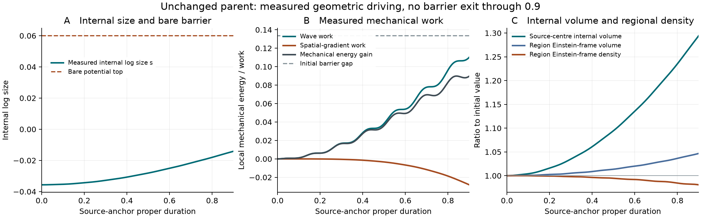
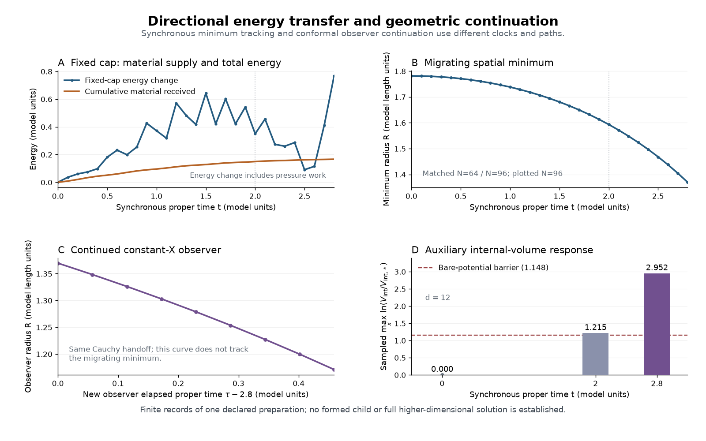
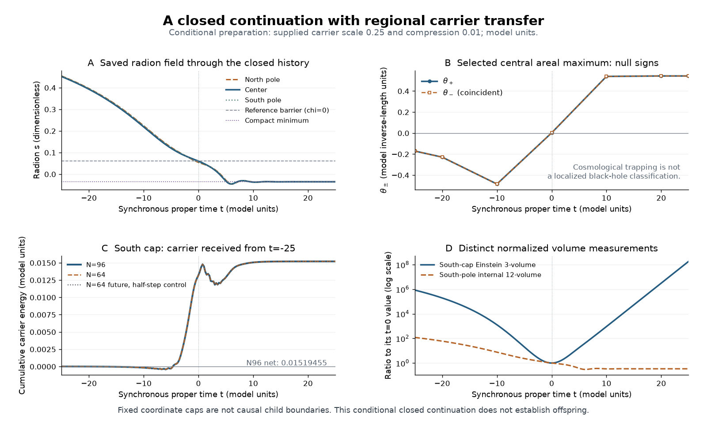
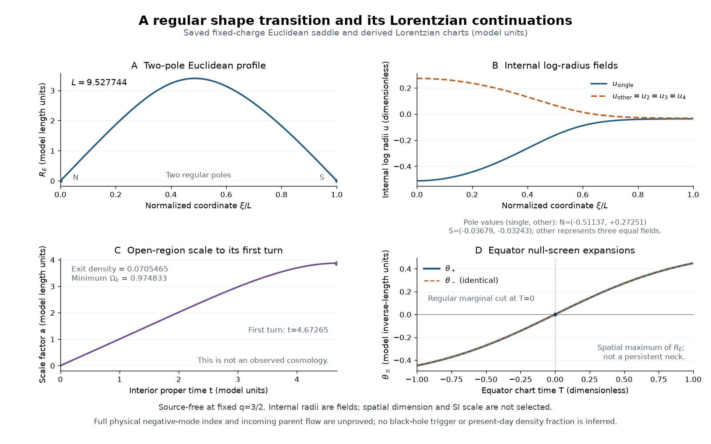

# Valve formation: compression, closed surfaces and a receiving region

This owner covers only roadmap step4: compression sources, circulation,
future trapping and a compatible receiving geometry. Eta is parked at
`dfda6e5a`; horizon/GH/boson refinement and downstream cosmology are frozen
except for the finite evolution needed to test formation. The compact-parent
action is retained. The earlier two-mode preparation and the new one-mode
occupation below remain explicitly distinct states.

## Parent-driven release: executed readout and same-state continuation

Douglas accepted this calculation after `befb4300`. The passive readout and
bounded continuation of the same complete Cauchy state are now complete.
The old supplied-state, Dirac and conformal-neck campaigns stay paused.
This work uses the existing two fields and the fixed original preparation.

### The wave actually drives the internal geometry

For K_s=84, mu squared=400 exp(-12s), the same action gives

$$
K_s\Box s-V_s+6\mu^2\chi^2=0.
$$

Along the tracked geodesic u, put e_s=K_s[u(s)] squared/2+V(s) and
P_u contravariant=g inverse+u tensor u. Then

$$
\frac{de_s}{d\tau}
=6\mu^2\chi^2u(s)+K_su(s)P_u^{ab}\nabla_a\nabla_bs.
$$

This is a local mechanical-energy identity, not a regional energy flux or
an escape theorem. The second term includes spatial transport and the
observer's geometric environment. The saved solution supplies every term;
no incoming waveform or independent perturbation amplitude is inserted.
Normal-lapse acceleration and the conversion to the geodesic are retained
separately, so no normal clock is silently substituted for geodesic time.

The [corrected readout](../results/summaries/nsc-atlas-parent-release-v2.json)
uses the admitted original degree20/24 histories over anchor proper0..0.9.
Both passive passes together took64.13seconds, below the300-second allowance;
the second adds actual boundary-observer flux to distinguish it from the
Eulerian ledger. Full time series stay under.build and have public hashes.

| Quantity, degree24 | Initial | At anchor proper .9 |
| --- | ---: | ---: |
| Internal log size s | -.03564678255 | -.01414520052 |
| Canonical geodesic rate u(S) | 0 | .3496326933 |
| Internal volume / initial volume | 1 | 1.294363391 |
| Local mechanical radion energy | .2209830242 | .3106505378 |
| Bare barrier energy minus mechanical energy | .1335536533 | .04388613964 |

The wave delivers +.1101485794 local mechanical work; the spatial-Laplacian
term contributes -.0281010515 and the slice-expansion term +.0076436342.
The observed mechanical-energy gain is .08966751363. The finite-sampling
work residual is below3.45e-5; the129/65-sample indicator for carrier work
is8.88e-5. These are empirical controls, not a certified total error bar.
The degree20/24 difference in s remains below1.97e-7 and in u(S) below7.23e-5.
Direct scalar-KG residuals decrease under refinement; their finite values
are preserved in the readout rather than repaired using the field equation.
The smallest mechanical barrier margin anywhere in the sampled history is
.04374572809, distinct from the final margin in the table.

No upward bare-barrier crossing, reference-fold-coordinate crossing or
geodesic velocity reversal occurs in this window. The loading comparison
remains above its adiabatic fold throughout the observed interval. This
does not determine how long it remains above the fold afterward. A release
time and eventual escape are not inferred from the local Hessian or from
the already matched static fold.



The figure uses the fine passive series only. Regional quantities are
evaluated on GH leaves labelled by the source-anchor clock; the plot does
not identify a global proper time or a receiving child.

### Local driving is distinct from regional accretion

The measurement ball is fixed by the initial source f=aX1+bX2X4. Its centre
is the original positive maximum. With q=a/b, its largest reference-round
radius before the nearest node is

$$
\rho_0=\arccos\left(\frac{1+q^2}{\sqrt2}-q^2\right)
=.8522887164834.
$$

A global Cauchy--Schwarz bound and explicit feasible contacts establish
this radius; it was not selected by a favourable later flux. It is a
measurement region, not an assumed receiver or a material wall.
Einstein-frame regional energy rises25.47945279 to26.15981361 while its
volume rises40.62096007 to42.51957633. Mean density therefore falls1.9143%.
The normal-energy change separates into +.11524608 geometric work,
+.57154880 shift transport and -.00643139 Eulerian material transport.
This accounting closes to2.0e-5, with a5.81e-5 time-quadrature indicator.

The actual tube observers have a different flux. If v=beta_normal/N and
gamma=(1-v squared)^(-1/2), then

$$
j_B=\gamma^2[(1+v^2)j_n-v(\rho+p_n)]
=-\sum_A(U_B\phi_A)(n_B\phi_A).
$$

The readout measures both sides directly and reports the local tube lapse
N/gamma. Its integrated outward GH-weighted tube flux is -.2353336494,
so these boundary observers measure net incoming scalar energy. The
Eulerian material-column sign therefore cannot establish absence of tube
inflow. The boost identity residual is below4.9e-17. Neither this tube flux
nor the coordinate shift is identified
with energy delivered to a child. Einstein-frame energy is not divided
by the separately reconstructed external volume to manufacture a density.
Point principal rates in the raw record are Einstein-frame rates; the
regional `external_*` fields use exp(-12s)g_E and are labelled accordingly.

### Continuation justified by the measured driver

The local work and volume motion justify a bounded continuation of the
unchanged state, not a new preparation or a claim of regional collapse.
`continue_nsc_atlas_parent_release.py` starts at the actual admitted .9
state, preserves every field, momentum, observer component and absolute
clock, and carries sampled phase only as passive metadata. It uses the
unchanged GH physical RHS. Two resolutions use four Numba threads each,
with1800seconds per run and no frequency/amplitude scan.

The first upward bare-top crossing, actual geodesic velocity reversal,
proper1.6 endpoint or numerical/budget limit ends the test. Crossing the
fixed reference-fold field value is recorded without ending the run or
calling it a physical transition. Accepted dense polynomials determine
event roots; data beyond a refined stop are preserved but unpromoted.
The sampled .1 normalized constraint guards are numerical stop rules,
not proof of accuracy or regular child formation. A third resolution is
reserved for a candidate physical event if the comparison requires it.

The first CLI-only attempt stopped on sibling import resolution before any
readout; the first continuation attempts stopped on default-quadrature
metadata before any RHS evolution. Their fixes changed no physical data.
The successful passive records bind their exact committed sources.
No cosmological or charge claim is added by this result. Main-text section6.1
now contains only this worked parent-driven result and its numerical limits.

### Completed continuation and the resolved result

The [authenticated terminal comparison](../results/summaries/nsc-atlas-parent-release-continuation-v1.json)
preserves both complete caches and their actual dense polynomials. Every
first restart-state byte matches its pinned admitted .9 Cauchy data.
Both producer records confirm unchanged source during the runs.

| Quantity | Degree20 | Degree24 |
| --- | ---: | ---: |
| s at anchor proper1.2 | -.001949750359 | -.001950591472 |
| Internal volume / initial volume at1.2 | 1.498349826 | 1.498334702 |
| Hamiltonian RMS / reference H squared at1.2 | .03631653 | .01180112 |
| Reference-fold field-coordinate time | 1.264095564 | 1.263960667 |
| Bare potential-top crossing | Not observed | Not observed |
| Geodesic size-velocity reversal | Not observed | Not observed |
| Stop | Numerical guard at1.3 | 1500-second compute allowance |

The reference-fold time spread is .0001348973. Equal internal size at
that event is true by its definition and is not an independent convergence
test. The common-clock1.2 field difference is8.41e-7. These are empirical
two-resolution comparisons, not continuum error enclosures.
The fine run retains a guard-passing accepted endpoint at proper1.30510769;
its original absolute coordinate time is1.43588954. The failed coarse1.3
guard and its later accepted tail are preserved without promotion.

The numerical limitation is specific. At coarse proper1.3, the spatial
projection omits13.71% RMS of the computed internal-size acceleration;
at the fine endpoint it omits5.60%. The lapse remains positive and finite
(minimum about.785), with metric validity retained. No actual singularity,
barrier exit or new region is inferred from this loss of force resolution.
The next required numerical input is a resolved continuation of that same
force and Cauchy state; a different supplied preparation would not provide it.
Neither a larger allowance nor another grid is launched automatically here.

The local mechanical energy can momentarily exceed the bare potential top
while s is still below it. This is a necessary comparison only: its excess
is sensitive to momentum resolution and the gradients continue exchanging
energy. It neither proves a robust surplus nor turns the reference-fold
coordinate into an exit event.

The [fixed measurement-boundary check](../results/summaries/nsc-atlas-parent-release-surface-v1.json)
uses the original derived ball at common proper1.2, with32x64 and40x80
angular samples, without optimizing a surface or choosing another region.
Fine outgoing expansion ranges .37548344 to .65660311 and incoming
expansion -.71745011 to -.38333299 in model inverse-length units. This
fixed surface is not sampled future-trapped. No all-surface nonexistence
theorem or regular receiving child is asserted. Child volume, energy and
w therefore remain undefined. Thirty-one portable math/recovery tests pass.

## Accepted roadmap: parent-driven release before collapse

This is the roadmap requested after `6c4c7491` and subsequently accepted.
The previous trap threshold belongs to different one-mode initial data;
matching that amplitude is not the original parent's formation criterion.
Comparing more supplied states does not select the parent's history.

Three routes were compared: more old-neck conformal continuation, direct
longer parent evolution, and a same-action concentration/release test.
The third has the clearest early discriminator. The existing interaction
mu(s)^2 chi^2/2 already forces the internal-size field. Local adiabatic
loading is .7280212631 versus .3750793338 at the fold, but gradients,
oscillation and dilution can prevent an actual escape. Reuse the completed
retarded-volume and scalar/metric calculations; do not repeat their orders.

1. Freeze the original two-mode Cauchy state and existing 20/24 histories.
   Derive a finite-time concentration/release criterion from the coupled
   equations, including metric response, gradients, expansion and transport.
   A static Hessian, Jeans estimate or threshold crossing is not sufficient.
2. First use the saved 0..0.9 anchor-clock window. Track the original source
   extrema and predeclared surrounding regions, actual s/normal momentum,
   external principal expansions and finite-time density concentration.
   Separate material influx from geometric work. A region is an analysis
   domain, not an assumed receiver; global compensated flux does not rule
   out local accumulation. Limit this passive compute pass to300seconds.
3. Identify whether the wave's actual forcing lasts long enough for release.
   Any response/growth probes are mathematical controls, not supplied
   physical seeds. A nonlinear trigger forecast requires the existing state's
   actual projection onto the amplified sector. Report a gain, release
   margin and available-versus-required duration; keep unresolved entries
   explicit rather than inferring a collapse time from an eigenvalue alone.
4. Only a resolved driver justifies continuing the SAME complete Cauchy
   state, initially at two resolutions with at most1800seconds per run and
   at most8 physical cores total. Add one third-resolution event check if
   needed. Stop at the first physical discriminator or numerical admission
   loss; no amplitude/frequency scan, extra field or tailored incoming pulse.

A positive formation claim needs a common regular geometry with distinct
regional evolution, actual parent supply and causal access. Internal volume
growth alone is insufficient; a black-hole-child claim additionally needs
an enclosing future-trapped surface. A persisting minimum-radius neck
would face the existing obstruction again; track any neck-to-belly change
before a pinch rather than assuming a new frame repairs that obstruction.
The first deliverable is the release/growth decision, not a promised child.

Implementation reuses `load_original_parent` in
`scripts/check_nsc_atlas_parent_valve.py`, `ParentGH.jets/potential`,
`matter_work` and `evaluate_surface`. Retarded-volume `solve_feedback` and
the older `ParentModes` supply controls, not substitute background states.
The current GH CLI initializes a new run; any later same-state continuation
needs an explicit full-cache restart adapter before it is executable.
No new physical parameter is introduced. A frozen diagnostic region and
normalized response columns do not become a receiver or a physical seed.

Failure forecast: (1) oscillatory or coordinate growth masquerades as physical
concentration; use matched clocks, complete stress and cycle comparisons;
(2) local loading exceeds its static fold but gradients/dilution prevent
release; report that finite-window mechanism limit without supplying a new
state; (3) release produces an obstructed collapse rather than a regular
receiver, or resolution fails; distinguish those outcomes and retain the
existing continuation constraints. A later converged same-state evolution
that contradicts the forecast would falsify that forecast. No PDF changes
or numerical evolution are authorized merely by recording this proposal.

## Current result: unchanged parent, conformal endpoint and loading threshold

Douglas's latest instruction restricts the active calculation to these three
questions. All supplied-state preparations, the Dirac branch and their older
"next" instructions below are historical and paused. No new fields, states or
GR evolutions were used for this readout; the manuscript and 252-page PDF are
unchanged. The horizon/GH/transport and eta chains remain frozen.
The [source-bound readout](../results/summaries/nsc-atlas-parent-valve-test-v1.json)
was produced by `5b26bb6b` from the original saved histories in 64 seconds.

### 1. What the unchanged parent actually drives

Use the original epsilon=1 two-mode parent, chi containing both X1 and
X2X4, with no kick or new preparation. Its admitted degree20/24 interval is
0..0.9 in the elapsed proper clock of the tracked source-anchor geodesic.
That clock labels a GH coordinate-time leaf; it is not a global proper time
or the clock of every interface observer. The saved 1.2 leaf stays diagnostic.

With A the original one-mode neck normalization, define

$$
a_X=\frac{\int\chi X_1\,dV_h}{\int X_1^2\,dV_h},\qquad
p_X=\frac{\int(n\chi)X_1\,dV_h}{\int X_1^2\,dV_h},\qquad
\epsilon_X=\frac{\sqrt{a_X^2+p_X^2/\omega_X^2}}{A},
$$

where n is the actual unit slice normal, including the saved lapse/shift,
and omega_X squared is the instantaneous Rayleigh quotient of X1 for
the actual scalar mass and spatial metric. This is a stated projection
convention, not a conserved nonlinear amplitude or a new eigenmode claim.

| Projection, degree24 | Maximum | Anchor proper duration |
| --- | ---: | ---: |
| Reference-measure instantaneous X1 | .7071067812 | 0 |
| Reference-measure quadrature | .7071068462 | .00497125 |
| Physical-measure instantaneous X1 | .7850323694 | .38017276 |
| Physical-measure quadrature | .7851012011 | .37353704 |
| Physical two-template quadrature, retaining X2X4 | .7075053238 | .24417778 |

All are below the recorded one-mode epsilon_crit=.8339066143. The largest
listed value is 5.8526% below it; its degree20/24 spread is 4.19e-10.
These are empirical resolution comparisons and numerical extrema of the
saved dense solution, not certified continuum-in-time bounds. Retaining
both templates matters: about half the reference field power remains in
even modes. The threshold itself belongs to different, time-symmetric
SO3 data with zero normal momenta and Kij, s=sstar and its own constrained
metric. A projected amplitude cannot admit the two-mode parent as that state.

The inward preparation data can nevertheless be extracted without choosing
a waveform. On the actual timelike tube F=X1=0, take its unit normal nB
toward increasing X1 and future unit tangent U orthogonal to its sphere cuts.
For each of the two existing canonical fields,

$$
w_{\rm in}=\tfrac12(U\phi-n_B\phi),\quad
w_{\rm out}=\tfrac12(U\phi+n_B\phi),\quad
j_B=w_{\rm in}^2-w_{\rm out}^2=-(U\phi)(n_B\phi).
$$

The actual j_total>0 support defines the localized incoming portion; no
outgoing field or other mode is deleted. At anchor duration .0538334449,
the carrier's incoming and outgoing RMS are both .3069698832. The standing
critical reference has |w_in|=|w_out|=.01051425628, so the incoming content
is 29.20 times that reference, but so is the outgoing content. The positive
and negative area-integrated total fluxes are +.1394603866 and -.1394603866.
Their cancellation follows from the parent's proper paired-flip symmetry;
it does not imply that local flux or local accumulation vanishes. The readout
also preserves the separate GH-coordinate power integral with tube lapse.
Neither integral is silently treated as an anchor-clock energy derivative.

**Blocker:** the saved parent stays below the X1 reference threshold and its
derived, compensated boundary traces do not select the pure one-mode Cauchy
state. No inherited trigger is established in this finite interval; this is
not a proof against a later trigger or every localized formation mechanism.

### 2. What can continue at the conditional R=0 break

The old reflection-symmetric neck is a separate, supplied one-mode history.
At its finest admitted saved cut, R=.1495326738 and nR=-2.849706278. Direct
metric jets, without replacing curvature by the source, give

$$
K=1994425.2501,\qquad
C_{abcd}C^{abcd}=1994423.9803,\qquad
R_{ab}R^{ab}=.63489368,\qquad \mathcal R=-.00450790.
$$

Thus the large curvature is Weyl-dominated. In the convention
g_tilde=Omega squared times g, its Weyl norm transforms as
C_tilde squared=Omega to the minus fourth times C squared. Omega tending
to zero amplifies this curvature. The mixed-index Weyl tensor's conformal
invariance is not invariance of this scalar norm.

There is also a conditional obstruction stronger than the old K>=4/R^4
bound. Write D=(1+(nR)^2)/R^2=2m/R^3 and
C_rad=Krad Ktan-R_ll/R. The canonical Einstein equations at reflection give

$$
\mathcal E=\frac{D-C_{\rm rad}}3+
 \frac{\kappa}{6}\sum_A(\partial_\ell\phi_A)^2.
$$

If the current minimum, radial-stretch and angular-collapse signs persist,
C_rad<=0. If p_r>=0 and nR<0 persist, reflection mass balance gives
dm/dtau=-kappa p_r R squared (dR/dtau)/2>=0. Consequently, if R really
approaches zero,

$$
C_{abcd}C^{abcd}\ge\frac{64m_{\rm cut}^2}{3R^6},\qquad
\widetilde C_{abcd}\widetilde C^{abcd}
\ge\frac{64m_{\rm cut}^2}{3(\Omega R)^4R^2}.
$$

A finite nonzero crossover radius Omega R therefore leaves divergent
Weyl norm under these hypotheses. Their persistence and the R=0 endpoint
have **not** been proved by the finite run. This does not rule out every
continuation, changed neck shape or gluing law.

Applying the break question with Omega=R^(-3/2) gives a different metric
representative: at the same saved cut its radius is 2.586020424, positive
normal-time radius rate 1.424853139, Weyl norm 22.29636581 and local volume
expansion 3.372069543. Its effective Einstein stress has rho=2.955387103,
p_r=-1.135434287, p_t=-6.820764521 and mean w=-1.666669804. The angular null
combination rho+p_t=-3.865377418 cannot be supplied by the unchanged positive
canonical scalar action. Under the additional finite-mass, vacuum-dominated
asymptotic, this representative has finite curvature but infinite normal
proper duration to R=0 and infinite sphere size. It is not a finite CCC
crossover or a physical child. No child's volume, energy, w or expansion
has been determined by this transformation.

[Meissner--Penrose](https://arxiv.org/abs/2503.24263) supplies the conformal
continuation programme, not a theorem gluing this collapsing neck.
[Markwell--Stevens](https://arxiv.org/abs/2212.06914) explicitly treats
conformal-factor selection and the future-side field equations. Finite
curvature alone does not supply that matching. The earlier shape-transition
exit has density .07054648474 and w=-1; w=-2.681342368 is from its later
negative-density turning event, not that exit. No match to either is derived.

### 3. Why the loading threshold is near 3/8

Mcrit=.375079333827 is an adiabatic **density-loading coefficient**, not
Schwarzschild mass or total child energy. E0=3/8 is the original prepared
scalar excitation density; the Parke comparison imports it as a target.
For the already matched potential,

$$
\mathcal M(s)=-14e^{-6s}+\frac{35}{2}e^{-8s}-\frac{25}{8}e^{-18s}.
$$

At its fold, x=exp(-2s) solves 225x^6-560x+336=0, with
x=.998727268724 and s=.0006367709432. Exactly
Mcrit=x cubed times (175x-168)/18. Equality to 3/8 would also require
700x^4-672x^3-27=0; the two polynomials have gcd1. It is **not an identity**.

The reason for the near-match is calculable: the original coefficient
matching imposes M(0)=E0 exactly, while M'(0)=1/4 and M''(0)=-793/2 place
the fold very nearby. Mcrit is .0211556872% above E0; the actual density
at the fold is .3736490302. This is a parameter-dependent stability margin,
not an independent prediction of the Parke energy.

Reproduce this readout from the original pinned caches with a fresh raw
directory and output path:

```powershell
python scripts/run_python.py scripts/check_nsc_atlas_parent_valve.py --raw-directory .build/parent-valve-reproduction --output .build/parent-valve-reproduction.json
python scripts/run_python.py -m pytest -q tests/test_nsc_atlas_parent_valve.py
```

The 11 portable tests independently check tensor contractions, conformal
metric differentiation, source incompatibility and exact fold elimination.
No new initial data or evolution is invoked by them. The three results
above complete this scoped readout; the physical inherited trigger and
action-matched receiving space remain open. They do not reopen the paused
preparations below automatically.

## Historical connection: a conditioned parent with spatially balanced compression

The [critical-history calculation](#reference-history-and-global-momentum-close-one-phase)
now determines the carrier's monopole momentum correction from its full
reference history and the global momentum constraint. It gives
delta Pi_chi=-.0063847845374 on the continuous weak-source branch, with
positive jointly constrained Cauchy data. The carrier amplitude and balanced
compression remain supplied; this is not natural or nonlinear critical-state
selection. The previous whole-S3 compactification window remains frozen.

The next formation calculation uses this conditioned state to keep a
compactifying region distinct from a persisting parent and establish their
causal handoff. Localized black-hole offspring and all downstream empirical
closures remain open. A numerical bandwidth/CFL stop is not treated as a
physical endpoint or repaired by a new field state.

## Completed finite contracting-to-compact history with carrier feeding

The [new closed preparation](#closed-compression-and-scalar-feeding) evolves
one constrained state through proper-25..+25. A larger-internal-volume,
contracting past continues into an expanding compact future. The south
control cap receives net massive-scalar carrier energy .015194550124;
radion transfer and pressure work are measured separately. Both spatial
resolutions and a time-step control are retained. A central spatial maximum
is future-trapped in the past and anti-trapped in the future, with no
membrane inserted. This is a finite cosmological continuation and regional
feeding result, not yet a localized black-hole offspring or distinct causal
child. The source amplitudes and incoming compression remain supplied state
data. The next connection is the actual parent/descendant region and its
causal handoff; the completed windows stay frozen.

## Completed rolling-parent continuation in the full source frame

The parent q=2 need not be an absent constant-radius vacuum. Its expanding
equal-radius sector has a derived decompactifying attractor. In the full
source frame both external and internal expansion approach
H16=sqrt(11/160)=.2622022120, with Ricci33/2 and Kretschmann363/160.
These are finite model-unit values from the supplied action, not a fitted
SI scale. The Einstein-frame energy tends to0 while that full geometry
remains nonempty. The [derivation below](#the-rolling-parent-at-the-break)
states its domain and keeps the finite history/state freedom explicit.

The exact material-wall Ward identity also closes a necessary accounting
link: [T(n,U)]=dot(sigma)=-6sigma U(s). It fixes a difference of regional
fluxes, not either individual influx. The next physical object is the
actual parent/transition state and wall trajectory that send energy to a
lasting child. The old shape-transition and directional-transfer states
remain separate; the finite source-free child is not retrofitted with
the earlier cap's energy. No further horizon/GH or eta refinement is opened.

## Completed shape transition and its finite interior

The [charged-parent join](nsc-atlas-scale-selection.md#executed-charged-parent-join-and-shape-transition)
now restores the original scalar/top-form sector alongside the smooth
six-form stabilizer. Its fixed-q=3/2 equations admit a regular, nonconstant
profile when the internal radii vary independently. The same profile gives
the connecting geometry and both Lorentzian pole states. The expanding
interior starts with density .07054648474 and reaches scale3.86983365 at
proper4.67265289 before its first turn toward recollapse. It remains strongly
curved, min Omega_k=.97483298, so this branch fails the requested .002
near-flatness bound. Incoming parent material flux is0. The finite
construction is established numerically; a physical decay-state index,
black-hole trigger and energy-fed lasting child remain open.

This result and the directional material-transfer history below are
different states. Their energies are not combined. Completed evolution
windows remain frozen; there is no deeper horizon/GH or eta campaign.

## Directional energy transfer and a controlled change of chart

The directional preparation now has a [coupled evolution through proper2](../results/summaries/nsc-atlas-valve-directional-evolution-v1.json)
and an [unchanged-state continuation through2.8](../results/summaries/nsc-atlas-valve-directional-evolution-v2.json).
The receiving fixed cap gains .1493154490 model energy by material flow
at2 and .1663334485 at2.8. Its independently accumulated pressure work at2.8
is .6011349170; the energy ledger residual is1.41e-10. The64/96-mode
material-transfer spread at2.8 is3.90e-9, an empirical comparison rather
than a total uncertainty bound. The receiving cap is contracting there:
volume111.21380378, volume rate-14.31834143, mean pressure-.19699793,
mean density .64868179 and w=-.30368963. It is not a proved expanding child.

The attempted extension toward4 encounters a nonpositive metric variable
in a Runge--Kutta stage near2.894. Only the admitted2.8 slice is used for
the next handoff; the uncached accepted tail supplies no new claim.
Concentration is polar: peak sampled electric curvature is about568.5H²,
whereas the positive-radius patch |u|<=.9 remains below18.9H² and has
positive radial scale above3.23. The stage exception establishes neither
a physical singularity nor a coordinate caustic.

The [asymmetric conformal continuation](../results/summaries/nsc-atlas-valve-directional-conformal-v1.json)
inherits that same2.8 Cauchy slice, its fields and normal derivatives.
The radial coordinate is proper distance on the handoff slice; the lapse
starts at1 and a_T=-K_rad. Its initial causal half-width is4.5039432.
Characteristic diamonds shrink the supplied domain without introducing
an incoming boundary state. Reflection projection is disabled.

The2049/4097-point runs both reach the declared local window. At the common
centerline proper reading3.258805, the fine radius is1.17109346; the
observed radius spread over nine aligned events is6.02e-7. The finest
endpoint is proper3.261813, radius1.16955022 and normal radius rate-.51369339.
The endpoint direct metric/source residual is2.25e-4 and relative
Hamiltonian/metric-curvature control4.79e-5. The1025-point trial stops its
declared validity test early and is not extended as a physical solution.
These clocks belong to the new constant-X observer, generally accelerated;
they are not silently equated to the previous synchronous geodesic.
This proves finite local continuation, not global polar regularity or a child.

### The volume transition already present in the action

At2.8 the maximum sampled volume modulus is s=.21037574, beyond the bare
potential maximum s=.060000535. The existing geometric identification gives
log(V_internal/V_internal,star)=12(s-s_star), reaching2.95227023.
The two resolutions place about10.8--10.9% of the proper slice volume above
that bare barrier. This is not a dark-energy fraction. The field's gradients,
kinetic energy and coupling to chi remain in the evolution; crossing the
bare barrier alone is not a runaway theorem. The ancestor sheet remains an
averaged source in the old interpretation. The smooth flux completion
described below now reproduces its scalar potential, with a distinct
microscopic field identification; it does not derive the ancestor coupling.



The [figure producer](../scripts/plot_nsc_atlas_directional_connection.py)
uses the committed compact records, with the two observer paths separated.
The maximum internal-volume ratio is exp(2.95227023)=19.14938 under the
existing reduction; no SI length or present cosmological fraction is inferred.

### What a receiving-neck turn would require

The [published spherical Einstein identities](https://arxiv.org/html/gr-qc/9710089v2)
separate geometric mass, supply and work. Applied at a hypothetical regular
turn of a persisting spatial minimum, R_t=R_l=0 and R_ll>0, they give

$$
\kappa\rho R^2=1-2RR_{ll},\qquad
R_{tt}=-\frac{1+\kappa p_rR^2}{2R}.
$$

The canonical fields have rho+p_r=Pi_S²+Pi_chi²+(D_lS)²+(D_lchi)²>=0.
Consequently R_tt<=-R_ll<0. Following the migrating minimum only subtracts
R_tu²/R_uu, so it cannot turn that event into a bounce. This is a condition
on a persisting nondegenerate spherical minimum, not a prohibition on all
compact continuations, nonspherical geometries, neck-type changes or other
physical sources. The present run keeps R_ll positive through2.8.
The marginal boundaries of its trapped component are not automatically
future-outer black-hole boundaries; at2 the opposite-null derivatives are
positive (.08582413,.21447025), the future-inner sign.

The [smooth pair-flux completion](nsc-atlas-scale-selection.md#smooth-pair-flux-completion-and-its-shape-operator)
now reproduces the existing scalar action with a six-form on four compact
three-spheres. Mixed and internal tracefree Einstein equations and Maxwell
remain consistent for the varying volume field. The15 focused tests and
the actual spatial-operator calculation are preserved in its linked record.
[Product-space flux spectra](https://arxiv.org/abs/1310.6360) and
[warped compactification branches](https://arxiv.org/abs/0710.0707) supply
methods and comparison geometries; their stability results require their
specified flux ranks and backgrounds. They are not imported as stability
proofs for this candidate.

Its three relative-radius fields have local mass squared below zero in
parts of the driven geometry, but the lowest retained spatial eigenvalue
stays positive: .13393326 at2.8, with degree difference4.29e-9. A local
coefficient crossing is therefore not advertised as a global instability.
That driven history has no selected physical shape seed or nonlinear child.
The separate regular boundary-value construction below derives its own
state rather than transplanting a seed into this history.

The calculation also gives a concrete inheritance ambiguity. Equal cycle
flux and a single-pair cycle can match the same T=25/32 and effective
charge unit1/4, yet give zero versus(+1.838,+1.838,-1.838,-1.838) initial
relative-radius accelerations. They are different microscopic charge
embeddings. The current history belongs only to the equal-flux completion.
The missing physical map is the charge coupling and its transport, keeping
the stabilizer separate from the original charged top-form sector. Closed
six-form periods are conserved through a smooth horizon;
the horizon cannot by itself add a charge unit. The dual six-form sector
also has a different volume-dependent canonical normalization from the old
top-form sector. Those identities must be connected explicitly.

Topology and matching coefficients remain inputs; the old round-S12
Dirac spectrum is not transferred to this product geometry. The charged
join and regular shape transition below advance that action-level connection;
a sourced child receiving parent material remains the next formation target.
The manuscript/PDF remains252pages; its expansion stays frozen.

## Reference history and global momentum close one phase

The [source-bound record](../results/summaries/nsc-atlas-critical-parent-v1.json)
derives one preparation coefficient using the existing action and
quarter-carrier normalization. It does not import a saved waveform or
fit an observational target. Pointwise V_s=0 was insufficient for a
spatially varying, oscillating source: the spatial Laplacian and the
time dependence of the inherited carrier also act on the radion.

On the declared global-de-Sitter barrier reference, T=H_top*t and
a=cosh(T)/H_top. Write chi=sum q_l(T)U_l(u), with the prescribed initial
position in l=1 and momentum in l=0,2. The actual massive source obeys

$$
q_l''+3\tanh T\,q_l'+
[\mu^2/H_{\rm top}^2+l(l+2)\operatorname{sech}^2T]q_l=0.
$$

No oscillation average replaces q_l in this calculation. The canonical
radion response z_L obeys

$$
z_L''+3\tanh T\,z_L'+
[L(L+2)\operatorname{sech}^2T-\alpha]z_L
=\frac{6\mu^2}{\sqrt{84}H_{\rm top}^2}(\chi^2)_L,
\quad \alpha=3.76250309154.
$$

The product identity U_m U_n=sum_(k=0..min(m,n)) U_(m+n-2k) closes this
source through L=4. Two-sided bounded Green conditions select a critical
reference response. In the finite calculation, parity conditions at0
and the decaying Robin condition at12 represent the interval-12..12;
a cutoff10 control measures the initial-coefficient change. These are
conditioning assumptions defining a mathematical threshold reference,
not a causal or naturally selected initial-state law.

### Closing the source rather than changing it afterwards

A constant correction delta to the carrier's initial momentum changes its
l=0 history. Recomputing that effect gives

$$
S=S_0+\delta S_1+\delta^2 S_2,\qquad
\Pi_S=\Pi_0+\delta\Pi_1.
$$

At the initial cut S_2 is purely monopole, so its spatial derivative is0.
The only nontrivial radial conformal-Killing condition is
mean(PiS*S_u+PiChi*chi_u)=0 with weight(1-u²)^(3/2). Hence

$$
C_2\delta^2+(A_\chi+C_1)\delta+C_0=0,
$$

where C0=8.21579442e-5, C1=-.0005452418413, C2=.0006904972365 and
A_chi=.0134174213493. The discriminant is positive. Scaling the original
carrier by lambda gives C0~lambda^4, C1~lambda^3 and C2~lambda²; only one
root tends continuously to0, as delta~-lambda³*C0/A_chi. It gives

$$
\delta\Pi_\chi=-.0063847845374.
$$

The other root, -18.6355, is excluded by that continuity condition, not by
which subsequent geometry it produces. The direct weighted constraint
and polynomial agree. No second carrier correction is applied after
computing this critical reference history.

The resulting positions and momenta enter the full nonlinear initial
Hamiltonian/York solve. The balanced perturbation is
PiS_bal=-sqrt84*(.01)*U2/3; its source-sphere mean is0. The full initial
metric has analytic positive conformal lower bound about.9837547, and
all reflection parities are retained. Independent dense tests verify the
physical constraints and the variable-momentum York tensor.

This closes one reference phase coefficient, not the quarter-carrier
amplitude, balanced-compression amplitude, physical origin of time,
fundamental charge, quantum state, SI scale or nonlinear formation
threshold. After solving the metric, actual momenta are psi^-6 times
the reference conformal data; the coupled evolution must be tested
separately rather than called the same global-de-Sitter source history.

Reproduce with a fresh output; the recorded response plus constraint solve
takes11.73seconds in the isolated runtime:

```powershell
python scripts/run_python.py scripts/check_nsc_atlas_shape_transition.py --critical-parent --raw-directory .build/critical-parent-fresh --output .build/critical-parent-fresh.json
python scripts/run_python.py -m pytest -q tests/test_nsc_atlas_critical_parent.py
```

## Closed compression and scalar feeding

The [joint calculation](../results/summaries/nsc-atlas-closed-pocket-v1.json)
uses the same canonical scalar, top-form and pair-six-form action, with
q=3/2 throughout. The new preparation is in
[one state adapter](../src/recursive_horizons/nsc_atlas_closed_pocket.py);
the original spherical physical evolution and historical neck sources are
unchanged. No old trajectory or received-energy number is transplanted.
The earlier q=2 parent and charged-membrane trials remain different states.

### The flat-horizon construction is not silently imported

[Carroll, Johnson and Randall's flat Nariai construction](https://arxiv.org/abs/0904.3115)
is a useful comparison. For this action's common-radius top its departure
has s-s_top=C_lambda*lambda^p, where lambda is external null affine distance,

$$
p=\frac{\sqrt{9+4\alpha}-3}{2}=.952040597449,
\qquad \alpha=-3m_s^2/V_{\rm top}=3.76250309154.
$$

In the full-source metric, the parallel-transported internal screen has
R(k,e_a,k,e_a)=-b''(lambda)/b, with b=r exp(s). Consequently

$$
R_{\rm pp,int}=-C_\lambda p(p-1)\lambda^{p-2}+\cdots
=.04565929826\,C_\lambda\lambda^{-1.04795940255}+\cdots.
$$

The two external and twelve internal leading terms cancel in the null
Ricci trace, not in the individual tidal components. Scalar curvature and
Kretschmann stay finite. The exponent inequality is certified without a
near-zero numerical sign test:
(175/22)^5*(28/55)<7^5<A_c^5 implies0<p<1 on this barrier branch.
The double integrated tide is finite while the single integral diverges.
Thus a nonconstant exactly homogeneous flat departure does not provide the
claimed smooth C2 horizon for these couplings. This does not exclude every
continuation. The closed Cauchy solution below is a different geometry,
not a coordinate repair or an imported regularity claim.

### One state, solved and evolved together

Use u=cos(chi) on the initial round-reference S3. The massive field and its
conformal normal momentum retain the reference harmonic normalization:

$$
\chi=A_\chi u,\quad
\bar\Pi_\chi=-B_\chi\sqrt{3/5}(u^2-1/6),\quad
\bar\Pi_S=-\sqrt{84}(.01).
$$

Here A_chi=.0134174213493 and B_chi=.0389770532576 are one quarter of the
recorded reference carrier normalization. They are benchmark state data,
not derived fundamental constants. S=sqrt(84)(s-s_star). Its initial value
is the potential-force top at the actual chi, determined by V_s=0 with
A_eff=7+200chi²; no extra Y2 radion displacement is supplied. This fixes a
local potential-force condition, not a full equilibrium with gradients.
The negative normal radion momentum is an incoming compression datum;
its sign and magnitude are not selected by the action alone.

Trace K and conformal TT data vanish. The scalar and carrier York sources
are solved jointly. If S=sum S_l U_l/sqrt(2pi²), the radial tracefree
curvature contains

$$
\bar A_{r,S}=\bar\Pi_S(1-u^2)
\sum_{l\ne1}\frac{S_l U_l''}{[l(l+2)-3]\sqrt{2\pi^2}}.
$$

Adding the carrier York tensor produces an odd cross term in A_ij A^ij.
The conformal Hamiltonian therefore uses all degrees0..40, not an even
projection. Physical momenta and tracefree curvature scale as psi^-6.
The solved conformal factor has analytic whole-sphere lower bound .9880055;
all fields, radii and normal momenta enter the same Hamiltonian and
momentum constraints. The normalization radius comes from V_top and the
constraint; neither R=1.9 nor M=.12 is used.

The two time directions start from bitwise identical Cauchy arrays.
The unchanged canonical equations then give:

| Reading | Proper-25 | Proper+25 |
| --- | ---: | ---: |
| South-pole s | .45398266455 | -.03564723638 |
| Central spatial-maximum radius | 281.18798098 | 1621.33397314 |
| Both null expansions there | -.17149513438 | +.54280983198 |
| Spatial second radius derivative | -.00376664816 | -.00058159073 |

These are cosmological trapped and anti-trapped cuts in a closed S3.
The turning sphere is a spatial maximum, so the earlier NEC obstruction
at a persistent spatial minimum does not apply. The existing wrapped-area
identity preserves the signs in the full source frame. This is not an
event-horizon identification or a localized collapse threshold.

The same field law transports its Einstein-frame massive scale
mu(s)=20 exp(-6s): between these south-pole endpoints it changes by
18.87388849. This is a state-dependent normalization on one computed
geometry, not an SI hierarchy or particle-production calculation.

### A measured transfer, separate from pressure work

The control caps are fixed worldtubes u>=.5 and u<=-.5, defined on the
initial source sphere and propagated with its synchronous observers.
They are not material walls or derived child boundaries. The carrier
and radion energy currents are evaluated separately on those tubes.
The physical-25→+25 interval uses future signed ledger minus backward
signed ledger, without a state or clock reset. On the finer history:

| South-cap contribution | Model energy |
| --- | ---: |
| Massive carrier material input | +.015194550124 |
| Radion material input | +71.740154886 |
| Total material input | +71.755349436 |
| Pressure work | +3765233954.56 |

The carrier's64/96 full-interval spread is1.73e-13. Carrier transfer also
remains positive in the already compact proper20..25 interval in both
caps. The north cap's full-interval carrier input is negative; no
universal sign or charge asymmetry is inferred. Component transfer is
not the same as energy retained in that component: the varying mass
exchanges energy with the radion. The total cap account is
Delta E=carrier input+radion input+pressure work. Work dominates the
energy growth and is not renamed parent material supply.

The past maximum is3.1e-8 in relative Hamiltonian residual and the finest
future maximum5.9e-8; momentum and relative local-ledger controls are
smaller. These are numerical finite-domain controls. The independent
time-step/spatial comparisons are empirical differences, not rigorous
global error bars. The trace of expansion and cap volume rates are saved
alongside pressure and w; the future compactness is measured on the same
solution as the received carrier, not attached as a separate success.

All five histories completed in five separate one-thread workers. The
first summary exporter exceeded its size guard after saving the arrays.
The compact record was recovered by exact selected-event re-evaluation
and bitwise initial-data checks, without repeating evolution. Original
transient CPU/wall telemetry was not recovered; the fixed exporter now
saves coordinator metadata before writing the summary.



The [figure producer](../scripts/plot_nsc_atlas_closed_pocket.py) reads only
authenticated saved diagnostics and ledgers; it does not rerun evolution
or decode the state with current physical equations.

### What this does and does not connect

The calculation supplies an energy-bearing finite continuation from a
contracting, larger-internal-volume state to a compact expanding state.
It gives an actual material carrier account, not a charge-blind amplitude
residue or a vacuum-work identification. But the entire connected S3
eventually compacts. It has not demonstrated a localized daughter within
a distinct persisting parent, inherited source selection, or causal
separation. Those child/offspring gates remain open, as do the SI scale,
Omega_Lambda_today, thermal sectors, eta and the cycle. The late vacuum
still belongs to the supplied action; its agreement with a minimum is
not a new nesting contribution to Lambda.

The next formation object is a geometrically defined descendant region
and parent region, with the inherited state and causal carrier tube
retained through their handoff. No further refinement of this completed
finite window is required unless that connection needs it.

```powershell
python scripts/run_python.py scripts/check_nsc_atlas_closed_pocket.py --raw-directory .build/closed-pocket-fresh --output .build/closed-pocket-fresh.json --workers 5
python scripts/run_python.py -m pytest -q tests/test_nsc_atlas_pocket_preparation.py tests/test_nsc_atlas_valve_neck.py tests/test_nsc_atlas_valve_spherical.py tests/test_nsc_atlas_valve_directional.py
```

## The rolling parent at the break

The [source-bound parent record](../results/summaries/nsc-atlas-rolling-parent-v2.json)
uses the same scalar/top-form plus smooth pair-six-form action. The full
four-radius stationary check at q=2 finds one1+3 AdS minimum,
V=-.52361044495, in the isotropic/1+3/2+2 families and no positive minimum
there. Its retained radius masses are positive. This is not an exclusion
of every other critical family or a classification of internal KK modes.
A positive parent therefore cannot simply be declared the equal-radius
stationary vacuum used by a constant-vacuum Parke calculation.

### A nonempty continuation of the runaway size

At phi=phi_star(2), equal internal radii and supplied q=2, the exact potential
is V=e^-12s W, with

$$
W=A-Bx+Tx^6,\quad x=e^{-2s},\quad
A=\frac{231}{32},\quad B=\frac{15}{2},\quad T=\frac{25}{32},\quad K=84.
$$

Here A>A_c and A>A_M from the exact sector thresholds, so V_s<0 and V>0
for every finite s. Set v=ds/dN and D=3-42v² on the expanding flat
Einstein-base branch. The full equations are

$$
\frac{dx}{dN}=-2xv,\qquad
\frac{dv}{dN}=-D\left[v+\frac{-12+W_s/W}{84}\right],\qquad
H_E=e^{-6s}\sqrt{W/D}.
$$

For finite s and0<=v<1/sqrt(14), v=0 points into positive roll. If s
stayed bounded, its strictly positive force would prevent v tending to0;
thus s grows without bound. Once s is large the velocity equation drives
v toward1/7, away from the kinetic boundary. The limiting fixed point
(x,v)=(0,1/7) has eigenvalues -2/7 and -15/7. The expanding monotone
common-radius family therefore approaches this limit. This does not
select its finite initial data or prove stability to every omitted mode.

The leading proper-time solution is

$$
a_E\propto t_E^{7/6},\qquad
s=\frac{\ln t_E}{6}+\frac1{12}\ln\frac{12A}{35}+o(1),\qquad
Vt_E^2\longrightarrow\frac{35}{12},\quad
\rho_Et_E^2\longrightarrow\frac{49}{12},\quad w_E\longrightarrow-\frac37.
$$

This is an asymptotic solution of the full potential, not an exact
finite-time replacement for it. Under the existing metric reduction,
d tau16=e^-6s d t_E and a_external,16=e^-6s a_E. Consequently

$$
\tau_{16}\sim\sqrt{40/99}\ln t_E,\qquad
H_{\rm int},H_{\rm ext}\longrightarrow\sqrt{A/105}
=\sqrt{11/160}.
$$

All15 spatial source directions expand at that same limiting rate. The
orthonormal curvature components have finite limits:

$$
R_{16}=\frac{16A}{7}+\frac{25}{56}e^{-12s}\longrightarrow\frac{33}{2},
\qquad R_{ABCD}R^{ABCD}\longrightarrow480(11/160)^2=\frac{363}{160}.
$$

Thus the zero-density tail of the Einstein description is not a vanished
parent or a curvature singularity in the full source. Its lowest internal
KK mass obeys m_KK²/H_E²=(15/8)e^-2s/(W/D)->0; the isolated lower-dimensional
effective description loses scale separation. This changes the useful
frame, not the conserved charge or the number of physical generations.
It does not identify heat death with a new child or establish a cycle.

The construction uses the dimensional-reduction/continuation viewpoint
of [Carroll, Johnson and Randall](https://arxiv.org/abs/0904.3115). Their
single-sphere flux solutions supply the method and comparison, not this
product-pair-flux parent, its selected state or its transition amplitude.
Neither the input internal dimension nor the geometry of the offset
generator is selected by this source calculation.

### Finite verification and what remains free

Two declared verification histories, (s,v)=(0,0) and(1,.1), are integrated
with the full potential to40 Einstein e-folds. At the endpoint:

| Initial state | H_internal | H_external | Bulk proper duration |
| --- | ---: | ---: | ---: |
| (0,0) | .2621818451 | .2622174880 | 34.48087381 |
| (1,.1) | .2622018835 | .2622024584 | 21.98881024 |

Independent full-source Einstein evolution in bulk proper time agrees
within1.91e-11 in expansion rate; its Hamiltonian defect is below1.34e-11.
The two finite histories remain different despite their common future
limit. Their Einstein-frame energy balances close within1.14e-14 through
expansion work. That work is not parent-to-child material transfer.
No physical transition epoch, finite inherited state, SI scale or present
cosmological fraction follows from convergence to the same attractor.

### The actual material-wall energy constraint

For a material charged membrane, normal n points child->parent and U is
its proper tangent. The existing source gives84[s_n]=-6sigma and
[phi_n]=0. Continuity of tangential fields then proves

$$
[T(n,U)]=84[s_n]U(s)=-6\sigma U(s)=\dot\sigma,\qquad
\dot E_\Sigma-\sigma\dot{\mathcal A}
=\mathcal A(\mathcal F_c-\mathcal F_p),\quad \mathcal F=-T(n,U).
$$

This follows from the [junction conservation laws](https://doi.org/10.1007/BF02710419)
with the action's varying tension. The same jump holds for local field
jets whose two individual fluxes have either sign. A decreasing tension
or one-way causal horizon cannot replace their calculation. U(s) belongs
to the moving wall; it is not automatically the comoving parent clock.
The smooth horizon0 still has no surface stress; it is not this membrane.

For two Euclidean regular caps the additional necessary balance is
sum integral(R³ V_s dxi)=6sigma Rwall³. The q=2 common-radius cap contributes
negatively, including any off-minimum massive scalar, so the child must
supply all of the positive balance. Bounded common-radius and1+3 charged regular-cap continuation
admitted no fixed-source target root; this is not an absence theorem or an inherited
rolling-parent state. That assumption is parked rather than refined.
The next formation calculation must use the rolling parent and its actual
charged handoff, with individual fluxes and trajectory retained.

Reproduce the new parent calculation in fresh destinations:

```powershell
python scripts/run_python.py scripts/check_nsc_atlas_shape_transition.py --rolling-parent --raw-directory .build/rolling-parent-fresh --output .build/rolling-parent-fresh.json
python scripts/run_python.py -m pytest -q tests/test_nsc_atlas_rolling_parent.py
```

## Regular shape transition and derived exit

The [source-bound calculation](../results/summaries/nsc-atlas-shape-transition-v1.json)
uses the [existing source completion](../src/recursive_horizons/nsc_atlas_sphere_flux_completion.py)
and [coupled transition solver](../src/recursive_horizons/nsc_atlas_shape_transition.py),
committed at292c742a. The method borrows the Euclidean gravitational field
equations and analytic continuation of [Coleman--De Luccia](https://doi.org/10.1103/PhysRevD.21.3305).
[Dynamical compactification](https://arxiv.org/abs/0904.3115) supplies a
related geometric precedent, not a source/state or stability theorem for
this different product-flux action.

At fixed q=3/2 the massive scalar is exactly phi_star and chi=0. In the
invariant sector u=(a,b,b,b), write y=(a,b) and
G=[[7.5,13.5],[13.5,49.5]]. The potential is the full four-radius potential
restricted to these fields; no new coefficient is added. For Euclidean
metric dxi²+R_E(xi)²dOmega3² the coupled equations are

$$
y''+3\frac{R_E'}{R_E}y'=G^{-1}\nabla V,\quad
R_E''=-\frac{R_E}{3}(y'^TGy'+V),\quad
R_E'^2=1+\frac{R_E^2}{3}\left(\frac12 y'^TGy'-V\right).
$$

Both poles are regular, R_E=0 and y'=0, with opposite unit radius slopes.
The interval length and both pole fields are solved, not supplied exits.
The numerical starting guess that converges to a constant Hawking--Moss
profile is rejected; a second guess converges to a nonconstant profile.
Those guesses are numerical solver settings, not fitted physical inputs.

| Derived quantity, model units | Value |
| --- | ---: |
| Pole-to-pole length | 9.527744309 |
| Interior pole (a,b) | (-.5113670617,.2725121203) |
| Other pole (a,b) | (-.03678920523,-.03243210376) |
| Interior exit density V | .07054648474 |
| Compact on-shell action difference B*g | 291.4501763 |
| Largest-radius equator | 3.398196836 |

The coarse/fine pole-field spread is5.47e-10, length spread3.79e-9 and
action spread5.00e-7. These are empirical refinement indicators, not
certified total errors. The finest Euclidean constraint maximum is2.56e-10.
On the common Cauchy cut, the unweighted Hamiltonian maximum is4.27e-4
near the pole cutoff, relative maximum4.45e-4 and proper-volume RMS7.40e-9;
the unweighted defect is retained rather than hidden by averaging.
Two independent compact action formulas agree to3.66e-8. Sampled positive
transverse masses and Q_min=.770536 do not prove the full scalar/metric
negative-mode index or internal Kaluza--Klein stability. Accordingly the
number B*g is not yet a decay-rate prediction or a lifetime selection.

### Continuing through the coordinate zero

Continuing a Euclidean angle gives the shared connecting chart

$$
ds_E^2=d\xi^2+R_E(\xi)^2[-dT^2+\cosh^2T\,d\Omega_2^2].
$$

Its T=0 Cauchy data have h=dxi²+R_E²dOmega2², K=0 and Pi=0. The constraint
R3=y'^TGy'+2V follows from the same Euclidean equations; a new exterior
or junction source is not inserted. At its equator R_E''=-.48831845<0:
this is a spatial maximum, so the earlier NEC obstruction at a persistent
spatial minimum does not apply. There

$$
\theta_+=\theta_-=\frac{2\tanh T}{R_{E,\mathrm{eq}}}.
$$

At T=-1,0,+1 the two expansions are respectively -.44823428,0,+.44823428.
The marginal cut is regular. This is a connected contracting/expanding
geometry, not a proved classical collapse history from the earlier parent.
The wrapped screen has A14=V0*A2 and theta16=exp(6s)*theta_E, so area
normalization and trapping signs agree in the complete internal frame.
That identity does not create a new generation or an incoming energy flux.

At either pole the open-region continuation has

$$
a(t)=t+V_0t^3/18+\cdots,\quad
y(t)=y_0-G^{-1}\nabla V_0\,t^2/8+\cdots,\quad
\rho=\tfrac12\dot y^TG\dot y+V,\quad p=\tfrac12\dot y^TG\dot y-V.
$$

Here V_0 denotes the potential at that pole, not the internal reference
volume. The apparent a=0 endpoint is a regular Milne-type coordinate zero:
Ricci tends to4V_0 and Kretschmann to8V_0²/3. Both are finite, as are the
internal radii. This explicitly implements the break question by changing
chart, with inherited fields and derivatives.

The interior expands to a=3.86983365 at proper4.67265289, where rho=-.20032570
and p=.53714178. Negative rho there must not be interpreted as NEC violation;
rho+p=dot y^T G dot y>=0. The other pole approaches the original positive
minimum over the declared proper0..10 window. The interior Friedmann
constraint is below5.44e-15 and its integrated density/work balance below
7.78e-16. Its smallest curvature fraction is .97483298: **this transient
AdS-bound branch fails the .002 near-flatness target**. No cosmology fit is
performed on it.

Background fields depend only on xi in the connecting chart and are
homogeneous in each open chart. Consequently their normal material flux
is exactly0. The exit's .60519116 excitation above the known AdS minimum
is geometric field energy, not old E0=3/8 massive-scalar matter, not the
directional cap's .16633345 influx, and not the earlier88.47% crossing.
Those other values remain attributed to their own states. The next useful
connection is a physical parent transition/preparation that yields a lasting
receiving state with actual incoming energy; no further decimals on this
completed finite branch are needed.



Reproduce in a fresh destination (about5.13seconds in the recorded run):

```powershell
python scripts/run_python.py scripts/check_nsc_atlas_shape_transition.py --raw-directory .build/shape-transition-fresh --output .build/shape-transition-fresh.json
python scripts/run_python.py -m pytest -q tests/test_nsc_atlas_sphere_flux_completion.py tests/test_nsc_atlas_shape_operator.py tests/test_nsc_atlas_charged_parent_completion.py tests/test_nsc_atlas_log_radius_potential.py tests/test_nsc_atlas_symmetric_shape_branches.py tests/test_nsc_atlas_shape_transition.py
```

The41 focused tests cover the action join, independent derivatives, stationary
branches, coupled equations, regular poles, refinement, common Cauchy data
and Lorentzian constraints. Full arrays stay under.build; the compact record
retains their hashes. No manuscript pages or historical runs are changed.

### Reproducing the continued window

The raw source commits are15137b9b for0--2,9f0554b9 for2--2.8 and
e07c2f46 for the conformal continuation. Historical trajectory producers
retain their original source checks; rerun them at their recorded revision
in an isolated checkout rather than replacing their source metadata.
Compact historical projections authenticate archived Git bytes and raw
cache hashes; current unrelated package changes do not rewrite old results.
With those raw caches present, the current coordinate-only preparer verifies
the unchanged spherical physical symbols against the archived source.

```powershell
python scripts/run_python.py scripts/continue_nsc_atlas_valve_directional.py --prepare-run .build/valve-directional-evolution-N96-v2/run.json --points 4097 --output .build/directional-cauchy-fresh
python scripts/run_python.py scripts/continue_nsc_atlas_valve_directional.py --initial .build/directional-cauchy-fresh/record.json --endpoint .4 --budget 60 --output .build/directional-conformal-fresh
python scripts/run_python.py scripts/continue_nsc_atlas_valve_directional.py --compare-records .build/valve-directional-conformal-evolution-P2049-v1/record.json .build/valve-directional-conformal-evolution-P4097-v1/record.json --output .build/directional-comparison-fresh.json
```

Use fresh destinations. Cauchy preparation and evolution must each use a
committed source revision because the next stage authenticates that source.
No boundary waveform, reselected scalar phase, new matter or fitted
parameter is supplied at this handoff.

## Earlier counterrotation result: a trapped neck

The [completed counterrotation records](../results/summaries/nsc-atlas-valve-counterrotation-evolution-v2.json)
continue the same finite initial state through admitted proper duration1.8.
The degree24/32 interface-radius spread through their common admitted
duration1.7 is at most3.30e-5 in model length units. At1.8 the fine interface
has area radius1.70419147, both sampled null expansions remain negative,
and the global excitation-work residual is1.0922e-4 in model energy units.
This does not establish a regular expanding receiving child.

The target duration2 was not reached under the declared controls. At1.9
the fine momentum-constraint maximum is2.5914%, exceeding the2% admission
limit; its Hamiltonian maximum is1.4510%. The lapse remains positive
(.6624 minimum) and the observer normalization error is7.76e-13.
This is a numerical admission boundary, not an inferred physical
singularity or child. All three execution handles are now terminal.
The next continuation must address this specific loss of control;
restarting the same invalid grid or extending its claimed domain would
not resolve it. The manuscript/PDF remains frozen at252pages.

The [single frozen-state quadrature check](../results/summaries/nsc-atlas-counterrotation-quadrature-v1.json)
keeps every admitted1.8 coefficient, observer component and ordered frame
derivative operator fixed. Increasing quadrature from26x98x98 to34x130x130
changes the nonlinear metric-velocity, volume-momentum and scalar-momentum
RHS blocks by3.42e-7,1.67e-7 and2.24e-9 in relative coefficient L2 norm.
The observer derivatives are identical. This gives no support for
quadrature alone repairing the accumulated defect; it does not separate
historical aliasing, omitted modes, time error and constraint amplification.
No further time step or higher-resolution evolution was taken.

The earlier spherical [small-radius continuation](../results/summaries/nsc-atlas-valve-restart-v1.json)
and [receiver-source calculation](../results/summaries/nsc-atlas-valve-source-gate-v1.json)
continue the declared state to controlled R approximately .15. No turn is
observed. That route's dependency is a physical source/state calculation;
another deeper grid on this completed window is not the next step. The
new spinor work below is explicitly a candidate extension and a probe,
not fermions silently added to the classical scalar solution.

The [state/source successor](nsc-atlas-inherited-charge.md) now computes
the complete signed Gaussian benchmark and the full initial radial Dirac
operator. Balanced contact cancels under its declared chirality conditions;
coherent Gaussian alternatives are explicit state data. Unequal-mode
couplings carry71.58% of the squared ground-column reference coefficient
norm, so the old same-mode pump is not a closed source model. The bare
stress/radion Ward identity fixes what must be calculated together.
The occupied state, UV/renormalization conditions and physicalg remain
unselected. No receiving child is inferred from these finite coefficients.

### Next formation route: canonical counterrotation

The bounded quantum source/operator calculation above is complete at its
declared scope. A new physical fermion state, UV prescription andg are
not selected by the existing scalar action. The next formation test
therefore returns to that action with momentum-carrying data, using the
existing [York completion](nsc-atlas-gravitating-kick.md). This changes
the preparation explicitly; it imports no spinor-source success.

Keep chi=A X1 and test a conformal momentum profile proportional to the
already used second harmonic X2 X4, Pi_chi=lambda f psi^-6. The first
check is exact orthogonality to all ten round conformal-Killing charges
and a nonzero local momentum curl with opposite circulation sectors.
Then derive its York inverse and finite positive Hamiltonian branch.
The amplitude is a declared initial-data family, not an inherited value
or observational fit. No new evolution is admitted until those constraints
and the physical energy accounting are checked. This relaxes the exact
SO3/reflection assumptions of the completed contracting neck; it does
not assume rotation guarantees a child.

The [finite counterrotation data](../results/summaries/nsc-atlas-valve-counterrotation-v1.json)
now reaches the declared lambda1 preparation on one positive continuation
branch. Independent full constraints give Hamiltonian RMS/H²=6.6578e-5
and momentum RMS/H²=1.51e-16; the finite-polynomial positive lower bound
is .48079. Total proper matter energy is141.84569, including3.32745
normal-momentum energy. Shear is accounted for separately. These are
finite numerical initial data, not a future-formation result.

The coupled test uses the explicit adapter in
`scripts/evolve_nsc_atlas_valve_counterrotation.py`, the unchanged GH
equations at degrees24/32 and four threads per run. Target proper duration2
belongs to the declared initially normal inflow-lobe geodesic, with3600s
per-run budgets. Actual dense states, local/global constraints, gauge,
normal-energy work and surface expansions are retained under `.build`.
The two resolutions supply an empirical comparison, not a certified
convergence order. The finished algebra and manuscript/PDF expansion
remain frozen before this formation test produces its result.

The [first coupled records](../results/summaries/nsc-atlas-valve-counterrotation-evolution-v1.json)
now show a sampled future-trapped interface at both resolutions. Through
their shared admitted proper duration1.2 the area-radius spread is at most
2.83e-8. This is an empirical comparison, not a total error bar. Degree24
remains admitted through1.7, then exceeds the declared2% normalized
constraint limit at1.8 (Hamiltonian maximum3.51%). Lapse stays positive
and observer normalization remains accurate; this is spatial resolution
loss, not a physical endpoint. Degree32 remains admitted through1.2 and
ends solely on its3600s compute budget. Its last cumulative work residual
is-3.63e-7 in the retained energy units. No regular expanding child is
established by these prefixes.

The same-grid continuation reads the terminal fine record via
`--resume-run`, uses its exact last admitted full Cauchy/observer state,
preserves original coordinate time and cumulative work, and clips the
inherited physical history at that handoff. It rejects a same-grid
restart of the coarser admission failure. The unused raw parent tail is
preserved without promoting its validity. This continues the same
intended proper2 formation test; it does not change the action or
preparation. The final fine admission stop above leaves its target unmet.

### The fixed-interface energy-supply gate

The paired flip g1:(X1,X2,X3,X4)->(-X1,-X2,X3,X4) exchanges the two
hemispheres. Both chi and Pi_chi change sign; their stress tensor, the
lapse and the interface area measure are invariant under the map.
The outward normal of the fixed X1=0 interface reverses. Consequently
its material-flux integrand is odd and

$$
\int_{X_1=0} N j_s\,dA=0.
$$

This holds for every smooth evolution preserving that declared symmetry.
It explains the numerical cancellation despite nonzero local counterflow:
at the last admitted fine event the incoming and outgoing rates are each
.05531980 in model energy/time units, with net-2.65e-17. It excludes net
material supply through this particular fixed interface, not work on the
geometry, transport through other boundaries, or child formation in all
preparations. The lobes already present initially must not be counted as
new children merely because they expand or an observer enters them.

A minimal compatible directional preparation can be written analytically
within the same action. Put u=X1, keep chi=A u and the previous B
normalization, and use

$$
f_{\rm dir}=B\sqrt{3/5}(u^2-1/6),\qquad
\Pi_\chi=\lambda f_{\rm dir}\psi^{-6}.
$$

Its unit-lambda conformal momentum source is
jbar=-(kappa A B sqrt(3/5)/3) gradbar(u^3-u/2). The polynomial
u^3-u/2 is a pure degree3 spherical harmonic, so it is orthogonal to all
ten conformal-Killing compatibility charges. The existing York operator
obeys Q jbar=-16 H^2 jbar and gives W=-jbar/(16 H^2).
The reference powers agree exactly:
(3/5)mean[(u^2-1/6)^2]=1/24=mean[X2^2 X4^2]. This does not equate the
solved physical kinetic energies. For a positive radial conformal factor,
the initial influx into the positive hemisphere is

$$
\Phi_{\rm in,+}
=\frac{4\pi\lambda A B}{6H}\sqrt{3/5}\,\psi(0)^{-4}>0
\quad(\lambda A B>0).
$$

The [finite directional data](../results/summaries/nsc-atlas-valve-directional-v1.json)
now reaches lambda1 on the declared positive degree40 branch. Its finite
polynomial lower estimate for psi is .44639454. Independent higher
quadrature gives physical Hamiltonian RMS/H²=6.39e-11 and radial momentum
RMS/H²=6.96e-18. The actual initial receiving-cap material influx is
.214001290635206 in model energy per initial normal-time unit. Separate
pressure work is6.80094e-5; boundary sweep is zero. The receiving cap's
initial energy is71.37490040 and its total initial energy derivative is
.214069300059588. The donor has the opposite rates. These are initial
rates, not an integrated transferred energy or a formed-child result.
Coordinate cap signs are separate from Douglas's donor(+)->drain(-)
convention.

The test controls independently recover the physical momentum identity
under a change of length scale, reverse the current without changing its
positive energy, and integrate the local Klein-Gordon energy derivative
against the surface-flux-plus-work ledger. All three pass. The actual
solved state's additional volume/surface comparison differs by4.53e-15.
The source amplitude, direction and preparation remain supplied. The
finite numerical branch does not certify continuum existence/uniqueness,
inheritance selection, a horizon, rotation or a child. It is a radial
transport seed. The current GH character masks and spherical reflection
projection would discard its required opposite field/momentum parities,
so neither existing evolution can be reused blindly. Its correctly
unprojected coupled evolution is now the formation connection to test.

```powershell
python scripts/run_python.py scripts/check_nsc_atlas_valve_directional.py --output-directory .build/valve-directional-fresh --summary results/summaries/nsc-atlas-valve-directional-reproduced.json
python scripts/run_python.py -m pytest -q tests/test_nsc_atlas_valve_directional.py
```

Use fresh output destinations. Full initial coefficients remain under
`.build`; the committed record carries their hash and source identities.

The old two-mode finite searches below found no admitted trap; their
occupation was supplied rather than selected. Continuing that optimizer,
adding an external pressure term, and changing the occupation are materially
different routes. The last route retains the action, introduces no coupling,
and supplies a directly calculable formation threshold. It is a declared
new state, not a spherical average of the nonspherical field.

Set chi=epsilon A X1 with kappa A²=24/(z+3), all normal field momenta and
Kij zero, and s=sstar. Its round-reference excitation energy equals the
old two-mode normalization. Its solved proper energy is recalculated.
The [initial calculation](../results/summaries/nsc-atlas-valve-neck.json),
[finite continuation](../results/summaries/nsc-atlas-valve-spherical-v1.json)
and [independent full-GH control](../results/summaries/nsc-atlas-valve-neck-gh-v1.json) supply numerical evidence of a
closed future-trapped region. No regular receiving child is admitted.

### Geometric threshold and local-development statement

With u=X1=cos(chi), the reflection-even conformal factor solves

$$
-8\Delta_0\Psi+6\Psi
-\kappa\epsilon^2A^2(1-u^2)\Psi
-[6+\kappa\epsilon^2A^2zu^2]\Psi^5=0.
$$

The fixed set u=0 is a totally geodesic closed S2. Both initial null
expansions vanish. Write its proper areal radius R=H^(-1)Psi² sin(chi).

Existence is not inferred from Newton convergence alone. Reuse the weighted
equivariant compactness proof in [finite parent data](nsc-atlas-finite-parent-data.md)
with antipodal symmetry, whose minimum orbit size is2. Put
a=kappa epsilon² A²=24epsilon²/(z+3). The elliptic weights are
A_w=6-a(1-u²), B_w=6+azu². For z>1 and epsilon<=1, A_w>0, while

$$
\frac{B_{\max}}{\langle B\rangle}
=\frac{6+az}{6+az/4}<\frac52,
\qquad
\left(\frac{\mathcal Q(1)}{T}\right)^3
=\left(\frac{\langle A_w\rangle}{6}\right)^3
\frac{B_{\max}}{4\langle B\rangle}<\frac58<1.
$$

The inherited Hebey--Vaugon concentration argument therefore supplies at
least one smooth positive antipodally even solution for every0<=epsilon<=1
in this one-mode family. It does not prove uniqueness or enclose the
numerically continued solution. The SO(3)-invariant calculation and the
strict negative slope below retain that distinction.

Independent ADM evolution and radial warped curvature give

$$
\dot\theta_\pm={\rm Ric}_h(\nu,\nu)-\kappa(\nu\chi)^2,
\quad
\frac{{\rm Ric}_h(\nu,\nu)}{H^2}
=\Psi^{-4}(2-4\Psi_{uu}/\Psi),
$$

and the constraint at u=0 reduces this to

$$
\frac{\dot\theta_\pm}{H^2}
=3-\left(1+\frac{\kappa\epsilon^2A^2}{2}\right)\Psi(0)^{-4}.
$$

For an exact nearby smooth constraint solution retaining the strict negative
sign, local Einstein--scalar development and reflection symmetry imply
both expansions are negative on the same sphere for sufficiently small
positive proper time. The residual/refinement calculations below support
that nearby solution; they are not an interval-certified continuum enclosure.

| Initial degree | Numerical epsilon_crit | Independent full conformal RMS |
| --- | --- | --- |
| 16 | .8339066729 | 8.44e-5 |
| 24 | .8339066144 | 1.57e-7 |
| 32 | .8339066143 | 2.52e-10 |

At epsilon=1 the finest neck has Psi=.69449811, versus the sign threshold
.76010912, and dot(theta_pm)/H²=-1.30467886. The overall trace initially
grows at3H²: radial stretching accompanies tangential compression. This
is an internal prepared-field/geometry threshold, not an external minus-side
pressure or a selected offset count n. No physical membrane is introduced.

### Finite continuation and independent full-metric check

The exact SO(3) reduction uses proper synchronous time,

$$
ds^2=-dt^2+q^2d\chi^2+b^2\sin^2\chi\,d\Omega^2,
\qquad q=b+(1-u^2)c,\quad k_a=k_b+(1-u^2)d.
$$

These variables enforce regular poles. Both scalars and their backreaction
are evolved; no homogeneous average replaces the physical fields. The
expansions are theta_pm=-2kb plus/minus2R_chi/(qR). At proper .02:

| Spherical modes | Both theta_pm/H | Independent Hamiltonian RMS/H² |
| --- | --- | --- |
| 24 | -.00707953272 | 8.21e-5 |
| 32 | -.00707954029 | 3.76e-7 |
| 48 | -.00707954032 | 8.86e-11 |

Independent quadrature evaluates constraints outside the retained spatial
nodes. At proper .3 both expansions/H=-.10672195 and the finest Hamiltonian
RMS/H²=7.85e-11. The radius is1.77330393 and radial scale1.80256812.
The source begins on a bi-marginal slice; an inherited earlier preparation
or collapse history has not been derived.

The existing full nonspherical GH engine, supplied the same one-mode
initial data, gives theta_pm/H approximately-.0074003, -.0071164 and
-.0070798434 at degrees12,16,24 and matched neck proper .02. Its finest
discrepancy from the spherical result is3.03e-7, or .0043% of the magnitude;
initial Hamiltonian RMS/H² falls .2644 ->.02763 ->.0002085. All sampled
points of the full reflection S2 have negative expansions. This checks
the symmetry reduction and lapse/proper-time handling without changing
the older saved-parent engine or its source pins.

### The other side: interior time and an actual regional ledger

The areal invariant

$$
1-\frac{2m}{R}=\nabla R\cdot\nabla R
=-\frac{R^2\theta_+\theta_-}{4}
$$

makes grad(R) timelike inside the strict trap. Decreasing R is a local
future time there, while the synchronous metric remains regular through
the marginal boundary. At proper .3 its neck norm is-.0006595557 and
m_geo=.88723676. This is the break-question continuation; it does not
create a new spatial coordinate or prove a new child. At the initial
bi-marginal neck grad(R)=0, so areal time alone is degenerate there.

Reuse [Hayward, Section II, (2.2) and (2.7)--(2.9)](https://arxiv.org/html/gr-qc/9710089v2)
for spherical geometric mass and supply/work. In the present conventions
j=-sum(Pi phi_l) and k_a,k_b are mixed extrinsic-curvature eigenvalues.
The full proper-energy density satisfies

$$
\partial_t(4\pi qR^2\rho)+\partial_\chi(4\pi R^2j)
=4\pi qR^2(k_ap_r+2k_bp_t).
$$

For moving marginal boundaries, retain the boundary term
[4piR²(rho q chi_dot-j)]_left^right. At proper .2 the connected trapped
band has volume16.77650134, energy3.77629301 and mean pressure-.21738048,
so w=-.96573118. Subtracting the supplied reference vacuum gives
excitation energy.06897101 and excitation w=.87628261. Near-vacuum total
stress here does not derive a new Lambda.

| Energy-rate contribution | Action units |
| --- | --- |
| Pressure work | .1584497891 |
| Physical material influx across both band boundaries | .0856197876 |
| Boundary sweeping existing energy | 24.1826846267 |
| Direct derivative | 24.4267542203 |
| Absolute ledger residual | 1.69e-8 |

The marginal boundary moves at1.30618 relative to normal observers; it is
a spacelike marginal tube, not matter moving faster than light. Reflection
makes the total material flux through the central timelike neck exactly0.
The two hemispheres' energy changes close with pressure work, not a supply
from one hemisphere into the other. A band receiving energy is not yet a
regular expanding child. Neither its proper energy nor geometric mass is
identified with Parke E=3/8 or the different88.47% reference transfer.

The [independent horizon classification](../results/summaries/nsc-atlas-valve-horizon-classification-v1.json)
checks that the surrounding marginal tubes are future outer, not inner
cosmological boundaries. With reciprocal null normals of inner product-2,
Hayward surface gravity is kappa_H=m/R²-kappa R(rho-pr)/4 and
L_in(theta_out)=-4kappa_H/R at marginality. At proper .02,.2,.3 the
computed kappa_H is+.0849121,+.0843238,+.0804675, and cross expansion is
negative at both boundaries. Independent directional and finite-difference
calculations agree within1.6e-12 and9.2e-10. The material-current component
changes sign over the carrier oscillation; full horizon crossing includes
its motion through the matter. An outward current relative to a spatial
slice is not proof of causal escape from the trapped region.

The [bounded continuation to proper2](../results/summaries/nsc-atlas-valve-neck-continuation-v1.json)
tests what the pinch becomes. Modes48/64/80 reach the endpoint in under
three seconds each. Finest Hamiltonian RMS/H²=8.80e-11. Neck radius
falls10.71% to1.58681277 while its radial scale grows73.79% to3.08848102;
both expansions/H=-.98374109. Its areal radius remains a spatial minimum,
and neither a bounce nor metric degeneration is observed in this window.
The hemisphere volume grows .57435% and its energy .22352%, with exact
zero central transfer. This is a calculated instance of radial stretching
coexisting with angular compression, not an isotropically inflating child.
Zero central flux does not exclude symmetric accretion through the two
surrounding marginal boundaries. The positive material influx above is
real. The next physical question is whether this receiving trapped band
admits a regular expanding-child continuation.

### Same-state continuation in a local null frame

The [conformal continuation](../results/summaries/nsc-atlas-valve-conformal-v1.json)
changes the numerical frame at the later global loss of accuracy. It
inherits the actual80-mode proper2 Cauchy state. Proper radial distance X
on that slice gives a=0, a_T=-ka, R_T=-kbR and phi_T=Pi for phi=(S,chi).
There is no resetting of fields, energy, occupation or source normalization.
Use ds²=exp(2a)(-dT²+dX²)+R²dOmega². The same Einstein--scalar equations are

$$
R_{TT}-R_{XX}=-\frac{R_T^2-R_X^2}{R}
-\frac{e^{2a}}R+\kappa WRe^{2a},
$$
$$
a_{TT}-a_{XX}=\frac{R_T^2-R_X^2+e^{2a}}{R^2}
-\frac\kappa2\sum_A(\phi_{A,T}^2-\phi_{A,X}^2),
$$
$$
\phi_{A,TT}-\phi_{A,XX}
=-\frac{2(R_T\phi_{A,T}-R_X\phi_{A,X})}{R}-e^{2a}W_{,A}.
$$

A shrinking characteristic stencil stays inside the Cauchy domain of
dependence, discarding one point at each side per step. Its initial
proper-radial half-width is3.45839; the common conformal endpoint is1.14819.
No exterior values or new incoming state are inserted at the patch edge.
All three calculations use the same inherited state and domain.

| Initial points | Center proper time | Radius | Both theta_pm/H | Hamiltonian RMS/H² |
| --- | --- | --- | --- | --- |
| 2001 | 3.945529 | .65495433 | -11.85692 | .0379729 |
| 4001 | 3.945509 | .65496885 | -11.85045 | .0094763 |
| 8001 | 3.945504 | .65497252 | -11.84883 | .0023727 |

Successive radius differences shrink by3.97; full fine-minus-middle spread
is3.66e-6. This is an empirical refinement indicator, not a certified error.
The finest constraint residual is about2e-5 of the local curvature scale;
the reference-H normalization alone obscures the growing physical curvature.
Exact de Sitter identities check the PDE factors to1.56e-15, and its field
errors converge at second order. Tiny finite-difference vacuum constraint
noise is nonmonotone and is not sold as an enclosure. Proper-time-aligned
overlap at2.2 differs from the previous frame by1.22e-8 in radius and
1.79e-7 in theta/H; full-vs-decimated actual-history clock indicators are
reported separately. The entire retained local patch is future trapped,
but it does not include the whole receiver's moving outer boundary.
No global child volume, cosmological epoch or new vacuum follows from it.

### What an actual zero radius would mean in both frames

At the reflection center, R_l=s_l=0. The sphere's spacetime sectional
curvature is K_Omega=(1+R_tau²)/R²>=1/R². Reflection eliminates the
odd-time mixed components in the spherical Riemann contraction, giving

$$
\mathrm{Kretsch}_4\geq4K_\Omega^2\geq4R^{-4}.
$$

Thus a genuine zero of this reflection sphere cannot be a regular center
or a removable coordinate zero. This statement does not assume zero is
reached by the finite computed history.

The [declared internal reconstruction](nsc-atlas-inherited-charge.md)
is ds16²=exp(-12s)g4+exp(2s)gamma12, with R[gamma]=15. Put x=exp(2s),
so the external areal radius is x^(-3)R. Its gradient is timelike or zero
at reflection, hence K_ext,16>=x^6/R². In12 dimensions positive scalar
curvature15 guarantees at least one internal sectional plane with
K_gamma>=15/(12*11)=k=5/44. The internal radius gradient is likewise
timelike or zero there, so K_int,16>=k/x. Consequently, for every volume roll,

$$
\max(K_{\rm ext,16},K_{\rm int,16})
\geq k^{6/7}R^{-2/7},\qquad
\mathrm{Kretsch}_{16}\geq4k^{12/7}R^{-4/7}.
$$

The bound follows by minimizing max(x^6/R²,k/x) over x>0. Odd-time mixed
curvature components also vanish in this reflection-symmetric warped
ansatz, so their Lorentz signs cannot cancel the positive square. Roundness
of gamma is unnecessary for this obstruction; its fixed positive scalar
curvature suffices. A volume/conformal redistribution cannot regularize
both factors if R actually tends to zero within this ansatz.

If the spatial minimum, radial stretching and canonical null-energy signs
persist, R_tautau<=0 and the endpoint values conditionally imply no more
than .622 further proper units before zero. Persistence has not been proved.
The next physical test is a neck-type/receiving-geometry transition before
that limit; neither coordinate failure nor a curvature blow-up is renamed
as a child. This is a scoped constraint on the current candidate, not on
all nested geometries or other published regular-interior mechanisms.

### Scope and next connection

The conditional source has a resolved future-trapped development and a
checked local receiving-band budget. Its inherited occupation, nonzero
directional supply history, regular child continuation and rotational formation
mechanism remain open. The completed threshold and this finite window
are frozen. The next calculation must follow the actual receiving band
and its horizons, retaining the parent-supplied state. A directional asymmetry,
if required, must be inherited rather than inserted to force a result.

A [later bounded probe](../results/summaries/nsc-atlas-valve-neck-late-probe-v1.json)
loses global synchronous constraint accuracy near proper2.9 before any
trustworthy bounce or neck-type change. Subsequent numerical metric
degeneration is not a physical endpoint. The next vantage point is a local
conformal/double-null characteristic development from trusted proper2
Cauchy data, with no new incoming boundary history. Its causal patch must
remain inside the inherited data domain. No further global resolution scan
is admitted by this diagnostic.

At a reflection neck the exact spherical Einstein equations also give
R_tt+R_ll+ka R_t=-kappa R(rho+pr)/2. If R_t=0 and the neck remains a
strict spatial minimum R_ll>0, canonical rho+pr>=0 implies R_tt<0.
A temporal bounce retaining that neck type is excluded under this action.
Changing coordinate names cannot remove this invariant sign condition;
a continuation must change neck type or its source assumptions.

```powershell
python scripts/run_python.py scripts/check_nsc_atlas_valve_neck.py
python scripts/run_python.py scripts/check_nsc_atlas_valve_spherical.py
python scripts/run_python.py scripts/check_nsc_atlas_valve_neck_gh.py --degree 24 --threads 4 --budget 180
python scripts/run_python.py scripts/check_nsc_atlas_valve_neck_continuation.py 80
python scripts/run_python.py scripts/check_nsc_atlas_valve_conformal.py
python scripts/run_python.py -m pytest -q tests/test_nsc_atlas_valve_neck.py tests/test_nsc_atlas_valve_spherical.py tests/test_nsc_atlas_valve_conformal.py
```

## Receiver source gate after the controlled small-radius stop

The [restart record](../results/summaries/nsc-atlas-valve-restart-v1.json)
rescales the actual inherited Cauchy profile by
T'=c(T-T0), X'=cX, a'=a-log(c), with c equal to the previous central lapse.
Fields, proper momenta and geometry are retained. A C2 interpolation on
the restricted causal patch supplies no new incoming boundary values.

At the finest actual cut, R=.14953267 and proper time4.27291177; radius
rate is-2.84970628 and both expansions/H=-140.43494. Direct metric/source
Ricci RMS discrepancy is .557%, below the declared2% guard. Temporal
metric derivatives come from the actual three time levels. Using the
source wave equation to reconstruct them would partly impose the check;
initial Cauchy accelerations, which necessarily use initialization, are
separately labelled. The dS actual-jet control and a deliberately changed
temporal-metric jet verify that this test can detect a source disagreement.

The fixed-R=.15 events on4k/8k/16k restart grids have successive proper-time
spread1.57e-7 and radius-rate spread1.35e-4, with difference ratios near4.
The two coarse target cuts fail the chosen source guard and remain
diagnostic only. The finest actual cut passes. These conditional grid
spreads do not enclose the uncertainty in the inherited parent profile.
No bounce, observed neck-type change, physical singularity or all-future
exclusion is inferred from this finite computation.

For the same reflection-center observer, the radial Einstein equation gives

$$
R_{\tau\tau}=-\frac{1+R_\tau^2+\kappa R^2p_r}{2R}.
$$

Positive acceleration therefore requires -kappa R²pr>1+R_tau². A
turning-point bounce separately requires pr<-1/(kappa R²) once R_tau=0.
The [actual source gate](../results/summaries/nsc-atlas-valve-source-gate-v1.json)
evaluates both rather than treating them as the same condition:

| Actual radius | Current pr | Pressure capacity -kappa R²pr | Required for positive acceleration |
| --- | --- | --- | --- |
| .65497252 | -.21016368 | .09015790 | 2.10911020 |
| .14953267 | +.23346054 | -.00522018 | 9.12082587 |

At the latter point, positive acceleration would require total pr below
-407.90776 in these units. This is a present-state force requirement,
not a selected replacement fluid. A new source must satisfy the gravitational
constraints and evolve the geometry as well as change stress. Positive
vacuum has zero direct radial-null contraction; it can change a cap only
with its compatible geometry and transition law.

For the persisting minimum-neck route, the equivalent null gate is

$$
\delta\mathcal N<-mathcal N_{\rm class}
-\frac{2\operatorname{Hess}_{ss}R}{\kappa R},\qquad
\mathcal N=\rho+p_r.
$$

The latter bound is about-408.14945 at the controlled cut. Include the
entire added sector, especially free kinetic stress, in delta N. A compact
canonical geometry can alternatively change into a belly before it turns;
the exact closed-dS control does this with zero NEC. Thus the numerical
outcome is not a general no-go for canonical compact cosmologies.

### Published sources and the compatibility decision

Known regular metrics are inputs only after their source and state match.

| Route | Current connection and unresolved input |
| --- | --- |
| Same canonical action, neck to belly | No extra operator; no change observed by R approximately .15. A different future continuation is not excluded. |
| Einstein--Cartan spin source | Fixed contact operator once spinors exist. The present two real scalars have no spin current. A fermion field, its actual state and complete stress are required. |
| MMP negative quantum stress | Requires magnetic Maxwell sector, sufficiently light charged fermions and a return state. The new untwisted KK spinor fails its massless-field gate below; the current source-free S3 also has no magnetic flux through a separating S2. |
| Nonminimal scalar/EC black universe | [Bronnikov--Galiakhmetov](https://arxiv.org/abs/1607.07791) supplies a different action with xi>1/2, Maxwell charge and a reconstructed potential. These are not the current minimal W. |
| Action-level limiting curvature | [Frolov--Zelnikov](https://arxiv.org/abs/2111.12846) supplies control stress and switching through added curvature constraints and cutoff parameters. Those new laws/scales are not fixed here. |

The earlier [scalar preparation](nsc-atlas-scalar-preparation.md) already
contains cap/DtN/junction/open-FRW machinery. Its independent vacuum-cap
state and tiny excitation cannot replace the actual receiving-band traces.
A flux-changing event is absent from the fixed-sector smooth evolution;
the original membrane action would have to supply its actual nucleation,
radion derivative jump and backreaction before a cap can be attached.

The [inherited-charge owner](nsc-atlas-inherited-charge.md#6-an-added-spinor-candidate-and-its-actual-parent-modes)
now derives the candidate field, its actual spatial modes and a
correlation-sensitive interaction kernel on this parent. This supplies
the next precise source observable,

$$
\mathcal N_{\rm new}(\tau)
=k^\mu k^\nu\langle T_{\mu\nu}^{\rm complete}\rangle_{\omega,\rm ren},
$$

with the inherited covariance and connected four-point function. The
source field/state is not selected by the classical offset map. The
current route is to calculate that inheritance, rather than insert a
negative density or extend the same shrinking-radius scan.

## Historical finite-window admission

1. Derive a dimensionless geodesic focusing ratio from the actual stress;
   distinguish it from the sufficient conditions for a trapped surface.
   Test whether external pressure and accumulated offset winding have
   separate stress terms in the current action before treating them as
   compression parameters.
2. Evaluate closed two-surfaces with the full spatial metric and extrinsic
   curvature. Solve the deformed theta_plus=0 equation and independently
   evaluate theta_minus. A cosmological marginal surface is not admitted
   as a future black-hole boundary.
3. First numerical window: epsilon=1, zero initial normal momenta and Kij=0,
   degrees12,16,20, proper interval0 to.3 in the existing model units.
   This reaches beyond one massive carrier period. It is an initial
   formation window, not a claim about the entire future. Use four threads
   per evolution, two concurrent workers, 900 wall seconds per case,
   rtol3e-9, atol3e-11 and maximum coordinate step.01. Passive matter-work
   accumulation is omitted; the coupled Einstein/scalar equations are
   unchanged. No observational quantity selects these numerical settings.
4. Compare constraints, both expansions and the full surface residual at
   independent denser angular nodes. Surface residual convergence alone
   does not establish evolution convergence. Search multiple initial
   radii and centers; a search miss is not a proof that all closed surfaces
   or all admissible states are untrapped.
5. A resolved future trap triggers the interior continuation and received
   energy/volume/pressure calculation. Otherwise report the precise
   tested domain, the missing source or unresolved dynamics, and the next
   necessary change. Neither a solver divergence nor a coordinate horizon
   supplies an invented child. The break question requires a regular
   continuation or a diagnosed invariant obstruction.

The likely obstacles are confusing local focusing with trapping,
mistaking a cosmological root for a local future trap, and trusting an
under-resolved metric because a surface solve converges. The independent
null signs, known-geometry controls and three metric resolutions test
those separately. A later finer evolution or a surface outside the tested
shape/chart family can overturn a finite search conclusion.

## Fixed-action pressure diagnostic

For the two canonical real fields and full potential W,

$$
R_{nn}=\kappa(\Pi_S^2+\Pi_\chi^2-W).
$$

For a hypersurface-orthogonal geodesic normal congruence,

$$
n(\theta)=\kappa W-\kappa(\Pi_S^2+\Pi_\chi^2)
-\sigma_{ij}\sigma^{ij}-\theta^2/3.
$$

When W>0, the normalized right-side competition is

$$
\mathcal F=\frac{\Pi_S^2+\Pi_\chi^2}{W}
+\frac{\sigma_{ij}\sigma^{ij}+\theta^2/3}{\kappa W}.
$$

Expansion decreases when F>1. This is a geodesic focusing criterion;
it is not a universal TOV, Jeans or black-hole mass threshold. Accelerated
slice normals also require their acceleration-divergence term. At the
time-symmetric reference event F=0 at every amplitude in the existence
theorem. The potential and gradients do not supply an initial inward
normal velocity by themselves.

The horizon is smooth with no surface stress. An independently adjustable
external pressure has not been specified. The outside's already present
bulk gravity is included in the common parent; assigning a new stress
to the minus label would change the model. The phase accumulator likewise
does not appear as an independently winding material field or forcing in
the action. Its index is an event label, not an accumulating energy source.
The actual oscillating scalar kinetic stress remains a possible dynamical
focusing source and is included in the finite evolution.

## An internal pressure-release threshold already in the action

The retained volume potential and its existing wave coupling supply a
specific candidate release mechanism without an added force or fit:

$$
V=7e^{-12s}-\frac{15}{2}e^{-14s}+\frac{25}{32}e^{-24s},
\qquad W=V+200\chi^2e^{-12s}.
$$

There are two different, explicitly conditional tests. At fixed
instantaneous chi, the stationary-volume polynomial has its unique
positive minimum at x=(14/15)^(1/5), where x=exp(-2s). Both extrema
disappear when

$$
\chi^2>\chi_c^2
=\frac{(175/24)(14/15)^{1/5}-7}{200}
=.000958715247985449.
$$

At the prepared scalar maximum, this occurs for epsilon>.571125282882.
The wave oscillates, so an instantaneous loss of the well is not evidence
of permanent escape.

For slow volume evolution, the correct other test holds the fast
oscillator action fixed rather than holding chi fixed. Neglecting local
spatial transport and holding external volume fixed, its density scales
as rho_chi=M exp(-6s). The effective volume potential is
V_eff=V+M exp(-6s). Its stationary points satisfy

$$
\mathcal M(s)=-14e^{-6s}+17.5e^{-8s}-3.125e^{-18s}.
$$

The minimum and barrier merge at M'(s)=0. Thus

$$
225x^6-560x+336=0,\qquad
x_{\rm fold}=.998727268724,\qquad
s_{\rm fold}=.000636770943,
$$

$$
\mathcal M_{\rm crit}=.375079333827.
$$

The unchanged initial two-mode source has exact maximum
f_max=(a²+b²)/(2b)=.0542142471364. At epsilon=1, its local oscillator
loading is M_local=(mu_star² f_max²/2) exp(6s_star)=.728021263069.
The dimensionless release test is therefore

$$
\mathcal B=\frac{\mathcal M_{\rm local}}{\mathcal M_{\rm crit}},
\qquad \mathcal B>1,\qquad
\epsilon_{\rm crit}=.717776996933.
$$

The epsilon=1 preparation has B=1.94097940732; the old epsilon=.25
control has B=.121311212957. This is a derived local adiabatic
stabilization threshold in the fixed action. Expansion, transport,
oscillation and gradients determine whether it actually releases the
volume. It is separate from the F>1 focusing test and theta_plus=0
surface test. No one of these substitutes for the other two.

The older Parke reference E0=3/8 is .0211512% below M_crit. These are
compared reference coefficients, not a calculated energy received by a
new child. The finite parent's normalized total excitation is another
quantity; it is not identified with E0 merely because numbers are close.

The unexcited bare maximum is s_top=.060000535042 with
V_top=.354536677477. The existing reconstruction is
ds_16²=exp(-12s) ds_4,E²+exp(2s) gamma_internal. Its radius and volume
factors are exp(s-s_star) and exp[12(s-s_star)]. This supplies a precise
internal-volume channel to track. It does not construct a new
three-dimensional regional child. The full evolution, regular higher
geometry and omitted internal modes retain their own requirements.

## Closed-surface definition

With the inherited convention Kij=-(Lie_n h)ij/2 and outward unit spatial
normal v, evaluate

$$
\theta_+=H_S+K(v,v)-\operatorname{tr}K,\qquad
\theta_-=-H_S+K(v,v)-\operatorname{tr}K.
$$

The finder uses a finite harmonic graph on S2 in geodesic polar charts of
S3 and its actual physical metric. Its independent validation uses denser
angular nodes. Strictly negative theta_minus is required at a candidate
theta_plus root, followed by checks on nearby surfaces and metric
resolution. A finite search does not certify the global outermost surface
on a compact parent.

An independent necessary sign test is useful on each leaf. If lambda1,
lambda2,lambda3 are the ordered physical eigenvalues of K, then for
every surface normal v,

$$
\operatorname{tr}_S K=\operatorname{tr}K-K(v,v)
\leq\lambda_2+\lambda_3.
$$

Where that upper bound is nonpositive, theta_plus+theta_minus cannot
be negative for any orientation. A sampled spatial bound is a numerical
diagnostic, not a certified global no-trapping theorem. This test never
replaces the actual closed-surface equation.

The expansion equation and elliptic-surface approach are published inputs:
[Thornburg's review](https://doi.org/10.12942/lrr-2007-3) and
[AHFinderDirect](https://einsteintoolkit.org/thornguide/EinsteinAnalysis/AHFinderDirect/documentation.html).
The regular-frame S3 implementation, physical-metric adapter and this
specific parent comparison are the atlas's calculations.

## Computed initial window

The [source-bound three-grid calculation](../results/summaries/nsc-atlas-valve-formation-early-v1.json)
reaches proper.3 with epsilon=1. These are new finite-window runs, not
the earlier under-resolved long histories. At proper.075 the fixed scalar
maximum has F=5.66663596 on the finest metric: intrinsic scalar kinetic
stress develops enough local focusing. Negative slice-normal expansion
also develops, so the initially expanding state does not stay everywhere
expanding. This does not yet establish a trapped closed surface.

| Metric degree | Final Hamiltonian RMS/H_reference² |
| --- | --- |
| 12 | .0338456813 |
| 16 | .00262947587 |
| 20 | .000175834904 |

The surface search at proper.225 uses both the scalar maximum and a
scalar node as centers, three round starts and deformed shape degrees4
and8. No sampled future-trapped or future-MOTS candidate is found in
this search. The finest maximum-centered candidate has full outgoing
RMS 7.85824e-5 and ingoing expansion range [-.0891827,+.0786602] in model
units. The node-centered candidate likewise has mixed ingoing signs.
Neither reaches the prescribed max-residual tolerance or qualifies as a
future horizon. No additional precision is pursued on these nonfuture
candidates.

The same maximum-centered graph is evaluated on all three metrics. Its
adjacent outgoing-expansion RMS gaps/H_reference shrink
.000295633 -> .0000227065, and ingoing gaps shrink
.000293449 -> .0000241497. The corresponding node-centered gaps contract
as well. This checks physical metric/field resolution separately from
surface fitting; it is not a continuum no-trapping proof.

The [passive dense-history onset calculation](../results/summaries/nsc-atlas-valve-onset-events-v1.json)
locates the first two local events without another evolution. The
geodesic-relaunch focusing score reaches 1 at proper duration .02822386;
the slice-normal trace at the tracked observer subsequently reverses
from expansion to contraction. Its three-resolution values are:

| Metric degree | First normal contraction, proper duration |
| --- | --- |
| 16 | .0538292690 |
| 20 | .0538328333 |
| 24 | .0538334449 |

The adjacent contraction-time differences decrease 3.56434e-6 -> 6.11599e-7.
Differences in the earlier F=1 event lie below the declared 1e-8 root
tolerance and are not treated as resolved extra digits. The early
observer-phase readout gives 1.94076 and 3.70068 protocol passes at the
two finest events, respectively. These are synchronization counts, not
an inherited nesting depth or a formed-child threshold. The measured
trace is that of slice normals at the geodesic observer's position, not
the expansion of a separately evolved geodesic bundle.

Independent new histories extend to proper1.2, with dense polynomial
outputs, at degrees12,16,20,24. The degree12/16 late constraints become
large; the finer runs are used to identify the interval where the geometry
is reliable. Repeating the proper.3 checkpoint with maximum step.025
instead of.01 supplies the time-step comparison without another physical
preparation. A later unresolved leaf is not admitted merely because its
integrator reached the endpoint.

## Circulation and the inward-channel question

The existing current obeys dot J+3hJ=5q1q2/a² and sources a regional
vector metric response. Its prepared coexact angular source is orthogonal
to the six reference rotation Killing fields: local circulation is
compensated globally. This permits local counter-rotation but does not
select a unique inward axial valve. A future collapsing channel must be
tested with its actual inward flux and null expansions, not inferred from
the presence of a nonzero circulation coefficient.

The [same-state vortex calculation](../results/summaries/nsc-atlas-valve-vortex-v1.json)
now makes a more specific connection. Use the canonical quadrature map
Z=chi+i Pi_chi/mu_reference, with positive constant mu_reference. In the
two-mode comparison, D=q1p2-q2p1 is its transverse orientation determinant.
For D nonzero, its zeros are the two S3 circles X1=X2=0 and X1=X4=0.
Their fixed-point source symmetries force chi=Pi_chi=0 there in the full
nonlinear evolution too, though the nonlinear winding must be checked.
The geometric eigenvalue gap generates
dot D+3hD=-5q1q2/a² from initially zero D.

This phase geometry is tied to the actual momentum density:

$$
j_\chi=-\Pi_\chi\,d\chi,\qquad
dj_\chi=d\chi\wedge d\Pi_\chi,
\qquad \oint j_\chi=\frac12\oint(\chi\,d\Pi_\chi-\Pi_\chi\,d\chi).
$$

Both sampled cores and both transverse radii have winding -1 at metric
degrees 16,20,24 at proper .9. Finest 256/512-point loops confirm the sampled
index with a nonzero boundary margin; this is not a certified continuum
nonvanishing bound. The phase winding is not itself a quantized material
circulation. For example chi=x,Pi=y gives a phase vortex while j=-y dx
is a shear flow. Circular fluid streamlines and an inward drain require
additional measurements.

At the two selected cores, the chi current vanishes but the volume field
has opposite axial momentum densities of magnitude 1.92824e-4 in model
units. Thus the quadrature zero is not an endpoint of the full stress:
the other field carries a finite current there. The cores' normal
expansion is about +.171428. A direct three-resolution round-surface search
about these source-derived centers finds no sampled future trap among
the thirteen radii .2 to 2.6. This does not rule out other deformed surfaces,
other centers or later events. It also does not identify a child merely
because the phase coordinate is undefined at its core.

[The 2026 forced-fluid construction](https://cdn.openai.com/pdf/32d9f210-8b73-45e0-91bc-82a30aef8a9a/navier-stokes.pdf),
Theorem1.1 and its early construction, supplies radial inflow with axial
stretching/outflow in an incompressible constant-density fluid and smooth
forcing. Those inspected passages do not construct the present source,
a relativistic horizon or a child beyond the singular limit. The broader
proof is not used as an NSC formation theorem.
[Bredberg and collaborators](https://arxiv.org/abs/1101.2451) supply a
fluid/gravity map with specified boundary and expansion assumptions;
those assumptions do not automatically hold in the strong-field limit
tested here. The useful shared question is concentration and transfer;
their mathematical source and regime remain explicit.

Published [massive-scalar collapse](https://arxiv.org/abs/gr-qc/9709014)
and [rotating scalar collapse](https://arxiv.org/abs/gr-qc/0405101)
show how preparation, pulse scale and angular data affect thresholds.
Their isolated/spherical or complex-field assumptions are not silently
substituted for this nonspherical compact two-real-field state.

## The break question in the declared internal frame

The breathing-mode reconstruction provides a concrete second vantage
point for the same fields. For a deformed surface Sigma2 wrapped over the
fixed internal compact geometry M12, its full area density is

$$
dA_{14}=e^{-12s}dA_E\,e^{12s}dV_{\rm int,0}
=dA_E\,dV_{\rm int,0}.
$$

With the null normals normalized as n plus/minus the unit surface normal,
k_16=exp(6s) k_E. Consequently

$$
\theta_{16,\pm}=e^{6s}\theta_{E,\pm}.
$$

The wrapped trapping signs are exactly preserved, even with nonuniform s
on the surface. Looking only at external Jordan-frame two-area would
instead give

$$
\theta_{J,\pm}=e^{6s}[\theta_{E,\pm}-12k_{E,\pm}(s)].
$$

Its timelike three-volume trace is
vartheta_J=exp(6s)[vartheta_E-18n_E(s)]. Internal expansion and external
three-volume contraction can therefore coexist. The full area identity
prevents this reallocation of volume from being misidentified as a new
wrapped trapped surface. These are exact kinematic identities of the
block-diagonal ansatz; localization, omitted internal modes and a new
regional child still require their own dynamical solution.

At the degree24 F=1 event, the same state gives
vartheta_E/H_reference=.07507030 and
vartheta_J/H_reference=-.10515381, with n(s)=.00309498365 in model units.
At the subsequent normal-contraction onset, vartheta_E=0 while
vartheta_J/H_reference=-.21686585. These are a calculated example of
internal-volume growth coexisting with external three-volume contraction
in the declared reconstruction. The wrapped null signs remain governed
by the full area identity, so neither number establishes a hidden child.

No child has been admitted in the completed window. Received child
energy, volume, pressure and w remain undefined. The already computed
88.47% is a regional Killing-energy crossing in the earlier prepared
background, and E0=3/8 is a separate reference coefficient. Neither is
reported as the energy of an unconstructed child. This finite search
also establishes no universal prohibition for all amplitudes, surfaces
or future times, so there is no justified one-line universal blocker.

## Extended search, current limit and next connection

The [extended finite diagnostic](../results/summaries/nsc-atlas-valve-formation-extended-v1.json)
uses metric degrees 16,20,24 at matched proper .9. Hamiltonian residuals
there decrease .00680 ->.00169 ->.000221 in reference H² units. Its
maximum-centered candidate has outgoing expansion range [-.0277647,.0233364]
and ingoing range [-.215176,.293958]. The node-centered candidate also has
mixed signs. No prescribed seed, finite deformed fit or sampled core
surface supplies an admitted future trap. The shape4 fits remain
nonconverged; neither optimizer success nor a small average is a horizon.
The proper1.2 leaf has larger residuals and remains a diagnostic rather
than a new formation claim.

The results are: a local source-driven focusing threshold, actual local
contraction, an internal stabilization-loss threshold, and phase vortices
with finite longitudinal volume-field current. A child receiving energy
has not been constructed. The current sources are a broad standing
preparation; no independently specified external compression or inward
characteristic history is selected by the offset map. The finite search
cannot establish that no admissible state ever forms a trap, so it cannot
justify a universal blocking assumption or a necessary action change.
A localized inward preparation within the same action is a possible next
candidate, provided its constraints and parent inheritance are derived.

Before another global resolution campaign, the next formation connection
is the null-generator history on the existing resolved region. With
l_plus/minus=n plus/minus the unit surface normal,

$$
R_{ll}=\kappa\sum_A(\Pi_A\mathbin{\pm}v^iD_i\phi_A)^2.
$$

The potential cancels from this null projection, while still affecting
the field and opposite-expansion evolution. Integrated Raychaudhuri
requires the actual null shear, affine or boost weight and a common
closed cut with negative opposite expansion. Timelike K shear and the
old 88.47% Killing-energy fraction do not supply these data.
[Massless spherical positive-Lambda formation](https://arxiv.org/abs/2005.03434),
[anisotropic vacuum short pulses](https://arxiv.org/abs/1302.5951) and
[nonsymmetric massless-scalar formation](https://arxiv.org/abs/2304.01695)
provide criteria to reuse when their source, characteristic and norm
hypotheses hold. Those inspected theorem/setup sections do not certify
this massive compact standing state. In particular its old modes have
mu/k about 52.69 and 32.27, outside a massless short-pulse scale limit.

Reproduction uses the source-bound evolution command already admitted
above, saving sparse and dense caches under .build; then:

```powershell
foreach ($valveDegree in 12,16,20) {
  python scripts/run_python.py scripts/evolve_nsc_atlas_parent_gh.py --degree $valveDegree --epsilon 1 --proper-endpoint 0.3 --threads 4 --budget-seconds 900 --rtol 3e-9 --atol 3e-11 --max-step 0.01 --no-work --state-cache ".build/valve-e1-L$valveDegree-early-v1.npz" --output ".build/valve-e1-L$valveDegree-early-v1.json"
}
foreach ($valveDegree in 16,20,24) {
  python scripts/run_python.py scripts/evolve_nsc_atlas_parent_gh.py --degree $valveDegree --epsilon 1 --proper-endpoint 1.2 --threads 4 --budget-seconds 2400 --rtol 3e-9 --atol 3e-11 --max-step 0.025 --no-work --state-cache ".build/valve-e1-L$valveDegree-extended-v1.npz" --dense-cache ".build/valve-e1-L$valveDegree-extended-v1-history.npz" --output ".build/valve-e1-L$valveDegree-extended-v1.json"
}
python scripts/run_python.py scripts/analyze_nsc_atlas_valve_onset.py --output .build/reproduced-valve-onset.json
python scripts/run_python.py scripts/check_nsc_atlas_valve_vortex.py --core-surfaces --output .build/reproduced-valve-vortex.json
python scripts/run_python.py -m pytest -q tests/test_nsc_atlas_valve_formation.py tests/test_nsc_atlas_trapped_surfaces.py tests/test_nsc_atlas_trapped_parent.py
```

The surface producer takes explicit record paths and independently
admitted raw-cache SHA256 values. The compact records retain the original
paths, source commits, parameters, checkpoints, numerical tolerances and
cache hashes; full fields regenerate locally. The goal/frontier and all
other open programme items remain in [the progress record](atlas-progress.json).

## Completed null-sheet searches of the older occupation

The [compact causal record](../results/summaries/nsc-atlas-valve-null-search-v1.json)
preserves actual geometric-null transport on the source-bound dense parent
histories, both expansions of each common cut, and the time-tilted search.
Its curvature comes from metric jets; it is not replaced by the canonical
source to force focusing. Direct Ricci/source disagreement is reported
independently. Contracting outgoing rays coexist with positive or mixed
opposite expansion. The best degree4 time-profile search still has maximum
expansion/H=+.156706, not a future trap. This is a finite local search,
not a nonexistence theorem for the parent or all preparations. Raw rays and
dense arrays regenerate locally; the old searches are frozen.

A useful conditional geometric obstruction avoids further blind fitting.
Let a smooth caustic-free null sheet have cuts with reciprocal null normals
L,Lbar, g(L,Lbar)=-2 and angular metric q. A graph cut lambda=F(x) has, at
a critical point of F,

$$
\bar\theta_F=\bar\theta_{\rm base}(F,x)+2\Delta_qF.
$$

At the global minimum of F, Delta_q F>=0. Uniform nonnegative base incoming
expansion across a sheet window therefore rules out a strictly future-trapped
closed graph cut in that window. A connected closed spacelike cut of an
embedded S2 times interval sheet is a graph: its angular projection is a
local diffeomorphism, hence a covering of simply connected S2. In coordinate
time with L=N(n+v), the normalized shift is2N Delta_q F, with N>0.
The flat-null-plane and static-S3 controls check the sign independently.
Finite sampled positive expansions do not establish the uniform hypothesis;
this lemma is not promoted to an all-sheet physical no-go theorem.
