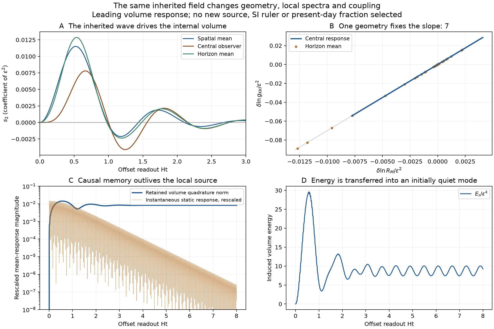

# Inherited waves change internal volume, spectra and coupling

The [coupled-parent successor](nsc-atlas-parent-backreaction.md) now supplies
the quadratic metric/cubic matter response and complete fourth-order
matter-excitation work on these same data. Full fourth-order Einstein
gravity and finite-amplitude concentration remain separate requirements.

The [thermodynamic wave](nsc-atlas-offset-thermodynamics.md) now has a
calculated geometric response in the same action. Its actual two-mode
history drives the previously frozen internal size. That response changes
local mass ratios and the restored geometric gauge coupling. No additional
incoming waveform, membrane, fit or physical ruler is supplied.
The [compact record](../results/summaries/nsc-atlas-volume-feedback-v1.json)
contains the coefficients, independent energy integral and error controls.

Three paths were considered: assume instantaneous pressure equilibrium,
introduce a charged state to create a bias, or evolve the neutral volume
already present in the action. The last path uses the existing initial
data and exposes a real feedback channel. The static construction remains
a comparison, since the real wave contains fast oscillatory forcing.

## 1. One action supplies the source and the responding geometry

The retained reduced Lagrangian contains

$$
\mathcal L=\frac{R}{2\kappa}
-\frac{K_s}{2}(\nabla s)^2-V(s)
-\frac12(\nabla\chi)^2-\frac12\mu^2(s)\chi^2,
$$

with K_s=84, mu^2(s)=400 exp(-12s), and the existing V(s). At its minimum,
s_star=-.035646782553, V''_star=183.431472847858 and
m_s^2=V''_star/K_s=2.183708010094. The volume mass divided by H is
5.4447564; it is not infinitely fast compared with expansion.

Set chi=epsilon phi1+O(epsilon^3), s=s_star+epsilon^2 s2+O(epsilon^4).
The scalar variation gives the closed leading equation

$$
\ddot s_2+3h\dot s_2-a^{-2}\Delta_\gamma s_2+m_s^2s_2
=\frac{12\mu_*^2}{2K_s}\phi_1^2.
$$

The source is exactly phi1=q1Y1+q2Y2 from the previous shared parent and
characteristic handoff. Its signed products are evaluated directly; the
turning-point force is not replaced by an averaged-dust force. The inherited
slice has s2=normal_derivative(s2)=0. The response phase is consequently
fixed by that same preparation, rather than added as a free offset.

Because s_star is constant and there is no first-order volume perturbation,
s2 is gauge invariant at this order. The quadratic metric correction
acting on the constant background vanishes; acting on s2 first contributes
at order epsilon^4. Conversely, V'_star=0 and the volume kinetic stress
starts at epsilon^4, so the earlier quadratic circulation/area calculations
are not changed by adding this leading volume response. A complete
quartic energy budget still requires the cubic matter and metric terms.

## 2. Five exact harmonics replace a spatial-grid campaign

On the generated round spatial parent use

$$
S=\left(1,\ X_1^2-\frac14,\ X_2^2+X_4^2-\frac12,
\ X_1X_2X_4,
\ X_2^2X_4^2-\frac{X_2^2+X_4^2}{8}+\frac1{48}\right).
$$

Their eigenvalues are (0,8,8,15,24). The four X components are the ambient
representation of this three-dimensional space. Let A=C1^2 q1^2,
B=C2^2 q2^2 and E=C1 C2 q1 q2, with the existing normalized harmonics.
The source coefficients are exactly

$$
[\phi_1^2]_S=(A/4+B/24,\ A,\ B/8,\ 2E,\ B).
$$

The two degree-two functions are not orthogonal: their normalized Gram
cross term is -1/24. The full positive Gram matrix is retained in every
energy and norm. Independent polynomial Laplacians, decomposition and
sphere moments check the finite closure.

For u=Ht and s2_A=cosh(u)^(-3/2)b_A, each coefficient obeys

$$
b_A''+\left[\nu_s^2+(\lambda_A+3/4)\operatorname{sech}^2u\right]b_A
=\frac{12\mu_*^2}{2K_sH^2}\cosh^{3/2}u\,F_A(u),
\qquad \nu_s^2=m_s^2/H^2-9/4.
$$

The finite evolution is 0<=u<=8, with two independent integrators and no
parameter or grid scan. Maximum coefficient disagreement over 257 comparison
events is 2.97e-12. This is a numerical control, not a bound on omitted
finite-amplitude orders.

## 3. One geometric response links mass and coupling changes

Define the local dimensionless spectral ratio

$$
R_M=\frac{\sqrt{M_1^2-\mu^2}}{\mu}.
$$

The numerator is the square root of the mass-squared increment, not the
direct difference M1-mu. The same reduction gives mu proportional to
exp(-6s), that increment's square root proportional to exp(-7s), and
g_KK proportional to exp(-7s). Therefore

$$
\delta\ln R_M=-\epsilon^2s_2,\qquad
\delta\ln g_{\rm KK}=-7\epsilon^2s_2,
\qquad \delta\ln g_{\rm KK}=7\,\delta\ln R_M.
$$

This correlation does not depend on the unknown absolute g_grav, an SI
ruler or the wave amplitude. It is a local action-coefficient/spectroscopy
relation within the retained internal geometry; no Standard Model force
has been identified. With varying s retain Z_A(s)F^2 rather than dropping
derivative terms in a pointwise canonical gauge-field redefinition.

At the already used 300-phase-pass event u=1.184645324262:

| Coefficient of epsilon^2 | Central observer | Horizon angular mean |
| --- | --- | --- |
| s2 | -.003854594815 | -.002358723358 |
| delta ln R_M | .003854594815 | .002358723358 |
| delta ln g_KK | .026982163703 | .016511063506 |

The horizon evaluation uses the unshifted observer horizon consistently:
its displacement acting on constant s_star gives zero, while displacement
acting on epsilon^2 s2 contributes at epsilon^4. There is no extra
receiving waveform or surface source. The exact 13/12 gauge-gap identity
from the previous chapter survives this volume evolution.



## 4. Energy and memory survive instantaneous source decay

For the induced volume excitation on the closed parent,

$$
E_s=\frac{K_s}{2}\int a^3
\left[\dot s_2^2+a^{-2}|Ds_2|^2+m_s^2s_2^2\right]d\Omega_3,
$$

$$
\frac{dE_s}{dt}=-p_s\frac{d\mathcal V}{dt}
+\int a^3J\dot s_2\,d\Omega_3,
\qquad J=\frac{12\mu_*^2}{2}\phi_1^2.
$$

These quantities are coefficients of epsilon^4; the pressure is the
spatially averaged canonical scalar pressure. Independent adaptive
quadrature of the right side reproduces endpoint energy within 2.19e-12.

| Endpoint u | E_s | Integrated pressure work | Integrated source work |
| --- | --- | --- | --- |
| Existing observation event | 4.057422625517 | 6.679745723589 | -2.622323098070 |
| 8 | 9.267695845498 | 9.282383647006 | -.014687801505 |

The wave excites the initially quiet volume, but source work can return
energy to matter; expansion pressure work is essential. This is not a
permanently one-way dissipative valve. This order's driven-subsystem
balance is not a replacement for the full quartic Einstein/matter budget.

The instantaneous algebraic response follows phi1^2 proportional to a^-3.
The actual volume retains a homogeneous oscillatory tail proportional to
a^-3/2. Its slower decay and nonzero coefficients show why a local
instantaneous replacement loses history. This realizes a causal response
channel in the [Schur-memory programme](schur-memory.md).

The tail control uses the original scalar's positive rescaled energies.
If D_A bounds F_A(u)/sech(u)^3, then the integrated rescaled force beyond U
is at most 2^(3/2)(2/3)D_A exp(-3U/2) times the fixed source prefactor.
The remaining homogeneous perturbation integrates to
(lambda_A+3/4)(1-tanh U)/nu_s. Gronwall's bound on the two quadratures
gives the recorded coefficient bounds and the following phase-averaged
energy diagnostic:

$$
\frac{\langle E_s\rangle_{\rm phase}}{E_\chi(0)}
=\epsilon^2\left(0.04005715\ \pm\ 0.00017306\right).
$$

The interval is a conservative future-tail bound at the numerical endpoint,
with solve error checked separately. Phase averaging refers to asymptotic
oscillator quadratures, not an ordinary finite-time thermal average.
The corresponding phase-averaged density scales as a^-3; the actual
coherent pressure oscillates. This is neither a selected present-day
matter fraction nor a thermalization claim.

## 5. The static Schur sign gives a conditional attraction

At fixed geometry and small perturbation about the stable minimum, the
volume-dependent static energy is s2 L_s s2/2-J s2, where
L_s=-K_s Delta_physical+V''_star is positive. Minimization gives

$$
\Delta E_{\rm static}=-\frac12\langle J,L_s^{-1}J\rangle<0
\quad\hbox{for nonzero }J.
$$

The finite-gradient result is a negative interaction contribution between
intensities. In the zero-gradient limit the real-field local term is
-36937.4965448063 chi_hat^4. Its canonical physical quartic coefficient
acquires g_grav; the large arithmetic coefficient is not a selected
absolute quantum coupling. The complex charged mode has a different
normalization and coefficient -149014.814858762 |z_hat|^4.

[Galley, equations1--4 and21--26](https://arxiv.org/html/1210.2745v2)
provides the initial-value/retarded-elimination method and explains the
advanced-kernel error in naive single-history variation. Our finite
expanding-space response is calculated here. The oscillatory retarded
kernel does not have the static energy sign at every instant.
[Lennon, section2](https://arxiv.org/html/2112.14263v1) supplies a useful
static charged-plus-neutral-field comparator; a stable Q-ball is not
imported into the present neutral preparation.

The local stable minimum is metastable against decompactification, so a
negative interaction cannot be extrapolated into a stable particle or
regular daughter. Charge exchange remains a symmetry: the current neutral
preparation sources neither a nonzero gauge potential nor baryon excess.
The physical scale and the present energy fractions remain unselected.

## Reproduction, limits and next calculation

```powershell
python scripts/run_python.py scripts/check_nsc_atlas_volume_feedback.py --output .build/volume-feedback-reproduced.json
python scripts/run_python.py -m pytest -q tests/test_nsc_atlas_volume_feedback.py tests/test_nsc_atlas_volume_feedback_algebra.py
python scripts/run_python.py scripts/plot_nsc_atlas_volume_feedback.py
```

The producer takes about five seconds within a 90-second compute budget.
Only a compact summary is retained. Failure risks are treating static
minimization as causal evolution, discarding the nonorthogonal Gram block,
and calling a perturbative subsystem a closed finite-amplitude solution.
Retarded initial data, exact polynomial controls and independent energy
quadrature address those separately. The successor above now supplies
the cubic matter response and quadratic metric on this same prepared
history; a concentration/continuation test remains. A different frequency
or initial cloud would be a separately declared preparation.
