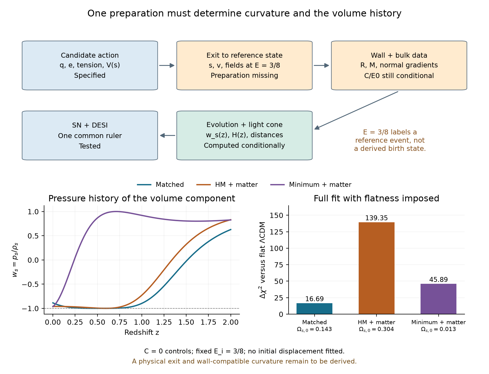

# Wall preparation, exit state and the volume equation of state

The subsequent [Parke nucleation test](nsc-atlas-parke-nucleation.md)
removes the supplied radius and seed mass within a constant-vacuum wall
control, then checks its source and reheating compatibility explicitly.

The strategic dependency is one connected preparation problem:
**fixed action -> physical exit/preparation -> wall and bulk initial data
-> volume/matter evolution -> observer distances -> SN + DESI**.
The existing calculations solve conditional links in that chain. A
vacuum saddle, a reference Cauchy slice and a material wall are different
mathematical objects; identifying them needs additional equations.

## Execution map and admission

1. `nsc_atlas_wall_exit.py` derives the existing unsquared Israel
   projection, its C/E0 and its dependence on geometric state data. It
   also checks what the computed HM saddle actually supplies.
2. `nsc_atlas_volume_preparation.py` reuses the fixed action and compares
   three named initial slices: the matched s=0, the computed HM location,
   and the computed minimum. All retain actual E_i=3/8 and zero volume
   velocity; no initial displacement or coupling is fitted.
3. The observation producer reuses the same SN and shared-ruler DESI
   likelihood. Flat C=0 and the old wall-projected C are explicit controls.
   A new post-exit curvature has not been derived by those choices.
4. Report the equation of state, energy exchange and full distance test,
   then map the common unresolved preparation rather than add independent
   fitted fixes for curvature and Omega_s.

The comparison is retrospective. Its domain is the existing homogeneous
reference-slice prior N_o in [0,log(20)], with numerical continuation to
N_e>=-log(1+z_max). Emitters can precede N=0. This is not a post-birth-only
history; a genuine exit interpretation would require N_e>=0 or a specified
earlier history. Four new state/curvature controls at two numerical settings
use six workers, one BLAS thread each and the existing 180 CPU-second
allowance per worker. No field grid or arbitrary perturbation-seed scan.

Failure forecast: an exact saddle may supply no rolling history; a wall
projection may leave its radius or collar unspecified; reducing one energy
fraction may worsen the complete distance history. Each outcome is recorded
separately. Finish-line evidence for a physical exit would be a compatible
Lorentzian state satisfying all junctions and generating the observed
light cone without emitters before its claimed birth.

## The wall fixes a relation, conditional on its geometric state

The [wall record](../results/summaries/nsc-atlas-wall-exit-v1.json) first
distinguishes the inputs. The displacement fluxes are (3/2,1,1/2,0).
The numbers (9/32,1/8,1/32,0) are their relaxed vacuum densities. With
the actual uniform grandchild-minimum scalar and zero momentum, the
middle and parent initial total densities are U_i=7/32 and U_o=21/32.
Using only their relaxed vacua in the initial junction would omit the
excitation that the task holds fixed.

In the old comoving initial slice, with k=sigma/2=1/10,

$$
\beta_-=-\frac{M}{kR^2}+\frac{(U_o-U_i+3k^2)R}{6k},\qquad
H_0^2=\frac{\beta_-^2-1+2M/R+U_iR^2/3}{R^2},\qquad
C=\frac{U_o}{3}-H_0^2.
$$

At the supplied R=19/10 and M=3/25 this gives

$$
\frac{C}{E_0}=\frac{61720739711}{1016191029600}
=0.06073733964695,\qquad
\Omega_{k,\mathrm{initial}}=-0.116222359874.
$$

The original evolving-volume fit observes that preparation later, with
Omega_k=-.08120633. This reproduces its known curvature; it does not
derive a new flattened value. With the same mass, tension and scalar data,
R=2 instead gives C/E0=-1729/21600=-.0800462963 and initial
Omega_k=+.1206643869. The zero occurs at R=1.9412508781. Choosing that
radius because C should vanish is an extra selection condition. The
ordinary-normal junction residuals of these local projections are checked
independently. Their different outer geometries are not all the original
compact atlas.

The (12,2) volume adds another mandatory condition,
K[partial_n s]=sigma_s. At s=0 its jump is -1/70, which a uniform
zero-momentum volume state does not satisfy. At the HM location the actual
tension is .1395348173 and the required jump -.00996677266. A compatible
collar and its gradient energy remain missing. Thus the old Israel
projection is not a completed new cap-wall solution.

In the [CDL](https://doi.org/10.1103/PhysRevD.21.3305) /
[Bucher--Goldhaber--Turok](https://arxiv.org/html/hep-ph/9411206)
open-interior construction the wall need not comove with the cosmological
slices. The identity H=Rdot/R used above cannot be transferred without
that assumption. Open k=-1 fixes a sign; the physical C=-1/a_ref^2
still needs the reference epoch and actual exit/evolution. No such (12,2)
CDL exit has yet been computed.

## What the HM saddle does and does not supply

The calculated HM vacuum saddle has s_b=.06000053504182, V_s(s_b)=0,
zero volume velocity and zero matter excitation. Its exact classical
continuation stays at the top by uniqueness. It supplies no finite rolling
e-fold count. In a constant-H de Sitter patch, the growing linear perturbation has rate

$$
\frac{\lambda}{H_b}=\frac{\sqrt{9+4\beta}-3}{2}=0.9520405974,
\qquad \beta=3.7625030915.
$$

The departure time depends logarithmically on its seed. Changing the
seed by a decade changes this linear departure by 2.41857868 e-folds.
A quantum preparation needs its state and the still-unspecified g;
machine roundoff is not an inherited seed. The
[HM description and its neighboring histories](https://link.aps.org/accepted/10.1103/PhysRevD.95.123502)
do not identify this exact constant saddle with a supplied material wall.

If E_i=3/8 is instead loaded at that location while sdot=0, the mean
equation gives sddot=6E_i/84=3/112>0. For every s>=s_b, V_s<=0;
on the boundary sdot=0 the force is nonnegative. The solution cannot
cross into negative velocity and return to the minimum on the left.
The full original scalar also has nonnegative mass-force contribution
there, so this branch statement is not created by phase averaging.

This loaded-location experiment is specified, but it is a different
preparation from the vacuum HM saddle. Preserving E_i at a new s_i uses
E=E_i*exp[-3N-6(s-s_i)]. Preserving the old adiabatic action would give
initial energy .2616277824 at s_b; preserving the old coherent field
instead gives .1825309240. The current task's fixed-energy control uses
.375 explicitly. It does not silently interchange these state laws.

| Proposed connection | Disposition |
| --- | --- |
| Fixed tension and vacua select C/E0 | The junction also needs geometric state and a volume collar. |
| The computed HM object is an open CDL wall exit | It is a homogeneous vacuum saddle; the compatible wall exit is absent. |
| Exact HM data determine a roll to s_star | The exact vacuum state stays at the top; a branch seed/state is missing. |
| Add the fixed matter at the top | This specified control rolls rightward toward decompactification. |

These outcomes restrict the stated constructions, not nesting.

## Equation of state and state controls

With T=Kv^2/2, the volume component relative to V_star has
rho_s=T+V-V_star and p_s=T-(V-V_star). Its physical equation of state
is w_s=p_s/rho_s where rho_s is nonzero. It exchanges energy with matter:

$$
\dot E+3HE=-6Ev,\qquad
\dot\rho_s+3H(\rho_s+p_s)=6Ev.
$$

Consequently the equation inferred from dilution alone is
w_s,eff=w_s-2Ev/(H*rho_s), not the pressure ratio. The combined volume
plus vacuum has w_DE=(T-V)/(T+V). A zero or negative rho_s is not clipped:
the fixed V_star split can cease to be a physical late-vacuum split on
the runaway branch, although the total canonical volume density remains
positive.

The current matched flat fit has w_s(0)=-.88673553 and
w_DE(0)=-.97747139. Over the requested redshifts the first pilot gives
w_s approximately (-.887,-.990,-1.000,-.897,-.025,+.627) at
z=(0,.25,.5,1,1.5,2). This substantial pressure evolution is part of
the distance prediction and cannot be assessed from Omega_s,0 alone.

The HM-location controls and the additional minimum-start control retain
E_i=3/8, v_i=0 and the same potential. The minimum-start experiment directly
tests initial displacement: it starts with rho_s=0, yet matter subsequently
forces motion. It is not a derived reheating state. All new comparisons
are labelled reference-slice continuations; the reconstructed z of N=0
is reported so that a reader can identify pre-slice emitters.

Rounding is explicit: 3*(.577259+.143326)=2.161755 for the displayed
six-decimal numbers. The stored full-precision best-fit sum is
2.1617561739988; the posterior mean is 2.1616589757622. These three
different reported quantities are not substituted for each other.

## Retained evidence and the next physical connection

The [retained preparation comparisons](../results/summaries/nsc-atlas-exit-preparations-v1.json)
use committed method 160f4f4. The four new controls share the same
authenticated data, covariances and three fitted observational quantities.

| Start and curvature control | Joint chi-square | Delta versus flat LambdaCDM | Omega_Lambda | Omega_s | Omega_m | Omega_k |
| --- | ---: | ---: | ---: | ---: | ---: | ---: |
| Matched, flat (retained baseline) | 1207.86625 | +16.68945 | .577259 | .143326 | .279415 | 0 |
| HM location + matter, flat | 1330.53101 | +139.35422 | .495982 | .303996 | .200022 | 0 |
| HM location + matter, old C | 1392.91214 | +201.73534 | .532212 | .326298 | .204525 | -.063035 |
| Minimum + matter, flat | 1237.06508 | +45.88828 | .745006 | .012710 | .242284 | 0 |
| Minimum + matter, old C | 1277.82738 | +86.65058 | .814085 | .015530 | .254214 | -.083829 |

Flat LambdaCDM has joint chi-square 1191.17680. Old C means the recovered
reference C/E0=.06073733965, not a new HM-exit junction value. In the
HM-location runs the positive V_star term is only a reference split: the
trajectory does not settle in that minimum. Its canonical total volume
density and pressure, and their sum with matter, determine the distances.

| Start and curvature control | Posterior 3*(Omega_Lambda+Omega_s) | Combined-width difference from 2.054 +/- .022 |
| --- | ---: | ---: |
| Matched, flat | 2.161659 +/- .015813 | +3.97 |
| HM location + matter, flat | 2.399845 +/- .010551 | +14.17 |
| HM location + matter, old C | 2.575431 +/- .008741 | +22.03 |
| Minimum + matter, flat | 2.273023 +/- .014245 | +8.36 |
| Minimum + matter, old C | 2.488710 +/- .011674 | +17.45 |

These sums include component covariance and are not added to the likelihood.
The two numerical settings change joint chi-square by at most 5.6e-9,
and the posterior sum mean by at most 1.3e-11. Reducing Omega_s today
does not by itself reduce total dark energy: at C=0 their sum is exactly
1-Omega_m. The minimum-start fit lowers Omega_s to .012710 but selects
matter .242284, increasing the total dark-energy fraction to .757716.

For the matched flat source, the directly computed pressure history is:

| z | w_s | w_DE | Omega_s |
| ---: | ---: | ---: | ---: |
| 0 | -.886736 | -.977471 | .143326 |
| .25 | -.990120 | -.997903 | .122643 |
| .5 | -.999998 | -1.000000 | .095024 |
| 1 | -.896920 | -.976132 | .059570 |
| 1.5 | -.024749 | -.600811 | .079416 |
| 2 | +.627429 | +.165435 | .171422 |

In the minimum-start flat control, Omega_s at z=2 is .226330 despite
its smaller present value. This earlier pressure/energy history is part
of why the full distance fit worsens. At its exact zero-density starting
point w_s is undefined; the canonical kinetic norm remains positive and
the total volume equation of state is well defined.

The fitted reference slices lie at z=.592946/.615760 for the HM-location
controls and z=.711186/.732856 for the minimum controls. Higher-redshift
emitters use the numerical backward continuation. Those curves cannot
be advertised as post-nucleation-only histories with N=0 as their birth.
No true-exit refit or new inherited Omega_k,0 was obtained.

The next calculation should construct a compatible parent/child transition
and its Lorentzian field profiles, volume branch and wall collar. Evolve
that state forward to the comparison event E=3/8 in the fixed source units,
if such an event exists. Carry its s, velocity and geometric curvature into
the observer calculation without resetting the velocity or loading matter
by hand. The existing E0 then labels a reference event rather than being
mistaken for a primordial birth density. A missing or ambiguous event is
a specific failure of that proposed preparation.

Before the next likelihood comparison, require every emitter to lie in the
constructed history. Choosing another homogeneous starting point to reduce
one present-day fraction would repeat a control that has now been tested.
The map identifies this shared preparation problem rather than treating
curvature and Omega_s as separate adjustable cosmological numbers. These
failed controls do not reject nesting.
