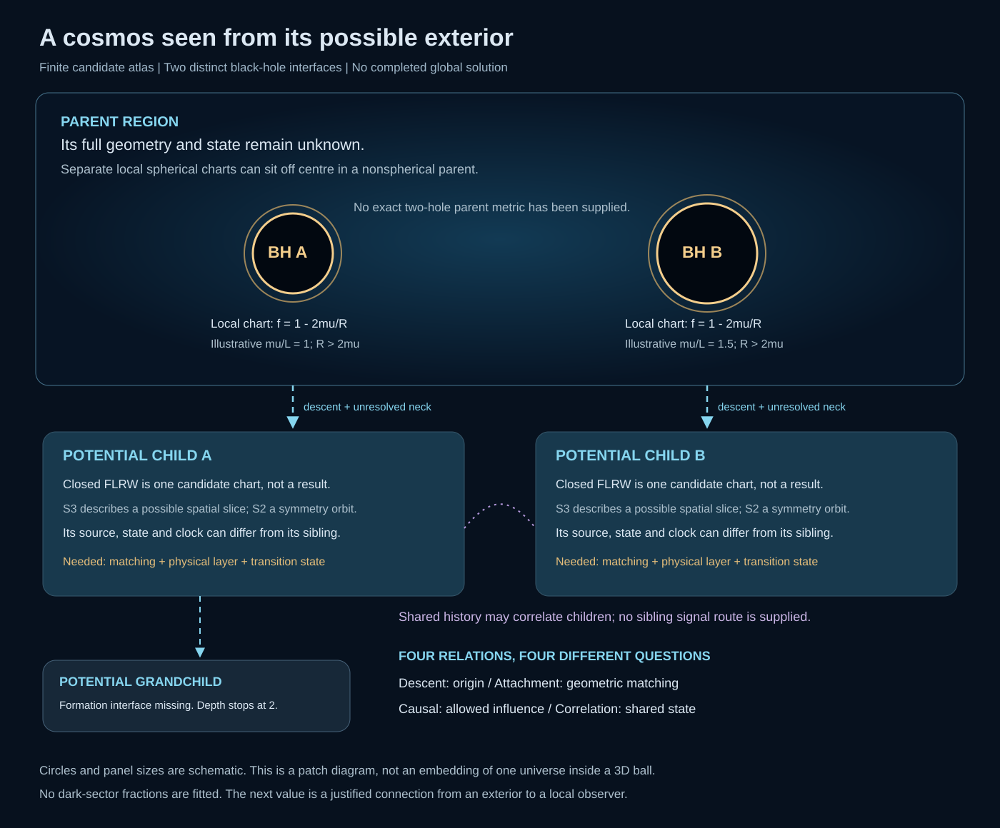
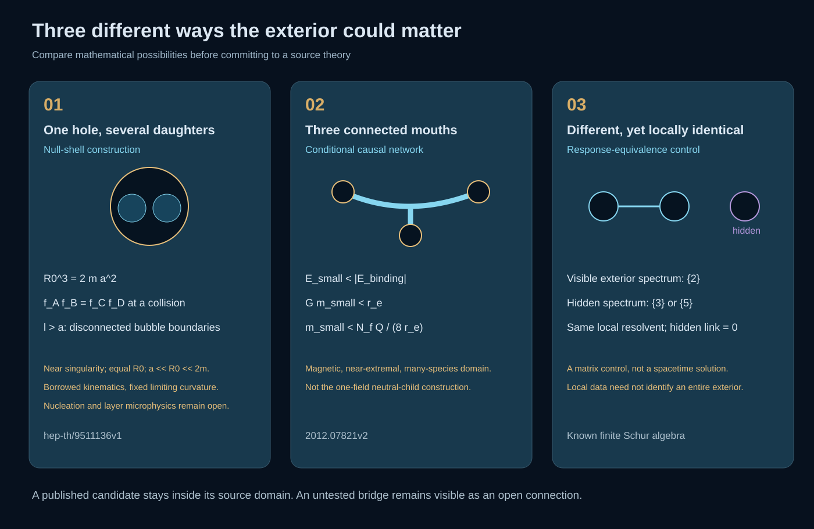

# A cosmos seen from its possible exterior

Start outside the local cosmos. Two black holes in a parent region may be
interfaces to two children. The pictured parent is not assumed globally
spherical: spherical symmetry belongs to separate local patches. A child's
possible closed spatial slice is S3; its round horizon sections are S2.
The drawing gives neither a global spatial embedding nor a solved spacetime.

The children may inherit a common law while differing in state and history.
Descent, geometric attachment, causal influence and correlation are four
independent relations. Shared ancestry alone gives no signal route. The
grandchild marks a finite second generation; its formation interface is open.

## Borrow before extending

The one-hole multiple-daughter construction supplies null-shell matching and
conditional boundary collisions. Its l>a disconnection condition uses a
near-singularity approximation, equal nucleation radius, and a<<R0<<2m.
It differs from two separate black holes
hosting different children. The connected-mouth construction supplies actual
conditional traversability, within its charged, many-species semiclassical
domain. Neither is imported as the project's completed geometry.

The response-equivalence control asks a different question: can a local
observer distinguish all exteriors? An exactly uncoupled mode changes the
exterior spectrum without changing the local resolvent. This known algebra
is a control against overclaiming what a local measurement can reconstruct.

## The next useful mathematical connections

1. Supply a common parent geometry and match each local interface, carrying
   induced metric, orientation, source and conservation together.
2. Supply the state and clock conversions that turn an exterior response
   into a local observer prediction. Do not turn correlation into signaling.
3. Separate inherited dimensionless law, environmental response and chosen
   state. Hold each candidate theory fixed when perturbing its state.
4. Then ask which local dark-sector, matter-antimatter or time observables
   can distinguish these exterior candidates. No abundance fit starts this map.

## What the saved records establish

`atlas.json` records every region, connection, source, assumption and gap.
`controls.json` checks imported junction and response algebra. The separately
labeled `integration.json` passes an explicitly supplied four-mode matrix to
the existing retained-region reducer. Its matrix coefficients are software
fixtures; no physical Hamiltonian, formation probability or relativistic
light cone is derived from them. Numerical discrepancies are not error bounds.

`manifest.json` binds portable source paths, the canonical input, and each
output. The producer refuses an existing output directory; `--check` verifies
the existing bundle without rewriting it. Full source reading boundaries
and versioned arXiv URLs are included in `atlas.json`.
