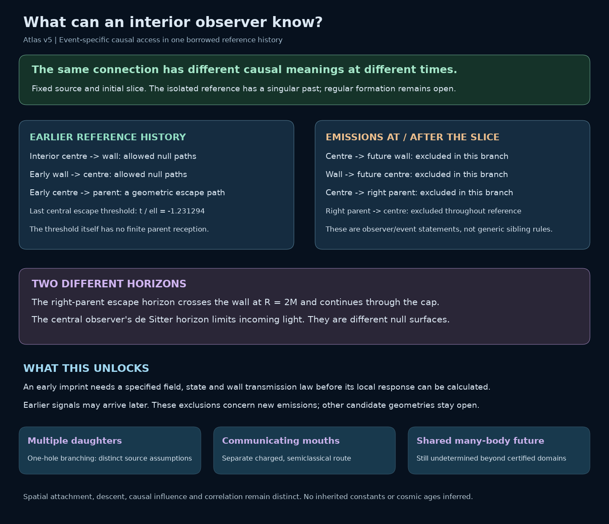
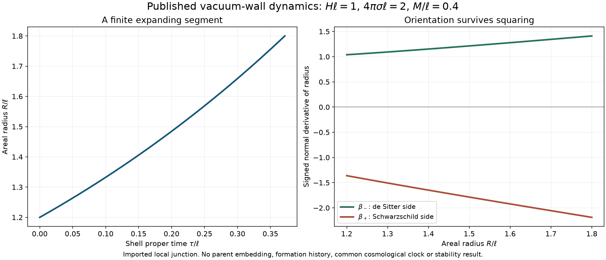

# A Finite Atlas of Nested Cosmologies: Branching, Junctions and Observer Response

**Working manuscript draft, atlas v5 - 10 October 2026.** This successor develops the
exterior-first investigation alongside the existing manuscripts. It is not a
submission-ready edition, a new release, or a replacement for their frozen
evidence. The [paper guide](../docs/papers.md) identifies those editions. The
[atlas v2 draft](atlas-working-draft.md) and
[atlas v3 draft](atlas-working-draft-v3.md), together with the
[atlas v4 draft](atlas-working-draft-v4.md), remain bound to their original evidence.

## Abstract

We construct a finite atlas of black-hole exteriors, candidate cosmological
interiors and further generations, distinguishing descent, geometric
attachment, causal influence and correlation. Published geometries and
matching laws provide the components. A fixed-source compatibility test
excludes a pure constant-tension radiation/vacuum attachment; conservation
shows why boundary motion alone cannot rescue it. A separate, published
de Sitter/Schwarzschild wall now connects on one checked spacelike slice to
a regular expanding cap, a Schwarzschild bridge and an exact vacuum
asymptotic end. The bulk constraints and the wall's distributional energy
and momentum constraints hold with the original source parameters. An
existing vacuum-end gluing theorem then supplies a sufficiently separated
multi-body initial-data family retaining that interior alongside another
Schwarzschild body. This
route is distinct from the atlas's explicit Brill-Lindquist parent.
A finite domain-of-dependence calculation identifies a parent observer's
proper-time window in which larger assemblies sharing the retained vacuum
data are geometrically indistinguishable. A separate causal completion of
the isolated spherical body now locates the center, moving wall and right
parent in their respective light cones. Earlier emissions can connect
selected observers, while emissions at or after the chosen initial slice
cannot pass between these three worldlines. This event-specific result
belongs to the isolated reference; it is not the global future of the
glued parent. These are connections and applications of established
mathematics, without a priority claim.
Multiple-daughter and communicating-mouth alternatives remain independent.
The construction establishes a sourced initial-data attachment and its
isolated observer map. Regular formation, global many-body shell evolution,
stability, inherited constants and dark-sector explanations remain open.

## 1. Begin with the possible exterior

An interior observer measures fields, curvature and correlations within a
limited region. The larger structure that supplies those data may be harder
to determine. Nested-Space Cosmology asks whether a systematic map of possible
exteriors can make that ambiguity useful: which regions can be joined, which
can influence one another, and which leave the same local response?

Our first motif places two candidate black-hole interfaces in a common
parent. Their proposed children may differ, and one child may contain a
further interface. This is a finite question about two generations. No
infinite hierarchy is needed to ask whether a single attachment is admissible.

*Figure 1. A map of regions and the status of their proposed relations. Its
layout is diagrammatic; separation on the page is neither proper distance nor
an embedding of the complete spacetime. Candidate descendants remain visible
when an attempted source or attachment is rejected.*

The research sequence is to borrow a geometry, identify the physical data
required at its boundary, decide a finite compatibility question, and then
derive consequences for an observer. The proposed explanatory reach includes
gravitational response, expansion, antimatter and time. These are distinct
questions, each requiring a mechanism and an observable. A desired cosmic
abundance does not select the geometry or its parameters.

## 2. Four relations carried by the atlas

Each region records its geometry, matter or quantum state, clock convention,
dimensionless parameters and validity domain. A spatial initial-data set
does not claim the information content of an evolved four-geometry. Each
connection records its mathematical source, assumptions and missing conditions.

| Relation | Mathematical question | What the relation alone does not establish |
|---|---|---|
| Descent | Which transition supplies the putative child's initial data? | A joined metric or a continuing signal channel. |
| Geometric attachment | Which boundary data match, with which normal orientations and source? | Traversability or regular formation from earlier data. |
| Causal influence | Can an intervention reach the named observer along an allowed route? | That every correlated quantity can be controlled or transmitted. |
| Correlation | Which state or ancestry relates measurements in different regions? | A communication channel between them. |

A round two-surface has topology $S^2$. A candidate closed spatial slice
may have topology $S^3$. These statements have different dimensions and
neither follows from drawing one circle inside another. Similarly, multiple
ends of a spatial slice do not by themselves specify a parent-to-child
history. Causal interpretation requires a spacetime extension; the review by
[Ansoldi, Merali and Guendelman](https://arxiv.org/html/1801.04539v1) provides
the relevant distinction between a spatial bridge and a traversable route.

## 3. A shared parent with two punctures

We import the uncharged, time-symmetric Brill–Lindquist construction. In
geometrized units $G=c=1$, its initial data are

$$
\gamma_{ij}=\psi^4\delta_{ij},\qquad K_{ij}=0,\qquad
\psi=1+\frac{m_A}{2|\mathbf x-\mathbf x_A|}
       +\frac{m_B}{2|\mathbf x-\mathbf x_B|}.
$$

The domain is $\mathbb R^3\setminus\{\mathbf x_A,\mathbf x_B\}$.
Away from the punctures, the harmonic conformal factor satisfies the vacuum
Hamiltonian constraint. For coordinate separation
$d=|\mathbf x_A-\mathbf x_B|$, the three asymptotic-end ADM masses are

$$
M_\infty=m_A+m_B,\qquad
M_A=m_A\left(1+\frac{m_B}{2d}\right),\qquad
M_B=m_B\left(1+\frac{m_A}{2d}\right).
$$

These are borrowed results, not new solutions. The original source is
[Brill and Lindquist (1963)](https://doi.org/10.1103/PhysRev.131.471);
the uncharged conventions above appear in
[Pook-Kolb et al., v1, Section III, equations 17–21](https://arxiv.org/html/2308.10906v1).
The parameters $m_A,m_B$ must not be silently identified with all three
end masses or with horizon masses.

The finite example uses $m_A=1$, $m_B=1.5$ and $d=12$ in one shared length
unit. The corresponding end masses are $M_\infty=2.5$, $M_A=1.0625$ and
$M_B=1.5625$. Their inequality is recorded input and its geometric consequence;
it is not a predicted distribution of children or inherited constants.
The [parent adapter and controls](../lab/docs/nsc-atlas-parent-initial-data.md)
also compare two finite coordinate spheres with their local monopole
approximations. Those probes are not computed horizons.

*Figure 2. A coordinate section of a borrowed initial-data geometry. The
conformal factor describes intrinsic spatial geometry; a colored contour is
not automatically a marginally trapped surface. Locating horizons and evolving
the slice are separate problems.*

The parent is axisymmetric for punctures on one axis, but it is not globally
spherically symmetric. Near one puncture, the companion contributes both a
leading offset and direction-dependent corrections to the conformal factor.
A local Schwarzschild description therefore requires a stated approximation
and an error criterion. Our spherical junction test does not supply that
criterion or remove the companion's tidal field.

On a coordinate sphere of radius $r$ about one puncture the induced metric is
$q_{AB}=r^2\psi(\theta)^4\Omega_{AB}$. The angular dependence is part of the
boundary data, even though the coordinate surface is called a sphere. The
adapter records its intrinsic Gaussian curvature as well as the conformal
factor's angular profile. These spatial quantities can test a proposed round
boundary; they are not four-dimensional observer tides.

Brill–Lindquist data carry three asymptotically flat ends. We do not relabel
the two puncture ends as expanding children. Doing so would replace a spatial
fact with a dynamical hypothesis. The atlas retains a separate, unresolved
transition from each candidate interface to its proposed cosmological region.

### 3.1 An alternative parent that preserves spherical collars

The nonround coordinate spheres of this particular parent do not exclude
exact spherical neighborhoods in every multi-body initial geometry.
[Chrusciel, Corvino and Isenberg, v1, Theorem 1.1 and its following discussion](https://arxiv.org/html/0909.1101v1)
provide a different construction. For positive-mass, scalar-flat,
asymptotically Euclidean body data, their gluing preserves selected compact
regions exactly while creating a common outer Schwarzschild end. Applied
to two Schwarzschild bodies, it can retain compact neighborhoods of their
throats. Unequal masses are allowed, and the body separation must be
sufficiently large. The proof adjusts mass and center parameters to remove
the finite-dimensional constraint obstruction. It supplies no usable numeric
separation threshold for our selected collars.

This imported existence result opens a separate parent family. It does not
make the unmodified Brill-Lindquist metric exactly spherical near either
puncture, nor certify its chosen $d=12$ example. We do not rerun the published
constraint-solving proof or label a schematic picture as its computed metric.

A usable connection must include the proposed child junction in admissible
body data while retaining the required vacuum end.
A moving timelike wall and a time-symmetric spatial collar are different
objects. Equality of a mass parameter does not match their induced metric,
extrinsic curvature, source and Cauchy data. The theorem supplies the parent
assembly route after those data are compatible; it does not supply that
compatibility itself. Extra ends retained from the individual bodies also
retain their spatial meaning, rather than becoming children by relabeling.

Time symmetry need not become a permanent restriction. The same authors'
[non-time-symmetric extension, v1, Theorem 1 and Corollary 1.1](https://arxiv.org/html/1004.1355v1)
retains specified body data $(g,K)$ with vacuum asymptotically Euclidean ends
and timelike ADM energy-momentum; matter may remain away from those ends.
The stated smooth-data theorem does not establish its global corollary for an ideal Israel
wall with a distributional surface source. Section 4.6 instead applies the
end theorem only where the data are smooth and vacuum, leaving the checked
wall-bearing interior untouched. The [earlier gluing assessment](../lab/docs/nsc-atlas-parent-gluing.md)
records the original routes and reading boundaries; the
[connection assessment](../lab/docs/nsc-atlas-connection-gluing.md) explains
this more specific application.

## 4. Decide an attachment with its source held fixed

The first compatibility question is deliberately limited:

> Can the specified surface source support the proposed spherical
> parent–child boundary over the declared finite interval without changing
> the source law or its coefficients along the trajectory?

Let a timelike shell have induced metric

$$
ds_\Sigma^2=-d\tau^2+R(\tau)^2d\Omega^2,
\qquad S^a{}_b=\operatorname{diag}(-\sigma,p,p).
$$

For a fixed orientation convention, Israel matching requires the jump in
extrinsic curvature, including its temporal component, to reproduce this
surface stress tensor:

$$
[K^a{}_b]-\delta^a{}_b[K]=-8\pi S^a{}_b.
$$

The surface conservation equation also relates the shell's evolving energy
and pressure to flux from the bulk. When that flux vanishes it reduces to

$$
\dot\sigma+2\frac{\dot R}{R}(\sigma+p)=0.
$$

Thus an angular matching identity alone is insufficient. The density
inferred from that identity, the pressure required by the temporal equation,
and the chosen material law must agree on the same trajectory. In particular,
a pure domain wall has $p=-\sigma$; with zero flux, its density is constant.
Replacing that constant by a separately fitted value at every radius defines
a different problem.

The source of these identities is
[Israel, *Singular hypersurfaces and thin shells in general relativity*](https://doi.org/10.1007/BF02710419).
The classic de Sitter/Schwarzschild domain-wall problem was already analyzed
by [Blau, Guendelman and Guth](https://doi.org/10.1103/PhysRevD.35.1747).
Replaying a known admissible wall is an integration control. The present
investigation tests the stated atlas candidate and records a rejection just
as explicitly as a successful attachment.

*Figure 3. The source comparison is evaluated along one specified trajectory
and over one finite domain. A failure of that candidate closes its attempted
connection, while leaving other sources, trajectories and geometries open.*

### 4.1 A comoving radiation cap and a constant-tension wall

The chosen interior is the exact closed, radiation-dominated FLRW solution

$$
ds_-^2=-dt^2+a(t)^2(d\chi^2+\sin^2\chi\,d\Omega^2),\qquad
a=A\sin\eta,\qquad t=A(1-\cos\eta).
$$

A boundary at fixed $\chi$ has $R=a\sin\chi$ and $\tau=t$. We compare it
with a Schwarzschild region of fixed mass $M$, restricting the finite
numerical example to an exterior static patch and a real timelike shell.
This $M$ belongs to the separate spherical test; it is not identified with
one of Section 3's asymptotic-end masses without an additional matching map.
The radiation fluid is comoving with the boundary, so its energy flux
through the boundary is zero; the exterior is vacuum. The trial wall has
$p=-\sigma$ with fixed $\sigma$.

For the ordinary cap orientation let $b=\cos\chi$. The angular extrinsic
curvatures can be expressed through

$$
\beta_-=b,\qquad
\beta_+^2=b^2+\frac{A^2\sin^4\chi}{R^2}-\frac{2M}{R}.
$$

The required angular jump is $\beta_- -\beta_+=4\pi\sigma R$.
Set $k=4\pi\sigma$. Squaring this necessary equation and multiplying by
$R^2$ gives

$$
k^2R^4-2bkR^3+2MR-A^2\sin^4\chi=0.
$$

For $A>0$ and $0<\chi<\pi$, the constant coefficient is nonzero. Therefore
this polynomial cannot vanish throughout an open interval of radii for any
fixed $k$ and $M$. This excludes a constant-tension wall on the stated
varying-radius, comoving radiation trajectory. Reversing the cap orientation
changes $b$'s sign but not that obstruction. Squaring is used only for a
necessary condition; no extra solutions from squaring are admitted.

The conclusion is stronger than observing a large numerical residual at a
few sample times, but it remains narrower than a no-child-universe theorem.
The polynomial alone tests the comoving boundary. Section 4.3 separately
checks whether noncomoving motion is available with the same bulk and wall
assumptions. Another material law, compatible bulk flux, or different bulk
geometries require their own matching problem. The radiation solution used
here has no regular bounce; its finite expanding segment is a matching test
rather than a formation history.

### 4.2 Finite witness and independent checks

The recorded test uses $M/A=0.4$, $\chi=\pi/3$ and
$\eta\in[1.25,1.45]$. Its specified positive wall density is
$\sigma=1/(64\pi A)$, chosen before the comparison. The parameters are
dimensionless model inputs, not inferred cosmological constants. The interval
has $\tau/A\in[0.684678,0.879497]$ and
$R/A\in[0.821845,0.859715]$, outside the Schwarzschild horizon $2M/A=0.8$
and before the FLRW turnaround.

The finite implementation evaluates the surface density and pressure
required by both components of the junction condition, checks conservation,
and compares them with the same fixed wall. A second normal orientation is
recorded separately. The exact polynomial obstruction prevents a different
constant wall density from rescuing the candidate on the whole interval.

| Ordinary-cap quantity | At $\eta=1.25$ | At $\eta=1.45$ |
|---|---:|---:|
| Required $A\sigma$ | 0.01638975 | 0.02001736 |
| Required $Ap$ | −0.05885743 | −0.05825351 |
| Fixed wall $A\sigma$ | 0.00497359 | 0.00497359 |
| Fixed wall $Ap$ | −0.00497359 | −0.00497359 |
| Required $A(p+\sigma)$ | −0.04246768 | −0.03823615 |

The required density varies, and the required pressure does not satisfy the
domain-wall equation of state. This is a rejection of the chosen attachment.
The required tensor is a geometric diagnostic, not an independently derived
new material source.

The [source test and its independent controls](../lab/docs/nsc-atlas-junction-sources.md)
compare the temporal extrinsic curvature with a direct Christoffel-symbol
calculation, check the surface conservation law using a five-point numerical
derivative, and check the normal Einstein jump relation. Their maximum
absolute discrepancies in the recorded dimensionless convention are
$1.21\times10^{-10}$, $9.16\times10^{-13}$ and $6.94\times10^{-18}$,
respectively. An imported Oppenheimer–Snyder dust boundary supplies a positive
control: across nine samples its required surface density and pressure are
zero to absolute discrepancies below $1.9\times10^{-17}$ and
$8.9\times10^{-18}$. These are numerical verification discrepancies, not
rigorous error bounds or physical perturbative-stability results. The
polynomial argument, rather than sampling density or a residual tolerance,
establishes the incompatibility over the interval.

Even a fully matched finite spherical shell would not establish its embedding
in the nonspherical parent of Section 3. It would also leave regular formation
and perturbative stability open. The formation obstruction of
[Farhi and Guth](https://doi.org/10.1016/0370-2693(87)90429-1) is conditional on
its classical energy and global assumptions. The nonspherical instabilities
studied by [Aguirre and Johnson, v2](https://arxiv.org/html/gr-qc/0508093v2)
show why a spherical background trajectory cannot substitute for a stability
analysis. These results guide separate checks; neither is applied outside its
stated model to exclude every atlas branch.

### 4.3 Is motion through the radiation an available freedom?

Changing the boundary trajectory is useful only if the chosen source permits
the associated energy transfer. The relevant restriction comes before a new
trajectory integration. For a pure wall with constant tension,

$$
S^a{}_b=-\sigma\delta^a{}_b,\qquad D_aS^a{}_b=0.
$$

The contracted Codazzi identity therefore requires
$[T_{\mu\nu}U^\mu n^\nu]=0$ across the wall. Here $U$ is the wall's unit
velocity and $n$ its consistently oriented unit normal. We import the
conservation identity from
[Lobo and Crawford, v2, equation 8](https://arxiv.org/html/gr-qc/0507063v2),
rather than assuming a transparent boundary independently of its matter.

Let $u$ be the interior perfect fluid's velocity and $e$ a radial unit vector
in its rest frame. A spherical wall moving at speed $v$ relative to that
fluid has

$$
U=\gamma(u+ve),\qquad n=\gamma(vu+e),\qquad
\gamma=(1-v^2)^{-1/2},\qquad |v|<1.
$$

Contracting $T_{\mu\nu}=(\rho+p)u_\mu u_\nu+p g_{\mu\nu}$ gives

$$
T_{\mu\nu}U^\mu n^\nu=(\rho+p)\gamma^2v.
$$

Reversing the normal changes the flux sign, not its zero. The Schwarzschild
side supplies no matter flux. Positive-density radiation has
$\rho+p=4\rho/3>0$, so conservation forces $v=0$. In the FLRW coordinates
of Section 4.1, $v=a\,d\chi/dt$, hence the wall must be comoving.
The polynomial obstruction then applies on every open interval of changing
radius in its stated domain. Motion alone cannot rescue this radiation,
vacuum exterior and fixed pure-tension combination.

This is a compatibility deduction from an established conservation law.
It does not rule out a wall that absorbs energy and changes its surface
state, a different prescribed material law, compensating exterior flux, or
a different interior. An imposed function $\sigma(\tau)$ chosen to cancel
the mismatch would require a physical exchange model before it could become
another admitted candidate. The atlas consequently stops the present route
without commissioning a noncomoving trajectory search under the same
assumptions.

### 4.4 A distinct moving-wall branch

The de Sitter case provides a useful comparison. Its vacuum stress satisfies
$\rho+p=0$, so the preceding fluid flux vanishes for any timelike wall
velocity. A moving de Sitter/Schwarzschild wall is an imported construction;
its availability does not repair the radiation interior. It identifies the
bulk assumption that changes the compatibility question.

In geometrized units, write

$$
f_-(R)=1-H^2R^2,\qquad f_+(R)=1-\frac{2M}{R},\qquad
\kappa=4\pi\sigma>0.
$$

With the normal directed from the minus to the plus region, the angular
junction equation is

$$
\beta_- -\beta_+=\kappa R,\qquad
\beta_\pm=\epsilon_\pm\sqrt{\dot R^2+f_\pm(R)},\qquad
\epsilon_\pm\in\{-1,+1\}.
$$

The signs specify which side of each spherical geometry is retained. They
cannot be recovered by plotting a squared effective potential alone.
Keeping those signs gives

$$
\beta_-=\frac{f_--f_++\kappa^2R^2}{2\kappa R},\qquad
\beta_+=\frac{f_--f_+-\kappa^2R^2}{2\kappa R},\qquad
\dot R^2=\beta_-^2-f_-.
$$

These are borrowed thin-wall dynamics, attributed to
[Blau, Guendelman and Guth](https://doi.org/10.1103/PhysRevD.35.1747)
and read through the sign-sensitive account of
[Ansoldi, Guendelman and Shilon, v1](https://arxiv.org/html/0711.2198v1).
The finite adapter tests an already specified branch; it does not claim to
rediscover the bubble solution. The temporal junction equation, the
unsquared angular equation and the allowed metric domain must agree with
the same tension throughout the recorded segment.

The [moving-boundary adapter](../lab/docs/nsc-atlas-moving-boundaries.md)
uses $H\ell=1$, $\kappa\ell=2$ and $M/\ell=0.4$, with
$R/\ell\in[1.2,1.8]$ on the expanding branch. Here $\ell$ is the shared
length unit. Throughout this interval $\epsilon_-=+1$ and
$\epsilon_+=-1$: the normal on the Schwarzschild side points toward smaller
areal radius. This supplies the signed local orientation, without deciding
which complete spacetime history creates it.

The de Sitter segment lies beyond its static-patch horizon, where the static
coordinate $t_-$ is spacelike. The decreasing signed Schwarzschild time
coordinate on the selected side is also not a negative observer age.
The wall's proper time is calculated from $d\tau=dR/\sqrt{\dot R^2}$;
the indefinite metrics and timelike normalization must hold on both sides.
No cross-universe clock comparison or entropy arrow is inferred from these
coordinate choices.

| Vacuum-wall quantity | At $R/\ell=1.2$ | At $R/\ell=1.8$ |
|---|---:|---:|
| $\dot R$ | 1.232594874 | 2.057420001 |
| $\beta_-$ | 1.038888889 | 1.411728395 |
| $\beta_+$ | -1.361111111 | -2.188271605 |
| Fixed $\ell\sigma$ | 0.159154943 | 0.159154943 |
| Fixed $\ell p$ | -0.159154943 | -0.159154943 |

The elapsed wall proper time is $\Delta\tau/\ell=0.3718706103$.
The quantity $\dot R$ is the rate of change of areal radius with proper time;
it is not a locally measured three-speed. Its values greater than one do
not violate the checked timelike normalization. Across 33 radii, the maximum
unsquared angular residual is $4.45\times10^{-16}$. The direct pressure
comparison differs by at most $2.78\times10^{-17}$ in the stated scaled
units; an independent Christoffel-symbol and five-point-derivative check
differs by at most $2.86\times10^{-12}$. The largest absolute tangent
normalization discrepancy is $3.56\times10^{-15}$.

Quadrature orders 32 and 64 agree on the duration within
$5.56\times10^{-17}\ell$. These are numerical verification discrepancies,
not rigorous error bounds or perturbative stability results. Replacing the
signed normal components by their absolute values produces an angular
mismatch of at least $2.72$ on this interval. The explicit orientation is
therefore consequential to the admitted attachment, rather than decorative
notation.

*Figure 4. The moving-boundary comparison separates a conservation constraint
on the radiation candidate from a sourced vacuum-wall control. A compatible
finite segment supplies local junction data. It does not establish formation,
stability, sibling communication or attachment to the two-puncture parent.*

### 4.5 Put the same wall on a slice with a parent end

The expanding interior, wall and vacuum parent end now belong to one checked
spacelike initial-data set. The construction keeps the preceding source
parameters fixed and chooses the wall event $R_{\rm w}/\ell=1.5$. It supplies
the missing geometrical attachment without replacing that finite question
by a formation simulation.

Let $l$ be radial proper distance on the slice, $T$ its future unit normal,
and $V=T(R)$. With $K=-\mathcal L_T h/2$, write

$$
h=dl^2+R(l)^2d\Omega^2,\qquad K^\theta{}_\theta=-\frac{V}{R}.
$$

The interior is a finite cap of the expanding flat slicing of de Sitter:
$R'=1$, $V_-=HR$ and $K^i{}_j=-H\delta^i{}_j$. Its spatial geometry is a
regular ball, not a closed $S^3$ universe. The wall's velocity relative to
that slice is determined by its existing signed trajectory:

$$
\gamma=\frac{\beta_- -HR\dot R}{1-H^2R^2},\qquad
\gamma v=\frac{\dot R-HR\beta_-}{1-H^2R^2}.
$$

Using the same Lorentz frame through the wall gives the exterior data

$$
R'_+=\gamma\beta_+-\gamma v\dot R,\qquad
V_+=\gamma\dot R-\gamma v\beta_+.
$$

Thus the exterior slice is allowed to have nonzero extrinsic curvature near
the moving wall. Imposing time symmetry there would add an unnecessary
restriction. The retained sign $R'_+<0$ means that areal radius initially
decreases as one proceeds from the cap toward the parent side.

The spherical vacuum mass identity and constraints are imported from
[Kuchar, v1, Sections 3 and 4](https://arxiv.org/html/gr-qc/9403003v1).
On this decreasing-radius part of the Schwarzschild geometry they give

$$
R'=-\sqrt{1-\frac{2M}{R}+V(R)^2},\qquad
K^l{}_l=-\frac{dV}{dR},\qquad
M=\frac{R}{2}\left(1+V^2-R'^2\right).
$$

A fixed smooth step tapers $V$ from its inherited wall value to zero at
$R_0/\ell=1.0>2M/\ell=0.8$. This chooses a slice of the same vacuum metric;
it does not interpolate between bulk source models. Both vacuum constraints
hold for this slicing family. Once $V=0$, the slice follows the ordinary
time-symmetric bridge, written in regular coordinates as

$$
R=2M\cosh^2 u,\qquad
l-l_{\rm throat}=2M(u+\sinh u\cosh u),\qquad R'=\tanh u.
$$

At $u=0$ the sphere has minimum radius $2M$ and
$R''=1/(4M)$. Continuing onto $u>0$ provides the analytically specified
Schwarzschild asymptotic end. A finite plotting cutoff does not truncate it.
The bridge is a spatial connection; its presence does not prove that a
message can traverse between observers.

The remaining check is the surface source on this particular slice.
Its integrated energy and radial momentum are
$E_\Sigma=\sigma\gamma$ and $J_\Sigma=\sigma\gamma v$, rather than the
rest tension alone. The extra boost factor follows by projecting the wall
stress and restricting its normal delta function to the slice. The frame
and shell machinery is borrowed from
[Hajicek, v2, Sections 2 and 4.1](https://arxiv.org/html/gr-qc/9708008v2).
With exterior-minus-interior jumps, the constraints require

$$
[R']=-4\pi R E_\Sigma,\qquad [V]=4\pi R J_\Sigma.
$$

The inherited signed junction equation supplies these two identities with
the same fixed $\sigma$. The [slice adapter](../lab/docs/nsc-atlas-connection-slice.md)
records the bulk, surface, center and throat checks separately. They pass,
including the unit-rescaling control. A regular
center on this initial slice does not establish past completeness. In
particular the expanding cap includes anti-trapped spheres beyond $HR=1$,
so the formation questions discussed in the literature remain relevant.

At the chosen wall event, $\dot R=1.650310951$, $\gamma=1.009262030$ and
$v=0.1351659945$. The exterior slice inherits
$R'_+=-2.027786090$ and $V_+=1.909253718$. The integrated surface quantities
are $\ell E_\Sigma=0.1606290409$ and $\ell J_\Sigma=0.02171158406$.
The finite transition has proper length $0.5655554520\ell$, and the bridge
minimum lies $2.897738508\ell$ from the cap's center. These are spatial
distances and slice data, not observer ages.

The largest dimensionless shell Hamiltonian and momentum discrepancies are
below $1.78\times10^{-15}$ and $3.34\times10^{-16}$, respectively. The
regular bulk residuals are below $8.44\times10^{-15}$ and
$3.56\times10^{-15}$. An independent finite-difference reconstruction gives
corresponding bulk discrepancies below $9.56\times10^{-11}$ and
$4.61\times10^{-11}$. The invariant Schwarzschild mass changes by less than
$10^{-15}\ell$, and the induced-metric normalization discrepancy is below
$3.56\times10^{-15}$. These checks verify the explicit initial-data
connection in the recorded scaling; they are not a continuum error bound
for a subsequent evolution.

*Figure 5. The areal-radius profile along one spacelike initial slice. The
cap, wall, decreasing-radius exterior, bridge minimum and parent-side vacuum
region have different geometric roles. The drawing does not identify proper
distance with areal radius or turn the spatial bridge into a signal path.
It is a radius profile, not an isometric surface-of-revolution embedding in
Euclidean space; the recorded $|R'|>1$ segment precludes that interpretation.*

### 4.6 Retain the connection while assembling a common parent

The exact vacuum end is what allows the local connection to enter the
multi-body atlas. Apply
[Chrusciel, Corvino and Isenberg, v1, Theorem 1](https://arxiv.org/html/1004.1355v1)
to the smooth vacuum asymptotically Euclidean ends of the selected bodies.
The theorem retains an open neighborhood of each end's inner boundary and
constructs a common exterior, Kerr near infinity, at sufficiently large separation. Our
Schwarzschild end has positive mass $M$ and zero ADM linear momentum, hence
timelike energy-momentum as required. The theorem permits unequal body masses;
it does not calculate a mass distribution or a separation threshold for the
atlas.

Each unchanged interior is then attached on the retained open overlap, where
both $h$ and $K$ already agree. This application never asks the gluing solver
to cross the ideal thin wall. The constraints are local differential
expressions: within a retained body their regular and distributional terms
are unchanged; in the new vacuum region they vanish. Equality on the open
overlap introduces no seam jump and therefore no additional surface source.
The independently checked wall coefficients remain those of Section 4.5.

This is an initial-data assembly statement. It avoids treating the global
smooth corollary as a theorem about delta-layer matter. It also avoids
requiring a thick-wall simulation solely to combine already compatible
vacuum ends. The [connection-gluing owner](../lab/docs/nsc-atlas-connection-gluing.md)
states the locality argument and its hypotheses explicitly.

The recorded example pairs the constructed $M_A/\ell=0.4$ cap-wall body
with an ordinary Schwarzschild bridge of mass $M_B/\ell=0.6$. Their selected
right asymptotic ends supply the gluing inputs. Body B's other asymptotic
end remains present; it is not labeled a formed child. Thus this example
has two asymptotic ends: the common parent exterior and Body B's retained
other end. It has one explicit cosmological-cap attachment; a cosmological
child for Body B remains unresolved.

A schematic placement in the atlas represents the sufficiently
separated family, not an explicitly computed global metric at a displayed
distance. Neither this existence statement nor the single-body slice proves
regular formation, perturbative stability, or a general well-posed evolution
for the complete shell-bearing geometry. Those remain different questions
with their own physical assumptions.

## 5. Alternative exteriors remain available

*Figure 6. Alternatives have separate sources and validity domains. A failed
radiation boundary does not invalidate a limiting-curvature construction,
and a conditional traversable wormhole does not supply a neutral child's
formation mechanism.*

[Barrabès and Frolov, v1](https://arxiv.org/html/hep-th/9511136v1) supply a
one-hole multiple-daughter construction. Its null shells and collision
conditions differ from two distinct holes in a shared parent. In particular,
the cited disconnection criterion uses a near-singularity approximation,
equal nucleation radii and a scale hierarchy; it is not a universal rule for
sibling separation. Formation microphysics remains an additional question.

[Emparan et al., v2](https://arxiv.org/html/2012.07821v2) provide a
communicating-mouth candidate within charged semiclassical assumptions. This
branch offers a way to investigate an actual causal channel, provided its
matter, state and geometric conditions are retained. It does not make
communication a generic consequence of shared ancestry.

A third possibility is that several exteriors are indistinguishable to the
selected observer. The finite atlas includes a control in which changing an
exactly uncoupled exterior mode changes the full spectrum but leaves the
local resolvent unchanged. This is established Schur-complement algebra. Its
role is to expose a limit on reconstruction, then ask what extra observable
or coupling would distinguish the alternatives.

## 6. From a connection to an observer's response

### 6.1 A finite interval determined by retained vacuum data

The parent-side Schwarzschild region supports a geometric observer question
before a full multi-region evolution. Choose a static observer at
$R_{\rm obs}=4M$ and preserve the full right exterior initial slice
$2M<R<R_{\rm cut}$, with $R_{\rm cut}=10M$ and $t=0$. These radii are
declared model inputs. They are not fitted
to a cosmological age or selected by the desired duration.
The parent assembly must preserve this region's closure and a larger open
vacuum overlap, as required by the [observer calculation](../lab/docs/nsc-atlas-connection-observer.md).

The borrowed Schwarzschild tortoise coordinate is

$$
r_*(R)=R+2M\ln\left(\frac{R}{2M}-1\right),\qquad R>2M.
$$

Radial null paths have $t\pm r_*$ constant, as in
[Kuchar, v1, Section 2.1](https://arxiv.org/html/gr-qc/9403003v1).
The inner optical edge is $r_*(2M)=-\infty$, so it imposes no finite
time cutoff on this static observer.
The outer edge of the retained initial data limits the observer's future
vacuum domain of dependence at

$$
\Delta t=r_*(R_{\rm cut})-r_*(R_{\rm obs}),\qquad
\Delta\tau_{\rm obs}=\sqrt{1-\frac{2M}{R_{\rm obs}}}\,\Delta t.
$$

For the stated radii,
$\Delta t/M=6+2\ln4$ and
$\Delta\tau_{\rm obs}/M=(6+2\ln4)/\sqrt2$.
With $M/\ell=0.4$, these are
$\Delta t/\ell\simeq3.5090354889$ and
$\Delta\tau_{\rm obs}/\ell\simeq2.4812627896$; the protected intervals
have these limits excluded. The analytic formula, direct quadrature and
Kruskal null-coordinate check agree to the displayed precision. This
numerical agreement is not a rigorous error bound.
$\Delta\tau_{\rm obs}$ is proper time along the observer's specified static worldline;
it is neither shell proper time nor a cross-universe age.

Two admissible parent assemblies with the same retained vacuum initial
data have isometric vacuum developments in this protected domain. This uses
the established geometric uniqueness of the vacuum Cauchy problem;
[Sbierski, v2, Section 2](https://arxiv.org/html/1309.7591v2) states the
relevant existence and uniqueness results. The claim concerns the smooth
vacuum region. It does not assume a general evolution theorem for the entire
distributional wall-and-matter geometry.

The finite window illustrates how different larger exteriors can remain
indistinguishable to a local geometric observer. Reaching its boundary only
ends that guarantee: it does not promise a signal, identify an exterior
perturbation, or prove that siblings can communicate. A claim about fields
or quantum measurements additionally requires their initial data and state.
Changing the observer or the preserved region changes the stated question.

### 6.2 Which observers share an accessible future?

The joined initial slice makes a sharper causal question possible: within
the isolated spherical wall model, which interventions can reach an observer
at the cap's center, an observer carried by the wall, or a static observer
in the right parent exterior? Spatial attachment alone does not decide that
question. The normal orientations, the retained spacetime regions and the
observer worldlines must be supplied together.

The reference observers and their clocks are specified as follows. In the
cap, choose flat-slicing time $t_{\rm dS}=0$ at the wall event
$R_{\rm w}=1.5\ell$ and set its scale factor to one there.

| Observer | Worldline | Proper-clock convention |
| --- | --- | --- |
| Center $C$ | De Sitter comoving radius $r=0$ | $\tau_C=t_{\rm dS}$, with $C_0$ on the chosen initial slice |
| Wall $W$ | The admitted expanding wall trajectory | Wall proper time $\tau_W=0$ at $W_0$, where $R=1.5\ell$ |
| Parent $P$ | Static orbit at $R_P=4M=1.6\ell$ in the right Schwarzschild exterior | $\tau_P=\sqrt{1-2M/R_P}\,t_{\rm right}$, with $P_0$ on the initial slice |

These zero points are a declared initial-data convention. They do not set
the regions' ages or identify all three coordinate times. In particular,
the right parent's future Killing time differs in orientation from the
signed static coordinate used on the wall's opposite exterior patch.

The [causal classification](../lab/docs/nsc-atlas-causal-classification.md)
identifies the fixed branch as the asymptotically flat exterior limit of
solution 13 in [Aguirre and Johnson, v2, Figures 7 and 10](https://arxiv.org/html/gr-qc/0508093v2).
The signed factors in Section 4.4 have $\beta_->0$ for every positive
radius, while $\beta_+$ changes sign at
$R/\ell=(4/25)^{1/3}<0.8$. The radial speed never vanishes.
The wall therefore passes from the Schwarzschild white-hole sector IV
through $R=2M=0.8\ell$ into the opposite exterior III. On its de Sitter
side it passes from the central static region into the expanding region
at $R=H^{-1}=\ell$. Taking the exterior cosmological constant to zero
removes the finite outer cosmological horizon in the published diagram;
it does not leave an extra Schwarzschild horizon.

*Figure 7. Matched causal coordinate panels for the fixed isolated body.
The initial slice, named observer events and selected radial null paths
identify where spatial attachment and causal access differ. The panels
use different coordinate charts; their common wall events provide the
identification. The finite plotted trajectories do not by themselves prove
the asymptotic boundaries or the complete future no-access statements.
Horizon segments are restricted to retained regions; the center's incoming
horizon continues into the vacuum chart along constant $V_K$.
The faint past $R=0$ line supplies chart context, with its left part excised.
Open wall markers at $R/\ell=0.02$ and $6$ bound finite samples, not the
physical history.*

This history has a regular cap center, but its past wall endpoint at
$R=0$ lies at finite wall proper time, with Schwarzschild curvature
$48M^2/R^6$ diverging. The retained Schwarzschild black-hole future
singularity also remains. At the opposite future end, the wall reaches
unbounded radius only at infinite proper time, approaching the left
Schwarzschild future null boundary and the de Sitter future conformal
boundary. This mathematical completion supplies neither a regular
formation history nor a globally regular cosmology.

The observer calculation uses the expanding flat de Sitter chart,

$$
ds^2=-dt_{\rm dS}^2+e^{2Ht_{\rm dS}}(dr^2+r^2d\Omega^2),
\qquad
\eta=-H^{-1}e^{-Ht_{\rm dS}}<0,\qquad R=e^{Ht_{\rm dS}}r.
$$

This explicitly reverses the contracting planar convention in
[Spradlin, Strominger and Volovich, v2, Section 2.1](https://arxiv.org/html/hep-th/0110007v2).
Radial rays have $\eta-r$ constant outward and $\eta+r$ constant inward.
For a wall event at $(t_w,R_w)$, the corresponding center emission and
reception times are

$$
t_e=t_w-H^{-1}\log(1+HR_w),\qquad
t_r=t_w-H^{-1}\log(1-HR_w).
$$

The reception formula requires $HR_w<1$. At equality the arrival is only
at infinite center proper time; above it no finite future arrival exists.
An emission formula alone does not certify a history: the whole outgoing
ray must remain inside the retained cap. The
[finite observer calculation](../lab/docs/nsc-atlas-causal-observers.md)
checks that domain and the monotonic null intercepts for its selected paths.

At $W_0$, $(\eta_w,r_w)=(-\ell,1.5\ell)$, so the inward intercept is
$\eta_w+r_w=0.5\ell>0$. The required arrival lies beyond the future
conformal boundary $\eta=0$. Conversely, a center photon reaching $W_0$
was emitted at $t_e/\ell=-\log(2.5)\simeq-0.9162907319$.
That historical path is retained and allowed; it is not an intervention
from $C_0$.
For all $R\geq1.5\ell$ the wall has positive peculiar velocity relative to
the flat de Sitter slicing, and its comoving radius cannot fall below
$1.5\ell$. The entire remaining radial light range from $C_0$ is only
$\ell$. These inequalities exclude future center-to-wall and
wall-to-center access for the selected expanding branch, independently of
the plotted radius cutoff.

The exterior verdict uses regular Schwarzschild null coordinates
$(U_K,V_K)$, with both nondecreasing along future-directed causal paths.
The parent worldline lies in region I, where $U_K<0,V_K>0$.
The wall after $W_0$ lies in region III, where $U_K>0,V_K<0$.
Reaching either from the other would require one null coordinate to
decrease. Earlier wall events in white-hole IV instead have
$U_K<0,V_K<0$ and admit an outgoing constant-$U_K$ path to the right
parent. The spatial bridge therefore cannot be assigned one undirected
communication status.

| Directed question | Reference verdict | Required event domain or obstruction |
| --- | --- | --- |
| Center to wall | Allowed for the recorded historical emission reaching $W_0$; unavailable from $C_0$ or later | The earlier path fits inside the retained history; later light cones cannot catch the expanding wall |
| Wall to center | Allowed for the recorded event at $R=0.5\ell$; unavailable from $W_0$ or later | Finite inward reception requires $HR_w<1$ |
| Earlier center or wall to right parent | Allowed for the recorded early path | The ray crosses the wall before $R_w=2M$ and enters the retained white-hole vacuum toward the right exterior |
| Center or wall at or after the initial slice to right parent | Unavailable | The early escape window has closed; the bridge supplies no future-directed crossing |
| Right parent to wall or center | Unavailable throughout this isolated reference | A future path from region I cannot reach the wall in IV or III |
| Any of these observers to another body's cosmological child | Unresolved | A second child and the many-body causal completion have not been supplied |

The boundary between the early center emissions that can escape and
those that cannot is itself an outgoing null ray. It meets the wall at
$R=2M$, with center emission time

$$
t_e^{\rm esc}=t_w(2M)-H^{-1}\log(1+2HM).
$$

The recorded value is $t_e^{\rm esc}/\ell\simeq-1.2312944525$.
As a strict early witness, a center emission at
$t_e/\ell\simeq-1.5242168241$ reaches the wall at $R=0.5\ell$ and
$t_w/\ell\simeq-1.1187517160$, while it is still in the white-hole sector.
An inward ray from that same wall event reaches the center at
$t_r/\ell\simeq-0.4256045355$. These times use the one declared de Sitter
flat coordinate; $t_w$ is not wall proper time. The outgoing ray's exterior
continuation reaches $P$ at $\tau_P/\ell\simeq2.5311656510$ on that
observer's separately specified proper clock: reception occurs after the
initial slice even though the emission preceded it. The finite record begins
at $t_{\min}/\ell\simeq-1.5439442061$, before the earliest displayed
center emission, and checks that the intervening null segments stay in
the cap. In contrast, the later center photon reaching $W_0$ is already
past the escape threshold: reaching the wall does not ensure access to
the parent.

At equality the ray continues on the right parent's event horizon and
does not reach a static parent observer at finite time. Escape requires
a strictly earlier retained emission. Inside the cap this horizon is
$\eta-r=\eta_w(2M)-r_w(2M)$, not a surface of constant $R=2M$.
It is also distinct from the center's cosmological horizon
$\eta+r=0$. A single spherical boundary symbol cannot represent both.

These are causal paths for test light and obstructions imposed by the
geometry. An allowed path does not determine field transmission through
the material wall, an observable amplitude or a shared quantum state.
The cutoff concerns emissions: a ray emitted earlier from just inside
the center's cosmological horizon can still arrive arbitrarily late.
The direction of a static coordinate, likewise, supplies no antimatter
identification or reversed proper age.

This reference question is independent of the long-time future of the
assembled multi-body parent. Its vacuum initial-data gluing theorem provides
neither a complete source evolution nor a guarantee that the isolated wall
trajectory remains unchanged forever. The finite parent-observer certificate
in Section 6.1 retains its own domain and meaning.

### 6.3 A physical response operator remains to be supplied

For a finite Hermitian operator divided into visible and exterior sectors,
the projected resolvent has the familiar form

$$
P(z-H)^{-1}P
=\left[z-H_{\rm v}
-V(z-H_{\rm e})^{-1}V^\dagger\right]^{-1},
\qquad \operatorname{Im}z>0.
$$

The exterior enters through the self-energy
$\Sigma(z)=V(z-H_{\rm e})^{-1}V^\dagger$. This identity tells us how
to reduce a specified operator. It does not choose the physical $H$, the
quantum state, or the inter-region clock map. The
[existing finite-reduction framework](../lab/docs/nsc-cosmological-atlas.md)
also accepts a supplied time-dependent Hamiltonian. Its software fixtures
exercise that interface without identifying their coefficients with
cosmological couplings.

A causal prediction requires a compatible field problem on the admitted
geometry, a joint state, boundary conditions and an observer. Proper time is
attached to a worldline and metric. A coordinate interval, a lapse sum lacking
its trajectory, or two independently normalized clocks cannot establish a
cross-universe age. Likewise, an entropy arrow requires a state and
coarse-graining, and an antimatter interpretation requires an explicit field
transformation and interaction model.

The future observational questions are therefore conditional: which
admitted exterior produces which local response, and which competing
exterior can reproduce it? A lensing response, clustering response, expansion
history and charge asymmetry will have separate evidence and comparison
domains. No result in this draft sets their observed amplitudes.

## 7. Reproducibility and the next missing connection

The [versioned atlas bundle](../lab/results/development/nsc-cosmological-atlas-v5/manifest.json)
binds the recorded inputs, sources, tests and displayed artifacts. Numerical
replay verifies the stated calculation; byte hashes authenticate its
provenance. Neither is a substitute for a missing source model or a proof of
physical formation. The [reuse library](../docs/arxiv-studies.md) records
paper versions and reading boundaries, and the existing
[admission rule](../docs/prior-art-and-open-claim.md) requires a finite domain,
budget, independent check and branch-stopping outcome before further compute.

The retained [parent record](../lab/results/development/nsc-cosmological-atlas-v2/parent.json)
and [radiation-junction record](../lab/results/development/nsc-cosmological-atlas-v2/junction.json)
keep the unrounded predecessor values and their domains. The
[successor connection map](../lab/results/development/nsc-cosmological-atlas-v5/atlas.json)
retains the sourced initial slice, its exterior assembly and the local
observer domain, then adds the isolated reference's event-specific causal
relations. The separate historical candidate routes remain visible.
The [moving-boundary record](../lab/results/development/nsc-cosmological-atlas-v3/moving-boundary.json)
stores the source parameters, signed branch, proper-time convention and
independent checks behind Section 4.4.
The [connection-slice record](../lab/results/development/nsc-cosmological-atlas-v4/connection-slice.json),
[parent-assembly record](../lab/results/development/nsc-cosmological-atlas-v4/parent-assembly.json)
and [causal-window record](../lab/results/development/nsc-cosmological-atlas-v4/causal-window.json)
record the distinct scopes of Sections 4.5, 4.6 and 6.1. An explicit body,
an existence family and a finite observer certificate are different forms
of evidence; the diagram preserves that distinction. The new
[causal map](../lab/results/development/nsc-cosmological-atlas-v5/causal-map.json)
and [observer-access record](../lab/results/development/nsc-cosmological-atlas-v5/observer-access.json)
add the retained reference patches, clock conventions, null witnesses
and analytic no-access domains behind Section 6.2. The finite observer
integration covers $0.05\leq R/\ell\leq3$; the exterior reference
plot covers its separately recorded finite interval. Analytic sign and
asymptotic arguments, rather than extrapolated samples, support the
complete reference-branch statements. Paired quadrature, independent
coordinate identities and unit-rescaling checks assess implementation
correctness without establishing a new solution or a rigorous numerical
error enclosure.
The Brill-Lindquist adapter
uses the initial-data section of Pook-Kolb et al. v1; it does not reproduce
that paper's merger evolution or quasi-local-mass analysis. Historical
originals are credited without implying their full derivations were rechecked.
Versioned candidate sources retain the reading boundaries recorded in the
library. This bounded prior-art comparison makes no claim to exhaustive
coverage or priority.

One previously unresolved geometric attachment now has an explicit source
and initial data: expanding cap, fixed wall, bridge and vacuum end. The
assembly argument puts that body beside a second body in a common parent
without changing its local source. The parent observer result supplies a
finite geometric degeneracy: sufficiently remote differences cannot be
distinguished within the retained vacuum domain. The isolated causal map
closes another connection: its spatially joined regions have a directed,
event-dependent access pattern. Historical paths coexist with the absence
of access for new emissions between the three named observers at or after
the chosen initial slice. The calculations close these named connections using
borrowed laws; they do not claim new gluing, thin-wall or causality theorems.

The next observer calculation must choose a question that the map permits.
One route is a field and transmission model on a recorded historical
causal path, which would turn geometric access into a possible measured
response. Another is a specified perturbation or state that could distinguish
admissible parent assemblies beyond the protected vacuum interval, using
published propagation results where applicable. Neither route may insert
an active late center-parent coupling across the obstruction just found.
Changing the geometry to test such a coupling would be a separate
candidate, with its own source, assumptions and admission. A failure of
field matching or loss of the required retained domain would redirect
that calculation. No large evolution is justified merely to refine the drawing.

A second cosmological cap requires its own body and surface-source check;
Body B's spare end does not supply it. Establishing descent or a formation
history likewise needs information beyond a joined initial slice. Constants,
antimatter and entropy remain questions for explicit field, state and
transition maps. The independent multiple-daughter and communicating-mouth
candidates remain available while those connections are investigated.
