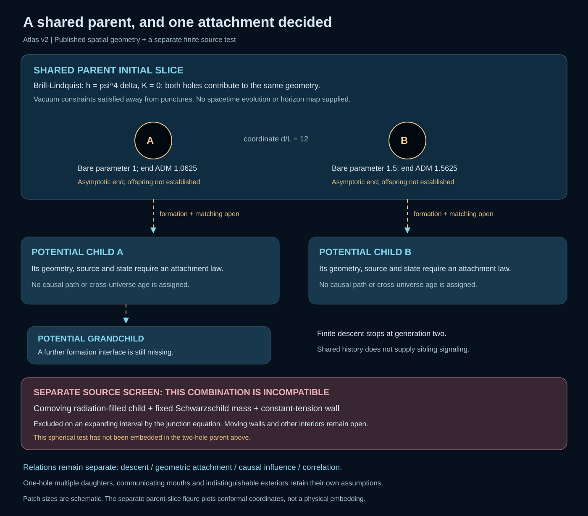

# A Finite Atlas of Nested Cosmologies: Branching, Junctions and Observer Response

**Working manuscript draft — 10 October 2026.** This draft develops the
exterior-first investigation alongside the existing manuscripts. It is not a
submission-ready edition, a new release, or a replacement for their frozen
evidence. The [paper guide](../docs/papers.md) identifies those editions.

## Abstract

We construct a finite atlas for investigating possible relations between
black-hole exteriors, cosmological interiors and further generations of
regions. The atlas distinguishes descent, geometric attachment, causal
influence and correlation. Published geometries supply its starting points;
an unexplained line in the diagram remains an open mathematical connection.
Two-hole Brill–Lindquist initial data provide a shared spatial parent without
imposing spherical symmetry on the whole configuration. Candidate spherical
interiors are tested separately using junction conditions with a specified
surface source held fixed over a finite interval. An exact compatibility
identity excludes a constant-tension wall between a comoving closed-radiation
cap and a fixed-mass Schwarzschild region on any varying-radius interval.
This is a scoped application of known junction laws, not a new formation
theorem. The embedding of a local spherical attachment in the two-hole
parent remains unresolved. Alternative multiple-daughter, communicating-mouth
and observationally equivalent exterior constructions remain independent.
The present work assembles imported mathematics and records which
compatibility questions it decides. It does not establish black-hole child
formation, a stable complete spacetime, inherited particle constants or a
dark-sector explanation.

## 1. Begin with the possible exterior

An interior observer measures fields, curvature and correlations within a
limited region. The larger structure that supplies those data may be harder
to determine. Nested-Space Cosmology asks whether a systematic map of possible
exteriors can make that ambiguity useful: which regions can be joined, which
can influence one another, and which leave the same local response?

Our first motif places two candidate black-hole interfaces in a common
parent. Their proposed children may differ, and one child may contain a
further interface. This is a finite question about two generations. No
infinite hierarchy is needed to ask whether a single attachment is admissible.

*Figure 1. A map of regions and the status of their proposed relations. Its
layout is diagrammatic; separation on the page is neither proper distance nor
an embedding of the complete spacetime. Candidate descendants remain visible
when an attempted source or attachment is rejected.*

The research sequence is to borrow a geometry, identify the physical data
required at its boundary, decide a finite compatibility question, and then
derive consequences for an observer. The proposed explanatory reach includes
gravitational response, expansion, antimatter and time. These are distinct
questions, each requiring a mechanism and an observable. A desired cosmic
abundance does not select the geometry or its parameters.

## 2. Four relations carried by the atlas

Each region records its geometry, matter or quantum state, clock convention,
dimensionless parameters and validity domain. A spatial initial-data set
does not claim the information content of an evolved four-geometry. Each
connection records its mathematical source, assumptions and missing conditions.

| Relation | Mathematical question | What the relation alone does not establish |
|---|---|---|
| Descent | Which transition supplies the putative child's initial data? | A joined metric or a continuing signal channel. |
| Geometric attachment | Which boundary data match, with which normal orientations and source? | Traversability or regular formation from earlier data. |
| Causal influence | Can an intervention reach the named observer along an allowed route? | That every correlated quantity can be controlled or transmitted. |
| Correlation | Which state or ancestry relates measurements in different regions? | A communication channel between them. |

A round two-surface has topology $S^2$. A candidate closed spatial slice
may have topology $S^3$. These statements have different dimensions and
neither follows from drawing one circle inside another. Similarly, multiple
ends of a spatial slice do not by themselves specify a parent-to-child
history. Causal interpretation requires a spacetime extension; the review by
[Ansoldi, Merali and Guendelman](https://arxiv.org/html/1801.04539v1) provides
the relevant distinction between a spatial bridge and a traversable route.

## 3. A shared parent with two punctures

We import the uncharged, time-symmetric Brill–Lindquist construction. In
geometrized units $G=c=1$, its initial data are

$$
\gamma_{ij}=\psi^4\delta_{ij},\qquad K_{ij}=0,\qquad
\psi=1+\frac{m_A}{2|\mathbf x-\mathbf x_A|}
       +\frac{m_B}{2|\mathbf x-\mathbf x_B|}.
$$

The domain is $\mathbb R^3\setminus\{\mathbf x_A,\mathbf x_B\}$.
Away from the punctures, the harmonic conformal factor satisfies the vacuum
Hamiltonian constraint. For coordinate separation
$d=|\mathbf x_A-\mathbf x_B|$, the three asymptotic-end ADM masses are

$$
M_\infty=m_A+m_B,\qquad
M_A=m_A\left(1+\frac{m_B}{2d}\right),\qquad
M_B=m_B\left(1+\frac{m_A}{2d}\right).
$$

These are borrowed results, not new solutions. The original source is
[Brill and Lindquist (1963)](https://doi.org/10.1103/PhysRev.131.471);
the uncharged conventions above appear in
[Pook-Kolb et al., v1, Section III, equations 17–21](https://arxiv.org/html/2308.10906v1).
The parameters $m_A,m_B$ must not be silently identified with all three
end masses or with horizon masses.

The finite example uses $m_A=1$, $m_B=1.5$ and $d=12$ in one shared length
unit. The corresponding end masses are $M_\infty=2.5$, $M_A=1.0625$ and
$M_B=1.5625$. Their inequality is recorded input and its geometric consequence;
it is not a predicted distribution of children or inherited constants.
The [parent adapter and controls](../lab/docs/nsc-atlas-parent-initial-data.md)
also compare two finite coordinate spheres with their local monopole
approximations. Those probes are not computed horizons.

*Figure 2. A coordinate section of a borrowed initial-data geometry. The
conformal factor describes intrinsic spatial geometry; a colored contour is
not automatically a marginally trapped surface. Locating horizons and evolving
the slice are separate problems.*

The parent is axisymmetric for punctures on one axis, but it is not globally
spherically symmetric. Near one puncture, the companion contributes both a
leading offset and direction-dependent corrections to the conformal factor.
A local Schwarzschild description therefore requires a stated approximation
and an error criterion. Our spherical junction test does not supply that
criterion or remove the companion's tidal field.

On a coordinate sphere of radius $r$ about one puncture the induced metric is
$q_{AB}=r^2\psi(\theta)^4\Omega_{AB}$. The angular dependence is part of the
boundary data, even though the coordinate surface is called a sphere. The
adapter records its intrinsic Gaussian curvature as well as the conformal
factor's angular profile. These spatial quantities can test a proposed round
boundary; they are not four-dimensional observer tides.

Brill–Lindquist data carry three asymptotically flat ends. We do not relabel
the two puncture ends as expanding children. Doing so would replace a spatial
fact with a dynamical hypothesis. The atlas retains a separate, unresolved
transition from each candidate interface to its proposed cosmological region.

## 4. Decide an attachment with its source held fixed

The first compatibility question is deliberately limited:

> Can the specified surface source support the proposed spherical
> parent–child boundary over the declared finite interval without changing
> the source law or its coefficients along the trajectory?

Let a timelike shell have induced metric

$$
ds_\Sigma^2=-d\tau^2+R(\tau)^2d\Omega^2,
\qquad S^a{}_b=\operatorname{diag}(-\sigma,p,p).
$$

For a fixed orientation convention, Israel matching requires the jump in
extrinsic curvature, including its temporal component, to reproduce this
surface stress tensor:

$$
[K^a{}_b]-\delta^a{}_b[K]=-8\pi S^a{}_b.
$$

The surface conservation equation also relates the shell's evolving energy
and pressure to flux from the bulk. When that flux vanishes it reduces to

$$
\dot\sigma+2\frac{\dot R}{R}(\sigma+p)=0.
$$

Thus an angular matching identity alone is insufficient. The density
inferred from that identity, the pressure required by the temporal equation,
and the chosen material law must agree on the same trajectory. In particular,
a pure domain wall has $p=-\sigma$; with zero flux, its density is constant.
Replacing that constant by a separately fitted value at every radius defines
a different problem.

The source of these identities is
[Israel, *Singular hypersurfaces and thin shells in general relativity*](https://doi.org/10.1007/BF02710419).
The classic de Sitter/Schwarzschild domain-wall problem was already analyzed
by [Blau, Guendelman and Guth](https://doi.org/10.1103/PhysRevD.35.1747).
Replaying a known admissible wall is an integration control. The present
investigation tests the stated atlas candidate and records a rejection just
as explicitly as a successful attachment.

*Figure 3. The source comparison is evaluated along one specified trajectory
and over one finite domain. A failure of that candidate closes its attempted
connection, while leaving other sources, trajectories and geometries open.*

### 4.1 A comoving radiation cap and a constant-tension wall

The chosen interior is the exact closed, radiation-dominated FLRW solution

$$
ds_-^2=-dt^2+a(t)^2(d\chi^2+\sin^2\chi\,d\Omega^2),\qquad
a=A\sin\eta,\qquad t=A(1-\cos\eta).
$$

A boundary at fixed $\chi$ has $R=a\sin\chi$ and $\tau=t$. We compare it
with a Schwarzschild region of fixed mass $M$, restricting the finite
numerical example to an exterior static patch and a real timelike shell.
This $M$ belongs to the separate spherical test; it is not identified with
one of Section 3's asymptotic-end masses without an additional matching map.
The radiation fluid is comoving with the boundary, so its energy flux
through the boundary is zero; the exterior is vacuum. The trial wall has
$p=-\sigma$ with fixed $\sigma$.

For the ordinary cap orientation let $b=\cos\chi$. The angular extrinsic
curvatures can be expressed through

$$
\beta_-=b,\qquad
\beta_+^2=b^2+\frac{A^2\sin^4\chi}{R^2}-\frac{2M}{R}.
$$

The required angular jump is $\beta_- -\beta_+=4\pi\sigma R$.
Set $k=4\pi\sigma$. Squaring this necessary equation and multiplying by
$R^2$ gives

$$
k^2R^4-2bkR^3+2MR-A^2\sin^4\chi=0.
$$

For $A>0$ and $0<\chi<\pi$, the constant coefficient is nonzero. Therefore
this polynomial cannot vanish throughout an open interval of radii for any
fixed $k$ and $M$. This excludes a constant-tension wall on the stated
varying-radius, comoving radiation trajectory. Reversing the cap orientation
changes $b$'s sign but not that obstruction. Squaring is used only for a
necessary condition; no extra solutions from squaring are admitted.

The conclusion is stronger than observing a large numerical residual at a
few sample times, but it remains narrower than a no-child-universe theorem.
It does not exclude another material law, a noncomoving shell, flux through
the boundary, a different interior, or a different exterior. The radiation
solution used here has no regular bounce; its finite expanding segment is a
matching test rather than a formation history.

### 4.2 Finite witness and independent checks

The recorded test uses $M/A=0.4$, $\chi=\pi/3$ and
$\eta\in[1.25,1.45]$. Its specified positive wall density is
$\sigma=1/(64\pi A)$, chosen before the comparison. The parameters are
dimensionless model inputs, not inferred cosmological constants. The interval
has $\tau/A\in[0.684678,0.879497]$ and
$R/A\in[0.821845,0.859715]$, outside the Schwarzschild horizon $2M/A=0.8$
and before the FLRW turnaround.

The finite implementation evaluates the surface density and pressure
required by both components of the junction condition, checks conservation,
and compares them with the same fixed wall. A second normal orientation is
recorded separately. The exact polynomial obstruction prevents a different
constant wall density from rescuing the candidate on the whole interval.

| Ordinary-cap quantity | At $\eta=1.25$ | At $\eta=1.45$ |
|---|---:|---:|
| Required $A\sigma$ | 0.01638975 | 0.02001736 |
| Required $Ap$ | −0.05885743 | −0.05825351 |
| Fixed wall $A\sigma$ | 0.00497359 | 0.00497359 |
| Fixed wall $Ap$ | −0.00497359 | −0.00497359 |
| Required $A(p+\sigma)$ | −0.04246768 | −0.03823615 |

The required density varies, and the required pressure does not satisfy the
domain-wall equation of state. This is a rejection of the chosen attachment.
The required tensor is a geometric diagnostic, not an independently derived
new material source.

The [source test and its independent controls](../lab/docs/nsc-atlas-junction-sources.md)
compare the temporal extrinsic curvature with a direct Christoffel-symbol
calculation, check the surface conservation law using a five-point numerical
derivative, and check the normal Einstein jump relation. Their maximum
absolute discrepancies in the recorded dimensionless convention are
$1.21\times10^{-10}$, $9.16\times10^{-13}$ and $6.94\times10^{-18}$,
respectively. An imported Oppenheimer–Snyder dust boundary supplies a positive
control: across nine samples its required surface density and pressure are
zero to absolute discrepancies below $1.9\times10^{-17}$ and
$8.9\times10^{-18}$. These are numerical verification discrepancies, not
rigorous error bounds or physical perturbative-stability results. The
polynomial argument, rather than sampling density or a residual tolerance,
establishes the incompatibility over the interval.

Even a fully matched finite spherical shell would not establish its embedding
in the nonspherical parent of Section 3. It would also leave regular formation
and perturbative stability open. The formation obstruction of
[Farhi and Guth](https://doi.org/10.1016/0370-2693(87)90429-1) is conditional on
its classical energy and global assumptions. The nonspherical instabilities
studied by [Aguirre and Johnson, v2](https://arxiv.org/html/gr-qc/0508093v2)
show why a spherical background trajectory cannot substitute for a stability
analysis. These results guide separate checks; neither is applied outside its
stated model to exclude every atlas branch.

## 5. Alternative exteriors remain available

*Figure 4. Alternatives have separate sources and validity domains. A failed
radiation boundary does not invalidate a limiting-curvature construction,
and a conditional traversable wormhole does not supply a neutral child's
formation mechanism.*

[Barrabès and Frolov, v1](https://arxiv.org/html/hep-th/9511136v1) supply a
one-hole multiple-daughter construction. Its null shells and collision
conditions differ from two distinct holes in a shared parent. In particular,
the cited disconnection criterion uses a near-singularity approximation,
equal nucleation radii and a scale hierarchy; it is not a universal rule for
sibling separation. Formation microphysics remains an additional question.

[Emparan et al., v2](https://arxiv.org/html/2012.07821v2) provide a
communicating-mouth candidate within charged semiclassical assumptions. This
branch offers a way to investigate an actual causal channel, provided its
matter, state and geometric conditions are retained. It does not make
communication a generic consequence of shared ancestry.

A third possibility is that several exteriors are indistinguishable to the
selected observer. The finite atlas includes a control in which changing an
exactly uncoupled exterior mode changes the full spectrum but leaves the
local resolvent unchanged. This is established Schur-complement algebra. Its
role is to expose a limit on reconstruction, then ask what extra observable
or coupling would distinguish the alternatives.

## 6. From a connection to an observer's response

For a finite Hermitian operator divided into visible and exterior sectors,
the projected resolvent has the familiar form

$$
P(z-H)^{-1}P
=\left[z-H_{\rm v}
-V(z-H_{\rm e})^{-1}V^\dagger\right]^{-1},
\qquad \operatorname{Im}z>0.
$$

The exterior enters through the self-energy
$\Sigma(z)=V(z-H_{\rm e})^{-1}V^\dagger$. This identity tells us how
to reduce a specified operator. It does not choose the physical $H$, the
quantum state, or the inter-region clock map. The
[existing finite-reduction framework](../lab/docs/nsc-cosmological-atlas.md)
also accepts a supplied time-dependent Hamiltonian. Its software fixtures
exercise that interface without identifying their coefficients with
cosmological couplings.

A causal prediction requires a compatible field problem on the admitted
geometry, a joint state, boundary conditions and an observer. Proper time is
attached to a worldline and metric. A coordinate interval, a lapse sum lacking
its trajectory, or two independently normalized clocks cannot establish a
cross-universe age. Likewise, an entropy arrow requires a state and
coarse-graining, and an antimatter interpretation requires an explicit field
transformation and interaction model.

The future observational questions are therefore conditional: which
admitted exterior produces which local response, and which competing
exterior can reproduce it? A lensing response, clustering response, expansion
history and charge asymmetry will have separate evidence and comparison
domains. No result in this draft sets their observed amplitudes.

## 7. Reproducibility and the next missing connection

The [versioned atlas bundle](../lab/results/development/nsc-cosmological-atlas-v2/manifest.json)
binds the recorded inputs, sources, tests and displayed artifacts. Numerical
replay verifies the stated calculation; byte hashes authenticate its
provenance. Neither is a substitute for a missing source model or a proof of
physical formation. The [reuse library](../docs/arxiv-studies.md) records
paper versions and reading boundaries, and the existing
[admission rule](../docs/prior-art-and-open-claim.md) requires a finite domain,
budget, independent check and branch-stopping outcome before further compute.

The [parent record](../lab/results/development/nsc-cosmological-atlas-v2/parent.json),
[junction record](../lab/results/development/nsc-cosmological-atlas-v2/junction.json)
and [connection map](../lab/results/development/nsc-cosmological-atlas-v2/atlas.json)
retain the unrounded values and their domains. The Brill–Lindquist adapter
uses the initial-data section of Pook-Kolb et al. v1; it does not reproduce
that paper's merger evolution or quasi-local-mass analysis. Historical
originals are credited without implying their full derivations were rechecked.
Versioned candidate sources retain the reading boundaries recorded in the
library. This bounded prior-art comparison makes no claim to exhaustive
coverage or priority.

The atlas gains scientific value when a connection changes status for a
stated reason. A compatible source would unlock a field-and-clock problem on
that attachment. An incompatible source would identify the smallest
assumption that needs replacement. The alternatives include a moving boundary,
a different source with its own fixed constitutive law, a bulk energy flux,
or a different interior. Each is a separate candidate with a fresh admission
record; none is silently tuned into the failed test.

The larger unresolved connection is the relation between an admissible local
attachment and a genuine two-hole parent. Before a multiregion simulation is
justified, that relation needs boundary data, a controlled approximation or a
constraint-solving construction. Until then the map displays both the
mathematically supplied regions and the distance between them.
