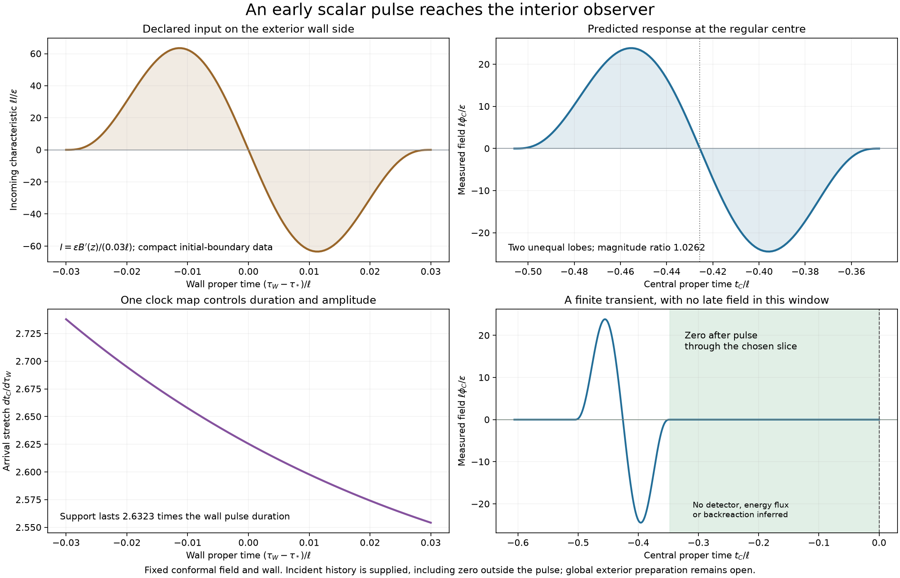
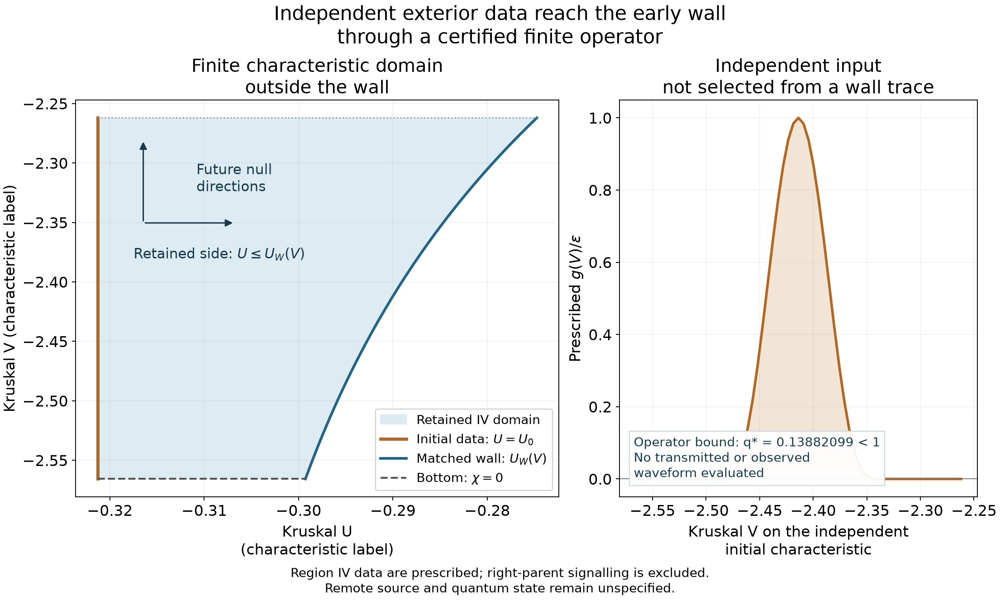
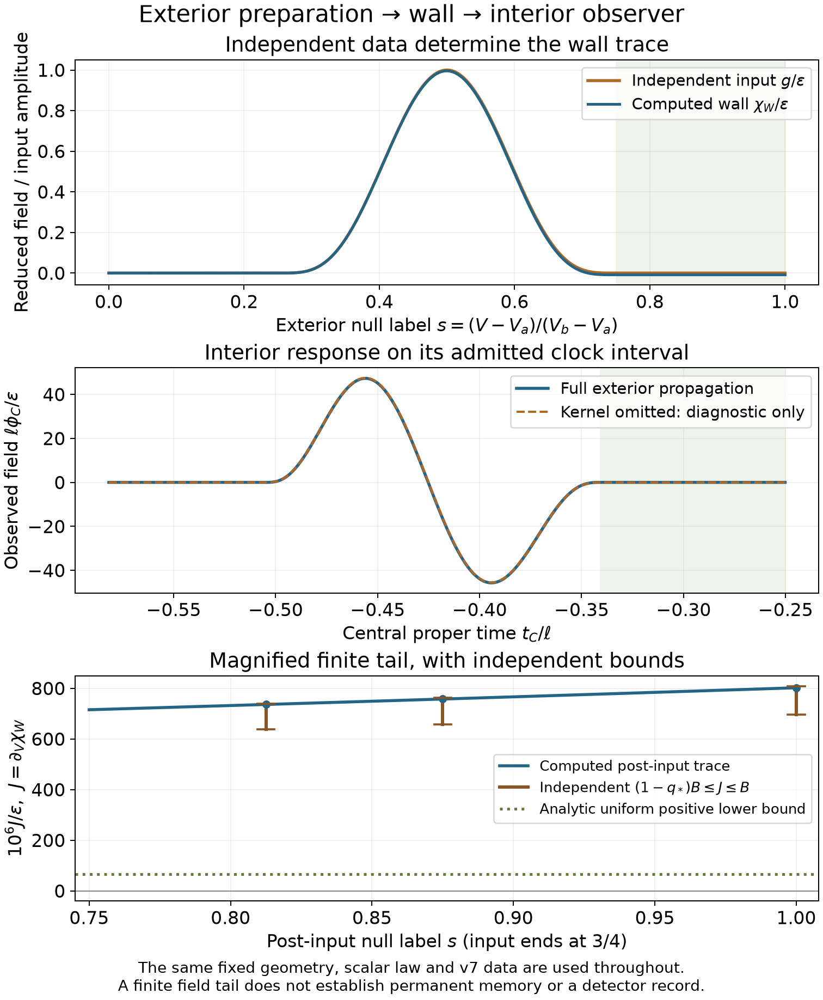
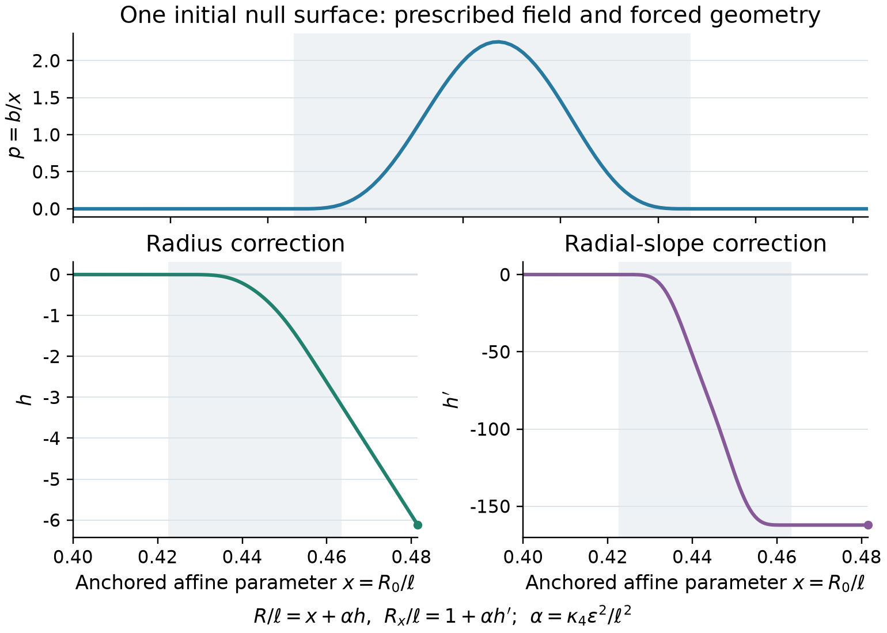
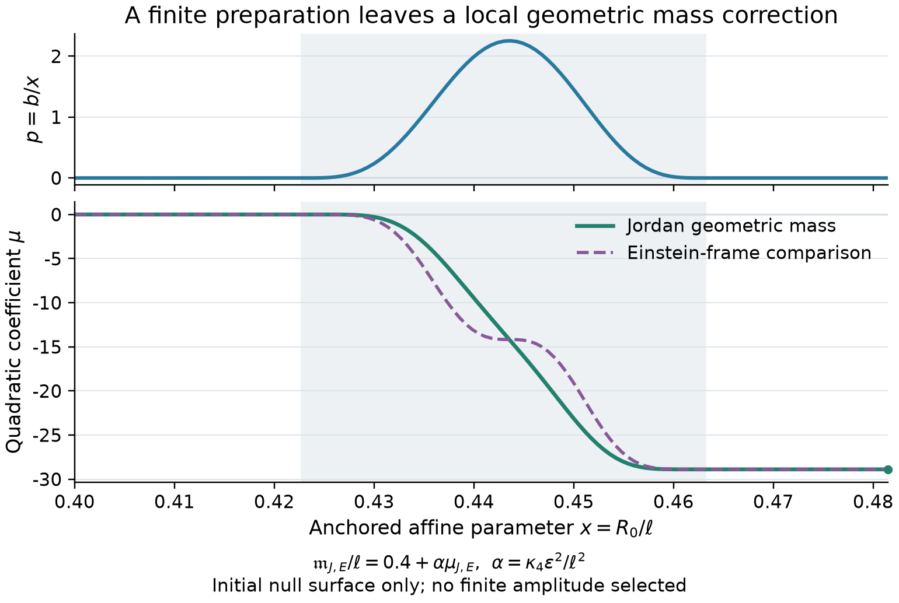

# Nested-Space Cosmology

## The Geometry of a Universe

**Douglas Ek**  
Working research manuscript, 13 October 2026

## Abstract

Nested-Space Cosmology asks how a region's geometry, fields and surrounding
structure determine the world available to an observer inside it. We develop
this question as a finite atlas: a parent with several black-hole boundaries,
possible unequal children and further generations. Local spherical geometry
provides tractable boundaries and observer charts; it does not make a
multi-hole parent globally spherical or establish the topology of our universe.
Published spacetime solutions, junction laws, branching mathematics and
regional reduction supply the foundations. The work then concentrates on
missing connections between them.

One connection is explicit. A fixed de Sitter/Schwarzschild wall joins a
regular expanding cap to a vacuum bridge and an asymptotic end on a checked
spacelike slice. A vacuum-end gluing theorem supplies a conditional
multi-body initial-data family preserving that body. In the isolated spherical
reference, the center, moving wall and right exterior have different causal
access: selected early signals connect them, while new emissions after the
chosen initial slice do not. A prescribed early conformal scalar pulse crosses
the wall and produces a calculable transient at the center. Its waveform alone
does not establish a unique exterior: the incident state is an independent
input. We now identify a finite characteristic preparation in the retained
white-hole sector and a bounded exterior-to-wall transfer operator. Its
existence is certified analytically. Evaluating it predicts a central pulse
followed by a small positive scattering tail within the declared finite
window. An independent positive-kernel argument fixes the tail's sign;
spatial and clock refinements test its numerical magnitude.
For this fixed geometry, a complete compatible signed central history also
determines a unique preparation. Positivity and a prescribed source cutoff
exclude some histories; geometry comparison requires those input restrictions
to be justified independently.
At quadratic order the canonically normalized probe adds no singular surface stress,
tangential flux jump or normal-stress jump at the fixed wall.
With fixed corner geometry and null normalization,
the same preparation requires a calculable correction to the initial
areal radius and its affine slope. Transverse constraint transport then
determines a geometric mass response on that initial null surface, including
a negative quadratic coefficient after the compact input. Coupled bulk and
wall evolution remain open.
A separate finite spherical field model demonstrates regional transfer,
geometric feedback and reduced memory, without identifying its mode-space
complement with a parent universe.

These results connect known mathematics in stated domains. They establish
neither regular black-hole formation of children nor a complete cosmology.
Physical inheritance of constants, quantum-state selection, persistent
gravitational effects, antimatter asymmetry and an arrow of time remain open.
The atlas makes those gaps explicit and identifies calculations that can
resolve them without requiring every microscopic question to be solved first.

## I. The question and the spherical idea

### 1. A universe viewed from within

An observer measures clocks, fields, curvature and correlations within a
limited domain. Such measurements need not uniquely identify the larger
structure containing that domain. Our question is whether this ambiguity
can become a constructive research programme: assemble possible surroundings,
determine which attachments satisfy their equations, and ask what each permits
an interior observer to experience.

The organizing sequence is **borrow established mathematics, connect compatible
regions, investigate branching and inheritance, calculate local consequences,
then compare with observations**. A universal action tying together all fields
and regions remains an ambitious candidate. It is not a prerequisite for
learning whether a particular boundary can be joined or whether a signal can
reach a particular observer.

A mature atlas would let a reader follow a possible universe from its
surroundings, through its boundaries, into an observer's world and onward
through compatible transitions. It would compare families of histories with
explicit geometry, dynamics and observables. Completion means dependable
coverage of declared model families, including exclusions and observational
degeneracies. Establishing that a family describes our universe is a further
empirical achievement. The present finite connections are steps toward that
destination, not a claim to have reached it.

The first motif contains two spatially separated black holes in a common
parent, possible unequal children, and one further generation. A separate
motif lets one hole have multiple offspring. These pictures suggest questions;
their arrows do not supply an equation of motion, a formation mechanism or
a communication channel. Figure 1 distinguishes the broad motif from the
specific attachment whose mathematics has been checked.

*Figure 1. Possible descent (upper panel) remains hypothetical; the lower
panel shows the checked cap–wall–bridge body and observer/field reference.
Colors distinguish attachment, descent, influence and correlation. Circles
and spacing do not establish an embedding, relative scales or global
spherical topology. The [figure record](figures/geometry-overview.json)
identifies each connection's evidence and status.*

### 2. What spherical geometry means here

There is a useful borrowed energy argument with a precise domain: in Euclidean
space, a ball minimizes boundary area at fixed enclosed volume. A positive
constant isotropic surface tension therefore favors a spherical boundary when
surface energy is the quantity being minimized. Direction-dependent tension
instead selects a Wulff shape; see [Neumayer, 1503.06705v2, Section 1.1](https://arxiv.org/html/1503.06705v2).
This motivates testing rotational symmetry. It does not prove a cosmological
equilibrium, dynamical relaxation or a probability ranking over all geometries.
Gravity, rotation, matter stresses and the actual boundary law must be specified
before importing that variational conclusion into a spacetime model.

A spherical boundary is a two-dimensional surface with area $4\pi R^2$.
A spatial interior may be a three-ball; a closed spatial universe may instead
have three-sphere topology. These are different assertions. Drawing one circle
inside another establishes none of them.

In a locally spherically symmetric spacetime, a useful form is

$$
ds^2=g_{ab}(x)\,dx^a dx^b+R(x)^2d\Omega^2.
$$

Here $g_{ab}$ is a Lorentzian metric on the two-dimensional orbit space and
$R$ is areal radius. We use signature $(-+++)$ for the atlas. Radial
proper distance, areal radius and a diagram's vertical coordinate need not
coincide. In particular, a radial profile is not automatically a surface
that can be embedded in Euclidean three-space.

The physical spherical hypothesis is that useful cosmological regions or
interfaces may admit this structure, exactly or as a controlled approximation.
It is not a theorem inferred from statistical isotropy of observations.
Several off-center holes generally break global spherical symmetry.
We therefore use local spherical charts where justified and an explicitly
nonspherical parent where required. Deviations from symmetry are a question
for each model, rather than a reason to discard the organizing idea.

### 3. One thread through three bodies of work

The continuing question is: **how do a region's fields, boundary and
surroundings shape its state, geometry and measurements?**

| Body of work | What it contributes | Connection still missing |
| --- | --- | --- |
| [Preserved foundation](archive/foundation-v0.26.0/paper/nested-space-cosmology.md) | Spectral inheritance proposal, boundary operators, source and response constructions | A physical inheritance law and common cosmological source completion |
| [Finite spherical companion](finite-regeneration/main.tex) | A finite realization of regional transfer, geometric feedback and memory with declared action and state | Identification with an actual assembled parent–child spacetime |
| [Atlas evidence](../docs/nsc-cosmological-atlas.md) and this living manuscript | Geometric compatibility, a sourced slice, observer access, a calibration response and an evaluated finite exterior preparation | Remote preparation, later evolution, other attachments and observational discrimination |

Their mathematics is complementary. A finite operator's eliminated modes
are not automatically the exterior spacetime beyond a black hole. The atlas
must first identify a field equation, state, clock and matching law before
an operator reduction can acquire that geometric meaning.

The foundation's useful historical calculations remain in their source-bound
edition and owning notes. This manuscript changes the organizing story:
geometry and observer access lead; stronger unifying claims follow only when
their missing connections are supplied. No priority claim is made for junction
conditions, Schur complements, branching processes or the published wall
solutions used below.

## II. Regions, inheritance and the meaning of a connection

### 4. Four arrows that must not be confused

Each region in the atlas carries a geometry, source or state, clock
convention, dimensionless parameters and validity domain. Each connection
states the borrowed mathematics and the additional condition still needed.

| Connection | Mathematical question | What it does not establish by itself |
| --- | --- | --- |
| Descent | Where do a child's initial data originate? | A traversable path |
| Geometric attachment | Which boundaries share admissible metric and source data? | Formation or stability |
| Causal influence | Can an intervention reach an observer within the stated domain? | A nonzero field response without state and coupling |
| Correlation | Which information is shared through state or ancestry? | Communication between siblings |

Two regions may inherit correlated data without ever exchanging a later
signal. An attached interior can lie beyond the causal reach of a specified
parent observer. Conversely, communicating mouths require their own causal
and material assumptions; they cannot be inserted into a disconnected
offspring model as an unlabeled extra arrow.

The multiple-daughter geometry of [Barrabès and Frolov
(hep-th/9511136v1)](https://arxiv.org/html/hep-th/9511136v1), the charged
semiclassical multi-mouth route of [Emparan et al.
(2012.07821v2)](https://arxiv.org/html/2012.07821v2), and quantum-state
coupling distributions discussed by [Giddings and Turiaci
(2004.02900v2)](https://arxiv.org/html/2004.02900v2) remain separate library
entries. A state's coupling distribution is not itself a signal exchanged
between its branches. Their source cards and unresolved connections are
recorded in the [mathematical library](../docs/arxiv-studies.md).

### 5. A precise finite inheritance construction

<!-- nsc-claim:finite-normalized-inheritance -->

Evidence: [exact finite record](../results/development/nsc-nested-qualities-v1.json),
[frozen snapshot](nested-quality-evidence/snapshot.json), and
[proof and domain](../docs/nsc-nested-qualities.md).

The foundation proposes an inherited normalized law,
$\mathcal T_\Theta^*\mathbb D_\Theta=\mathbb D_\Theta$.
One controlled meaning is available without postulating an infinite cosmos.
Fix a Hermitian $d$-dimensional matrix $H$, a nonzero link $B$, a
positive scale ratio $\Omega$, and a finite depth $N$. For regional labels
$j=0,\ldots,N-1$, define a block Hermitian matrix by the following entries
where their indices exist:

$$
(J_{m,N})_{jj}=\Omega^{m+j}H,\qquad
(J_{m,N})_{j,j+1}=\Omega^{m+j}B.
$$

The lower off-diagonal blocks are the adjoints. Let $U_m$ consistently
relabel the equal-sized regional frames. Then

$$
J_{m+1,N}=\Omega U_mJ_{m,N}U_m^\dagger,
$$

$$
\Omega^{-1}U_m^\dagger J_{m+1,N}U_m=J_{m,N}.
$$

Each block acquires the same extra factor, so the identity follows directly.
For fixed depth,

$$
\mathrm{spec}(\Omega^{-m}J_{m,N})=\mathrm{spec}(J_{0,N}).
$$

This is a finite realization of normalized inheritance under chosen scaling
data. It does not derive $\Omega$, establish a physical transition through
a horizon, or show that the universe selects this law. Changing $N$
changes the boundary problem and can change the dressed spectrum.
The finite identity is not a proof of cosmic natural selection.

The shared law also does not fix identical states. A fermionic covariance
$0\leq C\leq I$ evolves as

$$
C(t)=e^{-iJt}C(0)e^{iJt}.
$$

Regional occupations and cross correlations can differ under the same $J$.
Thus “same laws,” “same state,” and “same observed constants” require separate
arguments. A physical transition would have to determine the relevant state
and dimensionless data, rather than obtaining them from the normalization
identity alone.

### 6. What an unresolved surrounding region can leave locally

Split a specified operator into retained and complementary blocks $A,D$
with link $B$. For an admissible complex spectral parameter $z$, elimination
gives the usual self-energy

$$
\Sigma(z)=B(zI-D)^{-1}B^\dagger.
$$

The retained resolvent is $[zI-A-\Sigma(z)]^{-1}$.
Nested elimination is associative when the required inverses exist.
For the finite inherited chain its normalized recurrence is

$$
\Gamma_j(x)=xI-H-\Omega^{-1}B
\Gamma_{j+1}(x/\Omega)^{-1}B^\dagger.
$$

The factor $1/\Omega$ is essential. This is borrowed finite linear
algebra applied to the declared family, not an additional force law.
To interpret $\Sigma$ as a cosmological exterior response requires a
physical operator, field state and boundary map. Sections 14–15 give a separate
finite Hilbert-space realization of this reduction, without identifying its
complementary modes with a cosmological exterior.

## III. A finite map of possible geometries

### 7. Start with two holes, without manufacturing two children

The explicit parent benchmark uses time-symmetric Brill–Lindquist vacuum
initial data,

$$
h_{ij}=\psi^4\delta_{ij},\qquad K_{ij}=0,\qquad
\psi=1+\frac{m_A}{2r_A}+\frac{m_B}{2r_B}.
$$

The recorded choice is $m_A=1$, $m_B=1.5$, separation $d=12$.
It has outer ADM mass $2.5$ and two inner-end masses $1.0625$ and
$1.5625$. These are three asymptotically Euclidean ends of an initial
slice. Extra ends do not by themselves become cosmological children.
The companion hole supplies nonspherical structure, so an exact isolated
Schwarzschild collar cannot simply be assumed at either puncture.
The [parent record](../results/development/nsc-cosmological-atlas-v2/parent.json)
and [owning analysis](../docs/nsc-cosmological-atlas-v2.md) retain the
construction and checks.

*Figure 2. The explicit two-hole initial-data benchmark. This is a
nonspherical common parent with unequal ends, not a solved evolution that
creates children. Local spherical models must earn an attachment to it or
belong to a separate parent family.*

The alternative parent route imports an existence result instead of
re-solving its gluing equations. [Chruściel, Corvino and Isenberg
(0909.1101v1)](https://arxiv.org/html/0909.1101v1) provide sufficiently
separated scalar-flat bodies with retained interior regions and a common
Schwarzschild outer end. Their more general
[vacuum-end theorem (1004.1355v1)](https://arxiv.org/html/1004.1355v1)
allows appropriate non-time-symmetric ends. These establish separate
families, not a modification that leaves the displayed Brill–Lindquist
data unchanged. No explicit sufficient separation is certified here.

### 8. A failed attachment can sharpen the map

<!-- nsc-claim:atlas-junction-screen -->

Evidence: [radiation junction](../results/development/nsc-cosmological-atlas-v2/junction.json),
[moving-boundary conservation/control](../results/development/nsc-cosmological-atlas-v3/moving-boundary.json),
and [source assumptions](../docs/nsc-atlas-moving-boundaries.md).

The first attachment screen pairs a closed radiation FLRW region with a
vacuum exterior and a pure constant-tension wall. For a comoving boundary,
$a=A\sin\eta$, $t=A(1-\cos\eta)$, and $R=a\sin\chi$.
The junction condition would require, over an interval of changing $R$,

$$
k^2R^4-2\cos\chi\,kR^3+2MR-A^2\sin^4\chi=0.
$$

For nonzero $A\sin\chi$, this cannot be a polynomial identity on that
interval. The recorded $\chi=\pi/3$, $M=0.4A$ test exposes a source
incompatibility, not a failure of all interiors.

Could a moving wall repair the same model? Intrinsic conservation answers
before a new simulation is needed. Fixed pure tension has zero intrinsic
stress divergence, so the Codazzi relation requires zero net normal energy
flux. In the fluid rest frame,

$$
T(U,n)=(\rho+p)\gamma^2v.
$$

A vacuum exterior contributes no flux and radiation has $\rho+p>0$;
therefore $v=0$. Motion alone cannot rescue these assumptions.
This is a compatibility application of an established conservation law.
Allowing a different surface source, exterior state or flux would define
a different candidate requiring its own test.

### 9. A distinct fixed-source wall that does connect

For the next branch, take de Sitter inside and Schwarzschild outside,

$$
f_-=1-H^2R^2,\qquad f_+=1-\frac{2M}{R}.
$$

In $G=c=1$ units let $\kappa=4\pi\sigma>0$, with surface pressure
$P=-\sigma$. The signed angular extrinsic curvatures obey

$$
\beta_--\beta_+=\kappa R,\qquad
\beta_\pm=\epsilon_\pm\sqrt{\dot R^2+f_\pm}.
$$

Here the dot is wall proper time and $\epsilon_\pm$ fixes the normal
orientation. Squaring and then forgetting those signs would lose physical
branches. The useful explicit expressions are

$$
\beta_-=\frac{M}{\kappa R^2}+\frac{\kappa^2-H^2}{2\kappa}R,
$$

$$
\beta_+=\frac{M}{\kappa R^2}-\frac{\kappa^2+H^2}{2\kappa}R,\qquad
\dot R^2=\beta_-^2-f_-.
$$

We hold $H\ell=1$, $\kappa\ell=2$, $M/\ell=0.4$ fixed.
On the tested expanding segment $1.2\leq R/\ell\leq1.8$,
$\beta_->0$ and $\beta_+<0$. The wall proper duration is
$0.3718706103\ell$. Direct unsquared and pressure checks, including a
separate Christoffel-based calculation, agree within the recorded numerical
residuals. The wall's areal-radius rate is not a local three-speed.
This published wall family is classified more fully in
Section 11; the source has not been retuned to make the segment work.

### 10. A sourced initial slice and a conditional common parent

<!-- nsc-claim:atlas-sourced-slice -->

Evidence: [slice constraints](../results/development/nsc-cosmological-atlas-v4/connection-slice.json),
[parent assembly](../results/development/nsc-cosmological-atlas-v4/parent-assembly.json),
[slice derivation](../docs/nsc-atlas-connection-slice.md), and
[end-only gluing argument](../docs/nsc-atlas-connection-gluing.md).

At $R_w=1.5\ell$, the interior is a flat expanding de Sitter cap: a
regular spatial three-ball with $h=dl^2+R^2d\Omega^2$, $R'=1$
and $K^i{}_j=-H\delta^i{}_j$. We use
$K=-\mathcal L_T h/2$, where $T$ is the future unit slice normal.
Define $V=T(R)$. The cap has $V_-=HR$.
Its slice determines the wall boost,

$$
\gamma=\frac{\beta_--HR\dot R}{1-H^2R^2},\qquad
\gamma v=\frac{\dot R-HR\beta_-}{1-H^2R^2}.
$$

The exterior inherits

$$
R'_+=\gamma\beta_+-\gamma v\dot R,\qquad
V_+=\gamma\dot R-\gamma v\beta_+.
$$

At this event $\gamma=1.00926203$, $v=0.13516599$,
$R'_+=-2.02778609$, and $V_+=1.90925372$.
The exterior slice is therefore not time symmetric at the material wall.

A fixed smooth slicing function tapers $V(R)$ to zero at $R_0=\ell$,
before the Schwarzschild throat $2M=0.8\ell$. In the transition,

$$
R'=-\sqrt{f_++V^2},\qquad
K^\theta{}_\theta=-\frac{V}{R},\qquad K^l{}_l=-\frac{dV}{dR}.
$$

These data describe a slice of the same vacuum Schwarzschild spacetime.
They do not interpolate the matter source. Its mass identity is

$$
M=\frac{R}{2}(1+V^2-R'^2).
$$

Where $V=K=0$, the slice continues smoothly through a bridge using
$R=2M\cosh^2u$, with the cap on the negative-$u$ side and the
selected parent end on the positive-$u$ side.

The distributional shell constraints are equally necessary. The surface
energy and radial momentum on this slice are
$E_\Sigma=\sigma\gamma$, $J_\Sigma=\sigma\gamma v$, giving

$$
[R']=-4\pi R E_\Sigma,\qquad [V]=4\pi R J_\Sigma.
$$

Their recorded residuals are below $2\times10^{-15}$ in normalized
units; independent finite-difference bulk residuals are below
$10^{-10}$. These are implementation checks, not a global stability
estimate.

*Figure 3. The verified initial connection. Spatial distances are not ages.
Because $|R'|>1$ on part of the chosen slice, the radius profile should
not be interpreted as a Euclidean surface of revolution. The protected
right-exterior observer interval is a separate causal-domain statement.*

The selected right end of this body $A$, of mass $0.4\ell$, can be
used with the selected right end of an ordinary complete Schwarzschild
bridge $B$, of mass $0.6\ell$, in the imported vacuum-end gluing
theorem. It acts on smooth vacuum ends and preserves an open overlap.
Reattaching unchanged interiors on identical full $(h,K)$ data leaves
the original shell delta source intact and creates no seam source.
We do not apply a smooth global-data corollary directly to a thin shell.

The resulting conditional initial-data family has one designated common
parent end **and the untouched other end of $B$**: two asymptotic ends
in total. That second end has not become a cosmological child.
Sufficiently large separation is required but no numerical threshold or
explicit multi-body development has been calculated. The achievement is a
compatible sourced initial connection, not a regular formation history,
a general Einstein–shell evolution theorem or a stable cosmological future.

## IV. What the observers can reach

### 11. Complete one reference before assigning its causal arrows

<!-- nsc-claim:atlas-causal-access -->

Evidence: [isolated causal completion](../results/development/nsc-cosmological-atlas-v5/causal-map.json),
[observer access](../results/development/nsc-cosmological-atlas-v5/observer-access.json),
and [protected parent interval](../results/development/nsc-cosmological-atlas-v4/causal-window.json).

The wall's isolated spherical completion is the flat-exterior limit of
solution 13 in [Aguirre and Johnson, gr-qc/0508093v2,
Figures 7 and 10](https://arxiv.org/html/gr-qc/0508093v2).
Writing $x=R/\ell$, its expanding branch has

$$
\dot R^2=\frac{25x^2}{16}-1+\frac{3}{10x}+\frac{1}{25x^4}>0.
$$

It starts at a finite proper-past $R=0$ boundary in the Schwarzschild
white-hole sector, crosses $R=2M$ into the left exterior, and crosses the
de Sitter horizon into an expanding interior chart. It reaches arbitrarily
large radius at infinite wall proper time. Its Schwarzschild curvature
$48M^2/R^6$ diverges at the past boundary. The regular cap on the
chosen slice therefore does not imply a regular past formation.
The retained reference also contains the usual future Schwarzschild
black-hole singular boundary.

Choose three clocks. $C$ is the cap center, with de Sitter flat proper
time $t_C$. $W$ carries wall proper time $\tau_W$, set to zero at
$R=1.5\ell$. $P$ is static in the right exterior at
$R_P=1.6\ell$, with proper time
$\tau_P=\sqrt{1-2M/R_P}\,t_{\mathrm{Schw}}$. Their origins coincide
with a selected slice convention; this is not an equality of universe ages.

For the flat de Sitter chart,

$$
\eta=-\ell e^{-t_C/\ell},\qquad R=a r,\qquad a=e^{t_C/\ell}.
$$

Radial null lines have constant $\eta-r$ or $\eta+r$.
At $W_0$, $\eta=-\ell$ and $r=1.5\ell$.
Its inward ray would reach $\eta=0.5\ell$, outside the chart's
future $\eta<0$; hence it never reaches $C$.
A central signal emitted at $t_C=0$ likewise cannot catch the future wall.

*Figure 4. The isolated reference in joined causal charts. Horizons are
clipped to retained domains; the central cosmological horizon continues
into the Schwarzschild chart along its appropriate constant null coordinate.
The faint past $R=0$ line also shows uncut chart context, part of which is
excised. Open wall endpoints at $R/\ell=0.02$ and $6$ mark finite
plot samples, not physical beginnings or endings.*

| Emission and destination | Result in this reference | Required distinction |
| --- | --- | --- |
| New $C\to W$ or $W\to C$ emission at or after the anchor slice | No future reception | Earlier signals may arrive later |
| Right parent $P\to W$ or $P\to C$ | No future causal route | Left and right exterior regions are different |
| Early $W\to C$, while $R<\ell$ | Allowed | Reception time depends on the emission event |
| Early $C\to W\to P$, crossing while $R<2M$ | Allowed | The limiting horizon ray has no finite parent reception |
| These same arrows in a glued multi-body future | Unresolved | Initial-data gluing does not supply that global future |

For a wall event with interior time $t_W$, the central emission reaching
it and the reception of its inward ray satisfy

$$
t_e=t_W-\ell\ln(1+R/\ell),\qquad
t_r=t_W-\ell\ln(1-R/\ell).
$$

The second relation requires $R<\ell$.
At the early event $R=0.5\ell$, the recorded central emission is
$-1.5242168241\ell$ and inward reception is
$-0.4256045355\ell$. An outward early route through that event reaches
$P$ at its own proper time $+2.5311656510\ell$.
Thus exclusion of **new emissions** after a slice must never be rewritten
as exclusion of all later receptions. Emissions approaching the central
horizon from below can arrive arbitrarily late.

The critical central emission for escape to the right parent is
$t_C=-1.2312944525\ell$. Equality follows the parent horizon and has
no finite parent reception. That horizon extends into the cap along
$\eta-r=\eta_W(2M)-r_W(2M)$; it is not the surface $R=2M$
everywhere. The central observer's de Sitter horizon $\eta+r=0$
is a different boundary. Detailed clock domains and finite checks are
retained in the [observer note](../docs/nsc-atlas-causal-observers.md).

### 12. Different exteriors can be locally indistinguishable

There is also a result that does not require the glued parent's full future.
Retain the exact right Schwarzschild $K=0$ slice for
$2M<R<R_{\mathrm{cut}}$, with $R_{\mathrm{cut}}=10M$.
For a static observer at $R_{\mathrm{obs}}=4M$, the exterior cutoff
cannot influence it within

$$
0<t_{\mathrm{Schw}}<
r_*(R_{\mathrm{cut}})-r_*(R_{\mathrm{obs}}),\qquad
r_*(R)=R+2M\ln(R/(2M)-1).
$$

The observer's proper duration is the right side multiplied by
$\sqrt{1-2M/R_{\mathrm{obs}}}$.
For $M=0.4\ell$, the bound is
$t_{\mathrm{Schw}}<3.5090354889\ell$, or
$\tau_P<2.4812627896\ell$.
The inner optical boundary is at negative infinity, so it introduces no
finite inner cutoff.

Shared smooth vacuum data give the same vacuum development in this domain.
The [owning argument](../docs/nsc-atlas-connection-observer.md) uses standard
Cauchy-development uniqueness, with [Sbierski
(1309.7591v2)](https://arxiv.org/html/1309.7591v2) as a source.
The bound ends a guaranteed interval; it does not predict that a signal
actually arrives then. Matching additional fields and their states requires
additional data.

This supplies one precise atlas of indistinguishable exteriors. Distinct
larger assemblies can share a protected local geometry. The next useful
question is which later measurement or extra state datum separates them.
Failure to distinguish exteriors can be a result, rather than a reason to
add unconstrained parameters until a preferred story appears.

## V. Fields, transfer and finite memory

### 13. A first field that reaches the interior

<!-- nsc-claim:atlas-field-response -->

Evidence: [field transfer and checks](../results/development/nsc-cosmological-atlas-v6/field-transfer.json),
[distributional matching](../docs/nsc-atlas-field-matching.md), and
[finite initial-state construction](../docs/nsc-atlas-field-transfer.md).

A causal path permits a response; a field law and state determine one.
On the fixed wall geometry, take a classical real massless scalar in four
dimensions, its spherical $l=0$ sector, and conformal coupling
$\xi=1/6$. Its action and equation are

$$
S_\phi=-\frac12\int\sqrt{-g}\,[(\nabla\phi)^2+\xi\mathcal R\phi^2]\,d^4x,
\qquad (\Box-\xi\mathcal R)\phi=0.
$$

There is no independent scalar interaction added to the wall.
With the normal directed from cap to exterior, the pure-tension jump gives
$[K]=-3\kappa$ and singular curvature $6\kappa\delta$.
Distributional matching therefore requires

$$
[\phi]=0,\qquad [n\phi]=6\xi\kappa\phi.
$$

For $\chi=R\phi$, using $[nR]=-\kappa R$,

$$
[\chi]=0,\qquad [n\chi]=(6\xi-1)\kappa\chi.
$$

Conformal coupling cancels this radial delta barrier. It does not remove
the smooth Schwarzschild scattering potential $f_+2M/R^3$.
The jump law is borrowed from the distributional field equation; see
[Santiago et al., 1512.02120v2, equations 31–33](https://arxiv.org/html/1512.02120v2).
Their static charged-shell setup is not the moving solution used here.

Inside the conformally flat cap, regularity at the center gives

$$
\chi=F(\eta+r)-F(\eta-r),\qquad
\phi_C=\frac{2F'(\eta)}{a}.
$$

The outgoing term enforces central regularity; it is not a second
independently adjustable central source. The conformal reduction follows
the published field transformation of [Huguet, Queva and Renaud
(gr-qc/0603031v1)](https://arxiv.org/html/gr-qc/0603031v1).

Set the initial interior field and its normal derivative to zero on the
cap slice where the wall has $R=0.05\ell$. Prescribe one exterior-side
incoming characteristic at the wall,

$$
I=(d/d\tau_W+n)\chi.
$$

The plus derivative extracts the inward wave; its propagation direction
is $U_W-n$. No global exterior state or quantum vacuum is specified.
For the calibration pulse let $\delta=0.03\ell$,
$\tau_*=-1.1138558046\ell$, and $z=(\tau_W-\tau_*)/\delta$.
Define $B(z)=(1-z^2)^4$ for $|z|<1$, with $B=0$ outside, and set

$$
I=\frac{\varepsilon}{\delta}B'(z).
$$

The extended $B$ is $C^3$, and $I$ is $C^2$, not an infinitely
smooth bump. The amplitude $\varepsilon$ is a formal test-field
normalization. The incoming trace is stipulated zero outside the pulse
through the retained response interval.

Let $T(\tau_W)$ be central arrival proper time. On this early branch,

$$
T=t_W-\ell\ln(1-R/\ell),\qquad
T'=\frac{\gamma(1+v_{\mathrm{pec}})}{1-R/\ell}>0.
$$

The exact conditional central transfer is

$$
\phi_C[T(\tau_W)]=\frac{I(\tau_W)}{T'(\tau_W)}.
$$

This relation includes the wall boost and reception-clock Jacobian.
It is not a geometric-optics approximation.

*Figure 5. A prescribed classical pulse, propagated on the fixed geometry.
The source record normalizes input as $\ell I/\varepsilon$ and response
as $\ell\phi_C/\varepsilon$. The incoming history is a calibration
state. Its remote preparation, energy flux, quantum state and backreaction
have not been calculated.*

The wall support lies at $R/\ell=0.47499005$ to $0.52285042$.
The central response lies at $t_C/\ell=-0.50593397$ to
$-0.34799584$, giving a duration stretch of $2.63230219$.
Its normalized peaks are $+23.84144800$ and $-24.46533478$;
the magnitude ratio is $1.02616816$. These are waveform amplitudes,
not particle abundances or energy-transfer efficiencies.

The center field is exactly zero after this received support through
$t_C=0$, conditional on the stipulated incoming history.
From the first central arrival until that endpoint, the wall's comoving
radius is at least $0.8\ell$, while the earliest reflected ray reaches
at most $0.65853382\ell$. The $0.14146618\ell$ gap excludes a
cap round trip in this interval. It does not exclude an uncomputed exterior
tail under different incoming data, erase an observer's record, or imply
that the whole field vanishes everywhere.

There is explicit freedom in this wall-input calibration. On an admissible monotone arrival interval,
a desired central trace $Y(T)$ can be produced by
$I(\tau)=T'(\tau)Y[T(\tau)]$, subject to the same regularity and state
restrictions. Within the zero-area pulse family, the corresponding trace
must also have zero area. This inverse fixes a wall input under the stated
transfer law; it does not construct two compatible exteriors with the same
observation. The right parent observer cannot prepare it through
a causal channel in this reference. The following construction supplies
independent finite data elsewhere in the retained geometry; their remote
physical origin remains unspecified.

Minimal coupling remains a distinct alternative:
$[n\chi]=-\kappa\chi$ and the cap radial equation contains
$-2\chi/\eta^2$. Its known bulk de Sitter tail does not solve the
moving-boundary problem. The conformal transient therefore neither proves
nor excludes memory in other field theories.

### 13.1. Where the early signal can originate

<!-- nsc-claim:atlas-field-preparation -->

Evidence: [finite preparation and bounds](../results/development/nsc-cosmological-atlas-v7/preparation-access.json),
[derivation and independent checks](../docs/nsc-atlas-field-preparation.md).

Keep the same geometry and conformal probe. The right-exterior observer
$P$ still cannot signal the wall or center. However, the early wall is
adjacent to retained Schwarzschild white-hole geometry. Finite data there
can reach it without introducing a source at the singular past boundary.
This is an exterior-side preparation, not a signal sent by $P$.

In dimensionless Kruskal coordinates $U,V<0$, future radial causal
curves have nondecreasing coordinates. With $x=R/\ell$, define

$$
F(x)=(1-x/0.8)e^{x/0.8}=UV.
$$

Choose wall endpoints $x_a=0.45$, $x_b=0.55$ and radial floor
$x_f=0.4$. Set $V_a=V_W(x_a)$, $V_b=V_W(x_b)$ and
$U_0=F(x_f)/V_a$. The retained preparation domain is

$$
D=\{V_a\leq V\leq V_b,\quad U_0\leq U\leq U_W(V)\}.
$$

The wall truncates this domain: a rectangular continuation across it would
use the wrong field equation. Monotonicity of $F$ gives
$0.4\leq R/\ell\leq0.55$ throughout $D$, away from both $R=0$
and $R=2M$. Prescribe zero cap field and time derivative at the earlier
flat time $t_a=t_W(x_a)$, and zero reduced field on the bottom
characteristic $V=V_a$. On $U=U_0$, independently prescribe
$g(V)=\varepsilon B(4(V-V_m)/(V_b-V_a))$, where
$V_m=(V_a+V_b)/2$ and $B$ is the $C^3$ bump above.
It vanishes near the corners. Neither the outgoing wall characteristic
nor a desired received waveform is independently specified.

*Figure 6. The preserved v7 preparation checkpoint, before the waveform
evaluation in Section 13.2. The finite preparation occupies the retained side of the early
wall in sector IV. The profile on the characteristic surface is input,
not a calculated wall or central waveform. The singularity and horizons
lie outside this finite domain. Figure 4 supplies the global chart context.*

The cap null labels $u=\eta-r$ and $v=\eta+r$ increase along the
timelike wall. The earliest possible reflected signal has outgoing label
$v_a$, whereas $u_b<v_a$ throughout this wall window; the recorded gap
is $(v_a-u_b)/\ell=2.63459191$. No central reflection can yet return.
The normal toward the retained exterior has components

$$
n^U=-\dot{U}_W,\qquad n^V=\dot{V}_W.
$$

The vanishing outgoing
characteristic consequently supplies $\chi_U=0$ on the wall.

The borrowed Schwarzschild scalar potential is $f_+2M/R^3$;
see [Dolan and Ottewill, 1106.4318v1, Eq. 11](https://arxiv.org/html/1106.4318v1).
Its usual asymptotic scattering conditions are not imported into sector IV.
The local operator becomes

$$
\chi_{UV}+K\chi=0,\qquad K=\frac{16M^4}{R^4}e^{-R/(2M)}=-\frac{R_{UV}}{R}.
$$

Let $L(u)=V_a$ for $u\leq U_a=U_W(x_a)$ and otherwise let
$L(u)$ be the inverse wall graph. The complete reduced problem is

$$
\chi(U,V)=g(V)-\int_{U_0}^{U}du\int_{L(u)}^{V}dv\,K(u,v)\chi(u,v).
$$

Differentiating recovers the PDE, characteristic data and wall condition.
An analytic bound on the integral operator in the supremum norm is

$$
q_* =16e^{-1/2}\,[\sqrt{F(0.4)}-\sqrt{F(0.55)}]^2
\simeq0.138821<1.
$$

The bound uses $K\leq16e^{-1/2}$ and an AM–GM bound on the
enclosing area, independent of numerical clock quadrature. The standard
contraction principle therefore gives a unique finite solution. Moreover,

$$
\Vert\chi-g\Vert_\infty\leq\frac{q_*}{1-q_*}\Vert g\Vert_\infty.
$$

At the positive input peak the wall reduced field is at least
$0.8388\varepsilon$. This bound is not a central-field peak or an
energy-transmission efficiency.

The wall input is now determined by the solution:

$$
I=2\dot V_W\left[g'(V_W)-\int_{U_0}^{U_W(V_W)}K(u,V_W)\chi(u,V_W)\,du\right].
$$

The existing relation $\phi_C[T(\tau_W)]=I/T'$ then defines the
observer response over $-0.581759\leq T/\ell\leq-0.250231$.
This closes the finite data-to-wall-to-observer operator. Section 13.2
evaluates it without imposing the calibration's late zero field.
Remote generation of $g$, quantum-state selection, backreaction and
regular formation of the wall remain distinct open connections.

### 13.2. A prepared pulse leaves a finite scattering tail

<!-- nsc-claim:atlas-prepared-response -->

Evidence: [evaluated preparation and response](../results/development/nsc-cosmological-atlas-v8/prepared-response.json),
[derivation, admission and controls](../docs/nsc-atlas-prepared-response.md).

The next calculation keeps the same geometry, source profile, wall law and
linear conformal probe. It determines the signal from independent data,
rather than choosing a wall trace to reproduce a desired central waveform.
Write the positive integral operator in Section 13.1 as $A$. Reversing its
integration order gives

$$
(A\chi)(U,V)=\int_{V_a}^{V}dq
\int_{U_0}^{\min\{U,U_W(q)\}}dp\,K(p,q)\chi(p,q).
$$

This form exposes a causal evolution in $V$. For numerical bookkeeping only,
extend $\chi$ constantly in $U$ beyond the moving wall. All kernel integrals
remain clipped at the wall; this does not apply the Schwarzschild equation
inside the cap. The directly evaluated wall derivative is

$$
J(V)=g'(V)-\int_{U_0}^{U_W(V)}K(U,V)\chi(U,V)\,dU,
\qquad
\frac{\ell\phi_C}{\varepsilon}
=\frac{2J/\varepsilon}{d(T/\ell)/dV}.
$$

We integrate $\chi-g$ with borrowed DOP853 time stepping and a clipped
trapezoidal spatial integral. The wall crossings of grid nodes delimit
steps, preserving the partial-cell boundary integral. No new field solver
family or asymptotic scattering condition is introduced. The owner records
the initial stopped attempt and this event-aligned integration correction.

The sign of the resulting tail has an independent analytic check. For
positive input $g$ and kernel $K$, reversing the nested integrals gives
$0\leq A^2g\leq q_*Ag$ pointwise. Positivity then bounds subsequent
terms in the alternating Neumann series. After the input has ended,

$$
-Ag\leq\chi\leq-(1-q_*)Ag<0
\quad (U>U_0).
$$

Consequently $J=-\int K\chi\,dU>0$: scattering in the retained exterior
leaves a positive central field during this post-input window. Defining
$B(V)=\int K(U,V)(Ag)(U,V)\,dU$ supplies a quantitative bracket,

$$
(1-q_*)B(V)\leq J(V)\leq B(V).
$$

The transverse kernel integral is available exactly. With $m=M/\ell=0.4$
and $x_a,x_b$ the radii at $U=a,b$ on the same $V$,

$$
\int_a^bK(U,V)\,dU
=\frac{2m^2}{V}\left(x_b^{-2}-x_a^{-2}\right).
$$

Independent quadrature of the remaining two integrals checks the bracket
at three fixed post-input times. It does not reuse the evolved field.

*Figure 7. Independent characteristic data produce a wall trace and central
response. The lower panel resolves the small positive post-input derivative
with independent analytic brackets. The zero-potential curve is an integration
diagnostic on the same coordinate map, not a second physical spacetime.
The plotted tail stops at the admitted domain boundary.*

| Finite result or check | Value |
| --- | --- |
| Sampled positive / negative central extrema, $\ell\phi_C/\varepsilon$ | $47.29834$ / $-45.69596$ |
| Central field at the final admitted arrival | $0.001290498$ |
| Maximum central change, 257 to 513 spatial nodes | $2.79\times10^{-7}$ |
| Maximum central change, 129 to 257 clock knots | $3.41\times10^{-8}$ |
| Final $J/\varepsilon$ and independent bracket | $0.000802039$ in $[0.000696588,0.000808877]$ |

These sampled extrema are field amplitudes, not energy efficiencies or
certified continuum extrema. The positive post-input interval is
$-0.340773<T/\ell\leq-0.250231$. Spatial refinement, a separate
clock refinement and a constant-kernel Bessel benchmark support the
numerical evaluation. The recorded experiment uses 5,597,264 kernel
evaluations, within its ten-million evaluation and 60-CPU-second limits.
Numerical comparisons are diagnostics; the sign conclusion rests on the
positive-kernel argument, not a claimed rigorous floating-point enclosure.

This closes one missing connection: finite exterior data now yield a checked
observer response, including an exterior-generated tail even though the
conformal cap has no bulk tail. It does not establish a lasting remnant,
backreaction, a signal from $P$, or an observation identifying a unique
exterior. The useful next question is which response features survive
freedom in the preparation. Remote generation and continuation beyond this
window remain separate open problems.

### 13.3. What the signal determines when preparation is unknown

<!-- nsc-claim:atlas-observer-inverse -->

Evidence: [analytic inverse record](../results/development/nsc-atlas-observer-inference-v1/inference.json),
[proof and preparation restrictions](../docs/nsc-atlas-observer-inference.md).

The forward response now permits a sharper inference question. Hold the
geometry, scalar law, zero cap and no-return window fixed. Write
$f=\chi/\varepsilon$, $g=f(U_0,V)$, $h=f(U_W(V),V)$,
$\theta=T/\ell$ and $Y=\ell\phi_C/\varepsilon$. These are signed
classical fields, rather than particle counts or intensity-only measurements.
The inherited central map can be inverted by integration:

$$
h(V)=\frac12\int_{\theta_a}^{\theta(V)}Y(s)\,ds.
$$

The zero initial cap fixes its integration constant. To recover the exterior
preparation, subtract the forward wedge equation at the wall from its value
at $U$. With $E$ extending a function of $V$ constantly in $U$, this yields

$$
f=Eh+\mathsf{B}f,\qquad
(\mathsf{B}f)(U,V)=\int_U^{U_W(V)}dp
\int_{L(p)}^Vdq\,K(p,q)f(p,q).
$$

Every integration point stays in the retained exterior. The existing
operator-norm bound is $q_*<1$, so the standard resolvent supplies

$$
f=(I-\mathsf{B})^{-1}Eh,\qquad g(V)=f(U_0,V).
$$

Direct differentiation recovers $f_{UV}=-Kf$ and the zero outgoing wall
characteristic; restriction recovers the source, prescribed wall trace and
zero bottom. The inverse and forward constructions are mutual inverses.
The change in the derivative of $L$ at $U_a=U_W(V_a)$ requires a corner
check, supplied explicitly in the owning proof.

More precisely, take $C^2$ source traces that vanish on the initial interval
$[V_a,V_s]$, where $V_s=V_a+(V_b-V_a)/4$. They correspond bijectively
to $C^1$ central histories vanishing on $[\theta_a,\theta(V_s)]$.
The initial zero interval removes corner mismatches. This enlarged class
allows signed inputs with arbitrary later shape; it does not require the
original middle-half support, positivity or polynomial profile. The result
uses the exact smooth geometry and known strictly increasing proper-time map.
It concerns the reduced exterior field and regular-centre trace; higher
regularity of the full scalar at the centre requires stronger input regularity.
For two histories in this same model,

$$
\|g_1-g_2\|_\infty\leq
\frac{\theta_b-\theta_a}{2(1-q_*)}\|Y_1-Y_2\|_\infty.
$$

This controls source amplitude under errors in complete compatible field
histories. It supplies no bound on source energy, derivatives, backreaction,
or uncertainty in the geometry. Numerical reconstruction from sampled data
has not been performed.

Physical restrictions on the preparation change the allowed response range.
For any nonzero nonnegative source supported in the original
$[V_s,V_e]$, the positive-kernel argument of Section 13.2 implies, for
$V_e\leq V\leq V_b$,

$$
h(V)<0,\qquad Y(\theta(V))>0,\qquad
\int_{\theta_a}^{\theta(V)}Y(s)\,ds=2h(V)<0.
$$

A smooth, nonzero, nonnegative observer pulse supported strictly inside
$(\theta(V_s),\theta(V_e))$ violates this condition. Its integrated $h$
instead has a positive plateau;
positivity of the inverse resolvent forces $g\geq h>0$ after $V_e$.
Such a trace has a preparation in the enlarged class, but that preparation
cannot obey the original cutoff. This is an exact exclusion within the
fixed model, rather than another numerical waveform.

The result therefore separates reconstructing a source from identifying
geometry. Two geometries are observationally degenerate only when a trace
lies in both physically allowed response ranges. No second geometry is
constructed here. Controlled nonlinear source-response maps can carry much
richer geometric information, even with one receiver, as illustrated by
[Tzou, 2102.01841v3](https://arxiv.org/html/2102.01841v3); those assumptions
are absent from this passive linear experiment. Comparing candidate exteriors
needs an independent preparation restriction or a source-linked additional
channel. The next section tests a prerequisite for a physical preparation:
whether its stress is compatible with the existing wall.

### 13.4. The transmitted probe and the wall's stress

<!-- nsc-claim:atlas-scalar-wall-consistency -->

Evidence: [analytic stress record](../results/development/nsc-atlas-scalar-wall-consistency-v1/consistency.json),
[derivation and independent junction check](../docs/nsc-atlas-scalar-wall-consistency.md).

The normalized waveform leaves its absolute gravitational stress unspecified.
Fix the scalar kinetic coefficient to one, zero scalar potential and no direct
scalar-wall interaction. In the same Jordan frame the curvature coefficient is

$$
f(\phi)=\frac{1}{2\kappa_4}-\frac{\xi\phi^2}{2},
\qquad \kappa_4=8\pi G,\quad \xi=\frac16,\quad \phi=\varepsilon\Phi.
$$

Background vacuum stress remains independent of the scalar. The material
tension, geometry and original $C^3$ compact preparation remain fixed on the
finite domain of Section 13.2. This regularity supplies the one-sided
derivatives needed here; the broader inverse class alone does not establish
full four-dimensional stress regularity at the center. Assume $f>0$ for the
weak-field interpretation, without inferring a backreaction bound.

The borrowed nonminimal action gives the full improved Hilbert stress:

$$
T^{\mathrm{can}}_{\mu\nu}=\nabla_\mu\phi\nabla_\nu\phi
-\frac12g_{\mu\nu}(\nabla\phi)^2,
\qquad
T^\phi_{\mu\nu}=T^{\mathrm{can}}_{\mu\nu}
+\xi\left[G_{\mu\nu}\phi^2+
(g_{\mu\nu}\Box-\nabla_\mu\nabla_\nu)\phi^2\right].
$$

The Einstein-tensor term is counted once. With the same common normal,
write $d=[n\phi]=k\phi$ and
$C_{ab}=[K_{ab}]-\gamma_{ab}[K]=2k\gamma_{ab}$.
The distributional curvature and second derivatives then give the singular
scalar surface coefficient

$$
S^\phi_{ab}=\xi\{2\phi d\gamma_{ab}-\phi^2C_{ab}\}
=2\xi\phi(d-k\phi)\gamma_{ab}=0.
$$

An independent substitution into the coupled variational junction law of
[Aviles, Maeda and Martinez, 1910.07534v2, Eqs. (3.43)-(3.46)](https://arxiv.org/html/1910.07534v2)
recovers the unchanged material tensor $t_{ab}=-\sigma\gamma_{ab}$.
Continuous scalar coefficients make the delta terms well defined; products
with discontinuous normal derivatives are avoided.

The regular tangential flux must also be checked. Using one-sided traces,
constant $k$, the original curvature jump and the vanishing mixed Einstein
components of both vacuum backgrounds gives

$$
[T^\phi_{na}]=(1-6\xi)k\phi D_a\phi=0.
$$

The canonical kinetic term alone would give a nonzero jump; the improvement
terms cancel it. Equality of the two fluxes does not mean either flux vanishes.
Thus these two local conditions require no additional scalar surface source
or tangential exchange from the material wall at quadratic order.

The smooth bulk stress remains an order-$\varepsilon^2$ gravitational source.
No bulk metric response, normal-force balance, quantitative amplitude bound
or stability result follows from the surface cancellation. Before evolving
that source, its gravitational initial data must satisfy the constraints.
The next section supplies one such connection; it does not yet select a
physical preparation law for observer inference.

### 13.5. The prepared pulse requires gravitational initial data

<!-- nsc-claim:atlas-characteristic-initialization -->

Evidence: [initialization record](../results/development/nsc-atlas-characteristic-initialization-v1/initialization.json),
[constraint derivation and independent frame check](../docs/nsc-atlas-characteristic-initialization.md).

The field was propagated on a fixed geometry. Adding its gravitational
source while keeping all initial metric data unchanged would generally
violate an Einstein constraint. We retain the same compact characteristic
preparation and apply the spherical null constraint, borrowed from
[An and Lim, 2005.04090v1, Eqs. (2.6)-(2.7)](https://arxiv.org/html/2005.04090v1),
with the full conformal stress of Section 13.4 replacing their matter source.

Write the smooth exterior metric as

$$
ds^2=-A(U,V)\,dU\,dV+R^2d\Omega^2,\qquad
G_{VV}=-\frac{2}{R}\left(R_{VV}-\frac{A_V}{A}R_V\right).
$$

At the source-leg corner keep the reference radius $R=0.4\ell$, both
expansions and the lapse. The zero-data bottom leg retains its reference
geometry. On $U=U_0$, choose $A=A_0$, so that the background radius
$x=R_0/\ell$ is an affine parameter with fixed corner origin and scale.
This is a declared gauge and gravitational-data choice. Fixing both the
reference lapse and radius everywhere on the sourced leg is not available.

Express the original compact source as $\chi=\varepsilon b(x)$ and put
$p=b/x$. The leading scalar trace and formal radius correction are

$$
\phi=\frac{\varepsilon}{\ell}p+O(\varepsilon^3),\qquad
\alpha=\frac{\kappa_4\varepsilon^2}{\ell^2},\qquad
\frac{R}{\ell}=x+\alpha h(x)+O(\alpha^2).
$$

The affine constraint fixes the coefficient rather than choosing it to fit
an observation:

$$
h''=-\frac{x}{3}p'^2+\frac{x}{6}pp'',\qquad
h(0.4)=h'(0.4)=0.
$$

Primes mean $d/dx$. After the compact trace ends, integration by parts gives

$$
h'(x)=-\frac{1}{2}\int_{0.4}^{x}s\,p'(s)^2\,ds<0,
$$

$$
h(x)=-\frac{1}{2}\int_{0.4}^{x}(x-s)s\,p'(s)^2\,ds
-\frac{1}{6}\int_{0.4}^{x}p(s)^2\,ds<0.
$$

Thus the finite source leaves a reduced initial areal radius and affine
radial slope relative to the corner-anchored reference. The conformal
stress need not be pointwise positive during the pulse for these signs
to hold. The slope is not itself the null expansion $2R_x/R$.

At the last source point $x_b=0.4815042083$, the recorded coefficients are
$h=-6.1228335482$ and $h'=-162.1805536249$. The calculation uses 129
displayed samples and 15,360 scalar integrand evaluations, with no new
wave or bulk Einstein solve. Independent direct integration and integration
by parts agree; separate quadrature and geometric refinements change $h$
by less than $4.7\times10^{-14}$ and $h'$ by less than
$1.7\times10^{-12}$. These are numerical diagnostics, not rigorous decimal
enclosures or bounds on the omitted perturbative terms. No finite amplitude
has been selected: the formal radius displacement is $\alpha\ell h$.

*Figure 8. The original compact trace and its quadratic gravitational
coefficients along one initial null leg. The affine parameter is the
reference areal radius divided by $\ell$, with its origin and scale fixed
at the corner. Shading marks the compact input interval. After it ends,
the radial-slope correction stays negative and constant. These coefficients
describe initial data; they are not a mass shift or an evolved wall response.
The [figure record](figures/characteristic-initialization.json) binds the
plotted samples to the initialization evidence.*

An independent smooth-exterior check rescales the metric by
$1-\kappa_4\phi^2/6$ and transforms the affine parameter as well.
The equivalent Einstein-frame coefficient then satisfies
$h_E''=-xp'^2/2$, the minimally coupled affine focusing equation.
This frame comparison does not extend through the material wall without
transforming its action too.

This result supplies one intrinsic characteristic constraint. By itself it
does not fix the transverse geometry, later wall matching or the coupled
interior response. Although $T_{VV}=0$ after the trace
on this leg, transverse scalar derivatives can persist: it is not a claim
that the remaining spacetime is vacuum. No mass shift, wall displacement,
finite-amplitude error bound or stability conclusion follows from this
intrinsic constraint alone. The next section supplies its transverse-radius
connection without starting a new coupled solver.

### 13.6. An invariant mass response on the same initial surface

<!-- nsc-claim:atlas-source-mass -->

Evidence: [source-leg mass record](../results/development/nsc-atlas-source-mass-v1/mass.json),
[derivation and independent stress check](../docs/nsc-atlas-source-mass.md).

An intrinsic radius correction does not determine a spherical gravitational
mass: the transverse radius derivative is also required. Its corner value
was already fixed. Borrowing the mixed Einstein equation transports that
datum along the same initial null surface and closes this missing connection.
The quantity compared is the geometric Misner--Sharp mass length,

$$
\mathfrak{m}=\frac{R}{2}\left(1-g^{ab}\partial_aR\partial_bR\right),
\qquad \frac{\mathfrak{m}_J}{\ell}=m+\alpha\mu_J+O(\alpha^2),\quad m=0.4.
$$

It is invariant under coordinate changes. The constant reference mass
also makes this quadratic coefficient unchanged by an order-$\alpha$
displacement of the compared cuts. A conformal change of metric
generally changes its value. Dividing the length by $G$ gives mass units
when $c=1$; this does not turn a finite source-leg value into an asymptotic
energy or the mass of the entire parent.

On the source leg write $ds^2/\ell^2=-C\,dU\,dx+r^2d\Omega^2$,
where $C=-4a/U_0>0$, $a=2m=0.8$ and $r=R/\ell$.
The reference transverse derivative is $d=r_{0,U}/C=(a/x-1)/4$.
The leading scalar derivative $s=\ell\phi_U/(C\varepsilon)$ is supplied
by the original field equation and zero bottom data:

$$
s'=-\frac{s+dp'}{x},\qquad s(0.4)=0.
$$

No additional outgoing field profile is chosen. In the equivalent smooth
Einstein-frame description, the borrowed minimal mass law of
[An and Lim, Eq. (2.15)](https://arxiv.org/html/2005.04090v1) gives

$$
\mu_E(x)=-\frac{1}{4}\int_{0.4}^{x}t(a-t)p'(t)^2\,dt.
$$

Both future radial derivatives are positive in this retained white-hole
sector. Consequently this coefficient decreases for a positive canonical
null stress; untrapped-exterior monotonicity rules have different signs.

The return to the declared Jordan-frame geometry uses the full geometric
transformation of [Faraoni and Vitagliano, Eq. (7)](https://arxiv.org/html/1401.1189v1):

$$
\bar{\mathfrak{m}}=\omega\mathfrak{m}
-\frac{R^3}{2\omega}(\nabla\omega)^2
-R^2\nabla\omega\cdot\nabla R,\qquad
\omega=\sqrt{1-\kappa_4\phi^2/6}.
$$

Keeping both null derivatives yields the quadratic coefficient

$$
\mu_J=\mu_E+\frac{mp^2}{12}+\frac{x^2p}{3}(s+dp').
$$

The frame masses differ during the input. Independent substitution into
the mixed-radius equation and the geometric mass definition reproduces
this expression. A second check uses [Hayward's general-matter law,
Eq. (2.9d)](https://arxiv.org/html/gr-qc/9710089v2), retaining the improved
mixed stress instead of setting it identically to zero as in the
minimal-scalar comparison.

After the compact trace ends, $p=p'=0$ and both derivatives of $\omega$
vanish. The frame masses then agree at this order:

$$
\mu_J=\mu_E=-\frac{1}{4}\int_{\mathrm{support}}t(a-t)p'(t)^2\,dt<0.
$$

For the recorded input, this final coefficient is approximately
$-28.8831970541$. During the input the largest sampled frame difference
is $4.2654598348$; this is a sampled comparison, not an extremum bound.
Ten exact symbolic identities and the independent mixed-geometry and
improved-stress constructions check the borrowed mass laws. The
129-sample calculation uses 47520 counted quadrature nodes; separate
quadrature and geometry refinement comparisons change the mass coefficients
by less than $4.6\times10^{-13}$. These are numerical diagnostics rather
than rigorous enclosures or bounds on omitted perturbative orders.

*Figure 9. The fixed compact preparation (top) and its quadratic geometric
mass coefficients on the same initial null leg (bottom). The horizontal
coordinate retains the corner-anchored affine normalization $x=R_0/\ell$.
Jordan and Einstein frame masses differ during the input and agree at a
constant negative correction afterwards. The negative coefficient is
relative to the reference mass; no finite amplitude or negative total
mass is established. The [figure record](figures/source-mass.json) binds
the plotted samples to the mass evidence.*

The sign follows from $0<t<a$ and the nonzero original input. The
coefficient stays constant on the remaining finite source leg. Transverse
scalar derivatives can still persist there, so this is neither a vacuum
future nor a global mass-loss history. It is an invariant response to the
specified initial data, with the frame and comparison fixed. No finite
amplitude or perturbative remainder bound has been chosen. The next
connection is to transport compatible sourced geometry toward the wall
and test its dynamical junction conditions. Wall motion and the corrected
interior-observer signal remain open.

### 13.7. The scalar adds no normal-force jump

<!-- nsc-claim:atlas-scalar-normal-force -->

Evidence: [normal-force record](../results/development/nsc-atlas-scalar-normal-force-v1/normal-force.json),
[projection, sign checks and geometric condition](../docs/nsc-atlas-scalar-normal-force.md).

The initialized geometry must eventually meet the wall's normal-force
condition. Its scalar contribution can be decided locally before that
evolution. Retain the action, common normal and original preparation of
Section 13.4. Define $q=n\phi$, intrinsic derivative $D_a$ and arithmetic
means denoted by bars. The complete improved stress in Gaussian normal
coordinates gives

$$
T^\phi_{nn}=\frac{q^2}{2}-\frac{D_a\phi D^a\phi}{2}
+\xi\left(\phi^2G_{nn}+2K\phi q+D^2\phi^2\right).
$$

The intrinsic terms have common traces. Combine the borrowed scalar law
$[q]=6\xi k\phi$ with $[K_{ab}]=-k\gamma_{ab}$ and $[K]=-3k$.
The Gauss equation fixes $[G_{nn}]=-2k\bar K$, and the jump reduces to

$$
[T^\phi_{nn}]=2\xi(6\xi-1)k\bar K\phi^2=0,
\qquad \xi=\frac{1}{6}.
$$

This is a quadratic identity for the admitted regular traces, independent
of the waveform's shape. In particular the cap has $G^-_{nn}=-3H^2$;
dropping that term would falsely leave $-H^2\phi^2/2$. Equality of the
normal stresses does not make their individual values zero. A symbolic
general-coupling check reproduces $S_\phi^{ab}\bar K_{ab}$; it does not
construct a nonconformal solution with the same wall.

With our conventions the normal shell identity is

$$
S^{ab}\bar K_{ab}=[T_{nn}].
$$

Contracting the Israel law with the mean curvature and independently
using distributional conservation both fix this plus sign. The
[source comparison](../docs/arxiv-studies.md#scalar-normal-force-library)
records why the opposite printed sign in Lobo--Crawford's Eq. (6) is not
imported alongside their Gauss and Israel equations.

The material tension and vacuum terms stay fixed. Together with the
vanishing additional scalar surface stress, the normal condition becomes

$$
-\sigma\bar K=[T^{\mathrm{vac}}_{nn}]+[T^\phi_{nn}],
\qquad \delta\bar K=0\quad\mathrm{at\ order}\ \varepsilon^2.
$$

This variation includes the changed bulk metric, induced metric and wall
position, pulled back to the reference wall. It does not set the wall's
displacement to zero or preserve its original trajectory. Exact algebra
checks the projection, force sign and vacuum contribution without a new
pressure curve. The next decision is whether the existing leading wall
field traces close exterior-side geometric mass transport on reference
wall cuts, using the borrowed flux and frame laws. This smaller connection
has not yet been derived or admitted; it should be decided before starting
a new bulk solver. Coupled cap and wall geometry, the corrected observer
signal and finite-amplitude validity remain open.

### 14. A separate finite model with geometric feedback

<!-- nsc-claim:finite-transfer-memory -->

Evidence: [focused companion snapshot](finite-regeneration/evidence/snapshot.json),
[finite episode](../results/development/nsc-spherical-conformal-episode-v2.json),
[local response](../results/development/nsc-conformal-local-response-v2.json),
and [memory controls](../results/development/nsc-conformal-memory-control-v1.json).

The finite companion supplies another part of the programme: fields
transfer between selected regions while the same declared action evolves
the geometry. It uses a periodic radial chart, positive chart variables
and antiperiodic spinors. In the present signature convention its metric is

$$
ds^2=r^2[-L^2dt^2+Q^2(dx+\beta\,dt)^2+d\Omega^2].
$$

The physical lapse is $rL$ and radial scale is $rQ$.
Conformal gauge has $L=Q$, $\beta=0$; the reduced field Hamiltonian
is $H=\sigma_2P+\kappa Q\sigma_1$.
Here $\kappa=1$ labels the retained angular block and is independent of
the wall-tension parameter used in the atlas.
Six prepared Gaussian fermion columns determine

$$
C=\Phi\,\mathrm{diag}(0.75,0.75,0.5,0.5,0.25,0.25)\Phi^\dagger,
\qquad \Phi^\dagger\Phi=I_6.
$$

This is a finite admissible state with $0\leq C\leq I$ and
$\mathrm{Tr}\,C=3$. Unoccupied retained bands are part of the
preparation, not a derived physical vacuum. The action coefficients,
magnetic sector, clock and cutoff are recorded inputs.

Four matched discretizations, using 256/512 field modes and time steps
0.001/0.0005, reach coordinate $T=0.3$ without resetting the state.
The reported transfer and curvature comparisons have sub-percent refinement
indicators in their stated observables. The finite evolution supplies a
same-action example, not a continuum error theorem, an eternal engine or
the creation of new universes. Collars of this periodic geometry are
regions of one evolving model.

Its local reduction keeps the original first two mode columns and eliminates
their Hilbert-space complement. That complement includes modes with support
inside and outside the spatial observation window. Consequently it is not
the parent end of Section 10, and its Hamiltonian cannot be transferred to
the wall model without a field-theoretic identification.

### 15. Memory is a consequence of elimination, not an added reservoir

For a time-dependent Hermitian block Hamiltonian with retained block $A(t)$,
coupling $B(t)$ and complementary block $D(t)$, let $U_E(t,s)$
propagate $D$. Eliminating the complementary amplitude gives

$$
y(t)=U_E(t,t_*)y_*-
i\int_{t_*}^{t}U_E(t,s)B^\dagger(s)x(s)\,ds,
$$

$$
\dot x(t)=-iA(t)x(t)-iB(t)U_E(t,t_*)y_*-
\int_{t_*}^{t}K(t,s)x(s)\,ds,
$$

$$
K(t,s)=B(t)U_E(t,s)B^\dagger(s).
$$

The memory kernel, actual initial complementary drive and initial cross
correlations all matter. If $R_A,R_E$ denote the corresponding solution
maps, the retained covariance is

$$
C_A=R_A C_{AA}R_A^\dagger+R_E C_{EE}R_E^\dagger+
R_A C_{AE}R_E^\dagger+R_E C_{EA}R_A^\dagger.
$$

The companion uses the actual evolved state at $t_*=0.2$, then compares
the reduced and full histories through $t=0.3$. The selected occupations
change from approximately $(0.10557448,0.10557464)$ to
$(0.03214496,0.03226900)$. The maximum reduced/full occupation
discrepancy is $6.35\times10^{-6}$, compared with a physical-model
change of about $0.07343$.

| Conditional omission control | Maximum occupation effect | Its separate numerical reference discrepancy |
| --- | --- | --- |
| Omit the memory term | 0.0168185 | $2.20\times10^{-6}$ |
| Omit the actual initial complementary drive | 0.0485412 | $1.66\times10^{-5}$ |
| Omit initial cross correlations | 0.0920614 | $1.23\times10^{-5}$ |

These controls hold the generated geometry fixed. They are not separately
coupled physical evolutions; in particular, deleting the memory term is a
diagnostic alteration, not a new Hermitian theory. They demonstrate why an
interior description must retain the appropriate history and state
information. The next bridge to the atlas would derive such a regional
Hamiltonian and state from a particular matched spacetime and field, rather
than labeling these finite modes as universes.

## VI. What the map can ask next

### 16. Constants, spectral scales and physical inheritance

<!-- nsc-claim:target-constants -->

**Open physical target.** A shared normalized operator can preserve
dimensionless spectral relationships while regional clocks and absolute
frequency units differ. To turn this into a statement about constants,
the attachment must specify clocks, rods, fields and the transition of their
dimensionless parameters. Useful comparisons include
$\alpha$, mass ratios, and $Gm^2/(\hbar c)$.
A numerical change caused solely by unit rescaling is not a changing law.

Successive inheritance maps also need compatible output and input spaces:
the first transition must supply data on which the next law is defined.
Drawing another nested sphere does not establish this composition.

The atlas wall parameters $H\ell$, $M/\ell$ and $\kappa\ell$
are declared inputs, not values inherited from a parent calculation.
Physical inheritance might preserve a law while changing states, select
among admissible states, or alter an effective environment. These
possibilities need different maps and should remain distinguishable.

The foundation also contains a scalar-link construction whose invariant
sector has the ordinary Dirac relation
$E^2=|\mathbf p|^2+\Phi^2$. It is a useful benchmark relating a
coupling to a gap. It does not derive the observed particle species,
nuclear masses or their interactions. Particles are not assumed to be
little universes. A particle interpretation requires the appropriate field
representation, observables and dynamics, not resemblance between a spectral
scale and a cosmological radius.

### 17. Wavelength, preparation and the role of light speed

The derived scales

$$
\ell_P=\sqrt{\frac{\hbar G}{c^3}},\qquad t_P=\frac{\ell_P}{c}
$$

are defined combinations of constants, as tabulated by
[NIST CODATA](https://physics.nist.gov/cuu/Constants/).
Dimensional construction alone does not establish a smallest physical
wavelength or an indivisible spatial cell. A claimed minimum would need
a model of probes, observables and gravitational backreaction.
Minimal-length scenarios themselves distinguish limits on resolution,
distance products and other quantities; see
[Hossenfelder, 1203.6191v2, Sections 5.3–6](https://arxiv.org/html/1203.6191v2).

Absolute zero refers to thermodynamic temperature and the limiting thermal
state, not to an endpoint of allowed wavelengths; see
[NIST's temperature definition](https://www.nist.gov/si-redefinition/kelvin/kelvin-thermodynamic-temperature).
A relation between a regional temperature and a spectral scale requires a
specified state and Hamiltonian. Changing a temperature unit supplies neither.

A horizon is not automatically a reflecting cavity wall or a prohibition
on longer-wavelength modes. A particle-like exterior description likewise
requires an additional quantum state and measurement model; exterior mass,
spin and charge alone do not establish that description. Quantum observables
can have continuous as well as discrete spectra. A detector event or a wave
crest is not a general definition of a particle.

Separately, $T=0$ in an evolution record names a prepared state and a clock
origin. It is not the short-wavelength endpoint of a spectrum.
An ultraviolet cutoff, an initial time and a spatial boundary have different
mathematical roles.

A local freely falling observer's null-cone speed, coordinate propagation
rate, group velocity, phase velocity and a reduced response delay are also
different quantities. A varying coordinate speed near a horizon is not
evidence that the local causal constant changes. Claims about different
regional $c$'s require an operational, dimensionless comparison and a
consistent theory. [Ellis and Uzan, gr-qc/0305099v2](https://arxiv.org/html/gr-qc/0305099v2)
explain why the distinct roles often assigned the symbol $c$ should be
separated. The present atlas uses conventional local null cones; its clock
conversion and delayed response do not change that local law.

### 18. Dark gravitational effects require a stress and an observable

<!-- nsc-claim:target-dark-sector -->

**Open physical target.** The unexplained gravitational and expansion
phenomena motivating the project must be investigated after an exterior
model supplies consequences. A prescribed fraction, including “95%,” is
not inserted as an exterior abundance or a target that chooses the map.

Clustering and lensing require a stress or effective gravitational response
with the right spatial, temporal and scale dependence. Accelerated
expansion requires a separate background and perturbation analysis.
Antimatter and clock arrows require still other data.
The calibration scalar pulse has no calculated energy flux or backreaction and
leaves no persistent central field in its certified interval. It supplies
none of these dark components.

The foundation's Schur response and the library's shadow-matter and
brane examples remain conditional starting points. A successful next
connection would carry an actual source/state through the admitted geometry
into a gauge-invariant gravitational observable. It would then either
distinguish that exterior from alternatives or demonstrate a stated
degeneracy. Fitting a freely chosen incident waveform cannot supply that
discrimination.

### 19. Matter, antimatter and orientation

<!-- nsc-claim:target-antimatter -->

**Open physical target.** “Inside” and “outside” are geometric labels.
Charge conjugation transforms fields and their gauge representations.
Changing radial orientation or the sign of a chart coordinate does not,
by itself, convert matter into antimatter. A proposed boundary identification
must say which field components and charges it matches and whether the
source, state and conserved currents permit it.

A real wave's sign change is not charge conjugation. CPT symmetry is also
distinct from time reversal alone; neither supplies an entropy arrow.

The library preserves distinct CPT, black-mirror and torsion-production
proposals. They cannot be combined by assigning one side of every sphere
to antimatter. A useful next test would choose one actual attachment,
write its field transformation and determine whether it selects a charge
asymmetry from the stated initial data. The current real scalar has no
particle–antiparticle charge degree of freedom and cannot settle this.

### 20. Time, recycling and the next generation

<!-- nsc-claim:target-continuation -->

**Open physical target.** A continuing child needs a domain beyond a
single initial slice and a source whose evolution remains meaningful there.
The present wall reference has a singular past; the gluing theorem supplies
initial data only. Neither is a proof that an astrophysical collapsing
black hole forms the mapped cap, or that the cap is stable under disturbances.
Regular background curvature and perturbative stability are separate tests.

Proper times can be compared along specified worldlines with a matching
convention. Cross-universe ages cannot be read from unrelated coordinate
times or unrecorded clock origins. Expansion, entropy increase, causal
orientation and an observer's records may all participate in an arrow of
time, but a clock conversion alone establishes none of those thermodynamic
claims.

<!-- nsc-claim:target-recursion -->

**Open physical target.** Finite-depth inheritance and periodic regional
transfer do not prove cosmic recycling or an eternal source. A new
generation requires an identified transition, source/state transfer and
entropy accounting. Multiple holes motivate multiple possible offspring;
they do not require equal children or communication between siblings.

Known branching mathematics should be borrowed. In the finite-type
illustration used by [Altenberg, 1302.1293v2](https://arxiv.org/html/1302.1293v2),
an offspring law determines a mean matrix $N_{ij}$; conditional expected
populations evolve by $N^n$. Its long-time conclusions require the stated
branching and spectral hypotheses. The unresolved physics is the transition
law and its admissible parameter/state inheritance. Choosing that law to
favor an intended cosmic population would assume the result.
No infinite-generation computation is needed before one such transition
has been established.

Conformal cyclic cosmology remains a separate possible continuation, with
its own conformal matching and matter assumptions. It is not identified
with black-hole offspring or communicating mouths by a scale analogy.

### 21. Measurements that could decide between maps

<!-- nsc-claim:target-measurement -->

**Open physical target.** A discriminating prediction must survive changes
of units, chart labels and unspecified initial data. The protected vacuum
interval proves a finite geometric degeneracy. The scalar inverse in
Section 13.3 determines the preparation for a fixed geometry and supplies
preparation-class exclusions. It does not establish equivalence between
two physical exterior models. Both results identify what information the
next observer comparison must supply.

The next admissible calculations therefore have concrete decisions:

| Missing connection | Finite decision | What it would unlock |
| --- | --- | --- |
| Initial mass to exterior wall cuts | Do the existing leading wall field traces close geometric mass transport through the borrowed flux and frame laws? | A finite invariant wall-side response or an exact missing datum, before tackling coupled cap/wall evolution |
| Preparation-restricted observer inference | Does the source reconstructed from a measured trace satisfy an independently justified preparation law in each candidate? | A discriminating response-range test or an explicit equivalence class |
| Alternative coupling or source | Does a fixed minimal-coupling or sourced model leave a distinguishable tail? | A comparison of interior response mechanisms |
| Physical regional Hamiltonian | Does a chosen matched field yield the required reduction and initial covariance? | Memory with an identified geometric exterior |
| Stability or formation of an attachment | Do fixed-source disturbances or collapse data remain in the claimed domain? | A stronger cosmological interpretation |
| Dimensionless inheritance | Which transition quantities are preserved or changed? | A meaningful comparison of constants across regions |

These are candidates, not a compulsory queue. Each proposed calculation
must state what is borrowed, what is missing, what it decides, what it
unlocks, its finite domain and budget, and the outcome that stops or
redirects it. The [existing admission owner](../docs/prior-art-and-open-claim.md)
keeps that rule. A failed attachment remains visible, while another
geometric route can proceed under its own assumptions.

*Figure 10. Research dependencies, distinct from spacetime causal arrows.
Known equations become usable when their inputs, domains and matching are
established. The diagram records the v7 prerequisite structure; the
updated [programme record](../results/development/nsc-cosmological-atlas-v8/programme.json)
names prerequisites, decisions, budgets and stop conditions for eight
themes: spherical stability, interior/exterior description, quantum fields,
barriers, scales, charge, time and branching. Arrows do not declare these
questions solved or prescribe a single compulsory route.*

The current result is a continuous mathematical story at a deliberately
finite scale: an exterior can be attached on a sourced slice; an isolated
completion determines observer access; a specified field state gives an
interior waveform; independent finite exterior data now predict a pulse
and a positive finite scattering tail; and finite regional reduction explains how unresolved
degrees of freedom can retain memory in another fully stated model.
The new inverse shows how a complete finite signal selects its preparation
within a fixed geometry, and why physical source restrictions must accompany
any comparison of maps.
The quadratic stress check now connects that preparation to compatible local
wall conditions. Its characteristic constraint requires a nonzero initial
radius correction under the declared corner and null normalization;
transverse constraint transport then supplies an invariant geometric mass coefficient
on that same surface. The vanishing normal-stress jump adds a necessary
condition on their later wall matching. Bulk and wall evolution remain
to be established.
The remaining work is to connect those statements physically where their
domains presently differ.

## Appendix A. Evidence, attribution and preserved mathematics

This living manuscript draws from source-bound atlas records without changing
their historical bytes. Record residuals and refinement comparisons are
reported at their declared scope; floating-point quadrature agreement is
not a rigorous error bound. The overview producer reads existing records
and renders their relationships without launching a new physics calculation.

| Result family | Owning derivation and preserved evidence |
| --- | --- |
| Finite inheritance and nested reduction | [Proof](../docs/nsc-nested-qualities.md); [snapshot](nested-quality-evidence/snapshot.json) |
| Two-hole parent and radiation attachment screen | [Atlas v2](../docs/nsc-cosmological-atlas-v2.md); [manifest](../results/development/nsc-cosmological-atlas-v2/manifest.json) |
| Signed moving wall and gluing literature | [Atlas v3](../docs/nsc-cosmological-atlas-v3.md); [manifest](../results/development/nsc-cosmological-atlas-v3/manifest.json) |
| Sourced slice and vacuum observer domain | [Atlas v4](../docs/nsc-cosmological-atlas-v4.md); [manifest](../results/development/nsc-cosmological-atlas-v4/manifest.json) |
| Isolated causal completion and clocks | [Atlas v5](../docs/nsc-cosmological-atlas-v5.md); [manifest](../results/development/nsc-cosmological-atlas-v5/manifest.json) |
| Classical incoming state and scalar transfer | [Atlas v6](../docs/nsc-cosmological-atlas-v6.md); [manifest](../results/development/nsc-cosmological-atlas-v6/manifest.json) |
| Finite exterior preparation and research dependencies | [Preparation](../docs/nsc-atlas-field-preparation.md); [programme](../docs/nsc-cosmological-atlas.md); [v7 manifest](../results/development/nsc-cosmological-atlas-v7/manifest.json) |
| Evaluated exterior preparation and finite tail | [Response](../docs/nsc-atlas-prepared-response.md); [v8 manifest](../results/development/nsc-cosmological-atlas-v8/manifest.json) |
| Fixed-model source inverse and preparation exclusions | [Proof](../docs/nsc-atlas-observer-inference.md); [record](../results/development/nsc-atlas-observer-inference-v1/inference.json) |
| Conformal probe surface stress and tangential flux | [Derivation](../docs/nsc-atlas-scalar-wall-consistency.md); [record](../results/development/nsc-atlas-scalar-wall-consistency-v1/consistency.json) |
| Characteristic gravitational initialization | [Constraint and frame check](../docs/nsc-atlas-characteristic-initialization.md); [record](../results/development/nsc-atlas-characteristic-initialization-v1/initialization.json) |
| Geometric mass on the prepared null surface | [Mixed geometry and stress checks](../docs/nsc-atlas-source-mass.md); [record](../results/development/nsc-atlas-source-mass-v1/mass.json) |
| Conformal scalar normal-force compatibility | [Projection and force sign](../docs/nsc-atlas-scalar-normal-force.md); [record](../results/development/nsc-atlas-scalar-normal-force-v1/normal-force.json) |
| Finite spherical transfer, feedback and memory | [Companion](finite-regeneration/main.tex); [frozen build/evidence](finite-regeneration-manifest.json) |
| Foundation boundary, spectral and source constructions | [Archived v0.26.0](archive/foundation-v0.26.0/paper/nested-space-cosmology.md); [research inventory](../docs/research-inventory.md) |

The archived foundation retains, among other strands, its full-spinor
boundary maps, scalar-link Dirac benchmark, source and work ledgers,
curved spectral constructions and explicitly limited black-universe
benchmarks. Their theory, state and domain remain with their owning notes.
An RN pressure diagnostic is not promoted to mechanical balance, a reached
inner horizon is not promoted to central regularity, and stopped numerical
runs without completed summaries supply no new physical conclusion.
These distinctions preserve useful work without making historical routes
mandatory.

The [arXiv library](../docs/arxiv-studies.md) records paper versions,
reading depth, reusable equations, assumptions and unresolved connections.
It includes the sources for the supplementary multiple-daughter,
multi-mouth, CPT, torsion and regular-interior branches. A bounded search
cannot certify that no one has already closed an apparent gap.
The [paper guide](../docs/papers.md) locates the unchanged atlas working
drafts and the focused companion. The author's responsibility includes the
interpretations and synthesis here; borrowed results retain their source
attribution and are not presented as new laws.
