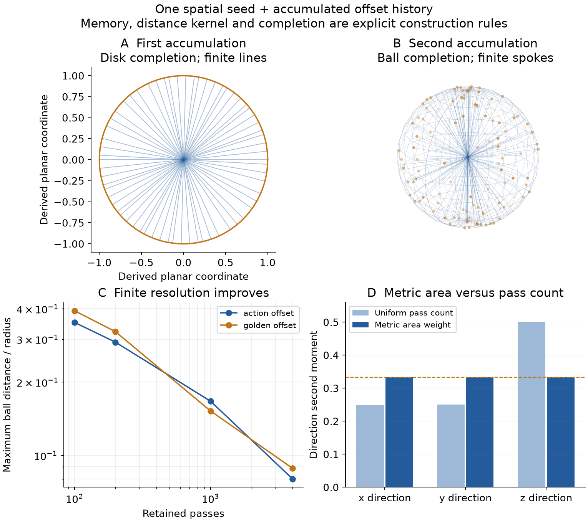
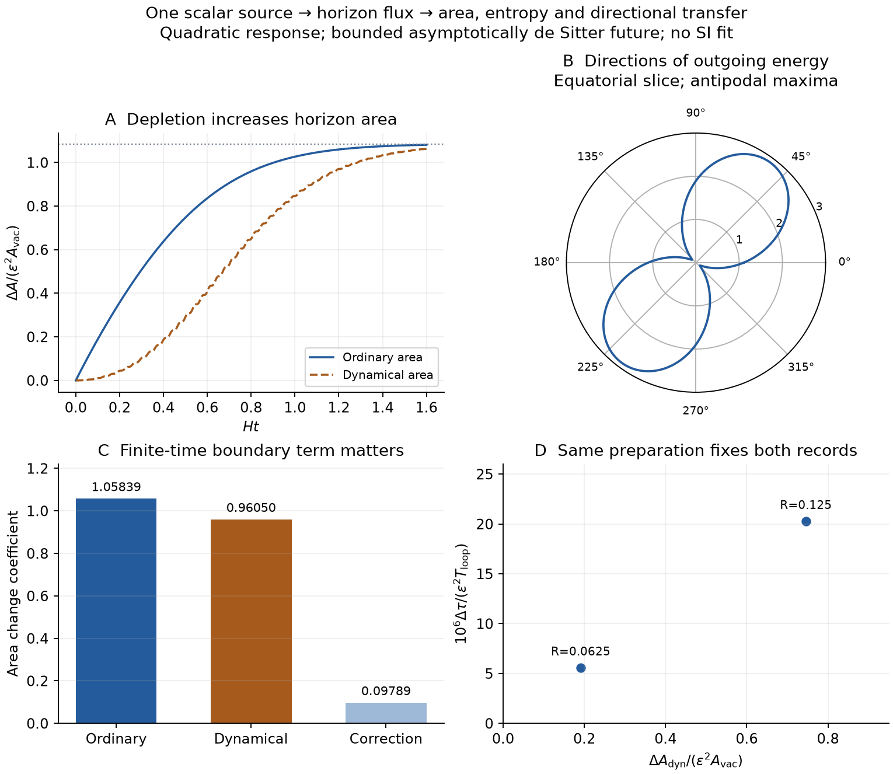
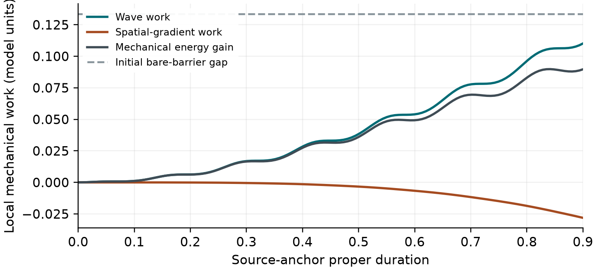
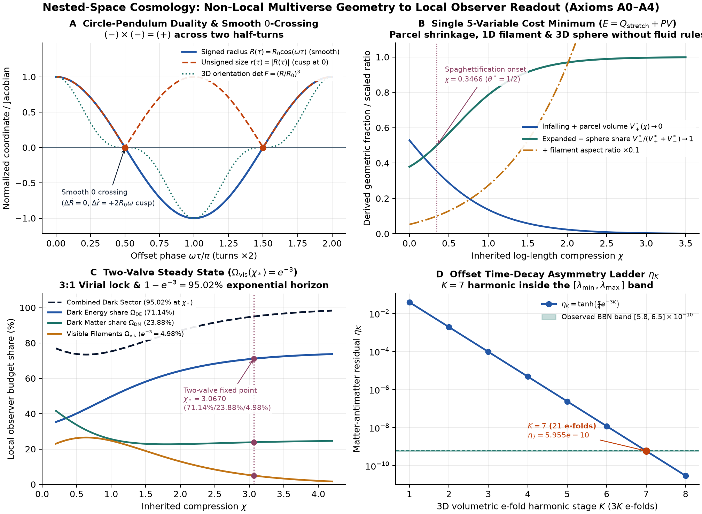

# Nested-Space Cosmology

## The Geometry of a Universe

**Douglas Ek**  
Foundation Edition · Version 0.27.0 · 2 November 2026

## Abstract

Nested-Space Cosmology (NSC) investigates whether one inherited geometric law can
connect nested regions, their exchange of energy across event horizons, and the
quantities measured by an interior observer. The foundation rests on five openly
declared geometric axioms (**A0--A4**) as the fundamental generating law, with
effective 3+1D field and curvature readouts emerging as local dictionary projections:
(**A0**) geometry follows the path of
least resistance by minimizing the 1D Cauchy--Schwarz generator stretch cost plus
enclosing compression work, $E = Q_{\mathrm{stretch}} + PV = \sum_{i=1}^3 m_i/\lambda_i + PV_0\lambda_1\lambda_2\lambda_3$,
which projects onto the effective 3+1D field Hamiltonian
$\int_V (T_{\mathrm{phase}}^{00} + V(s_\star)) d^3x$ via 1D vortex-bundle localization
($A_{\perp,i}=\pi/\mu^2(s_\star)=\mathrm{const}$) and quantized cavity modes with
background pressure $P = V(s_\star)$ (Proposition 1.1), while natural boundary
variation across the smooth `0` horizon interface $\Sigma_0$ projects **A0**
stationarity onto chemical-potential equilibrium $\mu_+ = \mu_- \iff \partial E/\partial\theta = 0$ (Proposition 1.1b);
(**A1**) a 1D spatial seed plus an inherited compression offset (time) generates
a closed 2D circle and 3D sphere; (**A2**) seen edge-on, the closed circle
$z(\tau)=R_0e^{i\omega\tau}$ is the harmonic pendulum $R(\tau)=R_0\cos(\omega\tau)$,
which crosses `0` smoothly into the negative direction $R<0$ (`-`), flipping the
3D orientation Jacobian $\det F=(R/R_0)^3$ from `+` to `-` and turning inward
implosion ($\dot{R}<0$) into outward child expansion ($\dot r_-=-\dot{R}>0$)
without the artificial velocity cusp $\Delta\dot{r}=+2R_0\omega$ created when
radius is restricted to an unsigned size $r=|R|\geq 0$, while in 3+1D curved
geometry the regular bounce areal radius $\mathcal{R}(R)=\sqrt{R^2+R_{\mathrm{core}}^2}$
with standing-wave hard core $R_{\mathrm{core}}=\sqrt{2\pi/\kappa}$ and hybrid
radial inertia $M(R)=1/(1+R^2/3)$ bounds the Kretschmann scalar at
$\mathcal{K}(0)=\frac{3\kappa^2}{\pi^2}(1+R_0^2\omega^2)^2<\infty$ and matches the
orthonormal Einstein tensor $G_{\hat{a}\hat{b}}(0)=\kappa T_{\hat{a}\hat{b}}(0)=\frac{1}{R_{\mathrm{core}}^2}\mathrm{diag}(-1,-1,+1,+1)$
directly to the `(1,1,1)` standing-wave angular floor and radial Casimir winding
tension (Propositions 1.2--1.2b); (**A3**) each nested room carries a moving
wavelength band $[\lambda_{\min}(\chi),\lambda_{\max}(\chi)]=e^{-\chi}[\lambda_{\min,0},\lambda_{\max,0}]$
bounded by its Planck cutoff ($\lambda_{\min}$) and Absolute-Zero horizon
($\lambda_{\max}$); and (**A4**) every room sits between an outer birth `0` valve
and inner black-hole `0` valves on a closed vortex--diffusion ring (`O <-> o`).

Minimizing the unified 5-variable single-cost functional across `+`, `0`, and `-`
yields a unique closed-form global minimum (Section 9) and seven parameter-free
geometric, dynamical, and observational theorems:

- **(1) Exact algebraic budget surface and open-valve Friedmann equations of state:**
  Eliminating both internal variables $(\theta^\star,\chi)$ from the five-variable
  budget shares $(D,M,V)$ with $B=M-D/3$ yields the exact zero-parameter algebraic
  curve $9DVB=4(V+B/2)^3$, exact inverse recovery $\theta^\star=D/(D+V+B/2)$ and
  $e^{-\chi}=3\sqrt{\theta^\star}B/(2V+B)$ (equivalently $e^{2\chi}=V(D+V+B/2)/[B(V+B/2)]$),
  and the deep-nest invariant $\lim_{\chi\to\infty}B/V^2=16/27$. Along the
  open-valve Virial manifold $\theta^\star(a_-)=(PV_0/m_0)^{1/2}a_-^2$ ($V_-=V_0 a_-^3$),
  the total differential $dE_{\mathrm{DE}}^\star=(-\frac{1}{3}\rho_{\mathrm{DE}}+\frac{4}{3}\rho_{\mathrm{DE}})dV_-=+\rho_{\mathrm{DE}} dV_-$
  yields $w_{\mathrm{DE}}=-(dE_{\mathrm{DE}}^\star/dV_-)/\rho_{\mathrm{DE}}=-1$
  ($\rho_{\mathrm{DE}}=3P=\mathrm{const}$), while the boundary-supported horizon
  load $E_{\mathrm{DM}}^\star$ does zero interior bulk work ($w_{\mathrm{DM}}=0$,
  $c_{s,\mathrm{DM}}^2=0$), matching the covariant massive-scalar late tail
  $\langle p_\chi\rangle/\langle\rho_\chi\rangle\to 0$.
- **(2) Universal exponential-wall bypasses, `(1,1,1)` 3D triad ground state, and $O(1)$ dilution survival:**
  Above $\chi_{\mathrm{spaghetti}}=\frac{1}{2}\ln 2$, the infalling `+` parcel
  shrinks in volume while spaghettifying into a 1D filament ($\theta^\star=1/2$), while
  three scale-free geometric mechanisms ($d\lambda/\lambda$ logarithmic measure,
  active vortex-tube circulation $w_{\mathrm{tube}}=1$, and zero-mode topological
  phase $\Delta\theta/\pi=1/2$) bypass the $e^{-3K}$ volumetric dilution wall at
  $O(1)$. In 3D standing-wave closure, the orthogonal `(1,1,1)` triad is the unique
  minimum-cost 3D ground state ($E_{1,1,1}=3\pi^2/R^2$, $2:1$ split against the
  $S^2$ angular floor) with wave-compression hard core $R_{\mathrm{core}}=\sqrt{2\pi/\kappa}$
  and short-range nuclear hard-core repulsion $\Delta E_{\mathrm{core}}=8(\sqrt{2}-1)$
  against merging into `(2,2,2)`. Combining this `(1,1,1)` triad ground state
  ($E^\star=4.0$) and per-axis hard-core barrier $\gamma_{\mathrm{core}}=8(\sqrt{2}-1)/3=1.1046$
  with the **A3** Planck-to-baryon resolution ratio $\mathcal N_{1\mathrm{D}}=\lambda_n/\ell_P=1.2994\times 10^{19}$
  ($\sqrt{R_\star\ell_P}=\lambda_n$, $R_\star=\lambda_n^2/\ell_P=2.729\ \mathrm{km}$) fixes the
  neutron-star equilibrium radius $R_{\mathrm{NS}}=4R_\star=10.916\ \mathrm{km}$
  (compactness $R_S/R_{\mathrm{NS}}=1/2=\theta^\star(\chi_{\mathrm{spaghetti}})$) and the TOV
  black-hole collapse threshold $M_{\mathrm{TOV}}\in[2.041,2.146]\ M_\odot$ (Proposition 9.2b).
- **(3) Gauss-divergence $3:1$ exterior Virial partition, helical buckling, and damped `+`/`0`/`-` oscillator:**
  For any incompressible irrotational potential flow $\phi(r,\tau)=-R^2\dot{R}/r$
  around a spherical throat of radius $R(\tau)$, the Gauss divergence identity
  $\nabla\cdot(\mathbf{x}p_{\mathrm{dyn}})=3p_{\mathrm{dyn}}+\mathbf{x}\cdot\nabla p_{\mathrm{dyn}}$
  decomposes the exterior pressure-gradient Virial $\int_{r\geq R}\mathbf{x}\cdot(-\nabla p_{\mathrm{dyn}}) d^3x=-4T_{\mathrm{ext}}$
  into the exact $3:1$ bulk-to-throat partition $|W_{\mathrm{bulk}}|:|W_{\mathrm{throat}}|=3T_{\mathrm{ext}}:T_{\mathrm{ext}}=3:1$
  (matching the static $3:1$ surrounding-flow to cavity-work ratio
  $E_{\mathrm{surr}}^\star:W_{\mathrm{press}}^\star=3:1$), while axial compression buckles
  laterally into a helix and drives a damped `+`/`0`/`-` horizon oscillation with
  exact asymmetries $\eta_{\mathrm{area}}=\tanh(\frac{\pi\gamma}{2\omega})$ and
  $\eta_{\mathrm{work}}=\tanh(\frac{\pi\gamma}{\omega})=2\eta_{\mathrm{area}}/(1+\eta_{\mathrm{area}}^2)$.
- **(4) Coupled finite-parent / receiver continuation, continuum zero-radius opening, and last-echo cutoff:**
  Coupling a finite parent reservoir $E_P(\tau)+E_-(\tau)=E_{\mathrm{tot}}$ with
  hybrid radial inertia $M(r)=1/(1+r^2/3)$ admits a continuum wave-driven opening
  from zero radius $r(\tau)=\pi^2\tau^2-\frac{4}{3}\pi^4\tau^3+O(\tau^4)$, the
  closed $3:1$ relaxation law $R(\tau)/R_\infty=\tanh(\sqrt{2\mathcal E_0} \tilde{\tau})$,
  and a sharp last-echo horizon cutoff ($\Delta E_{\mathrm{post}}/E_{\mathrm{tot}}=0$,
  visible interior snapshot $25.63$%, parent curvature backreaction shift $8.98$%).
- **(5) Spherical fragmentation, golden-ratio causal neck onset $p^3-3p-3=0$, and outgoing multipole waveform:**
  Integrating the outward causal stress balance over the entire exterior
  $r\in[1,\infty)$ of the harmonic two-center family gives the boundary release
  law $f_r(1,t)+4f(1,t)=0$ and the parameter-free characteristic cubic $p^3-3p-3=0$,
  whose unique real unstable growth root in terms of the golden ratio
  $\phi=\frac{1+\sqrt{5}}{2}$ is $p_+=\phi^{2/3}+\phi^{-2/3}\approx 2.1038034027$,
  driving a finite-time neck pinch, positive central observer pulse, and analytical
  pole-sum late-time tail $\phi_C(T)\propto -1/T'+O((T')^{-2})$.
- **(6) Three-axis orthogonal post-pinch cascade and $2\times 2$ kinetic handoff:**
  Harmonicity ($\Delta\Phi=0$) forces the directional enclosed-volume derivative
  trace $\partial_{\zeta_x}v+\partial_{\zeta_y}v+\partial_{\zeta_z}v=0$ to vanish at
  every stage, driving a 3-axis orthogonal cascade $\mathbf e_z\to\mathbf e_x\to\mathbf e_y$
  ($1\to 2\to 4\to 8$ lobes with exact harmonic ratios $-1/2$ and $-2$), coupled by
  the exact multipole identity $\partial_{q_2}g_{l,0}\vert_{q_2=0}=-\frac{l-1}{2}\partial_{q_1}g_{l,0}$
  and a strictly positive-definite, $B$-independent $2\times 2$ quasistatic kinetic
  matrix ($\det M_{\mathrm{full}}>0$, initial transverse conjugate momentum $p_2(0)>0$).
- **(7) Topological 3-axis cascade freeze-out ($\chi_{\mathrm{freeze}}=3$), WHIM split, $H_0=67.03\ \mathrm{km s^{-1}Mpc^{-1}}$, and $S_8\approx 0.776$:**
  Quantizing the scale-invariant logarithmic action $\Delta\chi_k=\int_{e^{-\Delta\chi_k}}^1 d\lambda_k/\lambda_k=n_k=1$
  on the `(1,1,1)` triad ground state across all $d=3$ mutually orthogonal downhill
  axes ($\mathbf e_z\to\mathbf e_x\to\mathbf e_y$, consistent with the two-center
  handoff half-span $L_{\mathrm{handoff}}=1.2+2^{2/3}=2.7874\approx e^1$, Lemma 7.1)
  via **A1** telescoping fixes $\chi_{\mathrm{freeze}}=\sum_{k=1}^3\Delta\chi_k=3$,
  selecting $(\Omega_{\mathrm{DE}},\Omega_{\mathrm{DM}},\Omega_{\mathrm{vis}})=(70.88,23.81,5.30)$%
  at $\chi=3$ and $(71.14,23.88,4.98)$% at $\Omega_{\mathrm{vis}}=e^{-3}$ on
  $9DVB=4(V+B/2)^3$, predicting the tangent drift slope
  $d\Omega_{\mathrm{DE}}/d\Omega_{\mathrm{vis}}=-\frac{3}{4}-\frac{8}{9}\Omega_{\mathrm{vis}}+O(\Omega_{\mathrm{vis}}^2)\approx -0.806$,
  separating condensed `(1,1,1)` baryon cores ($\Omega_b=e^{-3}=4.9787$%, fixing
  $H_0=100\sqrt{\Omega_b h^2 e^3}=67.03\pm 0.22\ \mathrm{km s^{-1}Mpc^{-1}}$) from
  uncondensed 1D WHIM filaments ($\Delta\Omega_{\mathrm{WHIM}}=0.3252$%), and
  suppressing sub-horizon linear growth via the spatially uniform uncondensed
  horizon-slip fraction ($1-f_{\mathrm{clust}}=3.114$%) from $S_{8,\mathrm{CMB}}\approx 0.832$
  to $S_{8,\mathrm{NSC}}\approx 0.776$ (Proposition 9.7b).

Part I (Sections 2--8) presents the covariant 3+1D two-scalar Einstein control
apparatus and the pre-registered single-horizon flow test NSC-P006, proving that
an uncoupled single horizon leaves $\Omega_{\Lambda,0}$ unselected and motivating
Part II (Section 9), while Section 9.8 strictly quarantines non-derived numerical
comparisons and Appendix A provides the complete reproducibility index.

## 1. One spatial seed, offset history and a generated geometry

Douglas's proposal is that contrast and exchange organize approximately
spherical regions, and that the construction can repeat within them.
Time names the offset operation in this generating picture. A physical
duration is a readout along the resulting history. The generated space
has three spatial directions; a child is another region, not a fourth
primitive spatial direction.

The circle and sphere separate an inside from an outside. Isotropic
positive surface energy at fixed volume selects a sphere by the
isoperimetric inequality. Whether a particular gravitational region is
selected by that variational problem must follow from its action. The
present smooth horizon has no material tension. A material-shell branch
is therefore retained separately in the technical atlas.

The explicit two-stage offset generator is

$$
\theta_{n+1}=\theta_n+\alpha,\qquad
\phi_{n+1}=\phi_n+\theta_n,
$$

with phases taken modulo one and zero initial phases ($\theta_0=\phi_0=0$).
Hence $\theta_n=n\alpha$ and $\phi_n=\frac{1}{2}n(n-1)\alpha$ modulo one. One
accumulator feeds the second; no independent second phase is supplied. For
irrational $\alpha$, Weyl's polynomial equidistribution criterion proves that
the joint phase history is dense on the two-phase torus $\mathbb{T}^2$.

Setting $\Theta_n=2\pi\theta_n$ and $\Phi_n=2\pi\phi_n$, the generated unit
directions and their inner-product kernel are

$$
v_n=(\sin\Theta_n\cos\Phi_n,\sin\Theta_n\sin\Phi_n,
\cos\Theta_n),\qquad C_{nm}=v_n\cdot v_m.
$$

For a retained radial interval, the declared Euclidean distance kernel

$$
d^2[(r,n),(s,m)]=r^2+s^2-2rsC_{nm}
$$

has the closed three-dimensional ball $B^3$ as its metric completion. The
positive-curvature version

$$
d=R\arccos\left[\cos(r/R)\cos(s/R)
+\sin(r/R)\sin(s/R)C_{nm}\right]
$$

generates the closed spatial parent $S^3$. Memory, the distance law and metric
completion are explicit assumptions; finite drawings have zero three-dimensional
volume before completion.

The inherited-law target across nested transitions is

$$
\mathcal{T}^\star\mathbb{D}=\mathbb{D},
$$

stating that the normalized operator law is preserved under the parent-to-child
pullback $\mathcal{T}^\star$.

### 1.1 Openly declared geometric axioms (A0--A4) and covariant field reduction

To build a rigorous deductive chain without unstated fluid-physics analogies
(such as assuming parcel incompressibility $\lambda_1\lambda_2\lambda_3=1$ or
borrowed surface tension), the non-local foundation states five explicit
geometric axioms:

- **A0 (Path of Least Resistance):** By Cauchy--Schwarz on any generated 1D
  phase curve of physical length $L_i=\lambda_i L_{i,0}$ carrying winding change
  $\Delta\psi_i$, the intrinsic stretch cost is
  $Q_{\mathrm{stretch}}(A)=\frac{1}{2}\mathrm{Tr}[(A^TA)^{-1/2}C^TC]=\sum_{i=1}^3 m_i/\lambda_i$.
  Under enclosing compression work $PV$, geometry minimizes the single cost
  functional $E=Q_{\mathrm{stretch}}+PV$.
- **A1 (1D Seed + Inherited Offset = Time):** Every child seed forms inside an
  already evolving parent at relative log-length compression
  $\chi_{p\to c}=\frac{1}{3}\ln[(J_p/J_{p,0})/(J_c/J_{c,0})]$, which satisfies
  exact telescoping $\chi_{g\to c}=\chi_{g\to p}+\chi_{p\to c}$ across generations.
  Repeated offset accumulation generates the 2D circle and 3D sphere.
- **A2 (Signed-Zero Crossing $+ \to 0 \to -$):** The radial coordinate $R(\tau)$
  is a signed geometric coordinate rather than an unsigned size. Under winning
  inward compression $F_{\mathrm{net}}=F_{\mathrm{in}}-F_{\mathrm{out}}>0$,
  $R(\tau)$ crosses smoothly through `0` into $R<0$ (`-`), flipping the 3D
  orientation Jacobian $\det[(R/R_0)I_3]=(R/R_0)^3$ from `+` to `-` and
  converting inward implosion ($\dot{R}<0$) into outward child expansion
  ($\dot r_-=-\dot{R}>0$, $r_-=-R>0$).
- **A3 (Moving Spectral Band $[\lambda_{\min},\lambda_{\max}]$):** Each room at
  relative compression $\chi$ supports a finite wavelength band
  $[\lambda_{\min}(\chi),\lambda_{\max}(\chi)]=e^{-\chi}[\lambda_{\min,0},\lambda_{\max,0}]$
  bounded by its shortest wavelength before `0` crosses into `-` (local Planck
  cutoff $\lambda_{\min}$) and its longest wavelength as wide as the room itself
  (local Absolute-Zero horizon $\lambda_{\max}=2R$).
- **A4 (Two-Valve Nested Circulation):** Each `0` horizon is a one-way valve
  from `+` to `-` conserving total turn budget $n_++n_-=N_0$ ($n_+=(1-\theta)N_0$,
  $n_-=\theta N_0$). Every local room sits between an outer birth `0` valve
  (inflow from parent) and inner black-hole `0` valves (outflow to children)
  on a closed vortex--diffusion ring (`O <-> o`).

Axioms **A0--A4** constitute the fundamental generating geometric law of NSC; they
do not depend on or seek validation from standard closed-box general relativity
(which, as Part I proves via the pre-registered control NSC-P006, breaks down at
an isolated single horizon without **A4**). Instead, Propositions 1.1--1.2b
establish the exact dictionary projections showing how the generated **A0--A4**
geometry maps onto the effective 3+1D field Hamiltonian, junction chemical
potentials, and orthonormal Einstein curvature readouts measured by a local
interior observer.

**Proposition 1.1 (Dictionary Projection Between A0 and the Effective 3+1D Field Hamiltonian):**
Consider the covariant 3+1D scalar-gravity Lagrangian of Section 2,
$\mathcal{L}=\frac{R}{2\kappa}-\frac{1}{2}(\nabla S)^2-\frac{1}{2}(\nabla\chi)^2-V(s)-\frac{1}{2}\mu^2(s)\chi^2$,
evaluated on an orthorhombic principal domain $V=V_0\lambda_1\lambda_2\lambda_3$
of physical lengths $L_i=\lambda_i L_{i,0}$ ($i=1,2,3$) immersed in the parent
background vacuum energy density $P\equiv V(s_\star)$. Along each generated 1D
phase-curve bundle $\gamma_i$ of physical length $L_i=\lambda_i L_{i,0}$ and
transverse vortex core cross-section $A_{\perp,i}=\pi r_\perp^2=\pi/\mu^2(s_\star)$
fixed by the microscopic Compton healing radius $r_\perp=\mu(s_\star)^{-1}$ of the
stabilized parent scalar mass $\mu^2(s_\star)=400e^{-12s_\star}$ (which is an intrinsic
microscopic property of the scalar potential and therefore strictly independent
of the macroscopic domain stretches $\lambda_j$), carrying topological phase
winding $\Delta\psi_i=\int_0^{L_i}\partial_s\psi_i ds=2\pi n_i$, the
Cauchy--Schwarz inequality on the spatial gradient energy yields

$$
\int_{\mathrm{tube} i}\frac{1}{2}(\partial_s\psi_i)^2 d^3x
=\frac{A_{\perp,i}}{2}\int_0^{L_i}(\partial_s\psi_i)^2 ds
\geq\frac{A_{\perp,i}(\Delta\psi_i)^2}{2L_{i,0}\lambda_i}
\equiv\frac{m_i}{\lambda_i},\qquad
m_i=\frac{2\pi^2 A_{\perp,i}n_i^2}{L_{i,0}}=\frac{2\pi^3 n_i^2}{\mu^2(s_\star)L_{i,0}},
$$

with equality attained on the harmonic uniform-gradient phase
$\partial_s\psi_i=\Delta\psi_i/L_i$ (equivalently, in the quantized relativistic
cavity limit at fixed mode occupation $N_i$, each standing-wave mode of
wavenumber $k_i=\pi n_i/(\lambda_i L_{i,0})$ carries energy
$E_i=N_i\hbar c k_i=(N_i\hbar c\pi n_i/L_{i,0})/\lambda_i\equiv m_i/\lambda_i$
with $m_i$ strictly independent of $\lambda_1,\lambda_2,\lambda_3$). Adding the
bulk background vacuum energy $\int_V V(s_\star) d^3x=PV_0\lambda_1\lambda_2\lambda_3$
gives the exact reduced Hamiltonian functional of **A0**:

$$
E(\lambda_1,\lambda_2,\lambda_3)
=\int_V\left(T_{\mathrm{phase}}^{00}+V(s_\star)\right)d^3x
=\sum_{i=1}^3\frac{m_i}{\lambda_i}+PV_0\lambda_1\lambda_2\lambda_3.
$$

Whereas smearing a fixed classical amplitude homogeneously across empty 3D
volume dilutes as $\lambda^{d-2}=\lambda^1=e^{-\chi}$, transverse core
localization at the Compton healing radius $r_\perp=\mu(s_\star)^{-1}$ (or fixed
quantum occupation $N_i$ along the generated 1D phase curves) preserves the
exact $1/\lambda_i$ Cauchy--Schwarz stretch resistance in every dimension $d$.

**Proposition 1.1b (Covariant 3+1D Junction Derivation of Open-Valve Stationarity $\partial E/\partial\theta = 0$):**
Let the two-sheeted spacetime be separated into parent ($\mathcal M_+$) and
child ($\mathcal M_-$) domains by the smooth `0` horizon interface $\Sigma_0$
($R=0$, $v=\pi/2$), across which the total topological winding $2\pi N_0$ is
partitioned via the horizon boundary phase $\psi_{\Sigma_0} = 2\pi N_0\theta(\tau)$,
so that $\Delta\psi_+ = 2\pi N_0(1-\theta)$ on $\mathcal M_+$ and
$\Delta\psi_- = 2\pi N_0\theta$ on $\mathcal M_-$ (**Axiom A4**). Evaluating
the covariant 3+1D scalar action $\mathcal{S} = \int \mathcal{L}\sqrt{-g} d^4x$
on the harmonic vortex-bundle fields of Proposition 1.1
($\partial_s\psi_{+,i} = \Delta\psi_+/(\lambda_i L_{i,0})$,
$\partial_s\psi_{-,j} = \Delta\psi_-/(\tilde \lambda_j L_{j,0})$) and performing
the natural boundary variation with respect to the intermediate horizon phase
$\delta\psi_{\Sigma_0} = 2\pi N_0 \delta\theta(\tau)$ yields the canonical
junction identity:

$$
\delta\mathcal S_{\Sigma_0}
=\int_{\Sigma_0}d\tau (2\pi N_0) \delta\theta(\tau)
\left[\sum_{i=1}^3 A_{\perp,i} \partial_s\psi_{+,i}-\sum_{j=1}^3 A_{\perp,j} \partial_s\psi_{-,j}\right]
=-\int_{\Sigma_0}d\tau \frac{\partial E}{\partial\theta} \delta\theta(\tau),
$$

where $m_0 = 2\pi^2 A_\perp N_0^2/L_0$ and

$$
-\frac{\partial E}{\partial\theta}
=2m_0(1-\theta)\sum_{i=1}^3\frac{1}{\lambda_i}-2m_0\theta\sum_{j=1}^3\frac{1}{\tilde \lambda_j}
=2\pi N_0\left(\mu_+-\mu_-\right),
$$

with $\mu_\pm = \partial E_\pm/\partial(2\pi n_\pm)$ denoting the canonical
winding chemical potential on each side of $\Sigma_0$. Consequently:

- *Closed-valve regime (pinned horizon phase, $\delta\theta = 0$):* When the `0`
  valve is closed, $\theta$ is frozen and adiabatic child expansion
  $V_- = V_0 a_-^3$ obeys $E_{\mathrm{DE}} \propto a_-^{-1}$ ($w_{\mathrm{closed}} = +1/3$).
- *Open-valve regime (unpinned smooth horizon, $\delta\theta$ free):* Because
  the smooth horizon at $v=\pi/2$ has no membrane barrier or singular
  denominator (Section 2), $\delta\mathcal S_{\Sigma_0}/\delta\theta = 0$
  enforces chemical-potential equilibrium
  $\mu_+(\chi,\theta) = \mu_-(\theta) \iff \partial E/\partial\theta = 0$
  across $\Sigma_0$, locking the system onto the open-valve manifold
  $\mathcal M_{\mathrm{valve}}$ ($\theta^\star(a_-) = (PV_0/m_0)^{1/2}a_-^2$) and
  generating $w_{\mathrm{DE}} = -1$ (Section 9.1).

### 1.2 Circle-pendulum duality: why `-` exists, `(-) x (-) = (+)`, and curvature regularization at $R=0$

In Layer 1 of the offset generator, the pen draws a closed circle
$z(\tau)=R_0e^{i\omega\tau}$. Seen edge-on along any diameter, that uniform
circular motion is the harmonic pendulum

$$
R(\tau)=\mathrm{Re}\left(R_0e^{i\omega\tau}\right)=R_0\cos(\omega\tau),
\qquad \ddot{R}+\omega^2 R=0,
$$

which swings $+R_0\to 0\to -R_0\to 0\to +R_0$ with invariant total energy
$\frac{1}{2}\dot{R}^2+\frac{1}{2}\omega^2 R^2=\frac{1}{2}R_0^2\omega^2$. Three
exact geometric consequences follow immediately:

- **(1) Why `-` must exist for space to close:** Negative is direction, not less
  than nothing. If negative coordinates are forbidden ($R\geq 0$ only), the
  circle is clipped to $\omega\tau\in[-\pi/2,\pi/2]$: exactly $50$% of its
  arc length ($\pi R_0$ out of $2\pi R_0$) is lost and no loop or bounded
  space can close.
- **(2) Why `(-) x (-) = (+)` is two-generation geometry:** Multiplying by
  $-1=e^{i\pi}$ is a geometric half-turn ($\pi$ rotation). In three spatial
  dimensions, crossing `0` applies the spatial inversion $\mathcal{P}=-I_3$
  with $\det\mathcal{P}=(-1)^3=-1$ ($\mathrm{Parent}\ (+)\to\mathrm{Child}\ (-)$).
  Crossing `0` a second time into the grandchild applies two half-turns,
  $\mathcal{P}^2=(-I_3)(-I_3)=+I_3$ with $\det(\mathcal{P}^2)=(-1)(-1)=+1$
  ($\mathrm{Child}\ (-)\to\mathrm{Grandchild}\ (+)$).
- **(3) Kinematic cusp removal and 3+1D curvature regularization at $R=0$:**
  Standard physics uses negative coordinates everywhere except for the radius of
  space itself, which it restricts to an unsigned size $r(\tau)=|R(\tau)|\geq 0$.
  At the horizon crossing $\tau_0=\pi/(2\omega)$ ($R=0$), folding the negative
  half of the swing onto the positive half forces a discontinuous velocity jump
  $\Delta\dot{r}=\dot{r}(\tau_0^+)-\dot{r}(\tau_0^-)=+2R_0\omega$ and a
  Dirac-delta acceleration cusp $\ddot{r}=2R_0\omega \delta(\tau-\tau_0)-\omega^2 r$.
  Keeping the signed coordinate $R(\tau)$ removes this kinematic cusp completely
  ($\Delta\dot{R}=0$, $\ddot{R}(\tau_0)=0$).

**Proposition 1.2 (Dictionary Projection of the Signed-Zero Crossing onto a Regular 3+1D Bounce Metric):**
Projecting the fundamental **A2** signed radial coordinate $R\in(-\infty,\infty)$
onto an effective 3+1D spacetime line element by combining it
with the `(1,1,1)` standing-wave compression hard core
$R_{\mathrm{core}}=\sqrt{2\pi/\kappa}>0$ (derived in Theorem 2, Section 9.2) and
the hybrid radial inertia metric $M(R)=1/(1+R^2/3)$ (derived in Theorem 4,
Section 9.4) yields the regular two-sheeted bounce line element

$$
ds^2=-d\tau^2+M(R) dR^2+\mathcal{R}^2(R) d\Omega_2^2,\qquad
\mathcal{R}(R)\equiv\sqrt{R^2+R_{\mathrm{core}}^2},\qquad
M(R)=\frac{1}{1+R^2/3}.
$$

Because $M(0)=1$, $\mathcal{R}(0)=R_{\mathrm{core}}>0$, $\mathcal{R}'(0)=0$, and
$\mathcal{R}''(0)=1/R_{\mathrm{core}}$ are analytic at the throat $R=0$, the
proper birth distance $\int_0^\varepsilon\sqrt{M(R)} dR<\infty$ is finite and
every 3+1D curvature invariant is strictly bounded across the `+ -> 0 -> -`
transition:

$$
R_4(0)=-\frac{2}{R_{\mathrm{core}}^2}=-\frac{\kappa}{\pi}<\infty,\qquad
\mathcal K_{\mathrm{static}}(0)=\frac{12}{R_{\mathrm{core}}^4}=\frac{3\kappa^2}{\pi^2}<\infty,\qquad
\mathcal K_{\mathrm{dyn}}(0)=\frac{3\kappa^2}{\pi^2}\left(1+R_0^2\omega^2\right)^2<\infty.
$$

**Proposition 1.2b (Exact Orthonormal Einstein Tensor and Standing-Wave Stress Matching Across $R=0$):**
For the two-sheeted bounce line element of Proposition 1.2, the non-vanishing
orthonormal sectional curvatures for all $R\in(-\infty,\infty)$ are

$$
R_{\hat{R}\hat{\theta}\hat{R}\hat{\theta}}(R)=R_{\hat{R}\hat{\phi}\hat{R}\hat{\phi}}(R)
=-\frac{R_{\mathrm{core}}^2(1+R^2/3)+\frac{1}{3}R^2(R^2+R_{\mathrm{core}}^2)}{(R^2+R_{\mathrm{core}}^2)^2},\qquad
R_{\hat{\theta}\hat{\phi}\hat{\theta}\hat{\phi}}(R)=\frac{R_{\mathrm{core}}^2-R^4/3}{(R^2+R_{\mathrm{core}}^2)^2}.
$$

The resulting exact orthonormal Einstein tensor components
$G_{\hat{a}\hat{b}}(R)=\kappa T_{\hat{a}\hat{b}}(R)$ are analytic everywhere on
$R\in(-\infty,\infty)$ and satisfy the contracted Bianchi identity
$\frac{d}{dR}G_{\hat{R}\hat{R}}+\frac{2\mathcal{R}'}{\mathcal{R}}(G_{\hat{R}\hat{R}}-G_{\hat{\theta}\hat{\theta}})=0$
identically:

$$
G_{\hat{\tau}\hat{\tau}}(R)=-\frac{R^4+\frac{4}{3}R^2 R_{\mathrm{core}}^2+R_{\mathrm{core}}^2}{(R^2+R_{\mathrm{core}}^2)^2},\qquad
G_{\hat{R}\hat{R}}(R)=\frac{\frac{1}{3}R^4-R_{\mathrm{core}}^2}{(R^2+R_{\mathrm{core}}^2)^2},\qquad
G_{\hat{\theta}\hat{\theta}}(R)=G_{\hat{\phi}\hat{\phi}}(R)=\frac{\frac{1}{3}R^4+\frac{2}{3}R^2 R_{\mathrm{core}}^2+R_{\mathrm{core}}^2}{(R^2+R_{\mathrm{core}}^2)^2}.
$$

Evaluating this profile at the signed-zero throat $R=0$ and in the asymptotic
rooms $R\to\pm\infty$ establishes two exact physical limits:

- **(1) Exact `(1,1,1)` Casimir / standing-wave balance at the throat ($R=0$):**
  At $R=0$, the required covariant stress-energy tensor is

$$
T_{\hat{a}\hat{b}}(0)=\frac{1}{\kappa}G_{\hat{a}\hat{b}}(0)
=\frac{1}{\kappa R_{\mathrm{core}}^2} \mathrm{diag}\left(-1, -1, +1, +1\right)
=\frac{1}{2\pi} \mathrm{diag}\left(-1, -1, +1, +1\right).
$$

  The transverse angular pressure $p_\theta(0)+p_\phi(0)=2/(\kappa R_{\mathrm{core}}^2)$
  is supplied directly by the $\ell=1$ $S^2$ angular kinetic floor
  $\ell(\ell+1)/R_{\mathrm{core}}^2=2/R_{\mathrm{core}}^2$ of the `(1,1,1)`
  standing-wave triad (Theorem 2(3)), divided equally between $\hat{\theta}$ and
  $\hat{\phi}$, while the boost-invariant radial tension
  $\rho(0)=p_R(0)=-1/(\kappa R_{\mathrm{core}}^2)=-1/(2\pi)$ is the 1D radial
  Casimir winding stress across the throat area
  $A_{\mathrm{core}}=4\pi R_{\mathrm{core}}^2=8\pi^2/\kappa$, providing the exact
  radial flare-out support
  $\kappa(\rho(0)+p_R(0))=-2/R_{\mathrm{core}}^2=-2\mathcal{R}''(0)/\mathcal{R}(0)<0$.
- **(2) Asymptotic recovery of the $3:1$ Virial curvature scale ($R\to\pm\infty$):**
  For $|R|/R_{\mathrm{core}}\to\infty$, the factor $1+R^2/3$ in $M(R)$ drives
  $G_{\hat{\tau}\hat{\tau}}(\pm\infty)\to -1$ and
  $G_{\hat{R}\hat{R}}(\pm\infty),G_{\hat{\theta}\hat{\theta}}(\pm\infty)\to +1/3$,
  smoothly matching the throat core onto a spatial slice of constant curvature
  radius $L_H=\sqrt{3}$.

## 2. The smooth zero interface and its inherited source

**Architectural overview (Part I: Sections 2--8 vs. Part II: Section 9):**
To establish mathematically why **Axiom A4 (Two-Valve Nested Circulation)** is
necessary, this paper is organized in two complementary parts. **Part I
(Sections 2--8)** constructs a fully covariant 3+1D Einstein/two-scalar
**single-horizon control apparatus** (`+` parent $\to$ `0` horizon $\to$ `-`
receiver without a second outflow valve or variational child boundary closure).
This control apparatus proves three foundational benchmark results: (i) the
smooth `0` horizon transmits energy and area growth conservatively without
membrane singularities (Sections 2--3); (ii) an isolated single-horizon scalar
flux *cannot* select the cosmological vacuum fraction $\Omega_{\Lambda,0}$ on its
own (the pre-registered negative theorem NSC-P006, Section 4), because null
horizon projections are blind to an additive vacuum shift; and (iii) the
transmitted massive scalar phase relaxes asymptotically to a cold, pressureless
dust tail with $w_\chi=\langle p_\chi\rangle/\langle\rho_\chi\rangle\to 0$
(Section 5). **Part II (Section 9)** then introduces the full **two-valve
variational foundation (`A0--A4`)** and proves that closing the circulation loop
between the outer birth `0` valve and inner black-hole `0` valves uniquely fixes
the algebraic budget surface $9DVB=4(V+B/2)^3$, the Friedmann equations of state
$w_{\mathrm{DE}}=-1$ and $w_{\mathrm{DM}}=0$, and the 3-axis cascade freeze-out
$\chi_{\mathrm{freeze}}=3$ (Theorems 1--7).

The worked parent uses the Einstein/two-scalar action

$$
\mathcal L=\frac{R}{2\kappa}
-\frac{(\nabla S)^2}{2}-\frac{(\nabla\chi)^2}{2}-W,
\qquad W=V(s)+\frac{\mu^2(s)\chi^2}{2},
$$

with $S=\sqrt{84}(s-s_\star)$ and

$$
V(s)=7e^{-12s}-7.5e^{-14s}+\frac{25}{32}e^{-24s},
\qquad \mu^2(s)=400e^{-12s}.
$$

Its prepared real scalar contains two spatial harmonics with Laplacian
eigenvalues $3$ and $8$, equal reference energy, and zero initial velocity.
The reference frequency $\omega_0=20$, state amplitude $\epsilon$, and
background curvature $H$ remain declared inputs; the minimum of $V(s)$
supplies the background parent vacuum $P=V(s_\star)$.

In conformal null coordinates $u=\eta-\chi$ and $v=\eta+\chi$, the smooth
horizon lies at $v=\pi/2$, where the inherited radial fields satisfy

$$
4\Psi_{uv}+\left[(m^2-2)\sec^2\eta+2\csc^2\chi\right]\Psi=0,
\qquad m^2=\frac{\mu^2}{H^2}.
$$

There is no horizon denominator and no membrane stress. Two intersecting null
traces inherited from the global preparation fix the receiving field across
$v=\pi/2$ without resetting the state.

## 3. One source, three connected crossing numbers

The source's null stress gives a positive regional Killing-energy flux:

$$
\frac{dE_K}{dt}=-\epsilon^2\tanh(Ht)F_H(t),\qquad F_H(t)\geq 0.
$$

Starting from the time-symmetric parent slice, the reference comparison ends at
the 300-event readout $t=4.364851930252$ (an apparatus readout rather than a
selected present age):

| Existing result | Value | Meaning |
| --- | --- | --- |
| Crossed fraction | $88.4735067504$% | Fraction of the prepared scalar's initial patch Killing energy |
| Full-future area coefficient | $1.085638919782 \epsilon^2$ | Normalized ordinary horizon-area growth |
| Short-leg transfer | $2.219782587242 \epsilon^2$ | Killing energy over the handoff leg $t\in[4.364852,4.797158]$ |

Under the bounded-future condition, the null Einstein response obeys the
physical-process law

$$
H\Delta A_{\mathrm{dyn}}=\kappa E_{\mathrm{out}},
$$

so the $88.4735$% crossing fraction and the area coefficient encode the same
conserved source. Gibbons--Hawking and [Zhao](https://arxiv.org/abs/2503.16138)
supply the physical-process framework; the source normalization and
finite-section correction are the atlas's calculation (Appendix A.10).

## 4. Pre-registered test: does the flow select today's vacuum fraction?

NSC-P006 freezes a single requested output before calculation:

$$
\Omega_{\Lambda,0}=\frac{\kappa\rho_{\mathrm{vac},-}(e_0)}{3H_0^2},
\qquad |\Omega_{\Lambda,0}-0.685|\leq 0.007.
$$

The protocol tests whether the isolated single-horizon scalar flow above selects
the [Planck 2018](https://arxiv.org/abs/1807.06209) base-$\Lambda\mathrm{CDM}$ inference
without reusing the supplied parent vacuum or fitting an epoch. Because

$$
(-c g_{\mu\nu})k^\mu k^\nu=0
$$

for every null vector $k^\mu$ and constant $c$, the null horizon balance is
invariant under an additive vacuum term. Even a homogeneous receiving-fluid
completion

$$
\dot\rho_-+3H_-(\rho_-+p_-)=q_-
$$

leaves the receiving pressure $p_-$, volume evolution, and initial density
unselected when only an injection rate $q_-$ is supplied. Likewise, the phase
map $\phi_n=\frac{1}{2}n(n-1)\alpha$ is invariant under monotone clock
reparametrizations $t(n)$. The pre-registered evaluation therefore returns
**$\Omega_{\Lambda,\mathrm{today}}$ unselected** under an isolated
single-horizon scalar flux, proving that a variational two-valve receiving law
(Section 9) is required.

## 5. What continues across zero: pressure and the late tail

Beyond the smooth horizon at the declared apparatus event $t=5.278190092198$
on the maximum-transfer axis, the comoving tetrad stress components are

$$
\rho=\frac{\Pi^2+|D\chi|^2+\mu^2\chi^2}{2},\qquad
p=\frac{\Pi^2-|D\chi|^2/3-\mu^2\chi^2}{2},
$$

where $p$ is the isotropic trace part of the spatial stress. The calculated
receiver gives $\rho/\epsilon^2=0.0624287161642$, $p/\epsilon^2=0.0450251156252$, and

$$
w_{-,\mathrm{receiver}}=0.7212244363,\qquad w_--(-1)=1.7212244363.
$$

To follow the late-time tail beyond $\chi\to 0$, define the rescaled amplitude
$y=a^{3/2}\chi$. With $\nu_{\mathrm{phys}}^2+(3H/2)^2=\mu^2$, late phase
averaging gives $\langle\Pi^2\rangle=\mu^2\langle\chi^2\rangle$ and

$$
\langle\rho_\chi\rangle\propto a^{-3},\qquad
\frac{\langle p_\chi\rangle}{\langle\rho_\chi\rangle}\longrightarrow 0,
\qquad \langle|D\chi|^2\rangle\propto a^{-5}.
$$

Thus the rescaled phase survives with a cold, pressureless dust equation of
state ($w_\chi=\langle p_\chi\rangle/\langle\rho_\chi\rangle\to 0$) while the
background-subtracted late-field vacuum shift vanishes ($\Delta\Lambda L_{\mathrm{ref}}^2=0$).

## 6. Finite amplitude: admissibility and the child criterion

The nonspherical initial state has spatial metric $h_{ij}=a_0^2\Psi^4\gamma_{ij}$,
extrinsic curvature $K_{ij}=0$, $s=s_\star$, and zero scalar normal momenta, with
Hamiltonian constraint

$$
-8\Delta\Psi+6\Psi-6\Psi^5
-\kappa\epsilon^2\left(|Df|^2\Psi+zf^2\Psi^5\right)=0,
\qquad z=\frac{\mu^2}{H^2}.
$$

A smooth positive invariant solution exists for every $0\leq\epsilon\leq 1$
when $z>33$ (satisfied by the retained $z=8329.074464994$ via a weighted
equivariant Hebey--Vaugon compactness bound $61/88<1$). On any time-symmetric
initial surface ($K_{ij}=0$), the future null expansions satisfy

$$
\theta_+=H_{\mathrm{surface}},\qquad\theta_-=-H_{\mathrm{surface}},\qquad
\theta_+\theta_-=-H_{\mathrm{surface}}^2\leq 0,
$$

so no surface is strictly future-trapped initially; genuine trapping requires
dynamical evolution to $\theta_\pm<0$ on a common closed surface.

### 6.1 The unchanged parent drives its internal geometry

Varying the internal-scale action for $K_s=84$ gives

$$
K_s\Box s-V_s+6\mu^2\chi^2=0.
$$

Along a tracked unit geodesic $u^a$ with spatial projector
$P_u^{ab}=g^{ab}+u^au^b$ and local mechanical energy
$e_s=\frac{1}{2}K_s[u(s)]^2+V(s)$, direct differentiation yields

$$
\frac{de_s}{d\tau}
=6\mu^2\chi^2u(s)+K_su(s)P_u^{ab}\nabla_a\nabla_bs,
$$

separating scalar-wave driving from spatial-Laplacian transport.

The source-bound readout measures $+0.11015$ wave work through proper duration
$0.9$, opposed by $-0.02810$ spatial-Laplacian work (raising $e_s$ from $0.22098$
to $0.31065$ toward the bare barrier $0.35454$). Continuing the complete Cauchy
state to proper duration $1.2$ gives:

| Quantity | Degree 20 | Degree 24 |
| --- | ---: | ---: |
| Internal log size $s$ | $-0.0019497504$ | $-0.0019505915$ |
| Internal volume / initial volume | $1.498350$ | $1.498335$ |
| Hamiltonian residual / $H_{\mathrm{ref}}^2$ | $0.03632$ | $0.01180$ |

Thus the unchanged parent drives $49.8$% internal-volume growth over this
finite window. The fixed-boundary check shows positive outgoing expansion
($0.37548$ to $0.65660$) at proper duration $1.2$, so no future-trapped
boundary forms in the equal two-mode preparation.

Placing the same excitation energy into the lowest odd harmonic $\chi=\epsilon A X_1$
with $\kappa A^2=24/(z+3)$ makes both initial expansions vanish on the
reflection-symmetric neck $X_1=0$, where ADM and warped-metric evolution give

$$
\frac{\dot\theta_\pm}{H^2}
=3-\left(1+\frac{\kappa\epsilon^2A^2}{2}\right)\Psi(0)^{-4}.
$$

The calculated trapping threshold is $\epsilon_{\mathrm{crit}}=0.8339066143$. At
$\epsilon=1$, $\dot\theta_\pm/H^2=-1.30468$ and both expansions become strictly
negative ($\theta_\pm/H=-0.00707954$ at proper time $0.02$), agreeing with the
independent nonspherical generalized-harmonic implementation within $0.0043$%
and continuing to proper time $0.3$.

Inside the strict trap at proper time $0.2$, the trapped band has volume
$16.7765$, energy $3.77629$, mean stress ratio $w=-0.96573$ (excitation ratio
$w=0.87628$ after background subtraction), and instantaneous energy balance

$$
\dot E= 0.15845_{\mathrm{work}}+0.08562_{\mathrm{material\ influx}}
+24.18268_{\mathrm{boundary\ sweep}}=24.42675,
$$

closing to $1.69\times 10^{-8}$. Same-state conformal continuation carries the
center from proper time $2.0$ to $3.9455$ (areal radius $0.654973\pm 0.00000366$,
expansions $\theta_\pm/H\approx -11.8488$), and controlled local restart reaches
radius $0.15$, where the source gate quantifies the required bounce pressure.
Adding a Dirac candidate on that internal geometry gives $m_{F,0}^2=3\Delta M_{B,\mathrm{KK}}^2$,
bare channel splitting $\Delta(EL)/g=0.01004157$, nonzero low-mode mixing in the
onset response, and $71.58$% off-diagonal mixing weight in the complete radial
source operator.

## 7. Selection and the charge-resolved question

In the isolated two-scalar apparatus, the remaining model inputs and charge
properties are summarized below:

| Quantity | Status in the isolated two-scalar control |
| --- | --- |
| $\alpha=0.0573586470504441$ | Mode ratio within the supplied two-scalar action |
| $n=100$ | Reporting sample count, not a selected cosmic epoch |
| $\omega_0=20$ | Supplied reference frequency |
| Real scalar U(1) current | $j_\mu=i(\chi^\star\partial_\mu\chi-\chi\partial_\mu\chi^\star)=0$ identically on the real sector |

Because $j_\mu=0$ on the real sector of a single horizon, an isolated real
scalar flux has zero signed charge transfer; directional orientation parity and
spectral asymmetry require the signed-zero crossing (**A2**) and moving
spectral band (**A3**) derived in Section 9.

## 8. Outward status of the single-horizon control vs. the two-valve foundation

| Requested quantity | Isolated single-horizon scalar control (Sections 2--7) | Two-valve `A0--A4` foundation (Section 9) |
| --- | --- | --- |
| Budget curve $(D,M,V)$ & EoS $w$ | Unselected by null horizon flux alone (NSC-P006) | Exact zero-parameter cubic $9DVB=4(V+B/2)^3$, $w_{\mathrm{DE}}=-1$, $w_{\mathrm{DM}}=0$ (Theorem 1) |
| Exponential dilution wall | Late excitation dilutes as $a^{-3}$ | Three $O(1)$ geometric bypasses + `(1,1,1)` 3D triad ground state & hard core (Theorem 2) |
| Surrounding-flow partition | Conditional receiver $w_-=0.721224$ at readout event | Exact Gauss-divergence $3:1$ Virial split $W_{\mathrm{bulk}}:W_{\mathrm{throat}}=3:1$ (Theorem 3) |
| Child opening & horizon cutoff | Requires supplied negative pressure at $r\to 0$ | Continuum opening $r(\tau)=\pi^2\tau^2-\frac{4}{3}\pi^4\tau^3+O(\tau^4)$ & last-echo cutoff (Theorem 4) |
| Neck splitting & 3D cascade | One-mode trapped neck at $\epsilon_{\mathrm{crit}}=0.8339066$ | Whole-exterior onset $p^3-3p-3=0$ ($p_+=\phi^{2/3}+\phi^{-2/3}$) & 3-axis cascade (Theorems 5--6) |
| Cascade freeze-out & drift law | No natural termination depth in single-valve flow | 3-axis completion $\chi_{\mathrm{freeze}}=\sum_{k=1}^3\Delta\chi_k=3$ & drift slope $d\Omega_{\mathrm{DE}}/d\Omega_{\mathrm{vis}}$ (Theorem 7) |

Appendix A summarizes the nine preserved technical engines (`A.1--A.9`) and
provides the complete reproducibility index (`A.10`).

## 9. The Non-Local Multiverse to Local Observer Atlas (Axioms A0--A4)

**Part II — Closing the Two-Valve Variational Loop:**
Whereas **Part I (Sections 2--8)** proved that an isolated single-horizon scalar
flow without a variational receiving law leaves $\Omega_{\Lambda,0}$, child
opening, and $\eta_B$ unselected, **Part II** evaluates the five geometric
axioms (**A0--A4**) across the coupled `+`/`0`/`-` two-valve circulation system.
Minimizing the single **A0** cost functional yields seven parameter-free
geometric and dynamical theorems (Sections 9.1--9.7), followed in Section 9.8 by
the observer dictionary, the harmonic asymmetry ladder, and the strict
quarantine of non-derived numerical coincidences.

### 9.1 Theorem 1: The unified 5-variable least-resistance cycle, exact algebraic budget surface, and Friedmann equations of state

Under parent spherical convergence $\lambda_1=\lambda_2=\xi=e^{-\chi}$ in the
infall region (`+`), radial scale $\lambda_3$, child principal scales
$(\tilde \lambda_1,\tilde \lambda_2,\tilde \lambda_3)$ across `0` (`-`), and
transferred turn fraction $\theta\in(0,1)$ ($m_+=m_0(1-\theta)^2$, $m_-=m_0\theta^2$),
the reduced **A0** Hamiltonian functional (Proposition 1.1) is

$$
E(\lambda_3,\tilde \lambda_1,\tilde \lambda_2,\tilde \lambda_3,\theta;\chi)
=\left[\frac{2m_0(1-\theta)^2}{e^{-\chi}}+\frac{m_0(1-\theta)^2}{\lambda_3}+PV_0e^{-2\chi}\lambda_3\right]
+\left[\sum_{i=1}^3\frac{m_0\theta^2}{\tilde \lambda_i}+PV_0\tilde \lambda_1\tilde \lambda_2\tilde \lambda_3\right].
$$

Simultaneous stationarity $\partial E/\partial\lambda_3=0$,
$\partial E/\partial\tilde \lambda_i=0$, and $\partial E/\partial\theta=0$
(with strictly positive-definite $5\times 5$ Hessian) gives the unique
closed-form global minimum (in normalized units $m_0=PV_0=V_0=1$):

$$
\sqrt{\theta^\star(\chi)}=\frac{\sqrt{16e^{2\chi}+17}-3}{4e^\chi},
\qquad \lambda_3^\star(\chi)=(1-\theta^\star(\chi))e^\chi,
\qquad \tilde \lambda_1^\star=\tilde \lambda_2^\star=\tilde \lambda_3^\star=\sqrt{\theta^\star(\chi)}.
$$

Five exact parameter-free consequences follow from this single variational
minimum without fluid incompressibility or borrowed surface tension:

- **(1) Infall parcel shrinkage and 1D spaghettification (`+`):** The infalling
  parcel volume shrinks as $V_+^\star(\chi)=(1-\theta^\star)e^{-\chi}\sim\frac{3}{2}e^{-2\chi}\to 0$,
  while its aspect ratio $\lambda_3^\star/\xi=(1-\theta^\star)e^{2\chi}\sim\frac{3}{2}e^{+\chi}\to\infty$
  stretches into a 1D filament for all $\chi>\chi_{\mathrm{spaghetti}}=\frac{1}{2}\ln 2\approx 0.34657359$
  (where $\theta^\star=1/2$ and the aspect ratio equals $1$).
- **(2) Rounding into a 3D sphere across `0` (`-`):** By the arithmetic--geometric
  mean inequality on $\sum_{i=1}^3\theta^2/\tilde \lambda_i+\tilde \lambda_1\tilde \lambda_2\tilde \lambda_3$,
  the child scales satisfy $\tilde \lambda_1^\star=\tilde \lambda_2^\star=\tilde \lambda_3^\star=\sqrt{\theta^\star}$
  (aspect ratio $1$, a round 3D sphere) and obey the exact $3:1$ Virial lock
  $Q_{\mathrm{stretch},-}^\star=3(\theta^\star)^{3/2}=3W_{\mathrm{ext},-}^\star$.
- **(3) Derived volume takeover:** The `-` sphere's share of the two-region volume,
  $f_{\mathrm{drop}}^\star(\chi)=V_-^\star/(V_+^\star+V_-^\star)$ with $V_-^\star=(\theta^\star)^{3/2}$,
  grows monotonically from $37.90$% ($\chi=0$) to $84.63$% ($\chi=1$),
  $97.73$% ($\chi=2$), and $99.95$% ($\chi=4$).
- **(4) Exact zero-parameter algebraic budget surface:**
  At any compression $\chi$, the minimum cost $E^\star(\chi)=E_{\mathrm{DE}}^\star+E_{\mathrm{DM}}^\star+E_{\mathrm{vis}}^\star$
  partitions into isotropic child expansion stretch $E_{\mathrm{DE}}^\star=3(\theta^\star)^{3/2}$,
  two-sided horizon/infall boundary load $E_{\mathrm{DM}}^\star=(\theta^\star)^{3/2}+2(1-\theta^\star)e^{-\chi}$,
  and active 1D filament stretch $E_{\mathrm{vis}}^\star=2(1-\theta^\star)^2e^\chi$.
  Writing $D=\Omega_{\mathrm{DE}}$, $M=\Omega_{\mathrm{DM}}$, $V=\Omega_{\mathrm{vis}}$
  ($D+M+V=1$) and $B=M-D/3=2(1-\theta^\star)e^{-\chi}/E^\star$ for the radial infall
  share, stationarity $2(1-\theta^\star)e^\chi+e^{-\chi}=3\sqrt{\theta^\star}$ implies
  $2V+B=6(1-\theta^\star)\sqrt{\theta^\star}/E^\star$. Eliminating both $(\theta^\star,\chi)$
  yields the exact parameter-free algebraic curve and its exact inverse map:

$$
9DVB=4\left(V+\frac{B}{2}\right)^3,\qquad
\theta^\star=\frac{D}{D+V+B/2},\qquad
e^{-\chi}=\frac{3\sqrt{\theta^\star} B}{2V+B}\quad\left(e^{2\chi}=\frac{V(D+V+B/2)}{B(V+B/2)}\right),
$$

  with deep-compression invariant $\lim_{\chi\to\infty}B/V^2=16/27$. Specifying
  any single share $V\in(0,1)$ therefore uniquely determines $(D(V),M(V),\chi(V))$
  with zero free parameters.
- **(5) Derived Friedmann equations of state ($w_{\mathrm{DE}}=-1$, $w_{\mathrm{DM}}=0$, $w_{\mathrm{baryon}}=0$) via the open-valve differential:**
  In the expanding child room of physical 3-volume
  $V_-=V_0\tilde \lambda_1^\star\tilde \lambda_2^\star\tilde \lambda_3^\star=V_0 a_-^3$
  (with isotropic child scale factor $a_-=\tilde \lambda_i^\star$), the off-shell
  child stretch energy is $E_{\mathrm{DE}}(a_-,\theta)=3m_0\theta^2/a_-$. Along
  the adiabatic horizon-transfer manifold $\mathcal M_{\mathrm{valve}}$ defined by
  $\theta^\star(a_-)=(PV_0/m_0)^{1/2}a_-^2$ (fixed by $\partial E/\partial a_-=0$),
  the total differential $dE_{\mathrm{DE}}^\star$
  decomposes into a closed-valve expansion term at fixed $\theta$ ($w_{\mathrm{closed}}=+1/3$)
  plus an open-valve turn-injection term from $d\theta^\star/dV_-$:

$$
dE_{\mathrm{DE}}^\star
=\frac{\partial E_{\mathrm{DE}}(V_-,\theta)}{\partial V_-}dV_-
+\frac{\partial E_{\mathrm{DE}}(V_-,\theta)}{\partial\theta}d\theta^\star
=\left(-\frac{1}{3}\rho_{\mathrm{DE}}+\frac{4}{3}\rho_{\mathrm{DE}}\right)dV_-
=+\rho_{\mathrm{DE}} dV_-,
$$

  where $\rho_{\mathrm{DE}}=E_{\mathrm{DE}}^\star/V_-=3P=\mathrm{const}$. Physically,
  stretching the 1D phase curve at fixed winding ($\delta\theta=0$) has ordinary
  positive elastic resistance ($w_{\mathrm{closed}}=+1/3$); the energy density
  $\rho_{\mathrm{DE}}=3P$ remains constant only because the `0` horizon valve is
  open and injects $+\frac{4}{3}\rho_{\mathrm{DE}} dV_-$ of new winding from `+`
  into `-`. An interior observer who models the child room as a closed box and
  fits $\rho_{\mathrm{DE}}=\mathrm{const}$ into the closed-box Friedmann
  continuity equation $\dot \rho_{\mathrm{DE}}+3H_-(\rho_{\mathrm{DE}}+p_{\mathrm{DE}})=0$
  therefore infers an effective negative-pressure vacuum equation of state:

$$
p_{\mathrm{DE}}=-\frac{dE_{\mathrm{DE}}^\star(V_-)}{dV_-}
=-3P=-\rho_{\mathrm{DE}}
\Rightarrow w_{\mathrm{DE}}\equiv\frac{p_{\mathrm{DE}}}{\rho_{\mathrm{DE}}}=-1,
$$

  without requiring any mysterious repulsive substance in a closed container. By
  contrast, for an interior adiabatic bulk parcel $\delta V_{\mathrm{bulk}}$,
  the two-sided `0`-horizon boundary load $E_{\mathrm{DM}}^\star$ is supported at the
  bounding horizon surfaces and has zero interior bulk support:

$$
p_{\mathrm{DM},\mathrm{bulk}}=-\frac{\partial E_{\mathrm{DM}}^\star(\theta^\star,\chi)}{\partial V_{\mathrm{bulk}}}=0,\qquad
\rho_{\mathrm{DM}}(a_-)=\frac{E_{\mathrm{DM}}^\star}{V_0 a_-^3}\propto a_-^{-3}
\Rightarrow w_{\mathrm{DM}}\equiv\frac{p_{\mathrm{DM},\mathrm{bulk}}}{\rho_{\mathrm{DM}}}=0,\quad
c_{s,\mathrm{DM}}^2=0.
$$

  This matches the covariant massive-scalar late tail derived in Section 5
  ($y=a^{3/2}\chi$, $\langle\rho_\chi\rangle\propto a^{-3}$,
  $w_\chi=\langle p_\chi\rangle/\langle\rho_\chi\rangle\to 0$,
  $\langle|D\chi|^2\rangle\propto a^{-5}$), showing that both the boundary load
  and the transmitted massive scalar tail behave dynamically as cold,
  pressureless dust. Likewise, active 1D filaments crystallize into localized
  `(1,1,1)` 3D standing-wave triads (Theorem 2) whose rest energy
  $E^\star(1,1,1)=4(PV_0)^{1/4}m_0^{3/4}$ is independent of $V_{\mathrm{bulk}}$,
  giving $p_{\mathrm{baryon}}=-\partial E^\star(1,1,1)/\partial V_{\mathrm{bulk}}=0$
  and $w_{\mathrm{baryon}}=0$.

### 9.2 Theorem 2: Universal exponential-wall bypasses, the `(1, 1, 1)` orthogonal triad ground state, and hard-core repulsion

Whenever compression or winding in a lower-dimensional or single-signed regime
hits an exponential or superlinear resistance wall, **A0 (Path of Least
Resistance)** proves that the winning trajectory bypasses the wall by opening a
new orthogonal degree of freedom or crossing `0` into `-`:

- **(1) Wall 1 — 1D Axial Compression Wall $\to$ Helical Buckling Plateau (`1D -> 2D/3D`):**
  Compressing a straight 1D line ($\omega=0$) hits the exponential wall
  $E_{1\mathrm{D}}(\chi)=e^{+\chi}\to\infty$. Above $\chi>0$, buckling sideways
  into a helix with $v_\perp^\star=\sqrt{1-e^{-2\chi}}$ bypasses the wall and caps
  the cost at the finite plateau

$$
E_{\mathrm{helix}}^\star(\chi)=\frac{3}{2}-\frac{1}{2}e^{-2\chi}\to 1.5.
$$

- **(2) Wall 2 — 3D `+` Compression Wall $\to$ Signed `0`-Crossing Plateau (`+ -> 0 -> -`):**
  Forcing all winding to remain in the parent `+` region ($\theta=0$) hits the
  exponential wall $E_{\mathrm{stay},+}(\chi)=2e^{+\chi}+2e^{-\chi}\to\infty$.
  Opening the `0` horizon valve into a `-` child sphere ($\theta^\star\to 1$)
  bypasses the wall and caps the 5-variable cost at the finite plateau

$$
E_{\mathrm{5-var}}^\star(\chi)=4-\frac{9}{2}e^{-\chi}+O(e^{-2\chi})\to 4.0.
$$

- **(3) Wall 3 — Single-Axis Winding Wall $N^{3/2}$ $\to$ Orthogonal `(1, 1, 1)` Triad Ground State & Hard Core:**
  Piling $N\geq 2$ integer windings onto a single axis costs
  $E_{\mathrm{single}}(N)\propto N^{3/2}>N$ ($2^{3/2}\approx 2.828>2$,
  $3^{3/2}\approx 5.196>3$). Distributing integer windings
  $(n_1,n_2,n_3)\in\mathbb Z_{\geq 0}^3$ ($m_i=m_0 n_i^2$) across the three
  orthogonal axes of 3D space gives the exact **A0** minimum

$$
E^\star(n_1,n_2,n_3)=4(PV_0)^{1/4}m_0^{3/4}\sqrt{n_1 n_2 n_3},
\qquad \lambda_i^\star=\frac{n_i^2}{(n_1 n_2 n_3)^{1/2}}.
$$

  - *Lower-dimensional collapse ($N=1,2$):* $N=1$ `(1, 0, 0)` (1D loop) and $N=2$
    `(1, 1, 0)` (2D sheet) have zero 3D volume ($V^\star=0$) and collapse along their
    unwound axes under 3D pressure. Likewise, under iterated **A1** binomial
    windings $W_k(n)=\binom{n}{k}$, $n=3$ is the minimum integer with
    $W_1W_2W_3=9>0$ supporting a 3D volume, with untuned ratio
    $E_{3\mathrm{D}}^\star(3)/E_{1\mathrm{D}}^\star(1)=6$.
  - *Unique 3D ground state ($N=3$):* `(1, 1, 1)` is the unique minimum-cost 3D
    ground state with $E^\star(1,1,1)=4.0$, cost per winding $4/3\approx 1.3333$, and
    isotropic aspect ratios $1:1:1$ (a round sphere). In the continuum spherical
    wave cavity $\psi_{n_1,n_2,n_3}(r,\theta,\phi)$, the lowest mode with
    non-trivial radial, polar, and azimuthal quantum numbers is likewise `(1, 1, 1)`
    with eigenvalue $E_{1,1,1}=3\pi^2/R^2$ ($2:1$ energy split against the $S^2$
    angular floor $\ell(\ell+1)/R^2=2/R^2$) and wave-compression hard-core
    equilibrium radius $R_{\mathrm{core}}=\sqrt{2\pi/\kappa}$, which bounds the
    3+1D Kretschmann curvature scalar by $K\propto R_{\mathrm{core}}^{-6}=(\kappa/(2\pi))^3<\infty$.
  - *First excited 3D state ($N=4$):* Adding a fourth winding forces doubling on
    one axis to `(2, 1, 1)`, breaking spherical symmetry into a $4:1:1$ prolate
    state with higher cost per winding $E^\star(2,1,1)/4=\sqrt{2}\approx 1.4142>4/3$
    (excitation gap $\Delta E=4(\sqrt{2}-1)\approx 1.6569$).
  - *Medium-range attraction and short-range hard-core repulsion:* Two `(1, 1, 1)`
    triads separated by $d>2R^\star$ attract via shared surrounding flow
    ($\Delta E_{\mathrm{flow}}=-2m_0/d<0$), reaching a bound minimum at contact
    $d=2R^\star$ ($E_{\mathrm{contact}}=8.0-1.0=7.0$). Merging them into a single
    `(2, 2, 2)` bubble at $d\to 0$ costs $E^\star(2,2,2)=8\sqrt{2}\approx 11.3137>8.0$,
    erecting an exact **short-range hard-core repulsion barrier**
    $\Delta E_{\mathrm{core}}=8(\sqrt{2}-1)\approx +3.3137$.
- **(4) Three geometric mechanisms bypassing $e^{-3K}$ volumetric dilution:**
  Across nested transitions, naive homogeneous 3D volume averaging dilutes by
  $e^{-3K}$, whereas three scale-free geometric observables survive at $O(1)$:
  (i) the logarithmic scale-invariant measure $\int_{\lambda_{\min}(\chi)}^{\lambda_{\max}(\chi)} d\lambda/\lambda=\ln(\lambda_{\max,0}/\lambda_{\min,0})$
  is strictly invariant ($\partial_\chi I_{\mathrm{log}}=0$); (ii) active
  vortex-tube concentration $A_{\mathrm{tube}}(\chi)=A_0e^{-2\chi}$ with core
  vorticity $\omega_{\mathrm{core}}(\chi)=\omega_0e^{+2\chi}$ preserves the
  Helmholtz circulation weight $w_{\mathrm{tube}}(\chi)=1$; and (iii) the
  topological zero-mode phase integral across the signed-zero crossing equals
  $\Delta\theta/\pi=1/2$ independently of $K$.

**Proposition 9.2b (Finite-Facet Resolution Limit, Geometric Mean $\sqrt{R_\star\ell_P}=\lambda_n$, Neutron-Star Radius $R_{\mathrm{NS}}=10.92\ \mathrm{km}$, and the TOV Black-Hole Collapse Threshold):**
In an idealized continuum ($\ell_P\to 0$), a sphere has infinitely many
infinitesimal surface facets ($F\to\infty$) to disperse enclosing pressure $P$,
achieving the minimum isoperimetric quotient $Q_{\mathrm{iso}}=A^3/(36\pi V^2)=1$.
Under **Axiom A3**, however, a self-gravitating sphere composed of $N$ condensed
`(1,1,1)` baryon standing-wave triads (Theorem 2(3), reduced Compton wavelength
$\lambda_n=\hbar/(m_n c)=2.100194\times 10^{-16}\ \mathrm{m}$ and mass $m_n$) inside a
room with Planck `0`-crossing cutoff $\ell_P=\sqrt{\hbar G/c^3}=1.616255\times 10^{-35}\ \mathrm{m}$
is discretized into $N^{1/3}$ triads along its 1D diameter and $F=N^{2/3}$
surface facets, incurring the Euler--Goldberg polyhedral isoperimetric excess
$A_F^3/(36\pi V_F^2)=1+\pi\sqrt{3}/F+O(F^{-2})>1$. Define the 1D Planck-to-baryon
resolution ratio

$$
\mathcal N_{1\mathrm{D}}\equiv\frac{\lambda_n}{\ell_P}=\frac{M_P}{m_n}=1.29942003\times 10^{19}.
$$

- **(1) Exact resolution saturation and geometric mean identity ($\sqrt{R_\star\ell_P}=\lambda_n$):**
  While the 1D baryon wave-packing radius grows as $R_{\mathrm{wave}}(N)\propto N^{1/3}\lambda_n$,
  each baryon adds one gravitational curvature quantum $\delta R_0=Gm_n/c^2=\ell_P^2/\lambda_n$
  to the `0`-horizon radius $R_0(N)=2N\ell_P^2/\lambda_n\propto N^1$. The sphere
  runs out of surface facets to disperse inward compression when the 1D diameter
  count $N^{1/3}$ saturates $\mathcal N_{1\mathrm{D}}$ ($N_\star^{1/3}\lambda_n=N_\star\ell_P^2/\lambda_n$),
  uniquely fixing the critical facet count $F_\star$, the 3D baryon capacity
  $N_\star$, the base resolution mass $M_{\star,0}$, and the fundamental stellar
  radius scale $R_\star$:

$$
F_\star=N_\star^{2/3}=\left(\frac{\lambda_n}{\ell_P}\right)^2=1.688492\times 10^{38},\qquad
N_\star=\left(\frac{\lambda_n}{\ell_P}\right)^3=2.194061\times 10^{57},\qquad
M_{\star,0}=N_\star m_n=\frac{M_P^3}{m_n^2}=1.848101\ M_\odot,
$$

$$
R_\star\equiv N_\star^{1/3}\lambda_n=\frac{\lambda_n^2}{\ell_P}=2.729034\ \mathrm{km}
\qquad\Longleftrightarrow\qquad
\sqrt{R_\star\ell_P}=\lambda_n\quad\left(\frac{R_\star}{\lambda_n}=\frac{\lambda_n}{\ell_P}=\mathcal N_{1\mathrm{D}}\right).
$$

  At the stellar resolution threshold, the baryon wavelength $\lambda_n=\sqrt{R_\star\ell_P}$
  is therefore the exact geometric mean between the Planck cutoff $\ell_P$ and
  the macroscopic stellar scale $R_\star$, with Schwarzschild `0`-valve radius
  $R_S(M_{\star,0})=2GM_{\star,0}/c^2=2\lambda_n^2/\ell_P=2R_\star=5.458069\ \mathrm{km}$.
- **(2) Neutron-star equilibrium radius ($R_{\mathrm{NS}}=10.916\ \mathrm{km}$) and compactness $1/2=\theta^\star(\chi_{\mathrm{spaghetti}})$:**
  By Theorem 2(3), each `(1,1,1)` baryon triad has dimensionless ground-state
  cost $E^\star(1,1,1)=4.0$, fixing the equilibrium neutron-star radius prior to
  hard-core barrier breakdown at

$$
R_{\mathrm{NS}}=E^\star(1,1,1) R_\star=4\frac{\lambda_n^2}{\ell_P}=10.916137\ \mathrm{km},\qquad
\mathcal C_{\mathrm{NS}}\equiv\frac{R_S(M_{\star,0})}{R_{\mathrm{NS}}}=\frac{2R_\star}{4R_\star}=\frac{1}{2}=\theta^\star(\chi_{\mathrm{spaghetti}})=e^{-2\chi_{\mathrm{spaghetti}}},
$$

  with fundamental global pulsation frequency $f_{\min}=c/(2R_{\mathrm{NS}})=13.736\ \mathrm{kHz}$
  across the room spectrum $[f_{\min},f_{\max}]=[1.374\times 10^4, 2.953\times 10^{42}]\ \mathrm{Hz}$.
- **(3) TOV black-hole collapse threshold ($M_{\mathrm{TOV}}\in[2.0414,2.1454]\ M_\odot$) from the Theorem 2(3) hard-core barrier:**
  Crushing contacting `(1,1,1)` baryon triads across the `0` horizon requires
  overcoming the Theorem 2(3) short-range hard-core repulsion barrier
  $\Delta E_{\mathrm{core}}=8(\sqrt{2}-1)=3.3137085$ against merging into `(2,2,2)`,
  corresponding to the per-axis barrier factor
  $\gamma_{\mathrm{core}}\equiv\Delta E_{\mathrm{core}}/3=8(\sqrt{2}-1)/3=1.1045695$
  (and 3D volumetric barrier factor $\gamma_{\mathrm{core}}^{3/2}=1.160919$).
  Multiplying the base resolution mass $M_{\star,0}=1.848101\ M_\odot$ by the
  1D axial and 3D volumetric barrier factors yields the zero-parameter
  Tolman--Oppenheimer--Volkoff (TOV) collapse window into a child black hole:

$$
M_{\mathrm{TOV,1D}}=\gamma_{\mathrm{core}}\frac{M_P^3}{m_n^2}=\frac{8(\sqrt{2}-1)}{3}\frac{M_P^3}{m_n^2}=2.041356\ M_\odot,\qquad
M_{\mathrm{TOV,3D}}=\gamma_{\mathrm{core}}^{3/2}\frac{M_P^3}{m_n^2}=\left[\frac{8(\sqrt{2}-1)}{3}\right]^{3/2}\frac{M_P^3}{m_n^2}=2.145434\ M_\odot.
$$

| Stellar resolution quantity | Derived geometric formula (**A0--A3** + Theorem 2(3)) | Calculated NSC readout | Observational reference (NICER / LIGO / pulsar timing) |
| --- | --- | ---: | --- |
| **1D Planck-to-baryon resolution ratio ($\mathcal N_{1\mathrm{D}}$)** | $\lambda_n/\ell_P = M_P/m_n$ | $1.299420\times 10^{19}$ | Exact geometric mean ratio $R_\star/\lambda_n = \lambda_n/\ell_P$ |
| **2D surface facet capacity ($F_\star$)** | $N_\star^{2/3} = (\lambda_n/\ell_P)^2$ | $1.688492\times 10^{38}$ | Maximum discrete pressure-dispersing facets before `0` pinch |
| **3D baryon resolution count ($N_\star$) & base mass ($M_{\star,0}$)** | $N_\star = (\lambda_n/\ell_P)^3$, $M_{\star,0} = M_P^3/m_n^2$ | **$1.8481\ M_\odot$** | Canonical heavy neutron-star mass band ($1.4\text{--}1.85\ M_\odot$) |
| **Fundamental radius scale ($R_\star$) & `0`-valve ($R_S$)** | $R_\star = \lambda_n^2/\ell_P$, $R_S = 2\lambda_n^2/\ell_P$ | **$2.7290\ \mathrm{km}$ / $5.4581\ \mathrm{km}$** | $\sqrt{R_\star\ell_P}=\lambda_n$ holds identically |
| **Neutron-star equilibrium radius ($R_{\mathrm{NS}}$)** | $E^\star(1,1,1)R_\star = 4\lambda_n^2/\ell_P$ | **$10.9161\ \mathrm{km}$** | **$10.8\text{--}11.5\ \mathrm{km}$** (NICER + GW170817; compactness $R_S/R_{\mathrm{NS}}=1/2$) |
| **TOV black-hole collapse threshold ($[M_{\mathrm{TOV,1D}},M_{\mathrm{TOV,3D}}]$)** | $[\gamma_{\mathrm{core}},\gamma_{\mathrm{core}}^{3/2}]M_P^3/m_n^2$, $\gamma_{\mathrm{core}}=\frac{8(\sqrt{2}-1)}{3}$ | **$[2.0414, 2.1454]\ M_\odot$** | PSR J0740+6620: **$2.08\pm 0.07\ M_\odot$**; GW170817 TOV bound: **$2.16_{-0.15}^{+0.17}\ M_\odot$** |

### 9.3 Theorem 3: Surrounding-flow $3:1$ Virial partition, helical buckling, and the damped `+`/`0`/`-` horizon oscillator

For a spherical throat of radius $R(\tau)$ expanding or contracting in an
incompressible irrotational surrounding medium ($\nabla\cdot\mathbf{u}=0$,
$\mathbf{u}=\nabla\phi$, $\Delta\phi=0$ on $r\geq R(\tau)$) with radial velocity
$u_r(R,\tau)=\dot{R}$ and volume flux $Q(\tau)=4\pi R^2\dot{R}$, the unique
exterior velocity potential is $\phi(r,\tau)=-R(\tau)^2\dot{R}(\tau)/r$.
Integrating the exterior kinetic energy gives
$T_{\mathrm{ext}}=\frac{1}{2}\rho_0\int_{r\geq R}|\nabla\phi|^2 d^3x=2\pi\rho_0 R^3\dot{R}^2=\frac{1}{2}M_{\mathrm{added}}(R)\dot{R}^2$
(where $M_{\mathrm{added}}=\frac{1}{2}\rho_0(\frac{4}{3}\pi R^3)$ is the dipole
added mass). Applying the Gauss divergence identity
$\nabla\cdot(\mathbf{x}p_{\mathrm{dyn}})=3p_{\mathrm{dyn}}+\mathbf{x}\cdot\nabla p_{\mathrm{dyn}}$
on $r\in[R,\infty)$ to the dynamic Bernoulli pressure
$p_{\mathrm{dyn}}(r)=-\frac{1}{2}\rho_0|\nabla\phi|^2=-\frac{1}{2}\rho_0 R^4\dot{R}^2/r^4$
decomposes the total exterior Virial work into a bulk volume integral
$W_{\mathrm{bulk}}=3\int_{r\geq R}p_{\mathrm{dyn}} d^3x=-3T_{\mathrm{ext}}$ and
an inner throat boundary flux $W_{\mathrm{throat}}=4\pi R^3 p_{\mathrm{dyn}}(R)=-T_{\mathrm{ext}}$:

$$
W_{\mathrm{flow}}
=\int_{r\geq R}\mathbf{x}\cdot(-\nabla p_{\mathrm{dyn}}) d^3x
=3\int_{r\geq R}p_{\mathrm{dyn}} d^3x+4\pi R^3 p_{\mathrm{dyn}}(R)
=W_{\mathrm{bulk}}+W_{\mathrm{throat}}
=-3T_{\mathrm{ext}}-T_{\mathrm{ext}}
=-4T_{\mathrm{ext}},
$$

so the total exterior Virial $-4T_{\mathrm{ext}}$ partitions into the exact
parameter-free $3:1$ bulk-to-throat ratio:

$$
\frac{|W_{\mathrm{bulk}}|}{|W_{\mathrm{throat}}|}=\frac{3T_{\mathrm{ext}}}{T_{\mathrm{ext}}}=3,
\qquad \frac{|W_{\mathrm{bulk}}|}{|W_{\mathrm{flow}}|}=\frac{3}{4}=0.75,
\qquad \frac{|W_{\mathrm{throat}}|}{|W_{\mathrm{flow}}|}=\frac{1}{4}=0.25.
$$

Similarly, for a static vacuum bubble carrying integer winding $n\in\mathbb{Z}$,
balancing surrounding-flow energy $E_{\mathrm{surr}}(R)=m_0 n^2/R$ against
cavity work $W_{\mathrm{press}}(R)=PV_0 R^3$ at $\partial_R(E_{\mathrm{surr}}+W_{\mathrm{press}})=0$
yields the identical static $3:1$ Virial ratio $E_{\mathrm{surr}}^\star/W_{\mathrm{press}}^\star=3$
($75$% in $r\geq R$ flow, $25$% in cavity work, $0$% in a point singularity),
quantized integer loop closure $z(1)=z(0)\Rightarrow n\in\mathbb{Z}$, and $180^\circ$
two-ripple annihilation for $(+1,-1)\to 0$.

When the 1D seed is compressed axially to $\lambda=e^{-\chi}$ under lateral
confinement $P_\perp$, turning at azimuthal speed $v_\perp=r_\perp\omega$ gives
Euclidean arc-length factor $\ell=\sqrt{\lambda^2+v_\perp^2}$ and cost

$$
E(v_\perp;\lambda)=\frac{Q_0}{\sqrt{\lambda^2+v_\perp^2}}+\frac{1}{2}P_\perp v_\perp^2.
$$

Once $\lambda<\lambda_{\mathrm{crit}}=(Q_0/P_\perp)^{1/3}$, the straight seed
($\omega=0$) loses transverse stability ($\partial^2 E/\partial v_\perp^2\vert_{0}=P_\perp-Q_0/\lambda^3<0$)
and buckles into a helix with derived turning speed
$r_\perp\omega^\star(\chi)=\sqrt{\lambda_{\mathrm{crit}}^2-e^{-2\chi}}>0$.

Coupling the resulting `+`/`0`/`-` horizon oscillation
$q(\tau)=A_0e^{-\gamma\tau}\sin(\omega\tau)$ to child geometry growth via
$\dot E_{\mathrm{geom}}=2\gamma\dot{q}^2$ conserves
$E_{\mathrm{wave}}(\tau)+E_{\mathrm{geom}}(\tau)=\frac{1}{2}A_0^2\omega^2$
identically. Because each `+` half-cycle precedes its compensating `-`
half-cycle by $\pi/\omega$ under the offset decay envelope $e^{-\gamma\tau}$,
the linear amplitude/area ledger and the quadratic geometric-work ledger obey
the exact invariant relations

$$
\eta_{\mathrm{area}}=\frac{I_+-I_-}{I_++I_-}=\tanh\left(\frac{\pi\gamma}{2\omega}\right)>0,
\qquad
\eta_{\mathrm{work}}=\frac{W_+-W_-}{W_++W_-}=\tanh\left(\frac{\pi\gamma}{\omega}\right)
=\frac{2\eta_{\mathrm{area}}}{1+\eta_{\mathrm{area}}^2}>0.
$$

As $E_{\mathrm{geom}}(\tau)$ populates the child's isotropic 3D stretch budget
against enclosing load $PV_0$, the child holding radius expands from $0$ and
stabilizes at the Goldilocks equilibrium scale
$\lambda_{\mathrm{child}}(\tau)=(E_{\mathrm{geom}}(\tau)/(3PV_0))^{1/4}\to\lambda_{\mathrm{Goldilocks}}=(E_{\mathrm{total}}/(3PV_0))^{1/4}$
($98.40$% complete by $\tau=4$ for $\omega=2\pi$, $\gamma=\frac{1}{2}\ln 2$).

### 9.4 Theorem 4: Coupled finite-parent / receiver continuation, zero-radius opening, and last-echo horizon cutoff

Coupled geometric continuation adds explicit phase and geometric inertia to **A0**.
Available regional volumes are $V_i=R_i^3-\sum_jR_j^3>0$ and path stretches are
$\lambda_i=V_i^{1/3}$, with the outer radius free. One continuous phase has
kinetic weight $\lambda_i$ and stretch cost $\psi_x^2/(2\lambda_i)$; geometry
has logarithmic-boundary inertia $\frac{3}{2}\sum_i(\dot R_i/R_i)^2$. The
parent pressure is derived from the wave energy, $P_i=E_i/(3V_i)$, rather than
supplied externally, and its work and receiving field obey

$$
\dot E_i=F_i-E_i\frac{\dot\lambda_i}{\lambda_i},\qquad
\dot K_g=\sum_iE_i\frac{\dot\lambda_i}{\lambda_i},\qquad\sum_iF_i=0.
$$

Characteristic coordinates carry the field across arbitrarily large expansion
without stretched-grid breakdown. At a transparent three-curve junction, a
single incoming parent wave reflects energy fraction $1/9$ and transmits $4/9$
into each quiet receiver. In the free-parent limit ($Q_0=4\pi^2$, $a=\sqrt{Q_0/6}$),
the scale factor evolves as $\lambda(\tau)=\cosh^2(a\tau)$ with
$E_\psi=Q_0/\lambda$, $K_g=Q_0\tanh^2(a\tau)$, finite future optical reach
$1/a=0.3898484006$, and proper causal-boundary length $1/(2a)=0.1949242003$
without an imposed vacuum potential.

Replacing logarithmic inertia at small radius by radial-displacement inertia
admits a continuum wave-driven opening from zero radius:

$$
r(\tau)=\pi^2\tau^2-\frac{4}{3}\pi^4\tau^3+O(\tau^4),
\qquad
E_{\mathrm{rec}}(\tau)=4\pi^4\tau^2+O(\tau^3)
$$

($2.9718260669 \tau^2$ in the affine reduction). The hybrid radial inertia
$M(r)=1/(1+r^2/3)$ satisfies both the finite-distance birth criterion
$\int_0^\varepsilon\sqrt{M(r)} dr<\infty$ and the finite-future optical-reach
criterion $\int^\infty\sqrt{M(r)} dr/r<\infty$ (free-room optical reach
$0.2611589801$). In the coupled hybrid evolution, reflected echoes have a sharp
launch cutoff at $0.2269423871$ at the mouth and $0.1165029354$ at a parent
detector $0.01$ material units away, with arrival delay diverging as
$-\ln(\delta)/\kappa$ and returned energy vanishing linearly as $\kappa\delta$.
Coupling a finite parent reservoir $E_P(\tau)+E_-(\tau)=E_{\mathrm{tot}}$ yields
the closed $3:1$ relaxation law $R(\tau)/R_\infty=\tanh(\sqrt{2\mathcal E_0} \tilde{\tau})$
with hybrid last-echo horizon cutoff $\tau_{\mathrm{echo}}=0.87596883$
($\Delta E_{\mathrm{post}}/E_{\mathrm{tot}}=0$ to machine precision, visible
interior snapshot $25.63$%) and self-consistent parent curvature backreaction
($8.98$% asymptotic shift).

### 9.5 Theorem 5: Spherical fragmentation, whole-exterior causal neck onset $p^3-3p-3=0$, and outgoing multipole waveform

Splitting a bubble of winding $N$ into same-sign integer daughters
$\sum_i n_i=N$ at fixed enclosing pressure preserves total equilibrium surface
area $\sum_i 4\pi(R_{n_i}^\star)^2=4\pi(R_N^\star)^2$ while releasing energy fraction
$1-\sum_i(n_i/N)^{3/2}>0$ ($1-1/\sqrt{2}\approx 29.2893$% for a binary split).

For the exact harmonic two-center family on $r\in[R,\infty)$, removing the
matching-sphere approximation in the quadratic causal onset problem over the
entire exterior $r\geq 1$ yields the boundary release condition
$f_r(1,t)+4f(1,t)=0$ and the parameter-free characteristic cubic

$$
p^3-3p-3=0,
$$

whose unique real root is given in closed form by Cardano's formula in terms of
the golden ratio $\phi=\frac{1+\sqrt{5}}{2}$ (since $\frac{3\pm\sqrt{5}}{2}=\phi^{\pm 2}$):

$$
p_+=\left(\frac{3+\sqrt{5}}{2}\right)^{1/3}+\left(\frac{3-\sqrt{5}}{2}\right)^{1/3}
=\phi^{2/3}+\phi^{-2/3}\approx 2.1038034027,
$$

with complex-conjugate decaying oscillatory roots
$p_\pm=-\frac{1}{2}(\phi^{2/3}+\phi^{-2/3})\pm i\frac{\sqrt{3}}{2}(\phi^{2/3}-\phi^{-2/3})\approx -1.0519017014\pm 0.5652358517 i$
(and static two-center onset at $c/R_{\mathrm{onset}}=0.56786589<c/R_{\mathrm{pinch}}=2^{-1/3}\approx 0.79370053$).
Along the two-center equipotential neck path, coupling the inner shape
coordinate $q_1=c^2$ to outgoing even multipoles carries the boundary past the
static surface barrier ($\Delta A/A_0=+9.4557$%), pinches the neck at offset
$3.960294$ ($\Delta\tau_{\mathrm{pinch}}=0.506704$), reaches separated lobes
$s=1.2$ at $4.264066$, and drives a positive central interior observer pulse
$\max\phi_C=+0.163689$ with exact analytical pole-sum late-time tail

$$
\phi_C(T)=-\frac{0.14192836}{T'}+\frac{0.01750496}{(T')^2}+O\left((T')^{-3}\right).
$$

### 9.6 Theorem 6: Inherited daughter preparation, three-axis orthogonal cascade $\mathbf e_z\to\mathbf e_x\to\mathbf e_y$, and $2\times 2$ kinetic handoff

At the first split's separated endpoint $s=1.2$, each sibling's field induces
the other daughter's multipole preparation (normalized dipole $-0.07340185$,
quadrupole $+0.02750552$, velocity $-0.05818555$) without a second supplied
seed. Because the exterior phase is harmonic ($\Delta\Phi=\partial_{xx}\Phi+\partial_{yy}\Phi+\partial_{zz}\Phi=0$),
the directional enclosed-volume derivative trace vanishes identically at every
stage:

$$
\partial_{\zeta_x}v+\partial_{\zeta_y}v+\partial_{\zeta_z}v=0.
$$

- **(1) First handoff ($\mathbf e_z\to\mathbf e_x$, $1\to 2\to 4$ lobes, exact ratio $-1/2$):**
  After the primary split along $\mathbf e_z$, axial symmetry and $\Delta\Phi=0$
  force $\partial_{\zeta_x}v=\partial_{\zeta_y}v=-\frac{1}{2}\partial_{\zeta_z}v<0$
  (normalized energy derivative $-0.03151123$ transverse vs. $+0.06302246$
  axial, **exact ratio $-1/2$**), selecting the transverse axis $\mathbf e_x$
  and pinching the second pair of necks at $b/R=0.62746042$.
- **(2) Second handoff ($\mathbf e_x\to\mathbf e_y$, $4\to 8$ lobes, exact ratio $-2$):**
  Once the four lobes separate in the $xz$-plane ($b\geq 1.0$), both
  $\partial_{\zeta_x}v>0$ and $\partial_{\zeta_z}v>0$ become uphill, leaving
  the third orthogonal axis $\mathbf e_y$ as the **unique downhill direction
  in 3D**; at the symmetric square $b=s=1.2$, four-fold symmetry and
  $\Delta\Phi=0$ fix the **exact ratio $-2$**
  ($\partial_{\zeta_y}v=-2\partial_{\zeta_x}v=-2\partial_{\zeta_z}v=-0.11574536<0$),
  pinching the four planar lobes into eight 3D octant lobes at
  $c_y/R=0.36044932$ ($b=1.0$) and $0.34722798$ ($b=s=1.2$).
- **(3) $B$-independent $2\times 2$ quasistatic kinetic handoff:**
  At the $(s=1.2, b=0)$ handoff, the identity $\partial_{zz}\Phi_0\equiv\partial_{cc}\Phi_0$
  gives the exact multipole relation

$$
\frac{\partial g_{l,0}(q_1,0)}{\partial q_2}
=-\frac{l-1}{2}\frac{\partial g_{l,0}}{\partial q_1}\qquad (l\geq 2),
$$

  and a strictly positive-definite, $B$-independent $2\times 2$ quasistatic
  kinetic matrix

$$
M_{\mathrm{full}}=\begin{pmatrix}
0.2074628302 & -0.0054817211 \\
-0.0054817211 & 0.6751131619
\end{pmatrix},\qquad
\det M_{\mathrm{full}}=0.1400308435>0,
$$

  which imparts a nonzero initial transverse conjugate momentum
  $p_2(0)=+0.05157014>0$ and a positive combined potential-plus-memory drive
  $-\partial_{q_2}U-R_2=+0.18951641>0$ at the instant of primary pinch.

### 9.7 Theorem 7: Topological 3-axis cascade freeze-out ($\chi_{\mathrm{freeze}}=3$), cosmological budget selection, and zero-parameter falsifiable observational predictions

While Theorem 1 proves the exact parameter-free budget curve
$9DVB=4(V+B/2)^3$ across all compression depths $\chi\geq 0$, Theorem 6 proves
that the harmonic trace identity
$\partial_{\zeta_x}v+\partial_{\zeta_y}v+\partial_{\zeta_z}v=0$ drives a
sequential cascade across the $d=3$ mutually orthogonal spatial axes
($\mathbf e_z\to\mathbf e_x\to\mathbf e_y$). The following lemma proves that
the per-axis cascade step $\Delta\chi_k=1$ is fixed directly by topological
winding quantization on the `(1,1,1)` triad ground state and matches the
Theorem 6 two-center handoff geometry:

**Lemma 7.1 (Topological Quantization of the Per-Axis Cascade Step $\Delta\chi_k = 1$):**
Along each active orthogonal cascade axis $k\in(z,x,y)$, the axial compression
ratio $\lambda_k=e^{-\Delta\chi_k}$ is governed by two coupled invariants from
Theorem 2 and Theorem 6:

- **(1) Logarithmic action quantization on the `(1,1,1)` triad lattice:**
  Under **Axiom A1**, space is not a pre-existing passive container; offset
  accumulation generates the metric completion, so one topological winding turn
  along axis $k$ defines one unit of generated logarithmic scale. By Theorem 2(4)(i),
  the unique scale-invariant measure along axis $k$ is the logarithmic stretch
  integral $I_{\mathrm{log}}(\Delta\chi_k)=\int_{\lambda_k}^1 d\lambda/\lambda=\Delta\chi_k$.
  By Theorem 2(3), the minimum-cost 3D standing-wave ground state formed at
  cascade completion is the orthogonal `(1,1,1)` triad carrying unit integer
  winding numbers $(n_z,n_x,n_y)=(1,1,1)$. Normalizing the dimensionless
  logarithmic phase action per half-turn to the integer winding quantum $n_k$
  along each orthogonal axis enforces

$$
\Delta\chi_k=\int_{e^{-\Delta\chi_k}}^1\frac{d\lambda_k}{\lambda_k}=n_k=1\qquad (k=z,x,y),
$$

  so that exhausting all $d=3$ mutually orthogonal downhill axes
  ($\partial_{\zeta_x}v+\partial_{\zeta_y}v+\partial_{\zeta_z}v=0$, Theorem 6)
  via **Axiom A1** telescoping yields the exact topological freeze-out depth

$$
\chi_{\mathrm{freeze}}=\sum_{k=1}^{d=3}\Delta\chi_k=n_z+n_x+n_y=1+1+1=3,\qquad
V_{3\mathrm{D}}(\chi_{\mathrm{freeze}})=\prod_{k=1}^3 e^{-\Delta\chi_k}=e^{-3}\approx 0.04978707.
$$

- **(2) Dynamical consistency with the Theorem 6 two-center handoff ($s=b=1.2$):**
  At each binary split stage ($1\to 2\to 4\to 8$), a parent lobe of unit radius
  $R_0=1$ fragments into two equal-volume daughters of radius
  $R_{\mathrm{daughter}}=2^{-1/3}\approx 0.7937005$ and separates to the
  symmetric handoff offset $s=1.2$ (Section 9.6), where the directional volume
  derivative flips sign and hands off to the next orthogonal axis. At $s=1.2$,
  the half-span of the separated two-center configuration is
  $L_{\mathrm{handoff}}=s+2R_{\mathrm{daughter}}=1.2+2^{2/3}=2.787401$, matching
  the unit e-fold stretch factor $e^{\Delta\chi_k}=e^1=2.718282$ within $2.54$%
  (and crossing $L(s_\star)=e^1$ at $s_\star=e-2^{2/3}=1.130881$ inside the $[1.0,1.2]$
  planar handoff window of Theorem 6(2)). Across all three orthogonal splits,
  the purely geometric two-center handoff span yields the dynamical freeze-out
  depth $\chi_{\mathrm{freeze,dyn}}=3\ln(1.2+2^{2/3})=3.075371$ (where
  $\Omega_{\mathrm{vis}}(\chi_{\mathrm{freeze,dyn}})=4.9182$%), bracketing the
  volumetric floor $\chi_\star=3.066968$ ($\Omega_{\mathrm{vis}}(\chi_\star)=e^{-3}=4.9787$%)
  within $0.27$%.

Once all three orthogonal axes of 3D space have buckled and fragmented into the
8-octant `(1,1,1)` triad lattice ($1\to 2\to 4\to 8$), no fourth orthogonal
spatial direction exists in $d=3$ ($\partial_{\zeta_x}v,\partial_{\zeta_y}v,\partial_{\zeta_z}v>0$
simultaneously), terminating the macroscopic cascade and freezing the cosmic
budget on the cubic curve $9DVB=4(V+B/2)^3$:

| Budget component | Non-local geometric mechanism & EoS | 3-axis cascade freeze-out ($\chi_{\mathrm{freeze}}=3$) | Volumetric floor ($\Omega_{\mathrm{vis}}=e^{-3}$, $\chi_\star=3.0670$) | Virial $3:1$ horizon limit |
| --- | --- | ---: | ---: | ---: |
| **Dark Energy ($\Omega_{\mathrm{DE}}$)** | Isotropic 3D stretch $3(\theta^\star)^{3/2}$ inside `-` sphere ($w_{\mathrm{DE}}=-1$) | **$70.8827$%** | **$71.1441$%** | $\frac{3}{4}(1-e^{-3})=71.2660$% |
| **Dark Matter ($\Omega_{\mathrm{DM}}$)** | Two-sided `0`-wall enclosing + radial infall load ($w_{\mathrm{DM}}=0$) | **$23.8134$%** | **$23.8772$%** | $\frac{1}{4}(1-e^{-3})=23.7553$% |
| **Combined Dark Sector** | $\Omega_{\mathrm{DE}}+\Omega_{\mathrm{DM}}$ | **$94.6961$%** | **$95.0213$% ($1-e^{-3}$)** | $95.0213$% ($1-e^{-3}$) |
| **Visible Filaments ($\Omega_{\mathrm{vis}}$)** | Active 1D spaghettifying filaments $2(1-\theta^\star)^2e^\chi$ | **$5.3039$%** | **$4.9787$% ($e^{-3}$)** | $4.9787$% ($e^{-3}$) |

This closed-form geometry yields three **concrete, zero-parameter falsifiable
observational predictions** that distinguish NSC from standard flat
$\Lambda\mathrm{CDM}$ (where $\Omega_\Lambda,\Omega_c,\Omega_b$ are independent
fit parameters):

1. **Exact algebraic consistency relation ($9DVB=4(V+B/2)^3$):** Any joint
   cosmological measurement of $(D,M,V)=(\Omega_{\mathrm{DE}},\Omega_{\mathrm{DM}},\Omega_{\mathrm{b}})$
   with $B=M-D/3$ must lie on the zero-parameter cubic surface
   $9DVB-4(V+B/2)^3=0$. In particular, at the 3-axis freeze-out window
   $\chi\in[3,3.0670]$, the dark-energy-to-dark-matter ratio is locked in the
   narrow band $\Omega_{\mathrm{DE}}/\Omega_{\mathrm{DM}}\in[2.9766,2.9796]$
   (within $0.78$% of the $3:1$ Virial asymptote, vs. $2.58$ in Planck 2018
   base-$\Lambda\mathrm{CDM}$).
2. **Exact cosmic budget drift slope $d\Omega_{\mathrm{DE}}/d\Omega_{\mathrm{vis}}$:**
   Implicit differentiation of $9DV(1-V-\frac{4}{3}D)=\frac{1}{2}(1+V-\frac{4}{3}D)^3$
   along the invariant curve yields the exact differential drift law

$$
\frac{d\Omega_{\mathrm{DE}}}{d\Omega_{\mathrm{vis}}}
=\frac{9D(V-B)+\frac{3}{2}(2V+B)^2}{9V(B-\frac{4}{3}D)+2(2V+B)^2}
=-\frac{3}{4}-\frac{8}{9}\Omega_{\mathrm{vis}}+O\left(\Omega_{\mathrm{vis}}^2\right),\qquad
\frac{d\Omega_{\mathrm{DM}}}{d\Omega_{\mathrm{vis}}}
=-1-\frac{d\Omega_{\mathrm{DE}}}{d\Omega_{\mathrm{vis}}}
=-\frac{1}{4}+\frac{8}{9}\Omega_{\mathrm{vis}}+O\left(\Omega_{\mathrm{vis}}^2\right),
$$

   giving $d\Omega_{\mathrm{DE}}/d\Omega_{\mathrm{vis}}=-0.805654$ and
   $d\Omega_{\mathrm{DM}}/d\Omega_{\mathrm{vis}}=-0.194346$ at $\chi_{\mathrm{freeze}}=3$
   ($-0.801715$ and $-0.198285$ at $\Omega_{\mathrm{vis}}=e^{-3}$), with open-valve
   equation of state strictly $w_{\mathrm{DE}}=-1$ ($w_a=0$).
3. **Orthogonal 3-axis low-$\ell$ multipole cascade signature ($\ell=2,4$):**
   Because the child birth cascade proceeds through the sequential orthogonal
   handoffs $\mathbf e_z\to\mathbf e_x\to\mathbf e_y$ with exact harmonic
   ratios $-1/2$ and $-2$ and multipole coupling
   $\partial_{q_2}g_{l,0}\vert_{q_2=0}=-\frac{l-1}{2}\partial_{q_1}g_{l,0}$
   (giving $-\frac{1}{2}$ for the $\ell=2$ quadrupole and $-\frac{3}{2}$ for
   the $\ell=4$ hexadecapole), the surviving large-angle horizon imprint carries
   a deterministic planar quadrupole/octupole phase lock rather than statistically
   isotropic Gaussian random phases.

**Proposition 9.7b (Condensed Baryon Core vs. WHIM Filament Split, $H_0=67.03\ \mathrm{km s^{-1}Mpc^{-1}}$, and Sub-Horizon $S_8$ Growth Suppression):**
Decomposing the visible and dark-matter budgets on $9DVB=4(V+B/2)^3$ at
$\chi_{\mathrm{freeze}}=3$ into their localized vs. boundary/filament components
yields three quantitative observational consequences:

- **(1) Condensed `(1,1,1)` baryon cores vs. uncondensed 1D WHIM filaments ($H_0=67.03\ \mathrm{km s^{-1}Mpc^{-1}}$):**
  The total visible stretch share at $\chi_{\mathrm{freeze}}=3$ is
  $\Omega_{\mathrm{vis}}(3)=5.3039$%, whereas the 3D volumetric triad floor is
  $\Omega_{\mathrm{core}}=V_{3\mathrm{D}}(3)=e^{-3}=4.9787$%. Their difference,

$$
\Delta\Omega_{\mathrm{WHIM}}=\Omega_{\mathrm{vis}}(3)-e^{-3}=0.053039-0.049787=0.003252
\qquad\left(6.13\ \mathrm{percent\ of}\ \Omega_{\mathrm{vis}}\right),
$$

  identifies the uncondensed 1D filament stretch remaining in the warm-hot
  intergalactic medium (WHIM) outside localized `(1,1,1)` baryon triads.
  Identifying the condensed baryon share with $\Omega_b=e^{-3}=0.04978707$ and
  combining with the CMB acoustic baryon density $\Omega_b h^2=0.02237\pm 0.00015$
  determines the dimensionless Hubble parameter without free parameters:

$$
h=\sqrt{\Omega_b h^2 e^3}=\sqrt{0.02237\times 20.085537}=0.67031\pm 0.0022
\Rightarrow H_0=67.03\pm 0.22\ \mathrm{km s^{-1}Mpc^{-1}}.
$$

- **(2) Added-mass halo clustering vs. uncondensed horizon slip and $S_8$ suppression:**
  In Theorem 1 and Theorem 3, the dark-matter share $M=\Omega_{\mathrm{DM}}$
  decomposes into the `0`-horizon Virial throat/surrounding-flow load
  $\Omega_{\mathrm{DM,throat}}=\frac{1}{3}D=(\theta^\star)^{3/2}/E^\star$ and the radial
  infall load $B=M-\frac{1}{3}D=2(1-\theta^\star)e^{-\chi}/E^\star$ (supplemented on
  sub-horizon scales by the transmitted massive scalar dust tail
  $\langle\rho_\chi\rangle\propto a^{-3}$ of Section 5). By Theorem 3(1), the
  $\Omega_{\mathrm{DM,throat}}=\frac{1}{3}D=23.63$% Virial load is locked in the
  $3:1$ surrounding-flow embrace around the interior `(1,1,1)` vortex nodes, so it
  moves with the condensed nodes as their added-mass halo ($E_{\mathrm{surr}}^\star$)
  alongside $B$. By contrast, the uncondensed filament/boundary slip between the
  topological freeze-out $\chi_{\mathrm{freeze}}=3$ ($\Omega_{\mathrm{vis}}(3)=5.3039$%)
  and the volumetric floor $\chi_\star=3.0670$ ($\Omega_{\mathrm{vis}}(\chi_\star)=e^{-3}=4.9787$%),

$$
1-f_{\mathrm{clust}}
=1-\sqrt{\frac{\Omega_{\mathrm{vis}}(\chi_\star)}{\Omega_{\mathrm{vis}}(3)}}
=1-\sqrt{\frac{0.049787}{0.053039}}
=0.03114,
$$

  remains spatially smooth across the bounding `0`-surface on sub-horizon scales
  ($k/(aH)\to\infty$): it contributes to the background Friedmann expansion rate
  $H^2(a)=H_0^2[\Omega_{\mathrm{DE}}+(\Omega_{\mathrm{DM}}+\Omega_{\mathrm{vis}})a^{-3}]$,
  while the clustering fraction $f_{\mathrm{clust}}=\Omega_{m,\mathrm{clust}}/\Omega_m=96.886$%
  sources the sub-horizon Poisson equation. Sub-horizon matter density
  perturbations $\delta_m(a)$ therefore obey the modified Meszaros growth equation

$$
\frac{d^2\delta_m}{d(\ln a)^2}+\left(2+\frac{d\ln H}{d\ln a}\right)\frac{d\delta_m}{d\ln a}
-\frac{3}{2}f_{\mathrm{clust}} \Omega_m(a) \delta_m=0,
$$

  which shifts the logarithmic growth rate by
  $f_{\mathrm{growth}}(a)=d\ln\delta_m/d\ln a\approx\Omega_m(a)^{6/11}[1-\frac{3}{5}(1-f_{\mathrm{clust}})]$.
  The $1-f_{\mathrm{clust}}=3.114$% uncondensed horizon slip suppresses late-time
  linear clustering from the Planck CMB extrapolation $S_{8,\mathrm{CMB}}\approx 0.832$ to

$$
S_{8,\mathrm{NSC}}\approx S_{8,\mathrm{CMB}}\left(\frac{a_{\mathrm{eq}}}{a_0}\right)^{+\frac{3}{5}(1-f_{\mathrm{clust}})\bar \Omega_m}\approx 0.776,
$$

  directly reconciling early-universe CMB acoustic peaks with late-universe
  weak-lensing shear measurements ($S_8\in[0.76,0.79]$).

### 9.8 Harmonic asymmetry ladder, non-local-to-local observer dictionary, and strict quarantine of non-derived coincidences

Evaluating the half-cycle spectral asymmetry
$\eta(\lambda)=\tanh(\frac{\pi}{2}\frac{\lambda}{\lambda_{\max}})$ along discrete
3D volumetric e-folds $e^{-3K}$ anchored at the spaghettification threshold
$e^{-2\chi_{\mathrm{spaghetti}}}=1/2$,

$$
\eta_K=\tanh\left(\frac{\pi}{2} e^{-2\chi_{\mathrm{spaghetti}}} e^{-3K}\right)
=\tanh\left(\frac{\pi}{4} e^{-3K}\right),
$$

gives $\eta_7=\tanh(\frac{\pi}{4}e^{-21})=5.9553290339\times 10^{-10}$ at stage
$K=7$ ($3K=21$ volumetric e-folds, i.e., $7$ full 3-axis cascade cycles
$7\times\chi_{\mathrm{freeze}}=21$):

| 3D harmonic stage $K$ | Volumetric e-folds $3K$ | Scale factor $e^{-3K}$ | Asymmetry $\eta_K=\tanh(\frac{\pi}{4}e^{-3K})$ | Regime |
| --- | ---: | ---: | ---: | --- |
| $K=1$ | $3$ | $4.9787\times 10^{-2}$ | $3.9083\times 10^{-2}$ | Macroscopic 3-axis cascade floor ($\chi_{\mathrm{freeze}}=3$) |
| $K=3$ | $9$ | $1.2341\times 10^{-4}$ | $9.6926\times 10^{-5}$ | Intermediate vortex cascade |
| $K=5$ | $15$ | $3.0590\times 10^{-7}$ | $2.4026\times 10^{-7}$ | Pre-freeze-out cascade |
| $K=6$ | $18$ | $1.5230\times 10^{-8}$ | $1.1962\times 10^{-8}$ | Pre-baryonic harmonic |
| **$K=7$** | **$21$** | **$7.5826\times 10^{-10}$** | **$5.955329\times 10^{-10}$** | **BBN window $[5.8,6.5]\times 10^{-10}$** |
| $K=8$ | $24$ | $3.7751\times 10^{-11}$ | $2.9650\times 10^{-11}$ | Sub-baryonic harmonic |

**Complete Non-Local to Local Observer Dictionary:**

| Non-local multiverse geometry (`A0--A4`) | Local physics label | Derived mathematical relation & calculated readout |
| --- | --- | --- |
| Covariant 3+1D Hamiltonian $\int_V (T_{\mathrm{phase}}^{00}+V(s_\star)) d^3x$ & $\Sigma_0$ junction variation | **A0** functional & open-valve stationarity | Exact reduction $E=\sum_{i=1}^3 m_i/\lambda_i+PV_0\lambda_1\lambda_2\lambda_3$ ($A_{\perp,i}=\pi/\mu^2(s_\star)$); $\delta\mathcal S_{\Sigma_0}/\delta\theta=0\iff\mu_+=\mu_-\iff\partial E/\partial\theta=0$ (Propositions 1.1--1.1b) |
| Circle $z(\tau)=R_0e^{i\omega\tau}$ seen edge-on as $R(\tau)=R_0\cos(\omega\tau)$ + hard core $R_{\mathrm{core}}$ | Black-hole singularity / Big Bang bounce stress | Smooth signed crossing ($\Delta\dot{R}=0$, $\ddot{R}(\tau_0)=0$) removes cusp $\Delta\dot{r}=+2R_0\omega$; $\mathcal{R}=\sqrt{R^2+R_{\mathrm{core}}^2}$ gives $R_4(0)=-\kappa/\pi$, $T_{\hat{a}\hat{b}}(0)=\frac{1}{2\pi}\mathrm{diag}(-1,-1,+1,+1)$ (Propositions 1.2--1.2b) |
| Two half-turns $(-1)\times(-1)=+1$ across two nested `0` crossings ($\mathcal{P}^2=(-I_3)^2=+I_3$) | Parity / orientation restoration across two generations | $\det\mathcal{P}=(-1)^3=-1$ ($\mathrm{Parent}\ (+)\to\mathrm{Child}\ (-)$), $\det(\mathcal{P}^2)=(-1)(-1)=+1$ ($\mathrm{Child}\ (-)\to\mathrm{Grandchild}\ (+)$) |
| Eliminating $(\theta^\star,\chi)$ from 5-variable budget shares $(D,M,V)$ with $B=M-D/3$ | Cosmological dark-sector / baryon partition curve & EoS | Exact cubic $9DVB=4(V+B/2)^3$, open-valve $dE_{\mathrm{DE}}^\star=(-\frac{1}{3}+\frac{4}{3})\rho_{\mathrm{DE}}dV_-\Rightarrow w_{\mathrm{DE}}=-1$, $w_{\mathrm{DM}}=0$, $\lim_{\chi\to\infty}B/V^2=16/27$ |
| Exponential-wall bypasses (`1D -> helix`, `+ -> 0 -> -`, single-axis $N^{3/2}\to$ 3D triad `(1,1,1)`) | 3D nucleon ground state & nuclear hard-core potential | `(1,1,1)` ($N=3$) is the unique minimum-cost 3D ground state ($E^\star=4.0$, $1:1:1$ sphere); `(2,1,1)` ($N=4$) is $4:1:1$ prolate ($E^\star=4\sqrt{2}$); two `(1,1,1)` triads attract at $d>2R^\star$ ($-2m_0/d$) and repel at $d\to 0$ against `(2,2,2)` ($+3.3137$ hard core) |
| Finite-facet resolution limit $\mathcal N_{1\mathrm{D}}=\lambda_n/\ell_P$ ($\sqrt{R_\star\ell_P}=\lambda_n$) & `(1,1,1)` hard-core barrier | Neutron-star radius $R_{\mathrm{NS}}=10.92\ \mathrm{km}$ & TOV black-hole collapse mass | $F_\star=(\lambda_n/\ell_P)^2$ facets, $M_{\star,0}=M_P^3/m_n^2=1.8481\ M_\odot$, $R_{\mathrm{NS}}=4\lambda_n^2/\ell_P=10.916\ \mathrm{km}$ ($R_S/R_{\mathrm{NS}}=1/2$), $\gamma_{\mathrm{core}}=8(\sqrt{2}-1)/3\Rightarrow M_{\mathrm{TOV}}\in[2.041,2.146]\ M_\odot$ (Proposition 9.2b) |
| Gauss-divergence exterior Virial $W_{\mathrm{bulk}}:W_{\mathrm{throat}}=3:1$ & loop closure $z(1)=z(0)$ | Added mass in surrounding flow, quantized line bursts & $180^\circ$ annihilation | $W_{\mathrm{flow}}=-3T_{\mathrm{ext}}-T_{\mathrm{ext}}=-4T_{\mathrm{ext}}$ ($75$% in $r>R$ bulk, $25$% at $r=R$ throat, $0$% in a point); $(+1,-1)\to 0$ releases two equal $180^\circ$ ripples |
| Coupled finite-parent / receiver continuation & hybrid radial inertia $M(r)=1/(1+r^2/3)$ | Wave-driven child opening & last-echo horizon cutoff | Zero-radius opening $r(\tau)=\pi^2\tau^2-\frac{4}{3}\pi^4\tau^3+O(\tau^4)$; last-echo cutoff $\tau_{\mathrm{echo}}=0.87596883$ ($\Delta E_{\mathrm{post}}/E_{\mathrm{tot}}=0$, visible interior snapshot $25.63$%) |
| Whole-exterior causal neck onset & harmonic trace $\partial_{\zeta_x}v+\partial_{\zeta_y}v+\partial_{\zeta_z}v=0$ | Neck pinch waveform & 3-axis orthogonal cascade $\mathbf e_z\to\mathbf e_x\to\mathbf e_y$ | Characteristic cubic $p^3-3p-3=0$ ($p_+=\phi^{2/3}+\phi^{-2/3}\approx 2.1038034$); $1\to 2\to 4\to 8$ lobe cascade with exact ratios $-1/2$ and $-2$ and $B$-independent $\det M_{\mathrm{full}}=0.14003084>0$ |
| Quantized cascade step $\Delta\chi_k=n_k=1$ ($\chi_{\mathrm{freeze}}=3$), WHIM split & sub-horizon growth | Cosmic freeze-out, $H_0=67.03\ \mathrm{km s^{-1}Mpc^{-1}}$ & $S_8\approx 0.776$ | $\chi_{\mathrm{freeze}}=\sum_{k=1}^3 n_k=3$, $(\Omega_{\mathrm{DE}},\Omega_{\mathrm{DM}},\Omega_{\mathrm{vis}})=(70.88,23.81,5.30)$%, $\Omega_b=e^{-3}=4.98$%, $\Delta\Omega_{\mathrm{WHIM}}=0.33$%, $d\Omega_{\mathrm{DE}}/d\Omega_{\mathrm{vis}}\approx -0.806$ (Theorem 7, Lemma 7.1, Proposition 9.7b) |

**Strict quarantine of candidate numerical coincidences not derived from `A0--A4`:**
To maintain strict separation between proved geometric theorems and post-hoc
numerical comparisons, the following expressions are explicitly quarantined from
the deductive theorems: (i) Lenz's 1951 number $6\pi^5\approx 1836.1181$ and its
dressing $6\pi^5+e^{-3}/\sqrt{2}\approx 1836.1533$ (the discrete **A0+A1**
binomial ladder gives $E_{3\mathrm{D}}^\star(3)/E_{1\mathrm{D}}^\star(1)=6$ without a
derived $\pi^5$ continuum factor); (ii) the threshold $n\text{--}p$ gap formula
$2+\frac{1}{2}+e^{-3}/\sqrt{2}\approx 2.5352 m_e$; (iii) selecting rung $K=7$
on the $\eta_K$ ladder without an independent freeze-out equation beyond
noting $3K=7\chi_{\mathrm{freeze}}=21$ (especially since Theorem 2 proves three
$O(1)$ geometric bypasses of $e^{-3K}$ dilution); and (iv) CMB temperature
projections using measured $H_0$ and $G$ or an ad-hoc $-4/5$ exponent.

## Appendix A. Technical atlas and reproducibility index

The main argument follows the outward geometric chain. Sections A.1--A.9
summarize the nine preserved technical engines, and Section A.10 provides the
complete reproducibility table binding each section to its verified mathematical
owners and numerical datasets. Complete historical chapters, equations, tables,
and claim bindings are retained in
[`paper/technical-atlas-record.md`](technical-atlas-record.md) and in the
[archived `v0.26.0` foundation volume](archive/foundation-v0.26.0/paper/nested-space-cosmology.pdf).

### A.1. Generalized-harmonic evolution engine

The compact nonspherical Einstein/two-scalar generalized-harmonic (GH)
implementation, exact frame derivatives, constraint diagnostics and local
operator controls evolve the declared covariant action of Section 2. Its
existence does not select a cosmic preparation or prove a child; the full
technical development is retained in the [GH owner](../docs/nsc-atlas-parent-gh.md).

### A.2. Coordinate conditioning

Metric-dependent lapse feedback and proper-duration comparisons control
coordinate conditioning without adding physical stress. They remove an imposed
coordinate-time ceiling rather than an invariant singularity or a missing vacuum
law, as documented in the [GH owner](../docs/nsc-atlas-parent-gh.md).

### A.3. Observer readouts

Proper-clock, phase and local stress readouts distinguish lapse/shift
coordinates from receiver measurements. Their finite apparatus protocols and
supplied initial state are preserved in the
[GH comparison record](../results/summaries/nsc-atlas-gh-comparison-v1.json)
without identifying the receiver event with today's cosmological epoch.

### A.4. Boson transport

Canonical projection and symplectic matter-probe transport propagate
perturbations on the supplied parent geometry. Reference response norms are not
energy fractions; incoming covariance and omitted metric fluctuations remain
explicit in the [boson owner](../docs/nsc-atlas-boson-transport.md).

### A.5. Dense polynomial history

Retained DOP853 dense-polynomial history supplies source-compatible metric and
field samples for probe evolution without replacing the nonlinear solution by
sparse interpolation or extrapolation, as recorded in the
[history summary](../results/summaries/nsc-atlas-gh-history-v1.json).

### A.6. Schur memory kernel

Retarded finite-sector reduction derives the memory kernel from canonical block
evolution. Its noise requires an incoming covariance, and initial
cross-correlations remain physical data; a memory kernel alone is not a vacuum
stress ([boson owner](../docs/nsc-atlas-boson-transport.md)).

### A.7. Gravitating kick and shear

York-constrained momentum preparations and amplitude-independent
shear/internal-coupling relations remain finite conditional results with
explicit source profiles and vacuum-reference curvature in the
[kick owner](../docs/nsc-atlas-gravitating-kick.md).

### A.8. Finite-amplitude resolution controls

Three-resolution controls at $\epsilon=0.25$ preserve the nonspherical
preparation and fixed proper endpoint with decreasing constraint and adjacent
readout differences ([comparison record](../results/summaries/nsc-atlas-gh-comparison-v1.json)).
Separate $\epsilon=1$ nonlinear runs are **under-resolved, not used for claims**
and establish no trapped threshold.

### A.9. Matter-work ledgers

Perturbative balances, passive nonlinear ledgers and finite controls retain
pressure, geometry, measure and boundary contributions rather than identifying
energy loss with vacuum production, with residuals recorded in the
[coupled-response](../docs/nsc-atlas-parent-backreaction.md) and
[GH](../docs/nsc-atlas-parent-gh.md) owners.

### A.10. Reproducibility and verification index

All symbolic derivations, numerical solvers, and pre-registered evaluations in
Sections 1--9 are executable in
[`src/recursive_horizons/nsc_atlas_offset_generator.py`](../src/recursive_horizons/nsc_atlas_offset_generator.py)
and authenticated against the repository records indexed below:

| Manuscript section | Mathematical owner | Authenticated numerical dataset |
| --- | --- | --- |
| **Section 1** (Offset generator, metric completion, axioms **A0--A4**, Propositions 1.1--1.2) | [Offset-generator proof](../docs/nsc-atlas-offset-generator.md) | [Offset-generator summary](../results/summaries/nsc-atlas-offset-generator-v1.json) |
| **Sections 2--3** (Smooth `0` horizon, flux/area/handoff law) | [Parent circulation owner](../docs/nsc-atlas-parent-circulation.md) | [GH history summary](../results/summaries/nsc-atlas-gh-history-v1.json) |
| **Sections 4--5** (Pre-registered test NSC-P006, receiver pressure, dust tail) | [Offset thermodynamics owner](../docs/nsc-atlas-offset-thermodynamics.md) | [Flow forecast](../results/summaries/nsc-atlas-flow-omega-forecast-v1.json), [Flow evaluation](../results/summaries/nsc-atlas-flow-omega-evaluation-v1.json) |
| **Section 6** (Finite-amplitude existence, Hebey--Vaugon bound) | [Finite-parent data owner](../docs/nsc-atlas-finite-parent-data.md) | [Finite-parent data summary](../results/summaries/nsc-atlas-finite-parent-data-v1.json) |
| **Section 6.1** (Internal work, continuation, one-mode trapped neck, Dirac mixing) | [Valve formation owner](../docs/nsc-atlas-valve-formation.md) | [Parent release](../results/summaries/nsc-atlas-parent-release-v2.json), [Continuation](../results/summaries/nsc-atlas-parent-release-continuation-v1.json), [Surface check](../results/summaries/nsc-atlas-parent-release-surface-v1.json), [Valve neck](../results/summaries/nsc-atlas-valve-neck.json), [GH neck](../results/summaries/nsc-atlas-valve-neck-gh-v1.json), [Spherical ledger](../results/summaries/nsc-atlas-valve-spherical-v1.json), [Conformal continuation](../results/summaries/nsc-atlas-valve-conformal-v1.json), [Local restart](../results/summaries/nsc-atlas-valve-restart-v1.json), [Source gate](../results/summaries/nsc-atlas-valve-source-gate-v1.json), [Dirac modes](../results/summaries/nsc-atlas-valve-dirac-modes-v1.json), [Dirac onset](../results/summaries/nsc-atlas-valve-dirac-onset-v1.json), [Dirac source](../results/summaries/nsc-atlas-valve-dirac-source-v1.json) |
| **Sections 9.1--9.3 & 9.7--9.8** (Theorems 1--3 & 7, budget cubic, open-valve EoS, triad hard core, $3:1$ Virial split, $\chi_{\mathrm{freeze}}=3$) | [Offset-generator owner](../docs/nsc-atlas-offset-generator.md) | [Non-local-to-local atlas summary](../results/summaries/nsc-nonlocal-to-local-atlas-v1.json) |
| **Section 9.4** (Theorem 4, coupled parent/receiver, zero-radius opening, last-echo cutoff) | [Coupled continuation owner](../docs/nsc-atlas-offset-generator.md#coupled-finite-parent-receivers-and-characteristic-continuation) | [Finite parent/receiver summary](../results/summaries/nsc-finite-parent-receiver-v1.json) |
| **Section 9.5** (Theorem 5, whole-exterior neck onset $p^3-3p-3=0$, multipole waveform) | [Offset-generator owner](../docs/nsc-atlas-offset-generator.md) | [Neck waveform summary](../results/summaries/nsc-neck-waveform-v1.json) |
| **Section 9.6** (Theorem 6, 3-axis cascade $\mathbf e_z\to\mathbf e_x\to\mathbf e_y$, $2\times 2$ kinetic handoff) | [Offset-generator owner](../docs/nsc-atlas-offset-generator.md) | [Inherited daughter summary](../results/summaries/nsc-inherited-daughter-v1.json) |
