# Nested-Space Cosmology

## The Geometry of a Universe

**Douglas Ek**  
Working research manuscript, 30 October 2026

## Abstract

NSC proposes a geometric account of the world seen from inside a region.
Its organizing hypothesis is that approximately spherical, sourced regions
can form a nested hierarchy: a child inherits physical laws and state data,
while its boundary and unresolved surroundings contribute to what an interior
observer measures. The atlas develops that hypothesis through explicit
actions, matched spacetimes, inherited fields and observable relations.

The sphere provides the simplest isotropic closed interface. The
isoperimetric inequality makes its energy advantage precise for positive
isotropic surface tension at fixed volume. The physical programme then asks
which gravitational sources preserve, deform or replace that geometry.
Finite and infinite operator constructions establish normalized inheritance
and controlled regional reduction. Their spacetime realization is developed
through sourced interfaces and causal maps, with the contributions of earlier
authors identified alongside the equations that enter the construction.

The central worked family uses Einstein gravity, a scalar coupled to a
four-form, and charged membranes. One action relates regional vacuum
energies, supports a constrained three-region initial atlas and determines
an evolving protected parent. The inherited scalar supplies both a vacuum
floor and an oscillating excitation. Its perturbations grow; conservation
ties local concentration to an ambient reservoir; finite nonlinear examples
form contracting structures. The same evolved sources determine clocks,
lensing, image delays and freely falling motion. Scale-independent
relations connect these local measurements to the parent vacuum, and a
motion-calibrated optical forecast passes its withheld synthetic test. A uniform corrected-energy comparison fixes the matter-law
normalization from the same inherited scalar and bounds its luminosity-distance
approximation. From $A=1$ onward the high-frequency member has relative background-density
departure below $1.097\times10^{-9}$, with an analytic interior light-cone
interval checked independently against the unaveraged source. The same
geometry fixes a scalar/vacuum/curvature correlation in which the explicit
epoch and length unit cancel.

Further atlas branches connect stable material interfaces to gravitational
scattering, unresolved fluid motion to resolved momentum flux, and a
geometry-derived quantum interaction to the cosmohedron energy kernel.
Effective-gravity calculations determine when an eliminated or averaged
source has vacuum form and when it does not. The quiet-cap distance law is
tested against 596 Pantheon+ light curves and disagrees with their
brightness-independent contrast by $-0.1046\pm0.0144$ magnitudes.
The inherited source instead admits a controlled earlier continuation to
$A=1/3$. On 1322 selected Pantheon+ light curves its epoch-calibrated
distance shape gives chi-square 1179.39, versus 1178.21 for a flat LambdaCDM
control with equal fitted dimension. With those shape parameters held fixed,
six DESI radial/transverse null contrasts give chi-square 7.16 and 8.89,
respectively. The sound-ruler scale cancels; these conditional comparisons
do not derive its origin or determine the absolute vacuum scale. A stronger full-covariance shared-ruler comparison,
with the supernova shape posterior propagated, gives joint chi-square
1203.22 for the fixed parent versus 1191.18 for the flat control with equal
fitted dimension. Its inherited SI scale remains unselected; that
realization's failed connections do not reject the nesting programme.

A separate volume extension co-scales the inherited charge, tension and
frequency. Its lowest stable-family vacuum has an extremal property and
a conditional HM survival preference; four regular scalar CDL channels
are excluded. An imposed flatness control leaves a joint data loss of
16.69, while an energy bound explains why the existing preparation cannot
supply both small curvature and substantial matter. A mass-free Parke
control fixes a critical bubble radius, but the stated densities fail
the source's vacuum test and empty classical matter remains empty.
The wall-to-observer map therefore requires compatible vacuum phases,
field preparation and matter production in one action. The SI hierarchy
remains controlled by an unselected Planck-normalized membrane charge.

The resulting book connects geometry, inherited state, stress, structure and
interior observation. Its completed results establish specified mathematical
and physical constructions. Its cosmological completion requires one
preparation and population history to fix the remaining freedoms and survive
joint observational tests. The absolute vacuum scale, early thermal history,
matter asymmetry and a geometry-based derivation of quantum probabilities
remain explicit parts of that programme.

## I. Spherical geometry and inherited law

Geometry is the organizing object. This part states the spherical hypothesis, proves the declared operator forms of inheritance, and determines what survives when unresolved regions are eliminated. The physical measure and state enter alongside the operator: they fix the energy and pressure that a local response can represent.

### 1. The central geometric proposal and the route through the atlas

The central proposal of this book is that the physical world accessible
inside a region can be the local expression of a larger nested geometry.
A region contains fields and observers; its surroundings and boundary
determine admissible states, exchange and gravitational response. What an
interior observer describes as matter, expansion or a delayed signal must
therefore be calculated from that connected system.

Douglas's organizing intuition is spherical inheritance through resolution.
A smooth envelope can be selected by a simple balance even when the fields
it encloses have fine structure. Resolving that structure changes the local
description; it need not change the law. Repeating the relation suggests an
atlas of parents, children and descendants rather than a collection of
unrelated objects. The mathematical question is how to carry geometry,
physical state and conservation through each transition.

The intended dark-sector account has two distinguishable channels. Fields
inherited from a parent can reside and cluster inside the observed region.
Unresolved surrounding geometry can instead contribute through a boundary
or effective gravitational response. Both can be electromagnetically unseen
in a stated model. Their stress, causal access and observational signatures
decide how they enter the interior description. The phrase "outside or
inherited" names this programme; the equations identify the actual channel.

The book follows one continuous route:

**Spherical geometry → inherited law and state → physical interfaces →
vacuum and clustering → clocks, light and gravitational measurements.**

Parts I and II establish the geometry, inheritance and causal attachments.
Part III gives the central scalar/four-form source history. Part IV follows
its energy into concentrations and their surroundings. Part V derives the
interior observer's measurements. Part VI develops compact-object, fluid
and quantum connections. Part VII determines what effective gravitational
sources these operations actually produce. Part VIII brings the results
together and states the remaining physical closures. The detailed
characteristic-field development and reproducibility material are retained
in the appendices.

An atlas can contain alternative branches within one book. Each branch
retains its action, state and domain, and a connection between branches is
made by a matching or reduction equation. The main scalar history and the
later static material-interface example are therefore presented as distinct
worked constructions. Their shared geometric questions are visible without
assuming that their different wall sources already form one cosmic history.

This synthesis builds with other researchers' mathematics. The table names
the contributors at the points where their constructions enter; the
subsequent chapters give the primary sources and the calculated connection.

| Mathematical contribution | Contributors and role in this atlas |
| --- | --- |
| Surface-energy selection | Isoperimetric and Wulff theory; Neumayer supplies the isotropic/anisotropic distinction |
| Sourced interfaces and energy balance | Israel, Brown--York and Hayward supply matching, boundary stress and mass/work laws |
| Cosmological attachment | Einstein--Straus, with Mars, Mena and Vera, supplies exact mass compensation in an expanding parent |
| Surrounding gravitational response | Shiromizu, Maeda and Sasaki; Maartens and Koyama; Garriga and Tanaka supply explicit bulk-to-local examples |
| Regular material interiors | Mazur and Mottola; Visser and Wiltshire; Jampolski and Rezzolla supply gravastar, stability and nested-interface precedents |
| Vacuum transitions and scalar response | Brown--Teitelboim, Bousso--Polchinski, Hirano and Kaloper--Sorbo supply charged flux and scalar couplings |
| Regular preparation and continuation | Coleman--De Luccia and Dong--Harlow supply the geometric preparation framework |
| Scalar concentration and growth | Seidel--Suen, Moroz--Penrose--Tod, Turner, Hwang--Noh and the cited scalar-field literature supply cooling, profiles and perturbation methods |
| Light and gravitational waves | Frittelli--Newman, Perlick, Seitz--Schneider--Ehlers, Pani and collaborators, and Martel--Poisson supply observer and perturbation machinery |
| Flow and quantum geometry | Hamilton--Lisle, Visser, Bredberg and collaborators, the cited OpenAI flow result, and Arkani-Hamed--Figueiredo--Vazao supply the separate flow and energy-kernel constructions |

The atlas's contribution is the explicit work connecting these ingredients:
compatible sourced regions, inherited state transport, conserved supply,
finite evolution and linked observer predictions. A result is stated where
its derivation closes. A remaining connection is stated as a specific
mathematical problem, so that later work can extend the same argument.

The first motif contains two spatially separated compact regions in a
common parent, unequal children, and a further generation. Figure 1
distinguishes that proposal from a particular calculated attachment.

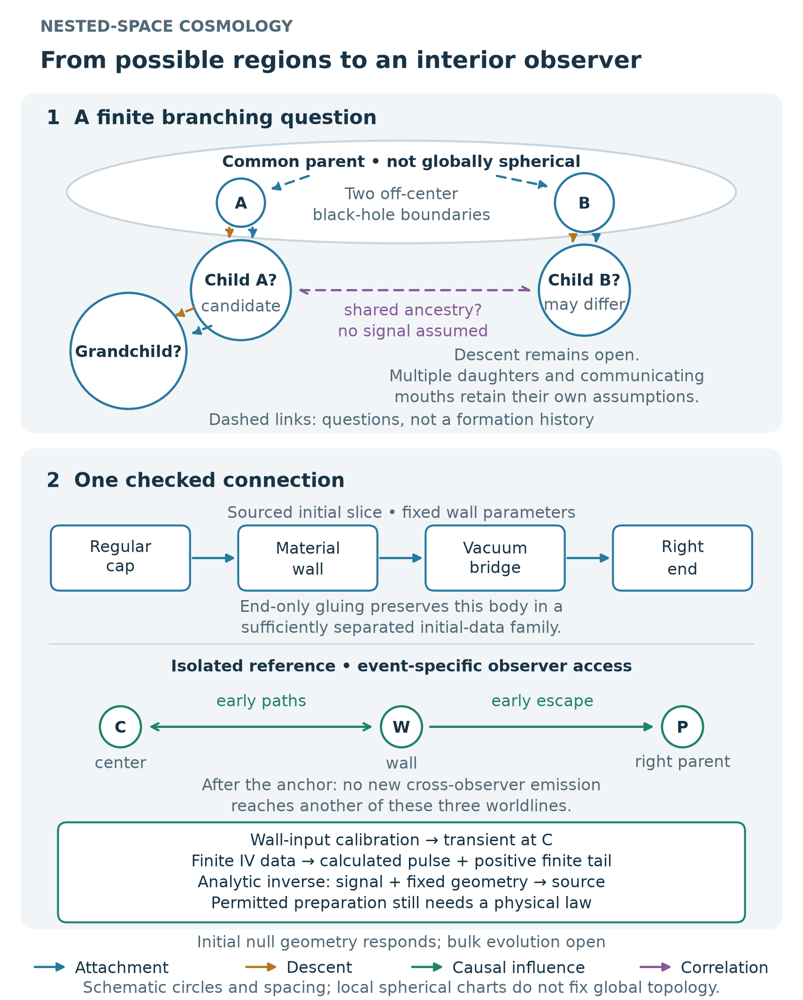

*Figure 1. Possible descent (upper panel) and the calculated
cap--wall--bridge connection with its observer/field reference (lower panel).
Colors distinguish attachment, descent, influence and correlation. Circles
show the regional hypothesis; their spacing does not specify a global
embedding or scale. The [figure record](figures/geometry-overview.json)
identifies the evidence for each connection.*

### 2. Why begin with the sphere? Energy, relaxation and inheritance

The sphere is the starting geometry because isotropic surface energy has
an exact minimizer. In Euclidean three-space, area $A$ and enclosed volume $V$
obey the established isoperimetric inequality

$$
A^3\geq36\pi V^2.
$$

Equality selects a ball, up to its position and size. For constant positive
surface tension $\gamma$, the energy $E_{\rm surface}=\gamma A$ is minimized
by a sphere at fixed $V$. The isotropic case and its anisotropic Wulff
generalization are stated in [Neumayer, Section 1.1](https://arxiv.org/html/1503.06705v2).
This is the precise energetic basis for the spherical organizing idea.

A simple relaxation model also displays the direction of change. Let $h$ be
the sum of the outward principal curvatures, $\bar h$ its surface average,
and choose normal velocity $v_n=-\mathcal{M}\gamma(h-\bar h)$,
with positive mobility $\mathcal{M}$.
The first variations of volume and area give

$$
\frac{dV}{dt}=0,\qquad
\frac{dE_{\rm surface}}{dt}
=-\mathcal{M}\gamma^2\int_{\partial V}(h-\overline{h})^2\,dA\leq0.
$$

Indeed, the integral of $h-\bar h$ vanishes, and subtracting $\bar h$ in the
area variation leaves the displayed square. This specifies an admissible
dissipative law and its energy budget. Volume-preserving mean-curvature
flow has its own developed theory, beginning with
[Huisken's 1987 treatment](https://doi.org/10.1515/crll.1987.382.35).
This illustrative surface law is not substituted for the relativistic
membrane equations used later in the atlas.

Simplicity here has a mathematical meaning: no angular direction is
preferred by the surface energy. Finer resolution of a smooth sphere does
not add a new sustaining force. Direction-dependent tension, rotation,
gravity and driving contribute additional terms to the energy and dynamics.
They determine whether a sphere persists, deforms or is replaced by another
configuration. Entropy production alone fixes neither a universal geometry
nor a maximum rate of dispersal.

<!-- nsc-claim:atlas-spherical-inheritance-hypothesis -->

**NSC's geometric hypothesis.** Persistent approximately spherical regions
form the envelopes of a physical hierarchy. Across admissible parent--child
transitions, a shared law is inherited while scale, state and resolved
structure change. Repeated spherical inheritance is the proposed
architecture to develop and test throughout this book.

The energy theorem supplies one reason for that architecture. Its
application to every universe or an unlimited spacetime hierarchy would
add a universality claim requiring a physical transition and composition
law. The finite and infinite operator results below establish their stated
forms of inheritance; the sourced geometries establish finite physical
connections. The [atlas owner](../docs/nsc-cosmological-atlas.md) records how
those constructions develop the hypothesis.

A spherical boundary is a two-dimensional surface with area $4\pi R^2$.
A spatial interior may be a three-ball; a closed spatial universe may
have three-sphere topology. The local spherical spacetime form is

$$
ds^2=g_{ab}(x)\,dx^a dx^b+R(x)^2d\Omega^2.
$$

Here $g_{ab}$ is the Lorentzian metric on the two-dimensional orbit space and
$R$ is areal radius. The atlas uses signature $(-+++)$. Proper radial distance,
areal radius and an embedding diagram are different data. Several compact
regions in one parent generally require a nonspherical parent even when
each local interface has a spherical approximation. The next constructions
specify which geometry is used at each level.

### 3. The same argument across operator, spacetime and observer descriptions

The inherited relation, the physical geometry and the interior response
are three stages of one programme. The first supplies a precise law to
transport. The second supplies the regions, sources and states on which
that law acts. The third calculates how an observer distinguishes the
resulting histories.

| Stage | Mathematical owner | Role in the book |
| --- | --- | --- |
| Inherited law and spectral relations | [Preserved foundation](archive/foundation-v0.26.0/paper/nested-space-cosmology.md) | Operator identities, boundary maps and source constructions |
| Regional transfer and geometric feedback | [Finite spherical companion](finite-regeneration/main.tex) | A specified action/state example of transfer and memory |
| Sourced spacetime and observation | [Atlas evidence](../docs/nsc-cosmological-atlas.md) and this manuscript | Compatible attachments, physical inheritance, evolution and observer relations |

The book connects these stages where an actual field equation, state,
clock and matching condition identify their mathematical objects.
Elimination of unresolved modes is used both in the inheritance calculator
and in physical boundary problems; its physical interpretation follows
from the operator and state supplied in each case.

Earlier constructions retain their source-bound editions and attribution.
The present synthesis begins with geometry and works outward to what an
interior observer can measure. The source of expansion, the supply of
localized structure and the meaning of a quantum mode are all pursued
through that same sequence.

### 4. Four arrows that must not be confused

Each region in the atlas carries a geometry, source or state, clock
convention, dimensionless parameters and validity domain. Each connection
states the borrowed mathematics and the additional condition still needed.

| Connection | Mathematical question | What it does not establish by itself |
| --- | --- | --- |
| Descent | Where do a child's initial data originate? | A traversable path |
| Geometric attachment | Which boundaries share admissible metric and source data? | Formation or stability |
| Causal influence | Can an intervention reach an observer within the stated domain? | A nonzero field response without state and coupling |
| Correlation | Which information is shared through state or ancestry? | Communication between siblings |

Two regions may inherit correlated data without ever exchanging a later
signal. An attached interior can lie beyond the causal reach of a specified
parent observer. Conversely, communicating mouths require their own causal
and material assumptions; they cannot be inserted into a disconnected
offspring model as an unlabeled extra arrow.

The multiple-daughter geometry of [Barrabès and Frolov
(hep-th/9511136v1)](https://arxiv.org/html/hep-th/9511136v1), the charged
semiclassical multi-mouth route of [Emparan et al.
(2012.07821v2)](https://arxiv.org/html/2012.07821v2), and quantum-state
coupling distributions discussed by [Giddings and Turiaci
(2004.02900v2)](https://arxiv.org/html/2004.02900v2) remain separate library
entries. A state's coupling distribution is not itself a signal exchanged
between its branches. Their source cards and unresolved connections are
recorded in the [mathematical library](../docs/arxiv-studies.md).

### 5. A precise finite inheritance construction

<!-- nsc-claim:finite-normalized-inheritance -->

Derivation and calculation: [exact finite record](../results/development/nsc-nested-qualities-v1.json),
[frozen snapshot](nested-quality-evidence/snapshot.json), and
[proof and domain](../docs/nsc-nested-qualities.md).

The foundation proposes an inherited normalized law,
$\mathcal T_\Theta^*\mathbb D_\Theta=\mathbb D_\Theta$.
One controlled meaning is available without postulating an infinite cosmos.
Fix a Hermitian $d$-dimensional matrix $H$, a nonzero link $B$, a
positive scale ratio $\Omega$, and a finite depth $N$. For regional labels
$j=0,\ldots,N-1$, define a block Hermitian matrix by the following entries
where their indices exist:

$$
(J_{m,N})_{jj}=\Omega^{m+j}H,\qquad
(J_{m,N})_{j,j+1}=\Omega^{m+j}B.
$$

The lower off-diagonal blocks are the adjoints. Let $U_m$ consistently
relabel the equal-sized regional frames. Then

$$
J_{m+1,N}=\Omega U_mJ_{m,N}U_m^\dagger,
$$

$$
\Omega^{-1}U_m^\dagger J_{m+1,N}U_m=J_{m,N}.
$$

Each block acquires the same extra factor, so the identity follows directly.
For fixed depth,

$$
\mathrm{spec}(\Omega^{-m}J_{m,N})=\mathrm{spec}(J_{0,N}).
$$

This is a finite realization of normalized inheritance under chosen scaling
data. It does not derive $\Omega$, establish a physical transition through
a horizon, or show that the universe selects this law. Changing $N$
changes the boundary problem and can change the dressed spectrum.
The finite identity is not a proof of cosmic natural selection.

The shared law also does not fix identical states. A fermionic covariance
$0\leq C\leq I$ evolves as

$$
C(t)=e^{-iJt}C(0)e^{iJt}.
$$

Regional occupations and cross correlations can differ under the same $J$.
Thus “same laws,” “same state,” and “same observed constants” require separate
arguments. A physical transition would have to determine the relevant state
and dimensionless data, rather than obtaining them from the normalization
identity alone.

Douglas's proposed geometric interpretation is that an approximately spherical
region can be the resolved envelope of finer nested structure. Repeated
transitions preserve the inherited law while changes of depth, state and
surroundings compound in the measured response. The next section's nested
reduction provides a finite calculator for that compounding. The following
theorem extends this to an infinite operator and a derived mode-count
scaling relation. Its spacetime geometry, physical scale ratios and
observer resolution remain calculation targets in the
[atlas programme](../docs/nsc-cosmological-atlas.md#working-geometric-hypothesis-inheritance-through-resolution).

### 5.1. An infinite inherited law with a controlled local response

Take a rooted tree with $b\geq2$ children per vertex, an inherited
positive Hermitian $d\times d$ matrix $H$, link $B$, and $\Omega>1$.
At depth $n$, the diagonal block is $\Omega^nH$ and the block to each
child is $\Omega^nB$; reverse links are adjoints. Set

$$
h=\lambda_{\min}(H),\qquad c=\sqrt{b/\Omega}\,\|B\|,\qquad h>2c.
$$

On square-summable regional fields specify the finite-energy form domain

$$
\mathcal Q=\left\{u:\sum_v\Omega^{|v|}\|u_v\|^2<\infty\right\}.
$$

**Theorem.** The corresponding positive closed form defines a self-adjoint
finite-energy realization $D$ with compact inverse. Every isolated child
subtree is $\Omega D$ after relabeling, so normalized inheritance holds
at unlimited depth. Its root response, for $\lambda\geq0$, satisfies

$$
R(\lambda)=\left[H+\lambda I-
\frac{b}{\Omega} B R(\lambda/\Omega)B^\dagger\right]^{-1}.
$$

For $\gamma=(h+\sqrt{h^2-4c^2})/2$ and $r=c^2/\gamma^2<1$, this response
is unique in the positive class
$R(\lambda)\leq(\gamma+\lambda)^{-1}I$. Retaining depths $0,\ldots,N$ gives

$$
0\leq R_N(\lambda)\leq R(\lambda),\qquad
\|R(\lambda)-R_N(\lambda)\|\leq r^{N+1}/\gamma.
$$

If $B$ is invertible, every added generation increases the response
strictly. The eigenvalue-counting exponent is

$$
\lim_{E\to\infty}\frac{\log N_D(E)}{\log E}
=\frac{\log b}{\log\Omega}.
$$

**Proof.** Let $S$ multiply depth-$n$ coordinates by $\Omega^{n/2}$, and
let $C$ have diagonal $H$ and child blocks $\Omega^{-1/2}B$.
Cauchy--Schwarz bounds the child-sum map by $c$, hence
$(h-2c)I\leq C\leq(\|H\|+2c)I$. The form
$q[u]=\langle Su,CSu\rangle$ is closed on $\mathcal Q$, with a norm
equivalent to the complete graph norm of $S$. Its operator has

$$
D^{-1}=S^{-1}C^{-1}S^{-1},\qquad
\operatorname{Dom}(D)=\{u\in\mathcal Q:CSu\in\mathcal Q\}.
$$

The diagonal entries of $S^{-1}$ tend to zero, with finite multiplicity
at each depth, so the inverse is compact. This selects the finite-energy
Friedrichs realization; essential self-adjointness under other possible
conditions at infinity is not assumed.

Relabeling a child multiplies every block and its closed form by
$\Omega$. Its root inverse is therefore
$\Omega^{-1}R(\lambda/\Omega)$. Eliminating the $b$ children yields the
recursion, including all descendant responses. Finite-support fields
are a form core. The variational expression for
$\langle f,(D+\lambda I)^{-1}f\rangle$ is the supremum of
$2\operatorname{Re}\langle f,u\rangle-q[u]-\lambda\|u\|^2$ over that
domain. Successive finite-depth restrictions increase to this supremum,
proving Loewner and norm convergence of the root matrices.

Since $h-c^2/\gamma=\gamma$, every Schur denominator is bounded below
by $(\gamma+\lambda)I$. The inverse identity bounds the outgoing
difference of two responses by $c^2/(\gamma+\lambda)^2$ times their
incoming difference. Its uniform factor $r<1$ proves uniqueness in
the stated class. Iterating $N+1$ times from a zero terminal response
gives the depth error. Inverse order and positive congruence give
monotonicity, strictly when $B$ is invertible.

Finally, the form bounds compare $D$ with positive constant multiples of
$S^2$. The eigenvalue $\Omega^n$ of $S^2$ has multiplicity $db^n$.
Min--max bounds $N_D(E)$ between geometric sums at constant multiples
of $E$, proving the exponent. This completes the proof. The
[full domain argument and calculator](../docs/nsc-infinite-inheritance.md)
give its detailed implementation.

For a second-order spectral interpretation,
$d_s=2\log b/\log\Omega$; a first-order interpretation instead uses the
counting exponent itself. These are spectral dimensions of this operator.
A spacetime or embedding dimension requires its own geometric construction.

For $H=3$, $B=1$, $b=3$, $\Omega=4$, the exact static response is

$$
R(0)=\frac{2}{3+\sqrt{6}},\qquad
D_{\mathrm{eff}}(0)=\frac{3+\sqrt{6}}{2}=2.724744871391589.
$$

Thus the inherited coefficient3 changes by $-0.275255128608411$.
Depths0 through6 give $R_6(0)=0.367006802721088$, with analytic depth
bound $3.94041\times10^{-8}$; the closed-form difference is
$3.54235\times10^{-8}$. Rounding is separate from this bound. The
second-order spectral dimension is $\log3/\log2=1.584962500721156$.
Four small controls compare full finite trees, noncommuting links,
branch/scale factors, the exact scalar root and spectral bounds.
They support the calculator; the infinite result follows from the proof.
A metric-dependent action and physical source identification remain
needed to connect this response to cosmological Lambda.

### 5.2. Physical measure, pressure and a measurable nesting ratio

An inherited canonical operator does not alone specify the physical measure.
For an explicit three-dimensional lift, give each depth-$n$ edge length
$Lq^n$ and section $Aq^{2n}$, with $0<q<1$. Half of each incident edge's
volume supplies the vertex kinetic weight; the root has a fixed parent
port. Direct expansion gives

$$
m_0=\frac{AL}{2}(q^{-3}+b),\quad
H=\frac{A(b+q^{-1})}{Lm_0},\quad
B=-\frac{A}{Lm_0q^{3/2}},\quad\Omega=q^{-2}.
$$

The positive margin is $A(\sqrt{b}-q^{-1/2})^2/(Lm_0)$, so Section 5.1
applies for $bq\ne1$. Its physical static root compliance is

$$
\chi_0=\frac{R(0)}{m_0}=\frac{L}{A\max(b,q^{-1})}.
$$

Under a common spatial dilation, $L\mapsto aL$ and $A\mapsto a^2A$.
Thus $M(a)=a^3M_0$, $K(a)=aK_0$, $D(a)=a^{-2}D_0$, and
$\chi(a)=\chi_0/a$. The length-only action instead has $\chi(a)=a\chi_0$;
the same operator scaling can conceal different physical measures. The
owned radial spatial metric $h=r^2(Q^2dx^2+d\Omega^2)$ supplies the volume
scaling directly: $\int r^3Q\phi_i\phi_jdx$ scales as $a^3$ and
$\int(r/Q)\phi'_i\phi'_jdx$ as $a$ at fixed $Q$.

**Pressure proposition.** Declare the kinetic-plus-gradient action

$$
S_\phi=\frac12\int dt\left[
\frac{a^3}{N}\dot\phi^TM_0\dot\phi-Na\phi^TK_0\phi\right].
$$

Let $T_0=\pi^TM_0^{-1}\pi/2$, $G_0=\phi^TK_0\phi/2$ and
$V=a^3V_c$. Its energy at fixed canonical data is
$E=a^{-3}T_0+aG_0$. Lapse and scale variation, or direct Legendre
transformation followed by $p=-\partial E/\partial V$, gives

$$
\rho=\frac{E_{\rm kin}+E_{\rm grad}}{V},\qquad
p=\frac{E_{\rm kin}-E_{\rm grad}/3}{V}.
$$

Both energies are nonnegative. For every nonzero finite-energy state,

$$
\rho+p>0,\qquad \rho+3p=4E_{\rm kin}/V\geq0.
$$

The form domain is preserved by multiplication by these positive scale
factors, so the proof also holds for the infinite hierarchy. Source-free
Hamiltonian evolution gives $\dot\rho+3H(\rho+p)=0$ in homogeneous proper
time. This sector cannot be a nonzero vacuum source. If it alone sources
a flat Einstein cosmology without a supplied volume term, it predicts
$q_{\rm dec}=2E_{\rm kin}/(E_{\rm kin}+E_{\rm grad})\in[0,2]$.
The full atlas's gravitational correlations and nonminimal terms require
their own metric variation; this proposition does not replace them.

**Dynamic root observable.** With zero initial data and a known compact
root force, measure the root field in proper time. Its Laplace response is
$\chi(s)=R(s^2)/m_0$. Differentiating the exact Schur equation at zero gives

$$
Z(s)=\chi(s)^{-1}=\chi_0^{-1}+\mu_*s^2+O(s^4),\qquad
\mu_*=\frac{m_0}{1-r/\Omega}.
$$

Independently, summing the entire static profile's kinetic weight gives
$\mu_*=m_0/(1-q/b)$ for $bq>1$ and $m_0/(1-bq^3)$ for $bq<1$.
Consequently the response scale $\tau_*^2=\chi_0\mu_*$ obeys

$$
\frac{\tau_*^2}{L^2}=\frac{q^{-3}+b}{2(b-q)}\quad(bq>1),
$$

$$
\frac{\tau_*^2}{L^2}=\frac{q^{-2}+bq}{2(1-bq^3)}\quad(bq<1).
$$

For $b=3$, $q=1/2$ and $q=2/5$ give the same static compliance
$L/(3A)$ but different dimensionless dynamic values: $2.2$ and
$3.581730769230769$. The expression is strictly decreasing in $q$ on
the admitted branches, so an independently known $b,L$ and calibrated
force permit a unique nesting-ratio inference. An unknown source or length
would restore degeneracy. The scale $\tau_*$ is a response coefficient,
not a first-arrival time.

The [derivation and independent checks](../docs/nsc-infinite-inheritance.md#a-calibrated-observable-that-distinguishes-the-nested-geometries)
include the profile sum, differentiated Schur recursion, an explicit
$O(s^4)$ Laplace remainder bound and root-work accounting. These are
predictions of the stated geometric action, with no observational
calibration. A compatible cap--wall/parent metric and its gravitational
source remain necessary for a cosmological Lambda prediction.

### 5.3. A response shape that recovers the nesting ratio

<!-- nsc-claim:scale-free-inherited-response -->

For the scalar volume action above, let mu_k denote the kth root spectral
moment and set g=b*abs(B)^2. Direct multiplication on two inherited levels
gives

$$
\mu_1=H,\quad \mu_2=H^2+g,\quad
\mu_3=H^3+gH(2+\Omega).
$$

All moments exist because every finite power of D applied to the root
has finite support. The positive root spectral measure yields

$$
R(\lambda)=\lambda^{-1}-\mu_1\lambda^{-2}
+\mu_2\lambda^{-3}-\mu_3\lambda^{-4}+\epsilon(\lambda),
\qquad 0\leq\epsilon(\lambda)\leq\mu_4\lambda^{-5},
$$
$$
\mu_4=(H^2+g)^2+gH^2(1+\Omega)^2+\Omega^2g^2.
$$

For the wave response, lambda=s^2. Write an unknown constant gain and
uniform clock factor into its measured coefficients beta2, beta4, beta6,
beta8 multiplying s^-2, s^-4, s^-6, s^-8. Then

$$
\Theta=\frac{\beta_2\beta_6}{\beta_4^2},\qquad
\Psi=\frac{\beta_2^2\beta_8}{\beta_4^3},\qquad
\Omega=\frac{\Psi-1}{\Theta-1}-2,\qquad q=\Omega^{-1/2}.
$$

Gain, root kinetic normalization and uniform clock calibration cancel.
At b=3, q=1/2 gives (Theta,Psi)=(49/25,169/25); q=2/5 gives
(617/242,13343/968). The recovered ratios are exactly 1/2 and 2/5, despite
the equal static compliance. At fixed b, Theta alone is strictly
monotone in q; the pair determines q even without a known b.

There is also a held-out consequence. The fifth coefficient beta10 must
obey the parameter-free relation

$$
\Upsilon=\frac{\beta_2^3\beta_{10}}{\beta_4^4}
=\Theta^2+(\Theta-1)(1+\Omega)^2+\Omega^2(\Theta-1)^2.
$$

A positive tree with altered child--grandchild links can retain the first
four response coefficients and violate this fifth one. The relation thus
tests continuation of the inherited law at the next level, using a
quantity not used in the inversion.

This is a conditional inverse of the specified transfer function. An
arbitrary unknown force spectrum does not cancel. Finite noisy data need
their own coefficient errors. The [complete proof and controls](../docs/nsc-infinite-inheritance.md#a-scale-free-inverse-of-the-inherited-geometry)
keep these requirements explicit. This connects the inherited operator
to an observable relationship, with its physical atlas identification
still to be established. The [compact calculation and source hashes](../results/summaries/nsc-compositional-proofs-v1.json)
retain these exact model examples alongside the separately scoped atlas
composition below.

### 6. What an unresolved surrounding region can leave locally

Split a specified operator into retained and complementary blocks $A,D$
with link $B$. For an admissible complex spectral parameter $z$, elimination
gives the usual self-energy

$$
\Sigma(z)=B(zI-D)^{-1}B^\dagger.
$$

The retained resolvent is $[zI-A-\Sigma(z)]^{-1}$.
Nested elimination is associative when the required inverses exist.
For the finite inherited chain its normalized recurrence is

$$
\Gamma_j(x)=xI-H-\Omega^{-1}B
\Gamma_{j+1}(x/\Omega)^{-1}B^\dagger.
$$

The factor $1/\Omega$ is essential. This is borrowed finite linear
algebra applied to the declared family, not an additional force law.
To interpret $\Sigma$ as a cosmological exterior response requires a
physical operator, field state and boundary map. Sections A.24–A.25 give a separate
finite Hilbert-space realization of this reduction, without identifying its
complementary modes with a cosmological exterior.

### 6.1. The local effective Lambda target

<!-- nsc-claim:target-local-effective-lambda -->

The intended cosmological target is a local effective $\Lambda$ arising
from inherited Schur memory: surrounding structure that a region does not
resolve contributes through $\Sigma(z)=B(zI-D)^{-1}B^\dagger$ to its
local response. A vacuum-form local gravitational part would be written
$T^{\mathrm{eff}}_{\mu\nu}=-(\Lambda_{\mathrm{eff}}/\kappa_4)g_{\mu\nu}$,
with $\kappa_4=8\pi G$. Identifying the physical exterior operator, its
state and boundary map, and obtaining that local part from the causal
response remain the missing connections. The finite Schur identity fixes
the reduction; it does not yet provide a measured cosmological value.
The [Schur-memory owner](../docs/schur-memory.md) keeps this target and
its retained spectral and geometric dictionary.

## II. Physical regions, interfaces and causal access

A nested drawing becomes a spacetime through its sources and junctions. The constructions in this part assemble regular centres, material interfaces, shared parents and named observers. They show both successful attachments and precise exclusions. Causal access is established before a boundary or remote region is used as a source for an observer.

### 7. Start with two holes, without manufacturing two children

The explicit parent benchmark uses time-symmetric Brill–Lindquist vacuum
initial data,

$$
h_{ij}=\psi^4\delta_{ij},\qquad K_{ij}=0,\qquad
\psi=1+\frac{m_A}{2r_A}+\frac{m_B}{2r_B}.
$$

The recorded choice is $m_A=1$, $m_B=1.5$, separation $d=12$.
It has outer ADM mass $2.5$ and two inner-end masses $1.0625$ and
$1.5625$. These are three asymptotically Euclidean ends of an initial
slice. Extra ends do not by themselves become cosmological children.
The companion hole supplies nonspherical structure, so an exact isolated
Schwarzschild collar cannot simply be assumed at either puncture.
The [parent record](../results/development/nsc-cosmological-atlas-v2/parent.json)
and [owning analysis](../docs/nsc-cosmological-atlas.md) retain the
construction and checks.

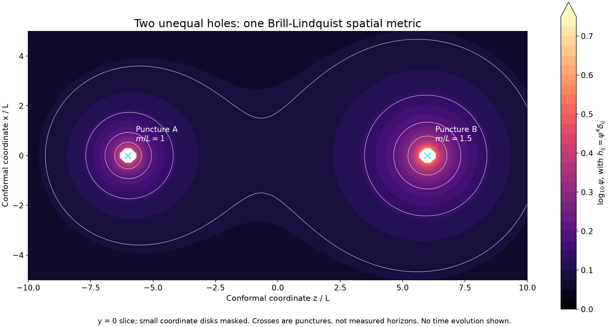

*Figure 2. The explicit two-hole initial-data benchmark. This is a
nonspherical common parent with unequal ends, not a solved evolution that
creates children. Local spherical models must earn an attachment to it or
belong to a separate parent family.*

The alternative parent route imports an existence result instead of
re-solving its gluing equations. [Chruściel, Corvino and Isenberg
(0909.1101v1)](https://arxiv.org/html/0909.1101v1) provide sufficiently
separated scalar-flat bodies with retained interior regions and a common
Schwarzschild outer end. Their more general
[vacuum-end theorem (1004.1355v1)](https://arxiv.org/html/1004.1355v1)
allows appropriate non-time-symmetric ends. These establish separate
families, not a modification that leaves the displayed Brill–Lindquist
data unchanged. No explicit sufficient separation is certified here.

### 8. A failed attachment can sharpen the map

<!-- nsc-claim:atlas-junction-screen -->

Derivation and calculation: [radiation junction](../results/development/nsc-cosmological-atlas-v2/junction.json),
[moving-boundary conservation/control](../results/development/nsc-cosmological-atlas-v3/moving-boundary.json),
and [source assumptions](../docs/nsc-atlas-moving-boundaries.md).

The first attachment screen pairs a closed radiation FLRW region with a
vacuum exterior and a pure constant-tension wall. For a comoving boundary,
$a=A\sin\eta$, $t=A(1-\cos\eta)$, and $R=a\sin\chi$.
The junction condition would require, over an interval of changing $R$,

$$
k^2R^4-2\cos\chi\,kR^3+2MR-A^2\sin^4\chi=0.
$$

For nonzero $A\sin\chi$, this cannot be a polynomial identity on that
interval. The recorded $\chi=\pi/3$, $M=0.4A$ test exposes a source
incompatibility, not a failure of all interiors.

Could a moving wall repair the same model? Intrinsic conservation answers
before a new simulation is needed. Fixed pure tension has zero intrinsic
stress divergence, so the Codazzi relation requires zero net normal energy
flux. In the fluid rest frame,

$$
T(U,n)=(\rho+p)\gamma^2v.
$$

A vacuum exterior contributes no flux and radiation has $\rho+p>0$;
therefore $v=0$. Motion alone cannot rescue these assumptions.
This is a compatibility application of an established conservation law.
Allowing a different surface source, exterior state or flux would define
a different candidate requiring its own test.

### 9. A distinct fixed-source wall that does connect

For the next branch, take de Sitter inside and Schwarzschild outside,

$$
f_-=1-H^2R^2,\qquad f_+=1-\frac{2M}{R}.
$$

In $G=c=1$ units let $\kappa=4\pi\sigma>0$, with surface pressure
$P=-\sigma$. The signed angular extrinsic curvatures obey

$$
\beta_--\beta_+=\kappa R,\qquad
\beta_\pm=\epsilon_\pm\sqrt{\dot R^2+f_\pm}.
$$

Here the dot is wall proper time and $\epsilon_\pm$ fixes the normal
orientation. Squaring and then forgetting those signs would lose physical
branches. The useful explicit expressions are

$$
\beta_-=\frac{M}{\kappa R^2}+\frac{\kappa^2-H^2}{2\kappa}R,
$$

$$
\beta_+=\frac{M}{\kappa R^2}-\frac{\kappa^2+H^2}{2\kappa}R,\qquad
\dot R^2=\beta_-^2-f_-.
$$

We hold $H\ell=1$, $\kappa\ell=2$, $M/\ell=0.4$ fixed.
On the tested expanding segment $1.2\leq R/\ell\leq1.8$,
$\beta_->0$ and $\beta_+<0$. The wall proper duration is
$0.3718706103\ell$. Direct unsquared and pressure checks, including a
separate Christoffel-based calculation, agree within the recorded numerical
residuals. The wall's areal-radius rate is not a local three-speed.
This published wall family is classified more fully in
Section 11; the source has not been retuned to make the segment work.

### 10. A sourced initial slice and a conditional common parent

<!-- nsc-claim:atlas-sourced-slice -->

Derivation and calculation: [slice constraints](../results/development/nsc-cosmological-atlas-v4/connection-slice.json),
[parent assembly](../results/development/nsc-cosmological-atlas-v4/parent-assembly.json),
[slice derivation](../docs/nsc-atlas-connection-slice.md), and
[end-only gluing argument](../docs/nsc-atlas-connection-gluing.md).

At $R_w=1.5\ell$, the interior is a flat expanding de Sitter cap: a
regular spatial three-ball with $h=dl^2+R^2d\Omega^2$, $R'=1$
and $K^i{}_j=-H\delta^i{}_j$. We use
$K=-\mathcal L_T h/2$, where $T$ is the future unit slice normal.
Define $V=T(R)$. The cap has $V_-=HR$.
Its slice determines the wall boost,

$$
\gamma=\frac{\beta_--HR\dot R}{1-H^2R^2},\qquad
\gamma v=\frac{\dot R-HR\beta_-}{1-H^2R^2}.
$$

The exterior inherits

$$
R'_+=\gamma\beta_+-\gamma v\dot R,\qquad
V_+=\gamma\dot R-\gamma v\beta_+.
$$

At this event $\gamma=1.00926203$, $v=0.13516599$,
$R'_+=-2.02778609$, and $V_+=1.90925372$.
The exterior slice is therefore not time symmetric at the material wall.

A fixed smooth slicing function tapers $V(R)$ to zero at $R_0=\ell$,
before the Schwarzschild throat $2M=0.8\ell$. In the transition,

$$
R'=-\sqrt{f_++V^2},\qquad
K^\theta{}_\theta=-\frac{V}{R},\qquad K^l{}_l=-\frac{dV}{dR}.
$$

These data describe a slice of the same vacuum Schwarzschild spacetime.
They do not interpolate the matter source. Its mass identity is

$$
M=\frac{R}{2}(1+V^2-R'^2).
$$

Where $V=K=0$, the slice continues smoothly through a bridge using
$R=2M\cosh^2u$, with the cap on the negative-$u$ side and the
selected parent end on the positive-$u$ side.

The distributional shell constraints are equally necessary. The surface
energy and radial momentum on this slice are
$E_\Sigma=\sigma\gamma$, $J_\Sigma=\sigma\gamma v$, giving

$$
[R']=-4\pi R E_\Sigma,\qquad [V]=4\pi R J_\Sigma.
$$

Their recorded residuals are below $2\times10^{-15}$ in normalized
units; independent finite-difference bulk residuals are below
$10^{-10}$. These are implementation checks, not a global stability
estimate.

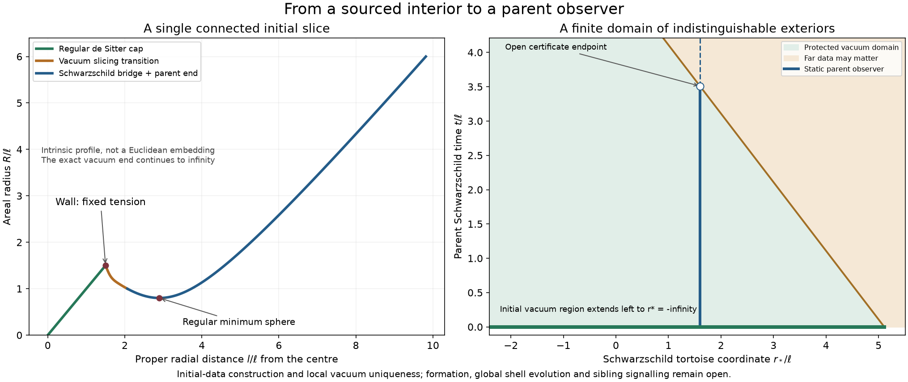

*Figure 3. The verified initial connection. Spatial distances are not ages.
Because $|R'|>1$ on part of the chosen slice, the radius profile should
not be interpreted as a Euclidean surface of revolution. The protected
right-exterior observer interval is a separate causal-domain statement.*

The selected right end of this body $A$, of mass $0.4\ell$, can be
used with the selected right end of an ordinary complete Schwarzschild
bridge $B$, of mass $0.6\ell$, in the imported vacuum-end gluing
theorem. It acts on smooth vacuum ends and preserves an open overlap.
Reattaching unchanged interiors on identical full $(h,K)$ data leaves
the original shell delta source intact and creates no seam source.
We do not apply a smooth global-data corollary directly to a thin shell.

The historical v4 conditional initial-data family has one designated common
parent end **and the untouched other end of $B$**: two asymptotic ends
in total. That second end has not become a cosmological child.
Sufficiently large separation is required but no numerical threshold or
explicit multi-body development has been calculated. The achievement is a
compatible sourced initial connection, not a regular formation history,
a general Einstein–shell evolution theorem or a stable cosmological future.

### 10.1. Two unequal sourced children in the same theory

<!-- nsc-claim:atlas-unequal-sourced-inputs -->

The second body can now carry its own cap and wall. Keep $H\ell=1$,
$k\ell=2$, $\xi=1/6$, quiet field $\phi=0$ and $R_w/\ell=1.5$ for
both bodies. Use masses $M_A/\ell=.4$, $M_B/\ell=.6$, with vacuum
slicing tapers ending at $R_{0,A}/\ell=1$ and $R_{0,B}/\ell=1.3$.
Both stops lie outside their respective throats. The mass changes the
object state; the taper changes the slice, with the action held fixed.

For B the signed factors are $\beta_-=151/120$,
$\beta_+=-209/120$ and $dR/d\tau=\sqrt{40801}/120$.
Its wall stress projections, bulk and shell constraints, geometric mass
and regular bridge pass the same checks as A. Its local normal-frame speed
is $v=.161244881293$, while its areal rate exceeds unity.
Each sourced body has one regular centre and one exact AE end. The
[unequal-input record](../results/summaries/nsc-atlas-unequal-children-v1.json)
reuses A's completed moments and evaluates B once; 42 focused controls pass.

[Chrusciel, Corvino and Isenberg's end theorem](https://arxiv.org/html/1004.1355v1)
therefore accepts two sourced inputs at sufficiently large separation.
Their selected ends become one parent end, without B's former extra end.
An exact quiet local solution neighbourhood can also be patched from the
already known source solutions and an auxiliary smooth vacuum development,
retaining wider identical annuli and trimming staggered cuts inside their
common vacuum neighbourhood. The
[local argument](../docs/nsc-atlas-connection-gluing.md#two-sourced-inputs-and-a-quiet-local-spacetime)
uses smooth vacuum uniqueness only off the walls. It supplies no numerical
separation threshold, uniform evolution interval, evaluated connector or
general uniqueness theorem for matter shells. Their observer clocks and
the cosmological reduction still need that geometry.

### 10.2. A retained grandchild and an explicit second boundary

<!-- nsc-claim:atlas-nested-slice -->

A different input A2 now puts two transitions on one explicit spherical
initial slice. It keeps the same quiet conformal-scalar and membrane law.
The regional metric functions are $f=1-2M/R-H^2R^2$:

| Region, ordered outward | $M/\ell$ | $H\ell$ | Connection |
| --- | ---: | ---: | --- |
| Inner regular cap | 0 | 1 | Centre to inner wall $R/\ell=.8$ |
| Kottler host | .01 | 1 | Left static branch, black-hole throat, right branch and expanding patch to outer wall $R/\ell=1.5$ |
| Outer Schwarzschild region | .4 | 0 | Left branch, throat $R/\ell=.8$, right AE end |

Both positive-tension walls obey the same signed equations,

$$
\beta_-=\frac{f_--f_++(kR)^2}{2kR},\qquad
\beta_+=\beta_--kR,\qquad \dot R^2=\beta_-^2-f_-.
$$

The expanding inner and outer factors are respectively
$(517/640,-507/640)$ and $(727/600,-1073/600)$.
The derivative of the same law gives the temporal Israel jump, while
the mean worldtube curvature satisfies the normal-force condition.
The equal-vacuum inner membrane remains a material source. All supplied
vacuum values and masses are part of this state, not outputs selected by
a cosmological observation.

In each bulk the assigned slicing function gives

$$
R'=\varepsilon\sqrt{f+V^2},\quad
R''=M/R^2-H^2R+VV_R,\quad
K^l{}_l=-V_R,\quad K^\theta{}_\theta=-V/R.
$$

Smooth tapers connect the walls to static bridges and the host's expanding
flat radial profile. Signed $y$ with $R=r_b+y^2$ resolves each minimum.
The host's two horizons are $r_b/\ell=.020008009615388216$ and
$r_c/\ell=.989845863754293$. The expanding profile crosses the latter
with $R'=1$. Both Hamiltonian/momentum constraints and both wall
distributions are retained. The slice ends analytically at its right AE
infinity; $R_{\mathrm{cut}}/\ell=4$ is the finite calculation domain.

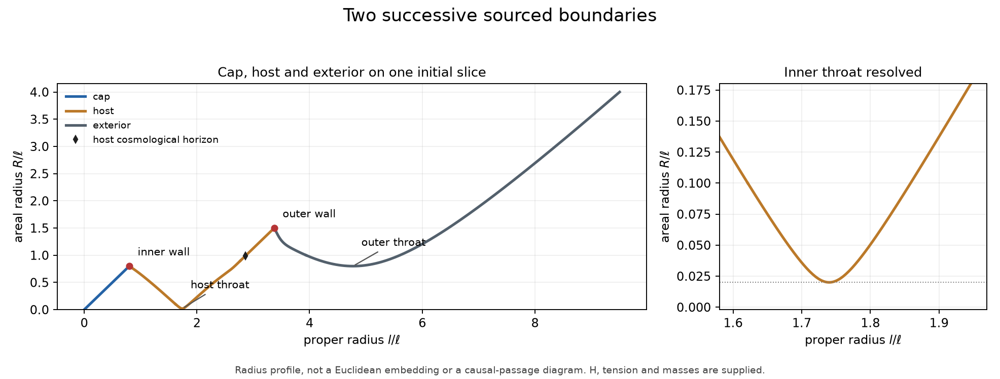

*Figure 4. One initial radial chain with two sourced boundaries. The inset
resolves the host's positive-radius minimum. Proper radius versus areal
radius is not a Euclidean embedding or a causal-passage diagram. The same
membrane law holds at both walls; regional state and slicing data are supplied.*

Explicit regular bulk charts are available. At a simple horizon $C$, let
$\kappa_C=(1-3H^2C^2)/(2C)$ and $R=C+\kappa_Cuw$. Then

$$
ds^2=Fdu^2+2du\,dw+R^2d\Omega^2,\qquad
F=\frac{w^2}{R}\left(\frac{1}{C}+H^2(R-C)\right).
$$

This is the algebraic form of
[Lake's coordinates, equations (5)--(10)](https://arxiv.org/html/gr-qc/0507031v2).
Independent warped-curvature algebra gives $R_{\mu\nu}=3H^2g_{\mu\nu}$;
the radial determinant is $-1$. Finite local charts do not identify
different cosmological regions or remove the $R=0$ singularity.
The single Killing time has $T_l=V/f$ and future normal
$N^T=R'/f$, negative on the left static branch. Section 10.5 now matches
both finite worldtube segments to this same initial slice using regular
overlapping coordinates; a static time alone does not cover the host.

The [two-level calculation](../results/summaries/nsc-atlas-nested-slice-v1.json)
and [slice derivation](../docs/nsc-atlas-connection-slice.md#two-successive-sourced-boundaries)
retain all assumptions and one Gauss 32/64 comparison. Twenty independent
controls pass. Its exact vacuum end can replace A in the end construction,
giving a conditional initial-data family with two unequal sourced children
and a retained grandchild. This establishes finite initial-data composition,
not unlimited generations, formation, stability or inherited detector states.

### 10.3. A central proper-clock and frequency observation

<!-- nsc-claim:atlas-nested-flash -->

Specify a radial inward geometric-optics flash from an ideal frequency
standard comoving with the inner material wall, with negligible backreaction.
The receiver follows the cap centre. Set flat-cap time $t=0$ at emission;
it is the centre's proper time. For $R_w=.8\ell$ and $H\ell=1$, the
null path and wall boost give

$$
t_{\mathrm{rec}}=-H^{-1}\log(1-HR_w)=\ell\log 5,
$$
$$
1+z=\frac{\gamma(1+v)}{1-HR_w}
=\frac{\beta_-+\dot R}{(1+HR_w)(1-HR_w)}
=3.7463933761061194.
$$

Here $\gamma(1+v)$ is the material wall's Doppler factor. Its initial speed
$v=-.280886551267$ is inward relative to the cap frame while its areal radius increases.
The host affects these factors through the junction. The flash stays
inside the wall: its inward radial speed is null, the wall is timelike,
and the expanding wall root persists to every finite cap time.

For the supplied ruler $\ell=10\,\mathrm{km}$, central receipt takes
$53.6850701$ microseconds after the specified emission-time origin.
The [recorded protocol](../results/summaries/nsc-atlas-nested-slice-v1.json)
agrees with independent 80-digit rational evaluation to
$1.45\times10^{-15}$ in the frequency ratio and
$1.30\times10^{-16}$ in $t_{\mathrm{rec}}/\ell$.
These measure roundoff, not input, model or experimental uncertainty.
The [causal derivation](../docs/nsc-atlas-connection-slice.md#a-central-test-flash-protocol)
uses no new field evolution. The source frequency standard and vacuum
scale are explicit inputs. The result supplies a conditional measurable
relation, not an observation of this emitter or an outer-wall signal
through the host bridge.

### 10.4. Radar and a wall clock recover a physical junction

<!-- nsc-claim:atlas-radar-clock-inverse -->

The atlas has a geometry inverse using an ideal negligible transponder
and a calibrated proper clock on its quiet membrane. A central clock sends
a radial pulse at t_minus and receives its immediate return at t_plus.
The transponder is a test device; the scalar's transparent boundary law
is unchanged. Work inside the static cap, where f=1-H^2*R^2>0 and
the optical radius is r_star=artanh(HR)/H. In central proper time T,
the reflection event obeys t_minus=T-r_star and t_plus=T+r_star.

Let D be half the round-trip interval, Z=dt_plus/dtau the calibrated
wall-clock redshift, K=dt_plus/dt_minus the echo stretch, and
s=d(log Z)/dt_plus its local receiver-time drift. For beta=f*T_tau>0
and v=R_tau, normalization gives beta^2-v^2=f. Thus

$$
Z=\frac{\beta+v}{f}=\frac{1}{\beta-v},\qquad
K=\frac{\beta+v}{\beta-v},\qquad f=K/Z^2.
$$

The Doppler motion cancels. More generally, send and return times are
null coordinates for a radial patch with unique light paths. In their
radar coordinates T=(t_plus+t_minus)/2 and D=(t_plus-t_minus)/2,

$$
ds_2^2=C(T,D)(-dT^2+dD^2),\qquad
1=C\frac{dt_-}{d\tau}\frac{dt_+}{d\tau},\qquad C=K/Z^2.
$$

This measures the radial metric on the transponder worldline even in
a time-dependent geometry, without imposing a gravitational field
equation. Its angular-radius function and off-worldline metric remain
undetermined. The separate quiet-cap inverse may fail while this readout
remains valid; an explicit evolving-metric control checks that case.
For the declared regular vacuum-cap family, put x=sqrt(1-f) and u=artanh(x):

$$
H=\frac{u}{D},\qquad R=\frac{Dx}{u},\qquad
\beta=\frac{Zf+Z^{-1}}{2},\qquad v=\frac{Zf-Z^{-1}}{2}.
$$

The zero-curvature limits are H=0 and R=D. This reconstructs the supplied
cap curvature; it does not generate it. The signed constant-tension
junction has beta=a/R^2+cR, where a=M_host/k and
c=(k^2+H_host^2-H^2)/(2k). Differentiate the null clock and the same
wall dynamics to obtain

$$
\beta_R=Z(s-H^2R),\qquad
c=\frac{\beta_R+2\beta/R}{3},\qquad
a=\frac{R^2(\beta-R\beta_R)}{3}.
$$

For an independently specified host curvature, retain every positive
root of k^2-2ck+H_host^2-H^2=0 and set M_host=ka. An unknown host
curvature leaves a continuous ambiguity; a larger known host curvature
can leave two positive tensions with identical cap-side clock histories.
The ordinary Schwarzschild host and the equal-curvature inner host each
give a unique positive root for the states used here.

The original one-level reference at R/ell=.5 and the nested inner wall
at R/ell=.8 supply the following conditional readouts:

| Readout | One-level reference | Nested inner wall |
| --- | ---: | ---: |
| D/ell | .549306144334055 | 1.09861228866811 |
| Z | 2.62549201161791 | 3.74639337610612 |
| K | 5.16990622730208 | 5.05276679827145 |
| s*ell | -.433158428652097 | 1.06171003724629 |
| Z after .04 ell of receiver time | 2.58466102249367 | 3.90852634473171 |

The first local readout and its derivative recover H*ell=1 and k*ell=2
in both states, with M_host/ell=.4 and .01 respectively. These are
different established states under one membrane law; no common-parent
clock history is assumed. After inference, integrate dt_plus/dR using
only H,a,c to predict the later row without additional calibration.
An independent proper-time evolution agrees within 3.56e-15 in Z, and
an 80-digit quadrature checks the nested result. These are numerical
comparison indicators, not physical error bars.

A changed material law beta_new=beta+.5*(R-R0)^2/ell^2 has exactly the
same first local readout. Its later Z differs by .0002413953 and
.0001163056, while the corresponding short-interval surface density
stays positive. The finite prediction therefore tests continuation of
the constant membrane law. It cannot separate the two tension branches
when their full cap histories agree.

At ell=10km the later receiver interval is **1.33425638079 microseconds**.
For an explicitly assumed independent 100ppm bound on D,Z,K, monotonic
analytic input bounds give the nested Lambda_cap*ell^2 in
[2.99837630274001,3.00162434110127]. This is a synthetic instrument
bound, with float64 endpoint evaluation, not an astronomical measurement,
a total model uncertainty or a new effective cosmological constant.
An uncalibrated beacon or unknown reflection delay restores degeneracy.
The [full proof and domain](../docs/nsc-atlas-radar-clock.md)
and [compact calculation](../results/summaries/nsc-atlas-radar-inverse-v1.json)
bind the source bytes and independent controls. The next section supplies
a finite two-wall host history. A collective parent and the physical
origin of the cap scale remain separate work.

### 10.5. Both walls in one host history

<!-- nsc-claim:atlas-two-wall-history -->

Continue the two walls of Section 10.2 through $0\leq\tau_i/\ell\leq.04$,
retaining all three regional metrics, the common tension and the original
slicing functions. Each $\tau_i=0$ is its own intersection with that
initial slice. Equal elapsed wall proper times do not define simultaneous
events. The scalar stays zero; this continuation supplies the geometry
on which a subsequent field can propagate.

Fix the host bridge at $T=0$ and its tortoise coordinate by
$r_*(.5\ell)=0$. The original oriented slice then determines
$T_l=V/f$ and both wall origins. With $p=T+r_*$ and $q=T-r_*$,

$$
p_l=\frac{1}{R'-V},\qquad q_l=-\frac{1}{R'+V}.
$$

The second expression stays regular through the right cosmological
horizon. At the host black-hole root $r_b$, the Lake chart of Section 10.2
uses $q=-\log(|u|/\ell)/\kappa_b$ and
$R=r_b+\kappa_buw$, where $\kappa_b=f'(r_b)/2$.
Signed bridge coordinate $R=r_b+y^2$ gives leading terms $u=a y$ and
$w=y/(\kappa_ba)$ smoothly through the neck. Their signs identify the two
branches; independently resetting a wall's host clock would lose the
shared embedding.

Let $\beta_h=\beta_+$ at the inner wall and $\beta_h=\beta_-$ at the
outer wall. The signed junction motion and proper normalization give

$$
p_\tau=\frac{1}{\beta_h-\dot R},\qquad
q_\tau=\frac{1}{\beta_h+\dot R}.
$$

The incoming host characteristic has constant $p$ at the inner wall and
constant $q$ at the outer wall. Its intersection with the original slice
defines a source label $l_{\rm foot}$. The arrival maps obey

$$
\frac{d\tau_{\rm inner}}{dl_{\rm foot}}
=\frac{\beta_h-\dot R}{R'-V},\qquad
\frac{d\tau_{\rm outer}}{dl_{\rm foot}}
=-\frac{\beta_h+\dot R}{R'+V}.
$$

The numerator is evaluated at the receiving wall event and the denominator
at the initial foot. These maps convert the original spatial source
labels into arrival proper times. They do not assign emitter-clock
redshifts or ages to whole regions.

At the two distinct endpoint events $\tau_i=.04\ell$, the calculation gives:

| Quantity in $\ell$ units | Inner wall | Outer wall |
| --- | ---: | ---: |
| Wall areal radius | .822921192107 | 1.567950150020 |
| Initial incoming-foot areal radius | .780076707080 | 1.466056964357 |
| Original source-label interval | [.8, .829362369820] | [3.338689615754, 3.372632651397] |

At $\tau_i/\ell=(0,.02,.04)$ the arrival derivatives are
$(1.334617,1.362318,1.391007)$ for the inner wall and
$(-1.143723,-1.178627,-1.214567)$ for the outer wall.
These are three evaluated cuts, not extrema of the derivative.
The largest recorded 32/64 quadrature change is $1.31\times10^{-12}$,
in the arrival derivative. Independent second-order wall evolution agrees
in $T/\ell$ within $3.34\times10^{-16}$; separate null integration
agrees within $3.50\times10^{-15}$. The wall metric-normalization residual
is below $1.14\times10^{-13}$. These are numerical comparison indicators,
without a physical input-uncertainty estimate.

The future orientation has $du\leq0,dw\geq0$ for $F\geq0$.
Throughout these segments the inner wall has $u,w<0$ and the outer wall
has $u,w>0$; the wall-growth bounds preserve these signs over the full
proper-time intervals. Inner-to-outer propagation would require increasing $u$;
outer-to-inner propagation would require decreasing $w$. Neither causal
edge exists through this constructed host patch. This is a domain-specific
result, without an assertion about additional global extensions.

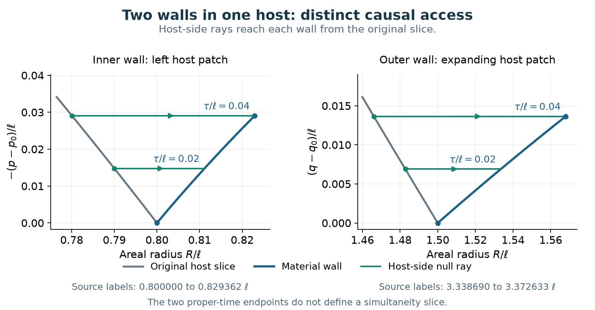

*Figure 5. Two host null-coordinate panels of the common embedding.
Horizontal constant-$p$ and constant-$q$ rays connect the original slice
(grey) to the inner and outer worldtubes (blue), respectively. Displayed
coordinate offsets position each panel; both host origins remain fixed
by one initial slice. The marked endpoints use separate wall proper
clocks and do not define a common time slice. The
[figure record](../docs/figures/nsc-atlas-two-wall-history.json)
binds these views to the finite calculation.*

The [shared-history derivation](../docs/nsc-atlas-connection-slice.md#a-shared-two-wall-history-and-its-characteristic-origins)
and [compact calculation](../results/summaries/nsc-atlas-two-wall-history-v1.json)
retain the common chart convention, signed normalization and finite
comparison indicators. The history locates the next field-transfer
problem. Section 10.6 supplies a transported averaging foliation and its
moving-wall crossings. Neither connection supplies a new field state,
formation mechanism or origin of the regional vacuum values.

### 10.6. The shared parent evolves into a calculable effective source

<!-- nsc-claim:atlas-parent-normal-evolution -->

Derivation and calculation: [normal-clock derivation](../docs/nsc-atlas-parent-evolution.md)
and [compact evolving-parent calculation](../results/summaries/nsc-atlas-parent-evolution-v1.json).

Choose freely falling observers initially normal to the original shared
slice. Their proper time defines one simultaneous leaf through both
walls and both bridge minima. Its outer boundary follows the original
$R=4\ell$ normal ray. This is a declared averaging clock on the same
quiet spacetime, with unchanged masses, regional curvatures and membrane
law. It provides the previously missing physical history for the
composition and source-balance equations in Section 17.12.

In a smooth regional chart write
$ds^2=-dt^2+A^2dx^2+R^2d\Omega^2$, with $x$ the initial proper-distance
label, $V=R_t$, $B=A_t$ and signed $E=R_x/A$. The complete bulk transport is

$$
R_t=V,\qquad V_t=-\frac{M}{R^2}+H_i^2R,\qquad
A_t=B,\qquad B_t=\left(\frac{2M}{R^3}+H_i^2\right)A.
$$

Initially $A=1$, $B=V_R$. The signed Killing energy $E$ is conserved
on each smooth geodesic segment and satisfies $V^2+f=E^2$. Differentiating
the radial equation proves $R_x=EA$, including the regular $E=0$
bridge limit. The clock therefore crosses horizons without dividing by
$f$ or treating a spatial minimum as a focal point. Intrinsic curvature,
expansion and shear follow independently:

$$
{}^{(3)}R=-\frac{4E_x}{AR}+\frac{2(1-E^2)}{R^2},\quad
\theta=\frac{B}{A}+\frac{2V}{R},\quad
\sigma^2=\frac13\left(\frac{B}{A}-\frac{V}{R}\right)^2.
$$

At a material wall put $U=\gamma N+b s$ and $b=\gamma v$.
The signed Israel law implies the outward spatial jumps
$[V]=kRb$ and $[E]=-kR\gamma$. A normal geodesic crosses in the
direction opposite $b$, so its future crossing data obey

$$
V_{\rm after}=V_{\rm before}-kR|b|,\qquad
A_{\rm after}=A_{\rm before},\qquad
B_{\rm after}=B_{\rm before}+\frac{kA}{|b|}.
$$

The last impulse follows from the radial Jacobi equation:
$R_{NsNs}^{\rm sing}=-k\delta(\eta)$ and $N(\eta)=-b$.
Omitting it would lose the physical membrane curvature. The inner
crossed normals come from the cap; the outer crossed normals come from
the exterior. Both enter the host. Their wall clocks satisfy
$dt/d\tau=\gamma$; they are not reset independently.

The new strip from crossings at time $s$ has proper-volume element

$$
dV(t;s)=4\pi R(t;s)^2A(t;s)\frac{|v(s)|}{A(s;s)}\,ds.
$$

It is added once, together with each wall's curvature, energy and spatial
stress atoms:
$C_W=2\kappa E_W$,
$E_W=4\pi R^2\sigma\gamma$, and
$S_W=4\pi R^2\sigma(\gamma-3/\gamma)$.
The analytic normal map has $A>0$ because $B(0)\geq0$, the smooth
Jacobi coefficient is nonnegative, and each impulse increases $B$.
For the smallest host throat, a first-exit estimate gives
$R\geq r_b-2Mt^2/r_b^2\geq .0150120120\ell>r_b/2$
through $0\leq t/\ell\leq.01$. The cap centre is exact and regular.
The wall rapidity bounds preserve both incoming branches on this interval.
The derivation records the piecewise charts at the transported initial
wall labels; no additional physical shell is introduced there.

Let $C_D$ denote the proper-volume average of intrinsic three-curvature.
Using $L_{\rm ref}=2/k=\ell$, the same scalar effective source gives:

| Normal time $t/\ell$ | $H_D\ell$ | $\Lambda_{g,\rm tr}\ell^2$ | $(3Q+C_D)\ell^2$ |
| ---: | ---: | ---: | ---: |
| 0 | .092609049 | -.0153506330754 | 2.11796240047 |
| .005 | .094009378 | -.0143471868939 | 2.13982145265 |
| .01 | .095427142 | -.0134681818918 | 2.16143093935 |

Here $\Lambda_{g,\rm tr}=(Q-C_D)/4$ is the geometric
trace after retaining the explicit regional and wall sources. Including
those sources gives a different total trace, $.455231112462/\ell^2$ at
the endpoint. Neither scalar alone specifies a vacuum stress tensor.
At the midpoint the actual moment histories give

$$
\Lambda_{g,\rm tr,t}\ell^3\simeq .18865034,\qquad
J\ell^3\simeq .0437522915.
$$

The independently differentiated history satisfies
$Q_t+C_D_t+2H_DA_D=2\kappa J$,
with $A_D=3Q+C_D$. Halving the time-difference
step reduces its residual from $7.22\times10^{-9}$ to
$1.80\times10^{-9}/\ell^3$. The largest 32/64 change in the trace is
$1.28\times10^{-10}/\ell^2$. These are numerical indicators, not
observational uncertainties or a certified error enclosure.

The same inner-wall events supply a received signal. For an inward
test flash with calibrated wall proper frequency,

$$
t_{\rm rec}=t_e-H^{-1}\log(1-HR_W(t_e)),\qquad
1+z=\frac{\beta_-+\dot R_W}{1-H^2R_W^2}.
$$

At $t_e/\ell=0$ and $.01$, the central reception times are
$1.60943791243410\ell$ and $1.64616002849800\ell$, and the redshift
factors are $3.74639337610612$ and $3.89500911178850$.
Differentiating reception time with wall proper time independently
recovers the frequency ratio. Reception uses the established quiet cap
continuation, not an extension of the whole Gaussian foliation to that
later time. Thus one history produces both the evolving effective-source
table and a clock observable. The redshift alone does not measure the
whole average.

There is also a finite-time large-domain conclusion. On the original
outer time-symmetric Schwarzschild end, a geodesic starting at rest at
areal radius $r$ has

$$
R=r-\frac{Mt^2}{2r^2}-\frac{M^2t^4}{12r^5}+O(r^{-8}),\quad
A=1+\frac{Mt^2}{r^3}+\frac{5M^2t^4}{12r^6}+O(r^{-9}).
$$

At fixed bounded regular time, $\theta$, $\sigma^2$ and
intrinsic three-curvature are $O(r^{-6})$. Their proper integrals converge while
volume grows as the cube of the outer cut. All explicit sources remain
confined to the interior and its walls. Hence both geometric and total
effective trace averages tend to zero as the parent domain grows.
The local outer Schwarzschild vacuum contribution also remains zero.

This closes the shared-history-to-effective-source calculation on its
finite domain. It does not generate cosmological Lambda: the source
fails vacuum form, evolves, and dilutes in this isolated AE parent.
The outward connection now requires an actual cosmological domain with
a physically determined nonzero regional volume fraction and compatible
connector/history, followed by its observer light cone. The cap curvature
has not been derived by recovering its supplied value.

### 10.7. A compact parent and the limits of its global average

<!-- nsc-claim:atlas-compact-parent -->

Derivation and calculation: [compact-parent derivation](../docs/nsc-atlas-compact-parent.md)
and [complete-domain calculation](../results/summaries/nsc-atlas-compact-parent-v1.json).

The isolated parent's dilution can be removed by constructing a complete
compact domain. Retain its nested centre-to-outer-throat body and attach a
second sourced body on the other sheet of the same Schwarzschild bridge.
The regular completion uses the original one-level cap and membrane on
the right. The nested completion uses another copy of the nested body.
Both retain connector mass $.4\ell$, common tension $k=2/\ell$, regional
$H\ell=1$ or $0$, and $\phi=0$. The two outer walls begin at $1.5\ell$;
each nested interior retains its inner wall at $.8\ell$.

These are different global states in the same piecewise theory. The
interiors differ by their structure, while the connected vacuum has one
mass invariant. There is no ADM mass at infinity in the compact geometry.
No regional vacuum value or measured volume fraction is fitted.

Reflection reverses the right body's radial label and preserves its future
normal. Consequently $(E,V,A,B)$ maps to $(-E,V,A,B)$. Reversing the
side order at its outer wall also gives

$$
\beta_-^{g}=-\beta_+^{loc},\qquad
\beta_+^{g}=-\beta_-^{loc},\qquad
b_g=-b_{loc},\qquad \gamma_g=\gamma_{loc}.
$$

The global jumps remain $[E]=-kR\gamma$ and $[V]=kRb$; the angular
and temporal Israel jumps remain $-k$. At the regular right wall the
global spatial slopes are $2.027786089806$ and $-1$, while the future
wall areal derivative stays $1.650310950872$. The right body has not
been time-reversed.

Both tapers reach the same static vacuum collar at $R=\ell$. In the
bridge coordinate $R=2M+y^2$, the initial geometry is even in $y$,
$E$ is odd, and $V=B=0$. The halves agree on open extensions through
the throat, adding no seam source. The radial interval's two endpoint
spheres collapse regularly to centres, so the underlying manifold is
$S^3$, with three or four material walls and no asymptotic end or
arbitrary outer cutoff.

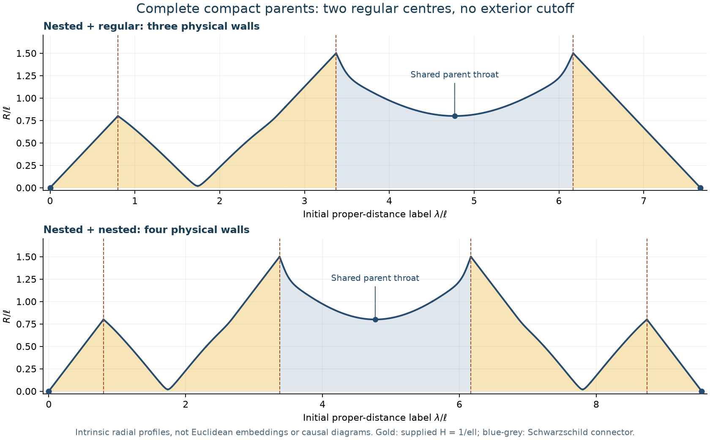

*Figure 6. The two complete compact initial profiles. Both use the same
connector and local membrane law; the lower state contains an additional
right-side descendant. Dashed lines are physical membranes. The radius
is plotted against proper distance, so these are intrinsic profiles rather
than Euclidean embeddings or causal diagrams.*

The normal evolution of Section 10.6 commutes with reflection. Its
positive Jacobi scale and radius bounds apply to each half through
$0\leq t/\ell\leq.01$. Each half contributes its seven moments and
its physical wall atoms once. The common throat has no surface source.
For the symmetric double, extensive moments double and all means stay
unchanged. Different halves require the between-region expansion
variance from Section 17.12.

Thus the proper-volume fraction $f_H$ of regions with $H\ell=1$ follows
from the geometry and its evolution. At $t/\ell=.01$,
$L_{\rm ref}=2/k=\ell$ gives:

| Right interior | $f_H$ | $\Lambda_{g,\rm tr}\ell^2$ | $\Lambda_{\rm total,tr}\ell^2$ |
| --- | ---: | ---: | ---: |
| Regular | .48620333 | -1.037400004 | 3.171376758 |
| Nested | .52228729 | -1.219330524 | 3.212316830 |

The total volumes are $71.1461599485\ell^3$ and $76.5242717224\ell^3$.
The total trace has a definite source decomposition,

$$
\Lambda_{\rm total,tr}
=\Lambda_{g,\rm tr}+3H^2f_H
+\frac{\kappa}{4V_D}\sum_W(E_W-S_W).
$$

For the regular completion its terms in $\ell^{-2}$ units are
$-1.037400003975$, $1.458609994750$ and $2.750166766967$.
The value near three therefore includes the supplied cap vacuum and
material-wall stress. The geometric vacuum defects are
$6.6134766493/\ell^2$ and $7.3326745903/\ell^2$; both effective
geometric sources fail vacuum form. Their midpoint trace derivatives
are approximately $1.0245354/\ell^3$ and $1.1843835/\ell^3$.
The actual moment histories satisfy the same source-conservation
identity, with approximately fourfold residual reduction on halving
the time-difference step. The largest 32/64 trace change is below
$1.2\times10^{-9}/\ell^2$, a numerical indicator rather than a
certified or observational uncertainty.

The comparison also proves a local-observability restriction. Adding
the remote nest changes the global total trace by
$.040940072190/\ell^2$ at the endpoint. The entire retained left
geometry and its inner-cap flash remain unchanged:
$1+z=3.895009111788$ at $t_{\rm rec}/\ell=1.646160028498$.

This follows from the actual connector clocks. Set $T=0$ on the
original static bridge and use its standard Kruskal coordinates $U,W$,
with future $dU,dW\geq0$ and

$$
-UW=(R/(2M)-1)e^{R/(2M)}.
$$

The left outer wall has $U>0,W<0$, and the right one has
$U<0,W>0$. Neither can signal the other through the constructed
connector. Their initial inward null fronts would require
$UW\geq15.6040388088$ to meet in the regular completion
($15.6031988754$ in the nested one), whereas the physical connector
has $UW<1$. This concerns those emission events; it is not a claim
that arbitrary future light cones never overlap.

The compact states therefore give different global averages but the
same local cap curvature and clock observation. Compactness removes
AE dilution; an additional causal/state mechanism is needed before a
global average can be identified with a locally measured cosmological
Lambda. The integrated constraint is satisfied by the local identities
and supplies no extra condition selecting the cap $H$ or absolute scale.

There is a separate continuation question. The small host throat starts
with $E=R_t=0$, and its exact quiet inward geodesic obeys
$R_t^2=2M_h/R+H^2R^2-1$. With $R=r_b\sin^2\chi$ and
$a=H^2r_b^2$, its proper lifetime to the classical endpoint is

$$
\tau_b=2r_b\int_0^{\pi/2}
\frac{\sin^2\chi\,d\chi}
{\sqrt{1-a(1+\sin^2\chi+\sin^4\chi)}}.
$$

The result is $.0314434597796\ell$, with analytic bounds
$.031434800637\ell\leq\tau_b\leq.031447397238\ell$.
The curvature contains $48M_h^2/R^6$, so this exact quiet geometry
does not smoothly continue the whole normal foliation through that
event. No physical topology change or claim of a literal infinity in
nature follows.

The spherical Einstein equations make the replacement problem precise.
For geometric mass $m=R(1-|\nabla R|^2)/2$, normal energy density
$\rho$ and radial pressure $p_r$,

$$
\nabla_N\nabla_N R=-\frac{m}{R^2}-\frac{\kappa R}{2}p_r,\qquad
\nabla_N\nabla_N R+\nabla_s\nabla_s R
=-\frac{\kappa R}{2}(\rho+p_r).
$$

At a temporal turn that is also a strict spatial minimum,
$E=R_t=0$ and $m=R/2$. A regular bounce requires
$\kappa p_r<-1/R^2$ and $\rho+p_r<0$.
At the current $r_b$, the pressure threshold is
$\kappa p_r\ell^2<-2497.9987983973$, compared with the supplied
vacuum value $-3$. This is a necessary source condition at that
radius, with compatible density and conservation still required.
It does not construct a bounce or prove that one occurs.

The compact atlas connection and its global-versus-local comparison
are complete on the stated finite domain. A source-derived regular
continuation, cosmological observer history and the origin of the
regional vacuum values remain the next physical questions.

### 10.8. The nested body in an expanding parent

<!-- nsc-claim:atlas-cosmological-parent -->

Derivation and calculation: [cosmological attachment and observer derivation](../docs/nsc-atlas-parent-observables.md),
[compact calculation](../results/summaries/nsc-atlas-parent-observables-v1.json)
and [independent checks](../tests/test_nsc_atlas_parent_observables.py).

An atlas needs both its local rooms and the world they inhabit. The
isolated and compact constructions above supply two completions of the
same nested body. A third now attaches its right Schwarzschild exterior
to an expanding dust universe. The new join has no material membrane.
Its geometry is borrowed from Einstein and Straus; the matching formulas
are presented in [Mars, Mena and Vera, Section 2](https://arxiv.org/html/1307.4371#S2).
The connection here is to the already sourced NSC interior and its
observer map.

Keep $M=.4\ell$, the original $L_{\rm ref}=\ell=2/k$, and the
increasing-radius exterior beyond the bridge. Choose the initial
cosmological join at $R_b(0)=4\ell$. With $G=c=1$, the two metrics are

$$
ds_F^2=-d\tau^2+a(\tau)^2(d\chi^2+\chi^2d\Omega^2),
$$

$$
ds_S^2=-f\,dT^2+f^{-1}dR^2+R^2d\Omega^2,\qquad f=1-\frac{2M}{R}.
$$

On the comoving boundary $R_b=a\chi_b$, equality of the angular
extrinsic curvature requires

$$
\sqrt{\dot R_b^2+f_b}=1,\qquad
\dot R_b^2=\frac{2M}{R_b},\qquad \dot T_b=\frac{1}{f_b}.
$$

Both induced metrics equal $-d\tau^2+R_b^2d\Omega^2$.
The boundary is geodesic, with radial acceleration $-M/R_b^2$, so the temporal
extrinsic curvature is also zero on both sides. The full Darmois
conditions hold. The flat dust Friedmann equation gives

$$
M=\frac{4\pi}{3}\rho_d R_b^3,\qquad
H_0^2=\frac{2M}{R_b(0)^3},\qquad
a(\tau)=\left(1+\frac{3}{2}H_0\tau\right)^{2/3}.
$$

This identity supplies the mass accounting. The exterior mass replaces
the dust removed to accommodate the attached interior. Its internal
proper energy is not another exterior mass to add to that equation.
The parent has $H_0\ell=.111803398875$ and
$\rho_d(0)\ell^2=.00149207759149$. The join radius and the dust
assumption are supplied; these values are conditional outputs.

The initial surface also needs a connection. Preserve the old static
collar through $R=\ell$, then set $dT/dR=w(R)\sqrt{2M/R}/f$.
A smoothstep takes $w$ from zero to one by $R=3.5\ell$.
The induced radial metric is $(1-w^2\,2M/R)/f>0$, becomes one near
the join, and satisfies the vacuum constraints. It supplies a spacelike
surface connecting the retained interior to the cosmic clock.
Keeping the old zero-velocity normal at the join instead would select
a different, closed-dust turnaround. The expanding construction changes
the outer slicing explicitly; it does not reinterpret the previous
normal averages or evolve the compact $S^3$ into a different topology.

Now follow a light ray. A static emitter at $R_e=2\ell$ emits at the
Killing time of the boundary's $\tau=0$ event. A comoving observer on
the join receives it. With $v_b=\sqrt{2M/R_b}$ and
$r_*=R+2M\log(R/(2M)-1)$,

$$
\int_0^{\tau_r}\frac{d\tau}{1+v_b(\tau)}
=r_*(R_b(0))-r_*(R_e),\qquad
1+z=\frac{1+v_b(\tau_r)}{\sqrt{f_e}}.
$$

The calculated reception is
$\tau_r/\ell=3.921887982097$, $R_b(\tau_r)/\ell=5.602745333858$,
and $1+z=1.778824923298$. An independent null ODE changes the
arrival by $1.3\times10^{-12}\ell$; a proper-clock derivative checks
the redshift. The experiment lies entirely on the parent side of
the bridge. It transmits no signal from the causally separated cap.
Its longer exterior history does not assert a regular continuation of
the inner throat. Seconds require an independent physical value of $\ell/c$.

The parent decelerates with $q=1/2$ and generates no cosmological
vacuum term. Its initial Ricci scalar divided by four is nevertheless
$.009375/\ell^2$, supplied by dust. The connected geometry therefore
distinguishes expansion, curvature trace and vacuum pressure.

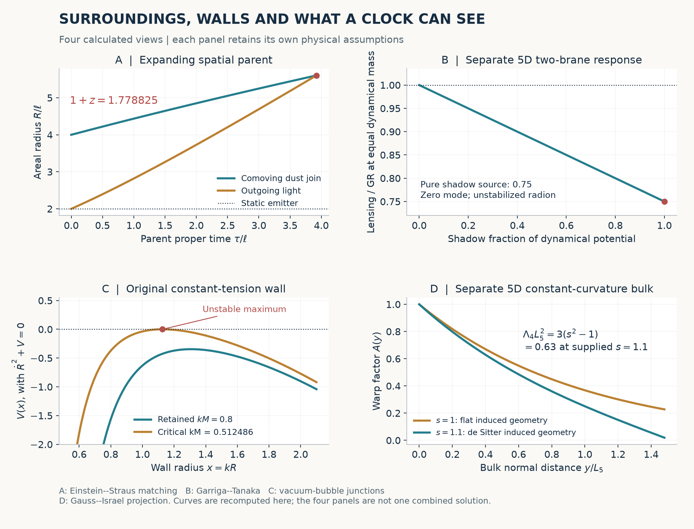

*Figure 7. A: the cosmological join and its received light ray.
B: the attributed two-brane lensing discriminator. C: the existing
constant-tension wall and its unstable critical comparison.
D: a separate bulk geometry inducing positive local curvature.
The curves are regenerated from the stated equations. Panels A and C
belong to the current four-dimensional family; B and D have different
five-dimensional backgrounds and have not been combined into one model.*

### 10.9. Two explicit ways surrounding geometry enters local gravity

<!-- nsc-claim:surrounding-bulk-reference -->

Derivation and calculation: [source conventions and geometric checks](../docs/nsc-atlas-parent-observables.md#b-a-surrounding-bulk-can-induce-local-curvature),
[finite examples](../results/summaries/nsc-atlas-parent-observables-v1.json),
[Shiromizu--Maeda--Sasaki](https://arxiv.org/html/gr-qc/9910076v3),
[Maartens--Koyama](https://arxiv.org/html/1004.3962)
and [Garriga--Tanaka](https://arxiv.org/html/hep-th/9911055v3).

The surrounding region can have a different mathematical role from an
ordinary exterior. In a brane construction, an observer occupies a
four-dimensional hypersurface of a five-dimensional bulk. The surface
curvature then depends on how it lies in that bulk. This is a distinct
candidate from the two-sphere membrane of the preceding sections.

For a $Z_2$-symmetric brane with tension $\lambda$, confined matter
$T_{\mu\nu}$ and a bulk cosmological term, the Gauss and Israel
equations yield

$$
G_{\mu\nu}=-\Lambda_4q_{\mu\nu}+\kappa_4^2T_{\mu\nu}
+\kappa_5^4\pi_{\mu\nu}-E_{\mu\nu},
$$

$$
\kappa_4^2=\frac{\kappa_5^4\lambda}{6},\qquad
\Lambda_4=\frac{\Lambda_5}{2}+\frac{\kappa_5^4\lambda^2}{12}.
$$

The full quadratic tensor $\pi_{\mu\nu}$ and the conservation equation
are given in the linked derivation. $E_{\mu\nu}$ is the traceless
projection of bulk Weyl curvature. Direct contraction of the Gauss
equation agrees with this decomposition for the checked tensors,
including momentum flux and anisotropic pressure. That algebra does
not supply a bulk solution for arbitrary matter data.

A vacuum example does supply the whole surrounding metric. Set
$\Lambda_5=-6/L_5^2$ and

$$
ds_5^2=dy^2+A(y)^2ds_{\mathrm{dS}_4}^2,\qquad
A(y)=\cosh(y/L_5)-s\sinh(|y|/L_5),
$$

$$
s=\frac{\kappa_5^2\lambda L_5}{6}>1,\qquad
0\leq |y|<L_5\operatorname{atanh}(1/s).
$$

Both independent bulk sectional curvatures equal $-1/L_5^2$.
The junction fixes the first derivative of $A$ at the brane, giving

$$
\Lambda_4L_5^2=3(s^2-1).
$$

For the declared demonstration $s=1.1$, this is $.63$, with
$H_4L_5=.458257569496$. It is a positive, locally measurable
curvature induced by surrounding geometry and tension. The two inputs
$s,L_5$ have not been selected by inheritance, and $L_5$ is not
identified with the membrane ruler $\ell$.

The source channels can be distinguished. In a homogeneous isotropic
brane, a separately conserved Weyl contribution behaves as radiation,
$p_E=\rho_E/3$ and its density decreases as $a^{-4}$. For confined dust the
quadratic source obeys
$\rho_{\rm quad}=p_{\rm quad}=\rho^2/(2\lambda)$. Neither is the
constant vacuum term in this explicit example.

Garriga and Tanaka give a second, observationally useful construction:
matter on another flat brane affects the observer's metric through a
bulk gravitational response. With two branes and an unstabilized
massless radion, the static zero-mode source tensor is
$T_{\mu\nu}-q_{\mu\nu}T/3$. Its nonrelativistic time and spatial
components have ratio $2:1$. Use the metric convention

$$
ds^2=-(1+2\Phi)dt^2+(1-2\Psi)(dx^2+dy^2+dz^2).
$$

A pure shadow source then has $\Psi/\Phi=1/2$.

Slow orbits determine the dynamical potential, while light deflection
depends on both potentials. The straight-ray integral gives

$$
\alpha=\frac{2(1+\Psi/\Phi)G_4M_{\rm dyn}}{bc^2},\qquad
\frac{\alpha_{\rm shadow}}{\alpha_{\rm GR}}=\frac{3}{4}.
$$

This 25% reduction at the same dynamical mass is their published
discriminator, recovered here from the tensor and ray integral.
It shows what a quantitative outside-matter claim can look like.
For positive-brane observers, mixed sources with common profiles and
shadow potential fraction $f$ give

$$
\gamma_v=\frac{3-e^{-2d/L_5}}{3+e^{-2d/L_5}},\qquad
\frac{\Psi}{\Phi}=(1-f)\gamma_v+\frac{f}{2}.
$$

At $d/L_5=5$, the lensing ratios for $f=0,.5,1$ are
$.99998487$, $.87499243$ and $.75$. This $f$ is not a cosmological
density fraction. A stabilized radion or a different background
requires a new response calculation. In particular, these flat-brane
perturbations have not been grafted onto the detuned de Sitter example.

### 10.10. Can the enclosing wall select the cap curvature?

<!-- nsc-claim:wall-equilibrium-closure -->

Derivation and calculation: [signed wall proof and inheritance map](../docs/nsc-atlas-parent-observables.md#d-does-the-actual-wall-select-its-own-cap-scale),
[original wall implementation](../src/recursive_horizons/nsc_atlas_nested_slice.py)
and [symbolic and geometric controls](../tests/test_nsc_atlas_parent_observables.py).
The [compact evidence](../results/summaries/nsc-atlas-parent-observables-v1.json)
records the retained parameters and the critical comparison.

The natural equilibrium question is whether the wall itself determines
$H$, making $\Lambda=3H^2$ an output. The relevant building block is
the published vacuum-bubble dynamics, credited through
[Ansoldi, Guendelman and Shilon](https://arxiv.org/html/0711.2198v1#S3).
First consider the original massless cap-to-Schwarzschild member.
For its constant positive tension,
$p_s=-\sigma$, $k=4\pi G\sigma$ in $c=1$ units, the signed junction
gives the existing radial equation

$$
\dot R^2+V(R)=0,
$$

with potential

$$
V(R)=1-\frac{M^2}{k^2R^4}
-\frac{M(1-H^2/k^2)}{R}
-\frac{(k^2+H^2)^2R^2}{4k^2}.
$$

Write this as $1-A/R^4-B/R-CR^2$, with $A,C>0$.
At a stationary point, $B/R^3=2C-4A/R^6$. Substitution gives

$$
\left.V''\right|_{V'=0}=-\frac{12A}{R^6}-6C<0.
$$

Every static wall in this family is radially unstable. This exact
identity decides the suggested stable-equilibrium closure without
a scan. The full static family, with $u=H^2/k^2$, $x=kR$ and
$\mu=kM$, can be parameterized by

$$
q_*=\frac{u-1+\sqrt{9u^2+14u+9}}{8},\qquad
x^2=\frac{1}{3[(1+u)^2/4-q_*^2]},\qquad
\mu_{\rm crit}=q_*x^3 .
$$

Its signed factors obey $\beta_->0>\beta_+$ and the temporal
Israel condition. Thus the exterior remains on the wormhole branch.
The critical mass decreases with $u\geq0$ from
$\mu_{\rm crit}(0)=16/27$. Our retained $\mu=.8$ exceeds that
ceiling: at fixed $M,k$ it admits no static state at any nonnegative
$H^2$. At the illustrative critical state with $u=.25$,
$\mu=.512485700729$, $x=1.126996043952$ and
$V_{xx}=-3.881941479272$.

The actual nested outer wall has inner Kottler mass $m=.01\ell$.
Its potential replaces $A$ by $(M-m)^2/k^2$ and $B$ by
$M+m-(M-m)u$. The same negative-curvature identity applies.
More strongly, its dimensionless potential is the massless expression
at $k(M-m)=.78$, minus $.04/x$. Since $.78>16/27$, it is
everywhere negative and also has no static root. The massless
critical curve is a comparison bound for this nested wall.

The scale-compatible inheritance map

$$
(R,M,k,H)\longmapsto(aR,aM,k/a,H/a)
$$

preserves $kM$ and $H/k$ for every $a>0$. It transports a
dimensionless model without selecting those invariants.
The full inherited-operator programme may supply additional conditions;
this wall calculation does not yet identify them. The cap radius
$H^{-1}$ and its material wall radius $R$ are different quantities.
The compact average counterexample does not make them equal.

Gravastars provide a useful next building block.
[Mazur and Mottola](https://arxiv.org/html/gr-qc/0109035) place a
material transition layer between a de Sitter core and a Schwarzschild
exterior. [Visser and Wiltshire](https://arxiv.org/html/gr-qc/0310107)
make stability depend explicitly on the thin shell's equation of state.
For a no-flux shell,

$$
\frac{d\sigma}{dR}=-\frac{2(\sigma+p_s)}{R}.
$$

The current $p_s=-\sigma$ is one special case. An inherited material
or state response could supply another and change stability.
That is the connection to derive before using a stable gravastar to
select the cap scale. These published results do not select the
new material law for us.

The classic [Morris--Thorne construction](https://doi.org/10.1119/1.15620)
already relates traversable throats to negative radial null stress.
Section 10.7 applies a related Einstein-equation condition at the
specified dynamical turn; it makes no priority claim for that
requirement. [Easson and Brandenberger](https://arxiv.org/abs/hep-th/0103019)
likewise belongs in the black-hole-interior cosmology family. Each
construction contributes its established mechanism with its premises.

### 10.11. The source law behind a growing mass

<!-- nsc-claim:population-source-balance -->

Derivation and calculation: [energy accounting and finite counterexample](../docs/nsc-atlas-parent-observables.md#e-growing-black-hole-masses-and-the-missing-energy-equation),
[calculated balances](../results/summaries/nsc-atlas-parent-observables-v1.json)
and [conservation checks](../tests/test_nsc_atlas_parent_observables.py).

The proposal that black holes supply dark energy makes the source
question especially sharp. For fixed comoving number,
a mass growing as $a^n$ gives a density growing as $a^{n-3}$.
The balance law is

$$
\dot\rho_B+3H(\rho_B+p_B)=Q.
$$

A separately conserved effective component has $Q=0$ and
$w_B=-n/3$. Pressureless mass receiving energy instead has
$p_B=0$ and $Q=nH\rho_B$. The mass law alone does not decide which
description follows from the geometry.

For example, take $\rho_B=.1$ and a pressureless reservoir
$\rho_X=a^{-3}-.1$, in units of the initial total density.
Over $1\leq a\leq2$, both are nonnegative and the transfers cancel.
The total density is $a^{-3}$, total pressure zero and $q=1/2$,
even though the black-hole component has constant density.
This is a homogeneous conservation counterexample, not a microscopic
accretion model. It identifies the equation an inherited coupling must supply.

[Farrah and collaborators](https://arxiv.org/abs/2302.07878) propose
a cosmological mass-growth mechanism; [Ghodla and collaborators](https://arxiv.org/abs/2306.08199)
derive binary-merger consequences of such growth. The atlas includes
both the proposed connection and an independent way of testing it.
Neither supplies an observational validation of the present NSC geometry.

The next selection problem is now explicit: derive an inherited
stress/state law or gravitational reduction, obtain its dimensionless
parameters, and propagate the same solution to expansion, clustering,
lensing and thermal history. The present chapter adds a cosmological
connection, an observable clock relation, useful external mechanisms
and a decided equilibrium question. It does not yet predict the
cosmological density fractions or matter--antimatter asymmetry.

### 10.12. Sourced rooms from an occupied wall spectrum

<!-- nsc-claim:occupied-wall-source -->

Derivation and calculation: [state, stress and signed geometry](../docs/nsc-atlas-occupied-wall.md),
[finite calculation](../results/summaries/nsc-atlas-occupied-wall-v1.json)
and [independent controls](../tests/test_nsc_atlas_occupied_wall.py).

The equilibrium question in Section 10.10 asks for a material law.
A finite occupied field supplies one: its energy changes when the
surface changes, and that derivative determines pressure. This connects
the geometric spectrum to a gravitational source before a wall potential
is chosen.

The construction introduces a new surface theory. Its Einstein bulk has
a de Sitter core, a Schwarzschild collar and a zero classical scalar.
The wall carries a positive bare tension and two parity-paired massless
Dirac species:

$$
S_\Sigma=-\sigma_0\int_\Sigma\sqrt{-\gamma}\,d^3y+S_D,
$$

$$
S_D=\sum_{j=1}^{2}\int_\Sigma\sqrt{-\gamma}\,
\overline{\chi}_j\,i\hbar D_\Sigma\chi_j\,d^3y.
$$

Use the conformal reference vacuum and its normal-ordered finite
excitation stress, with specified renormalized tension and no additional
surface-curvature terms. This is a declared effective material candidate.
The original transparent bulk probe has no trapping interaction and is
not reinterpreted as this surface field.

[Macpherson and Campbell](https://arxiv.org/html/hep-ph/9408387)
provide the localized-fermion wall precedent.
[Ogure, Yoshida and Arafune](https://arxiv.org/html/hep-ph/0212332)
calculate its finite spherical occupation and discuss fragmentation.
A finite-thickness realization of the present gravitating surface
theory remains a separate problem.

For one two-component spinor, the positive sphere eigenvalues are
$n/R$, with degeneracy $2n$.
[Abrikosov's spherical Dirac analysis](https://arxiv.org/html/hep-th/0212134)
gives the spectrum and its rotational representations, with attribution
to earlier Newman--Penrose and related work. Fill all angular states
through level $q$ in each of $g=2$ species. The state is isotropic and
has the exact finite sums

$$
N_q=gq(q+1),\qquad
\mathcal A_q=\frac{gq(q+1)(2q+1)}{3},\qquad
E_q=\frac{\hbar c\,\mathcal A_q}{R}.
$$

The negative-energy reference branch is not counted again as occupied
positive particles. Varying the energy with area at fixed occupation gives

$$
\sigma=\sigma_0+\frac{\hbar c\,\mathcal A_q}{4\pi R^3},
\qquad
p=-\sigma_0+\frac{\hbar c\,\mathcal A_q}{8\pi R^3}.
$$

The gas pressure is half its surface energy density. The total obeys
$d(\sigma R^2)/dR+2pR=0$. Its occupied part has zero trace, yet
changes the full stress tensor and the resulting geometry.

This state is transported exactly within the surface theory.
On $-d\tau^2+R(\tau)^2d\Omega^2$, use $d\eta=d\tau/R$ and
rescale the spinor by $R^{-1}$. The resulting Hamiltonian is the same
unit-sphere Dirac operator. Its occupied projectors commute with
the unitary evolution. Number is conserved and energy scales as $1/R$,
without assuming adiabatic motion. This inherits a specified occupation
along a wall; it does not select its initial value.

In $c=1$ units put $k_0=4\pi G\sigma_0$ and
$d=\ell_P^2\mathcal A_q$, with $\ell_P^2=G\hbar/c^3$ when units
are restored. The angular junction is

$$
\sqrt{\dot R^2+f_-}-\epsilon\sqrt{\dot R^2+f_+}
=s(R),\qquad s(R)=k_0R+\frac{d}{R^2}.
$$

Here $f_-=1-H^2R^2$ and $f_+=1-2M/R$.
The ordinary orientation is $\epsilon=+1$; the previous
wormhole-side orientation is $\epsilon=-1$.
For the latter, at a static point with $a=\sqrt{f_-}$ and
$b=\sqrt{f_+}$, implicit differentiation gives

$$
V''=
\frac{-H^2/a^3-2M/(bR^3)-M^2/(b^3R^4)-6d/R^4}
{1/(2a)+1/(2b)}<0.
$$

Thus positive occupation does not stabilize the former wormhole
branch. The ordinary orientation has a different sign in this test.
One exact reference, specified before comparison with observations, is

$$
a=\frac{24}{25},\qquad b=\frac{4}{5},\qquad
H^2R_0^2=\frac{49}{625},\qquad \frac{M_0}{R_0}=\frac{9}{50}.
$$

Both Israel conditions then fix positive components,

$$
k_0R_0=\frac{1}{225},\qquad
\frac{d}{R_0^2}=\frac{7}{45},\qquad
4\pi G R_0\sigma=\frac{4}{25},\qquad
4\pi G R_0p=\frac{11}{150}.
$$

The centre is regular, the wall lies inside the core's static horizon,
and the exterior starts outside $2M$. The resulting room is horizonless.
At fixed mass, curvature, bare tension and occupation, its radial potential has

$$
V=V'=0,\qquad R_0^2V''=\frac{35159}{7200}>0,\qquad
\frac{\omega_{\rm radial}R_0}{c}
=\frac{\sqrt{35159}}{120}=1.562561109916.
$$

This establishes linear radial stability in the mean-stress surface
model. Finite disturbances carry energy and change the exterior mass
at second order. Nonspherical and fragmentation stability are not
established; the localized-fermion literature makes that distinction
essential.

**Fixed couplings, unequal occupied states.**

Choose the finite reference $q_0=1000$, with $N_0=2,002,000$.
The spectral sum and the declared gas compactness give

$$
\frac{R_0}{\ell_P}=\sqrt{\frac{45\mathcal A_{1000}}{7}}
=92651.4435937.
$$

This is a physical ruler for the conditional example, not a predicted
cosmological length. The reference shape and state determine its action
parameters once. Thereafter keep $G,\hbar,\sigma_0,H$ fixed and change
only the occupation.

For geometric shell mass $m_s=k_0R^2+d/R$, the signed static junction gives

$$
M(R,q)=\frac{H^2R^3}{2}
+m_s\sqrt{1-H^2R^2}-\frac{m_s^2}{2R}.
$$

Equilibrium requires $M_R=0$. The positive reference Hessian
$R_0M_{RR}=35159/86400$ gives a locally unique family.
Its exact response to spectral energy is

$$
\frac{dM_{\rm eq}}{d\mathcal A}
=\frac{\ell_P^2\beta_+}{R}.
$$

The extra local energy contributes to the mass measured outside with
its gravitational redshift. This accounts for the interior through
the same mass used in the parent matching.

| q | Radius / R0 | Mass / R0 | Mode / level spacing |
| ---: | ---: | ---: | ---: |
| 999 | .9993406734 | .1796270290 | 1.563237585 |
| 1000 | 1.0000000000 | .1800000000 | 1.562561110 |
| 1001 | 1.0006588232 | .1803733226 | 1.561883618 |

The last column also compares the radial mode to the adjacent surface
level spacing $c/R$. A detector interaction and selection rules are
needed before identifying that spacing with an observed spectral line.

### 10.13. Two physical interiors, one parent, and a central beacon

<!-- nsc-claim:occupied-wall-parent-clocks -->

Derivation and calculation: [common parent and null transport](../docs/nsc-atlas-occupied-wall.md#two-unequal-interiors-in-one-evolving-cosmology),
[state and clock results](../results/summaries/nsc-atlas-occupied-wall-v1.json)
and [piecewise null-ODE controls](../tests/test_nsc_atlas_occupied_wall.py).

The same dust matching can now hold two unequal, completely specified
interiors. Set the common parent $H_p(0)R_0/c=.075$ and
$a_p(0)=1$. The exterior mass of each room fixes its comoving
matching sphere:

$$
R_{b,q}(0)=\left(\frac{2M_q}{H_p(0)^2}\right)^{1/3}.
$$

Place the $q=999$ and $q=1001$ centres twelve $R_0$ apart in parent
comoving coordinates. Their matching radii are
$3.997235341585R_0$ and $4.002763442849R_0$, leaving positive
clearance. The two excised spheres stay disjoint as the parent expands.
Each local Darmois match has the same dust density on its outside.
Together they therefore define one shared piecewise Einstein solution.
The wall law and couplings are common; the states, radii and masses differ.

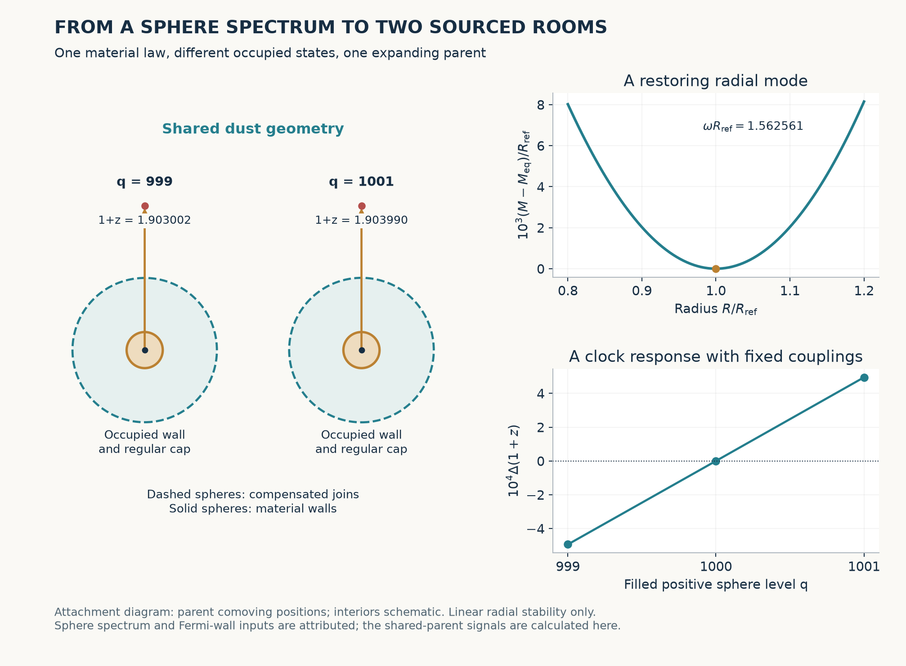

*Figure 8. Two disjoint compensated regions in the same expanding dust
parent. Parent positions are comoving; the interiors are schematic.
The right panels show the reference radial mass minimum and the
clock response to three finite states with unchanged couplings.
The ordinary horizonless attachment and linear radial result are
distinct from black-hole offspring formation and general stability.*

A beacon at each regular centre now crosses the entire connection.
At the static material wall, proper-time matching gives
$dT=(a/b)dt_c$, where $t_c$ is central proper time and $T$
is exterior Killing time. An emission at the Killing time of the
join's initial cosmic event spends

$$
\Delta T_{\rm core}=\frac{a}{bH}\operatorname{atanh}(HR)
$$

inside the core. With $v_b=\sqrt{2M/R_b}$, reception at the
moving dust join satisfies

$$
\int_0^{\tau_b}\frac{d\tau}{1+v_b(\tau)}
=\Delta T_{\rm core}+r_*(R_b(0))-r_*(R).
$$

Continue through the dust to an observer eight $R_0$ away from each
centre in the same comoving direction. Those two rays avoid the
other matching sphere. The explicit dust conformal time determines
the remaining arrival, and the total frequency ratio is

$$
1+z=\frac{a}{b}(1+v_b(\tau_b))
\frac{a_p(\tau_r)}{a_p(\tau_b)}.
$$

| q | Reception time / (R0/c) | 1+z |
| ---: | ---: | ---: |
| 999 | 12.61376979 | 1.903001657 |
| 1000 | 12.61774703 | 1.903495521 |
| 1001 | 12.62172978 | 1.903990397 |

The parent density and observer comoving offsets are the same in all
three calculations. A separate null ODE crosses the core, collar and
dust regions; differentiating reception proper time with respect to
emission proper time independently recovers the redshift.
The saved root comparison is at $3\times10^{-15}R_0$ and the
clock-derivative difference at $1.2\times10^{-11}$.
These are numerical indicators, not a microscopic or observational
error budget.

This connection reaches from a specified finite state to a conserved
surface pressure, a compatible geometry, a common parent and an
observer signal. Its inheritance law transports the occupation but
does not select it. At fixed fundamental constants, copying that
occupation to a scaled radius changes both $k_0R$ and
$\ell_P^2\mathcal A/R^2$. A normalized operator relation alone does
not preserve gravitational compactness.

The supplied cap curvature is still
$\Lambda_{\rm cap}R_0^2=147/625$; the common parent still has zero
cosmological Lambda. Formation, occupation transfer, general stability
and a collective source law remain physical questions. No cosmic
density fraction or matter--antimatter asymmetry is inferred from
this finite state-to-observer proof.

### 10.14. Energy, frequencies and a moving radius

<!-- nsc-claim:energy-frequency-radius -->

Evidence: [identities and retained endpoint comparisons](../results/summaries/nsc-atlas-energy-frequency-v1.json),
[assumptions and derivation](../docs/nsc-atlas-occupied-wall.md#energy-frequency-size-and-a-possible-cooling-ceiling),
and [independent symbolic checks](../tests/test_nsc_atlas_energy_frequency.py).

Douglas's frequency picture asks whether a region's stored energy, the
oscillations it supports and its enclosing size are one connected problem.
The occupied sphere supplies an exact conditional example. In the
equal-bulk-pressure, negligible-gravity limit of its surface action,

$$
E(R)=4\pi\sigma_0R^2+\frac{\hbar c\mathcal A_q}{R},\qquad
\mathcal A_q=\frac{N_s q(q+1)(2q+1)}{3}.
$$

The competing terms are membrane tension and occupied-mode energy. Setting
the radius derivative to zero, with the occupation held fixed, gives

$$
R^3=\frac{\hbar c\mathcal A_q}{8\pi\sigma_0},\qquad
E_{\min}=12\pi\sigma_0R^2,\qquad
E_{RR}=24\pi\sigma_0>0.
$$

This pressure balance links stored energy to radius. It also bounds the
highest occupied angular frequency, $\omega_{\max}=cq/R$:

$$
\omega_{\max}^3<\frac{12\pi\sigma_0c^2}{N_s\hbar},\qquad
\frac{\omega_{\max}^3}{12\pi\sigma_0c^2/(N_s\hbar)}
=\frac{2q^2}{(q+1)(2q+1)}<1.
$$

The inequality is exact because the denominator exceeds its numerator by
3q+1. The bound applies to the highest occupied level in this equilibrium
family. The allowed spectrum remains unbounded, arbitrary excitations are
not constrained by it, and the filled state is not a thermal gas. Hz
frequency is angular frequency divided by $2\pi$. A filled spectral
projector commutes with the Hamiltonian: its mean density and pressure can
remain static despite oscillating field phases.

Gravitational binding changes this balance, so the flat bound is not applied
to the retained gravitating spectrum. Those endpoints give a separate comparison. Reducing
the filled level from 1000 to 999 reduces the radius by .06593266%, surface
mode energy by .23377199%, and highest occupied frequency by .03408981%.
The spacing of fixed individual modes increases as the radius shrinks.
These are stationary endpoints; a depletion process needs a channel for
the surface's conserved particles to leave. The closed free surface action
does not supply that channel.

For cooling, explicitly introduce the separate benchmark of homogeneous
equilibrium radiation with fixed species, $E=a_{\rm rad}T^4V$ and
$p=E/(3V)$. Its [thermal equation of state](https://www.damtp.cam.ac.uk/user/tong/cosmo/cosmohtml/S2.html)
and the first law give

$$
\dot E+p\dot V=P_{\rm in}-P_{\rm out},\qquad
\frac{\dot T}{T}=-\frac{\dot R}{R}
-\frac{P_{\rm out}-P_{\rm in}}{4E}.
$$

A shrinking region cools only if outward loss exceeds compression heating:
$P_{\rm out}-P_{\rm in}>4E|d(\ln R)/dt|$. Halving both radius and total
radiation energy raises temperature by $\sqrt{2}$. Halving the radius while
reducing energy to 1/32 lowers it by $1/\sqrt{2}$. An initial temperature
is a ceiling on a homogeneous branch only with an appropriate energy-flow
and compression bound throughout its history. Later concentration or heating
can violate it. No photon thermalization or universal inflation-temperature
ceiling has been derived from the fixed scalar/four-form action.

The retained volume solution makes the distinction between frequency and
energy especially clear. At N=4, matter density is 7.6104674e-6 of its
initial value, but its scalar frequency is 1.2386400 times its initial
value. The law is $\rho/\rho_0=e^{-3N}(\omega/\omega_0)$: dilution can
lower density while frequency rises. The model supplies no temperature
or loss through an exterior boundary from this identity alone.

Finally, apparent expansion requires a specified clock. For transparent
null photons and identical reference clocks scaling as
$\Omega=e^{-6s}$, the emission, propagation and calibration factors yield

$$
1+z=\frac{a_{E,o}\Omega_o}{a_{E,e}\Omega_e}
=\frac{a_{J,o}}{a_{J,e}}.
$$

This is a conditional protocol consistent with
[frame-independent observation](https://arxiv.org/abs/1308.1142).
A decreasing coordinate scale can coexist with redshift when the
clock-calibrated size increases. Contraction of the latter gives blueshift
under these assumptions. A shrinking outer wall and an expanding interior
are different quantities; their connection needs the actual junction and
clock map. The proposed energy-size picture therefore yields precise
relations and tests, while its depletion, thermal preparation and
large-scale observation mechanisms remain to be constructed.

### 11. Complete one reference before assigning its causal arrows

<!-- nsc-claim:atlas-causal-access -->

Derivation and calculation: [isolated causal completion](../results/development/nsc-cosmological-atlas-v5/causal-map.json),
[observer access](../results/development/nsc-cosmological-atlas-v5/observer-access.json),
and [protected parent interval](../results/development/nsc-cosmological-atlas-v4/causal-window.json).

The wall's isolated spherical completion is the flat-exterior limit of
solution 13 in [Aguirre and Johnson, gr-qc/0508093v2,
Figures 7 and 10](https://arxiv.org/html/gr-qc/0508093v2).
Writing $x=R/\ell$, its expanding branch has

$$
\dot R^2=\frac{25x^2}{16}-1+\frac{3}{10x}+\frac{1}{25x^4}>0.
$$

It starts at a finite proper-past $R=0$ boundary in the Schwarzschild
white-hole sector, crosses $R=2M$ into the left exterior, and crosses the
de Sitter horizon into an expanding interior chart. It reaches arbitrarily
large radius at infinite wall proper time. Its Schwarzschild curvature
$48M^2/R^6$ diverges at the past boundary. The regular cap on the
chosen slice therefore does not imply a regular past formation.
The retained reference also contains the usual future Schwarzschild
black-hole singular boundary.

Choose three clocks. $C$ is the cap center, with de Sitter flat proper
time $t_C$. $W$ carries wall proper time $\tau_W$, set to zero at
$R=1.5\ell$. $P$ is static in the right exterior at
$R_P=1.6\ell$, with proper time
$\tau_P=\sqrt{1-2M/R_P}\,t_{\mathrm{Schw}}$. Their origins coincide
with a selected slice convention; this is not an equality of universe ages.

For the flat de Sitter chart,

$$
\eta=-\ell e^{-t_C/\ell},\qquad R=a r,\qquad a=e^{t_C/\ell}.
$$

Radial null lines have constant $\eta-r$ or $\eta+r$.
At $W_0$, $\eta=-\ell$ and $r=1.5\ell$.
Its inward ray would reach $\eta=0.5\ell$, outside the chart's
future $\eta<0$; hence it never reaches $C$.
A central signal emitted at $t_C=0$ likewise cannot catch the future wall.

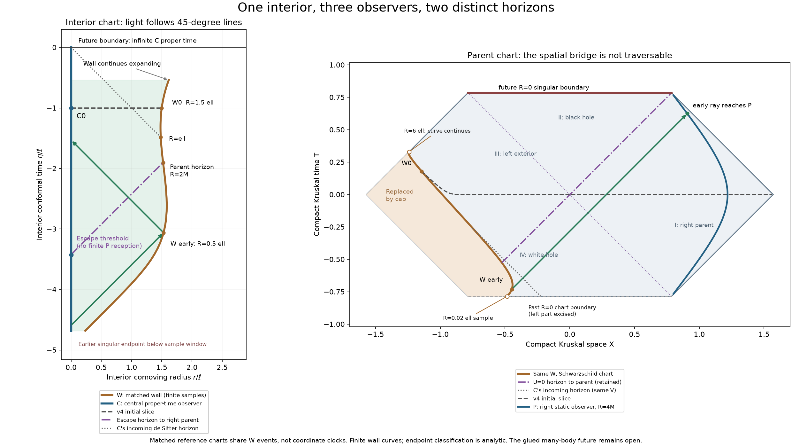

*Figure 9. The isolated reference in joined causal charts. Horizons are
clipped to retained domains; the central cosmological horizon continues
into the Schwarzschild chart along its appropriate constant null coordinate.
The faint past $R=0$ line also shows uncut chart context, part of which is
excised. Open wall endpoints at $R/\ell=0.02$ and $6$ mark finite
plot samples, not physical beginnings or endings.*

| Emission and destination | Result in this reference | Required distinction |
| --- | --- | --- |
| New $C\to W$ or $W\to C$ emission at or after the anchor slice | No future reception | Earlier signals may arrive later |
| Right parent $P\to W$ or $P\to C$ | No future causal route | Left and right exterior regions are different |
| Early $W\to C$, while $R<\ell$ | Allowed | Reception time depends on the emission event |
| Early $C\to W\to P$, crossing while $R<2M$ | Allowed | The limiting horizon ray has no finite parent reception |
| These same arrows in a glued multi-body future | Unresolved | Initial-data gluing does not supply that global future |

For a wall event with interior time $t_W$, the central emission reaching
it and the reception of its inward ray satisfy

$$
t_e=t_W-\ell\ln(1+R/\ell),\qquad
t_r=t_W-\ell\ln(1-R/\ell).
$$

The second relation requires $R<\ell$.
At the early event $R=0.5\ell$, the recorded central emission is
$-1.5242168241\ell$ and inward reception is
$-0.4256045355\ell$. An outward early route through that event reaches
$P$ at its own proper time $+2.5311656510\ell$.
Thus exclusion of **new emissions** after a slice must never be rewritten
as exclusion of all later receptions. Emissions approaching the central
horizon from below can arrive arbitrarily late.

The critical central emission for escape to the right parent is
$t_C=-1.2312944525\ell$. Equality follows the parent horizon and has
no finite parent reception. That horizon extends into the cap along
$\eta-r=\eta_W(2M)-r_W(2M)$; it is not the surface $R=2M$
everywhere. The central observer's de Sitter horizon $\eta+r=0$
is a different boundary. Detailed clock domains and finite checks are
retained in the [observer note](../docs/nsc-atlas-causal-observers.md).

### 12. Different exteriors can be locally indistinguishable

There is also a result that does not require the glued parent's full future.
Retain the exact right Schwarzschild $K=0$ slice for
$2M<R<R_{\mathrm{cut}}$, with $R_{\mathrm{cut}}=10M$.
For a static observer at $R_{\mathrm{obs}}=4M$, the exterior cutoff
cannot influence it within

$$
0<t_{\mathrm{Schw}}<
r_*(R_{\mathrm{cut}})-r_*(R_{\mathrm{obs}}),\qquad
r_*(R)=R+2M\ln(R/(2M)-1).
$$

The observer's proper duration is the right side multiplied by
$\sqrt{1-2M/R_{\mathrm{obs}}}$.
For $M=0.4\ell$, the bound is
$t_{\mathrm{Schw}}<3.5090354889\ell$, or
$\tau_P<2.4812627896\ell$.
The inner optical boundary is at negative infinity, so it introduces no
finite inner cutoff.

Shared smooth vacuum data give the same vacuum development in this domain.
The [owning argument](../docs/nsc-atlas-causal-observers.md) uses standard
Cauchy-development uniqueness, with [Sbierski
(1309.7591v2)](https://arxiv.org/html/1309.7591v2) as a source.
The bound ends a guaranteed interval; it does not predict that a signal
actually arrives then. Matching additional fields and their states requires
additional data.

This supplies one precise atlas of indistinguishable exteriors. Distinct
larger assemblies can share a protected local geometry. The next useful
question is which later measurement or extra state datum separates them.
Failure to distinguish exteriors can be a result, rather than a reason to
add unconstrained parameters until a preferred story appears.

## III. One field law from parent vacuum to evolving matter

This is the central source history of the atlas. A charged membrane changes four-form flux; a coupled scalar carries the resulting vacuum floor and excitation. The calculation follows that action through regular preparation, real parent sources, a three-region constrained slice and a protected evolving cosmology. Density growth and the remaining state freedom emerge from the same equations. The conditional initial data are stated once in each construction and carried through its consequences.

### 13. The shared source and its cosmological domain

The following sections give the worked constructions and their attributed mathematical inputs.

### 13.1. A field law that changes the inherited vacuum

<!-- nsc-claim:charged-vacuum-inheritance -->

Derivation and calculation: [action, conservation and composition](../docs/nsc-atlas-flux-transition.md),
[symbolic and numerical record](../results/summaries/nsc-atlas-flux-transition-v1.json)
and [scientific checks](../tests/test_nsc_atlas_flux_transition.py).

The preceding constructions supply their cap vacuum independently.
Brown--Teitelboim's charged-membrane mechanism supplies an alternative:
one field law determines the vacuum change at a boundary. We use the
fixed-flux action in [Bousso--Polchinski](https://arxiv.org/html/hep-th/0004134),
Section 2.1, and the full membrane conditions in
[Hirano](https://arxiv.org/html/1804.09985), Section 2.3.
This is a new declared matter sector, not an extra term calculated from
the original conformal-field Schur response.

With $c=\hbar=1$, $\kappa=8\pi G$, $F=dA$ a four-form, shared membrane
tension $\sigma$ and charge $e$, the action contains

$$
S_{\rm bulk}=\int\sqrt{-g}\left[
\frac{\mathcal R-2\Lambda_b}{2\kappa}-\frac{F^2}{2\,4!}\right]d^4x,
\qquad
S_\Sigma=-\sigma\int_\Sigma\sqrt{-\gamma}\,d^3y+e\int_\Sigma A.
$$

Gravitational and fixed-flux boundary terms complete the action.
Varying before substituting the solution gives

$$
F=f\epsilon,\qquad T^F_{\mu\nu}=-\frac{f^2}{2}g_{\mu\nu},\qquad
\Lambda(f)=\Lambda_b+\frac{\kappa f^2}{2}.
$$

The oriented membrane gives $f_{\rm in}=f_{\rm out}-e$.
Repeating that same law gives the composable sequence

$$
f_n=f_0-ne,\qquad
\Lambda_n=\Lambda_b+\frac{\kappa}{2}(f_0-ne)^2,
$$
$$
\Lambda_{n+1}-\Lambda_n=-\kappa e(f_n-e/2),\qquad
\Lambda_{n+2}-2\Lambda_{n+1}+\Lambda_n=\kappa e^2.
$$

The second difference removes the bare vacuum and parent flux. It does
not quantize the absolute flux, select which transitions occur, or
determine the observed cosmological constant. The action is common;
the state changes. Its relation to the earlier inherited operator is open.

Each vacuum region has
$F_n(r)=1-2M_n/r-\Lambda_n r^2/3$. On the ordinary outward orientation,
$\beta_--\beta_+=kR$, with
$\beta_\pm=\sqrt{\dot R^2+F_\pm}$ and $k=\kappa\sigma/2$.
Both the temporal junction and membrane force must also hold:

$$
[K^a{}_b]=-k\delta^a_b,\qquad
\sigma\overline{K}=e\,\frac{f_{\rm out}+f_{\rm in}}{2}
=\frac{\Lambda_{\rm out}-\Lambda_{\rm in}}{\kappa}.
$$

Our $K_{ab}=+h_a{}^c\nabla_c n_b$ is opposite to Hirano's convention.
The last equation is also the distributional normal conservation law.
Pure vacuum has no tangential flux, and the constant tension obeys
intrinsic wall conservation.

Let $A=(M_{\rm out}-M_{\rm in})/k$ and
$B=(\Lambda_{\rm out}-\Lambda_{\rm in})/(6k)+k/2$. Then

$$
\dot R^2+V(R)=0,\qquad
V=1-\frac{A^2}{R^4}-\frac{2(M_{\rm in}+AB)}{R}
-\left(\frac{\Lambda_{\rm in}}{3}+B^2\right)R^2,
$$
$$
\beta_-=\frac{A}{R^2}+BR,\qquad
\beta_+=\frac{A}{R^2}+(B-k)R.
$$

The signs are retained after using this potential. Given the inner mass
and initial radius/speed, the unsquared equation fixes the outer mass.
That same mass becomes the next wall's inner mass.

### 13.2. Three vacuum regions in one evolving cosmology

<!-- nsc-claim:charged-shared-parent -->

Derivation and calculation: [finite continuation and cosmological observer](../docs/nsc-atlas-flux-transition.md#a-composed-finite-geometry-with-calculated-vacuum-changes),
[endpoint values and independent quadratures](../results/summaries/nsc-atlas-flux-transition-v1.json).

Declare $\Lambda_bL_{\rm ref}^2=0$,
$\sqrt{\kappa}f_0L_{\rm ref}=3/2$,
$\sqrt{\kappa}eL_{\rm ref}=1/2$ and $kL_{\rm ref}=1/10$.
Choose initially resting membranes at $R/L_{\rm ref}=.8,.4$
and a regular massless center. These are benchmark inputs, not measurements.

| Region | $\Lambda L_{\rm ref}^2$ | $M/L_{\rm ref}$ |
| --- | ---: | ---: |
| Parent vacuum collar | 1.125 | .01523145571612779 |
| Shared child region | .5 | .01162657748024113 |
| Regular grandchild core | .125 | 0 |

The two vacuum changes are -.625 and -.375 in $L_{\rm ref}^{-2}$.
Both walls satisfy the full junction and charged force law, on one
middle-region clock $0\leq T/L_{\rm ref}\leq.25$. Timelike coordinate
speed bounds keep the inner radius above $.15L_{\rm ref}$ and the
outer radius below $1.05L_{\rm ref}$. Positive collars and bounded
ODE coefficients establish finite continuation. At the endpoint,

$$
R_{\rm outer}/L_{\rm ref}=.82656089965304,\qquad
R_{\rm inner}/L_{\rm ref}=.31785194531276.
$$

Join the outer vacuum to flat dust at $R_b(0)=1.2L_{\rm ref}$, with
the same four-form flux and no added shell. Both Darmois forms give

$$
M_0=\frac{\kappa\rho_mR_b^3}{6},\qquad
H_p^2=\frac{\kappa\rho_m+\Lambda_0}{3},\qquad \rho_m\propto a_p^{-3}.
$$

The exact expanding solution, with $h=\sqrt{\Lambda_0/3}$, is

$$
a_p(\tau)=\left[\cosh(3h\tau/2)
+\frac{H_p(0)}{h}\sinh(3h\tau/2)\right]^{2/3}.
$$

Clock matching puts the displayed endpoint at cosmic time
$.10872542374877L_{\rm ref}$, with $a_p=1.07034528578242$.
This parent accelerates from its declared four-form vacuum.
Inner transitions do not change the outside flux or select its value.

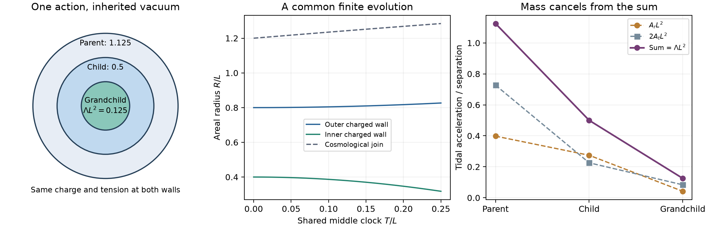

*Figure 10. One shared charged-membrane law gives three vacuum values.
The middle panel uses one common clock and its synchronized cosmological
join. The right panel separates mass and vacuum in free-fall tidal
measurements. The initial-region drawing is not a nucleation history.*

For locally released freely falling probes in each vacuum collar,

$$
\mathcal A_r=\frac{2M}{r^3}+\frac{\Lambda}{3},\qquad
\mathcal A_t=-\frac{M}{r^3}+\frac{\Lambda}{3},\qquad
\mathcal A_r+2\mathcal A_t=\Lambda.
$$

The trace removes the Weyl mass. In SI its measured relative acceleration
per separation is multiplied by $c^2$. A second relation reconstructs
the same vacuum from the flat dust parent's expansion:

$$
\Lambda_0=H_p^2+2\ddot a_p/a_p.
$$

These conditional relations are registered retrospectively as
[NSC-P002](../docs/prediction-register.md#nsc-p002--a-charged-vacuum-transition-and-its-curvature-observable).
Finite instruments and cross-region communication require their own
measurement model; these calculated values are not sky measurements.

Six symbolic identities vanish exactly. Independent 40-digit separated
quadratures reproduce endpoint radii and clocks within
$1.0\times10^{-15}L_{\rm ref}$; two ODE tolerances differ by less than
$3.0\times10^{-12}$ in the normalized state. These are numerical
diagnostics, not model or observational error bars.

This closes the declared finite source-to-geometry-to-observer connection.
Parent flux, charge, bare vacuum, tension and a physical ruler remain
inputs. The supplied two-wall Cauchy data have not been derived from
nucleation. Selecting a formation history and flux sector, with reheating
and observable consequences, is next; refining these trajectories would
not select the cosmological scale.

### 13.3. Preparing the scalar, membrane and geometry together

<!-- nsc-claim:scalar-gravity-preparation -->

Derivation and calculation: [coupled preparation and scope](../docs/nsc-atlas-scalar-preparation.md),
[regular geometry and checks](../results/summaries/nsc-atlas-scalar-preparation-v1.json)
and [scientific controls](../tests/test_nsc_atlas_scalar_preparation.py).

A constant four-form alone supplies vacuum stress. To investigate an
evolving component, explicitly add a canonical scalar with

$$
U(\phi,q)=\rho_b+\frac{m^2\phi^2}{2}+\frac{(q+\mu\phi)^2}{2},
\qquad
\omega^2=m^2+\mu^2,\qquad \epsilon=\frac{m^2}{\omega^2}.
$$

The mixing and fixed-flux elimination come from
[Kaloper--Sorbo](https://arxiv.org/html/0811.1989), equations (1)--(3).
The positive mass term is an additional declared choice; their axion
symmetry is not assumed for it. The minimum and residual density are

$$
\phi_*(q)=-\frac{\mu q}{\omega^2},\qquad
\rho_{\rm vac}(q)=\rho_b+\frac{\epsilon q^2}{2}.
$$

A [conditional rapid-transfer calculation](../docs/nsc-atlas-flux-conversion.md)
gave residual density $.125$, excitation $.09375$ and local energy
release $.0625$ for $\epsilon=1/4$, $\omega=20$, $q_p=1.5$,
$e=.5$ and $\rho_b=0$. Its
[conserving homogeneous history](../results/summaries/nsc-atlas-flux-conversion-v1.json)
did not establish the moving boundary that prepares those data.

There is an exact matching obstruction. At a timelike interface, continuity
between a homogeneous child $\phi_c(t)$ and a constant parent requires
$(d\phi_c/dt)(dt_W/d\tau_W)=0$. Since $dt_W/d\tau_W\geq1$, the child cannot
roll there. Its constant value also fails the child field equation when
$U_{\phi,c}-U_{\phi,p}=-\mu e\ne0$. A spatial scalar layer is necessary.

We retain those couplings and constant tension $\sigma=.2$, then use
regular gravitational preparation in the
[Coleman--De Luccia](https://doi.org/10.1103/PhysRevD.21.3305) construction,
with the continuation described by
[Dong--Harlow, Sections 2.1--2.2](https://arxiv.org/html/1109.0011).
Combined scalar, membrane and gravity preparations also appear in
[Bandos, Blanco-Pillado, Sousa and Urkiola, Section 5](https://arxiv.org/html/2306.09412).
Their field-dependent membrane coupling gives a scalar derivative jump;
our constant-tension example retains a continuous normal derivative.
Each cap has a pole-to-wall coordinate $\xi_j$,

$$
ds_E^2=d\xi_j^2+a_j^2d\Omega_3^2,\qquad
\chi_j=\phi_j-\phi_*(q_j),
$$
$$
\chi_j''+3\frac{a_j'}{a_j}\chi_j'=\omega^2\chi_j,\qquad
a_j''=-\frac{\kappa a_j}{3}
\left(\chi_j'^2+\rho_j+\frac{\omega^2\chi_j^2}{2}\right).
$$

Regularity imposes $a_j(0)=0$, $a_j'(0)=1$ and $\chi_j'(0)=0$.
The Hamilton constraint propagates from these poles. The two lengths
and scalar pole values are outputs. At the wall,

$$
a_i=a_o=R_*,\qquad
\chi_i-\chi_o=-\Delta,\qquad \chi_i'+\chi_o'=0,
$$
$$
a_i'+a_o'=\frac{\kappa\sigma R_*}{2},\qquad
\Delta=\frac{\mu e}{\omega^2}.
$$

The parent pole-to-wall derivative points opposite to the common outward
normal. Both caps therefore satisfy the same charged force,

$$
\sigma\overline{K}
=e\left(q_p+\mu\phi_W-\frac{e}{2}\right),
\qquad [K^a{}_b]=-\frac{\kappa\sigma}{2}\delta^a_b.
$$

All field gradients and gravitational effects are retained in the solve.
The converged ordinary-cap branch gives

| Quantity | Normalized value |
| --- | ---: |
| Wall radius $R_*$ | 2.70634531321651 |
| Child pole-to-wall length | 2.86731015671418 |
| Parent pole-to-wall length | 7.07049444470919 |
| Wall field $\phi_W$ | -.0543355679824020 |
| Common normal field derivative | -.215595888249873 |
| Wall normal pressure | .154440177981835 |

The two collocation tolerances change the radius by $3.81\times10^{-12}$.
The independent Hamilton constraint is below $6.9\times10^{-13}$ and
the sampled scalar equation below $2.2\times10^{-9}$.
These are numerical checks of a nonlinear construction, not a
validated interval proof of existence or uniqueness.

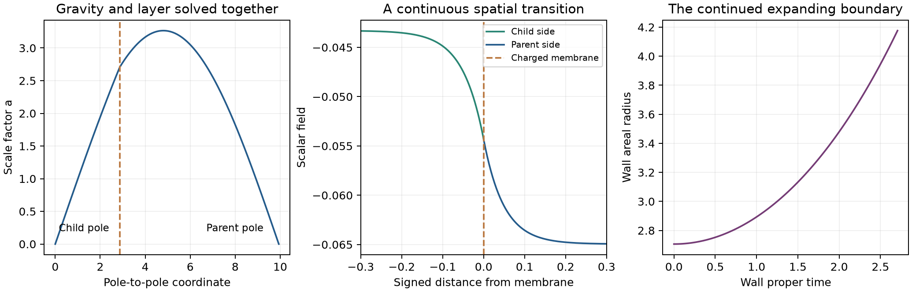

*Figure 11. The scalar transition layer and gravitational caps are solved
together with the membrane. Both field value and common-normal derivative
are continuous. The right panel shows the continued timelike boundary.
Lengths and field values use the declared normalized variables.*

### 13.4. Physical boundary reduction and the prepared child

<!-- nsc-claim:scalar-preparation-schur -->

Derivation and calculation: [boundary action and continuation](../docs/nsc-atlas-scalar-preparation.md#a-physical-scalar-boundary-reduction),
[independent action and pole transfer](../results/summaries/nsc-atlas-scalar-preparation-v1.json).

At this solved geometry, the regular scalar maps
$s_j=\chi_j'(L_j)/\chi_j(L_j)$ are actual Dirichlet-to-Neumann coefficients.
Continuity and normal matching determine

$$
\chi_i=-\frac{\Delta s_o}{s_i+s_o},\qquad
\chi_o=\frac{\Delta s_i}{s_i+s_o}.
$$

Integrating $(a^3\chi\chi')'=a^3(\chi'^2+\omega^2\chi^2)$ gives
the scalar excitation action at fixed geometry:

$$
S_\chi=\pi^2R_*^3
\left(s_i\chi_i^2+s_o\chi_o^2\right)
=\pi^2R_*^3\Delta^2\frac{s_i s_o}{s_i+s_o}.
$$

The coefficients are $s_i=19.53870489005$ and $s_o=20.30793503714$,
with Schur coefficient $9.95794752938$. Direct bulk integration and
the boundary expression give $S_\chi=.913188612282$, differing by less
than $2.8\times10^{-13}$. This is a physical elliptic preparation
reduction. It is not yet a retarded memory kernel or an added bulk Lambda.

Continuing one sphere angle gives

$$
ds_L^2=d\xi_j^2+a_j^2
\left(-d\eta^2+\cosh^2\eta\,d\Omega_2^2\right).
$$

The same scalar and junction equations hold. Wall proper time is
$\tau_W=R_*\eta$, and
$R_W=R_*\cosh(\tau_W/R_*)$. At $\eta=1$ the areal radius is
$4.17610904394739$. Scalar energy flux vanishes in the symmetric wall's
rest frame; the spatial layer and its stresses are part of the solution.

Near the child pole, $\xi=i\tau$ produces an open cosmology:

$$
\ddot\chi+3\frac{\dot b}{b}\dot\chi+\omega^2\chi=0,\qquad
\dot b^2=1+\frac{\kappa b^2}{3}(\rho_i+E),
\qquad E=\frac{1}{2}(\dot\chi^2+\omega^2\chi^2).
$$

Its regular data are $b(0)=0$, $(db/d\tau)(0)=1$, $(d\chi/d\tau)(0)=0$ and
the calculated pole value $\chi(0)=\chi_i(0)$. The coordinate origin
has finite curvature. Since $dE/d\tau=-3H(d\chi/d\tau)^2\leq0$ and
$\rho_i>0$, comparison bounds $b$ between open de Sitter solutions
with densities $\rho_i$ and $\rho_i+E_0$. The homogeneous future chart
therefore continues through every finite proper time.

An independent logarithmic-mode calculation determines the small pole
state without subtracting nearly equal field minima:

$$
\chi_i(0)=-6.9370429853\times10^{-25},\qquad
E_0=9.6245130760\times10^{-47}.
$$

This preparation does not realize the earlier assumed excitation $.09375$.
The spatial scalar layer carries energy per membrane area
$.00233741846805$, distinct from the bare tension $.2$. The homogeneous
child remains vacuum dominated, with $E/\rho_i\leq7.70\times10^{-46}$.
The calculation identifies where the excitation resides and prevents
importing the rapid-transfer amplitude into a different prepared state.

Regular Euclidean preparation is a declared state choice. No negative-mode
count, determinant, preferred contour or tunnelling probability has been
derived. A physically specified excited-parent or nonequilibrium
preparation is needed if substantial child matter is claimed. Absolute
vacuum scale, black-hole collapse formation and infinite physical nesting
remain separate questions.

### 13.5. Real parent sources and received energy

<!-- nsc-claim:prepared-parent-transport -->

Derivation and calculation: [causal and energy derivation](../docs/nsc-atlas-parent-transport.md),
[compact calculation and independent checks](../results/summaries/nsc-atlas-parent-transport-v1.json).

The small regular pole amplitude is not the transmission coefficient
for energy already present in the parent. Before choosing an excited
parent field, determine which sources can reach the child. Use the
same solved scalar/gravity profiles and membrane. An inward radial
test body starts at parent distance $.3L_{\rm ref}$ from the wall
on $\eta=0$, with supplied local Lorentz factor $\gamma_s$.
There is no direct material interaction with the membrane in this
test-body calculation.

The regular child pole fixes $x$ by $dx=d\xi/a$, with $e^x/\xi$ tending
to one. The conserved radial charge is $K=a_s\gamma_s$. An inward
trajectory requires $K$ greater than the largest $a$ along its path.
Its delay relative to a null ray
fixes the label transmitted across the child cone:

$$
D(K)=\int \frac{|d\xi|}{a}
\left[\frac{1}{\sqrt{1-a^2/K^2}}-1\right],\qquad
L=\exp(\eta_s+x_s+D).
$$

The integral includes the parent cap, membrane and child cap. The
metric and geodesic tangent are continuous at the wall. In the open
child, $b^2|d\chi/ds|=K$. For the vacuum comparison metric
$b=\sinh(h\tau)/h$, $h^2=\kappa\rho_i/3$, the regularized radial
integral has the closed form

$$
e^{I(\tau)}=\frac{2/h}{\coth(h\tau)+
\sqrt{\coth^2(h\tau)+(hK)^{-2}-1}},\qquad
\chi=\ln L-I(\tau).
$$

Hence a finite central arrival exists exactly when

$$
L<\frac{2K}{1+hK}.
$$

Failing this condition does not prevent entry into the child: a body
can remain at positive comoving distance and never reach its center.
For light the bound is $N=\exp(\eta_s+x_s)<2/h$. On the initial
slice, only parent distances below $3.700717257L_{\rm ref}$ can signal
the center, out of a parent cap length $7.070494445L_{\rm ref}$.
This is a specified observer's causal region, not a universal boundary
between different kinds of matter.

At source depth $.3L_{\rm ref}$ the massive threshold is
$\gamma_s=1.290485734$. The primary choice $\gamma_s=2$ yields

$$
\frac{c\tau_r}{L_{\rm ref}}=4.285837228,\qquad
\gamma_r=\sqrt{1+\frac{K^2}{b_r^2}}=1.546392954,\qquad
\frac{E_r}{E_s}=.773196477.
$$

The null control arrives at $3.420193817L_{\rm ref}/c$ with
$1+z=1.294206955$. The massive received speed is $.762773146c$;
arrival is not the production of cold matter. Its energy ratio refers
to two local frames, not a conserved global energy.

For a geometric comparison, replace the parent and membrane with a
single de Sitter space at the same child $h$. Fix the source's initial
areal radius, inward $\gamma_s=2$ and time-symmetric slice, using the
hemisphere nearest the receiver. The embedding control gives reception
at $4.014164210L_{\rm ref}/c$ and $E_r/E_s=.811509668$. The nested
geometry therefore delays reception by $.271673018L_{\rm ref}/c$ and
reduces received energy by $4.721224$ percent relative to that control.
This distinguishes these two supplied source/geometry pairs; unknown
source data or other geometries can retain degeneracies.

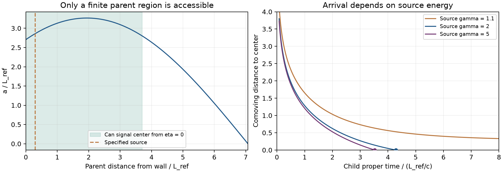

*Figure 12. The left panel identifies the parent region that can signal
the central child from the selected initial slice. The right panel shows
three transmitted massive trajectories. The lowest-energy example enters
the child but misses the center; the other two reach it at finite times.*

An independent de Sitter embedding recovers the zero-wall limit:
for source angle $\theta=h\xi_s$, central access requires
$\gamma_s>1/\cos\theta$ and gives $\gamma_r=\gamma_s\cos\theta$.
Direct integration of the child trajectory agrees with the closed
inverse within $7\times10^{-14}L_{\rm ref}/c$. Two background
tolerances change the primary arrival by $1.06\times10^{-11}$ and
its energy ratio by $8.74\times10^{-13}$. These are numerical checks,
not observational errors. Section 13.4's two de Sitter comparison
metrics bracket the residual homogeneous-background correction; they
do not bound backreaction from a new material population.

A simple collision alternative also has an exact diagnostic. The
[free-passage construction of Giblin, Hui, Lim and Yang](https://arxiv.org/abs/1005.3493)
motivates adding two scalar profiles. On one prescribed metric, with
additive swept flux and continuing prescribed membranes, the present
linear scalar equation gives

$$
\phi_*(q_p-e_L)+\phi_*(q_p-e_R)-\phi_*(q_p)
=\phi_*(q_p-e_L-e_R).
$$

Two equal charges $.5$ from $q_p=1.5$ therefore land on the
$q=.5$ minimum, with vacuum density $.03125$ and no homogeneous
displacement energy there. This control does not solve the interacting
gravitational collision or exclude radiation from deflected walls.
It prevents assigning the instantaneous quench energy to free passage.

The next source must be a finite, constraint-compatible parent field
preparation in the accessible region. Its scalar, metric and membrane
perturbations must be matched together before calculating transmitted
stress, isotropy or clustering. The smooth-wall bulk framework of
[Garriga, Montes, Sasaki and Tanaka](https://arxiv.org/html/astro-ph/9811257)
is useful input; an independently charged membrane requires its own
interface equations. Population normalization and the physical ruler
remain inputs to be supplied. The present result makes the geometric
part of that future source-to-observer calculation explicit.

### 13.6. A finite parent source with its gravitational response

<!-- nsc-claim:finite-parent-scalar-source -->

Derivation and calculation: [source, constraint and matching derivation](../docs/nsc-atlas-parent-source.md),
[finite preparations and independent checks](../results/summaries/nsc-atlas-parent-source-v1.json).

The next preparation includes the source's gravity. Retain the action,
charges and tension of Section 13.3, and prescribe a finite compact
scalar displacement in the parent. On the initial slice, the spatial
extrinsic curvature and scalar momentum vanish. This is a time-symmetric
packet, not a purely incoming wave. Its prior formation history is supplied
neither by the regular saddle nor by this Cauchy construction.

Let $h_0$ and $\phi_0$ denote the regular reference data. Solve
$h=\Psi^4h_0$ with $\phi=\phi_0+f+g$, where $f$ is the specified
parent packet and $g$ is a small wall-layer correction. The scalar
Hamiltonian constraint and conformal curvature identity, as in
[Choquet-Bruhat, Isenberg and Pollack, Section 2](https://arxiv.org/html/gr-qc/0610045), give

$$
\Delta_0\Psi=
\frac{\kappa}{8}\left[(\phi_0')^2-(\phi')^2\right]\Psi
+\frac{\kappa U_0}{4}\Psi-\frac{\kappa U}{4}\Psi^5.
$$

Primes use seed proper radial distance. The momentum constraint is
zero. Regularity gives $\Psi'=0$ at both poles; the same material
tension gives, in the common child-to-parent normal convention,

$$
[\Psi]=0,\qquad [\Psi']=\frac{k}{2}(\Psi-\Psi^3),
\qquad k=\frac{\kappa\sigma}{2}.
$$

For a second-order smooth initial corner there is an additional scalar
requirement. If the old field value and
first seed-normal derivative $s$ are retained at the wall, the physical
normal derivative becomes $s/\Psi_W^2$. The scalar wave equation and
the full trace jump $[K]=-3k$ require

$$
[\phi_{;nn}]-3k\phi_n-\mu e=0.
$$

Freezing the old layer after changing the metric violates this condition
unless $\Psi_W=1$ for the stated couplings. A parent-side correction
with $g(0)=g'(0)=0$ and $g''(0)=\lambda$ repairs it precisely when

$$
\lambda=\mu e(\Psi_W^4-1)+2ks(\Psi_W^2-1).
$$

Thus the scalar correction is solved with gravity. It is not an extra
surface impulse or an adjustable energy injection. The finite example
uses $f=A(1-z^2)^6$ for $|z|<1$, with $z=(d-.3)/.12$, and zero
outside. Here $d$ is seed distance into the parent from the wall.
The correction is $g=\lambda d^2(1-d/.08)^6/2$ for $0\le d<.08$,
and zero outside. These profile choices are explicit state data.

The complete instantaneous Israel conditions determine the two normal
wall accelerations. With $B_j=\beta_j/R$, $\beta_j=\partial_nR$ and
$P=e(q_p+\mu\phi_W-e/2)$, they are

$$
\overline{A}=\frac{P}{\sigma}-(B_i+B_o),\qquad
A_i=\overline{A}+\frac{k}{2},\qquad A_o=\overline{A}-\frac{k}{2}.
$$

The radial Einstein equation then gives the initial areal acceleration:

$$
\frac{d^2R}{d\tau_W^2}
=-\frac{m_j}{R^2}-\frac{\kappa R p_{r,j}}{2}+A_j\beta_j,
\qquad m_j=\frac{R}{2}(1-\beta_j^2).
$$

The two sides agree algebraically using the force and Israel conditions.
The scalar acceleration computed from each side agrees only after the
second-normal matching condition is included.

| Amplitude | Proper scalar excess | Wall radius | Initial areal acceleration |
|---|---|---|---|
| 0 | 0 | 2.706345313 | .369501998 |
| .01 | .270536650 | 2.721705563 | .374020762 |
| .02 | 1.112671383 | 2.764905208 | .386385323 |

The table uses the declared normalized units. Proper scalar excess
includes the quadratic excitation and its interference with the original
field, both evaluated on the same sourced metric. It is not a global
conserved energy or an ADM mass. For $A=.02$, $\Psi_W=1.010761098$
and $\lambda=.3779028621$. The radius increases by $2.163800$ percent
and its initial areal acceleration by $4.569211$ percent.

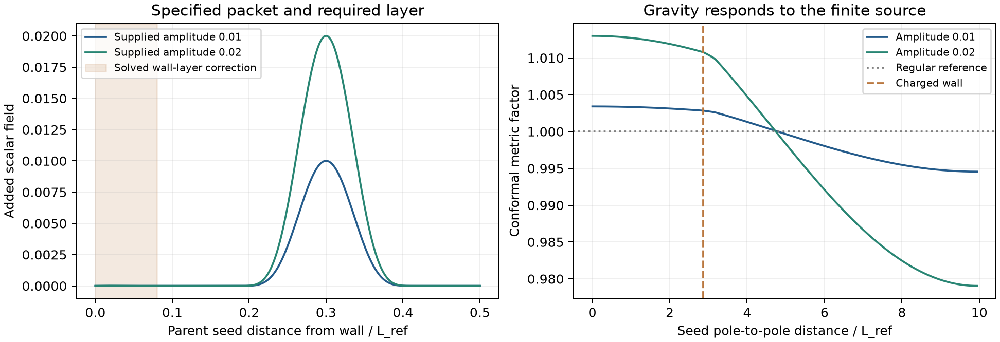

*Figure 13. The specified scalar packet and required narrow wall correction
are accompanied by a jointly solved spatial geometry. The conformal factor
changes on both caps. These are different constrained initial data, not
an instantaneous signal travelling from the packet to the child.*

For this example the shared initial scalar acceleration at the wall is
$.180243894532$. With outward flux $F=-T(n,u)$, its initial value
vanishes and its derivative is $.038036802293$. Positive denotes
child-to-parent exchange. The initial direction therefore does not
establish inward matter deposition; later arrival and transmission of
the parent packet must be evolved.

The deliberately frozen-layer control passes the gravitational constraint
but leaves scalar compatibility residual $-.362064088$. The solved
correction reduces the reported two-sided matching gaps below
$3\times10^{-15}$. Independent mass integration from the two poles gives
$.44414721424740$ and $.96826983393285$, matching the geometric masses
within $7\times10^{-13}$. Direct Hamiltonian residuals remain below
$3\times10^{-8}$, and two tolerances change the wall radius by
$4.36\times10^{-10}$. Five symbolic identities and the zero-source
limit check the construction. These numerical comparisons establish
neither interval-certified existence nor uniqueness.

The result supplies finite source gravity, instantaneous wall matching
and scalar compatibility through second order. It is not a finite-time
evolution or an all-order corner-compatibility theorem. The physical
ruler, preparation history and subsequent transmitted stress remain
open. The bulk vacuum values are unchanged. The next connected problem
is the evolution of these data and the energy delivered through their
moving boundary, followed by the stress required for clustering.

### 13.7. A conditional inward pulse from the excited parent

<!-- nsc-claim:parent-inward-transfer-limit -->

Derivation and calculation: [weak-corner preparation and transfer derivation](../docs/nsc-atlas-parent-source.md#a-weak-initial-corner-can-carry-a-real-inward-pulse),
[exact seed and independent massive-field control](../results/summaries/nsc-atlas-parent-source-v1.json).

Smooth second-order compatibility at the initial interface is a choice
of regularity. Its failure does not by itself exclude a finite-energy
weak transient. A different preparation with the same action makes this
distinction useful: put the field uniformly at the child minimum on
the entire time-symmetric slice. The child has no initial excitation;
the parent has excitation density $3/32$ above its own minimum.

The initial densities are $\rho_i=1/8$ and $\rho_p=3/8$. Round Cauchy
caps satisfy the gravitational constraints and instantaneous wall laws
exactly with

$$
B_i=\frac{7}{15},\qquad B_o=\frac{11}{30},\qquad
R_*^2=\frac{1800}{467},\qquad R_*=1.96325997301.
$$

Both poles are regular, and the parent excitation has finite proper
integral $38.30744838$ in normalized units. The initial wall pressure
is $P_0=1/4$ and its areal acceleration is $1/R_*$. This is a turning
instant, not static equilibrium. The parent is an excited scalar
region; its future is not a de Sitter vacuum continuation.

The scalar's initial corner is not twice differentiable in the required
piecewise spacetime sense. Suppose a causal local weak development
exists with continuous scalar value and normal derivative and bounded
one-sided geometric coefficients. Existence of that full coupled
development remains a separate question. With wall proper time $\tau$
and normal coordinate $x$, child $x<0$, the tangent equation is

$$
(\partial_\tau^2-\partial_x^2)\chi=-S H(x),\qquad
S=\mu e=5\sqrt{3}.
$$

The initial field displacement and its time derivative vanish. Retarded
integration in the child portion of the initial cone gives

$$
\chi_i=-\frac{S}{4}(\tau+x)^2\quad(-\tau<x<0).
$$

The corresponding parent expression matches its value and first
derivatives at the wall. Spherical terms, finite wall acceleration and
the massive-field term enter at higher order under the stated bounded
geometry assumptions. Thus the local coupled-development limit is

$$
F_{\rm in}=18.75\tau^2+O(\tau^3),\qquad
\frac{E_{\rm child}}{\mathcal{A}_0}=6.25\tau^3+O(\tau^4),
\qquad \mathcal{A}_0=4\pi R_*^2.
$$

Positive flux here means parent-to-child. It is generated by the
different potential slopes, with the energy initially stored in the
parent. The leading parent-layer energy loss equals the child gain;
there is no separately prescribed incoming waveform. The same
field controls the membrane pressure and gives a geometric relation:

$$
P(\tau)=\frac14-18.75\tau^2+O(\tau^3),\qquad
\sigma\overline{K}=P(\tau),\qquad
\lim_{\tau\to0^+}\frac{P_0-\sigma\overline{K}}{F_{\rm in}}=1.
$$

This links transmitted scalar energy and wall curvature from one source
and one set of couplings. It is a conditional short-time prediction,
not a calculated finite-time cosmological abundance. No remainder
constant for the curved coupled evolution has been established.

As a separate check, the exact planar massive retarded solution gives
inward flux $.001856325865$ and child energy per area
$.000006212608434$ at $t=.01$. Direct integration of the field energy
agrees with the integrated boundary flux and the parent energy loss. Those finite-time numbers
belong to that planar control only. The sharp membrane model also
leaves finite-thickness corrections outside this limit.

In the initially quiet child, the leading edge cannot reach the center
before proper time $2.07981585635L_{\rm ref}/c$, obtained from its
de Sitter domain of dependence. This is a causal front time, not a
detector threshold or received waveform. The next step is a coupled
causal development that tests the nonzero transfer and pressure relation
at finite times. The smooth source of Section 13.6 remains a distinct
preparation control, not a compulsory gate on this weak-corner route.

### 13.8. A one-sided geometric observer and the full mass balance

<!-- nsc-claim:geometric-wall-observer -->

Derivation and calculation: [observer and energy derivation](../docs/nsc-atlas-geometric-observer.md),
[coupled reference and independent checks](../results/summaries/nsc-atlas-geometric-observer-v1.json).

An observer relation can be derived without first knowing the incident
waveform. It combines the charged-wall force with the scalar geometrization
approach reviewed by [Krongos and Torre](https://arxiv.org/html/1503.06311).
Their full metric conditions include differential integrability; the local
tests here do not replace them or prove a bulk spacetime exists.

Use child-side geometry, the normal pointing into the parent, and wall
proper time. Write the mixed extrinsic eigenvalues as $A,B,B$, where
$A=n\cdot a$ is normal proper acceleration and $B=n(R)/R$.
These are not generally the areal acceleration or the radius's fractional
rate of increase.
Israel and the material force give

$$
P=\sigma\left(A+2B-\frac{3k}{2}\right),\qquad
\chi_W=\frac{P-P_c}{S},\qquad
\Pi=\frac{\dot P}{S},
$$

where $k=\kappa\sigma/2$, $S=\mu e$ and
$P_c=e(\epsilon q_c+e/2)$. Thus the field and its wall-time derivative
are determined by one-sided geometry once the action parameters are fixed.
No parent-side metric observation is needed for this step.

Gauss and Codazzi supply the normal pressure and inward flux:

$$
\kappa p_n=-\frac{2\ddot R}{R}-\frac{1+\dot R^2}{R^2}+2AB+B^2,
$$
$$
\kappa F_{\rm in}=2\left[\frac{\dot R}{R}(A-B)-\dot B\right].
$$

For the canonical scalar, $Q=2(p_n+U)-\Pi^2$ must be nonnegative
and $F_{\rm in}^2=\Pi^2Q$. When $\Pi\ne0$, its signed normal
derivative is $F_{\rm in}/\Pi$. At $\Pi=0$ only its magnitude is
identified by these observables; the inversion is sensitive to noise near that limit.

An independent bulk tidal contraction must then obey

$$
Y\equiv R_{uu}-\frac{\kappa}{S^2}\dot P^2
=-\Lambda_c-C(P-P_c)^2,\qquad
C=\frac{\kappa\omega^2}{2S^2}
=\frac{\kappa}{2(1-\epsilon)e^2}.
$$

For three distinct pressures on the same wall, the second divided
difference of $Y$ is exactly $-C=-8/3$ in the reference model.
This relation holds on regular finite intervals, beyond the short-time
expansion. Source history has disappeared; the field action has not.

With $S$ and $C$ fixed, two calibration points determine $P_c$ and
$\Lambda_c$ phenomenologically. They must also satisfy the action's
relation between flux, mixing and vacuum; the bare term cannot be
independently retuned. A withheld third value tests the resulting curve.
The synthetic example in the record performs that recovery and detects
a deliberate $.001$ discrepancy. It is not an observational comparison.

The actual regular continuation provides a separate physical model check.
From its wall geometry the inverse recovers
$\phi_W=-.0543355679824$ and $|\Phi|=.215595888250$.
An independent metric calculation gives $R_{uu}=-.149351145558$.
The potential excitation accounts for $.024351145558$, leaving the
declared vacuum $.125$. Interpreting the whole tidal magnitude as vacuum
would therefore overestimate it by about $19.48$ percent in this example.
The continuation has constant $P$; multiple times repeat one point of
the tidal curve rather than supplying several distinct calibration points.

Energy accounting supplies another exact check. For the geometric
Misner--Sharp mass,

$$
m=\frac{R}{2}\left[1+\dot R^2-(BR)^2\right],\qquad
\dot m=\frac{\kappa R^2}{2}
\left[BR F_{\rm in}-\dot R p_n\right].
$$

This is the signed wall-frame form of
[Hayward's energy-supply and work law](https://arxiv.org/html/gr-qc/9710089).
Subtracting $\Lambda_cR^3/6$ leaves an excitation-pressure work term.
On the existing evolved reference the scalar influx is exactly zero,
yet the mass above vacuum grows from $.003668251239$ to $.013477983984$
over $0\le\tau\le2.706345313217$. Independent pressure integration
accounts for the increase $.00980973274508$, agreeing within
$1.8\times10^{-15}$. Enclosed mass growth alone is therefore not an
accretion measurement, even in this explicit coupled nested geometry.

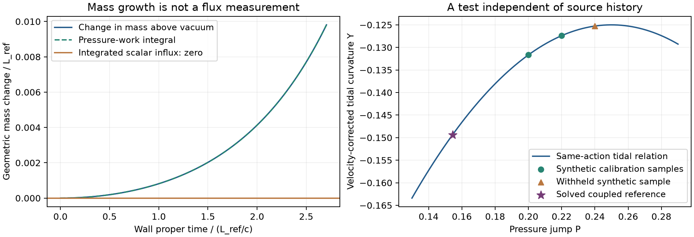

*Figure 14. Left: the solved continuation gains mass with zero scalar
influx; pressure work explains the change. Right: the star is its one
pressure/curvature point. The other markers are explicitly synthetic
calibration and withholding checks, not observed universes or new solutions.*

The observable test requires normal metric information and independent
tidal curvature. Radius or cosmological expansion alone is insufficient.
Its identities are necessary conditions for this action, not a complete
Rainich theorem, a globally reconstructed parent or an empirically selected
cosmology. They supply finite-time diagnostics for the coupled evolution
that remains to be constructed.

### 13.9. What an additional inherited region can identify

<!-- nsc-claim:one-wall-inheritance-ambiguity -->

Derivation and calculation: [coupling equivalence and inverse](../docs/nsc-atlas-geometric-observer.md#why-one-wall-cannot-determine-the-inherited-couplings),
[exact identity and numerical controls](../results/summaries/nsc-atlas-geometric-observer-v1.json).

There is a precise reason to extend the atlas beyond one interface.
Two fixed parameter choices in the same scalar/four-form family can
produce identical local classical dynamics while predicting different
consequences for the next charge sector. Keep $\omega=20$, $\kappa=1$,
$\sigma=.2$ and $\rho_b=0$ in both candidates, and choose

$$
(\epsilon,e,q_c)_A=(1/4,1/2,1),\qquad
(\epsilon,e,q_c)_B=(25/28,\sqrt{7}/2,-\sqrt{7}/5).
$$

In each case $q_p=q_c+e$. Let $\delta=3\sqrt{3}/100$. Direct
expansion gives the exact potential identity

$$
U_B\left(\phi+\delta,\sqrt{7}(q-6/5)\right)-U_A(\phi,q)
=3(q-1)(q-3/2).
$$

The difference vanishes for every field value in the original parent
and child sectors. A constant field translation preserves the kinetic
term, and the two models share both vacuum densities, $S=\mu e$,
tension and wall-force law. Their reduced classical scalar/gravity
equations and matching are identical at that interface, including for
mapped time-dependent states. More precision in those observations alone
cannot choose between the two parameter sets.

This equivalence excludes independent charge probes, extra matter
couplings that fix an absolute field origin and quantum preparation
probabilities. It is a statement about the declared classical sector.

One further step of each model's unchanged oriented charge gives

$$
(\Lambda_p,\Lambda_c,\Lambda_g)_A=(9/32,1/8,1/32),\qquad
(\Lambda_p,\Lambda_c,\Lambda_g)_B=(9/32,1/8,49/32).
$$

These are relaxed potential values, not a constructed grandchild
spacetime. Candidate B's next step is upward in ground energy, so the
ordinary descending-cap preparation cannot simply be repeated there.
The distinct prediction nonetheless identifies information that the
first interface cannot supply.

For three comparable ground-vacuum sectors with a common action and
equal oriented charge steps,

$$
D=\Delta^2\Lambda=\kappa\epsilon e^2.
$$

Combining this with the local tidal coefficient $C$ resolves the
mixing and charge magnitude:

$$
e^2=\frac{D}{\kappa}+\frac{\kappa}{2C},\qquad
\epsilon=\frac{D/\kappa}{D/\kappa+\kappa/(2C)}.
$$

Both candidates have $C=8/3$, but $D=1/16$ and $D=25/16$
respectively. The inverse recovers both parameter choices. This is
a test of an inherited-law hypothesis using additional regional
information. It does not prove that constants are inherited, that the
third region exists, or that these regions can all be observed in a
common normalization. The following construction supplies the third
initial region and a protected evolving parent domain.

### 13.10. Three sourced regions on one compact initial slice

<!-- nsc-claim:shared-scalar-initial-atlas -->

The previous ambiguity can now be tested on a physical third initial
region. Keep the scalar/four-form action of Section 13.3, with
$\kappa=1$, $\epsilon=1/4$, $\omega=20$, $e=1/2$, $\sigma=1/5$
and zero bare density. Inside outward, use fluxes $(1/2,1,3/2)$ and
one uniform initial field $\phi_0=-\sqrt{3}/80$, at the grandchild
minimum. Its momentum and spatial gradient vanish. The initial and
ground densities differ:

$$
(U_g,U_m,U_p)=(1,7,21)/32,\qquad
(\rho_{v,g},\rho_{v,m},\rho_{v,p})=(1/32,1/8,9/32).
$$

The supplied radii are 1 and 1.9, and the middle mass constant is .12;
both pole-region constants vanish. These are declared initial data.
The Kottler functions with $\Lambda_j=\kappa U_j$ represent the
instantaneous constraints. They cannot represent the excited scalar's
subsequent vacuum evolution. Reusing the signed Israel equations,

$$
\beta_i=\frac{M_o-M_i}{kR^2}
 +\frac{\kappa(U_o-U_i)+3k^2}{6k}R,\qquad
\beta_o=\beta_i-kR,\quad v^2=\beta_i^2-f_i,
$$

gives two expanding timelike walls. The inner pair of signed beta
values is (1.5625,1.4625), with areal speed 1.204916145077. The outer
pair is (1.148006694367,.958006694367), with speed .841108986073.
An areal speed above one is compatible with timelike normalization.
The same middle mass is used on both boundaries.

The caps have slice extrinsic curvature $L^i{}_j=-H\delta^i{}_j$,
where $H=v/R$ on the corresponding wall. The grandchild sectional
curvature is $-369/256$; the parent's is .022776502368. Between them
choose a quintic interpolation of H whose first two derivatives vanish
at both ends, and put

$$
v_s=RH(R),\quad R_\ell=\sqrt{f_m+v_s^2},\quad
L_r=-v_s',\quad L_\theta=-v_s/R.
$$

Direct substitution proves both smooth Einstein constraints. The
angular jump gives the distributional Hamiltonian source
$-4[\beta]/R=2\kappa\sigma$, and the continuous $L_\theta$ gives
zero surface momentum. Both caps close at regular poles, producing
a compact S3 slice of proper length 20.393422999807. This uses the
standard Einstein-scalar constraints of Choquet-Bruhat, Isenberg and
Pollack (Section 2), together with the material Israel conditions;
their smooth theorem is not a shell-evolution theorem.

The temporal jump is also retained. The pressure relation fixes

$$
\overline{A}=P/\sigma-(B_i+B_o),\qquad [A]=-k.
$$

A positive lapse
collar realizes both one-sided derivatives while taking N=1 on the
walls and near the poles. Its global bounds are .95649 and 1.04549.
Independent acceleration checks use the full moving mass
$m=R(1+v^2-\beta^2)/2$. The detailed construction and exact constraint
proof are in the [shared-slice owner](../docs/nsc-atlas-shared-scalar-slice.md).

The one-sided observer formula at each wall recovers the common field.
After subtracting the excitation, the three ground values are those
of candidate A. More strongly, candidate B from Section 13.9 obeys,
for every integer sector and every real canonical scalar state,

$$
q_n=e_B(3/5-n),\qquad
\rho_B\geq U_{\min,B}(n)=\frac{25}{32}(3/5-n)^2\geq\frac18.
$$

The new grandchild geometry instead requires density 1/32 from its
Hamiltonian constraint. The unavoidable gap is at least 3/32. Thus
changing B's preparation, including its gradients or momenta, cannot
reproduce this geometry under its unchanged law. This is a stronger
inheritance distinction than the previous potential-only comparison.
It is a mathematical rejection on the constructed geometry, not an
astronomical measurement or exclusion of all alternative actions.

The scalar corners remain weak: conditional short-time inward flux
coefficients are 18.75 and 56.25 at the two separate wall proper clocks.
They do not establish a finite interacting evolution. Initial
composition is now explicit; a full weak future remains open. The
[constraint and sector record](../results/summaries/nsc-atlas-shared-scalar-slice-v1.json)
contains the independent checks and exact parameters.

### 13.11. Cosmology in the protected parent domain

<!-- nsc-claim:protected-parent-cosmology -->

The initial parent cap is homogeneous closed-FLRW scalar data with
$a_0=6.626077076100$, $H_0=.442688940038$, ground density 9/32 and
excitation 3/8. Its angular extent from the parent pole is
$\theta_w=2.850764359770$. The smooth homogeneous solution determines
the domain of dependence of these actual cap data. Any causal
completion of the whole atlas must agree there; no completed wall
future is required to calculate this domain.

Writing chi for displacement from the parent minimum gives

$$
\dot\chi=\Pi,\quad \dot\Pi=-3H\Pi-\omega^2\chi,\quad
\dot a=aH,\quad \dot H=a^{-2}-\kappa\Pi^2/2,
$$

$$
E=(\Pi^2+\omega^2\chi^2)/2,\quad
3(H^2+a^{-2})=\kappa(\rho_v+E),\quad \dot E=-3H\Pi^2.
$$

Put $h_{\min}^2=\kappa\rho_v/3$. Because $a_0h_{\min}>1$,
H cannot vanish on the expanding branch; it stays above .266408516441.
The energy decreases, bounding the scalar and H and allowing smooth
continuation at every finite future time. Total future conformal
distance has the explicit bound

$$
\int_0^\infty\frac{dt}{a(t)}
\leq\arcsin\frac{1}{a_0h_{\min}}=.515418396612.
$$

Hence all comoving points with $\theta<2.335345963158$ remain within
the parent domain of dependence for all future proper time. They
occupy at least 90.703557% of the initial parent volume. This is a
sufficient causal bound, not the exact horizon or a construction
of the remaining wall spacetime. The initial lapse collar merely
changes coordinates on the smooth development.

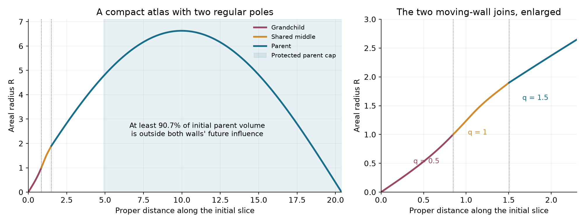

*Figure 15. The compact initial geometry, with the two joins enlarged
at right. Shading marks the sufficient protected parent cap. The
parent contains an evolved scalar source under the same action;
the unshaded interacting wall future remains a separate problem.*

Taking the initial parent curvature radius as the independently
specified reference length gives the conditional inherited value

$$
\Lambda_{\rm parent}L_{\rm ref}^2
=\kappa\rho_v a_0^2=12.348252398928.
$$

This depends on the declared couplings and initial data. It does
not select the measured cosmic Lambda or provide an SI ruler.
Integrating in proper time and independently in expansion e-folds
produces the same one-e-fold endpoint:

| Quantity | Same-source parent value |
| --- | ---: |
| Proper time | 2.888845513139 |
| Scale factor | 18.011544909930 |
| H | .311446897816 |
| Scalar excitation | .018994903671 |
| Integrated scalar expansion work | .356005096325 |
| Comoving scalar energy divided by its initial value | 1.017394237405 |

The excitation is within 1.74% of pressureless dilution across this
interval, which motivates a perturbation calculation but does not
prove clustering. Maximum Friedmann and work residuals are below
$3.3\times10^{-11}$; independent endpoint differences are below
$1.5\times10^{-11}$. The declared numerical comparison tolerance
is $10^{-9}$ in normalized variables, not an interval enclosure
or observational uncertainty.

The [compact evidence](../results/summaries/nsc-atlas-shared-scalar-slice-v1.json)
binds these numbers to the same action, constraints and implementation.
The following calculation tests scalar and metric perturbation growth
on this evolving domain. Its observer transfer and physical scale
remain further connections, while the full wall problem stays explicit.

### 13.12. A constrained parent perturbation that grows

<!-- nsc-claim:inherited-parent-structure -->

Near-pressureless homogeneous dilution does not determine whether a
field develops gravitational structure. We now perturb the same
protected parent, keeping its scalar action and curvature fixed.
The linear equations reuse the general curved-background formalism
of [Hwang and Noh](https://arxiv.org/html/astro-ph/0103244).
In Newtonian gauge the canonical scalar has no linear anisotropic
stress, so both metric potentials equal Phi. Let X be its field
perturbation and Y its proper-time derivative. For S3 scalar harmonics
with $\lambda=n(n+2)$ and $n\geq2$,

$$
\dot X=Y,\qquad
\dot Y=-3HY-(\omega^2+\lambda/a^2)X
 +4\Pi\dot\Phi-2\omega^2\chi\Phi,
$$

$$
\dot\Phi=-H\Phi+\frac{\kappa}{2}\Pi X.
$$

Here chi and Pi are the existing homogeneous parent field and
velocity. Its energy constraint is

$$
C=\left(\frac{\lambda-3}{a^2}-\frac{\kappa\Pi^2}{2}\right)\Phi
 +\frac{\kappa}{2}\left[\Pi Y+(\omega^2\chi+3H\Pi)X\right]=0.
$$

Direct differentiation proves

$$
\dot C=-3HC.
$$

The spatial Einstein
equation and perturbed energy conservation are independently verified.
No step divides by the oscillating scalar velocity; the numerical
evolution passes eighteen ordinary velocity sign changes.
The gauge-invariant comoving density contrast is

$$
\Delta=\frac{\delta\rho+3H\Pi X}{E}
=-\frac{2(\lambda-3)\Phi}{\kappa a^2E}.
$$

Density and metric transfer are therefore connected. The local
lensing-potential combination is $\Phi+\Psi=2\Phi$; an actual
light-cone lensing prediction still needs its observer and source map.

A compact perturbation makes this calculation belong to the actual
atlas. Choose an initial radial potential supported at parent-pole
angle $\theta<1.4$, with its n=0 and n=1 projections removed by two
weighted moments. The explicit C7 profile and normalization are in
the [calculation owner](../docs/nsc-atlas-parent-perturbations.md).
The lowest modes are excluded by preparation, not deemed unphysical;
their special roles are discussed by
[Noh, Hwang and Barrow](https://arxiv.org/html/2003.14108v2).
Since the background starts at zero scalar momentum, choose

$$
X_0=\frac{2(\nabla_\gamma^2+3)\Phi_0}
 {\kappa a_0^2\omega^2\chi_0},\qquad
Y_0=0,\qquad \dot\Phi_0=-H_0\Phi_0.
$$

These data satisfy the linear Hamiltonian and momentum constraints.
They vanish on an open neighborhood of both membranes, preserving
their initial junction and scalar data. The parent causal bound gives

$$
\theta_w-1.4-2\eta_{\rm bound}=.419927566546>0.
$$

Thus the entire packet's causal cone fits inside the protected parent.
S3 harmonics serve as a computational extension, with no imposed
reflecting material boundary. Finite spectral tails are checked
explicitly; the exact initial profile has compact support.

Normalize the initial central contrast to one as a linear response
coefficient. At one e-fold, proper time 2.88884551314, it becomes

$$
\Delta_{\rm center}=1.15188159122.
$$

This is a 15.188159% increase. Multiplication by an example initial
amplitude $10^{-5}$ gives the corresponding linear forecast. It
does not certify the nonlinear remainder at that amplitude. The
contrast oscillates during the interval; endpoint growth is not
monotonic growth. The same field perturbation on a deliberately
fixed metric instead gives .983934130329. That control removes the
gravitational response and is not another coupled Einstein solution.

The packet's final sampled density changes by $2.94\times10^{-9}$
between cutoffs 128 and 256. Independent proper-time and expansion-clock
formulations differ by $8.07\times10^{-11}$ on the retained packet.
The declared numerical comparison tolerance is $10^{-7}$, distinct
from a uniform error bound or physical state uncertainty. The
[compact evidence](../results/summaries/nsc-atlas-parent-perturbations-v1.json)
retains the constraints, state, comparisons and producer hashes.

### 13.13. Inheritance must also supply the structure scale

<!-- nsc-claim:inherited-structure-scale -->

One density history does not fix the initial scalar velocity. For
each harmonic, retain two independent linear columns: a unit initial
density contrast with Y0=0, and a unit initial scalar phase with
$Y_0=\omega\chi_0$ but zero initial density, field displacement and
metric potential. Their one-e-fold density responses are:

| Harmonic n | Density column | Phase column |
| --- | ---: | ---: |
| 2 | 1.15091875 | .00702776 |
| 8 | 1.15226198 | .10801274 |
| 32 | .92380409 | 1.36724676 |
| 128 | -.98302417 | -.98772566 |

The two columns give a transfer map for a specified preparation.
They do not invent the covariance or formation mechanism that
selects it. Shorter modes can be suppressed or reverse sign in
oscillatory evolution, rather than sharing the long-mode growth.

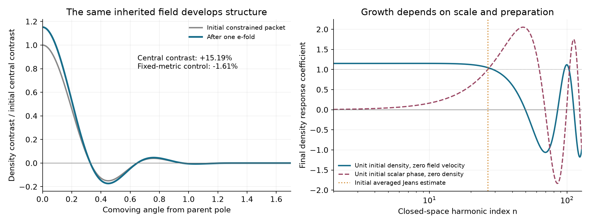

*Figure 16. Left: a compact constrained packet develops a larger
central density contrast under the same inherited source. Right:
the two independent initial-state columns have different scale
responses. The dotted Jeans estimate is a separate averaged
comparison; the evolution itself retains curvature and oscillations.*

[Hwang and Noh's massive-scalar calculation](https://arxiv.org/html/0902.4738)
provides the leading averaged, short-curvature-scale estimate

$$
k_{J,\rm physical}^4=2\kappa E\omega^2,\qquad
\ell_\Lambda=\sqrt{3/\Lambda}.
$$

The actual parent preparation has $E_0/\rho_v=4/3$, giving an
initial Jeans wavelength of $.462258806\ell_\Lambda$. Its
$H_0/\omega=.022134447$ and curvature-to-Jeans squared-wavenumber
ratio .001315002 characterize this comparison's scale separation;
they are not a proved approximation error. The unaveraged transfer
above does not depend on replacing the field by dust.

For this inherited excitation ratio the estimate implies

$$
\frac{\omega}{\sqrt{\Lambda}}
=\frac{\pi^2\sqrt{2/3}}{(\lambda_J/\ell_\Lambda)^2}.
$$

A smaller pressure cutoff therefore requires a larger scalar
frequency relative to the vacuum scale, with a compatible history.
The present benchmark's cutoff is a substantial fraction of its
vacuum radius; it cannot simply be called cold on every smaller
scale. The inherited law has not yet selected the required ratio.

These [calculated responses](../results/summaries/nsc-atlas-parent-perturbations-v1.json)
connect geometry, inheritance, expansion and linear structure.
An unnested model with identical local field and geometric initial
data has the same protected-domain response, so this growth alone
does not uniquely demonstrate nesting. The next physical connection
is a prepared perturbation state and frequency/scale, followed by
the linked density and metric response seen by observers.

### 13.14. What the inherited law leaves to the state

<!-- nsc-claim:finite-parent-state-observability -->

The two independent perturbation columns cannot be replaced by a
unique initial phase without additional physics. After inserting
the metric momentum equation, the linear flow on $(X,Y,\Phi)$ has
matrix trace -4H. Its fundamental matrix therefore obeys

$$
\det U(t,t_0)=\exp[-4N(t)]>0.
$$

Together with the exact constraint propagation, this makes finite
evolution a bijection between the initial and final two-dimensional
constraint spaces. Distinct admissible states cannot become the
same complete state at finite time. Their covariances transform by
U times the initial covariance times U-transpose, rather than being
selected by the deterministic equations. Asymptotic attraction,
open-system elimination, a boundary condition or an actual formation
law remains a separately specified possibility.

The useful next connection can nevertheless proceed: retain the
existing compact spatial profile and its two density/phase amplitudes,
use two operational observations to infer them, and test a third.
This does not select an arbitrary primordial spectrum. It creates
a falsifiable observer relation within a declared preparation family.
The [state-flow identities](../results/summaries/nsc-atlas-parent-clocks-v1.json)
are retained with the observer calculation.

### 13.15. The inherited scalar gives a controlled matter background

<!-- nsc-claim:uniform-inherited-scalar-matter -->

Derivation and calculation: [uniform source theorem and light-cone forecast](../results/summaries/nsc-atlas-inherited-matter-forecast-v1.json)
and [proof and domain](../docs/nsc-atlas-inherited-matter-bound.md).

The same inherited field must supply the normalization of its evolving
component. The oscillating-scalar matter mechanism is established in
[Turner](https://doi.org/10.1103/PhysRevD.28.1243) and
[Hwang--Noh](https://arxiv.org/html/0902.4738).
Here its background approximation is bounded on the actual closed,
self-gravitating parent, using its original state and positive vacuum floor.

Let $A=a/a_0$, and let $\chi$ be displacement from the parent minimum.
The uniform initial field is at the grandchild minimum, with $\Pi_0=0$.
Thus the same source law fixes

$$
E_0=\frac{1-\epsilon}{2}(q_p-q_g)^2=\frac{3}{8},\qquad
\rho_v=\frac{\epsilon q_p^2}{2}=\frac{9}{32},\qquad
\frac{E_0}{\rho_v}=\frac{4}{3}.
$$

This carries a stated ancestral preparation forward; it does not add an
independently chosen dust density. With

$$
E=\frac{\Pi^2+\omega^2\chi^2}{2},\qquad
p=\frac{\Pi^2-\omega^2\chi^2}{2},\qquad
D=A^3E,\quad S=A^3\chi\Pi,
$$

define the corrected comoving energy

$$
\mathcal{I}=D+\frac{3}{2}HS.
$$

The scalar equation and its exact energy law give

$$
\dot S=2A^3p,\qquad
\dot{\mathcal{I}}=\frac{3}{2}\dot H S,\qquad
|S|\leq\frac{D}{\omega}.
$$

The pressure term cancels in the corrected energy's derivative.
The parent geometry supplies a uniform variation bound. With $C=1/a_0^2$,
the Einstein equation gives $H_{,t}=C/A^2-\kappa\Pi^2/2$. The positive
expansion lower bound therefore yields

$$
\int_0^t|\dot H|\,dt\leq H_0-H(t)+2\int_0^t\frac{C}{A^2}\,dt
\leq H_0-H_-+\frac{C}{H_-}.
$$

Exact rational evaluation of the original unsquared wall junction verifies
$H_-=133/500$, $H_+=117/250$, $H_0<443/1000$ and $C<57/2500$ as conservative
bounds. Set

$$
\delta=\frac{3H_+}{2\omega},\qquad
V_H=\frac{443}{1000}-\frac{133}{500}+\frac{57/2500}{133/500},\qquad
\Gamma=\frac{3V_H}{2\omega(1-\delta)}.
$$

**Uniform source theorem.** For $\delta<1$ and $\Gamma<1$, define

$$
L=\frac{1-\Gamma}{1+\delta},\qquad
U=\frac{1}{(1-\Gamma)(1-\delta)}.
$$

Every future time in the protected parent satisfies

$$
L\leq\frac{A^3E}{E_0}\leq U,\qquad
\frac{4}{3}LA^{-3}\leq\frac{E}{\rho_v}\leq\frac{4}{3}UA^{-3}.
$$

**Proof.** The bound on $S$ gives
$(1-\delta)D\leq\mathcal{I}\leq(1+\delta)D$, so $\mathcal{I}$ is positive.
Its logarithmic derivative is bounded by $3|H_{,t}|/[2\omega(1-\delta)]$.
The inherited turning-point state has $\mathcal{I}_0=E_0$. Integrating
and using $\exp(-\Gamma)\geq1-\Gamma$ and
$\exp(\Gamma)\leq1/(1-\Gamma)$ gives the rational factors above.
The argument is uniform in the future interval. Nonzero initial $\chi\Pi$ would retain
its corresponding initial corrected-energy factor.

| Frequency in the same atlas units | Uniform ceiling for the relative departure of A^3 E/E0 from one |
| --- | --- |
| 20 | .05798115 |
| 2000 | .00054834 |
| 10^9 | 1.09608e-9 |

The last member therefore has a controlled matter-density background
throughout its protected future. Instantaneous pressure still oscillates;
this does not assert a small error in dot H or replace the perturbation
and halo equations by pressureless matter. The theorem begins at A=1;
the earlier A=.01 formation history retains its separately stated assumptions.

The nontrivial excitation decreases strictly over every nonzero interval
and tends to zero. Its unique energy-equality event E=rho_v obeys

$$
\left(\frac{4}{3}L\right)^{1/3}\leq A_{\rm eq}
\leq\left(\frac{4}{3}U\right)^{1/3}.
$$

This gives a relative expansion epoch from the same inherited normalization.
It is an equality of densities rather than a phase-independent acceleration
criterion.

### 13.16. The controlled background predicts an interior light cone

<!-- nsc-claim:inherited-parent-lightcone-bound -->

Derivation and calculation: [frozen NSC-P005 analytic interval](../results/summaries/nsc-atlas-inherited-matter-forecast-v1.json).
The vacuum, excitation and curvature in the comparison all belong to the
same protected parent:

$$
H_d^2=\frac{\kappa\rho_v}{3}+\frac{\kappa E_0}{3A^3}-\frac{C}{A^2}.
$$

Put $\epsilon_E$=max$(1-L,U-1)$ and $r=\kappa E_0\epsilon_E/(3H_0^2)$.
The source theorem and the increasing denominator of $E_0/(A^3H_d^2)$
give $1-r\leq H^2/H_d^2\leq1+r$. A comoving receiver at $A_o=2$ observes a
comoving test emitter at $z=1/4$, hence $A_e=8/5$. The entire ray lies in the
causally protected parent. The geometric-optics distance is

$$
\eta=\frac{1}{a_0}\int_{A_e}^{A_o}\frac{dA}{A^2H},\qquad
D_L=a_0A_o(1+z)\sin\eta.
$$

Both ray angles lie below $\pi/2$. Integrating the Hubble comparison and
using the increasing, concave sine proves

$$
\frac{1}{\sqrt{1+r}}\leq\frac{D_L}{D_{L,d}}\leq\frac{1}{\sqrt{1-r}},\qquad
\frac{1}{1+r}\leq\frac{\Lambda_vD_L^2}{\Lambda_vD_{L,d}^2}
\leq\frac{1}{1-r}.
$$

For u=1/A, the comparison Hubble rate squared is a positive cubic.
Twelve binomial terms integrate exactly as rational polynomials, with a
geometric-series bound on the entire tail. An alternating sinc series
then encloses the closed-space distance. The following decimal endpoints
are rounded outward from exact rational bounds:

| Frequency | Analytic interval for Lambda_v D_L^2 |
| --- | --- |
| 20 | [.242823328986305, .261473628319700] |
| 2000 | [.251715570867755, .251891708276777] |
| 10^9 | [.251803608594062, .251803608946144] |

The dimensionless comparison value itself is enclosed by
[.251803608770102,.251803608770104]. No SI ruler or sky measurement fixes
these numbers. The frequency-10^9 source induces a relative
squared-distance departure below 6.99120e-10 for this protocol.
Its result follows from the theorem without a long fast-oscillation solve.

<!-- nsc-claim:inherited-parent-unaveraged-validation -->

The [unaveraged validation](../results/summaries/nsc-atlas-inherited-matter-validation-v1.json)
was run after the forecast and register were committed in
[70bdd5a](https://github.com/kodareken/nested-space-cosmology/commit/70bdd5a).
The original scalar equation, gravity and initial state are retained.
Proper-time integration evolves H; an independent expansion-clock
integration eliminates H using the gravitational constraint.

| Frequency-20 readout | Proper-time evolution | Expansion-clock evolution |
| --- | --- | --- |
| Lambda_v D_L^2 | .251699293480111 | .251699293482159 |
| Energy-equality scale | 1.10363602735015 | 1.10363602734147 |
| A^3 E/E0 at A=2 | 1.02390960047656 | 1.02390960043505 |

The optical results differ by 2.05e-12 and both lie inside the frozen
analytic interval. Independent photon integrals also agree. Those
differences are numerical checks, whereas the prediction interval comes
from the source and geometric inequalities. A short frequency-2000
control checks the same source bound. The three comparisons use 7086
RHS evaluations; earlier wall grids and source preparations are unchanged.

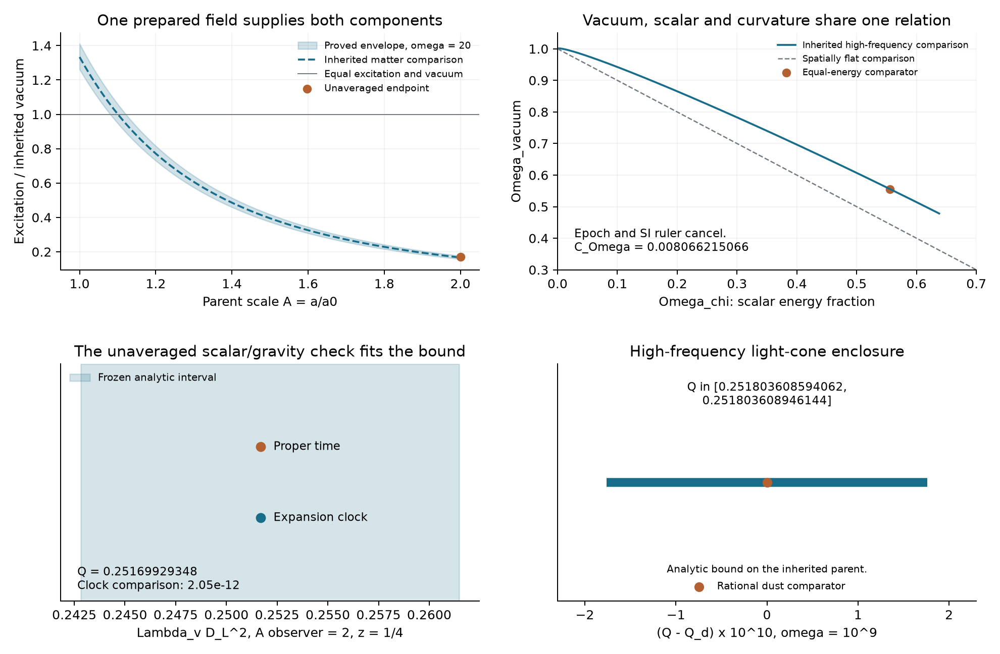

*Figure 17. The source normalization, matter-law envelope and photon
distance follow from the same stated inherited field. The energy-ratio
band is the theorem's envelope rather than a sampled evolution. The two
optical points are independent numerical formulations of one unaveraged
frequency-20 model. The narrow high-frequency interval is an analytic
prediction, not a computed fast trajectory or an astronomical measurement.
The upper-right density-fraction curve is the comparison relation derived
in Section 13.17.*

This completes a controlled homogeneous connection from inherited state
to expansion and luminosity distance. The absolute flux/vacuum sector,
primordial preparation and structure population remain physical inputs to
close. The background theorem supplies a quantified foundation for the
next shared distance, growth and population calculation.

### 13.17. An epoch-independent vacuum, scalar and curvature constraint

<!-- nsc-claim:inherited-vacuum-matter-curvature-relation -->

Derivation and calculation: [exact density relation and controlled intervals](../results/summaries/nsc-atlas-inherited-density-relation-v1.json).
The same source theorem gives a joint cosmological relation without choosing
an observer age or an SI ruler. Define the parent fractions by their actual
stress and spatial curvature,

$$
\Omega_\chi=\frac{\kappa E}{3H^2},\qquad
\Omega_v=\frac{\kappa\rho_v}{3H^2},\qquad
\Omega_k=-\frac{C}{A^2H^2}.
$$

Here $\Omega_\chi$ denotes the scalar excitation, rather than measured total
matter containing additional species. Within this stated three-component
background, the Friedmann equation gives
$\Omega_\chi+\Omega_v+\Omega_k=1$.
All three fractions use the same parent comoving proper-time expansion.
Set the comoving energy ratio $\mathcal{R}=A^3E/E_0$. Direct substitution gives

$$
\frac{(-\Omega_k)^3}{\Omega_\chi^2\Omega_v}
=\frac{\mathcal{C}_\Omega}{\mathcal{R}^2},\qquad
\mathcal{R}=\frac{A^3E}{E_0},\qquad
\mathcal{C}_\Omega=
\frac{C^3}{(\kappa E_0/3)^2(\kappa\rho_v/3)}.
$$

All explicit powers of the epoch and Hubble rate cancel. A common change
of length unit cancels as well. The original sourced geometry and inherited
energy determine the coefficient

$$
\mathcal{C}_\Omega=0.00806621506604026.
$$

This is a coefficient of the declared geometry and preparation. It is
neither fitted to observed density fractions nor asserted to be universal
across other initial atlases. The finite-frequency phase is retained by
the uniform source bound:

$$
\frac{\mathcal{C}_\Omega}{U^2}
\leq\frac{(-\Omega_k)^3}{\Omega_\chi^2\Omega_v}
\leq\frac{\mathcal{C}_\Omega}{L^2}.
$$

For frequency 10^9, exact rational calculation and outward decimal rounding
give the all-future interval

$$
0.008066215048357963
\leq\frac{(-\Omega_k)^3}{\Omega_\chi^2\Omega_v}
\leq0.008066215083722556.
$$

Thus the phase uncertainty in this correlation is bounded even when the
observer epoch is unknown. In the pressureless comparison, writing
$x=E/\rho_v$ and $b=(\mathcal{C}_\Omega x^2)^{1/3}$ makes the predicted curve explicit:

$$
\Omega_v=\frac{1}{1+x-b},\qquad
\Omega_\chi=\frac{x}{1+x-b},\qquad
\Omega_k=-\frac{b}{1+x-b}.
$$

At equal scalar and vacuum energy its comparison values are approximately
$(\Omega_\chi,\Omega_v,\Omega_k)=(.555725,.555725,-.111451)$.
These are model values, not astronomical measurements. The finite-frequency
interval above, rather than the comparison curve alone, is the result.

This provides a concrete test of the shared preparation and boundary
geometry: its scalar, vacuum and curvature fractions cannot be assigned
independently by shifting the observation epoch or changing units. A
cosmological application must infer those quantities in the model's own
observable dictionary and include any additional matter and radiation
sectors. The relation therefore connects the inherited source to a joint
observational question without inserting a desired dark fraction.

### 13.18. Continuing the same inherited parent to the emitters

<!-- nsc-claim:inherited-parent-past-collar -->

Derivation, rational bounds and two independent scalar clocks:
[finite backward Cauchy continuation](../results/summaries/nsc-atlas-parent-past-v1.json).
The next connection is an observational past light cone. The initial slice
at $A=1$ is a Cauchy surface, not the beginning of this cosmology. Extending
its smooth scalar solution backward is a mathematical question which can
be answered before prescribing a formation mechanism or the walls' future.

Use the corrected energy $\mathcal I$ from Section 13.15, and bootstrap
$1/2<A^3E/E_0<2$ on $1/3\leq A\leq1$. The unchanged Friedmann constraint gives

$$
\frac{\rho_v}{3}+\frac{E_0}{6A^3}-\frac{C}{A^2}
\leq H^2\leq\frac{\rho_v}{3}+\frac{2E_0}{3A^3}.
$$

The lower comparison decreases toward $A=1$ and stays above $1/9$;
the upper comparison stays below $9$. Thus $1/3<H<3$. Integrating the
absolute Hubble-rate derivative with $\Pi^2\le4E_0/A^3$ gives

$$
\int |H_{,t}|\,dt\leq
\frac{C_{\max}}{2H_-}(A_{\min}^{-2}-1)
+\frac{2E_0}{3H_-}(A_{\min}^{-3}-1)=19.7736,
$$

where the curvature upper bound is $.0228$, the past lower Hubble
bound is $H_-=1/3$, and the minimum scale is $A=1/3$.
The positive corrected-energy estimate works in either time direction.
Taking $\delta=9/(2\omega)$ and $\Gamma=3(19.7736)/(2\omega(1-\delta))$
gives the same $L,U$ formulas as before. Their strict improvement
$1/2<L<1<U<2$ closes the bootstrap. Bounded field energy, positive scale
and positive Hubble rate permit the smooth ODE to reach $A=1/3$ in finite
proper time. At $\omega=10^9$, combining the past and future estimates gives

$$
\left|\frac{A^3E}{E_0}-1\right|<3.416041\times10^{-8},
\qquad A\geq\frac{1}{3}.
$$

The light cone also needs a causal check. The original parent cap's
pole-to-boundary angle exceeds $2.83$. Its entire future conformal angle
is below $11/21$, and its backward angle to $A=1/3$ is below $.912$.
A past emitter is at angle $\eta_o+\eta_p$ from the receiver's pole; its
future domain to the initial slice adds another $\eta_p$. Therefore

$$
\eta_o+2\eta_p<\frac{11}{21}+2(.912)
=2.347810<2.83.
$$

Every ray considered here remains in the domain fixed by the homogeneous
initial cap. No signal from an unconstructed wall history is required.
This is a finite past continuation, not a bounce, primordial state-selection
rule or global completion. Two unaveraged $\omega=200$ formulations agree
on the endpoint comoving energy within $5.56\times10^{-10}$; the high-frequency
bound itself is analytic.

### 13.19. The inherited geometry meets the supernova distance shape

<!-- nsc-claim:inherited-parent-supernova-comparison -->

Evidence: [future-only comparison](../results/summaries/nsc-atlas-parent-supernova-v1.json),
[comparison with the proved earlier continuation](../results/summaries/nsc-atlas-parent-supernova-v2.json),
and [method and scope](../docs/nsc-atlas-parent-supernova.md).
The expanding source now produces an actual astronomical distance
comparison. Retain $\rho_v=9/32$, $E_0=3/8$, and the original junction
curvature. The controlled background is

$$
H_d^2(A)=\frac{\rho_v}{3}+\frac{E_0}{3A^3}-\frac{C}{A^2}.
$$

The closed-FLRW luminosity distance follows from the same geometry. With
$z$ the release's Hubble-diagram redshift, $z_h$ its heliocentric redshift,
and $A_e=A_o/(1+z)$,

$$
D_L=(1+z_h)\frac{A_o}{\sqrt{C}}
\sin\left(\frac{\sqrt{C}}{A_o}\int_0^z\frac{dz'}{H_d(A_o/(1+z'))}\right).
$$

The source theorem bounds the unaveraged scalar's magnitude departure by
$3.836\times10^{-8}$ up to a common offset on the checked ray branch.
A single magnitude intercept removes that offset and the common SI
distance scale. It is profiled with the full covariance, not assigned
separately to redshift bands. Published standardization, light-curve
correlations and redshift corrections follow
[Brout et al., Pantheon+](https://arxiv.org/abs/2202.04077) and its
[distance and covariance release](https://github.com/PantheonPlusSH0ES/DataRelease/tree/c447f0fea703fcd0fff57de5000947b5ca81286b/Pantheon%2B_Data/4_DISTANCES_AND_COVAR).

The original 596-row contrast is unchanged. Flat LambdaCDM controls with
$\Omega_m=.30$ and $.315$ give residuals $-1.517$ and $-1.255$ standard
deviations, respectively, compared with $-7.278$ for the pure quiet cap.
The wider selection uses 1322 non-calibrator light curves, representing
1271 distinct supernova identifiers, with $.025\le z\le2.26137$.

| History on the same wider sample | Fitted shape quantities | Minimum chi-square |
| --- | ---: | ---: |
| Quiet de Sitter | 0 | 1792.223 |
| Inherited parent, emission restricted to $A\ge1$ | 1 epoch | 1636.491 |
| Inherited parent, proved emission domain $A\ge1/3$ | 1 epoch | 1179.387 |
| Flat LambdaCDM control | 1 matter fraction | 1178.209 |

Every row also fits the same one magnitude intercept. The last two rows
each have 1320 degrees of freedom. The future-only failure is retained:
requiring the observer scale to exceed one plus the largest redshift
leaves too little scalar matter. The direct
repair was the earlier continuation of the same initial solution, rather
than changing its charge, flux, curvature or excitation normalization.

The resulting parent epoch is $A_o=1.381654568$, with earliest emitter
$A_e=.4236424$. Its inferred comparison fractions are

$$
(\Omega_\chi,\Omega_v,\Omega_k)
=(.3667843,.7255551,-.0923394).
$$

These fractions are linked by Section 13.17 and inferred after calibrating
the epoch; they are not parameter-free cosmic abundances. The flat control
calibrates $\Omega_m=.3312216$. The difference in minimum chi-square is
$1.17848$ with equal fitted dimension. These retrospective data do not
select a unique explanation or determine an absolute vacuum scale.

### 13.20. One calibrated geometry, a second distance channel

<!-- nsc-claim:inherited-parent-bao-ap-comparison -->

Evidence: [fixed supernova-calibrated AP forecast](../results/summaries/nsc-atlas-parent-bao-forecast-v1.json)
and [DESI comparison](../results/summaries/nsc-atlas-parent-bao-validation-v1.json).
The supernova epoch fixes a radial/transverse relation without another
geometric parameter:

$$
F(z)=\frac{D_M(z)H(z)}{c},\qquad
\frac{D_M/r_d}{D_H/r_d}=F(z),\qquad D_H=\frac{c}{H}.
$$

The unknown sound-ruler length cancels. This does not derive the acoustic
ruler or its baryon physics. It tests whether the published transverse and
radial distance measurements have the shape predicted by this geometry.
Use the six anisotropic pairs in [DESI DR2 II, Section III.3](https://arxiv.org/html/2503.14738v3)
at $z=.51,.706,.934,1.321,1.484,2.33$, with their full covariance.
The covariance product is pinned to the public Cobaya release; the DESI
[provenance clarification](https://help.desi.lbl.gov/index.php?qa=182&qa_1=provenance-external-cobaya-likelihood-public-cosmology-chains)
identifies it with the collaboration likelihood.

Avoid replacing the observed ratio by a Gaussian. For fixed $F_i$, form
six linear contrasts and their exact Gaussian covariance:

$$
r_i=y_{M,i}-F_i y_{H,i},\qquad
V=W C_{\rm BAO}W^T,\qquad \chi^2_{\rm AP}=r^T V^{-1}r.
$$

This equals profiling over an arbitrary unknown radial amplitude in each
pair, verified by an independent constrained-mean calculation. Cross-bin
correlations remain. The isotropic BGS row has no such pair and is unused.
All supernova-calibrated shape parameters were saved and pushed before
evaluating this comparison; no BAO parameter is fitted.

| Fixed supernova-calibrated geometry | AP chi-square | Contrasts |
| --- | ---: | ---: |
| Inherited parent | 7.15813 | 6 |
| Flat LambdaCDM control | 8.89401 | 6 |

The parent AP-relative scalar envelope is $3.533\times10^{-8}$.
Both conditional shapes are consistent with this comparison. The small
statistic difference is not a preference claim: supernova calibration
uncertainty has not been marginalized into a joint model comparison.
The full BAO likelihood, a common acoustic scale across redshifts and
growth supply stronger remaining tests. No astronomical data used here
were newly blinded.

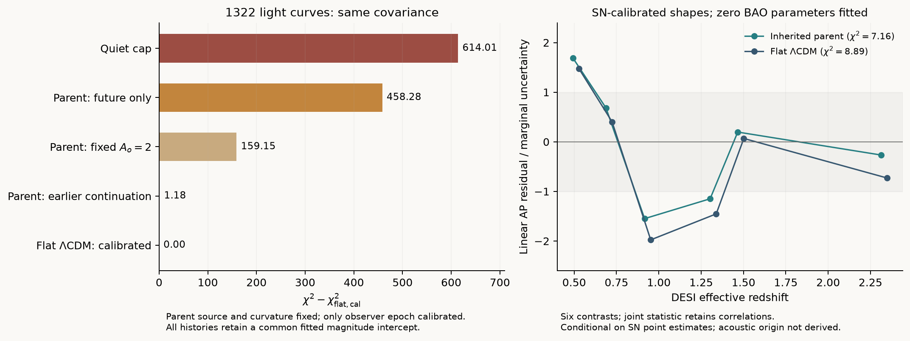

*Figure 18. Left: the quiet cap and future-only parent fail the wider
distance-shape comparison; the proved earlier scalar continuation reaches
a chi-square within 1.18 of the calibrated flat control without changing
the source. Right: that same supernova-calibrated parent is taken to six
DESI radial/transverse contrasts without another fitted parameter. Points
show marginal standardized residuals; the joint statistics retain the
published correlations. These are conditional model comparisons, not
primordial state selection or a claimed cosmological preference.*

### 13.21. What this connection closes and what its source still must supply

The connected calculation now runs from a shared inherited scalar through
a controlled Cauchy history to two astronomical distance channels. The
quiet-cap discrepancy is not hidden: its repair requires the actual evolving
source and a proved earlier observer domain. The common comparison
also supplies the previously missing LambdaCDM control.

Four other physical gaps remain. First, the background family's
$(\rho_v,E_0,C,H^2)\mapsto\lambda^2(\rho_v,E_0,C,H^2)$ leaves the fractions
unchanged and sends distances to $\lambda^{-1}$ times their value. This
corresponds to changing supplied dimensional source parameters together;
it is not a transformation selecting their values at fixed couplings.
Neither inheritance nor a magnitude-offset-free likelihood determines an
SI charge or absolute Lambda. Quantum scale selection or an independently
calibrated dimensional input must close that connection.

Second, the radially stable surface-scalar body in Part VI has
$p=\sigma$ and conserved surface shift charge
$Q=4\pi R^2\theta_{,\tau}$, hence
$\sigma=Q^2/(32\pi^2R^4)$. That law does not select $Q$ or inherit it
between membranes. The evolving parent uses constant charged tension
$p=-\sigma$. The two wall actions retain separate identities until a
compatible preparation/coupling is derived.

Third, P001's actual mass envelope still grows 3.35 percent in its
non-nested three-grid family. The independent
[matched-characteristic control](../results/summaries/nsc-atlas-matched-trace-v1.json)
shows that the adapter preserves deliberately compatible strong traces;
it does not repair independently evolved traces or their unresolved active
cell. Its production endpoint remains an unconverged estimate.

Fourth, this scalar/four-form action has no baryon current or photon
distribution. It supplies one scalar excitation, not separate derived
$\Omega_c$, $\Omega_b$ and $\eta_B=n_b/n_\gamma$. The latter is undefined
in this sector, rather than calculated to vanish. Composition, production
and entropy history must enter through an explicit compatible extension.
Those source tasks, together with joint growth and acoustic-scale tests,
are the next physical work. Further precision in a completed background
cannot replace them.

### 13.22. One common ruler and the remaining SI selector

<!-- nsc-claim:shared-ruler-posterior-comparison -->

Evidence: [full-covariance shared-ruler calculation](../results/summaries/nsc-atlas-shared-ruler-v1.json)
and [scoreboard](../docs/nsc-atlas-shared-ruler-scoreboard.md).
The six AP contrasts left a separate radial amplitude free in each bin.
The stronger next comparison uses all 13 DESI entries and one common
acoustic ruler. Charge, flux, curvature, scalar normalization and frozen
P004/P005 remain those of checkpoint 485b3b9.

The full one-dimensional supernova shape posterior is propagated, including
its tails. The stated priors are uniform in the parent's logarithmic
observer scale and in the flat control's matter fraction. A common
magnitude intercept belongs to the same covariance likelihood as before.
At each shape, the BAO likelihood is quadratic in
$\beta=c/(100r_{d}h)$, taking c in km/s and the ruler product in Mpc;
the scale is eliminated analytically before the
posterior integral. Four independent model/order workers and a 48/96-order
control require no new field evolution. The marginal BAO deviance changes
by less than $1.8\times10^{-11}$ under that control.

| Comparison | Inherited parent | Flat LambdaCDM | Fitted quantities in each |
| --- | ---: | ---: | --- |
| Original SN calibration | 1179.38727 | 1178.20879 | Shape and magnitude intercept |
| DESI shared-ruler chi-square at joint optimum | 18.84303 | 10.78167 | One ruler added |
| SN contribution at joint optimum | 1184.38115 | 1180.39513 | Same three joint quantities |
| Joint SN+DESI minimum chi-square | 1203.22418 | 1191.17680 | Three total |
| Posterior-predictive BAO deviance | 27.24410 | 16.46889 | Shape integrated; one ruler optimized |

Thus the joint difference is $\Delta\chi^2=12.04739$ with equal fitted
dimension. The posterior-predictive deviance difference is $10.77521$;
that marginal quantity is not assigned a chi-square distribution or
reported as a model Bayes factor. The old calibration and six AP scores
are preserved. The updated joint epoch is $A_o=1.46560035$ and gives

$$
(\Omega_\Lambda,\Omega_m,\Omega_k)
=(.76310716,.32320464,-.08631180).
$$

Here the parent's matter entry denotes the scalar pressureless comparison,
not a derived baryon/CDM split. Its common $r_{d}h$ is 101.91822 Mpc; the
flat control gives 101.05339 Mpc and fractions (.69630912,.30369088,0).
The parent's posterior $3\Omega_\Lambda=2.288667\pm.021121$ differs from
the comparison $2.054\pm.022$ by 7.695 standardized units including both
widths. That comparison is not added again to the joint likelihood.

<!-- nsc-claim:conditional-high-redshift-geometric-diagnostic -->

Evidence: [source bound and conditional Planck geometry](../results/summaries/nsc-atlas-cmb-geometric-diagnostic-v1.json).
The large curvature triggers a further distance test. A new finite
bootstrap continues the unchanged scalar to the supplied probe label
$z_*=1089.92$. Using $H>.24A^{-3/2}$ bounds the backward Hubble variation
and closes the source comparison at $A=.00134345$. The density envelope
is $7.871\times10^{-5}$; the two-way initial-cap causal margin is .226636
radians. The [owning derivation](../docs/nsc-atlas-shared-ruler.md) gives
the comparison and its conditions. The source geometry reaches that
redshift without simulating each scalar oscillation or assuming a wall history.

It does not thereby produce recombination or an acoustic horizon. A full
physical CMB likelihood remains undefined until photon, baryon, thermal and
perturbation states are supplied compatibly. The conditional diagnostic
uses the common curvature-relaxed compression in
[Chen, Huang and Wang, Table 1](https://arxiv.org/html/1808.05724v1), and
profiles an unknown acoustic ratio rather than assigning one to NSC.
At the joint late-time shapes it gives $R=1.55147562$ and $1.75179174$.
Against the compression mean 1.7429, the optimistic profiled diagnostic
scores are 1408.82 and 3.04. The parent's finite scalar phase enclosure
still gives a lower bound of 1407.72. These are conditional geometry
diagnostics at an externally supplied probe label, not complete CMB
predictions; they are not added to the primary SN+DESI score.

<!-- nsc-claim:fixed-parent-si-scale-freedom -->

Evidence: [computed inherited scale-route ladder](../results/summaries/nsc-atlas-SI-scale-ladder-v1.json),
[stationary-wall control](../results/summaries/nsc-atlas-wall-scale-stationary-v1.json)
and [scale-selection owner](../docs/nsc-atlas-scale-selection.md).
Failure of a specified parent, state or connection is not a rejection of
nesting. The next question is which inherited preparation selects the
actual scale. Eleven route classes in the existing atlas were evaluated;
their local failures are recorded one line each in the linked scoreboard.
None currently selects the parent curvature radius in SI from these fixed inputs.

The existing nonzero result remains

$$
\Lambda L_{\rm ref}^2=12.348252398928544.
$$

One [microscopic coupling relation](../results/summaries/nsc-atlas-inherited-microanchors-v1.json)
does survive: the inherited normalized charge and tension, with the
natural-unit coupling $\kappa=8\pi\ell_P^2$, give

$$
\frac{e_{\rm phys}}{\sigma_{\rm phys}}
=\frac{\hat{e}}{\hat{\sigma}}\sqrt{\kappa_{\rm nat}}
=2.0256752716\times10^{-34}\ {\rm m}.
$$

This fixes a microscopic SI combination, while its hierarchy to the parent
curvature radius remains unselected. Inserting the target would require
that hierarchy to be $1.6612691531\times10^{60}$; this is an inverse
diagnostic, not an inherited result.

Flux quantization gives $q/e=3$ and screened vacuum levels
$(9/32,1/8,1/32,0)$, while leaving a fundamental SI charge free. The
fixed-tension frozen-wall test has no static stable equilibrium. A
recursion ratio leaves its root scale unselected, and the scalar frequency
has no inherited SI clock. Quantum/spectral and boundary alternatives
must retain their actual actions and missing state data.

A formal added compact four-cycle period illustrates what a quantum global
condition could change. If a compatible real Euclidean cycle and contour
existed for the late source, the period relation would give

$$
\Lambda\ell_P^2=\frac{3\hat{e}}{n\hat{q}}=\frac{1}{n}.
$$

Neither that global saddle nor its winding is supplied by the excited
parent. The illustrative $n=1$ yields $3.8280731\times10^{69}$ inverse
square metres, not a selected cosmological value. Choosing a huge winding
from the target would be a fit. This formal candidate does not close the
physical connection.

Assigning the target $1.0904\times10^{-52}$ inverse square metres would
require $L_{\rm ref}=3.3651918430\times10^{26}$ metres by inversion.
It is not a derived ruler. Two dimensional completions with reference
lengths 1 and 2 metres preserve the same normalized inheritance while
giving different SI vacua. A physical state, quantum action normalization
or compatible global selector is therefore still needed. The target
remains unresolved; the conditional constructions and their failures
remain part of the atlas.

### 13.23. A physical volume connects normalization and evolving matter

<!-- nsc-claim:parent-volume-source-normalization -->

Evidence: [derived volume sector and compact evolution](../results/summaries/nsc-atlas-parent-volume-selector-v1.json),
[action, source and scope](../docs/nsc-atlas-scale-selection.md#executed-a-physical-volume-inherited-source-and-moving-vacuum),
and [independent symbolic and numerical controls](../tests/test_nsc_atlas_parent_scale_selector.py).

The missing SI ruler is a physical normalization problem. Changing a unit
in the old action cannot supply its selecting equation. A distinct parent
construction now gives a genuine geometric mode that transports the source
ratios. Consider Einstein gravity in $D=4+d$ dimensions, a canonical bulk
scalar, a top-form $F_D$, and charged membranes wrapping the entire compact
internal Einstein space. With reference volume $V_0$ and unit-integral
internal volume form $\eta_d$, use

$$
ds_D^2=e^{-ds}ds_{4,E}^2+e^{2s}\gamma_{ab}dy^a dy^b,
\qquad F_D=F_4\wedge\eta_d.
$$

Direct reduction gives $\kappa_4=\kappa_D/V_0$, positive volume kinetic
coefficient $K=d(d+2)/(2\kappa_4)$ and three-form kinetic factor
$Z_3=e^{ds}/V_0$. At constant $s$,

$$
e_{\rm can}=e_D\sqrt{V_0}e^{-ds/2},\quad
\sigma_4=\sigma_DV_0e^{-ds/2},\quad
(m_4,\mu_4)=(m_D,\mu_D)e^{-ds/2}.
$$

The flux has the charge factor. Thus $q/e$, $\epsilon$, $\sigma/e$ and
$\omega/e$ inherit together, while the scalar minimum is independent of
$s$. Keep the unrescaled gauge field and topological charge in the dynamic
action; changing canonical normalization in time also changes derivative
terms. This is a source-normalization connection, not the full dynamical
inheritance theorem. The flux boundary term and compactification precedent
come from [Bousso--Polchinski](https://arxiv.org/html/hep-th/0004134).
[Goldberger--Wise](https://arxiv.org/html/hep-ph/9907447v2) provides a
separate action-based stabilization precedent, without supplying this
geometry or its coefficients.

The reduced vacuum potential is

$$
V(s)=Ae^{-ds}-Be^{-(d+2)s}+W(s),\qquad
B=\frac{R[\gamma]}{2\kappa_4}.
$$

Matching $V(0)=\rho=9/32$ and $V_s(0)=0$ yields the exact stiffness
identity

$$
V_{ss}(0)=-d(d+2)\rho+\mathcal S_d[W](0),\qquad
\mathcal S_d[W]=W_{ss}+2(d+1)W_s+d(d+2)W.
$$

The two existing powers lie in its kernel. Bulk vacuum and curvature alone
therefore give $m_s^2/H_{\rm vac}^2=-6$, an unstable positive vacuum.
Changing those two coefficients while preserving matching cannot cure it.

An explicit additional four-dimensional vacuum sheet has induced volume
factor $W=T e^{-2ds}$. Its homogeneous internal average is a new source
assumption, not an exact localized higher-dimensional solution. Assigning
$T=\epsilon q_A^2/2$ uses the existing vacuum law at a declared ancestor
flux. It does not derive the sheet's location or coupling from nesting.

The same inherited oscillator changes frequency with $s$. Its averaged
energy is $E=(3/8)e^{-3N-ds/2}$, where $N=\log(a/a_0)$. Requiring initial
equilibrium with that matter, rather than only with the vacuum, gives

$$
B=\frac{d}{2}\left(\rho+T+\frac{E_0}{2}\right),\quad
A=B+\rho-T,\quad
V_{{\rm total},ss}(0)=-d(d+2)\rho+d(d-2)T-\frac{d(3d+4)}{4}E_0.
$$

An ancestor one step above, with $q_A=2$, gives $32V_{{\rm total},ss}/d=-2d-62<0$.
An ancestor two steps above, with $q_A=5/2$, gives $7d-80$. The first stable integer in
that specified family is $d=12$, with

$$
A=7,\quad B=\frac{15}{2},\quad T=\frac{25}{32},\quad
K=84,\quad V_{{\rm total},ss}(0)=\frac32.
$$

This is a candidate dimension and ancestry. The required bulk vacuum
$A-\rho=215/32$ is a matching requirement, not a microscopic prediction.
No minimum is subtracted from the gravitational source.

<!-- nsc-claim:parent-volume-evolving-vacuum -->

Evidence: [two clocks, scalar controls and basin entry](../results/summaries/nsc-atlas-parent-volume-selector-v1.json)
and [evolution and conservation checks](../tests/test_nsc_atlas_parent_scale_selector.py).

Hold these coefficients fixed. The averaged source and volume obey

$$
\dot N=H,\quad \dot s=v,\quad
K\dot v=-3HKv-V_s+\frac{d}{2}E,\quad
H^2=\frac{Kv^2/2+V+E}{3}-C e^{-2N}.
$$

At $N=s=v=0$ the original parent density and $H$ are recovered. The new
wall variation, however, requires

$$
K[\partial_n s]=\sigma_s=-\frac{d}{2}\sigma,
\qquad [\partial_n s]_{s=0}=-\frac{1}{70}.
$$

A globally uniform zero-momentum volume field cannot satisfy that junction.
A compatible wall collar and its gravitational gradient energy are still
required. The present evolution belongs to a homogeneous sector; it is
not yet a new shared three-region spacetime or its protected-domain proof.

The total energy decreases exactly as
$\dot\rho=-3H(Kv^2+E)$ in the average. For the full scalar, replace
$E$ in this loss by $\Pi^2$. A corrected-action identity connects the
new dynamics to the earlier matter calculation without assuming fixed
frequency:

$$
D=\frac{a^3E}{\omega},\quad S=a^3\chi\Pi,\quad
c=\frac{3H-dv/2}{2\omega},\quad I=D+cS,
\qquad \dot D=-c\dot S,\quad\dot I=\dot cS,\quad |S|\leq D.
$$

This controls the action through the variation of $c$ when $|c|<1$.
Resolved scalar controls at frequencies 200 and 400 to $N=.1$ reduce
the volume-field difference from the average from $1.417\times10^{-7}$
to $3.680\times10^{-8}$. They test the equations, without claiming the
old P005 enclosure covers the new frequency evolution.

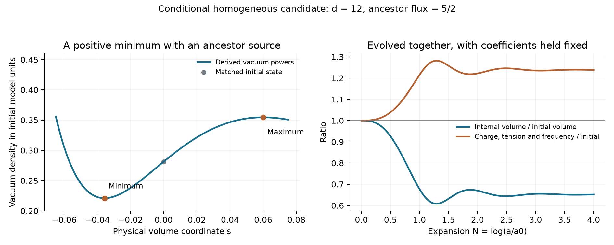

At $N=4$ the averaged volume ratio is .6517931 and the common
charge/tension/frequency ratio is 1.2386400. Proper and expansion clocks
agree in $s$ within $1.64\times10^{-12}$; the total-energy ledger closes
within $2.3\times10^{-12}$. The late minimum has

$$
s_*=-0.0356467826,\qquad V_*=0.2209830242,\qquad
\frac{m_s^2}{H_{\rm vac}^2}=29.64537,\qquad
\Lambda_*L_{\rm ref}(0)^2=9.7022370093.
$$

The computed energy lies below the escape barrier by .13354958.
Conditional on that finite numerical entry, the exact averaged energy
law confines the volume in the minimum's basin; a positive lower bound
on $H^2$ lets matter dilute and damping drives it to the positive
minimum. This implication is analytic. The entry is numerical, and
neither full scalar stability nor higher-dimensional shape stability
is claimed.

The remaining absolute normalization is visible rather than hidden:

$$
\kappa_4 e_{\rm can}=\frac{\eta_D}{\sqrt{v_{\rm int}}},\qquad
\eta_D=e_D\kappa_D^{D/[2(D-2)]},\quad
v_{\rm int}=\frac{V_0e^{ds}}{\kappa_D^{d/(d+2)}}.
$$

The relative volume is calculated. The microscopic charge and reference
volume are not selected, so no metre-valued ruler or observed SI vacuum
follows yet. The new source also changes later expansion: the fixed
P004/P005 forecasts and supernova/DESI scores remain records of their
original candidate. A common parent source/state must still supply this
normalization, the bulk energy and the new wall junction together.

**Absolute normalization and tunnelling statistics**

<!-- nsc-claim:si-hierarchy-normalization-audit -->

Evidence: [retained SI hierarchy audit](../results/summaries/nsc-atlas-si-hierarchy-audit-v1.json),
[definitions and stopping point](../docs/nsc-atlas-scale-selection.md#current-audit-the-geometric-hierarchy-and-the-tunnelling-exponent),
and [independent identities and inverse controls](../tests/test_nsc_atlas_si_hierarchy.py).

The current question isolates the absolute scale. With the retained
reference $a_0=6.6260770761$ and
$\ell_{e\sigma}=(5/2)\sqrt{\kappa_{\rm nat}}$, the geometry itself gives

$$
\mathcal{R}=\frac{L_{\rm ref}(0)}{\ell_{e\sigma}}
=\frac{2.6504308304}{\sqrt{g}},\qquad
\ln\mathcal{R}=0.9747222043-\frac{1}{2}\ln g,
$$

$$
\Lambda_*\ell_{e\sigma}^2=1.3811439013g,\qquad
\mathcal{R}^2\Lambda_*\ell_{e\sigma}^2=9.7022370093.
$$

The overall factor $1/g$ multiplying the dimensionless action cancels from
classical field equations. Neither the fixed dimension nor ancestor label selects
it. Dimensional completions with $g=1$ and $g=1/4$ preserve the supplied
normalized source ratios while changing the SI ruler and quantum weight.
The single missing numerical input is the absolute canonical membrane
charge in Planck units at the reference slice:

$$
\eta_{e,0}=\kappa_{\rm nat}e_{\rm can}(0)
=\frac{1}{2}\sqrt{g},\qquad g=4\eta_{e,0}^2.
$$

The [published tunnelling law](https://doi.org/10.1103/PhysRevD.21.3305)
gives a rate per four-volume,
$\Gamma_4=A_4e^{-B}$. A four-volume containing one expected event has
volume $1/\Gamma_4$ and volume-equivalent length
$A_4^{-1/4}e^{B/4}$. A mean wait in a fixed three-volume is
$e^B/(A_4V_3)$. Taking a square root changes the statistic and does not
itself define a length. No relation identifies one of these quantities
with $L_{\rm ref}$ or the prefactor length with $\ell_{e\sigma}$.
Thus no hierarchy exponent is selected by the current action.

The requested inverse arithmetic is nevertheless checkable. Using the
rounded logarithm 138.66 gives $g=2.91202756,1.45601378,.72800689$
for the imposed choices $e^B,e^{B/2},e^{B/4}$. Using the full target
logarithm 138.66268744 yields the following same-geometry check:

| Imposed exponential | Inverse g | Actual geometric ln(R) | Logarithm miss (%) |
| --- | ---: | ---: | ---: |
| exp(B) | 2.91197112 | .44030710 | -99.68246 |
| exp(B/2) | 1.45598556 | .78688069 | -99.43252 |
| exp(B/4) | .72799278 | 1.13345428 | -99.18258 |

Their geometric length ratios are only 1.55318, 2.19653 and 3.10637.
The corresponding products $\Lambda_*\ell_{e\sigma}^2$ are 4.02185,
2.01093 and 1.00546, whereas the observed benchmark is
$4.4743\times10^{-120}$. These rows test target-inverted guesses; they
are not independently selected predictions.

Inverting the geometric hierarchy itself instead gives
$g=2.5453818757\times10^{-120}$ and $B=1.5863306991\times10^{122}$.
At that normalization the late vacuum is 21.42826% below the supplied
Lambda benchmark. This is a consistency check: the quoted hierarchy
was anchored to the old coefficient 12.3482524, while the late coefficient
is 9.7022370. Inverting the observed Lambda with the latter would give
$\mathcal{R}=1.4725606528\times10^{60}$, with logarithm 138.5421084.
Neither target inversion is a scale-selection law.

No value of $g$, hierarchy exponent, predicted SI hierarchy or prediction
miss is selected. This audit stops at $\eta_{e,0}$; it does not resume a
different route or the parked parent-to-child energy calculation.

<!-- nsc-claim:charge-inheritance-and-parke-ruler -->

**Charge transport and a Parke radius ruler.** Evidence:
[charge map and ruler calculation](../results/summaries/nsc-atlas-charge-inheritance-v1.json),
[action-level distinctions](../docs/nsc-atlas-scale-selection.md#charge-transport-and-a-parke-only-ruler),
and [independent transport and unit controls](../tests/test_nsc_atlas_charge_inheritance.py).

Does repeated nesting itself make the charge small? In the implemented
four-dimensional inheritance step the flux changes by one membrane charge,
while the charge and gravitational coupling remain fixed. The
[published membrane law](https://arxiv.org/html/hep-th/0004134#S2.SS2)
and the current action give

$$
q_{\rm child}=q_{\rm parent}-e,\qquad
r=\frac{\eta_{\rm child}}{\eta_{\rm parent}}
=\frac{\kappa_{\rm child}e_{\rm child}}
{\kappa_{\rm parent}e_{\rm parent}}=1.
$$

The volume extension makes a different, state-dependent comparison.
Its Einstein coupling is constant and its canonical charge is proportional
to exp(-6s). At a finite-energy thin wall, s is continuous: a field jump
across thickness epsilon costs at least K times the squared jump divided
by twice epsilon. Its normal derivative can jump, as the wall condition
requires. Thus the two one-sided wall charges agree, while equilibrated
interiors can differ after a compatible profile and their states are solved.
For any such endpoint chain within this reduced action,

$$
r_k=e^{-6(s_{k+1}-s_k)},\qquad
\prod_{k=0}^{n-1}r_k=e^{-6(s_n-s_0)}.
$$

Depth alone supplies no suppression. A fixed factor per generation needs
a derived volume increment per generation. The retained homogeneous
matched-start-to-minimum evolution gives a charge ratio 1.2384748901;
it is a time-evolution factor, not a nesting step. The single D=16 to 4
reduction gives a different ratio, $\eta_4/\eta_D=1/\sqrt{v}$, but does not
select the internal volume or construct a repeated dimensional reduction.

Here $j=2$ labels the ancestor flux 5/2 assigned to one sheet. From flux
3/2 there are three downward half-unit discharges to zero; from 5/2 there
are five. These flux counts leave the elementary charge unchanged and
do not select our depth. For the implemented map, $\ln\eta_n=\ln\eta_{\rm root}$
at every depth. The remaining source of a small charge is the root
normalization, $\eta_D/\sqrt{v_{\rm root}}$, which is not yet selected. No predicted
hierarchy or percentage miss can be assigned without it.

To remove the old R,M preparation from a length comparison, define a new
wall ruler $L_P=R_c$ using the stipulated Parke vacuum and tension inputs:

$$
\frac{L_P}{L_{\rm unit}(0)}=\frac{240}{\sqrt{39169}},\qquad
\Lambda_*L_P^2=0.3249667388661.
$$

This expresses the retained volume-well vacuum on the independent wall
radius. It does not identify the wall radius with the old FRW curvature
radius or solve the source-admission problem. The actual auxiliary Parke
interior has $\Lambda_i L_P^2=12600/39169=.3216829635681$. Its vacuum
densities and tension remain declared inputs. The new forward relation is

$$
\ln\frac{L_P}{\ell_{e\sigma}}
=-1.4166194374-\ln\eta_{e,0}.
$$

The old-ruler target 138.542 requires $\ln\eta_{e,0}=-138.260425$ because
$\eta=\sqrt{g}/2$; dropping the factor 1/2 would omit $\ln 2$. Re-expressing
the observed Lambda benchmark on $L_P$ gives log hierarchy 136.8439139446.
Both the target and the forward intercept shift by the same ruler factor,
so the required physical charge is unchanged. Neither the ruler conversion
nor a flux-depth count selects that charge.

<!-- nsc-claim:energy-contrast-and-gravitational-lengths -->

**Energy contrast and the two gravitational lengths.** Evidence:
[frame identities and descendant vacua](../results/summaries/nsc-atlas-contrast-hierarchy-v1.json),
[contrast-to-length derivation](../docs/nsc-atlas-scale-selection.md#energy-contrast-and-the-planck-to-vacuum-length-ratio),
and [symbolic signs and independent roots](../tests/test_nsc_atlas_contrast_hierarchy.py).

Douglas's proposed organizing relation asks whether energy inside a region,
relative to its surroundings, determines both its small gravitational scale
and its large boundary scale. The fixed action gives a precise test of that
idea. Define the Planck scale through the Ricci coefficient,
$\ell_P^2=\kappa/(8\pi)$, and use $L_H=1/\sqrt{\Lambda}$ as the
positive-vacuum length. The action does not establish a minimum possible
length. A de Sitter event-horizon radius is $\sqrt{3}L_H$; a rolling
spacetime's horizon requires its full metric.

The existing reduction has constant Einstein coupling
$\kappa_E=\kappa_D/V_0$. In its external Jordan metric,

$$
g_J=e^{-12s}g_E,\qquad
\kappa_J=e^{-12s}\kappa_E,\qquad
\ell_{P,J}=e^{-6s}\ell_{P,E}.
$$

The local gravitational length can therefore vary in this representation.
At constant-s vacuum endpoints, however, $\Lambda_J=e^{12s}\Lambda_E$
and $L_{H,J}=e^{-6s}L_{H,E}$: both lengths acquire the same factor.
This direct calculation is the relevant instance of the
[Dicke frame relation](https://doi.org/10.1103/PhysRev.125.2163).
Writing $\lambda=\Lambda_E L_0^2$ and $g=\kappa_E/L_0^2$,

$$
\frac{\ell_{P,J}}{L_0}=e^{-6s}\sqrt{\frac{g}{8\pi}},\qquad
\frac{L_{H,J}}{L_0}=\frac{e^{-6s}}{\sqrt{\lambda(s,q)}},
$$

$$
\ln\frac{L_H}{\ell_P}
=\frac{1}{2}\ln\frac{8\pi}{\lambda(s,q)}
-\frac{1}{2}\ln g.
$$

For two positive vacuum endpoints with the same Einstein coupling, the
logarithmic gain is half the logarithm of their vacuum-energy contrast.
The common volume factor cancels, while the volume-dependent potential
can still change the vacuum. Parke's constant-density wall determines
the radius through the contrast and tension; its child curvature remains
$\Lambda_i=\kappa U_i$. It supplies neither a new gravitational coupling
nor the missing volume profile and initial state.

For the requested Parke child, the ratio is
$\ln(L_H/\ell_P)=2.3719985906-\ln(g)/2$. The retained (12,2) volume
minimum separately gives $2.3669204107-\ln(g)/2$. The same-definition
observed benchmark is 139.9343066121, using the stated observed Lambda
and $\ell_P=1.6162550244\times10^{-35}$ m. The actual de Sitter horizon
gives 140.4836127565. Earlier values 138.2604 and 136.8439 describe,
respectively, minus the charge logarithm and the Parke-radius/microscopic
charge-tension ratio; neither is this horizon/Planck ratio.

| Stipulated constant-density sector | Density | Log-ratio intercept before subtracting ln(g)/2 |
| --- | ---: | ---: |
| Parent | 21/32 | 1.8226924463 |
| Child | 7/32 | 2.3719985906 |
| Grandchild | 1/32 | 3.3449536652 |

These controls grow by factors $\sqrt{3}$ and $\sqrt{7}$. If g=1 is
supplied solely as a control, the child's logarithm is 98.30492% below
the same-definition target. That is not an inherited prediction. No
absolute percentage miss follows while g remains unselected. The actual
parent/child scalar snapshots are nonstationary, so their constant-density
interpretation also remains conditional.

There is a further fixed-action test. Keep the UV bare term 215/32 and
internal-curvature coefficient 15/2 unchanged, discharge the regional
flux by 1/2, and carry the declared j=2 ancestor label as $q_A=q+1$.
The conditional relaxed-sector potential is then

$$
V_q(s)=\left(\frac{215}{32}+\frac{q^2}{8}\right)e^{-12s}
-\frac{15}{2}e^{-14s}+\frac{(q+1)^2}{8}e^{-24s}.
$$

No density, UV coefficient or equilibrium condition is rematched along
this sequence. Its minima are:

| Regional flux | Ancestor flux | Volume minimum s | Vacuum at minimum |
| ---: | ---: | ---: | ---: |
| 3/2 | 5/2 | -.03564678255 | +.220983024213 |
| 1 | 2 | -.12203536150 | -2.452231934854 |
| 1/2 | 3/2 | -.20209261817 | -14.768058238899 |

All three minima have positive second derivative. The two descendants
have negative vacuum, so the requested positive-Lambda length is undefined
there. Their signs follow from exact rational comparisons: for
$V=x^6(A-Bx+Tx^6)$, its minimum has positive vacuum precisely when
$(6A/(5B))^5>B/(6T)$. Independent high-precision roots check the numbers.
Keeping the original ancestor sheet fixed instead also gives negative
descendant minima. These are conditional sectors of specified source
prescriptions; the sheets and transitions have not been constructed.
The current action therefore supplies a contrast relation and a vacuum-sign
boundary, while the SI hierarchy and a positive-vacuum descendant chain
remain unselected.

### 13.24. An extremal member is not yet an inherited selection

<!-- nsc-claim:parent-volume-discrete-selection-audit -->

Evidence: [general stability, family roots and frontier](../results/summaries/nsc-atlas-volume-family-selection-v1.json),
[derivation and selection boundary](../docs/nsc-atlas-scale-selection.md#selection-audit-inheritance-permits-a-family--29-october-2026),
and [symbolic and independent high-precision checks](../tests/test_nsc_atlas_volume_family.py).

The preceding value 9.7022370093 is conditional on internal dimension
$d=12$ and ancestor depth $j=2$. Here $j$ identifies the one ancestor
assigned to the sheet; it does not count a sum of independent sheets.
The general rule $T_j=(j+3)^2/32$ gives

$$
\frac{32}{d}V_{{\rm total},ss}(0)
=d\left[(j+3)^2-18\right]-2(j+3)^2-30.
$$

Positive initial stiffness permits $d\geq12$ for $j=2$, $d\geq6$ for
$j=3$, $d\geq5$ for $j=4$, $d\geq4$ for $j=5,6$, and $d\geq3$ for
all $j\geq7$. It excludes $j=1$. Thus inheritance and this stability test
admit infinitely many pairs. The normalized-pullback construction fixes
its operator data before proving covariance; its block dimension is a
different object from the internal manifold dimension here. The physical
reduction's inherited ratios also hold for every admitted $d$.

This family has an exact ordering. At $x=e^{-2s}$, the stationary equation
is $F(x)=dA-(d+2)Bx+2dT x^{d/2}=0$. Strict convexity for $d>2$, together
with $F(0)>0$, $F(1)=-dE_0/2<0$ and positive growth at infinity, gives
exactly two roots. The larger root is the unique late local minimum,
with $s_*<0$.

Set $u=ds$ and $S_0=\rho+T+E_0/2$. The matched potential becomes

$$
V=e^{-u}\left[\rho-T+\frac{dS_0}{2}(1-e^{-2u/d})+Te^{-u}\right].
$$

Stationarity removes the derivative through the minimum's location.
The two remaining derivatives, at fixed $u$, are

$$
\partial_T V=e^{-u}\left[\frac{d}{2}-1-\frac{d}{2}x+x^{d/2}\right]>0,
$$

$$
\partial_d V=\frac{e^{-u}S_0}{2}
\left[1-(1+2u/d)e^{-2u/d}\right]>0.
$$

Convexity of the power and exponential proves the signs. Hence the late
minimum strictly increases with $d$ and $j$. The rectangle
$10\leq d\leq30$, $2\leq j\leq4$ has coefficients from 9.4081354382
to 11.6042698624, without running an evolution at every point. Its lowest
member $(10,2)$ has a positive late minimum but negative initial stiffness.

Every initially stable integer pair lies coordinatewise above one of five
frontier points. Their independently checked values are:

| Internal dimension d | Ancestor depth j | Late Lambda_star L_ref(0)^2 |
| ---: | ---: | ---: |
| 12 | 2 | 9.7022370093 |
| 6 | 3 | 9.9915736476 |
| 5 | 4 | 10.6351760647 |
| 4 | 5 | 10.7761793116 |
| 3 | 7 | 10.7279322431 |

Rational bisection of the stationary polynomial in $y=e^{-s}$ and
outward interval bounds on $V/C$ give disjoint enclosures for these five
values. The strict ordering does not rely on floating-point equality.

Strict monotonicity therefore proves that $(12,2)$ uniquely minimizes
the late vacuum among this entire initially stable matched family.
This gives the example a definite extremal property. It does not prove
that inheritance selects the energy-minimizing member.

Each pair requires different $A$, $B$ and bulk vacuum energy; changing
$d$ also changes the parent theory. Local variation in $s$ does not vary
those discrete choices. A common physical action and inherited state
must make the branches admissible and derive their energy comparison or
selection probabilities. Neither a thermodynamic minimization rule nor
a tunnelling preference over these actions is presently supplied.

For example, independently inherited matching coefficients would require

$$
T=B+\rho-A,\qquad j=\sqrt{32T}-3,\qquad
d=\frac{2B}{\rho+T+E_0/2}.
$$

Using $A=7$, $B=15/2$ recovers $(12,2)$, but those numbers were originally
defined from that pair. The inversion is circular. The new work establishes
the family ordering and the conditional minimum; the missing physical
selection remains a prerequisite to using 9.7022 as an inherited
cosmological prediction or an absolute SI anchor.

### 13.25. Selection mechanisms and the actual evolving-volume distance test

<!-- nsc-claim:volume-selection-route-test -->

Evidence: [five evolutions, entropy ratios and same-action saddle](../results/summaries/nsc-atlas-volume-selection-routes-v1.json),
[physical scope and sources](../docs/nsc-atlas-volume-selection-routes.md),
and [independent checks](../tests/test_nsc_atlas_volume_routes.py).

The five values in Section 13.24 are minima of different parent actions.
Three proposed routes are now tested against that fact. All five matched
starts evolved to $N=6$ approach their own minima and retain their own
$d,j$. The prescribed equations contain no inter-sector dynamics.

[Gibbons--Hawking entropy](https://doi.org/10.1103/PhysRevD.15.2738)
gives $S=3\pi/(G\Lambda)$ at each late de Sitter endpoint. Their relative
entropies, in the preceding table's order, are
$(1,.971042,.912278,.900341,.904390)$. Thus the lowest member has the
highest entropy. The formula supplies no inheritance step that maximizes
it and no accessibility rule between these different actions.

[Brown--Teitelboim](https://doi.org/10.1016/0370-2693%2887%2991190-7) and
[Coleman--De Luccia](https://doi.org/10.1103/PhysRevD.21.3305) use
specified interfaces or interpolating field configurations in a common
theory. Here the four bounce actions from other members to $(12,2)$ are
undefined because that common theory and interface are missing. Endpoint
potentials cannot fix them: a term proportional to $z^4(1-z)^4$ can
change an interpolation's barrier while preserving its endpoint values
and first two derivatives. Introducing that term would require new
physical input, not a derivation from the present inheritance law.

An actual saddle can be calculated within $(12,2)$. Its positive local
minimum $V_f=.2209830242$ is separated from the direction $s\to\infty$
by the maximum $V_b=.3545366775$. Along that direction $V\to0^+$ and
the internal volume grows without bound. The standard
[Hawking--Moss result](https://doi.org/10.1016/0370-2693%2882%2990946-7) gives

$$
B_{\rm HM}=\frac{403.7817410357}{g},\qquad
g=\frac{\kappa_{\rm nat}}{L_{\rm unit}(0)^2}.
$$

The coefficient is $24\pi^2(1/V_f-1/V_b)$. Its canonical barrier
curvature obeys $-V_{ss}/(KH_b^2)=3.76250309<4$, giving one negative
scalar harmonic and a positive first nonconstant harmonic. This meets
the standard homogeneous saddle's
[negative-mode criterion](https://link.aps.org/accepted/10.1103/PhysRevD.95.123502).
It neither selects another discrete member nor calculates an absolute
rate: $g$, the determinant and the higher-dimensional completion remain
unspecified. It does show why the lowest stable listed member cannot be
declared terminal solely from that list.

The route dispositions are therefore specific: attractors preserve the
different sectors; entropy orders them without a selection law; and
cross-member tunnelling lacks its common action. None is evidence against
nesting. None presently supplies the requested parameter-free selection.

<!-- nsc-claim:evolving-volume-shared-ruler -->

Evidence: [committed-method full-covariance comparison](../results/summaries/nsc-atlas-volume-observations-v1.json),
[observer convention and methods](../docs/nsc-atlas-volume-selection-routes.md),
and [null-quadrature and synthetic-recovery checks](../tests/test_nsc_atlas_volume_observations.py).

The unselected $(12,2)$ member is nevertheless carried forward as a
conditional observation model. The volume and matter exchange energy;
substituting only the smaller vacuum into the old dust formula would
omit that dynamics. We integrate the homogeneous averaged equations and
their null distance over the entire emitter range, using Einstein-frame
metric redshift and fixed luminosity standards. This convention does not
derive the varying-mass model's photon/detector microphysics or a common
three-region causal domain.

The constant late floor and the additional volume contribution are

$$
\Omega_\Lambda=\frac{V_*}{3H_o^2},\qquad
\Omega_s=\frac{Kv_o^2/2+V(s_o)-V_*}{3H_o^2},\qquad
\Omega_\Lambda+\Omega_m+\Omega_k+\Omega_s=1.
$$

The same 1322 supernova rows and all 13 DESI entries use their full
covariances. Both models fit one shape, one magnitude intercept and one
shared ruler. The whole shape posterior is propagated, with positive
linear-ruler scale integrated analytically.

| Quantity at joint optimum | Evolving (12,2) | Flat LambdaCDM |
| --- | ---: | ---: |
| Supernova chi-square | 1193.97421 | 1180.39513 |
| DESI chi-square | 36.97493 | 10.78167 |
| Joint chi-square | 1230.94914 | 1191.17680 |
| Fitted quantities | 3 | 3 |
| Constant late vacuum fraction | .63219488 | .69630912 |
| Matter fraction | .29508238 | .30369088 |
| Curvature fraction | -.08120633 | 0 |
| Additional volume fraction | .15392907 | 0 |
| Shared ruler, r_d h in Mpc | 103.96783 | 101.05339 |

The joint difference is $\Delta\chi^2=+39.77234$. The volume model's
observer scale is $a_o/a_0=1.55151230$. Its instantaneous potential
fraction is .77550233, distinct from its constant late vacuum fraction;
the remaining kinetic fraction is .01062162. The requested posterior
comparison is

$$
3\Omega_\Lambda=1.89655509\pm0.01316621,
\qquad \mathrm{benchmark}=2.054\pm0.022.
$$

The combined-width standardized difference is -6.14088. This is a
conditional diagnostic, not an extra independent likelihood for a fully
specified microphysical cosmology. The flat control gives
$2.08783332\pm0.02399286$ and standardized difference +1.03935.
The two numerical settings change the joint chi-square by less than
$1.44\times10^{-8}$. The original parent score remains its own result.
This particular extension's actual evolving source worsens the shared-ruler
comparison; its lower late vacuum alone does not repair the connection.

### 13.26. Survival ranking and the curvature that must be inherited

<!-- nsc-claim:volume-lifetime-ordering -->

Evidence: [five lifetime coefficients and CDL checks](../results/summaries/nsc-atlas-volume-lifetime-v1.json),
[proof, assumptions and source references](../docs/nsc-atlas-lifetime-curvature.md),
and [symbolic and rational controls](../tests/test_nsc_atlas_volume_lifetime.py).

At fixed flux, the common normalization $B_i=b_i/g$ permits a comparison of leading
[Hawking--Moss](https://doi.org/10.1016/0370-2693%2882%2990946-7)
escape exponents. The resulting values are:

| Member (d,j) | Late vacuum coefficient | HM coefficient b | Regular compact CDL |
| --- | ---: | ---: | --- |
| (12,2) | 9.702237009265 | 403.781741036 | Absence unresolved |
| (6,3) | 9.991573647602 | 369.001286854 | Excluded below |
| (5,4) | 10.635176064650 | 326.046593819 | Excluded below |
| (4,5) | 10.776179311559 | 314.036386367 | Excluded below |
| (3,7) | 10.727932243144 | 305.543559374 | Excluded below |

The top negative-curvature ratios are all below four. This alone does
not exclude a distant CDL branch, as the
[global necessary condition](https://arxiv.org/html/gr-qc/0311040)
makes explicit. A stronger identity applies to four of these potentials.
For canonical $\phi=\sqrt{K}s$, put $y=\phi'/a$, $h=a'/a$ and
$Z=h/10+13\phi'/20$. The regular Euclidean equations imply

$$
0=\int a^5\left[(y'+Zy)^2+
\left(G+\frac{39}{100}(h+3\phi'/2)^2\right)y^2\right]d\xi,
$$

$$
G=V_{\phi\phi}+\frac{13}{10}V+\frac{13}{20}V_\phi.
$$

The boundary term vanishes as $a^4$ at each regular pole. Positive $G$
everywhere therefore forces $\phi'=0$, excluding all nonconstant regular
compact O(4) bounces, including thick and oscillating profiles. The
square-completion constants are mathematical choices and add no physical
parameter. For the exponential potentials, a convex one-variable expression
gives the global sign; exact rational bounds certify positivity for
$(6,3),(5,4),(4,5),(3,7)$. The retained heavy scalar is also forced to its
minimum by its positive Euclidean mass identity. Flux-changing membranes,
omitted internal modes and singular instantons are outside this scalar-bounce result.

For $(12,2)$ this certificate is inconclusive. Independent regular-pole
shots are matched at the equator. Eight bounded starting pairs approach
the HM solution and produce no admitted nonconstant root. This finite
search is not a proof of absence, so no reference CDL action is invented.

A precise survival theorem can nevertheless be stated. Assume HM-only
rates $\Gamma_i=A_i(g)e^{-b_i/g}$ with positive subexponential prefactors,
positive initial populations and no replenishment. Conditional survivors
then have weights

$$
p_i(t)=\frac{n_i(0)e^{-\Gamma_i t}}
{\sum_k n_k(0)e^{-\Gamma_k t}}.
$$

For sufficiently small common $g$, the largest $b_i$ is the smallest
rate, so its conditional survivor weight tends to one at late times.
Under this survival rule the HM approximation selects $(12,2)$.
Action ratios are independent of $g$, but actual lifetime ratios retain
$\exp[(b_i-b_j)/g]$ and prefactors. The unresolved reference CDL channel
prevents an unconditional full-decay selection theorem. If any such
reference channel still had coefficient above 369.001286854, the
reference would retain its leading lifetime advantage over these four.

<!-- nsc-claim:curvature-matter-obstruction -->

Evidence: [inherited curvature audit and exact energy bound](../results/summaries/nsc-atlas-curvature-mechanisms-v1.json),
[derivation](../docs/nsc-atlas-lifetime-curvature.md),
and [curvature controls](../tests/test_nsc_atlas_curvature_mechanisms.py).

The three proposed flattening routes have different missing inputs.
[Gott](https://doi.org/10.1038/295304a0) and
[Bucher--Goldhaber--Turok](https://arxiv.org/html/hep-ph/9411206) supply
an open-bubble geometry and post-nucleation inflation. An open origin
starts with curvature domination; small observed curvature requires a
specified subsequent expansion and exit history. That history has not
been inherited by this source. The oscillating-scalar dust phase itself
has $|\Omega_k|$ growing approximately as $a$ during matter domination.
Pure nesting similarity $a\to ra$, $H\to H/r$ leaves $\Omega_k$ invariant.

For the actual prepared volume model, there is a stronger restriction:

$$
\frac{|\Omega_k|}{\Omega_m}=\frac{3C}{E_0}e^{N+6s}.
$$

Total energy decreases from $21/32$. Rational exponential bounds give
$V(-1/12)>21/32$, so $s>-1/12$ along this expanding preparation.
Consequently, for $N\geq0$,

$$
\frac{|\Omega_k|}{\Omega_m}>0.11051717,
\qquad |\Omega_k|\leq0.002\ \Longrightarrow\ \Omega_m<0.01809674.
$$

Late acceleration does dilute curvature, but it also removes the required
matter. The first crossing $\Omega_k=-.002$ is at $N=2.52065449$,
where $\Omega_m=.00109975$. At $N=6$ the curvature is
$-1.8998373\times10^{-6}$ and matter fraction $3.2008896\times10^{-8}$.
These are trajectory values, not a selected present epoch. None of these
three routes derives near-flatness together with the needed matter in the
current preparation. A changed dimensionless source ratio or a specified
matter-producing process after dilution is required.

<!-- nsc-claim:imposed-flat-volume-control -->

Evidence: [fixed-flatness shared-ruler control](../results/summaries/nsc-atlas-imposed-flat-volume-v1.json)
and [declared method and observer convention](../docs/nsc-atlas-lifetime-curvature.md).

To isolate the role of curvature, impose $C=0$ before fitting and retain
the same potential, excitation and initial $s=v=0$. This is a diagnostic
initial condition, not an inherited flatness result. The homogeneous
constraint determines the changed initial expansion and the source is
evolved consistently. The old closed reference ruler does not become a
finite curvature radius for the flat control.

| Quantity | Closed volume | Imposed flat volume | Flat LambdaCDM |
| --- | ---: | ---: | ---: |
| Joint SN + DESI chi-square | 1230.94914 | 1207.86625 | 1191.17680 |
| Difference from flat LambdaCDM | +39.77234 | +16.68945 | 0 |
| Fitted quantities | 3 | 3 | 3 |
| Constant vacuum fraction | .63219488 | .57725899 | .69630912 |
| Additional volume fraction | .15392907 | .14332640 | 0 |
| Matter fraction | .29508238 | .27941461 | .30369088 |
| Curvature fraction | -.08120633 | 0 fixed | 0 fixed |

The imposed-flat posterior gives

$$
3(\Omega_\Lambda+\Omega_s)=2.16165898\pm0.01581258,
\qquad \mathrm{benchmark}=2.054\pm0.022.
$$

The combined-width standardized difference is +3.97366. The corresponding
closed-source sum is $2.35826094\pm0.01339209$, or +11.81341 standardized
units. Both include the component covariance. The flat control's SN and
DESI contributions are 1186.87204 and 20.99421; the two numerical settings
change their joint score by less than $4.4\times10^{-10}$.

Flattening substantially improves this conditional comparison, but does
not remove its remaining distance-history mismatch. No inherited curvature
value was derived for the requested physical refit; the imposed control
does not replace that missing construction. These results restrict the
declared source and selection arguments without rejecting nesting.

### 13.27. The wall, the exit state and the actual pressure history

<!-- nsc-claim:wall-exit-preparation-map -->

Evidence: [wall projection and HM-state checks](../results/summaries/nsc-atlas-wall-exit-v1.json),
[physical dependency map](../docs/nsc-atlas-wall-exit-preparation.md),
and [independent identities](../tests/test_nsc_atlas_wall_exit_preparation.py).

The next connection must supply curvature and the volume history together.
The action fixes equations; a physical preparation must fix the state
and the wall data from which those equations evolve. The computed HM
saddle, a reference Cauchy slice and a material wall cannot be identified
without that connection.

First distinguish relaxed vacua from the actual initial stress. The
displacement fluxes are $(3/2,1,1/2,0)$; their relaxed vacuum densities
are $(9/32,1/8,1/32,0)$. The supplied uniform scalar is at the
grandchild minimum with zero momentum, giving middle and parent total
densities $U_i=7/32$, $U_o=21/32$. With $k=\sigma/2=1/10$, the old
comoving Israel projection gives

$$
\beta_-=-\frac{M}{kR^2}+\frac{(U_o-U_i+3k^2)R}{6k},\qquad
H_0^2=\frac{\beta_-^2-1+2M/R+U_iR^2/3}{R^2},\qquad
C=\frac{U_o}{3}-H_0^2.
$$

At the supplied $R=1.9$, $M=.12$,

$$
\frac{C}{E_0}=0.06073733964695,\qquad
\Omega_{k,\mathrm{initial}}=-0.116222359874.
$$

That reproduces the reference preparation, whose later fitted curvature
is -.08120633. It does not select a new flattened value. At the same
mass, tension and field state, $R=2$ instead gives $C/E_0=-.0800462963$
and initial curvature fraction +.12066439. The zero occurs at
$R=1.9412508781$; choosing it because flatness is desired would be an
extra selection condition.

The new volume wall also requires $K[\partial_n s]=\sigma_s$,
including the collar's gradient stress. Its jump is -1/70 at $s=0$
and -.00996677 at the HM location. A uniform volume field supplies neither
collar. Furthermore, in a
[CDL open interior](https://doi.org/10.1103/PhysRevD.21.3305), the wall
need not comove with the cosmological slice. The equation $H=\dot R/R$
cannot be transferred from the old projection without that assumption.
The [open-inflation construction](https://arxiv.org/html/hep-ph/9411206)
therefore still needs its actual exit state and reference epoch here.

The computed vacuum HM saddle has $s_b=.06000053504182$, $V_s=0$,
zero velocity and no matter excitation. Its exact classical continuation
stays at the top. In a constant-H de Sitter patch a perturbation grows
with $\lambda/H_b=.9520405974$, but its departure time depends on the
seed; a decade changes the linear departure by 2.41858 e-folds. No
physical seed or unique rolling e-fold count was calculated by finding
the saddle.

Loading the task's $E_i=3/8$ at that same point defines a different,
finite-slice preparation. It gives

$$
\ddot s_i=\frac{6E_i}{84}=\frac{3}{112}>0.
$$

For $s\geq s_b$, the potential has $V_s\leq0$. At zero velocity its
force is nonnegative, so this loaded state cannot turn into negative
velocity and reach the minimum on the left. It rolls toward the
decompactifying side. This is a branch obstruction in the stated source,
not a general objection to a different inherited preparation.

Holding actual starting energy fixed requires

$$
E(N,s)=E_i\exp[-3N-6(s-s_i)].
$$

Preserving the old adiabatic action or the
old coherent field would instead give initial HM-location energies
.26162778 or .18253092. Those prescriptions are not silently exchanged.

<!-- nsc-claim:volume-preparation-pressure-controls -->

Evidence: [retained preparation comparisons and pressure history](../results/summaries/nsc-atlas-exit-preparations-v1.json),
[methods and limits](../docs/nsc-atlas-wall-exit-preparation.md),
and [state and continuity checks](../tests/test_nsc_atlas_wall_exit_preparation.py).

Writing $T=Kv^2/2$, the volume component relative to $V_*$ has

$$
\rho_s=T+V-V_*,\quad p_s=T-V+V_*,\quad
w_s=\frac{p_s}{\rho_s},\qquad
\dot\rho_s+3H(\rho_s+p_s)=6Ev.
$$

Matter loses the same source term. Thus the pressure ratio differs
from the effective dilution parameter,
$w_{s,\mathrm{eff}}=w_s-2Ev/(H\rho_s)$. At zero component density
$w_s$ is undefined; the canonical kinetic norm remains positive.
The combined volume-plus-vacuum pressure ratio is $(T-V)/(T+V)$.

For the current matched flat fit, the actual pressure history is:

| Redshift z | Volume w_s | Combined w_DE | Volume fraction |
| ---: | ---: | ---: | ---: |
| 0 | -.886736 | -.977471 | .143326 |
| .25 | -.990120 | -.997903 | .122643 |
| .5 | -.999998 | -1.000000 | .095024 |
| 1 | -.896920 | -.976132 | .059570 |
| 1.5 | -.024749 | -.600811 | .079416 |
| 2 | +.627429 | +.165435 | .171422 |

The present volume fraction therefore does not describe its entire
observable history. To test preparation directly, the same likelihood
is applied to the computed HM location and to the computed minimum,
each with fixed actual $E_i=3/8$ and zero starting volume velocity.
Neither start is fitted. Flatness and the recovered old C are controls;
no new wall-compatible post-exit curvature is claimed.

| Start | Curvature control | Joint chi-square | Delta vs flat LambdaCDM | Present volume fraction |
| --- | --- | ---: | ---: | ---: |
| Matched | Flat | 1207.86625 | +16.68945 | .143326 |
| HM location + matter | Flat | 1330.53101 | +139.35422 | .303996 |
| HM location + matter | Old C | 1392.91214 | +201.73534 | .326298 |
| Minimum + matter | Flat | 1237.06508 | +45.88828 | .012710 |
| Minimum + matter | Old C | 1277.82738 | +86.65058 | .015530 |

All fits have three observational quantities and use the same shared
ruler and full covariances. Flat LambdaCDM has chi-square 1191.17680.
For the HM-location flat control,
$(\Omega_\Lambda,\Omega_s,\Omega_m,\Omega_k)=(.495982,.303996,.200022,0)$;
with old C the tuple is $(.532212,.326298,.204525,-.063035)$.
The corresponding posterior sums $3(\Omega_\Lambda+\Omega_s)$ are
$2.399845\pm.010551$ and $2.575431\pm.008741$, giving combined-width
differences +14.17 and +22.03 from $2.054\pm.022$. On this runaway
branch $V_*$ is a reference offset, not its future vacuum.

The minimum-start flat control lowers the present volume fraction to
.012710, but raises the constant-vacuum fraction to .745006 and reduces
matter to .242284. Its posterior dark-energy sum is
$2.273023\pm.014245$, or +8.36 combined-width units. With old C the
tuple is $(.814085,.015530,.254214,-.083829)$ and the posterior sum is
$2.488710\pm.011674$, or +17.45 units. Component covariance is included.
At flatness the sum is exactly $1-\Omega_m$; reducing one component
alone does not lower total dark energy.

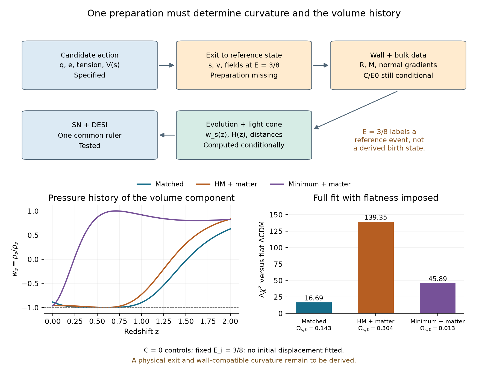

At $z=2$ the minimum-start flat source has volume fraction .226330,
despite its small present fraction. Its earlier kinetic/pressure history
helps explain why the full fit worsens. Numerical settings change joint
chi-square by at most $5.6\times10^{-9}$.

These are reference-slice continuations, including earlier emitters. The
fitted $N=0$ slices lie near redshifts .59--.73 in the new controls;
higher-redshift data use the backward continuation. They cannot be
advertised as post-nucleation-only histories with that slice as birth.
The requested genuine-exit refit therefore remains unfulfilled.

Finally, rounding is explicit: the displayed six-decimal pair gives
$3(.577259+.143326)=2.161755$. The unrounded best-fit sum is
2.1617561739988 and the posterior mean 2.1616589757622. They are
different reported quantities. The next physical calculation must supply
a compatible parent/child transition and its Lorentzian profiles and wall
collar. Evolve that state to the reference event $E=3/8$, if it exists,
and carry its volume, velocity and curvature forward without resetting
them. The reference density must not be mistaken for a derived birth state.
Every emitter must then lie in the constructed history before the next fit.

### 13.28. A mass-free nucleation radius and the matter-reference gate

<!-- nsc-claim:parke-mass-free-radius -->

Evidence: [constant-vacuum bubble and mass balance](../results/summaries/nsc-atlas-parke-bubble-v1.json),
[source scope and unit dictionary](../docs/nsc-atlas-parke-nucleation.md),
and [independent junction and limit checks](../tests/test_nsc_atlas_parke_nucleation.py).

The proposed replacement of the supplied radius and seed mass has a
definite answer within a constant-vacuum thin-wall model. Reusing
[Parke (1983)](https://doi.org/10.1016/0370-2693%2883%2991376-X),
which extends [Coleman--De Luccia](https://doi.org/10.1103/PhysRevD.21.3305),
take $U_i=7/32$, $U_o=21/32$, $\sigma=1/5$ and $\kappa=1$. The
ordinary positive-cap branch gives

$$
R_c^{-2}=\left(\frac{U_o-U_i}{3\sigma}\right)^2
+\frac{\kappa(U_i+U_o)}{6}+\frac{(\kappa\sigma)^2}{16}
=\frac{39169}{57600},
$$

$$
R_c=\frac{240}{\sqrt{39169}}=1.212662645008\ L_{\rm unit}(0),
\qquad M_i=M_o=0.
$$

Neither the old 1.9 nor the old .12 enters that calculation. The new
radius is .63824350 times the supplied one. Both radii are in the
original model unit. For historical comparison only, the old
$L_{\rm ref}(0)=6.6260770761L_{\rm unit}(0)$ gives ratios .18301366
and .28674583. That old curvature ruler was derived from the removed
preparation and is not a new prediction. The independent false-vacuum
ruler gives $R_c/\sqrt{3/(\kappa U_o)}=.56717102$.

At the turning point the signed normal factors are
$\beta_i=187/\sqrt{39169}$ and $\beta_o=163/\sqrt{39169}$.
They satisfy the unsquared junction exactly. Regular homogeneous vacua
have zero Schwarzschild seed offsets, and their mass balance is

$$
0=-\frac{(U_o-U_i)R_c^3}{6}
+\frac{\sigma R_c^2\beta_i}{2}
-\frac{\sigma^2 R_c^3}{8}.
$$

The terms are -.130030971151, +.138947380602 and -.008916409450.
The interior geometric Misner--Sharp mass is nevertheless .065015485576 because
it contains vacuum energy. Zero seed mass alone does not determine the
homogeneous scalar state or imply zero total energy.

The auxiliary bubble has wall trajectory
$R(\tau_w)=R_c\cosh(\tau_w/R_c)$. Its pure-vacuum open interior has
$a(t)=\sinh(H_it)/H_i$, $H_i^2=7/96$, and
$\Omega_k(t)=\mathrm{sech}^2(H_it)$, with birth limit +1. Wall proper
time and interior cosmic time differ. A finite turning radius is not a
matter-defined FRW reference scale.

<!-- nsc-claim:parke-source-reheating-admission -->

Evidence: [vacuum, reheating and energy-budget admission](../results/summaries/nsc-atlas-parke-reheating-admission-v1.json)
and [exact matter-invariance checks](../tests/test_nsc_atlas_parke_nucleation.py).

This geometric solution must still belong to the same action before it
can replace the preparation. The stated densities were values of an
excited scalar snapshot. At its supplied field, with $y=\omega\phi$,
the middle and exterior derivatives are

$$
U_y=\frac{\sqrt{3}}{4},\qquad U_y=\frac{\sqrt{3}}{2}.
$$

They are nonzero. The relaxed scalar densities are instead 1/8 and 9/32.
The volume adds another incompatibility: its well minimum
$V_*=.220983024213$ exceeds the stipulated interior density .21875.
The actual coupled wall also has $\sigma(s)=.2e^{-6s}$ and requires
its volume-gradient profile. The closed-form radius does not supply
that profile or an actual scalar turning point for these endpoints.

For an empty retained matter field in the homogeneous post-wall region
at fixed flux and without incoming sources, the supplied equations give

$$
\dot E+(3H+6\dot s)E=0,\qquad
E=E_i\exp[-3(N-N_i)-6(s-s_i)].
$$

Thus $E_i=0$ remains zero for any roll of $s$. The exact classical
$\chi=\Pi=0$ solution has the same invariance. This does not replace
a CDL turning point by the HM top, and it is not a claim that all quantum
reheating is impossible. It establishes that the present classical
source does not create the requested reference event from that empty state.

Counting volume oscillation energy as matter still requires an adequate
budget. With any internal energy-conserving transfer to positive dust,
an expanding homogeneous branch obeys

$$
\dot\rho_{\rm total}=-3H(K\dot s^2+E)\leq0.
$$

The literal thin-wall child density $7/32$ is below the matter target
$3/8$ even before a vacuum is retained. A rest exit that can arrive at
the well with the requested matter requires at least

$$
V_{\rm exit}\geq V_*+\frac38=0.595983024213.
$$

The excess available within the computed minimum-to-barrier interval is
only .133553653265 before expansion losses. This bound applies to that
interval; it does not assign a value to an unknown CDL exit. On the
potential's rising left side the necessary energy would require
$s\leq-.07885602698$, which is an energy threshold, not a derived
turning point. The parent difference $U_o-V_*=.435266975787$ could
cover the budget, but its delivery into the child has not been calculated.

Ordinary on-shell reheating into the retained massive scalar is also
closed near the minimum: $m_s=1.477737463$ while
$2m_\chi=2.476949780\times10^9$ in the same inverse-length units.
Nonperturbative and curved-background quantum production are not computed;
no new phenomenological reheating rate is inserted.

The result is consequently precise. The stipulated vacuum-wall model
fixes its radius and zero seed masses. Its endpoints fail admission as
vacua of the unchanged scalar/volume source, and its empty classical
matter branch never reaches $E=3/8$. There is no admissible reference
event from which to report a new $C/E_0$, present curvature, $w_s(z)$
or SN+DESI likelihood. No reset state or fictitious fit replaces that
missing event. A compatible vacuum transition and matter-transfer
mechanism must be derived together before this geometry becomes the
requested reheated cosmology. These route failures do not reject nesting.

### 13.29. Three targets from the spectral and regional map

<!-- nsc-claim:three-dimensionless-targets -->

Evidence: [dimensionless calculation and controls](../results/summaries/nsc-atlas-three-targets-v1.json),
[formula meanings and missing connections](../docs/nsc-cosmological-atlas.md#three-numerical-targets-from-the-existing-equations),
and [independent algebra and scale checks](../tests/test_nsc_atlas_three_targets.py).

Douglas's organizing picture asks whether the band of a confined region,
an imbalance between conjugate oscillations, and the response from outside
can yield three numerical predictions. Here the calculation uses only
the existing atlas equations and retained dimensionless inputs. No Planck
length in metres or other CODATA anchor is imported, and no target selects
a depth, source state or energy weight.

The related force-resolution proposal asks whether the frequency- and
momentum-dependent response of one action produces the different interaction
channels seen locally. It is a question about deriving couplings and their
scale dependence. It does not identify strong or weak interactions with
an event horizon, whose role in the atlas is causal access.

For the occupied sphere spectrum, $\omega_n=cn/R$, the highest selected
mode and the current lowest mode give

$$
\ln\frac{\omega_{\max,\rm infl}}{\omega_{\min,\rm now}}
=\ln q_{\max}+\ln\frac{R_{\rm now}}{R_{\rm infl}}.
$$

This assumes common local propagation speed and the angular ground n=1.
A varying speed would add its endpoint ratio. The product
$\omega_{\max}R_{\rm infl}/c=q_{\max}$ belongs to the selected state or
cutoff; the untruncated spectrum has no largest n. With the stated
wavelength formula, the ground wavelength is $2\pi R$. Thus the size
convention must also be explicit.

The RN/PG diagnostic gives a different quantity:

$$
B_{\rm grid}=\frac{\omega_{\rm cutoff}}{\omega_{\rm zero}}
=\frac{r}{\Delta r}\left(1+\frac{|\beta|}{N}\right).
$$

Here N is lapse and the cutoff uses numerical grid spacing. Refining the
spacing by two doubles this band without changing the metric. The
diagnostic alone therefore does not select a physical shortest wavelength.

In the spectral inheritance equation, Lambda_n is a frequency scale.
Frequency multiplication by Omega implies length division by Omega at
fixed c. The associated curvature factor is zeta=Omega squared, as in
the existing dilation implementation. Using the same Omega as a curvature
factor would be a different physical identification. The q=4 binding
candidate gives Omega=3.973074368754331 and ln(Omega)=1.379540195196.
If its frequency map were the cosmological transition and its endpoint
factor were one, the conditional calculation would be:

| Assigned depth | Log band | Miss vs 136.84 (%) | Miss vs 138.26 (%) |
| ---: | ---: | ---: | ---: |
| 1 | 1.3795401952 | -98.99186 | -99.00221 |
| 2 | 2.7590803904 | -97.98372 | -98.00443 |
| 100 | 137.9540195196 | +.81410 | -.22131 |

The last row is numerically inside the requested window, but neither
100 levels nor the endpoint factor is selected. The window inverts to
depths 99.19247--100.22180 only under those supplied assumptions. Under
the proposed curvature-factor reading, 200 assigned steps give the same
137.9540195196; that count is equally unselected. The
Parke radius and the late volume vacuum do not supply the missing depth
or band endpoints, and the q=4 spectral candidate has not been identified
with that cosmological source.

The conjugate-mode expansion likewise separates phase from population.
For mode occupations,

$$
\mathcal A=\frac{n_+-n_-}{n_++n_-},\qquad
\eta_B=\mathcal A_b\frac{n_b+n_{\bar b}}{n_\gamma}.
$$

A relative phase cancels from the number expectation values. Equal
occupations give zero imbalance for every phase; occupations 3/4 and 1/4
give 1/2 for the same operator. Neither choice is selected by the geometry.
A baryon/photon prediction additionally needs the physical sector assignment
and photon or entropy normalization. A freely supplied amplitude offset
would not be a derivation of the target 6.1e-10.

Finally, the stipulated Parke densities give Uo/Ui=3. Even an auxiliary
outside energy fraction requires a volume ratio v=V_out/V_in:

$$
f_{\rm out}=\frac{3v}{1+3v},\qquad
\Omega_a=\frac{\kappa\rho_a}{3H^2}.
$$

The first expression is .75 at v=1 and .5 at v=1/3; it is not a
vacuum/clustering/baryon decomposition. The second needs one observer's
effective stress and expansion. A vacuum-only Friedmann limit gives
(1,0,0), formally missing (.685,.265,.049) by (+45.9854%,-100%,-100%).
That is a limiting control, not a present-day abundance prediction.

The actual outputs for all three requested predictions remain unselected,
and their physical percentage misses are undefined. What is missing is a
physical endpoint/transition map, a charged-state preparation and baryon/photon
identification, and an exterior-to-observer stress projection. These are not
necessarily one new scalar each. The numerical targets remain comparisons
rather than substitutes for those maps. At exponential boundaries, logarithms,
dimensionless ratios and compatible regional charts preserve the calculation;
a clamp or coordinate limit is not promoted to a physical endpoint.

### 13.30. Constructing the pen: a phase history on the sphere

<!-- nsc-claim:constructed-pen-geometry -->

Evidence: [geometry and finite measurements](../results/summaries/nsc-atlas-pen-geometry-v1.json),
[construction and proofs](../docs/nsc-atlas-pen-geometry.md),
and [independent geometric and numerical checks](../tests/test_nsc_atlas_pen_geometry.py).

The next step constructs a candidate from two clocks already present in the
(12,2) action. Near its late vacuum, the volume displacement and canonical
scalar displacement are independent linear modes. Removing their common
Hubble damping by multiplying by $a^{3/2}$ gives

$$
\nu_s^2=\frac{V_{ss}}{84}-\frac{3V_*}{4},\qquad
\nu_\chi^2=\omega_0^2e^{-12s_*}-\frac{3V_*}{4}.
$$

One pass is defined as a scalar-mode period, sampling the volume phase.
For x=exp(-2s_star), stationarity gives the exact polynomial
25x^6-140x+112=0. Reduction by that polynomial yields

$$
\delta=2\pi\frac{\nu_s}{\nu_\chi}
=2\pi\sqrt{\frac{475x-468}{32\omega_0^2+75x-84}}
=0.360395008387051
$$

for the retained parent coupling omega0=20. The polynomial is Eisenstein
at7, and the squared frequency ratio is a nonconstant rational fractional-linear
function of its irrational root; the rotation is therefore irrational.
The offset is derived conditional on the supplied coupling, not fitted.
Mapping the sampled phase to a spatial circle is the declared geometric
step. It is a circle fiber of the phase map, not the continuous trajectory
of a particle. Pass k draws

$$
X(u,v)=R(\sin u\cos v,\sin u\sin v,\cos u),\qquad
v_k=k\delta.
$$

Circle orientations are read modulo pi. The independent curve parameter u
and plane orientation v give |X|=R and
area Jacobian $R^2|\sin u|$. The continuous family is the sphere; the
irrational sequence has the same dense closure. Finite curves have zero
area. A radial coordinate would be needed to fill a ball.

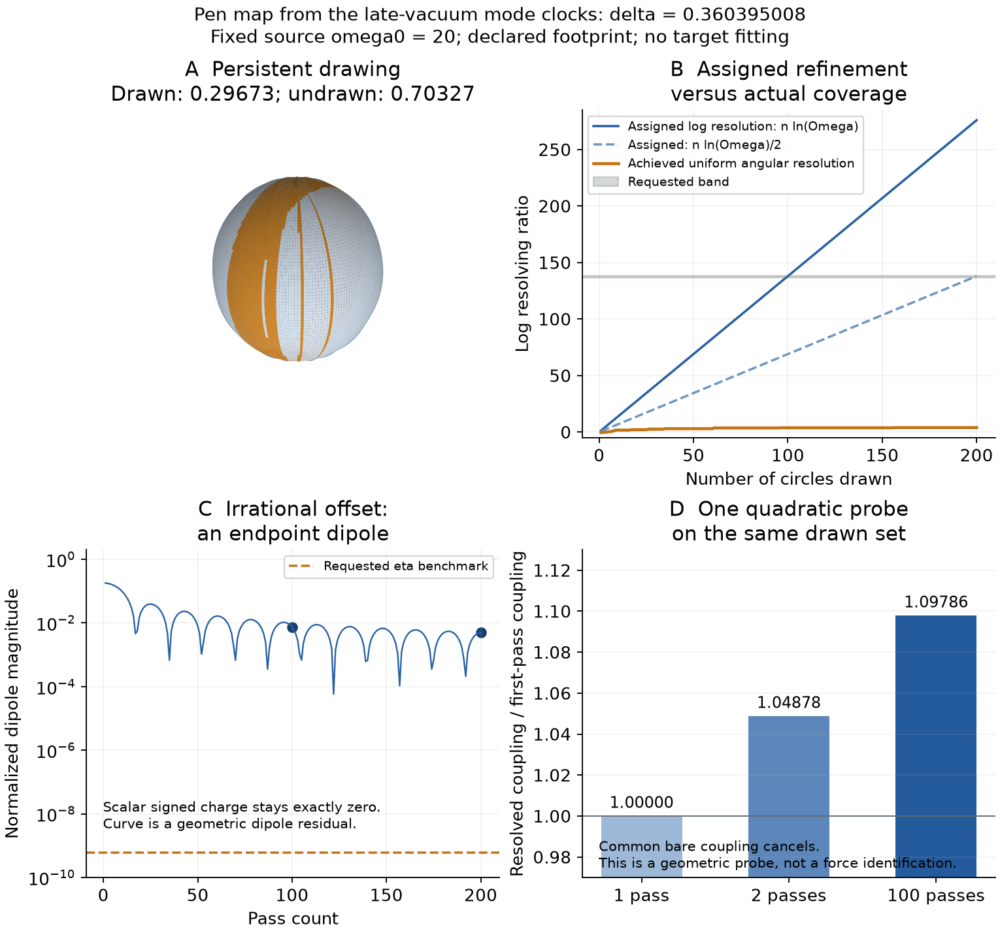

*The same clock-defined circle history supplies coverage, a signed phase moment
and a quadratic probe. The orange region retains earlier ink. Assigned
exponential refinement and achieved angular coverage are measured separately;
no curve or parameter is fitted to the targets.*

Give pass k the angular footprint $\epsilon_k=\Omega^{-(k+1)/p}$, with
p=1 for the frequency-scale reading and p=2 for the requested square-root
reading. Old ink persists. The Parke radius can set R, but it cancels from
these angular fractions. The maximum distance to the first n circle planes is

$$
h_n=\frac{\max_i g_i}{2}\geq\frac{\pi}{2n},
$$

where the orientation gaps sum to pi. This is an optimistic resolution
bound because each circle itself was drawn continuously. At 100 passes,
log(1/h_n)=3.7411273; at 200, it is 3.9020327. Their logarithmic misses
from 136.84--138.26 are about -97.29% and -97.18%, respectively, using
the upper endpoint. The assigned refinement is 137.9540195 at n=100,p=1
or n=200,p=2, but is not achieved by those finite drawings. Reaching that
uniform angular resolution requires at least about $1.285\times10^{60}$
independent circles. Irrational rotation also has no exact finite return.

The missing history link is a stopping event or a rule that branches each
pass into enough independently drawn circles. The present one-circle-per-pass
map selects neither 100 nor 200 as a physical endpoint.

The same late-vacuum action gives physical expansion of .0688557421
e-folds per scalar cycle: 6.8855742 at100 cycles and13.7711484 at200.
A phase cycle is therefore not automatically one Omega inheritance step.
The existing alternative source members omega0=2000 and10^9 give different
offsets, .00360346331762 and7.20692653791e-9; no member is substituted
to improve a comparison. Formation and the physical stop event remain open.

The bound is constructively sharp: M equally spaced meridians rotated
by the accumulated phase have fill distance pi/(2M). Taking
M=ceil(pi/(2*epsilon)) achieves the requested resolution. A branching
refinement can therefore work geometrically, but its many-circle history
and physical stopping event must be supplied by a transition law.

For a precise offset readout, let $z_k=e^{ik\delta}$ mark an oriented
equatorial point, and let a negative mark be displaced to the next pass.
Their normalized vector moment telescopes:

$$
D_n=\frac{1}{2n}\sum_{k=0}^{n-1}(z_k-z_{k+1})
=\frac{1-e^{in\delta}}{2n},\qquad
|D_n|=\frac{|\sin(n\delta/2)|}{n}.
$$

It gives .00737800095 at 100 passes and .00498029284 at 200, exceeding
6.1e-10 by about $1.210\times10^9$% and $8.164\times10^8$% if identified
with that target. Each pass still has one positive and one negative scalar
charge: net signed count is exactly zero. The irrationality gives a nonzero
endpoint dipole, not charge production. The tiny offset for the separately
supplied frequency10^9 member gives residual3.60346e-9 at100 cycles; its
smallness inherits that large input frequency and still is not net charge.

The missing asymmetry link is the physical charge-producing process and
its baryon/photon observable.

For the retained ink, union the open geodesic bands of widths epsilon_k.
At $z=|\cos\theta|$, calculate their union longitude length L_n(z) on
the orientation circle of length pi. The drawn fraction is

$$
f_n=\int_0^1\frac{L_n(z)}{\pi}\,dz.
$$

Monotone quadrature and a geometric tail bound give the following finite
measurements and a deliberately explicit binary area assignment:

| Drawing | Drawn fraction | Assigned (vacuum, clustering, baryon) fractions | % misses from (.685,.265,.049) |
| --- | ---: | --- | --- |
| 100, p=1 | .29673 | (.70327,0,.29673) | (+2.67,-100,+505.58) |
| 200, p=2 | .62898 | (.37102,0,.62898) | (-45.84,-100,+1183.64) |

The drawn-area enclosures are [.2966405,.2968324] and [.6289221,.6290423].
At constant wall tension these are also fractions of the surface energy.
Cosmological source identification remains additional physics. An outside
clustering share chi would give ((1-f)(1-chi),(1-f)chi,f); chi is not selected
and cannot repair the drawn/baryon fraction under this assignment.

There is also an exact fine-scale result. For p=1 the infinite ink union
is open and dense, yet its total area is at most $1/(\Omega-1)<1$.
Its closed complement has empty interior and area at least .6636478352.
Being arbitrarily close to a drawn line is therefore compatible with a
positive-area unresolved complement. Re-resolving every line at the latest
width instead gives area about $1.223\times10^{-58}$ at 100 passes.
That small number and its logarithm are retained; its complement is kept
as 1-f rather than rounded to one.

Finally use the same persistent drawn set for one declared quadratic probe:

$$
E_n(\mathbf{u})=\frac{\gamma}{2}\int_{\mathcal{D}_n}(\mathbf{u}\cdot X/R)^2
\frac{dA}{4\pi R^2},\qquad
g_z(n)=\gamma\int_0^1z^2\frac{L_n(z)}{\pi}\,dz.
$$

For the p=1 history the resolved force is $F_z=-g_z(n)u_z$. The common bare gamma cancels,
giving $g_z(2)/g_z(1)=1.048777$, enclosed by [1.04779,1.04980], and
$g_z(100)/g_z(1)=1.097855$. Total resolved-plus-unresolved coupling remains
gamma/3. Further growth between 100 and 200 passes is at most
$3.08\times10^{-60}$ in relative terms. This constructs a depth-dependent
effective response. Its identification with fundamental interactions,
the footprint rule and a physical formation history remain open. The earlier
auxiliary-wheel choice delta=2*pi*(sqrt(6)-2), with its different numerical
readouts, is preserved as a comparison. It is superseded here by the
normal-mode offset from the fixed source action.

### 13.31. The inward drawing: golden turns and inherited clocks

<!-- nsc-claim:golden-vortex-comparison -->

The drawing can continue indefinitely while an observer occupies a finite
depth. The [golden-vortex calculation](../docs/nsc-atlas-golden-vortex.md)
constructs that continuation and compares it with the retained action clocks.
For a point x in a unit ball, the same operation

$$
S(x,t)=(\sqrt{1-t^2}\,x,t),\qquad -1\leq t\leq1
$$

maps one ball onto the next-dimensional ball. Applied twice to a line segment,
it fills a three-ball; its boundaries pass through circle and sphere. The two
offsets are retained independent parameters. An inward history is

$$
F_n=R_c q^{-n}{\cal R}_z(n\delta)S(S(x,t_1),t_2).
$$

This gives nested copies for every q>1. Radius-normalized spherical Dirac
operators inherit the same law for every such q, so that invariance supplies
the construction but does not choose its scale ratio.

The golden choice has phi=(1+sqrt(5))/2, delta=2pi/phi^2 and q=phi^4. Its
planar logarithmic spiral shrinks by phi per quarter turn. On the sphere,

$$
\gamma(t)=R_c q^{-t}X(2\pi t,\delta t),\qquad
\gamma(t+1)=q^{-1}{\cal R}_z(\delta)\gamma(t).
$$

Local radial gaps therefore shrink geometrically. Angular coverage remains
a separate question: N points covering a unit sphere have angular covering
radius at least acos(1-2/N). Integer samples of this particular continuous
curve return to the pole; its full direction history has dense closure.
It is the turns, not those isolated integer samples, that draw the curve.

The golden angle is 2.399963229729 versus the action's .360395008387.
The full-turn ratio 6.854101966250 exceeds Omega=3.973074368754 by 72.5138%.
phi^3 differs by 6.6194%; ln(Omega)/ln(phi)=2.866804436955 is not an exact
integer-power link. No physical sampling clock makes these choices equal.

Reusing the stated persistent spherical-band footprint gives:

| Construction | Drawn | Undrawn | Undrawn vs .685 | Drawn vs .315 |
| --- | --- | --- | --- | --- |
| Action, omega0=20 | .2967343240 | .7032656760 | +2.6665% | -5.7986% |
| Action, omega0=2000 | .2490451897 | .7509548103 | +9.6284% | -20.9380% |
| Action, omega0=10^9 | .2490451897 | .7509548103 | +9.6284% | -20.9380% |
| Golden full turns | .1669757270 | .8330242730 | +21.6094% | -46.9918% |

The n=50,100,200,1000 values converge at this precision; the enclosing
intervals and geometric tail bounds are in the
[record](../results/summaries/nsc-atlas-golden-vortex-v1.json).
The limit depends on source frequency. omega0=20 remains a retained action
input. The area fractions require the declared footprint and have not been
identified with physical energy fractions.

The supplied log hierarchy 136.84--138.26 corresponds to 71.091--71.829
golden full turns, 284.365--287.316 quarter turns, 99.192--100.222 Omega
frequency steps, or 198.385--200.444 curvature steps. These describe positions
if the target hierarchy is supplied. A formation history must still select
the current event; the drawing does not need a final stopping point.

The black-hole comparisons also distinguish scale readouts. Schwarzschild
has horizon radius 2m and circular photon-orbit radius 3m, ratio 1.5. Its
critical photon-orbit offset grows by exp(2pi)=535.4916555 per revolution.
This follows by expanding (du/dphi)^2=1/27-u^2+2u^3 at u=1/3. For Kerr,
the corresponding equatorial instability exponent varies with spin; the
prograde full-orbit factors at .5,.9,.99 are 119.71156,11.38191,2.32608.
These are geodesic offsets, not child-radius ratios. The sources are
[Teo's Kerr orbits](https://phyweb.physics.nus.edu.sg/~phyteoe/kerr/) and the
[photon-ring analysis](https://pmc.ncbi.nlm.nih.gov/articles/PMC7080443/).

The Kasner/BKL connection is exact in its own vacuum approximation:

$$
(p_1,p_2,p_3)=\frac{(-u,1+u,u(1+u))}{1+u+u^2},
\qquad \sum p_i=\sum p_i^2=1.
$$

At u=phi the bounce cycles (-.3090169944,.5,.8090169944). Its derivative
is -phi^2=-2.618033989: the golden orbit is repelling. The permutation of
axis exponents is not itself a frame-dragging calculation. The Gauss-map
typical denominator factor is exp[pi^2/(12ln2)]=3.275822919, 17.5494% below
Omega; see [Damour--Lecian](https://arxiv.org/abs/1011.5797). A proper-time
clock and transition data are needed before an era count becomes a hierarchy.

[Frolov--Markov--Mukhanov](https://doi.org/10.1016/0370-2693%2889%2991114-3)
provide a limiting-curvature core using a spacelike transition; the old Parke
wall is timelike and cannot be substituted without matching its source.
The [spin-torsion bounce](https://arxiv.org/abs/1110.5019) is another specified
action, while [mass inflation](https://doi.org/10.1103/PhysRevD.41.1796)
describes an internal mass parameter rather than necessarily spatial expansion.
The next construction removes the material wall, following Douglas's revision.

### 13.32. Through the horizon: smooth geometry, charge and an offset

<!-- nsc-claim:smooth-horizon-and-offset -->

A causal horizon is now the proposed handoff. The
[smooth-horizon calculation](../docs/nsc-atlas-smooth-horizon.md) develops
that branch without treating the old material wall as compulsory.
At fixed Ui=7/32 and Uo=21/32, the Parke formula gives

$$
R_c^{-2}=\frac{(U_o-U_i)^2}{9\sigma^2}
+\frac{\kappa(U_i+U_o)}{6}+\frac{\kappa^2\sigma^2}{16}.
$$

Thus Rc tends to zero as tension tends to zero; 1.212662645 is not retained
as a finite horizon. The flux equation also requires continuous q when the
membrane current is removed. Keeping a charge jump while deleting only
tension would still leave an interface source.

The existing effective-action minimum has Lambda_star=.220983024213.
Its constant fields admit a smooth Kottler metric:

$$
ds^2=-f\,dv^2+2dv\,dr+r^2d\Omega^2,\qquad
f=1-\frac{2m}{r}-\frac{\Lambda_*r^2}{3}.
$$

The determinant is -r^4 sin(theta)^2. At a horizon f=0 it remains regular
away from the ordinary angular-coordinate poles. An infaller has

$$
\frac{dr}{d\tau}=-\sqrt{E^2-f},\qquad
\frac{dv}{d\tau}=\frac{1}{E+\sqrt{E^2-f}}.
$$

At the crossing these become -E and 1/(2E), and the norm stays -1. This
proves that this zero marks the end of the static chart, with continuation
in the same spacetime. It does not by itself create a new independent
dimension or resolve the central r=0 singularity of the m>0 solution.

At m=0 the same-action de Sitter horizon is **3.684522144189 model units**.
Forcing a black-hole root to equal the old Rc would require m=.540652151655;
that is an inversion diagnostic, not a derived mass. Smooth joining of two
constant-vacuum Kottler pieces in one EF normalization gives
[m]=-[Lambda]R^3/6 and [f']=-[Lambda]R, so equal first derivatives require
equal vacuum and mass parameters. Null interfaces use the transverse-curvature
conditions of [Barrabes--Israel](https://doi.org/10.1103/PhysRevD.43.1129)
and [Poisson](https://arxiv.org/abs/gr-qc/0207101). A sourced smooth transition
remains a separate field problem.

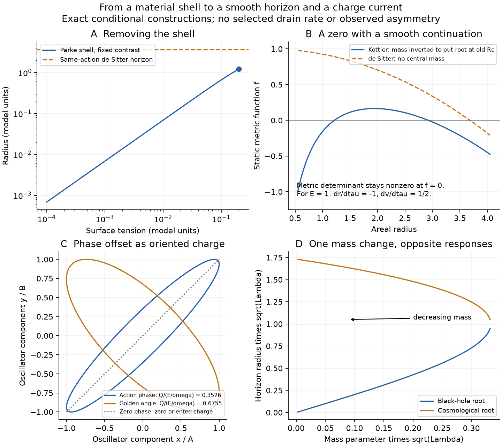

Global zero charge can mean opposite charge in two regions. The continuity
equation makes the distinction from no production calculable:

$$
Q(V_2)-Q(V_1)=-\int_{\partial V}J^\mu d\Sigma_\mu
+\int_{\mathcal V}S_B\,dV.
$$

A charge-symmetric state and dynamics on a moving neutral metric still have
zero expected charge in a region preserved by internal charge conjugation.
This does not exclude charge-separated states; it says their selection
requires state or interaction data. A global CPT pairing can exchange regions
and permits Q_minus(-t)=-Q_plus(t) without fixing its magnitude.
[Boyle--Finn--Turok](https://arxiv.org/html/1803.08928v3) supply a specific
pre-/post-bang CPT cosmology, not a general identification of black-hole
horizons with antimatter. [Cohen--Kaplan--Nelson](https://arxiv.org/abs/hep-ph/9302210)
combine moving walls with CP-violating interactions and transport. Motion
alone is not that baryogenesis mechanism.

Douglas's offset nevertheless has a precise charged realization. For the
two-component harmonic comparison x=A cos(omega t), y=B cos(omega t-delta),

$$
Q=x\dot y-y\dot x=AB\omega\sin\delta,\qquad
\frac{Q}{E/\omega}=\frac{2AB}{A^2+B^2}\sin\delta.
$$

The ellipse's orientation is its conserved charge. With equal amplitudes,
the action phase gives .352643892877 and the golden angle .675490294262.
These are charge per total oscillator quanta, not baryon/photon eta. The
existing volume and scalar modes have unequal frequencies, so they do not
already constitute this degenerate charged pair. The comparison constructs
the missing object explicitly while retaining its additional field/state
assumption. With common expansion damping, a^3 Q is conserved: density
dilutes without generating an initial imbalance.

The existing neutral quadratic field also has two calculable stress readouts:

$$
\rho=V_*+\frac{\dot\chi^2+\omega^2\chi^2}{2},\qquad
p=-V_*+\frac{\dot\chi^2-\omega^2\chi^2}{2}.
$$

A uniform phase ensemble on a fixed de Sitter background gives
rho_osc=A^2 omega^2/(2a^3) and p_osc=0; the baseline has w=-1. This connects
baseline and oscillation to vacuum-like and matter-like gravity. Their
fractions, charge state and baryon identity are not selected by this split.

Finally, adding a specified null source permits m=m(v) in the same regular
metric. Direct calculation gives

$$
T_{vv}^{\rm null}=\frac{2m'}{\kappa r^2},\qquad
\frac{dR_h}{dv}=\frac{2m'}{1-\Lambda R_h^2},\qquad
T^\mu{}_{\mu}=0.
$$

Decreasing m shrinks the black-hole marginal root and enlarges the
cosmological one. This advanced-coordinate comparison requires negative
ingoing energy for that sign, together with a physical source and exterior
balance. It has not derived the drain rate. These are local marginal roots,
not automatically global event horizons; see
[Nielsen et al.](https://arxiv.org/abs/1007.2990). The traceless drain adds no
vacuum Lambda in this construction. It can change a horizon without itself
being dark energy.

The [record](../results/summaries/nsc-atlas-smooth-horizon-v1.json) gives
the exact identities, numerical controls and independent tests. The
charge-symmetric control is zero (-100% against 6.1e-10), while physical
baryon/photon eta remains unselected. The flat pure-vacuum control has
Omega_Lambda=1 (+45.9854% against .685), not a matter-filled-universe fit.
The next bridge is an inherited charge current and state whose stress
produces a smooth, sourced horizon history. That makes the continuation
and the offset testable in the same geometry.

### 13.33. Deriving the charged pair from internal geometry

<!-- nsc-claim:inherited-harmonic-charge -->

The previous offset comparison needed two equal-mass components. The
[inherited-charge calculation](../docs/nsc-atlas-inherited-charge.md) now
derives a candidate pair from the real higher-dimensional scalar already
used in the volume reduction. We explicitly complete its internal Einstein
space as a round S12. The action fixes its scalar curvature, but does not
select roundness among all possible internal geometries. This is a quadratic
harmonic calculation on the effective late vacuum, not a full nonlinear
sixteen-dimensional formation solution.

The curvature term -15 exp(-14s)/2 gives R_gamma=15, hence

$$
a_0^2=\frac{12\cdot11}{15}=\frac{44}{5},\qquad
\lambda_l=\frac{l(l+11)}{a_0^2},\qquad \lambda_1=\frac{15}{11}.
$$

The thirteen real l=1 harmonics are normalized embedding coordinates.
For a rotation in one coordinate plane,

$$
Y_+=\frac{Y_1+iY_2}{\sqrt{2}},\qquad
\delta\Phi=xY_1+yY_2=\psi Y_+^*+\psi^*Y_+,
\qquad \psi=\frac{x+iy}{\sqrt{2}}.
$$

Thus one real higher-dimensional field supplies a complex four-dimensional
mode carrying internal rotational charges +/-1. Six commuting planes
organize the thirteen real harmonics as six complex pairs and one neutral
component. This uses the attributed
[Kaluza-Klein construction](https://arxiv.org/pdf/hep-th/9410046); no new
elementary complex scalar was inserted. Mixed metric components supply
gauge fields when these modes backreact. A finite-mode nonlinear truncation
and identification of this charge with baryon number are not established.

Canonical reduction fixes the pair's mass:

$$
M_1^2(s)=\omega_0^2e^{-12s}+\frac{15}{11}e^{-14s}.
$$

At s_star=-.035646782553 and the retained omega0=20, this is
615.774153968986, so M1=24.814797076925 in model units. The internal gradient
contributes 2.246132580192 to the mass squared. This degeneracy is geometric;
it does not equate the previously unequal volume and matter frequencies.

The round geometry also has a proper rotation flipping coordinates n2 and
n13. Its determinant is +1; it conjugates the selected charge generator
while preserving both the metric and oriented top-form flux. The supplied
flux therefore does not select a sign of this charge. Neither does the
ancestor count supply an internal rotational current.

Both components cross a neutral smooth horizon with the same radial operator:

$$
f u''+(f'-2i\omega)u'
-\left(\frac{f'}{r}+M_1^2+\frac{l(l+1)}{r^2}\right)u=0.
$$

At a simple horizon its powers are 0 and 2i omega/f'(r_h). The regular
branch has an arbitrary complex amplitude. Regular crossing transports
the field but does not select its phase or occupation.

On the stationary de Sitter parent, the regular Euclidean Gaussian
preparation has positive spectral coefficients H_star^2 L(L+3)+M1^2.
Its two component covariances agree, with zero cross covariance and uniform
phase. This is a specified invariant state-selection rule, not a claim that
the action alone selects all initial data. [Allen's state analysis](https://doi.org/10.1103/PhysRevD.32.3136)
distinguishes Euclidean regularity from de Sitter symmetry alone.
The [Gibbons-Hawking](https://doi.org/10.1103/PhysRevD.15.2738) static-patch
temperature is H_star/(2pi)=.043195545274.

For a stationary mode, write z=exp(-2pi omega/H_star). The local charge
difference of its two thermal populations obeys

$$
P(Q=k)=\frac{1-z}{1+z}z^{|k|},\qquad
\langle Q\rangle=0,\qquad
\operatorname{Var}(Q)=\frac{2z}{(1-z)^2}.
$$

This retains fluctuations rather than identifying zero mean with zero in
every realization. At the illustrative detector gap omega=M1, ln(z) is
-574.475838182 and the one-mode charge RMS is 2.539052865e-125. These are
spectral controls, not a baryon-to-photon ratio or a selected regional
population. A cosmological fluctuation needs mode weights and photon density.

The neutral Bogoliubov pair map gives the exact operator identity

$$
N_{+,\rm out}-N_{-,\rm out}=N_{+,\rm in}-N_{-,\rm in},
\qquad |\alpha|^2-|\beta|^2=1.
$$

More generally, an internal charge-exchange-equivariant transport channel
preserves an invariant state at every nesting depth. Regional charge still
obeys the boundary-current law; this does not assume that an open region
conserves its charge separately. A biased inherited state can carry an
imbalance, but neutral propagation cannot select that bias from this vacuum.

The [record](../results/summaries/nsc-atlas-inherited-charge-v1.json) gives
zero mean charge asymmetry. If this charge is identified with baryons and
a positive photon density is supplied, eta=0, a -100% miss against 6.1e-10.
The physical baryon/photon ratio remains unselected. The contribution is
the geometric field pair, its explicit horizon equation, and a conditional
state and charge distribution. The remaining connection is an inherited
internal current or charge-asymmetric preparation, together with its
baryon/photon interpretation; assigning a fitted phase would not close it.

## IV. Concentration, conservation and the surrounding reservoir

A dark-matter account needs a physical source that forms structure and accounts for its surroundings. We first calculate admissible scalar concentrations and their conserved supply, then their persistence and spatial compensation, and finally formation from compact disturbances. The route preserves the inherited parent instead of adding an independent halo mass. Different frequencies and preparations are explicit members of the family; they are not exchanged between examples by a change of units.

### 14. The energy supply and formation of structure

The following sections give the worked constructions and their attributed mathematical inputs.

### 14.1. A profile selected by scalar self-gravity

<!-- nsc-claim:scalar-core-profile-selection -->

The operational clock family in Section 15.1 uses a specified profile.
Here a physical selection mechanism is calculated: a real massive scalar can
concentrate through its own gravity and shed radiation, leaving a
coherent core. Gravitational cooling is established prior work of
[Seidel and Suen](https://arxiv.org/abs/gr-qc/9309015). The stationary
equations are also those studied by
[Moroz, Penrose and Tod](https://doi.org/10.1088/0264-9381/15/9/019),
with time-dependent examples in
[Harrison, Moroz and Tod](https://arxiv.org/html/math-ph/0208046).

The weak-field real-scalar reduction with positive vacuum curvature
is supplied by [Fodor, Forgacs and Mezei](https://arxiv.org/html/1007.0388).
Here its complex envelope represents one classical real field.
It introduces neither a new charged species nor a quantum
state-reduction law. We independently solve the profile and its
finite local evolution, then construct a sourced atlas initial slice.

First distinguish a coupling from a unit convention. At fixed mixing,
fluxes and tension, the common field at the grandchild minimum gives

$$
\phi_0=-\frac{\sqrt{1-\epsilon}\,q_g}{\omega},\qquad
U(\phi_0,q)=\frac{\epsilon q^2}{2}
 +\frac{(1-\epsilon)(q-q_g)^2}{2}.
$$

Thus the initial stress, wall jets and shared geometry do not select
omega. The later dynamics change with it. For weak amplitude zeta,
the local core approximation requires small $\zeta^2$ and

$$
h=\frac{H_\Lambda}{\omega\zeta^2},\qquad
H_\Lambda=\sqrt{\kappa\rho_v/3}.
$$

With zeta=.1 and the same parent vacuum 9/32, omega 20 gives h=1.53093,
outside the small-h approximation. The explicitly different
common-frequency member omega 2000 gives h=.0153093. It is chosen
for this hierarchy, not fitted to data. P003 retains omega 20; the
comparison does not rule out relativistic structures there.
The wall radii remain 1 and 1.9, with common middle mass .12. All
numbers use those same atlas coordinate units, with no selected SI ruler.

In local coordinates $\rho=\omega\zeta r$ and $\tau=\omega\zeta^2t$,

$$
i\partial_\tau\psi=-\frac{1}{2}\Delta\psi
 +(V-h^2\rho^2/2)\psi,\qquad \Delta V=\frac{1}{2}|\psi|^2.
$$

The h=0 nodeless core, with eigenvalue -1/2, satisfies

$$
S''+2S'/\rho+sS=0,\qquad
s''+2s'/\rho+S^2=0,\qquad s(\infty)=-1.
$$

Regularity and decay give $S(0)=1.02149303621$ and radial mass norm
$I=3.50532970334$. The 99%-mass radius is 5.67468871483 in rho.
Its virial identity is checked independently. Scaling the shape
fixes an isolated mass-radius relation,

$$
\mathfrak{M} R_f\omega^2=\frac{I\rho_f}{2},
\qquad \mathfrak{M}=GM.
$$

The core mass and frequency remain inputs; its dimensionless shape
is calculated. In the isolated problem, symmetric decreasing
rearrangement lowers the energy at fixed norm; this is the setting
of [Lieb's minimizing-solution theorem](https://doi.org/10.1002/sapm197757293).
Norm-preserving dilation gives energy $b^2T+bW$ with a finite minimum
at $b=-W/(2T)$. This explains the reference's spherical form and size
without establishing nonspherical stability in the full atlas.
Gaussian and super-Gaussian clouds with equal initial
norm evolve to tau 600. Their late density profiles, averaged over
$500\leq\tau\leq600$ and normalized by remaining mass, differ from the
independent coherent shape by 3.77% and 4.11%, compared with initial
discrepancies near 80%. Residual oscillations remain.

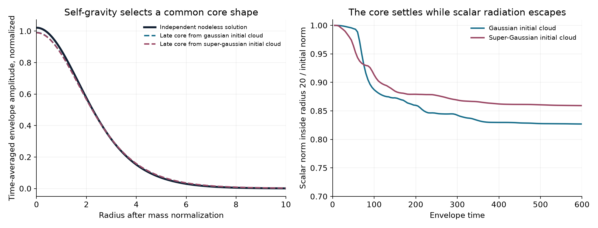

*Figure 19. Left: two distinct initial cloud shapes approach the
independently calculated coherent profile after mass normalization.
Right: scalar norm leaves the central region during relaxation.
This is a finite local envelope calculation, not the full evolving
parent and membrane history.*

The six independent runs use six worker processes. Outgoing current
at radius 20 checks loss from the core independently of the outer
absorber. Fine-run energy-accounting errors stay below $3.4\times10^{-6}$;
moving the outer boundary changes the late inner mass by about .165%.
A free-field control recovers analytic dispersion. The
[compact record](../results/summaries/nsc-atlas-scalar-core-v1.json)
keeps numerical discrepancies distinct from the weak-field, ambient
and relativistic approximations. The original cloud and its energy
are supplied, so this does not generate a primordial seed from nothing.

### 14.2. The coherent core and its inherited environment

<!-- nsc-claim:scalar-core-atlas-admission -->

The Gaussian late inner mass selects a coherent representative with
$\zeta_{\rm core}=.0826621713254$. It is the nodeless representative
of that mass, not the full radiating snapshot. Add its displacement
f to the inherited parent field, and taper its very small tail
smoothly to zero before the material wall. Retain zero scalar
momentum and homogeneous parent slice expansion v=HR.

The gravitational constraint must include the ambient scalar.
Writing $m=M(R)+\kappa U_0R^3/6$, with $U_0=21/32$, gives

$$
\beta^2=1+H^2R^2-\frac{\kappa U_0R^2}{3}-\frac{2M(R)}{R},
$$

$$
M'=\frac{\kappa R^2}{4}\beta^2f'^2
 +\frac{\kappa R^2}{2}U'_0f
 +\frac{\kappa R^2}{4}\omega^2f^2.
$$

The first and last terms are the gradient and quadratic core
contributions. The middle term is coherent interference with the
same inherited field. It cannot be discarded as if the core were
an independently added fluid.

M(0)=0 gives a regular pole. Outside the core M becomes constant;
the unsquared Israel condition then fixes the outer-wall speed and
H. Solving that condition with the mass equation rebuilds the large
parent cap and common middle. Both wall conditions and the middle
seams agree. The positive initial lapse realizes the temporal jets.
Removing the core recovers the same-frequency reference and extrinsic curvature.

| Coherent turning-point phase | Geometric mass offset | Outer-wall areal speed change |
| --- | ---: | ---: |
| Positive relative displacement | .0000957140113 | .000361840526 |
| Opposite relative displacement | .0000494933577 | .000187115382 |

Both have the same isolated leading mass .0000724395411. The exact
potential difference explains the main change:

$$
U(\phi_0+f)-U(\phi_0-f)=2U'_0f.
$$

The cross contribution has magnitude .0000231104644. The gradient
contribution also changes slightly through the metric. The positive-phase
proper slice energy excess is .00241200566080; it is distinct from the
geometric mass converted to energy units. Canonical absolute energy
remains nonnegative even where an excess relative to the background
is negative.

Independent field quadrature and proper-distance integration check
the mass. Sampled Hamilton residuals stay below $2\times10^{-8}$,
with wall and middle residuals near floating precision. The
[source derivation](../docs/nsc-atlas-scalar-core.md) and
[computed admission](../results/summaries/nsc-atlas-scalar-core-v1.json)
specify the complete initial construction.

The changed wall speed compares jointly prepared initial slices;
it is not a wall response propagated by the local cooling run. The
homogeneous reference's future shielding theorem is not asserted
for this new core geometry. A single formation history must also contain the
outgoing radiation, ambient-field interaction and moving walls.
This calculation supplies a profile-selection candidate and its
sourced initial admission. It leaves cloud origin, coupling and
relative-phase selection, nonlinear global evolution and observed
abundance as further physical connections.

### 14.3. Supplying a local core from the inherited parent

<!-- nsc-claim:compensated-core-reservoir -->

The core-only admission adds geometric mass. A local redistribution instead
needs a reservoir and the outgoing scalar field in the same geometry. Keep
the previous coherent core, the original parent expansion and the same
frequency-2000 action. Surround the core with a depleted scalar annulus and
a compact outward-current pulse. Determine the depletion by requiring zero
enclosing mass offset. The pulse and reservoir profiles are specified initial
data; no formation history is silently imported from the isolated cooling run.

With future normal $n$, outward unit spatial vector $s$, define $v=n(R)$,
$\beta=s(R)$, $\Pi=n(\phi)$ and $F=d\phi/dR$. The exact spherical constraints
in the convention $K=-\mathcal L_n h/2$ reduce to

$$
K_t=-\frac{v}{R},\qquad K_r=-v_R-\frac{\kappa R}{2}\Pi F,
\qquad M_R=\frac{\kappa R^2}{2}(\rho-U_0-v\Pi F),
$$

where $\rho=(\Pi^2+\beta^2F^2)/2+U$, $U_0=21/32$ and

$$
m=\frac{R}{2}(1+v^2-\beta^2)
=M+\frac{\kappa U_0R^3}{6}.
$$

Here $m$ is geometric mass, equal to $G$ times physical mass for $c=1$.
Fix $v=H_0R$. The pulse requires the displayed radial extrinsic-curvature
correction; retaining $K_r=-H_0$ there would violate the momentum constraint.

The core ends at $R_c=.120974320414$. A C4 bump depletes the inherited
displacement $\chi_0=.000433012702$ on $[R_c,2R_c]$. A sinusoidal pulse
with peak envelope $.02\chi_0$ occupies $[3R_c,4R_c]$ and has
$\Pi=-\beta F$. Its outward current is $j=\beta^2F^2$. The potential
is retained, so this instantaneous characteristic choice is not a claim
of purely outward massive propagation at all later times.

Solving $M(4R_c)=0$ fixes the maximum displacement reduction to
18.5913687%. The mass contributions are

| Region | Geometric excess, atlas units |
| --- | ---: |
| Coherent core | .0000957140112793 |
| Ambient reservoir | -.0000964548506037 |
| Outward-current pulse | .000000740839324389 |
| Enclosing offset | zero within $2\times10^{-11}$ |

The canonical absolute energy obeys $\rho\geq\rho_v=9/32$ throughout.
Depletion concerns excitation above that floor. Both original walls retain
their initial speed, acceleration and full junction data. Local geometry
does change: the maximum compactness excess $2M/R$ is about .00687441,
and the parent's proper length increases by .000244008403. Equal enclosing
mass does not imply identical internal geometry or proper energy integrals.

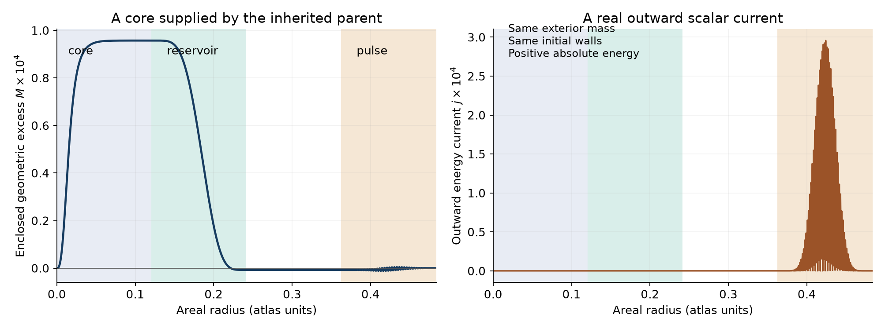

*Figure 20. Left: the core's positive geometric mass is supplied by ambient
depletion, with the outward-current pulse included in the balance. Right:
the pulse carries nonzero outward scalar energy while the total initial
exterior mass offset vanishes. These are constrained initial data, not a
claim that the previous vacuum-limit cooling run formed this configuration.*

Independent proper-distance integration, exact symbolic constraints and
zero-source/no-pulse controls check the construction. Tightening integration
changes the depletion fraction by less than $10^{-7}$. The
[source and compensation derivation](../docs/nsc-atlas-core-reservoir.md)
and [finite record](../results/summaries/nsc-atlas-core-reservoir-v1.json)
give the full preparation and numerical comparison. The solved root fixes
one compatibility datum; it does not select a primordial seed or abundance.

### 14.4. A perturbed centre and the same evolving cosmology

<!-- nsc-claim:compensated-parent-domain -->

At $R_b=4R_c$, the perturbation and its matching derivatives vanish,
$\Pi=0$ and $M=0$. Outside this sphere the spatial metric, extrinsic
curvature and scalar data equal the original parent exactly. This makes
the causal connection stronger than the earlier core-only admission.

Use the homogeneous reference angle $\theta$, with
$a_0=6.62607707610$, $\theta_b=\arcsin(R_b/a_0)=.0730942965661$ and
$\theta_w=2.85076435977$. Its future conformal-distance bound remains
$\eta_*=.515418396612$. Local Einstein--scalar uniqueness gives the
reference evolution on $\theta_b+\eta(t)<\theta<\theta_w-\eta(t)$.
The fixed annulus

$$
.588512693178<\theta<2.335345963158
$$

therefore stays in that domain for all future reference proper time.
It occupies at least 86.6472% of the **actual initial parent volume**.
The bound concerns a smooth exterior domain; it does not assume the same
light cones inside the perturbed core or establish a complete moving-wall
continuation. Any compatible causal development agrees on this domain.

For $L_{\rm ref}=a_0$ fixed by the retained geometry, its inherited vacuum
component remains

$$
\Lambda_{\rm vac}L_{\rm ref}^2
=\kappa\rho_v a_0^2=12.3482523989285.
$$

The excited scalar still contributes to the total stress. Rearranging it
into local structure does not change the inherited vacuum floor. This
establishes coexistence of a nonlinear local source and a connected,
evolving surrounding cosmology. It does not determine the observed Lambda
or an observed dark-matter abundance.

The dynamical connection must keep flux and pressure work together.
[Hayward's spherical mass law](https://arxiv.org/html/gr-qc/9710089) gives

$$
n(m)=\frac{\kappa R^2}{2}(\Pi\beta^2F-vp_r),
\qquad p_r=\frac{\Pi^2+\beta^2F^2}{2}-U.
$$

For the supplied outward characteristic, the fixed-areal-radius derivative
$D=n-(v/\beta)s$ satisfies

$$
D(m)=-\frac{\kappa R^2}{2}\beta F^2(\beta+v)^2\leq0.
$$

Where the fixed-radius trajectory is timelike, normalize $D$ to its proper
time. At the sampled peak current its mass rate is approximately
$-3.81559\times10^{-5}$. An expanding normal sphere has a different rate
because pressure does work. The [connected derivation](../docs/nsc-atlas-core-reservoir.md)
and [checks](../results/summaries/nsc-atlas-core-reservoir-v1.json) retain
both contributions. The next task is to evolve this compensated preparation
and calculate a local signal, preserving the source, outgoing field and
same-action geometry throughout.

### 14.5. Evolving the inherited field and its geometry together

<!-- nsc-claim:coupled-core-parent-evolution -->

The compensated slice supplies a full finite spherical evolution.
The scalar, its ambient reservoir and radiation source the local metric
throughout. The earlier envelope profile is an initial control; it does
not replace the Einstein--Klein--Gordon evolution equation. The action,
frequency 2000, regional flux and inherited vacuum remain fixed.

Use areal radius and the parent expansion H(t) in the metric

$$
ds^2=-\alpha^2dt^2+
\frac{(dR-\alpha HR\,dt)^2}{B}+R^2d\Omega^2,
\qquad B=1+H^2R^2-\frac{2m}{R}.
$$

This fixes angular extrinsic curvature $K_t=-H$, while the radial
curvature, mass and lapse respond to the source. With $F=\phi_R$ and
$\Pi=n(\phi)$, the momentum and Hamilton constraints give

$$
K_r=-H-\frac{\kappa R}{2}\Pi F,\qquad
m_R=\frac{\kappa R^2}{2}(\rho-HR\Pi F).
$$

The angular Einstein equation preserves that slicing by determining

$$
B\alpha_R=\dot H R+
\alpha\left(H^2R+\frac{m}{R^2}+\frac{\kappa R}{2}p_r\right).
$$

The lapse is normalized in the untouched parent. Central proper time
is calculated from it. The scalar evolves by its unaveraged wave equation
on this metric, and the same scalar drives the reference H(t). The
[equations and implementation](../docs/nsc-atlas-core-evolution.md) retain
the shift, lapse gradient, radial momentum and regular-centre limit.
The [finite record](../results/summaries/nsc-atlas-core-evolution-v1.json)
binds the model inputs and numerical controls.

Independent of the radial constraint, the geometric mass obeys

$$
m_t=\frac{\alpha\kappa R^2}{2}
\left[(B+H^2R^2)\Pi F-HR(\Pi^2+BF^2)\right].
$$

Its time integral is compared with reconstructed mass at six fixed
radii. Both expressions subtract the evolving homogeneous density.
No absorber deletes radiation, and expansion pressure work is retained.

A smooth moving radial map keeps the core at fixed physical resolution
and carries the outer grid with the parent. The boundary's initial
angle .648103368884 lies in the permanently protected reference annulus.
It can therefore receive the exact homogeneous data without introducing
an artificial reflecting wall. This connects the local evolution to an
actual parent domain while leaving the complete material-wall future open.

The calculation reuses the
[spherical oscillaton literature](https://arxiv.org/html/0710.4131),
[regular-centre methods](https://arxiv.org/html/gr-qc/0401113) and
[Lawson's integrating-factor approach](https://doi.org/10.1137/0704033).
The latter integrates the fast scalar rotation exactly within the time
step, so numerical damping of that oscillator is not interpreted as cooling.
The new connection is the sourced inherited preparation and its observer,
rather than a new generic scalar-gravity equation.

### 14.6. A diffuse cloud develops a compact, breathing concentration

<!-- nsc-claim:inherited-diffuse-concentration -->

Replace the supplied coherent core by a compactly tapered Gaussian of
width .03. Solve its amplitude, .00186251874314, to preserve the initial
geometric mass inside the core boundary. This fixes the same total
gravitational budget, including the ambient cross term. It does not
equate isolated scalar norm between different profiles.

The resulting data are evolved to parent time5. Their final shape is
not imposed. The diffuse cloud initially expands, subsequently contracts
and then breathes. The same scalar preparation on the homogeneous metric
provides a diagnostic of evolution without local gravitational response;
that control is not claimed to satisfy the sourced Einstein equations.

Over parent times 4.5--5, the half excess-mass radius inside R=.12
averages .01849207, compared with .03930864 initially: a ratio .470433.
The late central excitation averages 148.3729 against 10.53893 initially,
a factor 14.0786. With the same field on the homogeneous metric it instead
averages .0477285. Thus the concentration depends on the computed local
gravitational response. The medium/fine spreads are 1.19e-7 in mean radius
and .00232 in mean central excitation.

| Resolution multiplier | Maximum integrated mass-flux gap, diffuse run |
| --- | ---: |
| 1 | 2.55e-7 |
| 2 | 1.27e-8 |
| 4 | 8.42e-10 |

The finest run keeps the local lapse above .98145. Its final exterior
mass offset is 2.04e-9, against the initial core excess 9.57e-5. These finite
residuals are numerical diagnostics, not exact-zero assertions. The
formation is followed by substantial breathing; no stationary endpoint
is imposed or inferred.

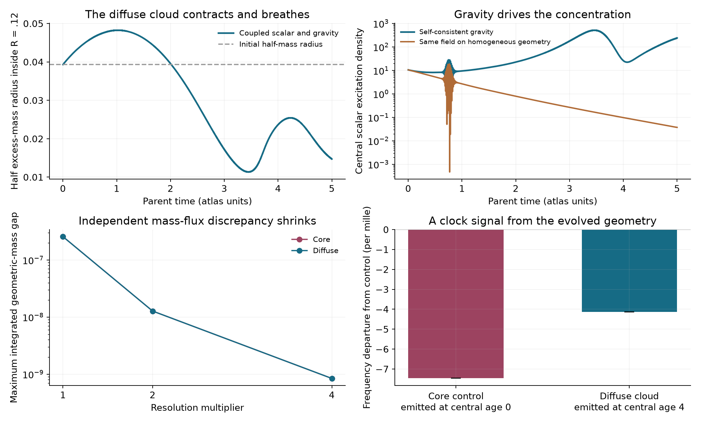

*Figure 21. The diffuse preparation develops a compact concentration under
its computed gravity. The fixed-geometry field control separates ordinary
scalar propagation from that response. Refinement checks the independent
mass-flux law. Clock departures use the stated central proper emission
ages and a receiver held at the same areal radius in each corresponding
homogeneous comparison.*

These are finite nonlinear concentration and breathing results. They do
not establish an asymptotic stationary remnant, universal formation from
arbitrary preparations or nonspherical stability. The
[formation and refinement record](../results/summaries/nsc-atlas-core-evolution-v1.json)
and [source owner](../docs/nsc-atlas-core-evolution.md) retain those limits.

### 14.7. Conservation selects a second local scale

The image-delay relation in Section 15.6 raises a physical question: can the inherited
field support a structure much smaller than its cosmological parent?
Changing a unit rescales both. Changing the scalar frequency changes the
physical model. The frequency family already constructed above holds
$\kappa=1$, mixing $\epsilon=1/4$, fluxes $(.5,1,1.5)$, charge $.5$ and
tension $.2$ fixed. Its common initial scalar is at the grandchild minimum.
The parent vacuum, excited density and available excitation are then

$$
\Lambda_v=\kappa U_v=\frac{9}{32},\qquad
U_0=\frac{21}{32},\qquad E_b=U_0-U_v=\frac{3}{8}.
$$

The original initial wall data and parent reference radius are independent
of frequency. The later scalar history depends on it. The following
preparations use the existing coherent core shape, a depleted ambient
annulus and zero scalar normal momentum. They contain no added outgoing
pulse and are distinct from the previously evolved diffuse lens.

Let $x=\omega\zeta R$, let $A(x)$ be the retained core shape with its cutoff
at $x=20$, and write

$$
f=\sqrt{2/\kappa}\,\zeta^2A(x),\qquad
\mathfrak{M}=\frac{\zeta}{\omega}N(x).
$$

The ambient scalar displacement is $d/\omega$, with $d=\sqrt{3}/2$.
If $C$ is the original parent spatial curvature, its exact initial mass
constraint becomes

$$
N'=-\zeta^4x(A')^2N
+\frac{x^2}{2}\left[A^2+\zeta^2(A')^2\right]
+\frac{x^2\sqrt{\kappa/2}\,dA}{\omega\zeta^2}
-\frac{Cx^4(A')^2}{2\omega^2}.
$$

The coefficient multiplying $N$ does not depend on frequency. With a
regular centre this proves, for the supplied shape,

$$
\mathfrak{M}_c=\frac{\zeta N_0(20)}{\omega}
+\frac{\zeta N_1(20)}{\omega^2}
+\frac{\zeta N_2(20)}{\omega^3}.
$$

This exact decomposition is not a fitted scaling curve. Its coefficients
retain self-gravity, interference with the inherited ambient field, and
parent curvature. Geometric excess mass is measured above the excited
homogeneous parent; in physical units it is $GM_c/c^2$.

A reservoir cannot supply arbitrary positive core mass. For zero initial
scalar momentum, the positive radial chart gives

$$
\mathfrak{M}_R=\frac{\kappa R^2}{2}
\left(\frac{BF^2}{2}+U-U_0\right)
\geq-\frac{\kappa E_bR^2}{2}.
$$

Reducing the core mass to zero at the reservoir's outer radius therefore
requires

$$
R_d^3-R_c^3\geq\frac{6\mathfrak{M}_c}{\kappa E_b},\qquad
R_c=\frac{20}{\omega\zeta}.
$$

Since $\kappa E_b=4\Lambda_v/3$ for this inherited state, every smooth
finite-energy match in the stated domain satisfies

$$
\frac{\Lambda_v(R_d^3-R_c^3)}{\mathfrak{M}_c}>\frac{9}{2}.
$$

Equality would require the scalar to remain at its parent minimum almost
everywhere through the annulus, contradicting continuous matching to the
excited ambient field at its ends. This lower bound does not depend on a
chosen depletion profile. Its coefficient belongs to the declared inherited
excitation/vacuum ratio, rather than to every possible scalar state.

The core mass falls as $\omega^{-1}$, whereas a reservoir with a fixed
ratio $R_d/R_c$ has available excitation falling as $\omega^{-3}$.
For $R_d=2R_c$ and the retained $\zeta=.0826621713$, the resulting
necessary frequency ceiling is $6221.94$. Above it, even full removal
of the excitation from that annulus cannot supply the core. Gradient
energy strengthens the restriction. The [full derivation](../docs/nsc-atlas-scale-hierarchy.md)
also extends the inequality to arbitrary scalar momentum where $B\geq v^2$.

Allowing the reservoir radius to respond resolves the obstruction. Choose

$$
\chi(R)=\frac{d}{\omega}[1-a b(x)],\qquad
x=\frac{R-R_c}{R_d-R_c},\qquad b(x)=1024x^5(1-x)^5,
$$

with supplied depletion $0<a\leq1$. The scalar returns smoothly to its
original parent value at both joins. Solve the exact constraint for $R_d$
so that the exterior geometric mass offset vanishes. Outside this radius the original initial
parent geometry and material-wall matching data are recovered exactly.
The independent proper-distance Hamilton equation checks the matching.

For fixed core amplitude and depletion, put $R_d=z\omega^{-1/3}$ and
use the positive leading mass coefficient $C_m=\zeta N_0(20)$. The scaled endpoint constraint
tends to

$$
0=1-\frac{\kappa d^2z^3}{4C_m}J(a),\qquad
J(a)=\int_0^1 x^2[2ab(x)-a^2b(x)^2]dx>0.
$$

Its positive root has nonzero derivative. The implicit-function theorem
continues it to sufficiently large finite frequency. Provided the limiting
core retains a positive radial-chart margin, the reservoir also remains
regular and lies inside the parent. The finite examples check these
conditions. This yields the hierarchy

$$
R_c\sim\omega^{-1},\qquad R_d\sim\omega^{-1/3},\qquad
R_d/R_c\sim\omega^{2/3},\qquad R_d\ll L_{\rm ref}.
$$

The parent vacuum and original initial wall geometry remain fixed. Each
member retains a causally protected parent annulus under the previously
derived energy-floor bound. These are initial-constraint and causal-domain
results; formation, persistence and the complete coupled wall future are
separate calculations.

### 14.8. A mass--reservoir--vacuum relation and a dimensional example

The same construction produces a dimensionless correlation:

$$
\frac{\Lambda_vR_d^3}{\mathfrak{M}_c}
\longrightarrow\frac{4\Lambda_v}{\kappa d^2J(a)}.
$$

For the declared half-depletion profile,

$$
J(1/2)=\frac{5476736}{66927861},\qquad
\frac{\Lambda_vR_d^3}{\mathfrak{M}_c}
\longrightarrow\frac{200783583}{10953472}=18.3305880546.
$$

The finite construction reaches $18.33027699$ at $\omega=10^{10}$.
Its reservoir/core cutoff ratio is then $40578.7$, while
$\Lambda_v L_{\rm ref}^2=12.34825239893$ is unchanged. The coefficient
is specific to the supplied bump and depletion. The additional quarter-
and three-quarter-depletion examples preserve that physical freedom
explicitly; this is not a universal constant selected by nesting.

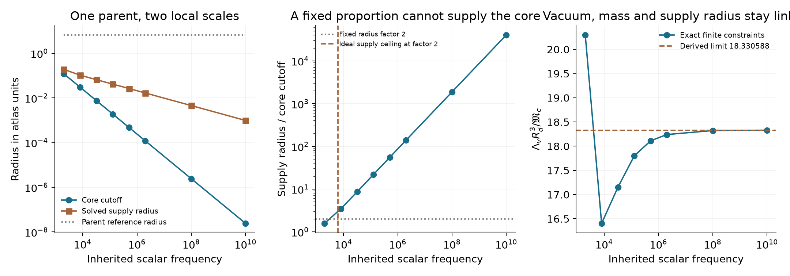

*Figure 22. The core shrinks faster than its energy-supply region while the
parent reference radius remains fixed. A reservoir constrained to twice
the core cutoff becomes insufficient above its ideal supply ceiling.
Solving for the reservoir radius restores the initial constraints and
approaches the independently derived vacuum-radius-mass relation.*

An illustrative member takes $\omega=10^9$, $\zeta=.001$ and half-depletion.
If the dimensional reference $\Lambda_v=10^{-52}\,{\rm m}^{-2}$ is supplied,
the consistent conversion gives:

| Quantity | Conditional value |
| --- | ---: |
| Core geometric excess mass | $6.32\times10^{10}$ nominal solar masses |
| Half-core-mass radius | 3.86 kpc |
| Compact core cutoff | 34.4 kpc |
| Compensating reservoir outer radius | 828 kpc |

The unit conversion uses the [IAU nominal solar mass parameter](https://www.iau.org/static/resolutions/IAU2015_English.pdf).
Neither that reference vacuum nor the chosen field/preparation parameters
were inferred here. No galaxy observation was fitted. The example proves
that compatible initial data can admit these separated scales; it does
not establish a stable halo, an observed rotation curve or a cosmic abundance.
The exterior total mass offset is zero: the core is supplied by redistribution
of the inherited excitation, not by creation of additional total mass.

The [compact evidence](../results/summaries/nsc-atlas-scale-hierarchy-v1.json)
contains thirteen examples and controls. The exact scaled core identity
has zero symbolic residual. Its mass agrees with the original constraint
integrator within $2.7\times10^{-16}$ atlas units. The proper-distance
Hamilton check leaves less than $4.2\times10^{-13}$ of core mass at the
outer join; tighter integration changes reported masses and radii by
less than $1.1\times10^{-11}$ relatively. Those are finite integration
checks for the supplied profile, not a bound on its uncomputed evolution.

The following section evolves this two-scale preparation in a leading
classical envelope with its reservoir retained. The image predictions of
Section 15.5 belong to the earlier evolved preparation;
they cannot be assigned to this new family by changing units.

### 14.9. Evolving the core together with its reservoir

Initial compatibility does not establish persistence. The high-frequency
member of Section 14.8 has many fast carrier oscillations per binding
time, so a direct relativistic grid is costly. We instead derive its
leading classical envelope, retain the solved reservoir and excited parent,
and test the reduction against the unchanged full Einstein--Klein--Gordon
solver on a short, tractable family. The long result belongs to the reduced
equations and their stated domain.

For the real displacement $\chi=\phi-\phi_{\min}$, define

$$
\chi=\sqrt{2/\kappa}\,\zeta^2 A^{-3/2}
\operatorname{Re}[\psi(x,\tau)e^{-i\omega t}],\qquad
x=\frac{\omega\zeta R}{A},\qquad \tau=\omega\zeta^2t.
$$

The normalized parent scale factor starts at $A=1$. The complex amplitude
$\psi$ describes the same real field; it is a total amplitude, including
its homogeneous value

$$
b=\frac{\sqrt{\kappa/2}\,d}{\omega\zeta^2}
=.000612372435696,\qquad d=\frac{\sqrt{3}}{2}.
$$

For this member $\omega=10^9$ and $\zeta=.001$. The initial field is the
previously supplied tapered core plus its depleted ambient annulus.
The real scalar value matches the exact constrained initial slice.
The initial normal momentum matches only to leading order, since the
slow prefactor contributes an $O(H/\omega)$ carrier-quadrature correction.
The small initial gradient-mass difference is recorded rather than removed
by renormalizing the field.

Averaging the homogeneous carrier retains the parent's excitation,
vacuum and positive spatial curvature:

$$
H^2=\frac{\Lambda_v}{3}+\frac{\kappa E_b}{3A^3}-\frac{C}{A^2},\qquad
\dot H=\frac{C}{A^2}-\frac{\kappa E_b}{2A^3}.
$$

Here $\Lambda_v=9/32$, $E_b=3/8$ and $C=.0227765023676$. Excitation is
initially $4/7$ of the parent density; a pure de Sitter replacement would
lose a leading contribution. On the local, nearly flat spatial chart,
the classical envelope obeys

$$
i\psi_\tau=-\frac{\Delta_x\psi}{2A^2}+V\psi,\qquad
\Delta_xV=\frac{|\psi|^2-b^2}{2A}.
$$

The complete density contrast is retained, including its coherent cross
term. The homogeneous background is already inside $\psi$, so it is not
added a second time. The physical Newtonian potential is $\zeta^2V$.
This uses the established real-scalar envelope framework in the explicit
source normalization of this atlas; it introduces no additional field or
measurement-probability law.

One exact check clarifies why the homogeneous envelope can be constant.
On the averaged parent, a field proportional to $A^{-3/2}\cos(\omega t)$
satisfies

$$
(\partial_t^2+3H\partial_t+\omega^2)\chi_b
=\left(-\frac{3}{2}\dot H-\frac{9}{4}H^2\right)\chi_b
=\frac{3}{4}\left(\frac{C}{A^2}-\Lambda_v\right)\chi_b.
$$

The dust terms cancel. The residual is small relative to the carrier
term, about $2\times10^{-19}$ for this member. This is an exact identity
on the averaged background, not proof that it equals the full oscillating
Einstein-scalar background at every instant.

### 14.10. Conserved transport, finite persistence and a relativistic check

The envelope's geometric excess mass is

$$
\mathfrak{M}_{\rm env}(R)=\frac{\zeta}{2\omega}
\int_0^{\omega\zeta R/A}x^2(|\psi|^2-b^2)dx.
$$

The factor of one-half follows from the Einstein mass normalization.
The initial envelope core mass differs from its exact GR value by
$-3.31923\times10^{-7}$ relatively. That difference is retained. Continuity
fixes the current; at a fixed physical radius the moving comoving cutoff
$x_*=X/A$ adds a necessary term:

$$
\frac{dN_*}{d\tau}
=-\frac{x_*^2}{A^2}\operatorname{Im}(\psi^*\psi_x)
-\frac{A'}{A}x_*^3(|\psi|^2-b^2).
$$

Independently integrating this current tests the changing enclosed mass.
The energy functional has kinetic and gravitational parts

$$
T=\frac{1}{2A^2}\int x^2|\psi_x|^2dx,\qquad
W=\frac{1}{2}\int x^2V(|\psi|^2-b^2)dx.
$$

With the symmetric Newtonian kernel and a time-independent outer field
value $\psi=b$, the reduced equations imply

$$
\frac{d(T+W)}{d\tau}=-\frac{A'}{A}(2T+W).
$$

Both terms contribute to expansion work. No absorber discards outgoing
field. The outer mass current is measured, and a larger domain checks its
influence on the core. These finite envelope-domain checks are not a new
relativistic causal-shielding theorem.

Eleven numerical cases evolve the retained high-frequency preparation to
slow time $600$, with three resolutions and separate time, outer-boundary
and no-gravity controls. The parent scale factor reaches $1.27443638723$.
Over the late interval $480\leq\tau\leq600$, mass inside the original fixed
physical core cutoff has ratio

$$
\frac{\langle\mathfrak{M}_{\rm core}\rangle}
{\mathfrak{M}_{\rm core}(0)}=1.00374088\pm.00001314.
$$

This is a small inward transfer, checked by the mass current. With
self-gravity removed, the same late ratio is $.000190975$. The core's
late mean physical half-mass radius is $2.23255821$ in the scaled length
$\omega\zeta R$, with numerical comparison range $.00319767$.
Its radius breathes: the peak-to-peak range grows from $.0674$ in the first
$120$ slow-time units to $.1399$ in the last $120$. Finite localization
therefore does not establish asymptotic stability.

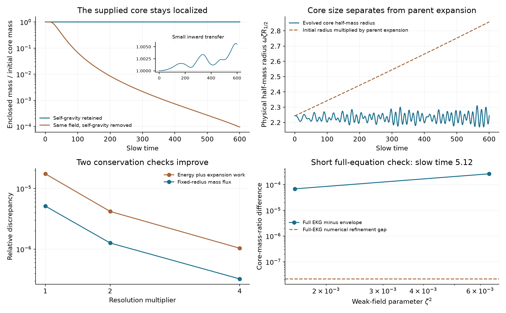

*Figure 23. The same supplied field disperses without self-gravity and
retains a localized core when self-gravity is included. Its physical size
breathes while the parent expands; the dashed size reference is simply
initial radius multiplied by the parent scale factor. Mass-current and
energy-work checks improve under refinement. The last panel compares
the reduced equations with full EKG over a separate short interval.*

The mass-current discrepancy falls from $5.13\times10^{-6}$ through
$1.26\times10^{-6}$ to $3.24\times10^{-7}$ of initial core mass. The
energy-work discrepancy falls from $1.75\times10^{-5}$ to
$1.04\times10^{-6}$ of initial energy. The
[compact calculation](../results/summaries/nsc-atlas-hierarchy-evolution-v1.json)
records source hashes, finite comparisons and the small net outer transport.
The [derivation and domain](../docs/nsc-atlas-hierarchy-evolution.md)
keep numerical error distinct from approximation error.

For the independent short comparison, hold $\omega\zeta^2=12.8$ and evolve
to atlas time $.4$, or slow time $5.12$. The original full EKG functions
are unchanged:

| Core amplitude | Frequency | Full-EKG mass ratio | Envelope mass ratio | Difference |
| --- | ---: | ---: | ---: | ---: |
| .08 | 2000 | 1.007402025 | 1.007139302 | .000262723 |
| .04 | 8000 | 1.007190375 | 1.007121981 | .0000683932 |

Halving the amplitude reduces the discrepancy by about $3.84$, consistent
with weak-field ordering. Refining the smaller full-EKG case changes its
ratio by $2.15\times10^{-8}$, far below that difference. Analytic free
Gaussian propagation, an independent Gaussian gravitational potential
and moving-cut continuity provide additional checks.

Using the earlier supplied reference $\Lambda_v=10^{-52}\,{\rm m}^{-2}$,
the long run spans $3.36$ billion years. Its fixed mass cutoff is $34.4$ kpc
and its late mean half-mass radius is $3.837\pm.006$ kpc. Those physical
values inherit the assumed ruler; their quoted ranges are numerical ranges
within the envelope model. No galaxy observations were fitted.

The short full-equation comparison and small expansion, curvature and
weak-field parameters do not supply a rigorous full-GR error bound at slow
time $600$. The supplied initial cloud, growing radial breathing and
nonspherical persistence remain physical questions. The completed connection
is from the conserved initial supply construction to finite radial
localization in its expanding parent, with a stated approximation and
independent transport checks.

### 14.11. Testing the breathing core beyond spherical symmetry

A changing radius does not by itself diagnose an instability. We now
linearize the actual evolving envelope of Section 14.10 and calculate its
radial and quadrupole response. The spherical field, reservoir and parent
expansion are replayed unchanged. A stationary eigenproblem would answer
a different question because this background is time dependent.

Perturbations of Schrodinger--Newton stationary states have prior analyses
by [Harrison, Moroz and Tod](https://arxiv.org/abs/math-ph/0208045).
[Zagorac et al.](https://arxiv.org/abs/2109.01920) investigate breathing,
quadrupolar deformation and time-dependent soliton perturbations. Their
stability or profile conclusions are not substituted for this trajectory.

Use real angular functions with angular mean square one. For an
axisymmetric quadrupole, $Y_{20}=\sqrt{5}P_2$. With real perturbation
parameter $\varepsilon$, write

$$
\psi=\psi_0+\varepsilon\eta_lY_{lm}+O(\varepsilon^2),\qquad
V=V_0+\varepsilon v_lY_{lm}+O(\varepsilon^2).
$$

The real-linear equations are

$$
i\partial_\tau\eta_l=
\left[-\frac{D_l}{2A^2}+V_0\right]\eta_l+v_l\psi_0,\qquad
D_lv_l=\frac{\operatorname{Re}(\psi_0^*\eta_l)}{A},
$$

$$
D_l=\partial_x^2+\frac{2}{x}\partial_x-\frac{l(l+1)}{x^2}.
$$

The potential source is real, so complex phase directions are included
explicitly as independent real initial directions. With
$d_l=2\operatorname{Re}(\psi_0^*\eta_l)$, regularity and the decaying exterior
potential give

$$
v_l(x)=-\frac{1}{2A(2l+1)}
\left[\frac{1}{x^{l+1}}\int_0^x s^{l+2}d_l(s)ds
+x^l\int_x^L s^{1-l}d_l(s)ds\right].
$$

Both integrals are retained. The finite source is zero outside $L$;
the potential has its free decaying tail rather than a zero-potential wall.
The $l=2$ density has zero angular mean, so its radial coefficient integral
is not a monopole mass change.

During the joint potential substep the base field rotates but its density
and the density variation remain fixed. The exact tangent flow is therefore

$$
\eta_l^{\rm new}=e^{-ihV_0}(\eta_l-ihv_l\psi_0).
$$

This is also the derivative of the nonlinear potential step. In
$q=x\eta$ variables, the kinetic operator is
$-\partial_x^2/(2A^2)+l(l+1)/(2A^2x^2)$. The radial channel uses the
same spectral kinetic step as the base. The quadrupole uses a unitary
centrifugal step, checked against an analytic solid-harmonic Gaussian.

The transported bilinear form

$$
S_{jk}=\operatorname{Im}\int q_j^*q_k\,dx
$$

is conserved. The kinetic and background-potential terms cancel by
self-adjointness; the remaining source terms cancel through symmetry of
the multipole Green kernel. This symplectic identity remains valid for a
time-dependent background. It checks the transport but does not imply
norm conservation or stability. A separate passive quadrupole, propagated
without its own potential response, supplies the unitary control.

### 14.12. A finite response theorem for every orientation in a declared span

Choose two compact radial profiles of widths $2$ and $4$ in the physical
scaled radius $Ax$, together with their phase partners. They taper to zero
between radii $15$ and $20$. Project the radial seeds to preserve initial
total mass to first order; quadrupoles have zero angular mean automatically.
Real Gram orthonormalization gives four initial directions.

Let $N_c$ be the initial core-field norm. For any real coefficient vector
$c$ of unit Euclidean length, a fractional field perturbation is

$$
\delta q(\tau)=\varepsilon N_c\sum_{j=1}^{4}c_jq_j(\tau).
$$

Define $G_{jk}=\operatorname{Re}\int q_j^*q_kdx$. The Rayleigh quotient
then gives the exact finite-span bound

$$
\frac{\|\delta q(\tau)\|_2}{\varepsilon N_c}
\leq\sqrt{\lambda_{\max}(G(\tau))}.
$$

A second real Gram matrix uses the density variations inside the fixed
physical core cutoff. Normalizing by the current base excess-density norm
gives the fractional density response per fractional initial field
perturbation. This is not a density-to-density growth factor: some initial
phase directions have zero density variation. The density response of the
direction with greatest field-norm growth is recorded separately.

Spherical symmetry gives the same radial propagator for all five real
quadrupole components. Angular orthogonality gives the direct-sum Gram
matrix $I_5\otimes G$, with the same largest eigenvalue. The four-column
calculation therefore covers every coefficient combination in the
corresponding twenty-dimensional real quadrupole span. A new quadrupole
family is also seeded on the evolved state at slow time $480$.

The normalized core second-moment quadrupole is defined explicitly by

$$
\frac{\int R^2P_2\,\delta\rho\,d^3R}
{\int R^2\rho_{\rm excess}\,d^3R}
=\frac{\varepsilon N_c}{\sqrt{5}}
\frac{\sum_jc_j\int x^4d_jdx}{\int x^4d_0dx}.
$$

The factor follows from the angular average of $P_2Y_{20}$, which is
$1/\sqrt{5}$. Direct angular integration independently verifies this
moment definition. It is distinct from the coefficient multiplying $P_2$
and from a Cartesian trace-free tensor component. A core-truncated moment
is not inserted into an exterior potential formula; that calculation
uses the full multipole source.

These are finite response statements on a specified radial span. Numerical
maxima are reported on saved unit-slow-time events, not as rigorous bounds
between every pair of samples. The result does not cover additional radial
profiles, reservoir-supported seeds, higher angular multipoles, nonlinear
three-dimensional evolution or full-GR stability.

The [response calculation](../results/summaries/nsc-atlas-hierarchy-perturbations-v1.json)
reproduces every retained spherical field hash. Its sampled extrema are:

| Perturbation family | Field-norm amplification | Density response per initial field perturbation |
| --- | ---: | ---: |
| Radial, seeded at 0 | $6.756\pm.162$ | $3.592\pm.033$ |
| Quadrupole, seeded at 0 | $1.08113\pm.00025$ | $1.15675\pm.00007$ |
| Quadrupole, seeded at 480 | $1.0820\pm.0011$ | $1.1720\pm.0049$ |

For example, a $1%$ fractional field-norm perturbation in the quadrupole
span seeded at time zero gives a calculated first-order density response
of at most about $1.157%$ at the saved events. The quoted ranges compare
spatial/time refinement and the outer domain. They are not rigorous
interval enclosures, bounds between samples, or nonlinear guarantees at
finite amplitude. Different observables can have different maximizing
initial coefficient vectors.

Radial sensitivity is larger and more dependent on refinement. At the final
event, the direction with greatest field amplification has $99.4%$ of
its squared norm inside the core; $99.5%$ of that core part lies in the
local phase direction relative to the base field. This does not make every
radial response a phase change. Spatial phase gradients can affect later
flow, and the independent density response is nonzero.

The symplectic discrepancy stays below $1.15\times10^{-11}$ in the radial
channel and $9.76\times10^{-14}$ in the quadrupole. The passive quadrupole
norm remains one within $5\times10^{-14}$. Independently, centred differences
of the nonlinear radial flow converge toward the tangent prediction:
halving the initial amplitude from $10^{-4}$ to $5\times10^{-5}$ reduces
the density-derivative error from $2.18\times10^{-6}$ to $5.46\times10^{-7}$.

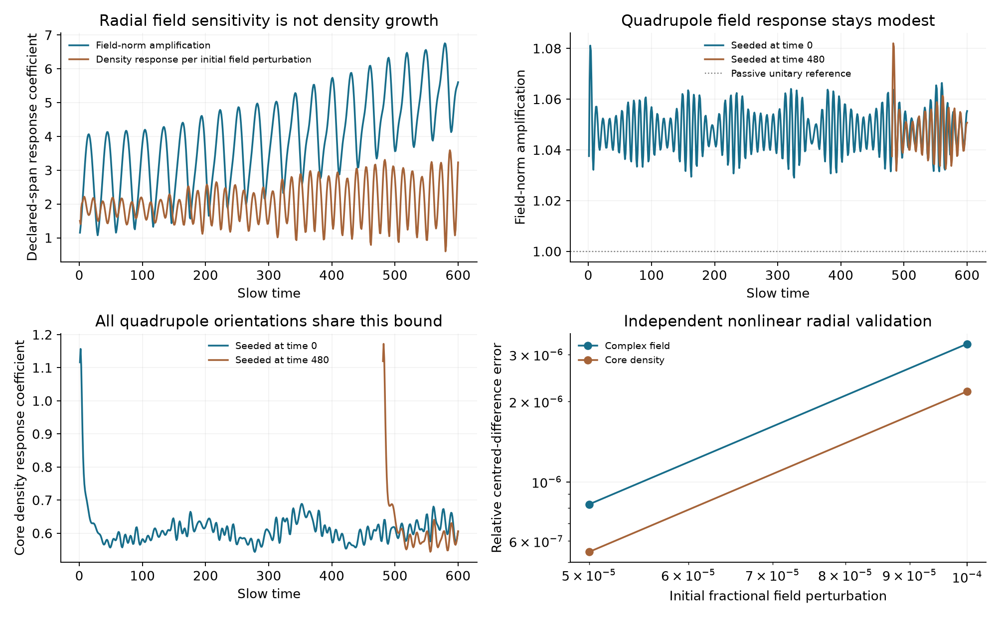

*Figure 24. Field sensitivity and density deformation are distinct responses.
The quadrupole field response remains modest for seeds at the initial and
late events; the same radial matrices cover all five angular components
in the declared span. Independent nonlinear radial differences converge to
the tangent prediction. These finite sampled results do not establish
universal or asymptotic stability.*

### 14.13. The surrounding field must carry the tidal phase

A quadrupole has zero angular mean, so its first-order monopole mass change
vanishes. It can nevertheless produce a nonzero external tidal potential.
The full multipole kernel was therefore evaluated at fixed physical radius
$2R_d$, outside the initial reservoir. Cauchy--Schwarz bounds each response
coefficient. The squared angular basis functions sum to five at every direction, so
the pointwise all-orientation potential bound is $\sqrt{5}$ times its
angular-RMS bound.

The initial external amplitude failed its numerical comparison. At fixed
spacing, enlarging the domain changed the coefficient from
$3.33\times10^{-14}$ to $9.28\times10^{-15}$. This is a diagnostic value,
not an accepted nonzero tidal prediction. The failure identifies an outer
condition that matters for the observer calculation.

In an ideal homogeneous ambient region, with no incoming density disturbance,
let the quadrupolar potential be $v_2=C(\tau)/x^3$. It is harmonic:
$D_2v_2=0$. The linearized field equation has the particular solution

$$
\eta_2(x,\tau)=-i b x^{-3}\int C(s)ds,\qquad
2\operatorname{Re}(b\eta_2)=0.
$$

It carries a phase tail without a first-order density change. Therefore

$$
q=x\eta_2\propto x^{-2},\qquad q_x=-\frac{2q}{x}.
$$

A zero-field condition at a finite outer radius suppresses this forced
phase and can generate spurious density there. A separate calculation
allows the leading harmonic tail through a self-adjoint boundary correction.
Its Cayley step remains unitary and agrees with an independent dense-matrix
calculation. General outgoing radiative or Jeans responses are not replaced
by this particular harmonic condition.

The [tail-matching comparisons](../results/summaries/nsc-atlas-hierarchy-tidal-tail-v1.json)
reduce the outer-domain change from $2.40\times10^{-14}$ to
$7.26\times10^{-17}$, an improvement of about $331$. The final core-density
response changes by less than $1.8\times10^{-8}$, supporting the core result
against this boundary change.

The external amplitude still fails the refinement requirement: its
coarse-to-medium change is $8.80\times10^{-15}$, so twice that change
exceeds the medium coefficient $9.34\times10^{-15}$. The public record
explicitly leaves this outward prediction unresolved. The useful results
are the finite core-response bound and the derived tidal-phase matching
requirement. An external clock or lens prediction needs further controlled
work; it is not inferred from the unresolved coefficient.

The [perturbation owner](../docs/nsc-atlas-hierarchy-perturbations.md)
records the definitions, interpretation, independent checks and compute
limits. The original response campaign used about $4073$ CPU seconds
within its $4500$-second budget. After the diagnosed boundary failure,
the targeted tail calculation used about $615$ within its separate
$800$-second budget. Both retain their completed evidence without enlarging
their claims to all-profile, nonlinear or full-relativistic stability.

### 14.14. A local concentration carries the signature of its surroundings

<!-- nsc-claim:atlas-compensation-response -->

Derivation and calculation: [spatial compensation and retained evolution](../results/summaries/nsc-atlas-compensation-response-v1.json)
and [derivation and source dictionary](../docs/nsc-atlas-compensation-response.md).

The dense core and its depleted surroundings are one initial solution.
Their relation should therefore survive into a spatial statistic. Let
$M(R)$ be excess geometric mass, $M_c$ its value at
the core cutoff, and $R_d$ the solved compensation radius. On the retained
zero-momentum initial slice,

$$
\frac{dM}{dR}=\frac{\kappa R^2}{2}
\left(U-U_0+\frac{BF^2}{2}\right),\qquad
M(0)=M(R_d)=0.
$$

This is the areal mass measure from the Einstein constraint. A proper-volume
energy integral is a different object. With $s=R/R_d$ and $K=kR_d$, define

$$
W(K)=\frac{1}{M_c}\int j_0(Ks)\,dM,
\qquad j_0(x)=\frac{\sin x}{x}.
$$

The transform is an exact descriptor of the specified mass profile. Its
flat-space density interpretation is local, on scales small compared with
the parent's curvature radius. It does not substitute continuous Fourier
modes for the compact parent's global spectrum. Compensation gives

$$
W(K)=a_2K^2+\mathcal R_4(K),\qquad
a_2=-\frac{1}{6M_c}\int s^2\,dM,
$$
$$
|\mathcal R_4(K)|\leq
\frac{K^4}{120M_c}\int s^4|dM|.
$$

To prove this bound, write $j_0(x)$ as the integral of $\cos(xt)$ from
zero to one and integrate the fourth-order cosine remainder. The zeroth
moment cancels, and spherical symmetry eliminates the dipole. The retained
profile gives $a_2=.0608058925116$ and remainder coefficient
$.00129586307998$. Integrating the solved mass primitive against $Kj_1(Ks)$
independently reproduces the transform without differentiating stored data.

The simpler initial scalar envelope omits positive gradient mass. Using
the same normalization in both descriptions yields an all-wavelength bound:

$$
dM-dM_{\rm env}
=\frac{\kappa R^2BF^2}{4}dR\geq0,\qquad
|W-W_{\rm env}|\leq g
=\frac{1}{M_c}\int\frac{\kappa R^2BF^2}{4}dR.
$$

For this source $g=3.31911631\times10^{-7}$. The initial envelope has
$W_{\rm env}(0)=-g$; its small residual is retained. Near $K=.00234$ it
competes with the quadratic term. Thus the absolute source bound cannot
be converted into arbitrary relative accuracy near zero. Nor is it a
long-time error bound for the reduced dynamics or an assertion that the
instantaneous scalar pressure is dustlike.

Let $W_c$ denote the core-only transform, with the same normalization.
The resolved half-power crossing is defined by

$$
\left[\frac{W(K_{1/2})}{W_c(K_{1/2})}\right]^2=\frac{1}{2}.
$$

For the unchanged $\omega=10^9$, $\zeta=.001$, half-depletion preparation,

$$
K_{1/2}=4.0522389138,\qquad
\frac{\Lambda_v}{M_c k_{1/2}^3}=.2681493031.
$$

The second number combines the already solved mass--reservoir--vacuum
relation with the new spatial window. Three quadrature orders and a
tighter constraint integration give comparison ranges below $9\times10^{-12}$
and $1.8\times10^{-12}$, respectively. Those ranges concern integration
of the fixed numerical core shape, not total model uncertainty.

At fixed weak amplitude and depletion, the established large-frequency
hierarchy makes the core pointlike relative to its reservoir. Its window
tends to one minus the transform of the normalized positive weight
$s^2[2ab(s)-a^2b(s)^2]/J(a)$. Half depletion gives limiting crossing
$4.1423205290$ and limiting vacuum--mass--turnover ratio $.2578964084$.
Finite quarter- and three-quarter-depletion preparations instead give
$.47250817$ and $.20537800$. Inheritance has not selected one depletion.

With the previously supplied $\Lambda_v=10^{-52}\,\mathrm{m}^{-2}$ ruler,
the initial example has $R_d=.827653$ Mpc, $k_{1/2}=4.89606$ Mpc$^{-1}$
and wavelength $2\pi/k_{1/2}=1.28331$ Mpc. These are conditional spatial
numbers, not an observed halo population or a fitted cosmological spectrum.

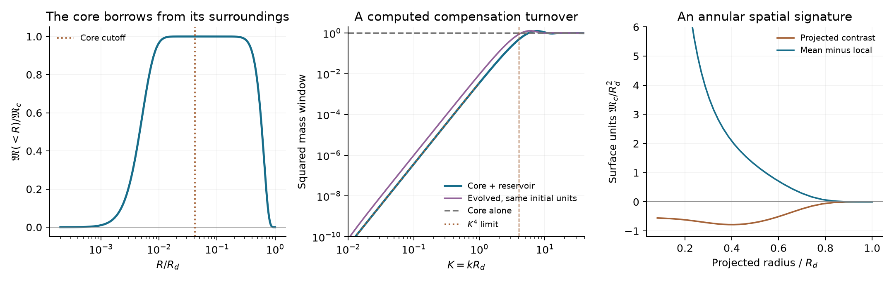

*Figure 25. One supplied core and its inherited reservoir, viewed through
enclosed mass, spatial frequency and projected contrast. Including the
reservoir suppresses long-wavelength response. The purple curve reuses
the evolved field in the original mass/radius units. The projected deficit
is a spatial statistic; a relativistic lens observation needs its own
averaging and light-cone dictionary.*

### 14.15. The age and population are part of the correlation

The inherited vacuum remains fixed while the surrounding field evolves.
Postprocessing the five authenticated spherical evolution checkpoints,
with physical radius $R=Ax/(\omega\zeta)$, gives at slow time $600$:

| Spatial quantity | Fine result and comparison range |
| --- | ---: |
| $k_{1/2}R_{d,0}$ | $3.165445\pm.000031$ |
| $\Lambda_v/(M_{c,\mathrm{current}}k_{1/2}^3)$ | $.559473\pm.000024$ |
| Quadratic coefficient in original mass/radius units | $.0998276\pm.0000072$ |

The ranges include grid, time and outer-domain comparisons from the saved
source; no evolution was rerun. This changes the initial coefficient by
much more than numerical error. An age-independent interpretation of
$.2681493$ is excluded for this history. Long-time full-relativistic
accuracy remains outside the established envelope calculation.

The finite-domain total excess agrees with initial excess minus the outer
mass flux to better than $3.5\times10^{-9}$ of the initial core mass.
Its small nonzero monopole is not resolved against outer-domain variation.
Core accretion is not total mass creation. The turnover is nevertheless
resolved, and neither exact compensation at the original $R_d$ nor a strict
evolved zero-wave-number power law has been imposed.

For a spatial density descriptor $h=M_R/(4\pi R^2)$, projection
along a line of sight gives

$$
\Sigma(b)=2\int_b^{R_d}\frac{h(R)R\,dR}{\sqrt{R^2-b^2}}.
$$

Its planar Fourier transform equals the three-dimensional transform at
zero line-of-sight wave number. The same compensation scale therefore
appears in projection. Outside the core the initial example has negative
surface contrast but positive mean-minus-local contrast, both vanishing
outside $R_d$. A weak-field lens interpretation would connect those two
quantities to convergence and tangential shear. It requires the averaged
source and null-propagation approximation; the exact instantaneous scalar
optics cannot be obtained by renaming this projection a lens map.

The correlation framework is established in
[Schmidt, 1511.02231v2](https://arxiv.org/html/1511.02231v2) and
[Chen--Afshordi, 1912.04872v5, Section III](https://arxiv.org/html/1912.04872v5).
The contribution here is a calculated compensated kernel from the inherited
source, its mass--vacuum scale relation and its measured age dependence.
For identical local profiles with number-density fluctuation $\Delta n$,

$$
\delta_{\rm red}(k)=\frac{M_c}{\rho_g}
W(kR_d)\Delta n(k),\qquad
P_{\rm red}(k)=\left(\frac{M_c}{\rho_g}\right)^2
|W(kR_d)|^2P_n(k).
$$

Here $\rho_g$ is mean geometric-mass density, and $P_n$ is the spectrum
of absolute number-density fluctuations. Bounded $P_n$ gives an initial
$O(k^4)$ redistribution spectrum; independent centres have $P_n=n_{\mathrm{mean}}$.
The total matter spectrum also contains the large-scale field and its
cross correlations. Suppressing that field would discard the very signal
one wants to explain. No abundance, formation law or matter fraction has
been calculated by this single-profile construction.

The next connection is consequently formation and age selection in the
inherited parent, followed by the observation map for that population.
The atlas supplies a joint spatial relation to test when those inputs
exist; it does not fix them by matching a desired sky spectrum.

### 14.16. Does the inherited parent leave enough time to form a core?

<!-- nsc-claim:atlas-formation-window -->

Derivation and calculation: [formation budget and compact seed](../results/summaries/nsc-atlas-formation-window-v1.json)
and [all-wavelength comparison proof](../docs/nsc-atlas-formation-window.md).

Persistence of an installed core does not explain its formation. The
earlier diffuse-cloud example also began with a nonlinear overdensity.
Before another collapse grid, ask how much a small ambient disturbance
can grow in the same inherited parent. Keep $\omega=10^9$,
$\Lambda=9/32$, $D=\kappa E_b=3/8$ and the retained curvature $C$:

$$
H^2=\frac{\Lambda}{3}+\frac{D}{3A^3}-\frac{C}{A^2}.
$$

Linearizing the existing classical envelope gives density contrast
$\delta$ and phase $\theta$. For local comoving wave number $k$,

$$
\dot\delta=\frac{k^2\theta}{\omega A^2},\qquad
\dot\theta=-\frac{k^2\delta}{4\omega A^2}
+\frac{\omega D\delta}{2Ak^2},
$$
$$
\ddot\delta+2H\dot\delta+
\left(\frac{k^4}{4\omega^2A^4}-\frac{D}{2A^3}\right)\delta=0.
$$

The related averaged massive-scalar equation is given by
[Hwang--Noh, 0902.4738, equations (19)--(28)](https://arxiv.org/html/0902.4738).
Here it follows from the already declared local envelope with the actual
inherited expansion. This is not a global flat-parent approximation or a
new quantum postulate. An initially real envelope has zero current;
a growing-mode velocity would be additional preparation data.

There is no need to guess a sufficiently late stopping time. Set
$u=1/A$, $\nu=k^2/(2\omega)$ and introduce the rescaled density velocity:

$$
p=A^2\dot\delta,\qquad
\delta_u=-\frac{up}{H(u)},\qquad
p_u=\frac{\nu^2u-D/2}{H(u)}\delta.
$$

The entire expanding future ends at the regular point $u=0$, because
$H$ stays positive and tends to the vacuum expansion rate. The transfer matrix
in $(\delta,p)$ has determinant one, providing an independent check.
Regularity of this reduced endpoint does not establish infinite-time
agreement with full GR or complete the unresolved wall future.

To bound every wavelength, use kinetic time $d\eta=dt/A^2$. The equation
becomes a forced oscillator with nonnegative feedback:

$$
\delta_{\eta\eta}+\nu^2\delta=\frac{DA}{2}\delta.
$$

The free Green kernel obeys $|\sin[\nu(\eta-s)]/\nu|\leq\eta-s$.
Iterating the positive Volterra comparison therefore bounds the absolute
solution by the zero-frequency density and velocity responses. This proves
the bound even when a finite-wave-number solution oscillates or changes
sign; simply deleting its pressure term would not prove that statement.

For zero initial current, an elementary Gronwall estimate gives

$$
|\delta_k|\leq
\exp\left(\frac{D u_i^3}{12H_{\min}^2}\right)|\delta_i|.
$$

At $A_i=1$, this factor is $1.39616912$, below $1.397$. Solving the
positive comparison gives the sharper evaluated relation

$$
|\delta_k(t)|\leq1.26934144123|\delta_i|
+0.68728524662|v_i|,\qquad v_i=\dot\delta_i/H_i.
$$

The exact comparison solutions define the coefficients; the printed
decimals have numerical comparison ranges below $3.4\times10^{-12}$,
not certified interval endpoints. The independent pressureless basis
$H(A)$ and its reduction-of-order partner reproduces the result within
$8\times10^{-15}$. The standard basis is attributed to
[Heath (1977)](https://doi.org/10.1093/mnras/179.3.351); its governing
identity is verified directly here.

Thus a small zero-current disturbance introduced at this late anchor
cannot reach nonlinear contrast through the stated linear mechanism,
even if evolved forever. This conclusion is specific to its epoch,
initial current and equations. Earlier seeds, forcing or already nonlinear
data are different possibilities. The bound also applies to spatial L2
norm; a pointwise statement needs an appropriate Fourier norm.

### 14.17. A compact earlier seed identifies the nonlinear continuation

Construct a local compensated disturbance without the stationary core:

$$
g(r)=(1-r^2/L^2)^4_+,\qquad
\delta_i(r)=\epsilon\frac{-\Delta(g*g)(r)}
{\int|\nabla g|^2d^3x}.
$$

It has support $2L$, zero total density contrast, central value $\epsilon$
and nonnegative Fourier transform proportional to $k^2|G(k)|^2$, where
$G$ is the Fourier transform of $g$.
Consequently $|\delta_i(r)|\leq\epsilon$, and the mode comparison gives
a pointwise future bound for this entire seed. Its linear Poisson potential
is compact as well. These are smooth local-envelope data, not yet a new
exact nonlinear shared-wall preparation.

Take $L=.000481562379847$, the previous supply radius interpreted as a
comoving length, a supplied peak contrast of $5%$, and zero initial phase.
At $A_i=1$ the central future gain is $1.26488829$; the global pointwise
bound keeps the contrast below about $6.35%$.

Now place that same dimensionless seed at $A_i=.01$ on the earlier
averaged-parent continuation. Its central linear gain is

$$
35.609032\pm.000004.
$$

The stated range combines an analytic spectral-tail bound with a numerical
integration comparison. No truncated spectrum is renormalized. For
$q=kL$, the normalized bump transform is $10395j_5(q)/q^5$; Parseval fixes
the density-weight integral, while the explicit sine/cosine polynomial for
$j_5$ bounds its omitted tail. At $q=60$ the omitted pointwise gain is at
most $3.07\times10^{-6}$ for all future times. Quadrature and ODE comparisons
add about $1.02\times10^{-8}$.

The supplied $5%$ seed reaches linear contrast $.1$ near $A=.0957400$.
Its formal linear extrapolation reaches contrast one near $A=1.0190483$.
That second event is outside linear validity: it identifies the nonlinear
continuation to calculate, not a completed collapse or a formed core.
The late-parent bound and the earlier amplification together show why
the preparation epoch is a physical part of the proposed formation route.

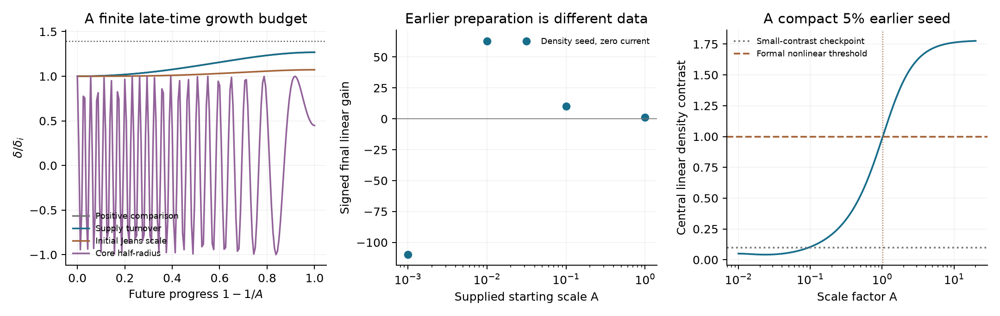

*Figure 26. Left: the late parent permits only modest ambient amplification;
the small core-scale mode oscillates. Middle: changing the supplied epoch
changes both growth and wave phase. Right: a compact 5% seed on the earlier
continuation approaches a nonlinear regime. The curve beyond small contrast
is a linear extrapolation, not a simulated core.*

The earlier benchmark has $H_i/\omega=3.53\times10^{-7}$ and maximum
retained $k/(\omega A_i)=.01246$. These indicate a useful reduction hierarchy,
not a total relativistic error estimate. Its homogeneous past and sufficient
local parent domain are explicit assumptions. The existing material walls,
radiation history and inherited seed statistics have not been supplied at
that earlier epoch. Exactly homogeneous data remain homogeneous; numerical
noise cannot establish a physical seed mechanism.

The next calculation should solve the compatible initial source dictionary
for this small compact disturbance and evolve it nonlinearly in the same
declared earlier parent. Retained mass, concentration, reservoir and the
spatial turnover would then be outputs, tested together. No new core profile
or desired observed spectrum needs to be inserted to start that experiment.

### 14.18. Nonlinear formation without installing the final core

<!-- nsc-claim:atlas-seed-collapse -->

Derivation and calculation: [nonlinear compact-seed comparison](../results/summaries/nsc-atlas-seed-collapse-v1.json)
and [initial constraints, boundary clock and balances](../docs/nsc-atlas-seed-collapse.md).

The compact disturbance has a finite-amplitude continuation. Keep the
same action, inherited vacuum and excitation, comoving length and earlier
epoch. The $5%$ seed is evolved to $A=16$. A separately declared $10%$
preparation is tested through its first compression and rebound at $A=1.2$.
This amplitude comparison is not a fit to an observed object or an inferred
universal formation threshold. No stationary core is placed in either seed.

The autocorrelation source from Section 14.17 has an exact factored
real-space polynomial. Its radial mass primitive is positive inside the
support and vanishes at its edge. Normalize the total envelope by its
homogeneous value and set

$$
f_i(r)=\sqrt{1+\epsilon S(r)-\lambda W(r)},\qquad
r=\frac{R}{AL}.
$$

The square root preserves the intended finite density contrast. The fixed
smooth bump $W$ occupies the outer part of the original support. Its
coefficient is solved from the full local initial gravitational constraint,
not chosen to force a later collapse. Let $M_*=DL^3/2$, $n=M/M_*$,
$q=1/(\omega^2 A_i^2L^2)$, $c=CL^2$ and $\gamma=DL^2/A_i$. Then

$$
n_r=r^2\left[\epsilon S-\lambda W+qB(f_i')^2\right],\qquad
B=1-cr^2-\frac{\gamma n}{r},\qquad n(0)=n(2)=0.
$$

Without the correction, positive scalar gradient energy leaves a small
exterior mass offset. The derivative of the zero-gradient endpoint with
respect to $\lambda$ is negative, so a nearby compensating branch exists.
The solved values are $9.75930\times10^{-12}$ and $3.85046\times10^{-11}$
for the two amplitudes. An independent proper-distance Hamilton solve
checks the endpoint, and the initial radial metric remains positive.
This constructs local turning-point Einstein-scalar data in the declared
earlier parent patch. It does not construct the earlier material walls.

The envelope omits that gradient contribution, so its small initial mass
residual is retained in the subsequent balance. It also retains the stated
carrier-quadrature difference from exact zero scalar momentum. These are
identified approximation differences, not silently removed inputs.

The nonlinear evolution uses logarithmic scale time $N=\ln A$:

$$
i f_N=-\frac{a}{2}\Delta f+bVf,\qquad
\Delta V=\frac{|f|^2-1}{2},
$$
$$
a=\frac{1}{\omega L^2A^2H},\qquad
b=\frac{\omega DL^2}{AH}.
$$

The finite boundary field and its gravitational clock must agree. A fixed
boundary phase uses $V(L_{\rm box})=0$, implemented by subtracting the
free-space potential's boundary value. This leaves bulk spatial forces
unchanged and preserves a symmetric Green kernel. An initially inconsistent
boundary choice failed conservation before nonlinear growth and is rejected.
The corrected kernel passes an independent radial eigenfunction test.

The existing sine kinetic map and full-field potential kicks are retained.
Integrated time coefficients follow the early expansion, and a potential
phase limit resolves the first rapid compression. With the physical-time
Hamiltonian split into kinetic $T$ and self-gravitational $W$, the exact
expansion identity is

$$
\frac{d(T+W)}{d\ln A}=-(2T+W).
$$

Mass transport is checked at fixed comoving cuts and the outer boundary.
The work integral is evaluated every step. Three spatial resolutions,
an independent time control and a larger domain test the $10%$ history.
The $5%$ history has its own three resolutions, with no-gravity and
small-amplitude controls completing eleven runs.

### 14.19. Physical contraction separates formation from density contrast

Track a shell carrying a fixed amount of the oscillatory scalar source:

$$
M_{\rm shell}=\frac{DL^3}{2}\int_0^{r_m(N)}r^2|f|^2dr,
\qquad R_m(N)=ALr_m(N).
$$

This is an exact mass label in the envelope continuity equation. It
excludes vacuum volume mass and higher-order GR gradient corrections.
A decreasing comoving radius alone is insufficient: the physical radius
must turn around and contract.

For the $10%$ preparation, the shell initially at $r=.25$ turns around
near $A=.5852$. At $A=1.2$ it gives

| Quantity | Fine value and numerical comparison range |
| --- | ---: |
| Central density contrast | $59971\pm1514$ |
| Physical density half-height radius | $(4.22172\pm.02216)\times10^{-6}$ |
| Selected shell physical radius | $(4.38056\pm.03788)\times10^{-6}$ |
| Selected shell radius / largest sampled radius | $.109898\pm.000950$ |

The selected mass contracts by about $89%$ from its largest sampled
physical radius. The density profile also contracts and undergoes a first
rebound. Ranges use twice the largest fine/medium, time-control or outer-domain
difference. They describe numerical uncertainty within the envelope, not a
full relativistic or observational error budget.

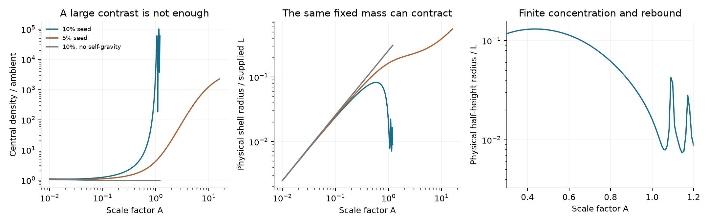

*Figure 27. Both supplied seeds develop large contrast, but the sampled
fixed-mass shells of the 5% case continue expanding through its interval.
The 10% case turns around and contracts. Removing self-gravity removes that
contraction. The right panel resolves the forming concentration's first
compression and rebound; it does not establish asymptotic stability.*

The fixed-cut mass-flux discrepancy decreases from $8.88\times10^{-5}$
through $2.11\times10^{-5}$ to $5.48\times10^{-6}$, relative to the initial
positive excess. Expansion-work discrepancies decrease from $.007108$
through $.001689$ to $.0004185$. The fine global mass/current discrepancy
is $6.69\times10^{-10}$. The larger domain barely changes the central
result. Halving a small seed amplitude also halves its departure from
the independently calculated linear response.

The no-gravity control keeps the sampled shells expanding. The $5%$ case
likewise shows no sampled shell turnaround through $A=16$, despite a final
central contrast near $2257$. Contrast can grow while the background thins
and the physical region expands. That history is not promoted to a formed
bound object. Conversely, finite contraction and rebound of the $10%$
case do not prove an asymptotic soliton, nonspherical stability or a
population of astronomical objects.

Using the previously supplied $\Lambda=10^{-52}\,\mathrm{m}^{-2}$ ruler,
the selected shell contains $4.251\times10^9$ nominal solar masses and
contracts from a largest sampled radius of $68.51$ kpc to
$7.529\pm.066$ kpc. The final density half-height radius is
$7.256\pm.039$ kpc, enclosing a calculated scalar-source mass of
$(3.919\pm.069)\times10^9$ nominal solar masses. This aperture mass is
an output of the forming field. The ruler, seed amplitude, length and epoch
remain inputs; no galaxy measurement was fitted.

The general scalar concentration mechanism is established in work including
[Seidel--Suen, gr-qc/9309015](https://arxiv.org/abs/gr-qc/9309015), with
expanding-envelope context in [Banik et al.,1504.05968](https://arxiv.org/abs/1504.05968).
Here the new connection is a specified weak compact seed, compatible
local initial gravity and a conserved, converged finite formation history
in the inherited parent. Its actual field can now supply an observer
calculation. The old installed-core and different-frequency lens histories
cannot be substituted for that next signal.

## V. The interior observer: motion, light and expansion

An interior observer tests a geometry through clocks, trajectories and light. This part uses the sources already constructed to derive frequency relations, focusing, multiple images and motion-calibrated optical predictions. Endpoint identities connect measurements that belong to one geometry. The final cosmological comparison confronts a quiet limiting state with actual supernova data, identifying the expansion history that the full account must improve.

### 15. One geometry, several measured consequences

The following sections give the worked constructions and their attributed mathematical inputs.

### 15.1. Three freely falling clocks and a withheld prediction

<!-- nsc-claim:three-clock-parent-relation -->

Let $L_{\rm ref}=a_0$ and initialize three ideal test emitters at
proper separations $(.04,.08,.12)L_{\rm ref}$ from the parent pole.
They initially rest relative to the slice normal, emit continuously
at known rest frequencies, and freely fall without backreaction.
The central free-fall receiver observes at fixed proper age
2.251557477076, corresponding to background N=.8. All rays remain
inside the protected parent domain.

Observer terms are essential in relativistic measured quantities;
see [Scaccabarozzi, Yoo and Biern](https://arxiv.org/html/1807.09796).
Here the actual closed-parent metric supplies the calculation.
Holding initial proper distance and receiver age fixed gives

$$
\delta\theta_s(0)=\int_0^s\Phi(0,\theta)d\theta,
\qquad \delta t_o=-\int_0^{t_o}\Phi(t,0)dt.
$$

The source's outward peculiar velocity obeys

$$
\dot v_s+Hv_s=-\frac{\partial_\theta\Phi(t,s)}{a},
\qquad \delta\dot\theta_s=v_s/a.
$$

Along the unperturbed incoming ray, $\theta=\eta_o-\eta(t)$. The perturbed
null equation sets the emission-time correction,

$$
\delta t_e=a_e\left[\frac{\delta t_o}{a_o}
 +2\int_{t_e}^{t_o}\frac{\Phi}{a}dt-\delta\theta_s(t_e)\right].
$$

The measured log-frequency departure from the background is

$$
y=\log\frac{(\nu_o/\nu_e)}{a_e/a_o}
=H_e\delta t_e-H_o\delta t_o+\Phi_e-\Phi_o-v_e
 +2\int_{t_e}^{t_o}\partial_t\Phi\,dt.
$$

The last derivative is partial at fixed position. Source motion,
potential, propagation and clock contributions all enter; no
instantaneous potential difference alone determines the measurement.

Writing $y_i=R_{i1}\alpha+R_{i2}\beta$ for the two retained amplitudes,
the computed response is:

| Initial distance / $L_{\rm ref}$ | Background frequency ratio | Density column | Phase column |
| --- | ---: | ---: | ---: |
| .04 | .840672581087 | .017861103048 | -.000731094396 |
| .08 | .721722111018 | .030644152339 | -.001671366286 |
| .12 | .628648035135 | .038548233209 | -.002804913120 |

The first two rows have nonzero determinant and condition number
169.341 in this amplitude normalization. Eliminating both amplitudes
gives the conditional prediction

$$
y_3=-2.88990465\,y_1+2.94232704\,y_2.
$$

This is [NSC-P003](../docs/prediction-register.md), registered
retrospectively without astronomical data. In the synthetic check,
amplitudes $(10^{-5},-4\times10^{-6})$ give departures
$(1.81535408,3.13126989,3.96701985)\times10^{-7}$. Calibrating only
the first two recovers the amplitudes and predicts the withheld third.

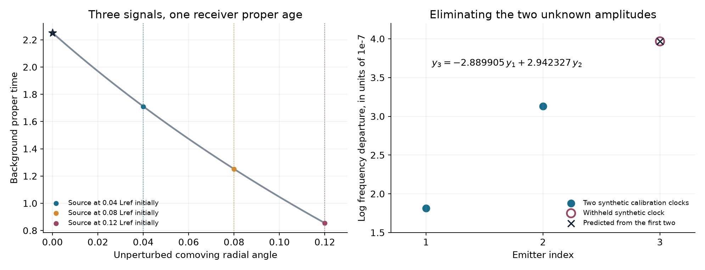

*Figure 28. Left: three emitters on the central past radial light cone;
their initial proper distances and the receiver's proper age are fixed.
Right: a withheld synthetic frequency response agrees with the prediction
from two state calibrations. No observational confirmation is inferred.*

An independent check integrates timelike sources and radial photons
in finite metric deformations, fixing the physical distances and
proper age by direct integration. The null Hamilton equation is

$$
\frac{d\log(-p_t)}{dt}
=\frac{\partial_tA}{2A}-\frac{\partial_tB}{2B},
\qquad A=1+2\Phi,\quad B=a^2(1-2\Phi).
$$

Symmetric metric variations verify the linear clock response;
the mixed-direction derivative differs by $5.23\times10^{-11}$
at variation step .0005. The finite metrics validate the first
variation, not a nonlinear Einstein-scalar solution. Refinement
changes the null weights by $1.35\times10^{-9}$; the retained
coefficient comparison tolerance is $10^{-7}$.

For independent equal frequency-log errors $\sigma_y$, the null residual
has uncertainty $4.243682044\sigma_y$. A full covariance must replace
that example for correlated measurements. Unknown source velocities,
an arbitrary spatial profile or extra fields would add parameters
and need not obey the three-clock relation. The
[derivation](../docs/nsc-atlas-parent-clocks.md) and
[compact evidence](../results/summaries/nsc-atlas-parent-clocks-v1.json)
keep those restrictions explicit. The advance is an operational test
surviving the two unknown state amplitudes, while physical formation
and an unrestricted primordial spectrum remain open.

### 15.2. A signal from the concentration's evolving geometry

<!-- nsc-claim:formed-core-clock -->

The central emitter is geodesic. The receiver is actively held at areal
radius .6 and starts its proper clock on the initial slice. In the diffuse
case the emission occurs at central proper age 4, after the contraction
has developed. Reception time is determined by propagation, not chosen
as an equal-coordinate-time comparison.

An outgoing photon with frequency E measured by the slice normal obeys

$$
\frac{dR_\gamma}{dt}=\alpha(HR_\gamma+\sqrt{B}),\qquad
\frac{d\log E}{dt}=\alpha K_r-\sqrt{B}\alpha_R.
$$

At reception, the held-radius observer's velocity relative to that normal
adds a necessary Doppler factor:

$$
\frac{\nu_o}{\nu_e}=\frac{E_o}{E_e}
\sqrt{\frac{\sqrt{B_o}+H_oR_o}{\sqrt{B_o}-H_oR_o}},
\qquad
\frac{d\tau_o}{dt}=\alpha_o
\sqrt{1-\frac{H_o^2R_o^2}{B_o}}.
$$

An independent canonical null-geodesic calculation transports $p_R$ with
Hamiltonian $\alpha(HR+\sqrt{B})p_R$. It is checked against this normal-frame
formula. A separate unaveraged homogeneous integration gives the
corresponding control signal analytically along its FLRW light cone.

For the diffuse run emitted at central proper age 4, the fractional
frequency departure from the homogeneous comparison is

$$
\frac{(\nu_o/\nu_e)}{(\nu_o/\nu_e)_{\rm hom}}-1
=-0.0041375586\pm 1.1\times10^{-8}.
$$

This is approximately -0.413756 percent, with a finite numerical error
estimate of .0000011 percentage points. The receiver's additional proper
arrival time is .01703546, with numerical comparison error 2.2e-7 in atlas
time units. Both the emitter's accumulated proper clock and propagation
contribute to this delay. The independent canonical frequency differs by
less than 4.7e-11 on the finest run.

The coherent control, emitted at central age 0, has frequency departure
-.007456287 with numerical comparison error 2.1e-7 and proper arrival delay
.000476466. These use different declared emission ages; they are not a
same-epoch comparison of the two states. All errors here concern numerical
resolution and event calculation, not physical preparation uncertainty.

The frequency departures are dimensionless. Delays are in atlas time units;
an independent physical length would convert them to seconds. These
conditional observables do not import P003's earlier linear coefficients
or select a primordial population. The
[complete protocol](../docs/nsc-atlas-core-evolution.md) and
[numerical comparisons](../results/summaries/nsc-atlas-core-evolution-v1.json)
give the emission events, receiver motion, error estimates and model scope.

The connection now runs from a declared inherited scalar preparation,
through self-consistent local evolution, to a received signal. The parent
vacuum remains $\Lambda_{\rm vac}a_0^2=12.3482523989285$. Selecting its
observed scale, explaining the population of structures and testing their
nonradial persistence remain further physical questions.

### 15.3. The same concentration bends and focuses light

<!-- nsc-claim:evolved-core-null-focusing -->

The radial clock is followed by a nonradial optical test on the same
evolved scalar geometry. The field stepper and its physical inputs remain
unchanged; final-state hashes must reproduce the preceding source calculation
at every retained resolution. The lens is not replaced by a fitted density
profile or a static metric.

Scalar lenses have published precedents in
[Dabrowski and Schunck](https://arxiv.org/abs/astro-ph/9807039), and
[Aimar et al.](https://arxiv.org/abs/2512.23800) study time-dependent
real-scalar optical signatures. The contribution here is the connection
to the computed inherited parent and its formation history. The exact
lens-map approach follows
[Frittelli and Newman](https://arxiv.org/html/gr-qc/9810017), with the
observer-screen formulation made explicit below.

The canonical bulk equation gives an exact null contraction:

$$
R_{ab}=\kappa(\nabla_a\phi\nabla_b\phi+Ug_{ab}),
\qquad R_{ab}k^ak^b=\kappa(k\phi)^2.
$$

The potential, including the inherited vacuum, drops out of this direct
focusing term. It still affects the field and spacetime through which the
ray travels. Its absence from this contraction is not invariance of the
whole optical experiment under a change of Lambda.

For normal energy E, radial momentum $q=\sqrt{B}p_R$ and conserved angular
momentum L, the two principal tidal eigenvalues are

$$
T_\perp=\frac{\kappa}{2}(E\Pi+q\sqrt{B}F)^2
+\frac{3WL^2}{R^2},\qquad
T_\parallel=\frac{\kappa}{2}(E\Pi+q\sqrt{B}F)^2
-\frac{3WL^2}{R^2},
$$

where

$$
W=\frac{m}{R^3}-\frac{\kappa}{6}
\left(U+\frac{\Pi^2-BF^2}{2}\right).
$$

Ricci curvature focuses both directions. Weyl curvature changes them with
opposite signs, producing optical shear. The spherical Einstein Hessians
and warped-product Riemann tensor independently give these factors and
signs. In the homogeneous parent W vanishes. At a pure vacuum extremum
both tidal eigenvalues vanish, although expansion and distances still
depend on the vacuum scale.

The principal Jacobi scales obey

$$
\frac{d^2D_i}{d\lambda^2}=-T_iD_i,
\qquad D_i(0)=0,\qquad D_i'(0)=1.
$$

This is the attributed optical transport framework of
[Seitz, Schneider and Ehlers](https://arxiv.org/abs/astro-ph/9403056),
applied to the current source. The
[curvature derivation](../docs/nsc-atlas-core-optics.md) and
[compact calculation](../results/summaries/nsc-atlas-core-optics-v1.json)
separate the exact identities from finite numerical lensing evidence.

### 15.4. A proper-clock lens map during contraction and breathing

<!-- nsc-claim:evolved-core-lens-map -->

Hold a source and a spherical family of receivers at areal radius .6.
Their clocks start on the initial slice. The source emits transparent
test light at proper ages 2.8 and 3.4, with inward rest-frame angle $\psi$.
The primary declared angles are .02, .04 and .08 radians. Unit emitted
energy fixes affine normalization; beam stress is neglected as in the
previous clock calculation.

The null Hamiltonian is

$$
\mathcal H=-p_t=\alpha(E+HRp_R),\qquad
E=\sqrt{Bp_R^2+L^2/R^2}.
$$

Each ray is followed to its first outward recrossing of the receiving
sphere. Proper emission time, the changing metric and the receiver's
velocity relative to the slice normal are retained. A separate normal-frame
frequency equation checks canonical photon transport.

The full landing map gives an independent computation of both beam scales:

$$
D_\perp=\frac{R_s\sin\varphi_o}{\sin\psi},\qquad
D_\parallel=-R_s\mu_o\frac{d\varphi_o}{d\psi}.
$$

Here $\mu_o$ is the measured outward radial cosine. The derivative includes
the angle-dependent arrival event. These screen identities and the
curvature equations calculate the same beam by different routes. Flat
space gives both scales equal to the chord length; a separate closed-FLRW
great-circle solution checks the evolving homogeneous control.

For inward launch angle .02 rad, the same source gives the following
finite-screen results. Errors are numerical comparison envelopes, not
uncertainties in the physical preparation.

| Source proper age | Landing-angle departure | Beam flux / homogeneous | Principal-axis ratio |
| --- | ---: | ---: | ---: |
| 2.8 | 0.01928843 rad | 1.648532 +/- 0.000021 | 2.19831 |
| 3.4 | 0.00666950 rad | 1.381442 +/- 0.000018 | 1.03582 |

The early landing-angle departure is about 1.105 degrees. The beam is
focused and distorted by different amounts at the two epochs, with no
change to the scalar action or initial preparation. The six source replays
match the prior field-state hashes exactly.

The independent rotation-Jacobi discrepancy at the primary probes falls
from 1.35e-5 to 8.80e-7 to 5.16e-8 under refinement. The in-plane angular-map
discrepancy falls to 1.82e-6. The independent homogeneous area distance
agrees within 1.42e-8; its frequency check agrees within 2.05e-8.

The early fan brackets a tangential caustic between source angles .006
and .008 rad at all three resolutions. On the finest run the signed
perpendicular scales at those endpoints are -.00118667 and .0802128;
their independent rotation checks differ by less than 1.7e-6. No tangential
sign change is found in the sampled late fan. This is finite numerical
evidence for the optical caustic, not a certified interval root or a
prediction of infinite physical brightness. The calculated metric remains
regular; a light-bundle caustic is not a spacetime singularity.

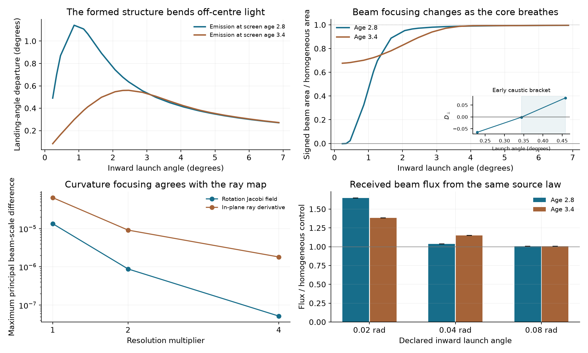

*Figure 29. Two proper emission ages probe the same evolving concentration.
The landing-angle map and signed beam area change as the core breathes.
The inset shows the sampled transverse-scale sign change near the early caustic.
Curvature-based Jacobi scales converge toward their independent ray-map
values. Relative received beam flux uses the fixed source luminosity,
measured frequency and projected beam area.*

For fixed isotropic emitted luminosity, the received bolometric beam flux
is proportional to

$$
\frac{\nu_o^2}{|D_\perp D_\parallel|}.
$$

The absolute area enters flux; its sign retains parity relative to the
homogeneous beam. Comparisons identify the same source proper age and
launch angle on the two geometries, so receiving worldlines can differ.
This finite-screen experiment is not yet a fixed-source/fixed-observer
astronomical image fit. Optical caustics, when bracketed by the fan, do
not establish infinite physical brightness; finite-source and wavelength
effects would require a further calculation.

The [observer protocol and limits](../docs/nsc-atlas-core-optics.md) and
[numerical comparisons](../results/summaries/nsc-atlas-core-optics-v1.json)
bind these optical numbers to the same source that produced concentration
and the radial clock signal. The inherited law has not thereby selected
a cloud population, a physical SI scale or an observed dark-matter fraction.

### 15.5. Two paths, one receiving clock

A lens map becomes an image prediction when the emitting and receiving
worldlines are fixed. Keep the scalar-parent solution of the preceding
sections. Hold both worldlines at areal radius $R_s=.6$, put the emitter at
azimuth zero and the receiver at $\pi-b$, with $b=.0002$. A pulse leaves at
emitter proper age $2.8$. If $\Phi(\psi,\tau_e)$ is the positive-orientation
landing map, the two selected branches satisfy

$$
\Phi(\psi_+,\tau_e)=\pi-b,\qquad
\Phi(\psi_-,\tau_e)=\pi+b.
$$

Reflection sends the second ray to $-(\pi+b)$, which is the same receiving
worldline modulo $2\pi$. The images arrive at different proper times on
that one observer's clock. This improves on a fixed-launch-angle comparison,
where the landing observer itself can change. The two selected angular
patches do not constitute a census of all possible images.

A null geodesic's endpoint variation relates these image measurements.
Normalize its emitted energy to one. The null action gives
$p_a\delta x_o^a-p_a\delta x_e^a=0$. The emitter is spatially fixed;
the held receiving sphere contributes the local energy and conserved
angular momentum $L$. Hence

$$
d\tau_o=\frac{d\tau_e}{\nu_o}
+\frac{L}{\nu_o}\,d\varphi_o.
$$

This equation does not assume a static lens or a conserved photon energy.
It uses the actual evolving metric and endpoint observer tetrads. At a
fixed receiving worldline, each image obeys $d\tau_i/d\tau_e=1/\nu_i$.
For the relative delay $\Delta=\tau_--\tau_+$,

$$
\frac{d\Delta}{d\tau_e}=\frac{1}{\nu_-}-\frac{1}{\nu_+},\qquad
\frac{d\Delta}{d\tau_+}=\frac{\nu_+}{\nu_-}-1.
$$

The second expression requires only the receiver's clock and the ratio
of frequencies of matched source features. Image delays and frequency
shifts are linked consequences of one geometry. The general endpoint and
lens-map ideas are established mathematics; their evaluated connection
to the forming source in this atlas is the present result.

Conserved angular momentum also fixes the received image directions:
$\sin|\xi_i|=\sin\psi_i/\nu_i$. Choose positive sky direction opposite
increasing azimuth, so that $\xi_+>0$ and $\xi_-<0$. For a common,
infinitesimal isotropic pulse, its observed bolometric fluence is

$$
\mathcal F_i=\frac{E_e}{4\pi}
\frac{\nu_i}{|D_{\perp,i}D_{\parallel,i}|}.
$$

A continuous source instead gives a flux proportional to
$\nu_i^2/|D_{\perp,i}D_{\parallel,i}|$, because reception rate adds a
second frequency factor. The signed determinant retains image parity.
These relations assume transparent geometric optics and a detector
perpendicular to the arriving ray. Finite source size, duration and
wavelength require separate modeling.

The [fixed-worldline derivation](../docs/nsc-atlas-core-images.md) gives
its endpoint proof, angular inverse and independent checks. Source ages
$2.8\pm.0002$ and $2.8\pm.0001$ test the delay derivative; curvature
and angular resampling test the two image inverses. All source evolution
files remain unchanged.

The completed pair is resolved at three grid spacings, with an additional
optical-time comparison. Its conditional observables are:

| Observable | Calculated value | Numerical comparison range |
| --- | ---: | ---: |
| Image separation | 0.682670 degrees | 0.000493 degrees |
| Relative proper arrival delay | 1.44125317e-6 atlas units | 9.54e-10 atlas units |
| Negative/positive frequency | 1.00000922695 | 8.52e-9 |
| Negative/positive pulse fluence | 1.401958 | 0.006483 |

The negative-parity image is brighter and arrives later. The rotation/Jacobi
error decreases from $5.65\times10^{-4}$ to $3.35\times10^{-5}$ to
$1.92\times10^{-6}$. The angular inverse and its curvature-based check
agree to better than $1.31\times10^{-10}$ radians on the fine patches.
All four field replays match the previously retained solutions exactly.
The [compact evidence](../results/summaries/nsc-atlas-core-images-v1.json)
records the fixed inputs, individual images and numerical comparisons.

The directly differentiated delay agrees with the inverse-frequency
identity to $1.55\times10^{-8}$ per source proper time, within its
$1.67\times10^{-7}$ numerical comparison envelope. That small derivative
residual is not monotone between the middle and fine grids. The result
is a finite checked prediction with numerical ranges, not a rigorous
interval enclosure or an asymptotic stability statement.

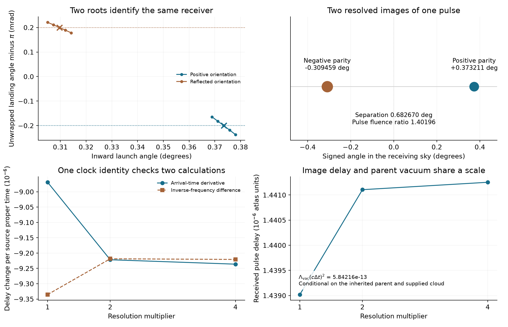

*Figure 30. The two angular roots reach one receiver after reflection of the
negative branch. Their sky positions, pulse fluences and arrival times are
computed from the unchanged scalar-parent evolution. Two independent
calculations check the delay-frequency identity. The final panel links
the resolved delay to the inherited parent vacuum through a scale-free
product; it does not identify this benchmark with an observed lens.*

### 15.6. A local image delay and the parent's vacuum must share one scale

The local concentration belongs to the same sourced parent whose protected
annulus retains the inherited vacuum. For this declared action and flux,
the vacuum and reference radius in atlas units are

$$
\widehat\Lambda=\kappa U_{\rm vac}=9/32,\qquad
\widehat L_{\rm ref}=6.62607707610.
$$

Thus the earlier conditional result
$\Lambda L_{\rm ref}^2=12.34825239893$ still applies.

Let $L_{\rm unit}$ be the physical length assigned to one atlas unit and
let $\delta$ be the computed dimensionless image delay. Any consistent
dimensional embedding must obey

$$
\Lambda_{\rm phys}=\frac{\widehat\Lambda}{L_{\rm unit}^2},\qquad
\Delta t=\frac{L_{\rm unit}}{c}\,\delta,
$$

and therefore

$$
\Lambda_{\rm phys}(c\Delta t)^2=\widehat\Lambda\,\delta^2.
$$

For the computed pair,

$$
\Lambda_{\rm phys}(c\Delta t)^2
=(5.8422\pm.0078)\times10^{-13}.
$$

The quoted range propagates the numerical delay envelope while holding
the declared parent vacuum fixed. It does not include uncertainty in a
physical interpretation or an unspecified preparation law.

The free unit cancels. Calibrating a physical scale with an image delay
leaves the vacuum value, angular image separation and frequency/fluence
ratios as linked tests. Matching each by an independent scale choice
would break this connection. This does not select the physical scale or
prove that the inherited vacuum equals the value inferred from cosmology.
It creates a precise joint requirement on that proposed identification.

The cloud, emitting age and receiver position remain specified inputs.
Population selection and nonspherical persistence remain necessary for an
astronomical application. The atlas provides the mathematical route
from inherited vacuum, through formed structure, to a fixed observer's
measurements without an independently fitted lens mass.

### 15.7. The forming field supplies one connected observer map

<!-- nsc-claim:atlas-formed-observer -->

Derivation and calculation: [fixed-observer response](../results/summaries/nsc-atlas-formed-observer-v1.json)
and [metric, mass-current and endpoint derivation](../docs/nsc-atlas-formed-observer.md).

The finite concentration can now be used as a source for light. Start from
the authenticated $A=1.2$ fields of the preceding formation calculation.
Short backward and forward steps reconstruct a local interval around that
event using the same field operators; no formation grid or fitted halo
profile is substituted. The source's time dependence remains in the ray.

The declared averaged weak metric is

$$
ds^2=-(1+2\Phi)dt^2+A^2L^2(1-2\Phi)
\left(\frac{dr^2}{B_0}+r^2d\Omega^2\right),\qquad
B_0=1-CL^2r^2,\qquad \Phi=\frac{DL^2}{A}V.
$$

It retains the parent spatial curvature and equal leading scalar
potentials. Null propagation is solved in this metric. Omitted higher-order
Einstein-scalar, carrier and stress terms remain approximation errors;
the numerical ranges below are not bounds on the full relativistic model.

There is a direct connection between the field current and the potential's
time derivative. Let $N=\ln A$, $j=\operatorname{Im}(f^*f_r)$ and
$m(r)=\int_0^r s^2(|f|^2-1)ds$. The existing envelope continuity equation
gives $m_N=-ar^2j$, with $a=1/(\omega L^2A^2H)$. Since the boundary-clock
potential is an integral of $m/r^2$,

$$
\Phi_r=\frac{DL^2}{2A}\frac{m(r)}{r^2},\qquad
\Phi_N=-\Phi+\frac{DL^2a}{2A}\int_r^{L_{\rm box}}j(s)ds.
$$

The potential, its spatial force and its time variation therefore come
from the same formed source. Spectral field derivatives and exact radial
polynomial integrals evaluate them; no derivative of a stored plot is used.
A Hermite interpolation in time preserves a consistent metric and its
derivatives. Pure-phase data give an independent analytic check of the
current term.

Place test clocks at comoving radius $r_s=.25$, with the emitter at
azimuth zero and receiver at $\Theta=\pi-.08$. They are held at these
coordinates. They do not follow the scalar flow or the contracting mass
shell that began at $r=.25$ in the earlier preparation. Their proper-clock
rate is

$$
\frac{d\tau_s}{dN}=\frac{\sqrt{1+2\Phi(r_s,N)}}{H(N)}.
$$

Set both clocks to zero on the declared initial slab slice. The emission
proper age equals the homogeneous reference clock's age at $A=1.2$.
Solve its actual emission event in the perturbed metric, then shoot the
inward angle to the fixed receiving worldline. This matches proper age
and receiver position, rather than comparing different arrival locations.
It resolves one weak-image branch in the declared angular bracket.

With $dq=dt/(AL)$, the null Hamiltonian is

$$
\mathcal{H}_q=F\sqrt{B_0p^2+J^2/r^2},\qquad
F=\sqrt{\frac{1+2\Phi}{1-2\Phi}}.
$$

The emitted frequency is normalized to one. Its received value obeys

$$
\log\frac{\nu_o}{\nu_e}=N_e-N_o+
\frac{1}{2}\log\frac{1+2\Phi_e}{1+2\Phi_o}
+\int\frac{2\Phi_NN_q}{1-4\Phi^2}dq.
$$

The small time-dependent term is integrated directly, avoiding cancellation
between nearly equal photon energies. An endpoint energy identity checks
it independently. The receiver's proper flight time is also integrated;
it differs from a coordinate Shapiro delay.

### 15.8. Direction, delay and frequency are derivatives of one arrival map

Let $T(\tau_e,\Theta)=\tau_o$ be the arrival map. Null endpoint variation
gives, for the specified worldlines,

$$
\nu_o\,d\tau_o=\nu_e\,d\tau_e+J_{\rm physical}\,d\Theta.
$$

For unit emitted frequency this implies

$$
\frac{\partial T}{\partial\tau_e}=\frac{1}{\nu_o},\qquad
\frac{\partial T}{\partial\Theta}=R_o\sin\beta_o,
\qquad R_o=A_oLr_s\sqrt{1-2\Phi_o}.
$$

Here $\beta_o$ is the observed ray angle relative to the radial axis.
Subtracting the homogeneous reference gives two independently testable
relations for the excess delay. They belong to the general spacetime
Fermat/endpoint framework described by
[Perlick](https://arxiv.org/abs/1010.3416) and
[Fleury--Larena--Uzan](https://arxiv.org/html/2011.04440v4).
The contribution here is their evaluated application to the actual forming
source. The identities check one connected prediction; they are not three
independent confirmations of nesting.

For the primary fixed observer, the result is:

| Readout relative to the matched homogeneous parent | Fine result and numerical comparison range |
| --- | ---: |
| Image-direction change | $21.20\pm.20$ milliarcseconds |
| Proper flight-time excess, with the supplied ruler | $27.5906\pm.0120$ days |
| Log received-frequency change | $(-1.44088\pm.01399)\times10^{-11}$ |

The delay conversion uses the previously supplied
$\Lambda=10^{-52}\,\mathrm{m}^{-2}$ ruler; the angular conversion does
not need an SI length. Source parameters, clock protocol and geometry are
specified, and no astronomical data were fitted. The same calculation
also fixes a scale-independent relation:

$$
\Lambda_{\rm physical}(c\,\Delta\tau)^2
=(5.10730\pm.00441)\times10^{-23}.
$$

This connects the inherited vacuum to a local flight-time excess within
the declared model. It does not determine the observed absolute vacuum.

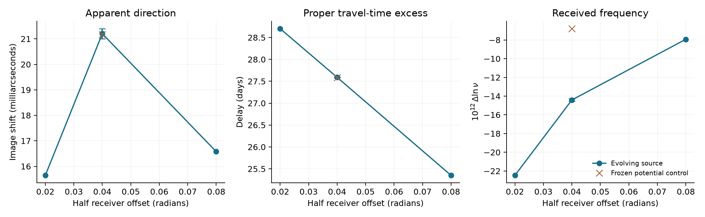

*Figure 31. The actual forming source supplies direction, proper delay and
frequency for specified receiver offsets. The middle offset has the full
quoted source and integration controls; the other two illustrate the map.
The cross freezes the comoving potential under the same clock protocol.
Its frequency discrepancy exposes the source's time dependence.*

The time derivative of excess delay is $1.44090\times10^{-11}$, agreeing
with the independently calculated frequency relation within
$1.36\times10^{-15}$. The smaller-step angle derivative agrees with the
direction relation within $6.59\times10^{-16}$. Source-grid, source-time,
outer-domain, short-slab and ray-tolerance controls determine the reported
numerical ranges. A curved homogeneous ray and an independent Plummer
Born calculation check the geometry and optical normalization.

Freezing the comoving potential removes its expansion-corrected frequency
term. The total log-frequency contrast becomes $-6.79268\times10^{-12}$,
while the direction and delay change much less. Thus an almost unchanged
image can accompany a distinguishable dynamical frequency contribution.
The frozen potential is an optical approximation control, not a second
self-consistent formation history.

This is a finite forward prediction for held test clocks in the stated
weak metric. Freely falling clocks or emitters moving with the scalar flow
need their own trajectories, Doppler effects and aberration. Those effects
can exceed the small gravitational frequency contrast. The next link to
observations is therefore physically prepared or measured kinematics and
the assessment of omitted metric terms, using this same formed source.

### 15.9. Motion calibrates a prediction before the new ray is evaluated

<!-- nsc-claim:atlas-dynamics-lensing -->

Derivation and calculation: [frozen NSC-P004 forecast](../results/summaries/nsc-p004-dynamics-lensing-forecast-v1.json),
[separate validation](../results/summaries/nsc-p004-dynamics-lensing-validation-v1.json)
and [derivation and preparation](../docs/nsc-atlas-dynamics-lensing.md).

The preceding result supplied light propagation from a known forming
source. The next test reverses part of that inference: calibrate its force
from finite timelike motion and predict a new optical response before
computing the corresponding null ray. The source, weak metric and action
remain unchanged.

Preparation first checks whether an equilibrium rotation curve is justified.
For the source acceleration $g$ at fixed physical radius, compare its
variation rate with $\Omega^2=g/R$. The instantaneous ratios
$|\partial_t\log g|/\Omega$ are about $.611$ near $r=.0073$ and $.457$
near $r=.015$. They do not support slow variation over an orbital period.
This is a timescale diagnostic, not a theorem excluding every orbit.
The selected method therefore uses short freely falling motions.

For positive lapse $\alpha^2=1+2\Phi$, spatial scale
$s^2=A^2L^2(1-2\Phi)$ and $B=1-CL^2r^2$, a radial unit-mass test body has

$$
\mathcal{H}_t=\alpha\sqrt{1+BP^2/s^2}.
$$

Its trajectory and proper clock follow the timelike Hamilton equations.
At release with zero peculiar velocity, the local radial velocity relative
to the stated cosmological frame obeys

$$
-\left.\frac{dv}{d\tau}\right|_0
=\frac{\sqrt{B}\,\Phi_r}
{AL\sqrt{1-2\Phi}(1+2\Phi)}.
$$

The test body's proper four-acceleration is zero. This is a relative
velocity change, measured in the specified reference frames.
Centered before/after velocities reconstruct the leading force:

$$
\Phi_r^{\rm rec}=-\frac{AL}{\sqrt{B}}
\frac{v_+-v_-}{\tau_+-\tau_-}.
$$

The refined calibration uses $96$ probes on the incoming and outgoing
halves of the retarded background chord. Their central release events,
proper-time intervals and initial velocities are specified. The initial
source and receiver themselves are another pair of radial geodesics,
released at the slab start. They have the same trajectory at a common
time, but different radii at emission and reception.

The new receiver is at $\Theta=\pi-.12$, absent from the earlier optical
fan. Let its reference chord have impact parameter $b$, length $d$ and
coordinate endpoints $z_e,z_o$. A fixed-endpoint Born calculation gives

$$
\Delta\beta_{\rm lens}
=\frac{2}{d}\int_{z_e}^{z_o}(z-z_e)
\Phi_r^{\rm rec}(N(z),r(z))\frac{b}{r(z)}dz.
$$

The endpoint weight follows by integrating the transverse displacement
equation with both positions fixed. It differs from the total deflection
of a freely specified incoming ray. The retarded times come from the
background chord, not from the withheld optical path.

Calibrated endpoint positions fix the geometric direction. The measured
receiver velocity supplies the exact radial aberration:

$$
\cos\beta_{\rm obs}=
\frac{\cos\beta_{\rm normal}-v_o}
{1-v_o\cos\beta_{\rm normal}}.
$$

The prediction function consumes these motion measurements and geometric
inputs only. It does not read the source potential or interpolate the old
optical fan, and it does not fit an independent lens mass. Equal leading
metric potentials remain a premise of this model. Combining dynamics and
lensing is established practice, illustrated in a different statistical
setting by [Reyes et al.,1003.2185](https://arxiv.org/abs/1003.2185).

### 15.10. NSC-P004 passes its frozen synthetic cross-observable check

The forecast and comparison tolerance were committed and pushed in
[e626f2f](https://github.com/kodareken/nested-space-cosmology/commit/e626f2f)
before evaluating the new null boundary problem. The forecast is
creation-only and remains byte-identical after validation.

| Stage | Image shift, milliarcseconds |
| --- | ---: |
| Motion-calibrated forecast | 19.43948287 |
| Frozen comparison tolerance | .18327870 |
| Withheld moving-endpoint null calculation | 19.43946116 |
| Null result minus forecast | -.00002171 |
| Null-grid comparison range | .08049 |

The check passes without changing its prediction, tolerance, source or
lens normalization. Adding the null-grid comparison range to the residual
still leaves it inside the frozen window. The small closure residual is
not a new absolute accuracy claim: both channels share the prescribed
metric and underlying source. This is prospective synthetic validation,
not astronomical confirmation or a unique signature of nesting.

The frozen window contains a numerical comparison envelope, a probe-release
sensitivity estimate and a predeclared Born allowance of $0.5%$ of the
lens contribution. It is a test tolerance, not a certified error bound on
the complete relativistic theory. Numerical refinement of the impulse and
quadrature is performed before the optical target is evaluated.

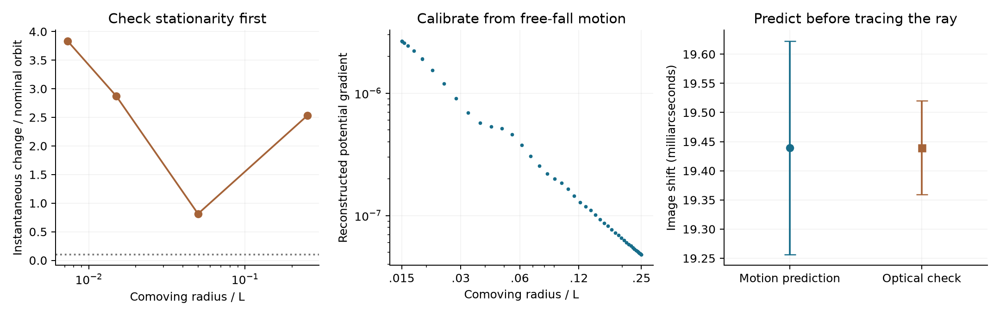

*Figure 32. The force-timescale precheck selects finite free-fall calibration.
The middle panel reconstructs the force from motion along the retarded
chord. The right panel compares the committed forecast with the later
null calculation; its bars represent the stated comparison ranges, not
empirical confidence intervals.*

Observer motion is not a negligible relabeling. At the emission and
reception events, radial velocities are approximately $-4.27921\times10^{-8}$
and $-6.67110\times10^{-8}$ in units of $c$. Their Doppler contribution
to log frequency is $1.09306\times10^{-7}$, while the expansion-removed
normal-frame gravitational contribution is $-2.93250\times10^{-12}$.
The exact endpoint boost is

$$
\log\frac{\nu_o}{\nu_e}
=\log\frac{\nu_{o,\rm normal}}{\nu_{e,\rm normal}}
+\log\frac{\gamma_o(1-v_o\mu_o)}
{\gamma_e(1-v_e\mu_e)}.
$$

Here $\mu$ is the local photon direction cosine. The moving-clock arrival
identity remains valid and is checked by emission-age differences.
Related frequency and viewing-direction effects are treated by
[Korzynski--Kulejewski,2601.13912v2](https://arxiv.org/abs/2601.13912v2);
the radial boosts and worldlines here are evaluated for this source.

The calibration assumes known endpoint kinematics. Near the measured
angle, velocity error changes the direction by approximately
$\sin\beta\,\delta v$. Keeping that error alone below the frozen tolerance
requires roughly $4.4$ m/s receiver-velocity precision with other quantities
fixed. Position, distance and release-state errors also need propagation.
No such astronomical calibration is claimed here.

The new connection is a motion profile predicting a withheld light
measurement, with its preparation and possible failure specified first.
The calibration probes the inner chord. An alternative geometry agreeing
there would pass the same test. The next outward comparison should ask
whether the surrounding compensation and inherited scale relation break
a specified same-core degeneracy.

### 15.11. Two observer distances, on two metrics

<!-- nsc-claim:atlas-supernova-distance -->

Scalar volume averages do not by themselves give an observer a distance.
On the exact zero-source quiet cap the luminosity shape is

$$
\frac{D_L}{c/H}=z(1+z).
$$

The comparison retains 596 released Pantheon+ light curves of 545 distinct
supernovae, excluding calibrators and retaining correlated repeat light
curves. The low band is $0.025\leq z_{\mathrm{HD}}<0.075$ (335 curves);
the high band is $0.15\leq z_{\mathrm{HD}}\leq0.25$ (261 curves). Both
lie inside the declared quiet-cap causal domain. For each curve define

$$
y_i=m_{b,i}^{\mathrm{corr}}
-5\log_{10}[z_{\mathrm{HD},i}(1+z_{\mathrm{HEL},i})].
$$

Generalized least squares fits the two band intercepts jointly using the
selected full statistical and systematic covariance. Their high-minus-low
contrast cancels a common brightness and Hubble scale. The quiet prediction
is zero; the measured contrast is

$$
\Delta=-0.1046180474751224\pm0.014373986469318333
\ \mathrm{mag}.
$$

The estimator was frozen before this evaluation. The catalogue itself was
already public, so the test is a retrospective comparison of one quiet
state, not a blind test and not a falsification of a completed
Nested-Space cosmology. No $\Lambda$CDM parameter was fitted, and no
cosmological constant was supplied to improve the residual. The uncertainty
is conditional on the released covariance and standardization, including
its peculiar-velocity treatment. The
[distance-contrast record](../results/summaries/nsc-atlas-distance-contrast-v1.json)
stores the estimator specification, selected-row identity, zero prediction
and this residual.

<!-- nsc-claim:conformal-causal-distances -->

The separate evolving metric also has an explicit null cone. Receiver,
emitters and ideal reflectors sit on fixed-coordinate normal worldlines.
Those worldlines may be accelerated. They are not introduced as
cosmological comoving matter, and a slope of redshift against lookback is
not a measurement of $H_0$. For transparent, photon-conserving geometric
optics, with $N=rQ$, reception $(T_o,x_o)=(0.3,1)$ and past rays
$T_e=T_o-\chi$, $x_e=x_o+\eta\chi$,

$$
1+z=\frac{N_o}{N_e},\qquad
D_A=\frac{r_or_e}{N_o}\int_0^\chi Q(T_o-s,x_o+\eta s)^2\,ds,
$$
$$
D_L=(1+z)^2D_A,\qquad
D_{\mathrm{radar}}=\frac{1}{2}\int_{T_o-2\chi}^{T_o}N(T,x_o)\,dT.
$$

The lapse in these formulae is the full product $rQ$. The three
predeclared lookbacks are $\chi=0.025$, $0.075$ and $0.125$, in both
directions. The longest radar trip begins at $T=0.05$, inside the saved
time interval. At $\chi=0.125$ both directions have the same radar distance
$D_{\mathrm{radar}}/L_{\mathrm{ref}}=0.031382863175331$.

| Side at $\chi=0.125$ | Redshift | $D_L/D_{\mathrm{radar}}$ |
| --- | ---: | ---: |
| Smaller $x$ | $0.0016677447278268254$ | $1.0000739824887968$ |
| Larger $x$ | $-0.007306104080127329$ | $0.991108506097534$ |

The ratios carry no unit. The largest 32/64-point difference is
$3.34\times10^{-16}$. Across the four stored cases the largest deviations
are $2.94\times10^{-10}$ in redshift and $4.84\times10^{-10}$ in the ratio.
Those figures do not bound interpolation or the total model uncertainty.
The method was frozen at `f0f639d` before the rays were evaluated, with no
new gravitational or field solve. The
[light-cone record](../results/summaries/nsc-conformal-lightcone-v1.json)
contains all six rays. Figure 33 shows the three declared lengths; the lines
only connect those samples. This is a finite observer map on one saved
metric, not a full-sky prediction and not a match to the Pantheon+ residual.

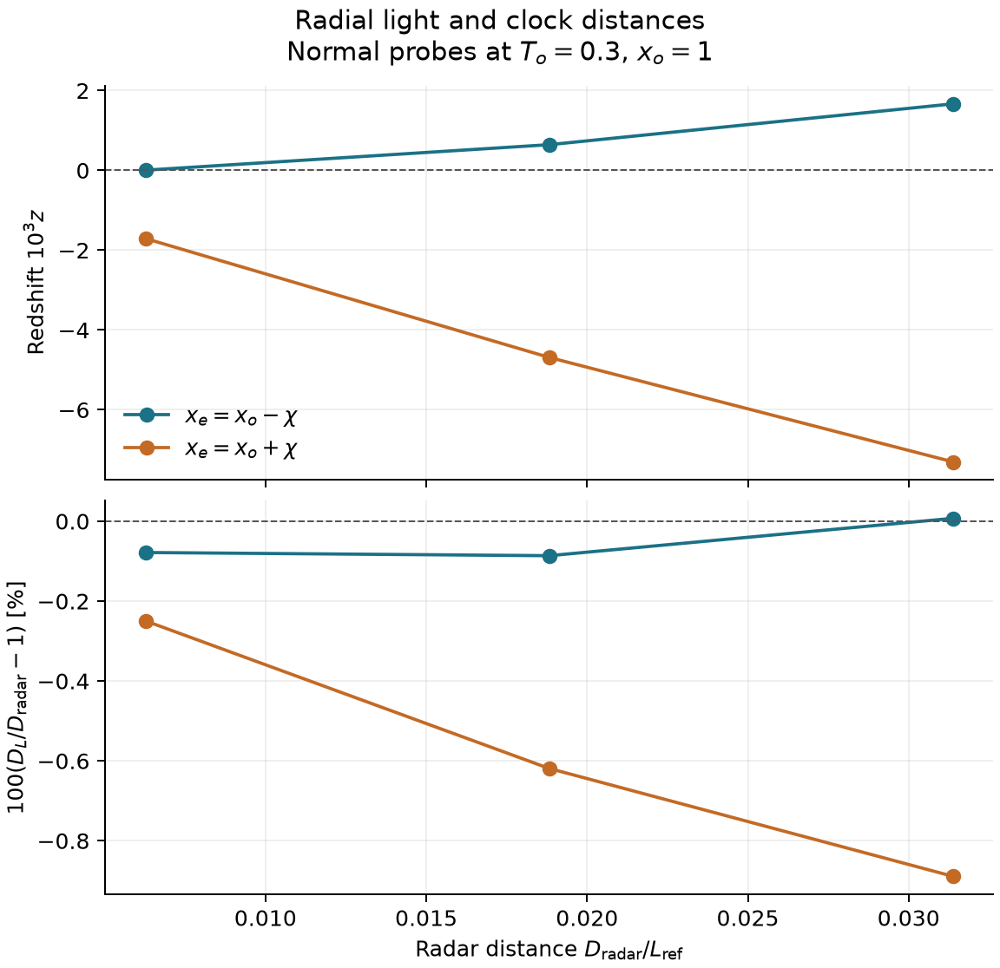

*Figure 33. Three predeclared lookbacks in each radial direction, for the
fixed-coordinate normal probes of the saved conformal metric. Markers are
the declared rays. Lines connect samples and do not fill intermediate
evolution.*

## VI. Gravitational exchange, fluid motion and quantum state

The same geometric question extends to gravitational waves, unresolved motion and quantum fields: which boundary and state determine the measured response? A separately specified stable material geometry gives an actual gravitational Schur action and return contrast. Fluid correlations provide a conserved stress mechanism in their own domain. Physical Dirac propagation and the geometry-derived cosmohedron exchange then connect explicit quantum states to sourced geometry. Each mathematical bridge retains its field content and approximation.

### 16. Responses across matter, gravity and quantum descriptions

The following sections give the worked constructions and their attributed mathematical inputs.

### 16.1. Flow geometry and a common boundary stress

<!-- nsc-claim:atlas-flow-boundary-dictionary -->

The [flow dictionary](../docs/nsc-atlas-flow-dictionary.md) connects several
published constructions through explicit operations. PG coordinates expose
radial null directions as $dr/dt=v\pm1$. Linear potential disturbances in a
prepared barotropic inviscid medium instead define an acoustic metric.
Specified near-horizon gravitational perturbations have a fluid limit.
Their source, state and domain determine which parts can be joined.
[Hamilton--Lisle](https://arxiv.org/abs/gr-qc/0411060) supplies the river
construction, [Visser](https://arxiv.org/abs/gr-qc/9712010) the acoustic
dictionary, and [Bredberg et al.](https://arxiv.org/abs/1101.2451) the
Einstein/Navier--Stokes limit. The dictionary checks the latter's shear
coefficient directly from its perturbed Rindler metric, including the
proper-clock conversion.

One connector is the [Brown--York](https://arxiv.org/abs/gr-qc/9209012)
boundary stress. With a common spacelike normal from minus to plus,

$$
t^{\rm BY}_{ab}=\frac{K h_{ab}-K_{ab}}{8\pi G},\qquad
[t^{\rm BY}_{ab}]=S_{ab},\qquad
D_a(t^{\rm BY})^a{}_b=-T_{\mu\nu}n^\mu h^\nu{}_b.
$$

The jump is precisely Israel's material-interface law. Different material
actions can therefore occupy this mathematical interface. A horizon fluid
uses an additional limit and constitutive response on an appropriate surface;
the current pure-tension wall is one candidate in this larger map.

Douglas's circulating-scale hypothesis asks whether nested vortical regions
and transfer across scales can supply a physical continuation. Published
[holographic turbulence](https://arxiv.org/abs/1307.7267) provides a gravity/cascade
block in its own asymptotically AdS setting. The spherical river alone has no
ordinary circulation. A rotating cosmological state, its energy-transfer
budget and its light-cone observations remain calculations to construct.
The next example supplies a finite gravitational response with an explicit
material action, rather than assigning an arbitrary reflector to a horizon.

### 16.2. Two stable material interfaces in one static geometry

<!-- nsc-claim:atlas-gravitational-background -->

Derivation and calculation: [background, force and response record](../results/summaries/nsc-atlas-gravitational-response-v1.json).
The [derivation](../docs/nsc-atlas-gravitational-response.md) distinguishes this
candidate from the earlier formed scalar history. It reuses the
[Visser--Wiltshire](https://arxiv.org/abs/gr-qc/0310107) shell dynamics and
[Pani et al.](https://arxiv.org/abs/0909.0287) gravitational junctions.
[Jampolski--Rezzolla](https://arxiv.org/abs/2310.13946) supplies the explicit
nested-gravastar antecedent; neither nesting nor gravastar perturbations are
claimed as discoveries here.

Use $G=c=M=1$ and one time normalized at infinity. The three regions have

$$
ds_i^2=-A_i^2 f_i dt^2+f_i^{-1}dr^2+r^2d\Omega^2,\qquad
f_i=1-\frac{2m_i}{r}-H_i^2r^2.
$$

The exterior has $m=1,H=0,A=1$, the parent annulus has $m=.1$, and the
central region has $m=0$. The radii are $R_o=2.5$ and $R_i=.25$.
On each surface a canonical massless scalar has homogeneous stress
$p=\sigma=s^2/2$, where s is its proper-time derivative. The bulk four-form action, with its
fixed-flux boundary term, supplies the regional vacuum stress
$\Lambda_i=4\pi G q_i^2=3H_i^2$; surface charges are the oriented flux jumps.
The material law and geometric ratios are shared declared inputs.

For ordinary increasing-radius normals, the two static Israel conditions are

$$
\sigma=\frac{\sqrt{f_-}-\sqrt{f_+}}{4\pi R},\qquad
p=\frac{1}{8\pi}\left[\frac{f'}{2\sqrt{f}}+\frac{\sqrt{f}}{R}\right].
$$

Putting $p=\sigma$ solves the interior curvature at each interface and its
matched clock. The full algebra is given in the owner; in this member,

$$
A_-^2=A_+^2\frac{f_+}{f_-},\qquad
H_{\rm parent}^2=\frac{3(29-\sqrt{265})}{1000}.
$$

| Quantity in exterior M units | Parent / outer wall | Center / inner wall |
| --- | --- | --- |
| H squared | .0381635382117 | 4.41709564871 |
| A | .541737767916 | .283041476224 |
| sigma equals p | .0120417630513 | .129330203316 |
| Radial potential second derivative | .442766777226 | 51.2125679208 |

All retained lapse factors are positive. The central bulk is nonsingular;
the two interfaces carry the specified thin material sources. Surface
conservation gives $\sigma R^4=\mathrm{constant}$. The signed wall potentials
obey $V=V'=0,V''>0$ with this law, and the normal force balance agrees
independently. These are radial linear stability results. Polar and nonlinear
stability are additional questions.

The same construction returns the conditional curvature products
$\Lambda_{\rm parent}M^2=.114490614635$ and
$\Lambda_{\rm child}(.1M)^2=.132512869461$. The supplied radius/mass ratios
and four-form sectors have not been selected by astronomical data or by an
absolute vacuum-selection mechanism.

### 16.3. The gravitational action now composes through the interfaces

<!-- nsc-claim:atlas-gravitational-composition -->

Derivation and calculation: [common-clock wave and junction controls](../results/summaries/nsc-atlas-gravitational-response-v1.json).
For linear axial modes $\ell\geq2$, use the Fourier convention below
and the common-time Regge--Wheeler variable

$$
\psi(t,r)=e^{-i\omega t}\psi(r),\qquad
\psi(r)=\frac{Af h_1}{r},\qquad \frac{dx}{dr}=\frac{1}{Af},\qquad
\psi_{xx}+\left[\omega^2-U(r)\right]\psi=0,
$$

$$
U=A^2f\left(\frac{\ell(\ell+1)}{r^2}-\frac{6m}{r^3}\right),\qquad
[\psi]=0,\quad [\psi_x]=q_s\psi,\quad
q_s=4\pi\sigma\sqrt{F_s}>0.
$$

Here $F_s=A^2 f$ is the common wall lapse squared. The shell response is
derived from Pani et al.'s general conditions $[h_0]=0$ and
$[\sqrt{f} h_1]=0$. Applying the zero-density simplification from their
special gravastar directly would give the wrong matching here. The
remaining temporal Israel condition is also checked against the canonical
surface-scalar stress. This is a coupled gravitational perturbation, not a
test field assigned a spin-two potential.
The standard Kottler bulk potential is also given by
[Cardoso--Lemos, equation 11](https://arxiv.org/html/gr-qc/0301078v2).
Their subsequent near-extremal approximation is not used here.

Let $T$ propagate $(\psi,\psi_x)$ through a region. Its determinant is 1,
and a shell adds $q_s\psi$ to the second component. Both preserve the
Wronskian flux. If $Z=\psi_x/\psi$, the regional response composes as

$$
Z_{\rm out}=\frac{T_{21}+T_{22}Z_{\rm in}}
{T_{11}+T_{12}Z_{\rm in}}.
$$

Away from a Dirichlet pole the boundary action has
$K_{11}=T_{11}/T_{12}$, $K_{12}=K_{21}=-1/T_{12}$ and
$K_{22}=T_{22}/T_{12}$. Adding adjacent actions and eliminating their shared
boundary by a Schur complement gives exactly the propagated result.
This supplies a physical gravitational realization of the atlas's composition
method in this sector.

The bulk potentials and shell strengths are nonnegative, so

$$
\int\left(|\psi_x|^2+U|\psi|^2\right)dx
+\sum_s q_s|\psi(x_s)|^2\geq0.
$$

With a regular center and radiative exterior, integration by parts excludes
finite-energy exponentially growing axial modes. This covers a propagating
gravitational sector across both material levels. It does not establish polar
stability or the nonlinear formation of a rotating hierarchy.

### 16.4. The same exterior mass permits different gravitational returns

<!-- nsc-claim:atlas-gravitational-contrast -->

Derivation and calculation: [two-frequency contrast and numerical controls](../results/summaries/nsc-atlas-gravitational-response-v1.json).
Keep the outer wall, parent annulus and exterior fixed. Replace only the
regular child and its inner interface by the same Kottler region extended
to its horizon, with an ingoing state there. Drive the finite worldtube
$r_o=10M$ in the $\ell=2$ channel. Define

$$
a_{\rm in}=\frac{1}{2}\left(\psi-\frac{\psi_x}{i\omega}\right),\qquad
a_{\rm out}=\frac{1}{2}\left(\psi+\frac{\psi_x}{i\omega}\right),\qquad
\mathcal R=\frac{a_{\rm out}}{a_{\rm in}}.
$$

These are the stated finite-boundary canonical energy channels. They have
not been extrapolated into an astronomical waveform at infinity.

| M omega | Absolute difference of complex returns | Horizon absorbed fraction |
| --- | --- | --- |
| .4 | .00000160391406 | .000000288534441 |
| 2 | .258116878344 | .442777762923 |

The regular child returns all incident power in this lossless sector. At the
higher frequency the horizon control absorbs about 44.2778%. Its numerical
indicator in absorbed fraction is $3.69\times10^{-9}$. Lower-frequency waves are strongly
screened from the changed interior. Three numerical levels, an independent
hypergeometric cap, another integrator and flux controls resolve both contrasts.
The indicators are not physical confidence intervals or rigorous enclosures.

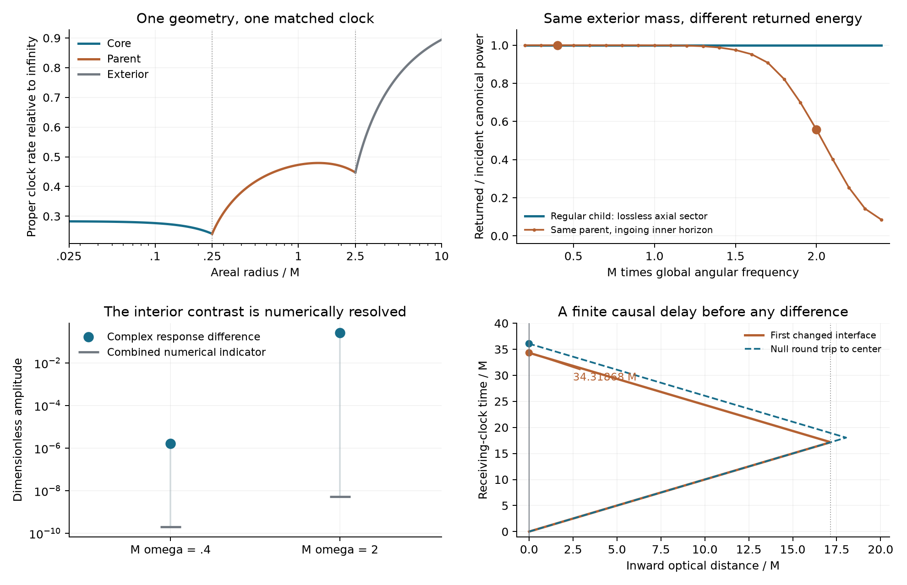

*Figure 34. The matched clocks are continuous across both sourced interfaces.
The same parent/exterior yields a different return when its inner termination
changes. The lower panels compare the contrast to numerical indicators and
show the principal-characteristic return times. The curves use 23 fixed
plotting frequencies, not a fit or a search over object parameters.*

For initially quiet perturbations, the first possible difference follows a
round trip from the worldtube to the inner interface. On the receiving clock,

$$
\Delta\tau_{\rm first}/M=34.3186793341.
$$

A null round trip to the center is $36.0742605915M$. Neither is a fitted echo
peak. With the independently supplied example mass of $10^6$ nominal solar
masses, the first bound becomes 169.036344 seconds and the higher proper
drive frequency .0722529542 Hz. The [IAU nominal mass parameter](https://arxiv.org/abs/1510.07674)
sets the unit conversion.

The [calculator and derivation](../docs/nsc-atlas-gravitational-response.md)
retain the exact action, finite domain and thirteen new controls. The
calculation uses 145106 RHS calls and about 1.6 solver CPU seconds in four
workers, with no wave history stored. The result connects a nested source,
a common gravitational evolution equation, Schur composition and a receiving
clock. A direct retarded pulse, polar response and a specified rotating or
dissipative state are the next physical connections.

### 16.5. A published nonlinear vortex mechanism enters the atlas

<!-- nsc-claim:atlas-openai-navier-stokes-source -->

Reference and reading boundary:
[source identity and finite calculation](../results/summaries/nsc-atlas-vortex-transfer-v1.json).
OpenAI's [Finite time blowup for Navier--Stokes](https://cdn.openai.com/pdf/32d9f210-8b73-45e0-91bc-82a30aef8a9a/navier-stokes.pdf)
is linked from its [8 September 2026 announcement](https://openai.com/index/navier-stokes-solution/)
and accompanied by a [Lean formalization](https://github.com/openai/NavierStokesAndEuler/tree/f9e8bc5b38b6e212696e8a30e3e91517af887bbd).
Theorem 1.1 constructs a three-dimensional incompressible flow for every
positive viscosity, starting from rest under a smooth compactly supported
force. Its velocity becomes unbounded in finite time while kinetic energy
stays bounded. OpenAI's theorem is incorporated as an attributed mathematical
input; the independent atlas calculation follows in Sections 16.6--16.7.

The relevant mechanism appears in Sections 2.2 and 3.2--3.3: zero-mean
oscillatory velocities have nonzero quadratic momentum fluxes. The source
uses those stresses to close a concentrating vortex's momentum balance.
Its full profile construction and singularity argument have not been
independently reproduced here. The formalization is version-pinned;
it and its dependencies were not rebuilt in this task.

For time remaining tau and $0<h<.01$, the source's core scales are

$$
\ell_r\sim\tau^{1/2},\quad \ell_z\sim\tau^{1/2-h},\quad
U_{\rm core}\sim\tau^{-1/2-h}.
$$

Direct power counting gives

$$
E_{\rm core}\sim\tau^{1/2-3h},\qquad
D_{\rm core}\sim\tau^{-1/2-3h},\qquad
\|u\|_{L^3({\rm core})}\sim\tau^{-4h/3}.
$$

The shrinking volume permits small core energy and time-integrable loss
alongside large pointwise velocity. These scaling checks illuminate the
result; they do not replace its global proof or the force-regularity estimates.

The [new finite atlas entry](../docs/nsc-atlas-vortex-transfer.md) extracts
the momentum-transfer mechanism for an independent calculation. Its
prepared initial velocity is nonzero, its initial mean is zero, and the
force is zero after release. Those assumptions differ from Theorem 1.1.

### 16.6. Fine motion produces an exact resolved circulation

<!-- nsc-claim:atlas-vortex-initial-transfer -->

Derivation and calculation: [initial rate, covariance and conservation checks](../results/summaries/nsc-atlas-vortex-transfer-v1.json).
In cylindrical coordinates choose the smooth bump

$$
g(s)=\exp\left(1-\frac{1}{1-s^2}\right)\quad (|s|<1),\qquad
g(s)=0\quad (|s|\geq1).
$$

Set
$a(r)=g(2(r-1))$, $b=-a/2$ and $\chi(z)=g(z)$. For an integer angular
mode m and kappa=-2, the vector potential and initial velocity are

$$
\phi=m\theta+\kappa m\log r,\qquad
\mathbf A=\frac{\chi(z)\cos\phi}{m}(0,b,a),\qquad
u_0=\nabla\times\mathbf A.
$$

The field is smooth and compact, with support away from the axis, and its
divergence is zero exactly. Let U be its rotation-group mean. At the
initial instant U=0, but the covariance is

$$
R_{ij}=\langle u_{0i}u_{0j}\rangle
=\frac{1}{2}\operatorname{Re}(W_i\overline{W_j})
=R^{(0)}_{ij}+\frac{R^{(2)}_{ij}}{m^2}.
$$

Here $u_0=\operatorname{Re}(W e^{i\phi})$; the owner gives each component.
Both covariance terms are positive semidefinite. Their nonzero
radial--tangential correlation transfers angular momentum.

For the local classical unforced Navier--Stokes solution at any constant
positive viscosity, the initial mean viscous term vanishes because the
mean velocity is zero. Mean pressure has no tangential gradient. The
actual initial equation is therefore

$$
\left.\partial_tU_\theta\right|_0
=-\left(\partial_rR_{r\theta}+\frac{2R_{r\theta}}{r}
+\partial_zR_{z\theta}\right).
$$

The cylindrical factor two is necessary. At the symmetry plane z=0, the
envelope derivative vanishes, and substitution proves

$$
\left.\partial_tU_\theta(r,0,t)\right|_{t=0}
=-\frac{2a a'}{r^2}.
$$

For every prepared m and positive viscosity, the rates at r=.75 and 1.25 are

$$
-\frac{1024}{81}e^{-2/3}=-6.49060654184413,\qquad
\frac{1024}{225}e^{-2/3}=2.33661835506389.
$$

These are rates in reference units U squared over L. Opposite resolved
rotating bands begin to develop even though the initial mean velocity
vanishes. Direct angular averaging of the original convection term,
including its basis contribution, reproduces the stress result. This is
an initial derivative of the unforced equation, not a chosen residual force.

There is also a finite composition law. Around any admissible axisymmetric
parent B, add distinct angular modes with amplitudes $\epsilon_j$. Cross
covariances average to zero, as do the linear cross terms with B. Relative
to the solution prepared from B alone,

$$
\delta\left(\partial_t U_\theta\right)_{t=0,z=0}
=\left(\sum_j\epsilon_j^2\right)
\left(-\frac{2aa'}{r^2}\right).
$$

This composes the initial effects of prepared resolutions while retaining
their covariance state. An infinite sequence additionally needs regularity
and dissipation summability; it is not supplied by this finite identity.

### 16.7. The correlations retain their energy and momentum budget

<!-- nsc-claim:atlas-vortex-resolution-budget -->

Derivation and calculation: [quadrature controls and physical unit example](../results/summaries/nsc-atlas-vortex-transfer-v1.json).
With $I=\int\chi^2 dz=.983380812913$, the outward angular-momentum and
axial-momentum fluxes through a cylinder are

$$
\mathcal J_L=2\pi r^2\int R_{r\theta}dz=2\pi a^2I,\qquad
\mathcal J_z=2\pi r\int R_{rz}dz=\frac{\pi a^2I}{r}.
$$

They vanish at the radial support edges, so the global initial momentum
budgets cancel. The circulation comes from internal redistribution.
The energy and initial dissipation have the exact form

$$
E_m=E_0+\frac{E_2}{m^2},\qquad
D_m=\nu\left(D_2m^2+D_0+\frac{D_{-2}}{m^2}\right),\qquad E'(0)=-D_m.
$$

| Angular mode | Initial kinetic energy | Initial loss, viscosity .001 |
| --- | --- | --- |
| 4 | 5.476541766802 | 1.722601258802 |
| 8 | 4.892129540839 | 4.237090234552 |
| 16 | 4.746026484348 | 14.757095523724 |

Energy approaches a positive 4.697325465517 while the viscous cost grows
quadratically in mode number. For a finite sum the added energies and
losses are their amplitude-squared weighted sums. A fixed energy budget
therefore bounds the mean-force increment for this fixed envelope. Keeping the mean force at the
initial instant does not establish a sustained cascade or uniform lifespan.

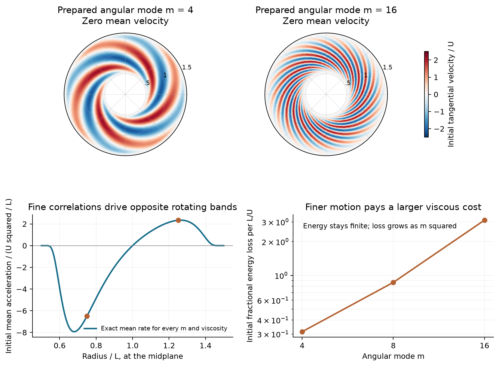

*Figure 35. The upper panels show actual tangential-velocity patterns of the
analytic initial data, not a simulated singularity or an image of the universe.
Both patterns average to zero velocity. The lower left gives the exact common
initial mean acceleration; the lower right shows the increasing fractional
viscous loss. The preparation, transfer and budget share one velocity field.*

In the supplied example L=1 m, U=.1 m/s, density 1000 kg/m³ and kinematic
viscosity .0001 m²/s, the two initial accelerations are
-.0649060654 and +.0233661836 m/s². These are conditional measurable
rates for the stated preparation, not experimental observations. Independent
64/128/256 quadratures, curl/gradient energy identities and direct convection
checks accompany the exact formulas. Fourteen field/budget controls and
an independent parent/composition check pass.

This adds a nonlinear source to the atlas's boundary dictionary. A coarse
description that retains only U loses a real momentum flux; retaining R
keeps its force and energy cost. Coupling that tensor to gravity requires
the selected relativistic stress and geometry. In Bredberg et al.'s map,
a three-spatial-dimensional fluid has a five-dimensional gravitational lift;
the earlier four-dimensional Rindler example used a two-dimensional fluid.
The singular endpoint also leaves a fixed hydrodynamic expansion regime.
Thus the source paper contributes a defined mathematical block, while the
gravitational attachment and a sustained rotating hierarchy remain further
connections to calculate.

### 16.8. A material action now supplies the interaction vertex

<!-- nsc-claim:atlas-geometric-cubic-vertex -->

Derivation and calculation: [actual-mode normalization, vertices and controls](../results/summaries/nsc-atlas-cosmohedron-interaction-v1.json).
The [interaction owner](../docs/nsc-atlas-cosmohedron-interaction.md) turns
the cosmohedra comparison into a finite calculation on the sourced body.
[Arkani-Hamed, Figueiredo and Vazao](https://arxiv.org/html/2412.19881v1)
organize a cubic scalar wavefunction through nested energy factors;
[Ardila-Mantilla and collaborators](https://arxiv.org/abs/2603.03425) prove
the associated Matryoshka face combinatorics. Here the low-point kernel
is tested with a vertex calculated from a selected material/gravity action.
No cosmohedron in physical spacetime is assumed.

The supporting wall scalar has a nonzero background and cannot be treated
as a free probe. Explicitly add a second canonical component chi_s with
zero background on each wall,

$$
S_\chi=-\frac{1}{2}\sum_s\int_{\Sigma_s}\sqrt{-\gamma}\,
\gamma^{ab}\partial_a\chi_s\partial_b\chi_s\,d^3y.
$$

Its background and linear stress vanish. The classical geometry, original
wall sources and axial operator are preserved. This adds stated probe
matter; quantum vacuum loops and their backreaction are not calculated.
For wall lapse $N_s=A\sqrt{f}$ and real unit spherical harmonics, the
canonical modes use the shared global time:

$$
\chi_s=\frac{\sqrt{N_s}}{R_s}\sum_i Q_{si}Y_i,\qquad
L_{2s}=\frac{1}{2}\sum_i(\dot Q_{si}^2-\omega_{si}^2Q_{si}^2),\qquad
\omega_{s\ell}=\frac{N_s}{R_s}\sqrt{\ell(\ell+1)}.
$$

Select the ell=1,m=1 cosine and ell=2,m=1 sine harmonics on each wall.
For the axial metric harmonic $X^A=\varepsilon^{AB}D_BY_{20}$ and
$\delta\gamma_{tA}=h_0X_A$, direct variation yields

$$
L_{3s}=-\frac{h_0}{R_s^2}\sum_{ij}C_{ij}\dot Q_{si}Q_{sj},\qquad
C_{ij}=\int Y_iX^AD_AY_j\,d\Omega=-C_{ji}.
$$

The selected real harmonics give $C_{12}=3/(2\sqrt{\pi})$. The sign
convention is fixed in the owner. Its opposite reverses both vertices,
leaving their exchange product unchanged. This angular integral and the
proper-clock normalization determine the vertex without a cubic fit.

### 16.9. An actual gravitational mode carries the cosmohedron seed

<!-- nsc-claim:atlas-physical-cosmohedron-exchange -->

Derivation and calculation: [mode, selected exchange and numerical controls](../results/summaries/nsc-atlas-cosmohedron-interaction-v1.json).
Retain the first regular axial ell=2 mode, with Dirichlet master at r=10M.
This is an explicitly conditional quantum domain. It differs from the
earlier open characteristic experiment at that radius and adds no physical
spacetime wall. The retained scalar harmonics have positive frequencies;
the scalar shift zero mode is excluded. Quantum theory and the positive
Gaussian reference state are imported explicitly.

The existing spatial operator and real material jumps determine the mode.
A trial Rayleigh quotient brackets its first eigenvalue. A phase and
eigenvalue-sensitivity calculation gives the norm through a Wronskian
identity; direct spatial quadrature and ordinary Regge--Wheeler propagation
check it independently. The result is

$$
M\omega_g=.392804111132,
$$

with no interior node. [Martel--Poisson](https://arxiv.org/html/gr-qc/0502028),
the master relation and radiation-flux normalization, fix the canonical
Cunningham--Price--Moncrief field:

$$
\alpha_\ell=\frac{(\ell-1)\ell(\ell+1)(\ell+2)}{64\pi G},\qquad
\Psi_C=\frac{e(r)Q_g}{\sqrt{\alpha_\ell}},\qquad
h_0=\frac{Af\Psi_C+r\Psi_{C,x}}{2}.
$$

Here the spatial mode has unit square integral in x. Legendre transforming
the scalar action therefore supplies the selected Hamiltonian vertex

$$
H_3=Q_g\sum_s c_s(P_{s1}Q_{s2}-P_{s2}Q_{s1}),\qquad
c_s=\frac{C_{12}}{2R_s^2\sqrt{\alpha_2}}(Af e+R_s e_x)_{\Sigma_s}.
$$

Both sides of the actual material junction give the same h0 and coupling.
The vacuum pair numerator is $n_s=c_s(\omega_{s1}-\omega_{s2})$.
Equal-frequency pairs have zero numerator. In exterior M units and with
G factored out, the calculated inputs are

| Quantity | Inner wall | Outer wall |
| --- | --- | --- |
| First scalar frequency | 1.36230331533 | .252982212813 |
| Second scalar frequency | 2.35957855748 | .438178046004 |
| Current coupling divided by sqrt(G) | .001441720226 | .028346822842 |
| Pair numerator divided by sqrt(G) | -.001437791887 | -.005249713475 |

For the two distinct wall pairs, a direct perturbative Schrodinger
calculation gives the mixed connected term in log(Psi):

$$
\Gamma_{1234}^{(g_1)}=-n_{\rm in}n_{\rm out}K_4,\qquad
K_4=\frac{1}{E_tE_LE_R},
$$

$$
E_t=\omega_1+\omega_2+\omega_3+\omega_4,\quad
E_L=\omega_1+\omega_2+\omega_g,\quad
E_R=\omega_3+\omega_4+\omega_g.
$$

The energy denominator is the seed of
[Cosmohedra, equation 49](https://arxiv.org/html/2412.19881v1).
The imaginary first-order phase and derivative numerator follow from this
current interaction. An independent number-state perturbation calculation
recovers the same kernel and selected normalized connected moment.

This is one propagating-mode tree contribution in the specified basis.
Other radial modes, even parity, nonpropagating constraint/contact terms
and higher orders are excluded. It is not the complete Einstein four-point
function. Mode frequencies replace plane-wave momentum magnitudes;
the full momentum-polytope realization has not been identified with
this geometry. The result is a calculated graph-kernel connection.

### 16.10. Interior geometry changes the interaction and fixes its scale law

<!-- nsc-claim:atlas-cosmohedron-interior-contrast -->

Derivation and calculation: [two preparations and fixed-G scaling](../results/summaries/nsc-atlas-cosmohedron-interaction-v1.json).
Move the inner wall from .25M to .30M and re-solve its stiff junction.
Its radial potential curvature stays positive. The parent parameters,
outer wall and exterior are unchanged. These are separately prepared
static states, not an instantaneous change or a new signal claim.

| Quantity | Child radius .25M | Child radius .30M |
| --- | --- | --- |
| M times gravitational frequency | .392804111132 | .392804157226 |
| Selected coefficient times M^4/G | -3.83479234e-7 | -6.32140173e-7 |
| Selected normalized moment times M^2/G | -3.21208795e-7 | -4.91767335e-7 |

The selected coefficient changes 64.84%, while this one gravitational
frequency changes about 1.17e-7 relatively. Inner scalar frequencies also
change. This does not assert degeneracy of every linear observation.
The numerical contrast is resolved by three solver tolerances and
independent mode/action checks; it is not an astronomical measurement.

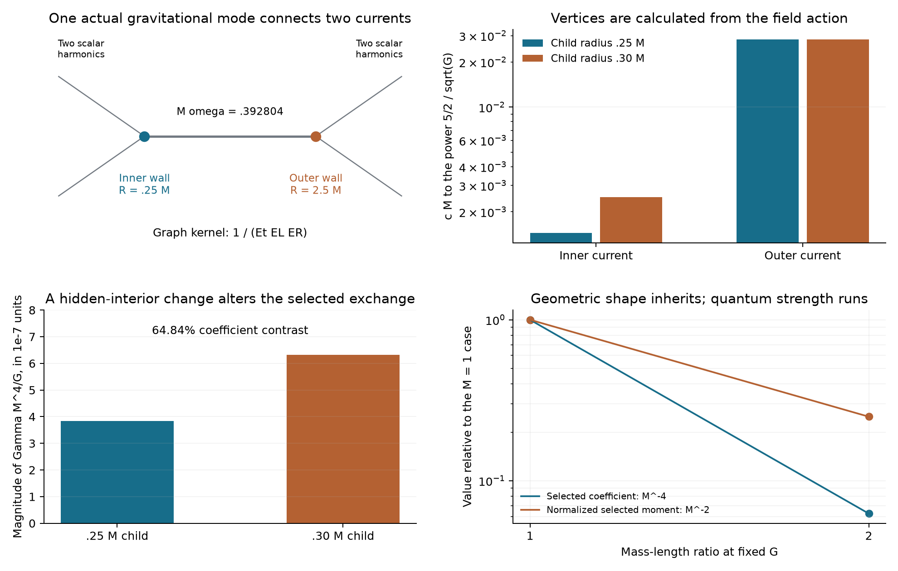

*Figure 36. The upper-left panel is the selected interaction graph, not a
spacetime diagram. Its vertices are calculated from the same material action.
The lower-left panel compares the two inner geometries. The scale control
at fixed G preserves geometric shape while changing quantum strength.
The panels concern the declared one-mode exchange contribution.*

At fixed dimensionless geometry, unit-normalized mode shape scales as
M to the power minus one-half. The action consequently gives

$$
c_s\sim\sqrt{G}M^{-5/2},\quad n_s\sim\sqrt{G}M^{-7/2},\quad
\Gamma_{\rm selected}\sim GM^{-4},\quad C_{\rm selected}\sim G/M^2.
$$

Thus the M=2 calculation preserves the geometric quantities
Gamma M^4/G and C M^2/G. The dimensionless quantum strength is G/M^2
in hbar=c=1 units; restoring units gives squared Planck length over
squared geometric mass length. A physical inherited-law map must carry
that parameter and the state. A fixed quantum coupling does not follow
from classical geometric covariance. Shapes tabulated per G are not
assertions of perturbative control at a Planck-sized mass.

The completed finite link is: material action, common clocks, actual modes,
derived vertices, selected quantum exchange and an interior-dependent
coefficient. Completing the constrained/pole-summed response and extending
the state to a time-dependent parent remain further work. No black/white
transition or observed Lambda value has been deduced from this graph kernel.

### 16.11. The actual cap--wall Dirac operator and the missing nested slip

The [cap--wall calculation](../docs/nsc-atlas-dirac-probe.md)
adds a declared massless, minimally coupled probe with no direct surface
spinor interaction to the original classical scalar candidate. It uses the
known quiet reference; P001's unconverged endpoint supplies no controlled
corrected background. In its static cap, let $A=1-H^2r^2$ and
$z=\operatorname{atanh}(Hr)/H$. Rescaling the physical spinor by
$\psi=A^{-1/4}r^{-1}u$ gives

$$
\mathsf{H}_k=-i\sigma_2\partial_z+\sigma_1 W,
\qquad W=\frac{k\sqrt{A}}{r},
\qquad V_\pm=W^2\pm\partial_zW,
\qquad \partial_zW=-\frac{k\sqrt{A}}{r^2}.
$$

At $r/\ell=.5$, the lowest angular channel has
$W\ell=\sqrt3$ and squared potentials
$V_+\ell^2=-.4641016151$, $V_-\ell^2=6.4641016151$.
Flat space at the same radius gives $0$ and $8$ for those potentials.
These are curvature effects. The smooth control continues the same cap
and retains its identical bulk operator.

Nesting changes the material domain. For the common cap-to-exterior normal,
$[K]=-6/\ell$. Continuity of the spinor and its Dirac image gives
$[\partial_n\psi]=-[K]\psi/2=3\psi/\ell$ in a common normal frame.
The smooth-cap control has no jump. The
[reference record](../results/summaries/nsc-atlas-dirac-probe-reference-v1.json)
and ten independent controls verify these operator inputs. The exterior's
usual static coordinate is spacelike at this cut, so it cannot supply a
static joined spectral problem.

No nested $\Psi/\Phi$ or slip difference has yet been calculated. The
loop requires a Dirac two-point state on the joined causal domain,
renormalized bulk/interface response, and a conserved metric source with
its wall displacement and gauge-invariant observer readout. Those inputs
are absent from the classical scalar preparation and the flat profile.
For free fermions the retarded bilinear response already depends explicitly
on its initial covariance through $-i\operatorname{Tr}(C[V(t),V(0)])$;
geometry alone does not select it. The completed result here is the curved
operator/domain connection, not a loop polarization or an NSC slip number.

### 16.12. Local Dirac trace on the cap and material wall

The free four-component Dirac determinant and general
[heat-coefficient framework](https://arxiv.org/pdf/hep-th/0306138)
are imported; the spin/statistics contractions and actual curvature are
calculated. In the two quiet smooth regions, where $\Box R=0$,

$$
\frac{\langle T^\mu{}_\mu\rangle}{\hbar c}
=\frac{7R_{\alpha\beta\gamma\delta}R^{\alpha\beta\gamma\delta}
+8R_{\alpha\beta}R^{\alpha\beta}-5R^2}{360(4\pi)^2}.
$$

The [one-sided evaluation](../results/summaries/nsc-atlas-dirac-bulk-trace-v1.json)
therefore gives $-11H^4/(240\pi^2)$ in the cap and
$7M^2/(120\pi^2r^6)$ outside. A flat reference has zero local curvature
trace. These are actual-background terms of the declared quantum probe,
distinct from the flat nonlocal polarization in Section 17.11.

At the material wall, integrate a smooth normal curvature jet before
taking a thin limit. The declared class smooths the kinked conformal factor
while the conformal product curvature remains bounded. With one normal
pointing from cap to exterior, put $t=K^\tau{}_\tau$, $b=K^\Omega{}_\Omega$,
$A=R_{\tau\tau}/R$ and $B=(1+R_\tau^2)/R^2$. The Chern scalar is
$\mathcal{B}_3=-8tb^2+8Bt+16Ab$. Direct Lorentz curvature contraction gives
the Euler surface coefficient

$$
\mathcal{E}_\Sigma=-[\mathcal{B}_3]
=4k_{\rm wall}(k_{\rm wall}^2+3H^2)=56/\ell^3.
$$

The exterior mass and wall radius cancel through the signed junction
equations. Pure-trace leading singular terms cancel in both Euler and
Weyl curvature squares; no delta square is evaluated. The
[Euler-wall reference](../results/summaries/nsc-atlas-dirac-euler-wall-v1.json)
then gives

$$
\frac{\langle T^\mu{}_\mu\rangle_{\Sigma,E}}{\hbar c}
=-\frac{77}{720\pi^2\ell^3}\delta_\Sigma.
$$

A smooth continuation of the cap has no such interface coefficient.
The scheme-dependent total derivative, finite interface terms, traceless
stress and quantum preparation remain separate inputs. This one Euler
term is not the complete wall stress. Trace-only projections do not
establish vacuum stress or replace the supplied cap $\Lambda_{0,-}\ell^2=3$.

### 16.13. An actual wall radar chart and a finite clock prediction

The [wall-clock construction](../results/summaries/nsc-atlas-dirac-radar-v1.json)
uses the same $H\ell=1$, $k_{\rm wall}\ell=2$, $M/\ell=.4$ and
$.45\le R_{\rm wall}/\ell\le.55$. In each static region take optical
coordinates $u_i=t_i-r_i^*$, $v_i=t_i+r_i^*$. Their wall derivatives are

$$
\frac{du_i}{d\tau}=\frac{1}{\beta_i+\dot{R}},\qquad
\frac{dv_i}{d\tau}=\frac{1}{\beta_i-\dot{R}}.
$$

Inside the exterior horizon the second derivative is negative. Label both
null rays by their wall proper times $U,V$, preserving that orientation.
Then

$$
T=(U+V)/2,\quad x=(V-U)/2,\quad
ds_2^2=C_i(-dT^2+dx^2),\quad
C_i=f_i(r)u_i'(U)v_i'(V)>0.
$$

The cap occupies $V\le U$ and exterior $V\ge U$. The proper-clock range
$0\le U,V\le S$, $S/\ell=.1256873632901$, gives the finite causal diamond
in Figure 37. An analytic conservative bound gives $N=\sqrt{C}\ge.3851891$
throughout that domain. The material wall remains $x=0$, $T=\tau$,
$C=1$; both Israel jumps are retained. This construction uses no spatial
cutoff profile and has no reflecting timelike ends. The earlier wide
coordinate chart's fold remains an unsuccessful construction, without
changing the underlying quiet geometry.

The actual Dirac half-density has constant characteristic speed:

$$
\xi=C^{1/4}r\psi,\qquad
H_\kappa=-i\sigma_2\partial_x+\sigma_1W_\kappa,\qquad
W_\kappa=\kappa\sqrt{C}/r.
$$

Both $W_\kappa$ and its first derivatives are continuous at the wall.
The density spinor and its spatial derivative are continuous in this
frame, while the physical parallel-normal jump remains $3k_{\rm wall}\psi/2$.

For a finite clock protocol, emit a radial optical phase at wall
$U=\tau(.475)$ and receive at
$(U,V)=(\tau(.475),\tau(.525))$ on a fixed wall-radar-position observer.
The signed radar position is $x/\ell=.0314673818165$ and
$T/\ell=.0584746895099$. The null phase $-U$ and receiver proper clock give
$\omega_{\rm rec}/\omega_{\rm wall}=1/N_{\rm rec}$.

| Quiet geometry with the same radar protocol | $r_{\rm rec}/\ell$ | $N_{\rm rec}$ | $\omega_{\rm rec}/\omega_{\rm wall}$ | $W_1\ell$ |
| --- | ---: | ---: | ---: | ---: |
| Nested cap--wall--exterior | .5068911 | .8668323 | 1.153626 | 1.7101 |
| Smooth cap continuation | .5364941 | .9253385 | 1.080686 | 1.7248 |

For the independently supplied $\ell=10\,{\rm km}$, this radar range is
$314.674$ m. The smooth continuation is a geometric control with the same
observer worldline and clock labels; it is not another matched membrane
solution. These are conditional quiet-background predictions, with no
observed frequency used to tune the geometry. They are not a quantum slip
or an astronomical identification. The optical-map comparison with independent
quadrature differs by $2.11\times10^{-14}$ or less; finite mode propagation and the full
quantum error account are not supplied by this geometry calculation.

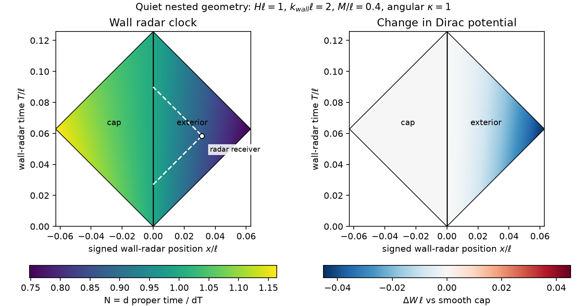

*Figure 37. The finite quiet wall-clock diamond. The material wall is the
vertical line; null edges are causal limits. Left: proper-clock lapse,
with the emitted/reflected radar ray and receiver. Right: the radial
Dirac-potential difference from a smooth continuation of the same cap,
using the same wall clock and probe angular sector. These colors describe
the background geometry, not an evolved quantum state or a metric-loop
response.*

### 16.14. Stress vertices and the inherited quantum preparation

The same canonical radial Dirac action supplies its gravitational
sources. For a full magnetic multiplet let $d=2|\kappa|$,
$f=d/(4\pi)$, $\xi=\sqrt{a}\,r\psi$,
$q_A=-i(\xi^\dagger A\xi_y-\xi_y^\dagger A\xi)/2$ and
$s_1=\xi^\dagger\sigma_1\xi$. Its real Hamiltonian density is
$h=d[N(q_\alpha/a+\kappa s_1/r)-\beta q_I]$. Metric variation at fixed
canonical half-density gives

$$
\rho=\frac{f}{ar^2}(q_\alpha/a+\kappa s_1/r),\qquad
p_r=\frac{fq_\alpha}{a^2r^2},\qquad
p_t=\frac{f\kappa s_1}{2ar^3},\qquad
T^{\hat{0}\hat{1}}=\frac{fq_I}{a^2r^2}.
$$

The [stress and contact calculation](../docs/nsc-atlas-dirac-probe.md#dirac-stress-and-the-actual-gravitational-metric-vertices)
checks the Hilbert energy/flux, complete angular normalization,
four-dimensional covariant conservation and the first/second metric
variations. Finite-mode stress has zero classical trace and transmits
continuously; the anomaly in Section 16.12 is retained separately.
Radial ports and first-order time-end variations remain in an integrated
response. No scalar source or flat polarization is substituted.

The radar characteristic equations define the transfer of prepared
incoming data to the middle Cauchy segment. A parent covariance must
include both incoming branches and their cross-correlations. Existing
Gaussian boundary elimination can preserve those terms once the actual
transfer is supplied. Neither the chart nor the common-law relation
chooses a root state. Section 16.17 supplies one additional preparation
axiom and establishes its local short-distance class; it is not inferred
from a null-line frequency label alone.

The characteristic transfer and a finite prepared-state mean response
are evaluated next. A compatible baseline preparation, bulk/interface
renormalization conditions and the complete mixed response to a physical
source still separate them from a nested $\Psi/\Phi$ prediction.

### 16.15. Prepared Dirac propagation, mean metric and clock

The [actual transfer](../results/summaries/nsc-atlas-dirac-scattering-v1.json)
propagates the canonical chiral field on the wall-clock diamond. With
$P=\eta_+$ and $M=\eta_-$, the equations are
$2P_V=-iW_\kappa M$ and $2M_U=-iW_\kappa P$.
The characteristic cell map is a two-component Cayley unitary in positive
null-flux weights. Direct metric variation gives the ordered matter
response $-i[J_A,J_B]$ for the declared exterior source and later cap
insertion. For one specified first-channel occupation difference its
magnitude changes by about .3774% relative to the smooth-cap control.
This is one matter-response component.

The [mean-clock reference](../results/summaries/nsc-atlas-dirac-mean-clock-v1.json)
then supplies the mean metric needed before a full mixed source/tadpole
calculation. The incoming mode has $P(U,0)=0$ and
$M(0,V)=A b(V)\exp(-12iV/S)$, where $b$ is the stated smooth peak-one
bump centered at $.6S$ with half-width $.3S$: put
$z=(V-.6S)/(.3S)$ and $b=\exp[1-1/(1-z^2)]$ for $|z|<1$,
and zero otherwise. The constant $A$ normalizes its continuum null flux
to one. For a compatible supplied parent
covariance $C_H$, define $\Pi=I-|f\rangle\langle f|$,
$C_{\mathrm{empty}}=\Pi C_H\Pi$ and
$C_n=C_{\mathrm{empty}}+n_{\mathrm{occ}}|f\rangle\langle f|$,
$0\leq n_{\mathrm{occ}}\leq1$. This declared preparation changes one mode's
occupation and removes its cross terms; it selects no root vacuum.
The parent must make the finite-rank modification smooth on this region;
its global preparation remains an assumption.
Both magnetic states of the $\kappa=1$ multiplet have the same radial data.
Other inherited modes cancel between the two states.

Analytically differentiated characteristic equations supply first
derivatives of the propagated field. The same stress vertices then
determine the nonvacuum Misner-Sharp mass one-form. In units $c=\hbar=1$,
with $\kappa_g=8\pi G$ and the cap vacuum mass evaluated at the actual
areal radius,

$$
m_{\rm total}=M_i+\Lambda_i r^3/6+m_i,\qquad
(m_U,m_V)=\frac{\kappa_g r^2}{C}
(t_{UV}r_U-t_{UU}r_V,\ t_{UV}r_V-t_{VV}r_U).
$$

The two wall masses drive the existing signed radius-response equation.
In outgoing EF coordinates, the radial lapse follows from
$\psi_V=\kappa_g r t_{VV}/(2r_V)$ and its proper-wall normalization.
Analytic sensitivity of the ingoing null ray gives $s=\delta r$ and
$z=s_V$, hence $q=\delta\ln C=\psi+z/r_V$. The specified radial phase
and a receiver at fixed proper-wall radar position give
$\delta\ln(\omega_{\mathrm{rec}}/\omega_{\mathrm{wall}})=-q/2$.
No separate bulk metric grid is needed for this first-order supplied source.

The proper-clock labels remain $U=\tau(.475)$ and $V=\tau(.525)$
of the quiet reference. Define

$$
\varepsilon_q=\frac{8\pi\hbar G}{c^3\ell^2},\qquad
\mathcal C_{\rm clock}
=\frac{\delta\ln(\omega_{\rm rec}/\omega_{\rm wall})}
{\varepsilon_q n_{\rm occ}}.
$$

| Geometry and observer protocol | $\mathcal C_{\mathrm{clock}}$, 128 cells | Absolute 64/128 spread |
| --- | --- | --- |
| Nested cap-wall-exterior | -.41780 | 1.12e-5 |
| Smooth cap, shared observer motion | -.39929 | 9.95e-6 |

The smooth cap has no membrane. Its observer worldtube is explicitly
driven along the computed nested wall's areal-radius history. The
coefficient difference is $-.01851197$, about 4.63625% in magnitude,
with a correlated numerical spread $1.23\times10^{-6}$.
This compares the two geometries at common observer motion; it is not
an independently evolving alternative wall model.

The normalized nested mass-path discrepancy decreases from
$1.15\times10^{-6}$ to $2.92\times10^{-7}$; the smooth control also
improves. Orders 8/12 of the piecewise quadrature differ by less than
$5.34\times10^{-15}$ in the clock coefficient. Exact charged-wall and
nonzero-lapse fluid families independently check the reconstruction.
These indicators support the finite calculation; they are not a
rigorous continuum remainder or an observational confidence interval.

For the independently supplied $\ell=10\,\mathrm{km}$, the nominal
prepared-state fractional frequency correction is

$$
\delta\ln(\omega_{\rm rec}/\omega_{\rm wall})
\simeq-2.7430\times10^{-77}n_{\rm occ}
\left(\frac{10\ {\rm km}}{\ell}\right)^2.
$$

The nested resolution spread converts to $7.34\times10^{-82}$ at unit
occupation and that scale. The
[CODATA 2022](https://physics.nist.gov/cuu/Constants/Table/allascii.txt)
uncertainty in $G$ is separate. The length and mode preparation are
inputs, and no astronomical datum selects them.

This finite state-difference result supplies the mean $h_q$ needed in
the later mixed Einstein and source variations. It does not determine
the baseline vacuum, full retarded $\Psi/\Phi$ or a cosmological
$\Lambda$. The finite-amplitude scalar P001 remains unconverged;
its original solver and grids were not changed by this calculation.

### 16.16. A conserved compact source and local gravitational tides

A central mass source can be supplied on the same finite annulus, with
its body or inner horizon below the causal domain. The cap and exterior
vacuum functions and dimensionless source mass are

$$
f_-=1-2b/r-H^2r^2,\qquad f_+=1-2M_p(b)/r,\qquad \hat b=b/\ell.
$$

Hold the initial physical wall radius and proper speed fixed, as well
as H and tension. Both signed junction constraints then require
$dM_p/db|_0=\beta_{+,0}/\beta_{-,0}=2755/8587$. Holding the parent mass
fixed would change that speed. No regular body interior or formation
history is supplied by this annular construction.

The same continuum-normalized Dirac occupation difference is propagated
on each member of the mass family. The mean Einstein reconstruction,
stress, wall and observer vary together. Its two mass-flux laws and
wall displacement have an exact triangular solution: since
$d\ln v/d\tau=\mathrm{acc}/v$,

$$
\frac{\rho(\tau)}{v(\tau)}
=\frac{\rho(\tau_0)}{v(\tau_0)}
+\int_{\tau_0}^{\tau}
\frac{\beta_+(\mu-\nu)/(k_{\mathrm{wall}}R^2)+\mu/R}{v^2}\,d\tau'.
$$

Piecewise Gauss integration on the existing field-cell breakpoints
evaluates these primitives. The prefactor v retains the acceleration
term; no constraint residual is canceled. The independent exact
charged and fluid families check this reconstruction.

The [compact-source reference](../results/summaries/nsc-atlas-dirac-mass-response-v3.json)
uses $b/\ell=0,5\times10^{-5},10^{-4}$, the same 64/128 field cells,
and joint wall/bulk quadrature orders 8/12. Its receiver is inside
the cap at $U=.8S,V=.7S$, at fixed proper-wall radar position.
An inward phase -V is emitted at the earlier wall time V. The smooth
SdS continuation shares the nested observer's classical and mean
areal-radius history, without another material wall.

Define

$$
\mathcal C_B=\left.\frac{\partial}{\partial\hat b}
\frac{\delta\ln(\omega_{\mathrm{rec}}/\omega_{\mathrm{wall}})}
{\varepsilon_q n_{\mathrm{occ}}}\right|_{\hat b=0}.
$$

This derivative uses a source present before the window, not a retarded
mass-switching experiment. It includes the background Einstein variation
that a matter-only insertion on fixed geometry would omit.

A second readout uses actual orthonormal curvature. In the specified
radar observer's frame put $A=R_{0r0r}-R_{0\theta0\theta}$ and
$B=R_{r\theta r\theta}-R_{\theta\phi\theta\phi}$. Direct Ricci/Weyl
decomposition gives

$$
w=\frac{b+m_q}{r^3}-\frac{\kappa_g}{6}(\rho_q-p_{rq}+p_{tq}),\qquad
A=-3w-\frac{\kappa_g}{2}(p_{rq}-p_{tq}),\qquad
B=-3w+\frac{\kappa_g}{2}(p_{rq}-p_{tq}).
$$

The fixed vacuum term cancels. At fixed radar labels its first-order
Weyl variation also retains $-3b\,\delta r/r^4$. For nonzero b,
$A_0=B_0=-3b/r^3$. Define the occupied-minus-empty local ratio response
by $\delta(B/A)=\varepsilon_q n_{\mathrm{occ}}\mathcal C_{\mathrm{tid}}$.
The 128-cell results are:

| Geometry and observer | Clock derivative $C_B$ | Tidal coefficient at $b/\ell=10^{-4}$ |
| --- | --- | --- |
| Nested cap-wall-exterior | -.002329216 | -540762.871 |
| Smooth SdS cap, shared motion | -.002329519 | -540765.571 |

The clock-derivative difference is $+3.03553\times10^{-7}$, with a
correlated grid spread $2.58\times10^{-9}$ and a source-step indicator
$5.95\times10^{-10}$. The tidal-coefficient difference is +2.7001584,
about 4.9932 parts per million of the prepared correction, with a
correlated grid spread .0011855. Individual tidal-coefficient grid
spreads are about 14.59. For the supplied $\ell=10\,\mathrm{km}$,
the occupied-minus-empty changes in B/A are $-3.55031184\times10^{-71}$
and $-3.55032957\times10^{-71}$. Their nominal nesting difference is
$+1.77276\times10^{-76}$. The length, source and state are inputs.

All prescribed reference checks pass. The maximum normalized nested
mass-path gap falls from $8.08\times10^{-7}$ to $1.93\times10^{-8}$;
joint quadrature changes the clock coefficient by less than
$4.45\times10^{-15}$. These spreads are diagnostics, not rigorous
remainder bounds or observational confidence intervals. Earlier failed
precision/execution records remain in the scientific owner.

The local ratio is a curvature observable in the stated frame. In a
flat-FLRW Newtonian metric its comoving counterpart compares the radial
trace-free Hessians of $\Psi$ and $\Phi$. Reconstructing those potentials
also requires radial zero-mode and background-split data; below the
exterior horizon one cap FLRW pair does not cover the joined spacetime.
This finite prepared-state result therefore supplies no absolute empty
vacuum ratio, full vacuum $\Psi/\Phi$ or cosmological $\Lambda$.

### 16.17. A correlated continuum parent and local vacuum regularity

Specify the parent before evaluating a baseline vacuum. One explicit
alternative is the Dirac ground state on a static product of a radial
line with a sphere of radius $R_0=.45\ell$. In its chiral canonical frame,

$$
\mathsf{H}_{\kappa}(p)=p\sigma_3+\mu\sigma_1,\qquad
\mu=\frac{\kappa}{R_0},\qquad \omega=\sqrt{p^2+\mu^2}.
$$

Fill its negative band for every signed angular sector, including
each magnetic multiplet once. The Fourier measure is $dp/(2\pi)$.
On the two incoming null legs put $a=(\omega-p)/2$ and
$b=(\omega+p)/2$. Their plane phases are $\exp(iaU)$ and $\exp(ibV)$.
The same normalized spinor supplies both amplitudes, so the state has
Hardy diagonal kernels and the cross-leg kernel

$$
C_{+-}(U,V)=-\frac{\mu}{2\pi}
K_0\!\left(|\mu|\sqrt{UV}\right),\qquad U,V>0.
$$

Here $K_0$ is the modified Bessel function. Its normalization follows
independently from the equal-time cylinder Fourier integral. Restricting
the global projector to a finite diamond gives a generally mixed CAR
covariance. Its exact finite compressions retain this cross term; filling
the negative spectrum after truncating an energy matrix selects a
different state.

Use an explicit auxiliary preparation, with fixed physical duration $S$
and a smooth switch $\chi(s)$ supported in $(.1S,S)$, equal to one on
$[.2S,.9S]$. Define

$$
q=\frac{N}{r},\qquad
q_{\mathrm{aux}}=\frac{1}{R_0}
+\chi(U)\chi(V)\left(q-\frac{1}{R_0}\right).
$$

The auxiliary product metric has $r_{\mathrm{aux}}=R_0$ and
$N_{\mathrm{aux}}=a_{\mathrm{aux}}=R_0q_{\mathrm{aux}}$.
Blending q directly preserves its continuous first wall jets. Where the
switches are one this metric is conformal to the physical metric and
the canonical massless spinor is unchanged. This neighborhood includes
the cap detector of Section 16.16. The construction assigns a state;
it is not a physical formation history or an Einstein source model.
Stress and clocks still use the physical metric, including its anomaly.

For every angular sector the auxiliary Hamiltonian differs from the
cylinder by a bounded time-dependent potential on a common radial
domain. Its convergent interaction series gives unitary evolution.
The angular direct sum is unitary as well. Moreover,

$$
\{H_{\kappa},\sigma_1\}=2\kappa q_{\mathrm{aux}}
$$

gives a gap at least $|\kappa|q_{\min}$ when
$q_{\mathrm{aux}}\ge q_{\min}>0$.
The prescribed covariance is $C(T)=U(T)C_0U(T)^\dagger$.

**Local regularity proposition.** On an admitted regular patch, this
state is Hadamard on any relatively compact smooth interior neighborhood
inside the matched operator region. Both geometries therefore have a
smooth physical two-point difference on their common cap neighborhood.

The [proof and calculated boundary symbols](../docs/nsc-atlas-dirac-probe.md#local-hadamard-property-for-the-declared-preparation)
make the calculus input explicit. Fold the two sides onto a half-line.
The transparent condition is the allowed space of a constant Hermitian
involution that anticommutes with the normal matrix. It has maximal zero
flux. At real spacelike frequency the decaying-root map is invertible,
uniformly away from glancing, including both angular polarizations.
This verifies the complementing condition for the standard finite-bundle
first-order boundary parametrix. One-sided smoothness supplies its jets.

Normal regularity follows by pairing the unitary field with smooth
tangential tests and transferring tangential derivatives through its
first-order equation. The resulting map from the initial Hilbert space
to every one-sided normal Sobolev space gives smooth normal traces.
Boundary elliptic regularity confines singularities to the compressed
causal cone. Splitting its two orientations then makes the unwanted
component satisfy a smooth inhomogeneous boundary problem with absent
past data; energy uniqueness makes it smooth. Glancing remains inside
the causal cone and does not join its opposite time orientations.
The local CAR and the regular physical conformal map finish the argument.

The existing Weyl projector and transport algebra now receives the actual
radar metric jets through fourth order. Here local p is conjugate to
radar x, with $\omega=\sqrt{p^2+W^2}$; it is not the incoming cylinder
momentum label. In the canonical Pauli frame the first subleading term
is $c_1=-pW_T\sigma_3/(4\omega^3)$.
The first discontinuous wall coefficient enters $c_2$, through
$[W_{xx}]=-6\kappa(M_p-b)/R^4$. This curvature contribution is retained.
At a cap detector the two models share all local subtraction terms.
For a single covariance the fourth-order remainder is qualitatively
of order minus five; the two-state difference is smooth there.

This establishes existence of the local relative stress for this stated
preparation. It does not evaluate it or provide a numerical tail constant.
The full vacuum $\Psi/\Phi$, wall renormalization and physical selection
of the preparation remain separate work. No astronomical measurement
sets this root radius, switch, state or resulting numerical coefficients.

### 16.18. Inherited preparation and the cap's local late state

Derive the state transport before choosing another parent benchmark. A
complete ancestral covariance is inherited as $C_c=K C_aK^\dagger$, with
$KK^\dagger=I_c$ for current-normalized restriction and evolution.
Both incoming null branches, their cross-correlation and $I-C_a$ are
transported. A change of null clock carries a square-root Jacobian on
each kernel argument. Finite unitary transport does not select $C_a$.

The actual quiet cap nevertheless selects a local asymptotic state.
Keep $M_-=0$, $H\ell=1$, $M_+/\ell=.4$, $k_{\rm wall}\ell=2$, and the
transparent massless Dirac probe. In $\ell$ units its signed wall obeys

$$
\beta_-=\frac{3R}{4}+\frac{1}{5R^2},\qquad
v^2=\dot R^2=\frac{25R^2}{16}-1+\frac{3}{10R}+\frac{1}{25R^4}.
$$

This positive expanding root reaches $R>1$ in finite wall and central
cap time. In the expanding flat cap chart its regular clock is
$dt/d\tau=(1+v^2)/(\beta_-+Rv)$; at $R=1$ it equals $761/760$.
After that crossing choose a Cauchy ball of physical radius
$H^{-1}<R_B<R_w$. Its conformal future contains a neighborhood of the
central endpoint at $\eta=0$, with a positive spatial margin. The future
timelike wall remains outside that null domain.

**Inherited-state proposition.** Suppose the inherited field state is
Hadamard on a neighborhood of this closed ball. For Gaussian detector
correlations take a gauge-invariant quasifree state. In each fixed
translated central proper-time window, its full four-component two-point
function approaches the conformal de Sitter one. Parent-dependent stress
has a decaying amplitude, rather than a new freely chosen root state.

**Proof.** Set the cut to $t=0$, $a=e^{Ht}$ and $\eta=-H^{-1}e^{-Ht}$.
The conformal field $\psi_{\mathrm{flat}}=a^{3/2}\psi$ satisfies the flat
massless Dirac equation. Subtract the conformal Minkowski two-point
function as a proof reference. Its Cauchy-data difference is smooth.
Cut off both arguments inside a smaller ball still larger than $H^{-1}$
and evolve with the flat Dirac propagator. Finite propagation and the
strict margin extend this smooth difference through a neighborhood of
the virtual endpoint. No condition at a physical infinity is added.

The physical two-point difference is $a^{-3/2}a'^{-3/2}F(\eta,\eta')$,
with $F$ smooth and bounded there, so it decays as $e^{-3HT}$ under a
common time translation $T$. The same-action tetrad stress difference is

$$
\Delta T_{\hat a\hat b}=e^{-4Ht}Q_{\hat a\hat b}(-H^{-1}e^{-Ht}),
\qquad
\left|\Delta T_{\hat a\hat b}-e^{-4Ht}Q_{\hat a\hat b}(0)\right|
\leq \frac{M_1}{H}e^{-5Ht}.
$$

Here $M_1$ bounds the corresponding conformal-time derivative; anomaly
and local curvature ambiguities cancel in the state difference.
The amplitude $Q(0)$ and its bound are inherited data. This proves a
local limit and a finite conditional error, without asserting equal
finite-time states or loss of global unitary information. The
[complete proof and calculator](../docs/nsc-atlas-dirac-probe.md#inheritance-and-the-late-local-cap-state-19-october-2026)
give the wall positivity and domain argument.

On the central geodesic the limiting Dirac kernel's scalar factor is
$[H/(2\sinh(H(s-s'-i0)/2))]^3$. Its imaginary-time antiperiod is
$2\pi/H$. A weak scalar-density detector coupled to $:\bar\psi\psi:$
has a bosonic bilinear kernel with power six, giving, up to one positive
detector constant,

$$
\mathcal R(x)=\frac{x(x^2+1)(x^2+4)}{e^{2\pi x}-1},\qquad
x=\frac{E}{\hbar cH},\qquad
\frac{\mathcal R(x)}{\mathcal R(-x)}=e^{-2\pi x}.
$$

The polynomial follows independently by shifting the Fourier contour
to a nonsingular $\cosh^{-6}$ integral. Late-state translation precedes
the long smooth observation limit; finite switching does not have the
exact stationary ratio. Detector statistics and the conformal/no-hair
mechanism have [prior literature](../docs/arxiv-studies.md#quiet-cap-inherited-state-and-detector-19-october-2026).
The project result connects them to this sourced wall's causal future.

Finally the existing cap trace, $A=-11\hbar cH^4/(240\pi^2)$, has a
full asymptotic stress interpretation. Homogeneity, isotropy and
conservation give $-\rho+3p=A$ and $d\rho/dt+4H\rho=-HA$.
The radiation constant decays as $a^{-4}$, leaving, at fixed renormalized
classical $\Lambda$ and $G$,

$$
\langle T_{\mu\nu}\rangle_{\rm late}
=-\frac{11\hbar cH^4}{960\pi^2}g_{\mu\nu},\qquad
\delta\Lambda\ell^2=\frac{11}{120\pi}\frac{\ell_P^2}{\ell^2}.
$$

For the supplied $\ell=10$ km ruler this is $7.62221759052\times10^{-80}$;
the temperature is $3.64446440565\times10^{-8}$ K and the stress
e-folding interval is $8.33910237995$ microseconds. At $x=1$ the
detector ratio is $0.00186744273171$. These are conditional model
scales, with no observational calibration. Seven new independent controls
pass, including the separate detector integral and the FLRW Ward identity.

The same smooth cap has the same late state and source: the late
nesting-specific vacuum offset is zero at fixed $H$. This does not
generate the supplied classical cap scale or solve quantum wall
backreaction. Regularity of a fully transmitted inherited state on the
later ball remains a hypothesis. The compact-source $b>0$ cap is not
conformally flat; its finite-time state and $\Psi/\Phi$ require their
own compatible source history and retarded response.

## VII. Effective gravity, vacuum form and the physical scale

A nonzero response is not automatically a cosmological constant. This part varies the relevant action or transported geometry to determine energy, pressure, memory and curvature together. The calculations decide which proposed reductions have vacuum form, which behave as other sources, and which require a different state or action. Those decisions delimit the routes by which the larger geometry can contribute to interior expansion.

### 17. What the eliminated geometry contributes

The following sections give the worked constructions and their attributed mathematical inputs.

### 17.1. The current scalar's classical vacuum projection

<!-- nsc-claim:atlas-classical-vacuum-trace -->

The current cap-wall candidate allows a direct first calculation of this
target. Its action fixes a real massless conformal scalar and independent
regional vacuum terms. Contracting the complete improved scalar stress gives

$$
T^\phi{}^\mu{}_\mu
=\phi(\Box-\mathcal R_J/6)\phi=0,
\qquad \mathcal R_J=4\Lambda_0.
$$

Consequently its additional smooth classical trace projection is
$\Delta\Lambda_{\mathrm{classical}}L_{\mathrm{ref}}^2=0$, including nonzero
on-shell pulses. The scalar still carries stress, mass and flux. The cap
baseline $\Lambda_{0,-}\ell^2=3(H\ell)^2=3$ is a supplied input, while
$\Lambda_{0,+}=0$ outside. The scalar calculation does not derive that
baseline. Distributional wall stress and geometric averaging are separate
operations.

The [exact calculation record](../results/summaries/nsc-atlas-effective-vacuum-v1.json)
binds the symbolic expressions and their producer. The
[calculation and frame check](../src/recursive_horizons/nsc_atlas_effective_vacuum.py)
also recover the same Jordan curvature from the Einstein-frame potential.
Independent [metric-jet checks](../tests/test_nsc_atlas_effective_vacuum.py)
evaluate the implemented nonlinear equations at zero and nonzero amplitude.
The [scientific owner](../docs/schur-memory.md) gives the complete derivation.

### 17.2. A conditional quantum contribution and its physical scale

<!-- nsc-claim:atlas-quantum-vacuum-trace -->

As an explicit extension, import one quantized real four-dimensional
massless conformal scalar with a Hadamard bulk state and locally covariant
renormalization. This uses quantum field theory; it does not derive quantum
statistics from the atlas. The local trace coefficient follows from the
[scalar heat-kernel formula](https://arxiv.org/pdf/hep-th/0306138), equation
(4.28), and [conformal anomaly](https://arxiv.org/pdf/hep-th/9308075),
equations (15)-(16). Substituting $E=-\mathcal R/6$ cancels its
$\mathcal R^2$ term. On either smooth quiet region,

$$
\langle T^\mu{}_{\mu}\rangle
=\frac{\hbar}{2880\pi^2}
(\mathcal R_{\mu\nu\rho\sigma}^2-\mathcal R_{\mu\nu}^2).
$$

The scheme-dependent $\Box\mathcal R$ term vanishes because the quiet
scalar curvatures are constant. Finite volume and Newton counterterms
remain supplied renormalized coefficients. Direct curvature contractions
give $(\mathrm{Riemann}^2,\mathrm{Ricci}^2)=(24H^4,36H^4)$ in the cap
and $(48M^2/R^6,0)$ outside.

Set $h=H\ell$, $m=M/\ell$, $r=R/\ell$ and
$\zeta=\kappa_4\hbar/\ell^2$. With
$\Delta\Lambda_{\mathrm{tr}}=-\kappa_4\langle T^\mu{}_{\mu}\rangle/4$,

$$
\Delta\Lambda_{\mathrm{tr},-}\ell^2
=\frac{\zeta h^4}{960\pi^2},\qquad
\Delta\Lambda_{\mathrm{tr},+}\ell^2
=-\frac{\zeta m^2}{240\pi^2r^6}.
$$

At the supplied $h=1$, $m=2/5$, $r=11/20$, the coefficients of
$\zeta$ are $0.0001055428996274352$ and $-0.002440241780407079$.
For the independently declared P001 fiducial $\ell=10000\,\mathrm m$,
restoring SI units gives $\zeta=8\pi G\hbar/(c^3\ell^2)$ and

| Quiet trace projection | $\Delta\Lambda_{\mathrm{tr}}\ell^2$ | Standard uncertainty from $G$ alone |
| --- | ---: | ---: |
| Cap | $6.92929\times10^{-81}$ | $1.5573\times10^{-85}$ |
| Exterior at the reference wall radius | $-1.60211\times10^{-79}$ | $3.6006\times10^{-84}$ |

These use [CODATA 2022 constants](https://physics.nist.gov/cuu/pdf/wall_2022.pdf).
The length is a fiducial input; the quoted uncertainty is not a total
theoretical or observational error band. The exterior term varies with
radius. A constant cap trace alone does not establish a stress proportional
to its metric, since the material wall need not preserve state symmetry.

There is a necessary test of whether this term can generate the cap scale
without supplying a volume term. Put $X=(H\ell)^2$ and
$\lambda_0=\Lambda_0\ell^2$. The semiclassical constant-curvature trace
equation requires

$$
3X=\lambda_0+\frac{\zeta X^2}{960\pi^2}.
$$

At $\lambda_0=0$ its roots are $X=0$ and $X=2880\pi^2/\zeta$.
The nonzero root has $H^2\ell_P^2=360\pi$, outside the controlled
small-curvature semiclassical regime. Thus this one-scalar contribution
does not generate a nonzero small-curvature de Sitter cap by itself.
The [same exact record](../results/summaries/nsc-atlas-effective-vacuum-v1.json)
retains the coefficients, SI inputs and necessary trace condition. No
cosmological observation selected these values.

### 17.3. The quantum interface and the remaining exterior reduction

<!-- nsc-claim:atlas-quantum-interface -->

The wall contributes its own local operator data. The existing scalar
matching $[\phi]=0$, $[n\phi]=k\phi$ identifies the transmittal coefficient
$U_\Sigma=k$. In the inward-normal convention of the
[transmittal heat-kernel theorem](https://arxiv.org/html/hep-th/0101105v1),
$L^+=-K_+$ and $L^-=K_-$. Their sum is $kI$, so the second surface
coefficient is proportional to $\operatorname{tr}(kI)/3-k=0$.

Keeping every curvature term in the fourth coefficient gives the local
surface polynomial

$$
a_4^\Sigma(1)=\int_\Sigma\sqrt{|\gamma|}\,q_\Sigma\,d^3y,
\qquad q_\Sigma\ell^3
=-\frac{b(b^2+3h^2)}{1440\pi^2}
=-\frac{7}{720\pi^2},\quad b=k\ell=2,
$$

at $h=1$. This evaluates the imported Riemannian polynomial on the quiet
wall's Lorentzian contractions. A joint Lorentzian quantum state and its
interface stress have not been constructed. The
[Gauss and Euler-boundary checks](../docs/schur-memory.md#quantum-interface-the-actual-transmission-law)
agree with the [recorded coefficient](../results/summaries/nsc-atlas-effective-vacuum-v1.json).
It is a surface invariant; obtaining its metric variation requires the
full off-shell operators and their renormalized coefficients.

The physical Schur connection must use the exterior conformal wave
operator with this transmission law. For boundary field
$\varphi=\phi|_\Sigma$, let $\mathcal N_\pm$ map it to the corresponding
outward normal derivative. The homogeneous matching equation is
$(\mathcal N_-+\mathcal N_++U_\Sigma)\varphi=0$; incoming initial data
add a drive. In real time these are causal history operators. Their
retarded response and the joint state's symmetric two-point function are
needed for the effective stress. A coefficient multiplying a boundary
field quadratic form alone does not supply a metric volume term.

### 17.4. The exterior scalar response on the quiet wedge

<!-- nsc-claim:atlas-exterior-schur-metric -->

The physical exterior reduction begins with the quiet Schwarzschild wedge
and the prepared source already fixed by the characteristic problem. The
outward Robin response on the exterior side of the wall is

$$
B_+\phi=\mathcal N_+\phi+\frac{K_+}{3}\phi.
$$

For the original unit-amplitude source, zero bottom data and the prepared
wall trace, the boundary pairing is

$$
\frac{1}{\varepsilon^2}\int\phi\,B_+\phi\,d\Sigma
=0.3703318455512892.
$$

The response at the wall is therefore nonzero. A compact Weyl variation
supported in the smooth cap, with the interface, exterior geometry and
characteristic data held fixed, does not move that boundary integrand. The
on-shell improved scalar trace remains zero, so this variation adds

$$
\Delta\Lambda_{\mathrm{Schur,cl,local}}L_{\mathrm{ref}}^2=0.
$$

The retarded map is causal. It is not in general equal to its adjoint, so
the single-history pairing is not by itself a variational action for a
metric stress. The [exterior response record](../results/summaries/nsc-atlas-exterior-schur-metric-v1.json)
binds the pairing, the zero bulk variation and the quadrature diagnostics.
The [Schur-memory owner](../docs/schur-memory.md) states the domain: a quiet
finite wedge, not a whole-geometry reduction, a quantum state, or a
cosmological value. The supplied cap input $\Lambda_{0,-}\ell^2=3$ is
unchanged.

### 17.5. Parent response, slice fit and a separate contracting geometry

<!-- nsc-claim:atlas-parent-metric-response -->

Eliminating the whole quiet body, as seen from its right Schwarzschild end,
is a different operation from the cap-centre scalar map. On the static tube
$R/\ell=4$, with $M/\ell=0.4$, proper boundary time and the outward normal,
Minkowski subtraction gives, in geometrized units $G=c=1$,

$$
E=R\left(1-\sqrt{1-\frac{2M}{R}}\right),
\qquad E/\ell=0.4222912360003365.
$$

The ADM mass is $M$, not this finite-radius energy. The accompanying surface
pressure is a stress on the tube. It is not a bulk pressure and not a
four-dimensional vacuum density. For dilute, slow, conserved bodies whose
separations are large compared with their tubes, the leading parent action is

$$
S_{\mathrm{body}}=-\sum_i M_i\int d\tau_i.
$$

Its homogeneous metric variation has zero bulk pressure and density scaling
as $a^{-3}$. A
general on-shell energy $E(V)$ at fixed particle number and entropy obeys
$\rho=E/V$ and $p=-dE/dV$. Vacuum form would require $E$ proportional to
$V$ as a consequence of that action. Prescribing a growing population or a
time-dependent mass by hand is exchange through the tube, not that
variation. No parent population, source state or controlled interaction
correction is supplied. The
[gravitational reduction record](../results/summaries/nsc-atlas-gravitational-reduction-v1.json)
contains the tube value and the dust-versus-extensive identities.

<!-- nsc-claim:atlas-geometric-slice-average -->

The isolated initial slice from the regular centre through the wall and
bridge to $R_{\mathrm{cut}}/\ell=4$ can be averaged in the hypersurface-normal
clock. Use the sign convention

$$
K_{ij}=-\frac{1}{2}\mathcal L_n h_{ij},\qquad
\theta=-h^{ij}K_{ij}.
$$

The scalar fit absorbs the variance $Q$ and the mean three-curvature into

$$
\kappa_4\rho_g=-(Q+\langle{}^{(3)}R\rangle)/2,\qquad
\kappa_4 p_g=-Q/2+\langle{}^{(3)}R\rangle/6.
$$

The trace projection and vacuum-form residual are

$$
\Lambda_{g,\mathrm{tr}}=\frac{Q-\langle{}^{(3)}R\rangle}{4},
\qquad\Lambda_{g,\mathrm{tr}}\ell^2=0.030775890732,
$$
$$
(3Q+\langle{}^{(3)}R\rangle)\ell^2=1.80095618027.
$$

The fit is therefore not vacuum. It is a scalar reduction of one slice, not
the average of a four-dimensional stress tensor, and the domain is not the
causal past of the cap centre. A $K=0$ connector added to repeated copies
increases the vacuum volume and does not remove the defect inside the
retained bodies. The
[slice-average record](../results/summaries/nsc-atlas-geometric-average-v1.json)
keeps the wall distribution, both bridge branches and the normal clock.
The shared parent geometry and its observer domain remain absent.

<!-- nsc-claim:atlas-nested-geometric-average -->

The two-level initial geometry in Section 10.2 makes this test at an
actual additional boundary, with the same outer mass and retention sphere.
Both membranes obey $k\ell=2$; cap and host have the supplied $H\ell=1$.
Including both wall curvature distributions gives

$$
\Lambda_{g,\mathrm{tr}}\ell^2=-0.0153506330754,\qquad
(3Q+\langle{}^{(3)}R\rangle)\ell^2=2.11796240047.
$$

The geometric density and pressure again fail vacuum form. Gauss 64-minus-32
differences in these quantities are $-1.28\times10^{-10}$ and
$-3.91\times10^{-10}$; the integrated Hamiltonian residual is
$-3.33\times10^{-16}$. These are numerical indicators, not total error
bounds. Adding the level changes the physical state and its finite
projection; this comparison is not solely a change of observational
resolution of one fixed state. The
[two-level record](../results/summaries/nsc-atlas-nested-slice-v1.json) and
[average derivation](../docs/schur-memory.md#two-successive-sourced-levels)
close this finite calculation. An evaluated parent and physical observer
reduction remain necessary for the local cosmological target.

<!-- nsc-claim:conformal-geometric-average -->

A second, already evolved geometry supplies a different finite average. Its
metric and action are not those of the cap-wall scalar. In the saved
conformal gauge

$$
ds^2=r^2\left\{Q^2[-dT^2+dx^2]+d\Omega^2\right\},
$$

with $r,Q>0$, zero shift and periodic $S^1\times S^2$ topology. The action
contains the Einstein term, a Weyl auxiliary and a Dirac source. The named
clock is the normal worldline at $x=1$, $d\tau=rQ\,dT$. The reference length
$L_{\mathrm{ref}}=4.80028044552352$ is that observer sphere's areal radius
at $T=0.05$. Write $\nu=N/N_{\mathrm{observer}}$ and use the weighted
moments $Q_\nu,\mathcal R_\nu$ defined in the
[observer-clock derivation](../docs/schur-memory.md#observer-clocks-in-the-geometric-average).
The clock term is

$$
P_\nu=\langle(\partial_{\tau_o}\nu)\theta\rangle
+\langle\nu\,D^2\nu\rangle.
$$

The geometric trace and vacuum defect at $T=0.3$ are

$$
\Lambda_{g,\mathrm{tr}}L_{\mathrm{ref}}^2=-0.5725162917234052,
\qquad
(3Q_\nu+\mathcal R_\nu+2P_\nu)L_{\mathrm{ref}}^2=2.177444644645245.
$$

The domain contracts. The largest four-case deviations,
$4.65\times10^{-9}$ and $1.92\times10^{-8}$, compare stored resolutions.
They are refinement indicators, not a continuum or total-error bound. The
metric identity used for $E$ and $S$ reconstructs an Einstein source from
the geometry. It does not independently verify the matter constraint: the
primary Hamiltonian defect remains about $9\times10^{-6}$ in its source
normalization. No new evolution was run. The negative trace is not a
positive cosmological vacuum response, and the periodic shell is not the
parent of the quiet cap. The
[conformal average record](../results/summaries/nsc-conformal-geometric-average-v1.json)
binds the clock, the reference length and these two numbers.

### 17.6. The interface required by a common action

<!-- nsc-claim:atlas-common-action-interface -->

The two actions remain alternatives. Importing the literal quiet tension
wall into the Weyl-squared chart is a compatibility question, not a
derivation of either model from the other. With the $(-+++)$ convention,
spacelike normal and $[K_{ab}]=-kh_{ab}$, every singular coefficient in the
linear Weyl tensor cancels. Thus the Weyl-squared term has no squared-delta
coefficient from this pure-trace jump at that algebraic level. The regular Weyl tensor still
steps from the conformally flat cap, where it vanishes, to the Schwarzschild
value. In the orthonormal wall frame, and after a radial boost,

$$
[C_{anbn}]=\frac{M}{R_w^3}\operatorname{diag}(-2,-1,-1).
$$

At $M/\ell=0.4$ and $R_w/\ell=1.5$,

$$
\ell^2[C_{anbn}]
=\operatorname{diag}(-32/135,-16/135,-16/135).
$$

The components have dimension inverse length squared. In a thin-layer limit
that keeps the metric, connection and Weyl curvature bounded and approaching
these one-sided values, the leading Bach double-layer strength is the jump
$[C_{\mu n\nu n}]$. Ordinary tension is a delta-order source and does not
supply that derivative of a delta. The quiet scalar vanishes. A continuous
scalar with bounded one-sided first derivatives does not supply it either.
The Euler and Box-R ledger completes divergences on smooth periodic metrics
and finite time caps. It is not an adjustable source on this timelike wall.

Lower-order products of discontinuous curvature, and a complete junction,
remain unproved. A smooth transition, or an effective interface between
resolutions whose action is actually derived, is still required. The check
is necessary under the stated thin-layer control. It is not a universal
impossibility, and it does not remove the separate P001 Einstein model.
[Reina, Senovilla and Vera](https://arxiv.org/html/1510.05515v1), Sections 3.1--3.2, discuss the hazards of formal quadratic cancellations. Their
generic distributional class is not applied here as a theorem. The direct
tensor calculation is in the
[wall-connection note](../docs/schur-memory.md#the-wall-connection-between-the-two-action-choices),
with the normal-Weyl components exposed by the
[gravitational reduction](../src/recursive_horizons/nsc_atlas_gravitational_reduction.py)
and checked in its
[tests](../tests/test_nsc_atlas_gravitational_reduction.py).

### 17.7. One state at two physical resolutions

<!-- nsc-claim:conformal-physical-resolution -->

The inherited law and a state's resolved structure are different mathematical
objects. To calculate a resolution effect, hold the separate conformal
candidate's full state fixed and choose a retained space from its physical
radial Laplacian. On the reference slice $T=0.05$,

$$
\mathcal L=-\Delta_h=-\frac{1}{r^3Q}\partial_x\left(\frac{r}{Q}\partial_x\right),
\qquad \mu L_{\mathrm{ref}}^2\leq1.
$$

The reference ruler remains $L_{\mathrm{ref}}=4.80028044552352$.
The mass and stiffness integrals use the existing 511 geometry variables
and their 2048-point quadrature. Orthonormalizing the selected eigenspace
in the canonical coordinate measure gives a fixed symmetric projector $P$.
Apply it to all six log-canonical variables $a=\log r$, $\pi_a=rp_r$,
$b=\log Q$, $\pi_b=Qp_Q$, and $\chi,p_\chi$. The fermion columns and
occupations remain fully retained. This rule keeps one geometric mode.
The first omitted eigenvalue is $0.4795862384$, above the fixed cutoff
$0.04339770651$. No observed target selects that cutoff or the ruler.

At $T=0.3$, evaluate the same Hamiltonian and its vector field on the full
and filtered states. The difference at fixed canonical environment is

$$
H_{\mathrm{corr}}(z_c;z_e)=H(z_c+z_e)-H(z_c),\qquad
\delta F_c=P X_H(z)-P X_H(Pz).
$$

Here $P$ acts as the identity on the fermions. The exact change of canonical
variables includes the momentum product rule. The four-dimensional vacuum
volume supplies an independently derived comparison direction,

$$
H_\Lambda=8\pi A\Lambda\int r^4LQ\,dx,\qquad A=\frac{1}{16\pi G}.
$$

The owned action uses $R_E=-R_L$ and $-A R_L-2A\Lambda$; its existing
$r^2$ potential is sphere curvature. The displayed $r^4$ weight follows
from the physical volume. Varying before choosing $L=Q$ fixes the lapse
constraint and both momentum forces. This potential changes no coordinate
or fermion rate. Adjoint pullback precedes the nodal canonical change.

The calculation gives $H_{\mathrm{full}}=-1.363\times10^{-11}$,
$H_{\mathrm{coarse}}=1.015478298556$, and unit-volume generator
$231.9284384454$. Their energy projection is

$$
\Lambda_E L_{\mathrm{ref}}^2=-0.100890404750047.
$$

Its force does not reproduce the correlation. Each row below uses that
block's canonical units; the RMS values are not combined across blocks.

| Log-momentum rate | Correlation RMS | Vacuum candidate RMS | Residual RMS |
| --- | ---: | ---: | ---: |
| $\pi_a$ | $0.21206304$ | $0.50773915$ | $0.29567611$ |
| $\pi_b$ | $0.01318283$ | $0.25386957$ | $0.24068675$ |

The residuals are 58.23% and 94.81% of the larger RMS in their respective
rows. The retained $a_T$ and $\chi_T$ correlations are $0.00098884455$ and
$0.67276495$ RMS per coordinate time, where a vacuum potential gives zero.
The unchanged input fermions also acquire a rate difference. The $b_T$
difference, $5.54\times10^{-18}$ RMS, is treated as roundoff.

The original Hamiltonian-constraint maximum is $9.005\times10^{-6}$; the
filtered state's is $25.5817$ in that density normalization. No constraint
reset is performed, and the filtered metric with the retained fine matter
is not a second physical solution. The missing correlation contains
constraint, kinetic and matter response beyond a single volume term.
Fifteen controls include the analytic spectrum under unit rescaling and
independent energy differentiation. The relative eigen residual is
$1.65\times10^{-15}$; replay of the archived prolonged rates differs by at
most $8.72\times10^{-9}$ in a momentum component. These controls do not
bound the continuum or physical model error. Rates use the same conformal
coordinate generator; a matched proper clock, causal elimination, repeated
scale composition and a fractal dimension remain open. The
[fixed-state record](../results/summaries/nsc-conformal-resolution-v1.json)
binds the original state and frozen method `cd00b35`. Its energy coefficient
is a failed vacuum-volume representation of this instantaneous response,
not a derived cosmological constant.

### 17.8. A prepared-state change propagated to a photon measurement

The same conformal episode carries an initial matter variation through
the coupled geometry to two received frequencies. Before prolongation,
apply $U_\epsilon(x)=\exp[i\epsilon f(x)\sigma_2]$ to every original spinor,
with $f(x)=\cos(2\pi x/8)$ and unchanged occupations. This preserves the
initial Gram matrix and paired current cancellation. The radius direction
is obtained by differentiating the original projected constraint level.
The original full constraint defect, $9.97845\times10^{-6}$, remains; a zero
root is not assumed. Initially at $x=1$,
$d\log N/d\epsilon=-0.27203771374589336$.

Evolve the complete state and its derivative together,
$z_T=X_H(z)$ and $u_T=DX_H(z)u$, at the same four RK4 stages. All six
geometry fields and both complex column blocks evolve. The fixed spatial
grid is $n_f=512,n_g=511,n_q=2048$, period 8. The two original time steps
$0.001$ and $0.0005$ take 300 and 600 steps to $T=0.3$. Both baseline
states reproduce their saved histories at $T=0.05$ and $0.3$ within the
declared field-scaled $10^{-8}$ tolerance.

Reception is fixed at $(T_o,x_o)=(0.3,1)$; emission occurs at
$(T_e,x_e)=(0.175,0.875)$ or $(0.175,1.125)$. These are exact step and
quadrature events. The normal observers measure $1+z=N_o/N_e$, $N=rQ$,
so the propagated response is

$$
K=\frac{d\log(1+z)}{d\epsilon}
=\frac{u_{r,o}}{r_o}+\frac{u_{Q,o}}{Q_o}
-\frac{u_{r,e}}{r_e}-\frac{u_{Q,e}}{Q_e},
\qquad \frac{dz}{d\epsilon}=(1+z)K.
$$

| Emitter $x_e$ | Fine $K$ | Fine $dz/d\epsilon$ | Absolute time-step change in $dz/d\epsilon$ |
| --- | ---: | ---: | ---: |
| 0.875 | $-0.0009129945410$ | $-0.0009145171829$ | $1.22\times10^{-13}$ |
| 1.125 | $0.0027692088369$ | $0.0027489767089$ | $1.71\times10^{-13}$ |

These differences are empirical temporal indicators. The inherited spatial
and constraint errors, physical source mechanism and finite-$\epsilon$
range are not bounded by them. At the fine endpoint, the full Hamiltonian
constraint maximum is $8.91\times10^{-6}$ and the weighted constraint
variation norm is $1.09\times10^{-6}$. The Gram and tangent-Gram errors
are $1.63\times10^{-13}$ and $1.68\times10^{-14}$. The sampled Hamiltonian
variation drifts by $8.59\times10^{-12}$, versus $2.76\times10^{-10}$ on the
coarse time step; no uniform-in-time estimate is inferred.

The [initial response](../results/summaries/nsc-conformal-preparation-tangent-v2.json)
and [propagated response](../results/summaries/nsc-conformal-causal-response-v2.json)
bind the original data, frozen method and reproduction command. A stopped
central-difference preflight is preserved; the independent initial Fourier
force check agrees to $6.35\times10^{-9}$ relative error without changing
the force equations. The calculation uses 1736.1875 process-CPU seconds
including that stopped attempt. One 477146-byte ignored checkpoint stores
the final states and derivatives; the published summary stores its hash.
This closes one finite prepared-direction observer calculation. The
metric-dependent reduction still needs to retain the corresponding causal
response and physical state before identifying an effective vacuum term.

### 17.9. A constrained gravitational exterior and its validity test

The same local auxiliary action supplies a linear vacuum exterior
response. This reference has zero Maxwell flux and Dirac field, physical
metric $ds^2=N^2dt^2-a^2dR^2-R^2d\Omega^2$, and flat $N=a=1$, $\chi=0$.
It is not an attachment to the charged periodic episode. Write
$N=1+\epsilon n$, $a=1+\epsilon b$, $\chi=\epsilon c$, and
$k=4\pi A/\alpha$, $\alpha=-4\pi C_W/3$.
Varying before imposing areal gauge retains both constraints. They fix
$kRb+c_R+c/R=kM$, with constant mass perturbation $M$; the full radius
equation then vanishes. Linear Schwarzschild has
$n=-M/R$, $b=M/R$, $c=-12M/R$.

For zero initial perturbation and $M=0$, set $\psi=c/R$. Independent
variation of all five original fields and elimination of the constraints
give

$$
\psi_{tt}-\psi_{RR}+(6/R^2+m^2)\psi=0,
\qquad m^2=\frac{A}{2C_W},
$$

$$
S_{2,\mathrm{bulk}}=K\int
[\psi_t^2-\psi_R^2-(6/R^2+m^2)\psi^2]dt\,dR,
\qquad K=-\frac{8\pi C_W^2}{3A}.
$$

The action weight $K$ is distinct from the normalization of the wave
equation. Radial total derivatives are retained in deriving the face
response; no boundary energy normalization is selected.

On $R\ge R_0$, impose a compatible causal curvature history at $R_0$ and
no incoming perturbation at infinity. For a Laplace parameter $s$ with real
part greater than $\gamma=\sqrt{\mathrm{max}(0,-m^2)}$, the decaying branch
$q=\sqrt{s^2+m^2}$, with positive real part, yields

$$
\frac{\widehat c_R(R_0)}{\widehat c(R_0)}
=-\frac{z^3+2z^2+3z+3}{R_0(z^2+3z+3)},\qquad z=qR_0.
$$

The outward normal of this exterior points toward decreasing $R$. The
lapse and radial metric histories obey the same constraints, so this is
one compatible response column. It is not a choice of three independent
boundary histories or a bulk vacuum density.

The [scalar evaluation](../results/summaries/nsc-vacuum-gravitational-response-v1.json)
keeps the saved $A,C_W$ and independent ruler
$R_0=L_{\mathrm{ref}}=4.80028044552352$. Frozen method `6c68d00` uses one
declared Laplace point, no archive, trajectory, root or fit, and 0.015625
process-CPU seconds:

| Reference quantity | Value |
| --- | ---: |
| $m^2L_{\mathrm{ref}}^2$ | $-614.4717961513472$ |
| $\gamma L_{\mathrm{ref}}$ | $24.788541630183637$ |
| Growth time divided by $L_{\mathrm{ref}}/c$ | $0.04034121954082023$ |
| $K/L_{\mathrm{ref}}^2$ | $-5.754230595887687\times10^{-6}$ |

For $m^2=-\gamma^2$, a compact sine beyond
$\mathrm{max}(R_0,4/\gamma)$ with width $4\pi/\gamma$ has spatial quadratic-form
quotient at most $-9\gamma^2/16$. Every finite inner radius therefore leaves
growing modes in this infinite flat exterior. The retarded map exists in
the stated half-plane, while a stable stationary reduction about this
reference is unavailable. Nine controls include the exact radial solution,
pre-gauge constraints, Schwarzschild mass mode, reduced action and
physical-clock face response.

This tests the local action used nonperturbatively. The
[spherical action owner](../docs/nsc-spherical-action.md) retains a
conditional curvature expansion and an incomplete full spectral/state
contribution. An effective-theory reading needs its cutoff, order reduction
or causal completion specified before promoting this additional mode to a
physical exterior state. The comparison ruler is not a derived ultraviolet
cutoff. The finite periodic computations retain their stated domain; the
actual nested exterior geometry and its physical state remain necessary
for a cosmological Lambda calculation. No coupling was changed to remove
the reference instability.

### 17.10. The inherited spectral profile and its gravitational response

The local coefficients have an existing spectral owner. For the fixed
warped compact interval, its matched profile is
$H(u)=h_\Lambda(u)-E_1(u/\mu_B^2)$, where
$\Lambda_{\mathrm{UV}}=\Omega/r_e$ and
$\mu_B=\sqrt{|q|}/r_e$. They are distinct from the observer ruler.
The coefficient account gives $Q_1=\int_0^\infty H(u)\,du$,
$Q_0=H(0)$, $A=Q_1/[6(4\pi)^2]$ and $C_W=-Q_0/[40(4\pi)^2]$.
Compact interval, warp and matching scales are fixed during this external
metric variation.

The flat Euclidean transverse-traceless heat response of
[Alkofer--Saueressig--Zanusso, 1410.7999v2](https://arxiv.org/html/1410.7999v2),
Section II, supplies the linear spectral-profile dependence. With the
existing zero-volume-term normalization, exchanging its integrations gives

$$
\mathcal P_H(x)=x\left[1-\frac{x}{4Q_1}\int_0^1
(1+2v)\sqrt{1-v}\,H(xv/4)\,dv\right],\qquad x=p^2\geq0.
$$

For the owned half-trace action, the quadratic density is
$(A/4)h_{\mathrm{TT}}\mathcal P_H(-\partial^2)h_{\mathrm{TT}}$.
Its first two terms are $x+(2C_W/A)x^2$, exactly matching the local
coefficient account. The [derivation and controls](../docs/schur-memory.md#the-induced-spectral-profile-beyond-the-local-gravitational-polynomial)
retain the spectral-calculus assumptions, unit scaling and an independently
integrated finite proper-time check. The earlier exponential example is
not substituted for this compact profile.

The [single evaluation](../results/summaries/nsc-spectral-gravitational-response-v1.json)
keeps the saved $A,C_W$, $\Lambda_{\mathrm{UV}}=3.973074368754331$,
$\mu_B=2$ and $L_{\mathrm{ref}}=4.80028044552352$. Frozen method
`9b68122` uses $p^2L_{\mathrm{ref}}^2=1$:

| Finite reference quantity | Value |
|---|---|
| $p/\Lambda_{\mathrm{UV}}$ | $0.05243324000377066$ |
| $\mathcal P_H(p^2)/p^2$ | $0.9983741797605584$ |
| Local polynomial divided by $p^2$ | $0.9983725860059594$ |
| Full-profile minus local ratio | $1.5937545990718505\times10^{-6}$ |
| Extra local root divided by $\Lambda_{\mathrm{UV}}^2$ | $1.6893333026263349$ |

Both fixed Jacobi rules, of orders 16 and 32, round to the same normalized
response; their raw correction integrals differ by about $10^{-15}$.
This is an integration indicator, not a zero total error or a bound on
inherited compact spectral errors. Seven controls pass, and the profile's
zero limit recovers $C_W$ within $5.42\times10^{-19}$ absolute. The scalar
application takes 0.1875 process-CPU seconds and stores 4720 bytes without
a raw cache, scale root, trajectory or fit.

The local polynomial's additional root lies above the stored ultraviolet
cutoff. It therefore cannot by itself diagnose the full spectral theory's
stability. This calculation does not locate the full kernel's other poles
or replace the constrained spherical causal map. Curved real-time metric
dependence and the exterior's physical state remain necessary before
identifying an effective cosmological volume term.

### 17.11. Flat-reference curvature channels and the relation between motion and lensing

The same fixed-profile functional has a covariant quadratic-curvature
connection. Reusing [Codello--Zanusso, 1203.2034v2](https://arxiv.org/html/1203.2034v2),
Section 5, and the owned Dirac Clifford traces gives Weyl and scalar
functions $\mathcal F_C(-\nabla^2)$ and $\mathcal F_R(-\nabla^2)$ in the
action $[C\mathcal F_C C+R\mathcal F_R R]/[2(4\pi)^2]$.
The [complete derivation](../docs/schur-memory.md#covariant-curvature-channels-and-a-static-gravitational-observable)
works to second order in curvatures with compact weak perturbations of
Euclidean $\mathbb R^4$, fixed topology and fixed compact data. Euler and
boundary terms are removed only within that domain; a material wall or
strong-curvature attachment needs its own terms.

This is an imported Dirac fixed-profile calculation about flat space. The
numerical slip below is not a consequence of NSC's cap--wall nesting.

The Weyl function recovers Section 17.10 through
$a_2(x)=\mathcal P_H(x)/x=1+6x\mathcal F_C(x)/Q_1$. The scalar function is

$$
\mathcal F_R(x)=\frac{1}{72}\int_0^1
\left(1-\frac{5v}{2}\right)\sqrt{1-v}\,[H(xv/4)-H(0)]\,dv.
$$

The constant subtraction changes nothing because its weight integrates to
zero. Thus $\mathcal F_R(0)=0$, while a nonzero-momentum scalar response
remains. Its trace factor is $a_0(x)=1-18x\mathcal F_R(x)/Q_1$.
This correction adds no zero-momentum volume term; the previous vacuum
normalization is still a premise.

For a conserved weak static density perturbation $T_{00}=\rho$, $T_{ij}=0$,
write the physical metric as
$ds^2=(1+2\Phi)dt^2-(1-2\Psi)d\boldsymbol x^2$.
Direct metric and source variation, with source action $+\int\rho\Phi$,
gives the ratios to $\Phi_{\mathrm{GR}}=\Psi_{\mathrm{GR}}=-\rho/(4Ax)$:

$$
G_\Phi=\frac{4}{3a_2}-\frac{1}{3a_0},\qquad
G_\Psi=\frac{2}{3a_2}+\frac{1}{3a_0}.
$$

Slow-motion acceleration measures $-\nabla\Phi$; the null optical index is
$1-\Phi-\Psi$. Consequently the lensing ratio is
$(G_\Phi+G_\Psi)/2=1/a_2$, and gravitational slip is
$\Psi/\Phi=G_\Psi/G_\Phi$. The density normalization cancels from these
relations. This is an external static probe, not a supplied astrophysical
source or the earlier nested-body preparation.

The [one application](../results/summaries/nsc-covariant-spectral-response-v1.json)
keeps the old profile, couplings and reference scale, using frozen method
`9796add` at $p^2L_{\mathrm{ref}}^2=1$:

| Conditional weak-field quantity | Value |
|---|---|
| Scalar trace factor $a_0$ | $0.9999996814199501$ |
| Motion-potential ratio $G_\Phi$ | $1.0021711842538266$ |
| Spatial-potential ratio $G_\Psi$ | $1.0010857514169889$ |
| Lensing-potential ratio | $1.0016284678354077$ |
| Gravitational slip $\Psi/\Phi$ | $0.9989169187321566$ |

Eight controls pass, including independent curvature contractions, pure
gauge, the Einstein density and its flux, heat/profile integration and
direct source variation. The fixed 16/32 rules round to the same response
floats and recover the old TT factor. Their scalar kernels differ by
$3.95\times10^{-16}$; these are integration indicators, not bounds on the
inherited spectrum or physical model. The application takes 0.140625 CPU
seconds and retains 5797 bytes without a trajectory or scale fit.

A real-time response requires its state and closed-time-path variation.
Putting a retarded kernel in an ordinary quadratic action instead produces
its symmetric retarded--advanced average. The static relation therefore
does not supply the actual curved causal exterior, physical length
calibration or a cosmological Lambda. Those remain the connection needed
between the larger geometry and its observer's effective volume response.

### 17.12. Composition and conservation of a nested geometric response

<!-- nsc-claim:atlas-compositional-gravity -->

The next connection runs from a nested geometry to its effective scalar
gravity and expansion test. On one common slice/clock, retain each
region's volume and integrals of theta, theta squared, shear squared,
intrinsic curvature, normal energy and spatial stress trace. Add these
seven moments, with every material interface counted once. If f_i is
its volume fraction and H_i its mean theta/3, the variance identity gives

$$
H_D=\sum_i f_iH_i,\qquad
Q_D=\sum_i f_iQ_i+6\sum_i f_i(H_i-H_D)^2.
$$

Moment addition is associative. The same result therefore follows from
direct integration or successive child-to-parent composition. With the
surface relation C_surface=2*kappa*E_surface retained, summing the local
Hamiltonian preserves the averaged scalar constraint at every level.
Dropping the inter-region variance would violate it. This applies
[established multidomain averaging](https://arxiv.org/html/1002.3912)
to the actual signed atlas and its material walls; it is not a new
spacetime gluing theorem.

For the existing two-level slice, grouping its cap, Kottler host and
Schwarzschild exterior gives

$$
Q_D\ell^2=0.280192255373+0.233947711669
=0.514139967042.
$$

The required between-region term is 45.50% of the total for this grouping.
Its 32/64 quadrature change is -5.02e-11; this is a numerical indicator,
not a certified bound. All wall atoms remain explicit. The initial
material-boundary fluxes in ell^2 units are -2.25902368244,
6.03328027292 and -3.77425659048; they cancel globally. Reynolds transport
adds these fluxes to the individual volume rates. Their contribution to
the derivative of the H weights is .008489878632/ell^2; local H
derivatives remain separate physical inputs. Mean local expansion cannot
silently be used as the expansion of a moving material volume.

For a regular history in the same clock, let R be its mean3-curvature,
P its complete lapse acceleration, and E,S its correspondingly weighted
explicit energy and spatial stress trace. The averaged Hamiltonian and
Raychaudhuri equations give

$$
3H^2=\kappa E-(Q+R)/2,\qquad
3(H_{,t}+H^2)=-\kappa(E+S)/2+Q+P.
$$

Set A=3Q+R+2P and Lambda_trace=(Q-R+2P)/4. Define the explicit-source
balance J=E_dot+3HE+HS. Differentiation now proves

$$
Q_{,t}+R_{,t}+2HA=2\kappa J,\qquad
\Lambda_{{\rm tr},t}=A_{,t}/4+HA-\kappa J.
$$

The corresponding source is

$$
\kappa\rho_g=\Lambda_{\rm tr}-A/4,\qquad
\kappa p_g=-\Lambda_{\rm tr}-A/12.
$$

Pure constant vacuum requires A=0 and J=0 on an interval. A constant
vacuum component plus radiation is also possible: for J=0, the trace
is constant exactly when A_dot+4HA=0. A non-vacuum result at one instant
does not distinguish those histories. Neither missing derivative is
chosen to satisfy this equation.

The same trace and vacuum condition follow independently from expansion:

$$
\Lambda_{\rm tr}=3H^2+\frac{3}{2}H_{,t}-\kappa(E-S)/4,\qquad
A=6H_{,t}+\kappa(3E+S).
$$

On the declared instantaneous normal continuation, H*ell=.092609048739
and H_dot*ell^2=.278302667627 recover the recorded trace -.0153506330754
and vacuum condition 2.11796240047 in ell units. H here is domain volume
expansion; its identification with sky-inferred expansion requires the
missing light-cone calculation. The [full derivation and calculator](../docs/schur-memory.md#from-nested-geometry-to-a-conserved-mean-response)
state the common-clock, source and infinite-resolution conditions.

These proofs establish a composable scalar response and its required
time balance. They do not supply a collective parent metric, a closed
history or a generated cosmological constant. The existing quiet
massless model still has no demonstrated nesting-induced bulk Lambda.
The [compact proof calculation](../results/summaries/nsc-compositional-proofs-v1.json)
binds the source hashes and the finite application; full fields need not
be stored to reproduce it.

## VIII. Physical inheritance and the completed cosmological account

The preceding parts supply a connected set of mathematical constructions. This final part states what they establish collectively, how their physical parameters must be inherited, and the remaining closures needed for one tested cosmological account. Quantum probabilities, matter asymmetry and successive generations have explicit mathematical targets alongside the dark-sector and observer programme.

### 18. Physical inheritance carries law, scale and state

<!-- nsc-claim:target-constants -->

Physical inheritance transports more than a picture. It specifies the
fields, dimensionless couplings, state and clocks that constitute a region.
The normalized operator theorem supplies one exact notion of a shared law.
The scalar/four-form construction supplies a physical charge-sector map,
and its three-region energy floor distinguishes laws that one interface
cannot separate. These are complementary steps toward the same account.

A single parameter table must therefore accompany the connected history:
fundamental couplings, ancestral flux/state data, object properties,
calibration quantities and predicted quantities. Local mass and spin can
differ between objects. The fundamental source law is shared across the
observations used to test the cosmology.

The quantum interaction gives a concrete additional requirement. At fixed
G, geometric rescaling preserves its shape while its normalized strength
varies as G/M^2. A physical inheritance map carries that dimensionless
strength and the state. Absolute frequency units, occupations and local
environment are not determined by relabeling the same operator.

The formation calculations likewise distinguish a frequency coupling from
an arbitrary unit. The mass--reservoir relation and a light-travel-time
relation can eliminate an overall ruler, but their preparation dependence
still has to be constrained. A scale is calibrated once; the remaining
measurements become joint predictions of that calibration and common law.

The foundation's scalar-link construction retains the Dirac benchmark
E^2=|p|^2+Phi^2 in its invariant sector. Extending this to observed fields
requires their representations, interactions and detector observables.
The next physical inheritance result should determine descendant data from
one stated ancestral preparation and prove that those data admit the next
transition. That is the composition needed by the proposed hierarchy.

### 19. Geometric spectra, quantum observables and causal scales

The atlas uses fields and geometry before assigning particle or wave
language. A localized scalar concentration is a dynamical field profile;
a transmitted pulse is a propagated field configuration; a detector
couples to a stated operator and state. Those definitions specify what the
words refer to in each calculation.

The calculated quantum links import quantum theory openly. The Dirac
analysis supplies physical propagation, stress vertices and a conditional
late-state detector spectrum. The surface-probe analysis supplies positive
mode frequencies and an action-derived current interaction whose exchange
has the cosmohedron energy kernel. These are constructive connections
between geometry and quantum observables.

A derivation of quantum behaviour beneath the imported theory would need
amplitudes and measurement probabilities, spin and charge representations,
statistics, interference and entangled correlations in one dynamical model.
Discrete cavity modes alone address only a spectral part of that problem.
The selected four-point contribution also needs the remaining constrained
terms and physical state before it becomes a complete observer prediction.

The familiar combinations

$$
\ell_P=\sqrt{\frac{\hbar G}{c^3}},\qquad t_P=\frac{\ell_P}{c}
$$

set dimensional scales, as tabulated by [NIST CODATA](https://physics.nist.gov/cuu/Constants/).
[Hossenfelder's review](https://arxiv.org/html/1203.6191v2) distinguishes the
different possible resolution bounds. A horizon, a cutoff, an initial
clock origin and a thermal state perform different operations in the model.

The present atlas keeps the conventional local null cone. Its proper-clock
conversions and memory delays are calculated without changing that causal
law. A proposed change in regional constants would require operational
dimensionless measurements, following the distinction developed by
[Ellis and Uzan](https://arxiv.org/html/gr-qc/0305099v2).
This gives a precise route from geometric intuition to a quantum or causal
claim: define the state and detector, derive their response, and compare
the dimensionless result.

### 20. The connected dark-sector mechanism and its remaining physical inputs

<!-- nsc-claim:target-dark-sector -->

The dark-sector proposal is that interior gravitational observations can
encode inherited fields and unresolved surrounding geometry. Its physical
content is the effective stress and the measurements generated by that
stress. The scalar/four-form branch supplies the clearest worked route:
one potential contains a vacuum floor, while its excitation evolves,
redistributes energy and forms local concentrations.

For that action the minimum density is rho_v=rho_b+epsilon*q^2/2.
The protected parent evolves the excitation under the same potential. The uniform source theorem in Section 13.15 bounds its
matter-law normalization, and Section 13.16 carries that bound to an actual
interior luminosity-distance protocol.
The later local calculations retain both the ambient field and the
concentration, including their interference, mass current and pressure
work. The optical calculations then use that actual evolving source.
The local mass--vacuum--turnover relation and vacuum--delay products make
expansion and structure share a physical scale.

These connections define a candidate mechanism. Their remaining physical
inputs are concrete: ancestral flux and excitation, scalar frequency,
seed spectrum and phase, formation epoch and population. The regular
Euclidean preparation gives very little homogeneous child excitation;
the more strongly excited Cauchy preparations are different states whose
physical origin must be supplied. Deterministic transport carries a chosen
state and does not select an arbitrary initial covariance.

The source history must next generate both the measured expansion and
the observed clustering from one parameter account. That means calculating
past-light-cone distances, growth and the projection of the surrounding
compensation for the same population. An arbitrary halo-by-halo depletion
law would erase the predictive relation that the atlas has constructed.

The quiet-cap supernova contrast already supplies a concrete test: that
limiting history disagrees with the selected covariance-weighted distance
statistic. The scalar cosmology has to be propagated to the same observable
before agreement can be claimed. Early radiation and thermal evolution
also have to be included before using a sound horizon inferred from
early-universe observations. The density fractions are outputs of that
completed history or parameters independently constrained within it; the
number "95%" is not imposed as a geometric boundary condition.

### 21. Charged matter and the asymmetry question

<!-- nsc-claim:target-antimatter -->

Matter asymmetry is another physical inheritance question. A parent--child
transition could prepare correlated charge sectors, but its transformation
must act on actual charged fields and conserved currents. The current
real scalar has no particle--antiparticle charge degree of freedom.

The atlas's [literature library](../docs/arxiv-studies.md) includes
[Poplawski's torsion-based asymmetry mechanism](https://arxiv.org/abs/1101.4012)
alongside CPT and black-mirror proposals. Each supplies a particular action
or state assumption to examine. A radial orientation reversal alone is
not the charge-conjugation operation of those field theories.

The constructive next result would specify a charged matter sector, its
parent and child state map, the interactions permitting an asymmetry and
the relevant current balance. It would then calculate a matter--antimatter
observable and its connection to the same thermal history used for
cosmology. A baryon-to-photon ratio requires both the baryonic charge and
the photon/entropy history. This is the route by which the matter chapter
can join the inherited vacuum and scalar-structure chapters.

### 22. Formation, continuation and successive generations

<!-- nsc-claim:target-continuation -->

The atlas establishes finite compositions and several controlled
continuations. The quiet two-wall geometry has a shared history; the
scalar/four-form slice has a protected evolving parent; local scalar
concentrations form and produce measurable signals. The static material
branch separately has radial and axial linear stability. These results
specify domains in which the proposed architecture actually works.

A continuing hierarchy also needs the transitions between those domains.
A regular spatial centre is not a collapse formation history, and the
quiet wormhole-side reference has a singular classical past and a finite
throat lifetime. Its replacement requires compatible matter and
conservation, using the existing regular-interior literature where its
assumptions apply. The stable ordinary-interface branch provides another
route; it is not identified with that wormhole-side history.

Proper times belong to named worldlines and matching conventions. The
thermodynamic arrow requires the state, entropy and exchange of those
regions. A clock rescaling alone selects neither an entropy direction nor
a matter asymmetry.

<!-- nsc-claim:target-recursion -->

Repeated spherical inheritance requires one transition's output to be
admissible data for the next. A physical composition rule must carry
energy, charges, state correlations and entropy. The unlimited-depth
operator theorem proves its own inherited law; a spacetime realization
needs this additional source and evolution statement.

For a proposed offspring population, established branching mathematics
can then be used. [Altenberg's finite-type treatment](https://arxiv.org/html/1302.1293v2)
shows how a specified offspring law supplies a mean matrix and expected
population evolution. The physics to derive is the transition law and
its inherited parameters.

[Penrose and Meissner's conformal continuation](https://arxiv.org/abs/2503.24263)
offers a separate geometric comparison. Conformal aeons, black-hole
offspring and communicating mouths have different matching assumptions.
The atlas can contain all three and connect them where an explicit map
and state law warrant the connection.

### 23. The connected result and the route to a tested cosmology

<!-- nsc-claim:target-measurement -->

The book's connected result is a route from specified geometry and
inherited state to a calculable interior world. Normalized inheritance,
sourced attachments, scalar supply, structure formation and observer
relations all have explicit realizations. The physical gravitational
boundary action and quantum vertex extend the same method to further
channels. Their common feature is that geometry and state determine a
response that can be calculated and challenged.

The central remaining work is concentrated in the following closures.

| Physical closure | Concrete result needed | Connection it completes |
| --- | --- | --- |
| One compatible source history | State the ancestral preparation and common couplings, transport them through the required interacting boundaries, and retain the descendant energy budget | Parent, child and inherited matter belong to one history |
| Cosmological evolution | Extend the controlled inherited parent and light-cone bound through the epochs used by the selected observations; calculate joint distances and growth | Vacuum and excitation become expansion and clustering predictions |
| Structure population | Derive or independently constrain seed statistics, formation ages and abundance; project the resulting compensation and lensing | The single-source relation becomes a local-universe correlation |
| Compact-object response | Prepare a causal wave/state, include the angular and rotation sectors needed by the observation, and calculate the received signal | The finite return contrast becomes an astrophysical test |
| Quantum and charged matter | Complete the chosen quantum response and detector statistics; specify the charged-sector and entropy evolution required for asymmetry | The quantum and matter chapters share a physical interpretation with the geometry |
| Joint observation | Calibrate declared inputs once, freeze the remaining cross-observable predictions, and evaluate independent data with their covariance | One mathematical account faces multiple tests without hidden retuning |

The causal domain required by an observation sets the evolution to
calculate. A protected parent domain can be used directly where it
applies; a full remote future is not required just to label an already
determined local measurement. Conversely, a claim about transmitted
matter or a new generation requires the actual relevant transition.

The strongest first observational route is the connection already built
between the forming source, its surroundings and its interior observer.
Motion constrains the force; light tests the metric; the compensation
and inherited scale constrain the environment. Compare against a specified
alternative with the same calibrated inner observables. The test is
whether the outer relation remains distinguishable after source, age,
kinematic and model uncertainties are propagated.

The theory is complete at its advertised scope when every claimed
connection has compatible geometry, sources, state and evolution; its
observable numbers have controlled errors; shared parameters survive
independent observations; and its main calculations can be reproduced.
The manuscript and matching source/evidence release then present the same
scientific version. A later withheld observation outside the declared
error range rejects the tested claim even after publication.

Three failure modes deserve direct attention. An incompatible source or
boundary prevents the claimed common history. Unrestricted preparation
can let different geometries reproduce the same measurements, defeating
identification. Uncontrolled approximation error or disagreement between
independent datasets can reject the proposed physical interpretation.
Each is a mathematical or observational decision to resolve, rather than
a reason to add an unrelated calculation.

Spherical inheritance remains the organizing hypothesis of this atlas.
The completed constructions show how that hypothesis can be made
calculable: define a region, derive its admissible connection, carry its
state, account for its energy and ask what the observer measures. The
remaining closures carry that same argument to a tested account of our
local universe.

## Appendix A. Characteristic fields, finite-amplitude response and memory

This appendix retains the detailed field-transfer and nonlinear-development calculations. They provide mathematical tools, boundary diagnostics and finite-domain results for the original conformal-scalar branch. Their source, gauge and error statements remain explicit. The main scalar/four-form history uses its own stated action and preparation; the appendix is not an additional mandatory calculation queue for that history.

### A.1. A first field that reaches the interior

<!-- nsc-claim:atlas-field-response -->

Derivation and calculation: [field-transfer record](../results/development/nsc-cosmological-atlas-v6/field-transfer.json)
and [field-transfer owner](../docs/nsc-atlas-field-transfer.md).

On the fixed de Sitter/Schwarzschild wall, retain $H\ell=1$, $k\ell=2$,
$M/\ell=0.4$ and a real classical massless scalar in its spherical mode,
with conformal coupling $\xi=1/6$ and no additional scalar wall interaction.
For $\chi=R\phi$, the distributional scalar equation gives

$$
[\phi]=0,\qquad [n\phi]=6\xi k\phi,\qquad
[\chi]=0,\qquad [n\chi]=(6\xi-1)k\chi=0.
$$

The conformal interface barrier cancels; the smooth exterior potential
$f_+2M/R^3$ remains. A regular center has
$\chi=F(\eta+r)-F(\eta-r)$. For incoming wall characteristic
$I=(d/d\tau_W+n)\chi$, its exact conditional response is

$$
\phi_C[T(\tau_W)]=\frac{I(\tau_W)}{T'(\tau_W)},\qquad
T=t_W-\ell\log(1-R/\ell),\qquad
T'=\frac{\gamma(1+v_{\rm pec})}{1-R/\ell}>0.
$$

The prescribed wall-clock calibration has half-width $0.03\ell$, duration
stretch $2.63230219$ and normalized extrema $+23.84144800$ and
$-24.46533478$. Its central field vanishes after the received support
through $t_C=0$, conditional on zero incoming data afterward and the
proved no-return interval. These are field amplitudes, not energy fractions.
The calibration does not generate its exterior input.

### A.2. Where the early signal can originate

<!-- nsc-claim:atlas-field-preparation -->

Derivation and calculation: [preparation record](../results/development/nsc-cosmological-atlas-v7/preparation-access.json)
and [preparation owner](../docs/nsc-atlas-field-preparation.md).

Independent data can instead be placed in retained white-hole sector IV.
The ordinary right-parent observer remains causally excluded. Let
$x=R/\ell$, $F(x)=(1-x/0.8)e^{x/0.8}=UV$, $V_a=V_W(0.45)$,
$V_b=V_W(0.55)$ and $U_0=F(0.4)/V_a$. Define $D$ by
$V_a\leq V\leq V_b$ and $U_0\leq U\leq U_W(V)$;
there $0.4\leq R/\ell\leq0.55$. Prescribe zero bottom and cap data and
$g(V)=\varepsilon B[4(V-V_m)/(V_b-V_a)]$ on $U=U_0$, where
$B(z)=(1-z^2)^4$ for $|z|<1$ and zero otherwise. This is a compact
$C^3$ input, independent of any desired central waveform.

With $L(u)=V_a$ below $U_a$ and the inverse wall graph above it,

$$
\chi=g-\int_{U_0}^{U}du\int_{L(u)}^Vdv\,K\chi,\qquad
K=\frac{16M^4}{R^4}e^{-R/(2M)},\qquad \chi_U|_W=0.
$$

The integral operator has analytic uniform-norm bound

$$
q_*=16e^{-1/2}[\sqrt{F(0.4)}-\sqrt{F(0.55)}]^2
=0.13882099234357653<1.
$$

It therefore determines a unique finite transfer. The central arrival
window is $-0.581758951595344\leq T/\ell\leq-0.250230700560700$;
the no-return null-label gap is $2.634591912177392\ell$. Remote physical
generation and data beyond that window remain unspecified.

### A.3. A prepared pulse leaves a finite scattering tail

<!-- nsc-claim:atlas-prepared-response -->

Derivation and calculation: [prepared-response record](../results/development/nsc-cosmological-atlas-v8/prepared-response.json)
and [response owner](../docs/nsc-atlas-prepared-response.md).

For this unchanged input, let $A$ denote the positive integral operator
above. After the compact input ends, its Neumann series gives
$-Ag\leq\chi\leq-(1-q_*)Ag<0$. Hence the determined wall derivative

$$
J=g'(V)-\int_{U_0}^{U_W(V)}K\chi\,dU>0,
\qquad (1-q_*)\mathcal B(V)\leq J(V)\leq\mathcal B(V),
\quad \mathcal B=\int KAg\,dU,
$$

produces a positive central tail on
$-0.340772594886934<T/\ell\leq-0.250230700560700$.
The sampled normalized extrema are $47.29833694$ and $-45.69595941$;
the final field is $0.00129049806$. At the final point,
$J/\varepsilon=0.0008020390045$ lies in the independently evaluated
bracket $[0.0006965878198,0.0008088769160]$.
The 257-to-513 spatial and 129-to-257 geometry comparisons change the
central field by at most $2.79286258\times10^{-7}$ and
$3.40622250\times10^{-8}$. The calculation uses 5,597,264 kernel values
within its ten-million/60-CPU-second limits. These numerical controls
support the finite waveform; the sign follows from the analytic argument.
No permanent memory, continuum enclosure or later decay law is established.

### A.4. What the signal determines when preparation is unknown

<!-- nsc-claim:atlas-observer-inverse -->

Derivation and calculation: [inverse record](../results/development/nsc-atlas-observer-inference-v1/inference.json)
and [inverse owner](../docs/nsc-atlas-observer-inference.md).

In this fixed geometry, put $f=\chi/\varepsilon$,
$h=f(U_W(V),V)$, $\theta=T/\ell$ and $Y=\ell\phi_C/\varepsilon$.
The zero cap fixes the integration constant:

$$
h(V)=\frac12\int_{\theta_a}^{\theta(V)}Y(s)ds,\qquad
f=(I-\mathsf{B})^{-1}Eh,\qquad g(V)=f(U_0,V),
$$
$$
(\mathsf{B}f)(U,V)=\int_U^{U_W(V)}dp\int_{L(p)}^Vdq\,K(p,q)f(p,q).
$$

The operator-norm bound $q_*<1$ gives a bijection between initially
quiet $C^2$ source traces and compatible $C^1$ signed central histories.
For nonzero nonnegative compact sources, the post-input restrictions are
$h<0$, $Y>0$ and $\int_{\theta_a}^{\theta(V)}Yds=2h<0$.
An arbitrary fitted trace need not satisfy them. This analytic source
inverse neither identifies geometry nor reconstructs a source numerically
from sampled or intensity-only data.

### A.5. The transmitted probe and the wall's stress

<!-- nsc-claim:atlas-scalar-wall-consistency -->

Derivation and calculation: [stress record](../results/development/nsc-atlas-scalar-wall-consistency-v1/consistency.json)
and [wall-stress owner](../docs/nsc-atlas-scalar-wall-consistency.md).

Fix canonical kinetic normalization, $\kappa_4=8\pi G$ and
$f(\phi)=1/(2\kappa_4)-\phi^2/12>0$ in the weak-field interpretation.
The full stress includes the nonminimal Einstein term once:

$$
T^\phi_{\mu\nu}=\nabla_\mu\phi\nabla_\nu\phi
-\frac{1}{2}g_{\mu\nu}(\nabla\phi)^2
+\xi[G_{\mu\nu}\phi^2+(g_{\mu\nu}\Box-\nabla_\mu\nabla_\nu)\phi^2].
$$

For the original sufficiently regular traces, $d=[n\phi]=k\phi$ and
$C_{ab}=[K_{ab}]-\gamma_{ab}[K]=2k\gamma_{ab}$ give
$S^\phi_{ab}=\xi(2\phi d\gamma_{ab}-\phi^2C_{ab})=0$ and
$[T^\phi_{na}]=(1-6\xi)k\phi D_a\phi=0$.
Thus no additional scalar surface source or tangential flux jump is
required at quadratic order. The individual fluxes and smooth bulk
gravitational source need not vanish.

### A.6. The prepared pulse requires gravitational initial data

<!-- nsc-claim:atlas-characteristic-initialization -->

Derivation and calculation: [initialization record](../results/development/nsc-atlas-characteristic-initialization-v1/initialization.json)
and [initial-data owner](../docs/nsc-atlas-characteristic-initialization.md).

On the source leg, keep the reference lapse, radius $0.4\ell$, both corner
expansions and affine normalization. Use the affine background radius
$x=R_0(U_0,V)/\ell$, $V(x)=F(x)/U_0$ and
$b(x)=B(4[V(x)-V_m]/(V_b-V_a))$; primes here and in section A.7 mean
$d/dx$. With $p=b(x)/x$,
$\phi=(\varepsilon/\ell)p+O(\varepsilon^3)$ and
$\alpha=\kappa_4\varepsilon^2/\ell^2$, write
$R/\ell=x+\alpha h+O(\alpha^2)$. The intrinsic constraint forces

$$
h''=-\frac{x}{3}p'^2+\frac{x}{6}pp'',\qquad h(0.4)=h'(0.4)=0.
$$

After the compact trace, $h'<0$ and $h<0$ by the integrated expressions;
$h'$ becomes constant. At $x_b=0.4815042082576364$,
$h=-6.12283354819419$ and $h'=-162.18055362491776$.
Direct integration, integration by parts and the transformed affine
Einstein-frame equation agree. These are initial radius coefficients,
not a mass shift or an evolved wall; no finite amplitude or perturbative
remainder bound is selected.

### A.7. An invariant mass response on the same initial surface

<!-- nsc-claim:atlas-source-mass -->

Derivation and calculation: [source-mass record](../results/development/nsc-atlas-source-mass-v1/mass.json)
and [mass owner](../docs/nsc-atlas-source-mass.md).

With $m=M/\ell=0.4$, the fixed transverse corner datum and scalar equation supply
$d=(a/x-1)/4$, $a=0.8$, and $s'=-(s+dp')/x$, $s(0.4)=0$.
For the geometric mass length, use

$$
\mathfrak{m}=\frac{R}{2}[1-g^{ab}\partial_aR\partial_bR],\qquad
\frac{\mathfrak{m}_J}{\ell}=m+\alpha\mu_J+O(\alpha^2).
$$

The borrowed flux and full conformal frame conversion yield

$$
\mu_E=-\frac14\int_{0.4}^{x}t(a-t)p'(t)^2dt,\qquad
\mu_J=\mu_E+\frac{mp^2}{12}+\frac{x^2p}{3}(s+dp').
$$

After the input, the frame masses agree at the constant negative coefficient
$\mu_J=\mu_E=-28.88319705406449$. Their largest sampled difference
during input is $4.265459834842238$. Independent mixed-radius and improved
stress laws agree. This is a finite source-leg response relative to the
reference mass, not a negative total mass, vacuum future or asymptotic energy.

### A.8. The scalar adds no normal-force jump

<!-- nsc-claim:atlas-scalar-normal-force -->

Derivation and calculation: [normal-force record](../results/development/nsc-atlas-scalar-normal-force-v1/normal-force.json)
and [normal-force owner](../docs/nsc-atlas-scalar-normal-force.md).

The Gauss jump $[G_{nn}]=-2k\bar K$ and complete scalar stress give

$$
[T^\phi_{nn}]=2\xi(6\xi-1)k\bar K\phi^2=0,\qquad
S^{ab}\bar K_{ab}=[T_{nn}].
$$

The cap contribution $G^-_{nn}=-3H^2$ is essential. Fixed vacuum and
material tension therefore require $\delta\bar K=0$ at order
$\varepsilon^2$. This mean-curvature variation includes the bulk metric,
induced metric and wall displacement. It does not require zero displacement
or an unchanged trajectory.

### A.9. Exterior mass closes from the known wall field

<!-- nsc-claim:atlas-wall-mass-closure -->

Derivation and calculation: [analytic closure record](../results/development/nsc-atlas-wall-mass-closure-v1/wall-mass.json)
and [wall-mass owner](../docs/nsc-atlas-wall-mass-closure.md).

On the smooth exterior wall limit in the same $0.45\leq R/\ell\leq0.55$
window, put $s=\tau/\ell$, $x=R/\ell$, $v=dx/ds$, $\beta=\beta_+$,
$w=\chi_W/\varepsilon$, $j=dw/ds$ and $p=w/x$. The two known derivatives
are $A=(j-vp)/x$ and $B=(j-\beta p)/x$. Both null mass fluxes and the
complete conformal endpoint term give

$$
L=\frac{x^2}{2}\left[\beta AB-\frac{v}{2}(A^2+B^2)\right],\qquad
Q=\frac{mp^2}{12}+\frac{x^2p}{6}(vA-\beta B),\qquad
\mu_J(s)=\int_{s_a}^sL(s')ds'+Q(s),\quad Q(s_a)=0.
$$

The original-frame improved stress independently gives
$d\mu_J/ds=L+dQ/ds$. Neither expression divides by $\beta$.
This analytic conditional functional is evaluated with the coupled
quadratic geometry in Sections A.11--A.13. The wall tail alone supplies
no late mass sign or plateau. Physical preparation selection, the next
scalar amplitude, stability and a finite-amplitude validity bound remain
open. Detailed scalar-chain
derivations belong to their owners; historical supporting calculations
are cited at [Zenodo](https://doi.org/10.5281/zenodo.23090015).

### A.10. Cap mass and a regular wall displacement functional

<!-- nsc-claim:atlas-cap-wall-response -->

Derivation and calculation: [cap-wall record](../results/development/nsc-atlas-cap-wall-response-v1/cap-wall.json),
[model specification snapshot](../results/development/nsc-atlas-cap-wall-response-v1/model-specification.json)
and [cap-wall owner](../docs/nsc-atlas-cap-wall-response.md).
The common [model interface](../src/recursive_horizons/nsc_cosmological_atlas.py)
separates the fixed action, prescribed preparation and unit scale from
derived responses. Its parameters $h=H\ell=1$, $b=k\ell=2$ and
$m=M/\ell=2/5$ remain declared inputs. We retain the same canonical real
massless scalar, conformal coupling, scalar-independent vacuum terms and
constant material tension in the Jordan frame.

Let $r=x+\alpha\rho+O(\alpha^2)$ be the actual wall radius in units of
$\ell$, with $\alpha=\kappa_4\varepsilon^2/\ell^2$ and proper wall time
$s=\tau/\ell$. The two geometric masses have expansions

$$
\frac{\mathfrak{m}_+}{\ell}=m+\alpha\mu_++O(\alpha^2),\qquad
\frac{\mathfrak{m}_-}{\ell}=\frac{h^2r^3}{2}+\alpha\nu_-+O(\alpha^2).
$$

Here $\mu_+$ is the exterior coefficient $\mu_J$ of Section A.9.
The cap vacuum is evaluated at the actual radius: its total quadratic
mass coefficient on the reference wall is
$\nu_-+3h^2x^2\rho/2$. Holding that vacuum mass constant would omit a
term required by the angular junction. The shared quiet corner fixes
$\mu_+(s_a)=\nu_-(s_a)=\rho(s_a)=0$.

Using the signed normals $\beta_-=\beta_++bx$, define
$B_-=(j-\beta_-p)/x$ with the same $p=w/x$, $j=w_s$ and $A=p_s$
as above. The cap's vacuum-subtracted mass closes as

$$
L_-=\frac{x^2}{2}\left[\beta_-AB_--\frac{v}{2}(A^2+B_-^2)\right]
+\frac{h^2x^2vp^2}{2},
$$
$$
Q_-=\frac{x^2p}{6}(vA-\beta_-B_-)-\frac{h^2x^3p^2}{12},\qquad
\nu_-(s)=\int_{s_a}^sL_-(s')\,ds'+Q_-(s).
$$

Direct differentiation reproduces the Jordan-frame improved-stress law
$\nu_{-,s}=x^2(\beta_-q_--vP_-)/2$. Here $q_-=t_{uN,-}$ and
$P_-=t_{NN,-}$ are the flux and normal pressure of
$t_{ab}=\ell^4T^\phi_{ab}/\varepsilon^2$. The extra vacuum terms
in $L_-$ and $Q_-$ are essential; the exterior's zero-vacuum shortcut
cannot be carried into the cap. The evaluation uses first scalar
derivatives, while covariant Hessians enter the independent transport
check. No derivative of sampled waveform data is used.

For this conformal scalar, $f+3f'^2=1/(2\kappa_4)$ reduces the
scalar-tensor pure-tension junction to the same signed angular law.
With $D=\mu_+-\nu_-$, its linearization gives

$$
\delta\beta_\pm=\beta_{\pm,x}\rho+\frac{D}{bx^2},\qquad
\rho_s=v_x\rho+\frac{\mu_+/x+\beta_+D/(bx^2)}{v}.
$$

The cap expression replaces the numerator by
$\nu_-/x+\beta_-D/(bx^2)$ and agrees exactly. Because $v=x_s>0$
on $x\in[0.45,0.55]$, the equation stays regular through
$\beta_+=0$. Its homogeneous solution is $C v(s)$, a relative
proper-time origin shift removed by the shared quiet event.

The existing scalar junction identities give equal one-sided fluxes and
pressures, $q_+=q_-=q$ and $P_+=P_-=P$. Subtracting the two mass laws
yields $D_s=-bx^3q/2$. Together with the displacement equation, this gives
equal corrections to the dimensionless normal accelerations $a_\pm$ and
zero change in the dimensionless mean extrinsic-curvature trace:

$$
\delta a_+=\delta a_-=\frac{6m\rho}{bx^4}-\frac{2D}{bx^3},\qquad
\delta\overline{K}=0.
$$

Thus the temporal jump and normal-force condition close with the angular
condition and mass transport, without setting $\rho=0$ or adding a freely
chosen cap mass or wall force. These are formal quadratic identities,
checked by independent algebra, not an evaluated displacement curve or
a completed sourced spacetime.

The next connection is the smooth bulk metric on both sides; the exterior
characteristic calculation below supplies its first evolved domain. Geometric
mass alone does not determine the null lapse, the wall's null-coordinate
embedding or the central observer's clock. Their reconstruction must use
the shared wall data and characteristic initial data before calculating
the corrected arrival map and subsequent scalar response. A nonzero
allowed amplitude, a controlled remainder, formation and stability remain
separate questions.

### A.11. The prepared field drives a smooth exterior metric response

<!-- nsc-claim:atlas-bulk-response -->

Derivation and calculation: [metric refinement](../results/development/nsc-atlas-bulk-response-v1/metric/response.json),
[field refinement](../results/development/nsc-atlas-bulk-response-v1/field/response.json),
[derivative-quadrature comparison](../results/development/nsc-atlas-bulk-response-v1/derivative/response.json)
and [bulk-response owner](../docs/nsc-atlas-bulk-response.md), with separate
[geometry](../results/development/nsc-atlas-bulk-response-v1/geometry/response.json),
[source quadrature](../results/development/nsc-atlas-bulk-response-v1/source/response.json)
and [time tolerance](../results/development/nsc-atlas-bulk-response-v1/time/response.json)
comparisons.

The gravitational data of Sections A.6--A.7 determine a computed smooth
exterior response at quadratic order on $[U_0,U_a]\times[V_a,V_b]$, whose two past null
sides are specified. This rectangle lies inside the retained wedge. Its
final transverse leg $U=U_a$ supplies data for a later extension toward
the moving wall; no exterior metric is continued through the excised cap.

Keep the original null coordinates and fixed Jordan source lapse. With
$r_0=R_0/\ell$, write $r_E=r_0+\alpha H$ and
$\log C_E=\log C_0+\alpha c$ to the retained order. The leading scalar
is $\phi=(\varepsilon/\ell)p$, with both first derivatives obtained
from its characteristic integral equations. The existing smooth exterior
Einstein equations simplify under $y=r_0H$, $z=c+H/r_0$ to

$$
y_{UV}=\frac{C_0}{4r_0^2}y-\frac{C_0}{4}z,\qquad
z_{UV}=-\frac{3C_0}{4r_0^4}y+\frac{C_0}{4r_0^2}z-p_Up_V.
$$

Integrating their right sides in $U$ gives a linear evolution in $V$.
The quiet bottom has $y=z=0$. At $U=U_0$, let $x=r_0(U_0,V)$ and
let $h_{\mathrm{init}}$ denote the original Jordan radius coefficient from
Section A.6. The source values in the unchanged coordinate gauge are

$$
y_0=xh_{\mathrm{init}}-\frac{x^2p^2}{12},\qquad
z_0=\frac{h_{\mathrm{init}}}{x}-\frac{p^2}{4}.
$$

The frame and affine-parameter corrections must both be retained;
the Einstein-affine radius coefficient alone is not the source value at
fixed original coordinates. Returning to the Jordan metric gives
$h_J=H+r_0p^2/12$ and $c_J=c+p^2/6$, where
$r_J=r_0+\alpha h_J$ and $\log C_J=\log C_0+\alpha c_J$.

At $(U_a,V_b)$, the 65-node metric calculation with 257 field nodes
reports the following dimensionless quadratic coefficients:

| Quantity | Recorded coefficient |
| --- | ---: |
| Radius, $h_J$ | $-5.7131513827$ |
| Logarithmic null lapse, $c_J$ | $-1.5461215575$ |
| Geometric mass, $\mu_J$ | $-28.8833375991$ |

Changing the metric grid from 33 to 65 nodes reduces the largest sampled
mass-transport residual from $1.65\times10^{-6}$ to
$4.31\times10^{-7}$. On the common sampled grid, the changes in
$h_J,c_J,\mu_J$ are respectively at most $1.15\times10^{-7}$,
$3.82\times10^{-6}$ and $1.23\times10^{-6}$. A separate 129/257
field-grid comparison changes these coefficients by at most
$2.14\times10^{-8}$, $9.55\times10^{-8}$ and $5.78\times10^{-7}$;
the 32/64 derivative-quadrature comparison changes them by less than
$7.2\times10^{-15}$. Both null constraints are checked in integral
form, and geometric mass is compared with transport along both null
directions. The radial lapse reconstruction checks the same $U$ constraint
in different variables.

Changing geometry interpolation and source quadrature changes these three
coefficients by less than $7.2\times10^{-15}$ and $1.5\times10^{-13}$
respectively; tightening the time tolerance tenfold changes them by less
than $1.21\times10^{-11}$. Each complete two-solve comparison took
between 17.16 and 21.91 process-CPU seconds within its 120-second budget.

These are finite numerical comparisons, not rigorous error enclosures or
a selected nonzero physical amplitude. They establish a sourced exterior
metric response on the rectangle and provide its transverse radius/lapse
data. Sections A.12--A.13 continue to the moving wall and cap using the
same source and material junction. The full finite-amplitude sourced
configuration, corrected observer signal and finite-amplitude remainder
have not yet been established.

### A.12. The same field displaces the wall and changes its exterior clock

<!-- nsc-claim:atlas-wall-evolution -->

Derivation and calculation: [field refinement](../results/development/nsc-atlas-wall-evolution-v1/field/response.json),
[radial quadrature](../results/development/nsc-atlas-wall-evolution-v1/radial/response.json),
[clock integration](../results/development/nsc-atlas-wall-evolution-v1/time/response.json)
and the [wall-evolution owner](../docs/nsc-atlas-wall-evolution.md).

The leading field supplies a computed response on the moving boundary,
with the action, source and quiet corner of Sections A.6--A.11 unchanged.
Extending its first-derivative evaluator to the retained wedge requires the
correct lower endpoint: a column with $U>U_a$ begins where it meets the wall.
At that event $\chi_U=0$, while $p_U=-p r_{0,U}/x$ is generally nonzero.
Both derivatives are obtained from the integral equations of the original
field solution.

Define the areal-null lapse $Z=C/(2r_U)$. The Einstein-frame mass and
logarithmic lapse coefficients follow radial constraints at fixed $V$:

$$
\mu_E=\mu_{E,0}-\int_{U_0}^{U}\frac{r_0^2r_{0,V}}{C_0}p_U^2\,dq,
\qquad
\zeta_E=\zeta_{E,0}+\int_{U_0}^{U}\frac{r_0}{2r_{0,U}}p_U^2\,dq.
$$

Their source constants are already fixed by the characteristic data.
At the wall, frame conversion gives $\mu_+^{\mathrm{radial}}=\mu_{E,W}+Q_+$
and $\zeta_{J,W}=\zeta_{E,W}+p^2/4$. The independent timelike mass
functionals of Section A.10 determine $\mu_+$ and $\nu_-$, and hence the
quiet-anchored displacement $\rho$. The radial and timelike mass values are
compared, rather than equated by the numerical implementation.

The exterior embedding also follows from these data. Write
$V_W=V_0(1+\alpha\eta)$, with $s$ the original Jordan wall proper time,
$d=v-\beta_+>0$, and $Z_0=-2a/V_0$, $a=2m$. Expanding
$V_{W,s}=1/[Z_J(r_{W,s}-\beta_+)]$ gives

$$
\eta_s=\frac{1}{2ad}\left[
\zeta_{J,W}+\frac{\rho_s-\delta\beta_+}{d}\right],
\qquad \eta(s_a)=0.
$$

The background lapse is evaluated at the moved $V_W$ in this expansion.
The equation stays regular through the zero of the signed $\beta_+$.

At the final reference radius $x=0.55$, the 257-node field calculation gives:

| Dimensionless quadratic coefficient | Recorded value |
| --- | ---: |
| Exterior mass, $\mu_+$ | $-28.8834223256$ |
| Cap excess mass, $\nu_-$ | $17.7590784205$ |
| Wall displacement, $\rho$ | $-5.2868390417$ |
| Exterior clock ratio, $\eta=V_1/V_0$ | $-0.8178125677$ |

For example, the radius expansion is $r_W=0.55+\alpha\rho+O(\alpha^2)$;
the tabulated number is its coefficient, with no finite $\alpha$ selected.
The cap excess subtracts its vacuum mass at the actual wall radius.

Changing the leading field from 129 to 257 nodes reduces the largest sampled
mass-path discrepancy from $6.49\times10^{-7}$ to $1.63\times10^{-7}$.
The maximum changes at nine common time cuts in $\mu_+,\nu_-,\rho,\eta$
are respectively $3.38\times10^{-7}$, $2.09\times10^{-7}$,
$3.64\times10^{-8}$ and $3.57\times10^{-9}$. Doubling the clock panels
from 8 to 16 changes $\eta$ by at most $2.41\times10^{-8}$.
The radial 2/4-point comparison changes it by less than $1.35\times10^{-13}$.
The angular jump, two forms of the displacement equation and clock
normalization are checked on the same trajectories.

The [32/64 field-derivative comparison](../results/development/nsc-atlas-wall-evolution-v1/derivative/response.json)
leaves the eight reported comparison quantities identical in this run.
Separate [geometry](../results/development/nsc-atlas-wall-evolution-v1/geometry/response.json),
[source](../results/development/nsc-atlas-wall-evolution-v1/source/response.json)
and [ODE tolerance](../results/development/nsc-atlas-wall-evolution-v1/ode/response.json)
comparisons change them by less than $5.64\times10^{-11}$,
$2.85\times10^{-14}$ and $8.25\times10^{-13}$ respectively. All seven
comparisons completed within their individual 120 process-CPU-second budgets.
An [independent rectangle overlap](../results/development/nsc-atlas-wall-overlap-v1/response.json)
finds mass and lapse differences of at most $4.08\times10^{-7}$ and
$1.30\times10^{-6}$ against the mixed metric solver. Different radial
quadratures expose error that a shared-rule constraint residual can cancel;
that residual alone is not a total metric error estimate.

These computations connect the sourced exterior and the two-sided mass
functionals to an actual wall displacement and exterior null embedding at
quadratic order. Their numerical differences are refinement diagnostics.
Section A.13 supplies the cap metric and central arrival correction.
The next scalar waveform and finite-amplitude remainder remain to be
calculated.

### A.13. The cap geometry changes the central arrival clock

<!-- nsc-claim:atlas-cap-response -->

Derivation and calculation: [field refinement](../results/development/nsc-atlas-cap-response-v1/field/response.json),
[radial integration](../results/development/nsc-atlas-cap-response-v1/radial/response.json),
[further radial refinement](../results/development/nsc-atlas-cap-response-v1/radial_fine/response.json),
[ray integration](../results/development/nsc-atlas-cap-response-v1/ray/response.json),
[further ray refinement](../results/development/nsc-atlas-cap-response-v1/ray_fine/response.json),
[wall-time integration](../results/development/nsc-atlas-cap-response-v1/time/response.json),
[geometry](../results/development/nsc-atlas-cap-response-v1/geometry/response.json),
[derivative quadrature](../results/development/nsc-atlas-cap-response-v1/derivative/response.json),
[centre quadrature](../results/development/nsc-atlas-cap-response-v1/centre_order/response.json),
[centre threshold](../results/development/nsc-atlas-cap-response-v1/centre_radius/response.json)
and the [cap derivation](../docs/nsc-atlas-cap-response.md).

The same prepared wall trace fixes the leading regular field in the cap.
With $A_0=1-r^2$, $r_*=\mathrm{atanh}\,r$ and
$f(q(V))=\chi_W(V)/\varepsilon$, where $q$ is the existing central
arrival map,

$$
p(T,r)=\frac{f(T+r_*)-f(T-r_*)}{r},\qquad p(T,0)=2f'(T).
$$

The reflected term remains in the interior. Both profile derivatives and
stable centre evaluations come from the existing field's continuum
integral equations. The fixed cap vacuum transforms to a quadratic
potential $H^2\phi^2$ in the Einstein frame; it is retained in the metric.

For the polar-areal metric
$ds_E^2/\ell^2=-e^{2\alpha\delta_E}A\,dT^2+A^{-1}dr^2+r^2d\Omega^2$,
write $A=A_0-2\alpha\nu_E/r$. The radial constraints give

$$
\nu_{E,r}=\frac{r^2}{4}
\left(\frac{p_T^2}{A_0}+A_0p_r^2\right)+\frac{r^2p^2}{2},
\qquad
\delta_{E,r}=\frac{r}{2}\left(p_r^2+\frac{p_T^2}{A_0^2}\right).
$$

Regularity fixes $\nu_E(T,0)=0$. Taking $T$ to be Jordan central proper
time fixes $\delta_E(T,0)=-p(T,0)^2/12$. These constants require no new
source history. At the wall the Jordan excess is
$\nu_J=\nu_E-r^2A_0pp_r/6-r^3p^2/12$; its endpoint term agrees with
$Q_-$, while the independent radial $\nu_E$ agrees with $\int L_-ds$.
The scalar equation gives the corresponding mass-conservation identity.

Let the cap wall time be $T_W=T_0+\alpha T_1$ and its Einstein radius
be $x+\alpha e$, where $e=\rho-xp_W^2/12$. The material normalization
fixes $T_1$ from the same mass, lapse and wall displacement. The inward
null equation then gives the central arrival coefficient at fixed wall
proper time:

$$
\Delta_C=T_1+\frac{e}{A_0(x)}
+\int_0^x\left[\frac{2\nu_E}{rA_0^2}-\frac{\delta_E}{A_0}\right]_{T=q_0-r_*(r)}dr,
\qquad q_0=T_0+r_*(x).
$$

The integral is regular at the centre. At a fixed exterior null label,
the moved emission event adds the correction

$$
\left.\Delta_C\right|_V=\Delta_C-q_{0,s}\frac{V_1}{V_{0,s}},
\qquad T_C(V)=q_0(V)+\alpha\left.\Delta_C\right|_V+O(\alpha^2).
$$

At the final reference wall event, the primary 257-node calculation with
16-point radial/ray rules and 16 cap clock panels gives:

| Dimensionless quadratic coefficient | Recorded value |
| --- | ---: |
| Cap Einstein excess mass, $\nu_E$ | $17.7590647726$ |
| Cap lapse, $\delta_E$ | $103.4370285720$ |
| Wall cap-time shift, $T_1$ | $-8.4727761614$ |
| Central arrival at fixed wall proper time, $\Delta_C$ | $-128.0670033577$ |
| Central arrival at fixed exterior label | $-130.3664151052$ |

The maximum radial/timelike cap-mass discrepancy is
$2.52\times10^{-9}$ over the recorded cuts and cap clock quadrature
nodes. Changing the field from 129 to 257 nodes changes the fixed-label
arrival coefficient by at most $6.42\times10^{-7}$. The clock convention
matters: the final exterior-label shift alone contributes $2.2994117476$
to the difference between the two arrival coefficients.

The 8/16 ray refinement changes the arrival coefficient by at most
$2.31\times10^{-5}$; the further 16/32 ray comparison with 129 field
nodes changes it by $1.84\times10^{-9}$. At that fixed field resolution,
129/257 geometry knots change it by $1.06\times10^{-8}$, and moving
the stable-centre threshold from $10^{-4}$ to $10^{-3}$ changes it by
$9.53\times10^{-10}$. Doubling the centre quadrature changes it by
$7.11\times10^{-15}$; doubling the differentiated-integral quadrature
leaves the saved coefficients equal at floating-point precision.
The coarser 8/16 radial comparison changes the arrival coefficient by
$6.30\times10^{-3}$; a separate 16/32 radial comparison at 129 field
nodes reduces that sensitivity to $1.97\times10^{-9}$. The 8/16 cap
time-panel comparison changes it by $1.92\times10^{-5}$, exceeding
the field and finer radial/ray sensitivities. Its two time integrations
reuse identical reference rays, with fresh and reused work recorded
separately. These differences do not form a rigorous total error bound.

The metric ray integrand has both mass and lapse terms. With
$D=\delta_E-2\nu_E/(rA_0)$, the radial constraints independently give
$D_r=2\nu_E(1-3r^2)/(r^2A_0^2)-rp^2/A_0$ and the integrand is
$-D/A_0$. Positive cap mass does not fix its sign. The records preserve
signed quadrature contributions and sampled extrema; at the final primary
cut the ray integral is $-112.0145129711$.

The comparisons retain explicit fixed settings. Geometry, cap derivative,
centre and further-radial/ray controls use 129 field nodes to fit their complete
pairs within the declared budget; the main field comparison uses both
129 and 257. Refinement differences are numerical sensitivity estimates.
No finite $\alpha$ is selected, and this metric null-arrival correction
does not include the order-$\varepsilon\alpha$ scalar amplitude. Its
perturbed wave equation and source continuation are specified in the next
section. Propagating that correction and establishing finite-amplitude
control remain the next physical connection.

### A.14. Geometry supplies an outgoing scalar boundary correction

<!-- nsc-claim:atlas-scalar-boundary -->

Derivation and calculation: [field refinement](../results/development/nsc-atlas-scalar-boundary-v1/field/boundary.json),
[radial integration](../results/development/nsc-atlas-scalar-boundary-v1/radial/boundary.json),
[ray integration](../results/development/nsc-atlas-scalar-boundary-v1/ray/boundary.json),
[further radial refinement](../results/development/nsc-atlas-scalar-boundary-v1/radial_fine/boundary.json),
[further ray refinement](../results/development/nsc-atlas-scalar-boundary-v1/ray_fine/boundary.json)
and the [scalar-metric derivation](../docs/nsc-atlas-scalar-metric-response.md).

Keep the same prescribed reduced-field input exactly on the original
anchored source and write $\chi/\varepsilon=c_0+\alpha c_1+O(\alpha^2)$.
Conformal covariance preserves $\chi$ between the two frames. In cap null
coordinates normalized to the central clock, $c_0=f(q_+)-f(q_-)$ and
the computed metric gives

$$
\partial_-\partial_+\widetilde{c}_1=-K_1c_0,\qquad
K_1=\frac{A_0}{4}\left[
\frac{2\nu_E}{r^3}-\frac{p^2}{3}
-\frac{p_T^2}{6A_0}+\frac{A_0p_r^2}{6}\right].
$$

The retained wall interval has $q_{-,W}<q_a$. Its outgoing homogeneous
correction is quiet, so the returning derivative is determined before
the incoming correction is solved:

$$
J_-=-\int_{q_a}^{q_{+,W}}K_1(q_{-,W},q)f(q)\,dq.
$$

Combining the reduced-field transmission laws with the moved wall event
then fixes the exterior areal derivative,

$$
c_{1,r,W}=\frac{2q_{-,0,s}}{d}J_-
-\left(e-\frac{vV_1}{V_{0,s}}\right)\frac{2mw}{x^3d^2},
\qquad d=v-\beta_+,\qquad e=\rho-\frac{xp_W^2}{12}.
$$

Here $w=c_{0,W}$ and $q_{-,0,s}=(\beta_--v)/(1-x^2)$.
The two terms are cap backscatter and the displacement pullback. At
$x=0.55$, the primary 257-node field calculation gives
$J_-=-1.8223975002$, a backscatter term $-2.9736230746$ and a
displacement term $-0.5062222284$, hence $c_{1,r,W}=-3.4798453030$.
The outgoing correction is therefore nonzero for this prepared pulse;
the leading zero-outgoing boundary condition cannot be reused at this order.

Over nine common wall cuts, changing the field from 129 to 257 nodes
changes $c_{1,r,W}$ by at most $1.73\times10^{-6}$. Radial order 8/16
changes it by $3.99\times10^{-7}$ and ray order 8/16 by
$3.26\times10^{-3}$. Separate 16/32 controls at 129 field nodes
reduce these changes below $1.17\times10^{-10}$ and
$1.31\times10^{-10}$ respectively. In the primary calculation,
independent integrations in incoming label and radius agree in $J_-$
within $5.59\times10^{-11}$. These are numerical sensitivity checks,
not a rigorous total error enclosure.

The boundary samples provide a determined input for the exterior forced
equation. The following calculation resolves its interpolation and
propagates the exterior correction. No new physical preparation mechanism
or nonzero finite-amplitude validity range is asserted.

### A.15. The exterior scalar correction propagates on the computed geometry

<!-- nsc-claim:atlas-scalar-evolution -->

Derivation and calculation: [mass-moment comparison](../results/development/nsc-atlas-profile-moment-v1/moment.json),
[clock-resolved boundary](../results/development/nsc-atlas-lift-clock-v1/clock.json),
[forcing cache](../results/development/nsc-atlas-forcing-cache-v1/cache.json),
[scalar evolution](../results/development/nsc-atlas-scalar-evolution-v1/evolution.json)
and the [conservative equation](../docs/nsc-atlas-scalar-evolution.md).

Pull the exterior areal coefficient back to the reference null coordinates:
$y(U,V)=c_1(r_0(U,V),V)$. The same metric and first scalar jets determine
the known flux $F$ and density $G$ in
$y_{UV}+K_0y=F_U-G$. The original prescribed source has the determined
areal-coordinate pullback $g_1=-H_{E,\mathrm{src}}c_{0,r}|_{\mathrm{src}}$.
It is retained after the compact leading input; setting it to zero would
change the preparation continuation.

Let $B_U=b_{\mathrm{out}}$, where $b_{\mathrm{out}}=r_{0,U}c_{1,r}|_W$ is the
outgoing boundary derived above, and choose $B=0$ below the initial wall
coordinate. Then $z=y-g_1-B$ has zero source and bottom data and
$z_U|_W=0$. Its conservative evolution is

$$
z_V=F(U,V)-F(U_0,V)
-\int_{U_0}^{U}[K_0(z+g_1+B)+G]\,dU.
$$

The fixed-$U$ discretization clips inactive nodes to the moving wall.
The terminal $z$ state has no extra advection term, while the reconstructed
wall derivative includes the lift transport:

$$
\frac{dy_W}{dV}=g_1'(V)+z_V|_W+U_W'(V)b_{\mathrm{out}}(U_W(V)).
$$

A cumulative pre-arrival cap-mass moment agrees with independent radial
integration within $2.50\times10^{-9}$ at the retained samples and makes
the boundary evaluation economical. Its local Hermite lift initially
exposes a clock interpolation error. Refining the exterior clock from
16 to 32 panels reduces the withheld boundary discrepancy from
$1.73\times10^{-6}$ to $5.75\times10^{-8}$, below the unchanged target.
The lift uses 41 training knots and 40 withheld queries. The exterior
forcing cache independently compares 17/33 time knots against 32 withheld
times, including radial midpoint queries.

Four evolutions then hold the physical source, 129-node leading field and
257-knot reference geometry fixed:

| Numerical comparison | Maximum $y_W$ change | Maximum $dy_W/dV$ change |
| --- | ---: | ---: |
| 17/33 forcing times, 129 correction nodes | $1.755\times10^{-3}$ | $1.326\times10^{-4}$ |
| 65/129 correction nodes, 33 forcing times | $6.984\times10^{-6}$ | $9.317\times10^{-5}$ |
| Relative tolerance $2\times10^{-6}/2\times10^{-7}$, fine cache/grid | $3.728\times10^{-9}$ | $3.956\times10^{-8}$ |

The finer sampled peak is $0.2679995064$; the terminal coefficient is
$0.2194607242$. The cache-time change is 0.655% of that peak, the grid
change 0.00261%, and the ODE change much smaller. Source-value,
source-rate and wall-flux defects vanish. Manufactured moving-wall
solutions independently check the integration signs, source subtraction
and material derivative. The four evolutions take 5.9375 process-CPU
seconds and 950,926 scalar kernels using the saved inputs.

This is a formal exterior cubic scalar response for the declared
preparation. Sampled refinement differences are not uniform bounds.
The central readout additionally requires reflected cap forcing and the
observer-clock pullback; no finite amplitude or remainder is fixed here.

### A.16. Reflected cap transport gives the central scalar correction

<!-- nsc-claim:atlas-central-scalar -->

Derivation and calculation: [central derivation](../docs/nsc-atlas-central-scalar-response.md),
[radial comparison](../results/development/nsc-atlas-central-scalar-v1/central.json)
and [incoming-ray comparison](../results/development/nsc-atlas-central-ray-v1/ray.json).

Write the dimensionless Jordan central proper time as $T=\tau_C/\ell$ and put
$u=T-\mathrm{atanh}\,r$, $q=T+\mathrm{atanh}\,r$.
The leading reduced field is $c_0=f(q)-f(u)$. Unlike the outgoing wall
ray, an incoming ray to the centre can contain both profile terms. Its
metric and forcing therefore use the full reflected field.

Write $c_N$ for the central-clock null correction. Let $a(q)$ be the
outgoing label of the wall event with incoming label $q$, and write
$J(q)=c_{N,u}|_W$. Its wall value is

$$
H(q)=y_W(V(q))-C(q)f'(q),\qquad C=\Delta C_{\mathrm{fixed}\,V}.
$$

The forced cap equation is $c_{N,uq}=-K_1c_0$. Differentiating
the wall value gives $c_{N,q}|_W=H'-a'J$; integrating inward
and imposing regular reflection at $u=q$ then yields

$$
p_{1,C}(T)=2H'(T)-2a'(T)J(T)-I_C(T),
\qquad
I_C(T)=\int_0^{x(T)}W_1(T-\mathrm{atanh}\,r,r)
 [f(T)-f(T-2\mathrm{atanh}\,r)]\,dr,
$$
$$
W_1=\frac{2\nu_E}{r^3}-\frac{p^2}{3}
-\frac{p_T^2}{6(1-r^2)}+\frac{(1-r^2)p_r^2}{6}.
$$

Here $x(T)$ is the radius of the wall event whose incoming label is $T$.
The factor two follows from regular reflection. The wall derivative uses
$y_{W,s}=V_{0,s}\,dy_W/dV$ and the differentiated optical constraint for
$C_s$. These include the arrival-rate and arrival-shift contributions at
fixed central time; adding another shift would count that pullback twice.
The cap's cubic frame term cancels its central lapse pullback. This last
cancellation is an algebraic check, not a second evolved solution.

The formal observable is

$$
\frac{\ell\phi_C(T)}{\varepsilon}
=p_0(T)+\alpha p_{1,C}(T)+O(\alpha^2),\qquad p_0=2f'(T).
$$

Five cuts lie strictly inside the retained arrival interval. With incoming
radial and ray orders both 32, they give:

| Central time $T$ | Leading $p_0$ | Cubic coefficient $p_{1,C}$ |
| --- | ---: | ---: |
| $-0.54363418$ | $0$ | $3.49\times10^{-137}$ |
| $-0.46546305$ | $42.21372894$ | $3395.219$ |
| $-0.42507962$ | $-0.265835912$ | $-34413.869$ |
| $-0.38358521$ | $-40.14663419$ | $4369.585$ |
| $-0.29640937$ | $0.00127167605$ | $1454.355$ |

The 16/32 radial comparison changes the coefficient by at most
$1.098\times10^{-5}$; the independent 16/32 incoming-ray comparison
changes it by $5.285\times10^{-5}$. Passing the existing exterior
cache, grid and ODE comparisons through the same cap algebra changes it
by $1.155\times10^{-4}$, $1.667\times10^{-4}$ and
$5.958\times10^{-8}$ respectively. These are separate sampled
sensitivities, not a combined uncertainty enclosure. The leading field
uses 129 nodes and the reference geometry 257 knots. Compatible saved
cap and wall data are reused; no new wall, cap-clock or exterior evolution
is performed. The radial pair takes 27.9375 process-CPU seconds and the
ray successor 50.046875 seconds, each within its own 120-second and
30-million-kernel budget.

The quiet sample remains below $3.49\times10^{-137}$. Positive-radius
centre samples retain the potential separately from its analytic
$K_1=O(r^2)$ limit. The radial-32/ray-16 travel integral reproduces the
previous cap calculation within $1.43\times10^{-14}$; changing to ray
order 32 moves it by $5.21\times10^{-10}$. Manufactured controls check
the optical derivative, integration sign, reflection factor and clock
conversion independently of this physical run.

The coefficient is large for this preparation, particularly near the
leading field's zero crossing. Its size neither selects a finite amplitude
nor bounds the omitted term. The [exact nonlinear equations](../docs/nsc-atlas-finite-amplitude.md)
now specify the next connection. The same action fixes the canonical
Einstein potential and wall tension:

$$
\widehat{V}_\pm=3h_\pm^2\cosh^4(\Psi/\sqrt{6}),\qquad
\sigma_E=\sigma\cosh^3(\Psi/\sqrt{6}).
$$

An exact source-leg constraint admits a nonzero small-amplitude interval
with positive radius and conformal factor. Extending that control through
the bulk, moving interface and regular centre, with a quantitative
remainder for this observable, remains open. The following calculation tests
the coupled equations on the original window without assuming that estimate.

### A.17. A nonlinear coupled window and its unresolved accuracy

<!-- nsc-claim:atlas-nonlinear-background -->

Derivation and calculation: [six-case evolution](../results/development/nsc-atlas-background-evolution-v1/background.json),
[source and runtime manifest](../results/development/nsc-atlas-background-evolution-v1/manifest.json),
[preceding transport comparison](../results/development/nsc-atlas-compatible-evolution-v1/compatible.json)
and [figure record](../docs/figures/nsc-atlas-background-evolution.manifest.json).
The [finite-amplitude owner](../docs/nsc-atlas-finite-amplitude.md#carrying-a-characteristic-background-and-evolving-its-correction)
specifies the equations, gauge, source and discrete representation.

The original compact preparation now drives a simultaneous cap, moving wall
and exterior calculation at $\alpha=0.00012983127142551443$ and at its
normalized zero-amplitude limit. The source label spans
$0.4\leq x\leq0.4815042083$, corresponding to reference wall radii
$0.45\leq R\leq0.55$. This window ends before the signal reaches the
centre. The action, source, wall tension and reference gauge are held fixed;
the amplitude is selected by the source-only bound, not an observed output.
Each amplitude uses 16 cells with 256 steps, 32 cells with 256 steps and
32 cells with 512 steps, retaining 129 common history cuts.

The cap carries a reflected characteristic background

$$
\chi_{\mathrm{can},0}(T,r)=F_{\mathrm{bg}}(T+\operatorname{atanh}r)
           -F_{\mathrm{bg}}(T-\operatorname{atanh}r),
$$

and evolves corrections to its conservative cell integrals. Here
$\chi_{\mathrm{can}}=r\Psi/\sqrt{\alpha}$ is the normalized canonical reduced field;
the transmitted invariant field $c$ differs from it at finite amplitude.
One cap primitive determines the common wall field. The full incoming
correction remains evolved, and total fields, including all cross terms,
source the cap metric. The $C^2$ quintic profile uses 65 alternating cuts
of the previous zero-case wall history and its first jets. The 64 withheld
cuts give maximum value and first-jet discrepancies $1.808\times10^{-5}$
and $0.01439$. Interpolation curvature is a computational choice, not an
independent physical second derivative.

An independent characteristic pullback from each new zero-case wall trace
tests cap propagation. Its 32-cell primitive discrepancy falls from
$0.380945$ to $0.000890490$ with linear interpolation, or from
$0.381936$ to $0.000836671$ with PCHIP. The remaining discrepancy is
comparable to the $0.00133$ interpolation sensitivity. Zero-case outgoing
$p-q$ remains exactly zero, and its spurious pre-arrival centre field is
below $3.9\times10^{-15}$. These checks distinguish accurate incoming
transport from an identity imposed by the cap primitive.

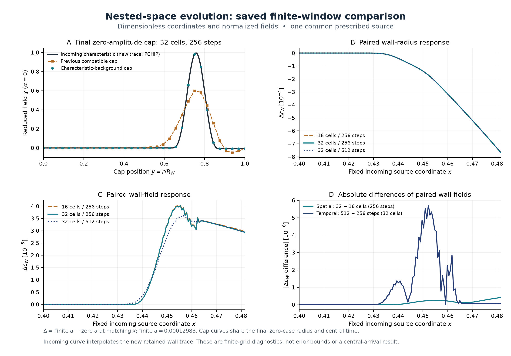

*Figure 38. Saved finite-window comparisons. A: the previous and current
zero-case cap primitives, with an independent incoming characteristic
pullback from the new wall trace. B and C: finite-minus-zero wall radius
and scalar histories. D: absolute spatial and temporal changes of the
paired scalar response. The comparisons neither bound the continuum error
nor extend to central arrival.*

Define each response as the finite-minus-zero history at the same source
label. In the table, spatial differences compare 16/32 cells at 256 steps;
temporal differences compare 256/512 steps at 32 cells. Endpoint values use
the 32-cell, 512-step pair. Here $L=\log C$, $T$ is the central coordinate
clock, $s$ is Einstein proper wall time and $c$ is the normalized invariant
wall scalar.

| Quantity | Endpoint response | Maximum spatial difference | Maximum temporal difference |
| --- | ---: | ---: | ---: |
| Radius $r$ | $-7.67297\times10^{-4}$ | $1.57484\times10^{-7}$ | $7.56646\times10^{-9}$ |
| Log lapse $L$ | $-6.48536\times10^{-3}$ | $1.92145\times10^{-6}$ | $5.58556\times10^{-8}$ |
| Central clock $T$ | $-1.27928\times10^{-3}$ | $8.00326\times10^{-7}$ | $1.10009\times10^{-8}$ |
| Wall clock $s$ | $-1.19742\times10^{-4}$ | $4.54211\times10^{-8}$ | $6.59243\times10^{-10}$ |
| Wall scalar $c$ | $2.94167\times10^{-5}$ | $4.18041\times10^{-7}$ | $5.71668\times10^{-6}$ |

Geometry and clock spatial differences are below 0.063% of their fine
response peaks, and time differences below 0.001%. The scalar time
difference is instead 15.83% of its fine peak $3.61049\times10^{-5}$.
Its small endpoint time difference, $7.42\times10^{-8}$, therefore does
not characterize the history. The finite outgoing characteristic also
changes by 12.41% of its fine peak under spatial refinement. Frozen
cap radial order-4/8 comparisons change the wall mass coefficient by at
most $3.00\times10^{-8}$ and the lapse by $2.29\times10^{-11}$; this
quadrature sensitivity does not explain the scalar time difference.

Independent exterior constraint maxima $(E_{\bar U},E_x)$ decrease from
$(7.88\times10^{-4},0.01312)$ to
$(5.48\times10^{-4},0.008783)$, but remain nonzero. The source-array
$E_x$ defect remains $0.001303$, and final 32-cell, 256-step wall kinematic defects in
$(r,L,c)$ are approximately $(-0.0003125,0.007739,-0.000119)$.
Constructed scalar flux agreement near roundoff does not remove these
independent derivative defects. Thus the integrated geometric responses
are reproducible within the tested comparisons, while scalar time
resolution, exterior constraints and wall slopes still require correction.

Creation and authentication use 228.9375 process-CPU seconds and
43,551,872 charged points within a shared 600-second, 100-million-point
allowance. The manifest binds 66 inputs and producers. Authentication
reconstructs saved diagnostics without source integration or time
evolution. No continuum error enclosure, converged nonlinear spacetime,
central-arrival waveform, formation mechanism or stability result follows
from this window.

### A.18. Profile-knot phase and a finer temporal comparison

<!-- nsc-claim:atlas-ssprk3-refinement -->

Derivation and calculation: [128/256-step histories](../results/development/nsc-atlas-ssprk3-evolution-v1/ssprk3.json),
[512-step comparison](../results/development/nsc-atlas-ssprk3-refinement-v1/refinement.json),
[source-bound manifest](../results/development/nsc-atlas-ssprk3-refinement-v1/manifest.json)
and [figure record](../docs/figures/nsc-atlas-ssprk3-refinement.manifest.json).
The [time-contribution derivation](../docs/nsc-atlas-finite-amplitude.md#isolating-the-scalar-time-contribution)
retains the background chain, physical wall flux and frame conversion separately.

The same spatial operators and physical inputs now use the three-stage
SSPRK3 method at 128, 256 and 512 steps, always with 32 cells. The last
comparison adds only the missing midpoint data: the original 513 rows
are preserved exactly, and the same source snapshot supplies 512 new
midpoints. Direct reference-gauge quadrature at orders 32 and 64 differs
by at most $1.99\times10^{-13}$ across its values and jets. The source
geometry still uses its inherited Hermite approximation; its residuals
are retained. Neither the physical preparation nor the 65-knot
computational cap profile is refitted.

The latter profile is $C^2$, with possible jumps in its third derivative.
An exact local model explains why the position of a knot inside a step
matters. For a prescribed path with
$B(x)=A(x-x_*)_+^3/6$ and $\theta=(x_*-x_0)/h\in[0,1]$, the
SSPRK3-weighted background-chain defect is

$$
\mathcal R_B=B(x_0+h)-B(x_0)
-\frac{h}{6}\{B'(x_0)+4B'(x_0+h/2)+B'(x_0+h)\}.
$$

$$
\mathcal R_B=\frac{Ah^3}{12}(1-2\theta)\min(\theta,1-\theta)^2.
$$

It vanishes at an endpoint or midpoint and has largest magnitude
$|A|h^3/324$ at phases $1/3$ and $2/3$. For a smooth increasing wall
label $\zeta(x)$ crossing a profile knot, the leading coefficient is
$A=[F_{\mathrm{bg}}''']\zeta_x^3$. This local quadrature identity does
not prescribe the coupled stage trajectory or identify its entire error.
In particular, shifting the crossing phase on refinement can change the
sign and size of a difference without a fixed observed convergence order.

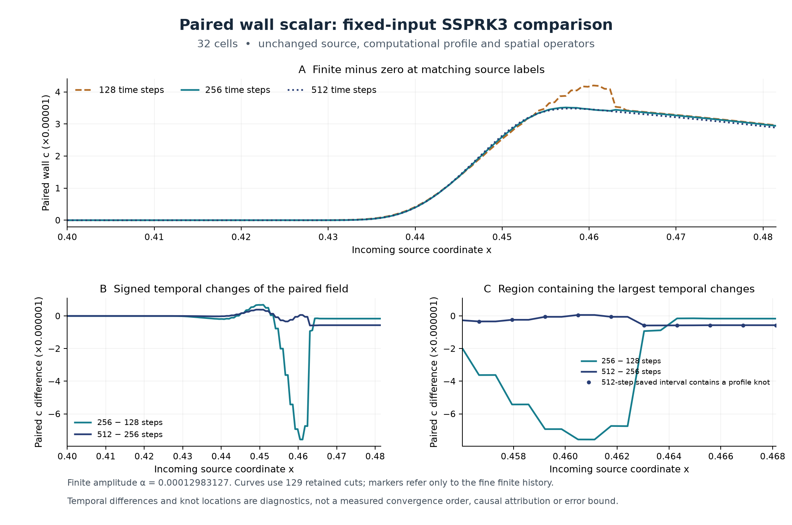

*Figure 39. A: finite-minus-zero wall scalar at 128, 256 and 512 time
steps. B: signed changes between successive histories. C: the region
containing their largest changes; dots mark fine finite-history saved
intervals containing a profile knot. These endpoint brackets do not
reconstruct internal-stage paths or assign causation.*

The paired scalar maximum time difference falls from
$7.57345\times10^{-6}$ for 128/256 steps to $5.84100\times10^{-7}$
for 256/512 steps. The latter occurs at saved cut 99 and is 1.67616%
of the fine peak $3.48476\times10^{-5}$. The difference ratio, 12.966,
is a measured quotient, not a convergence order. The final scalar change
is $-5.66081\times10^{-7}$, so an endpoint alone does not characterize
the history. All entries below use finite minus zero at common labels.

| Quantity | 512-step endpoint response | Maximum 256/512-step difference |
| --- | ---: | ---: |
| Radius $r$ | $-7.67296891\times10^{-4}$ | $6.62412\times10^{-11}$ |
| Log lapse $L$ | $-6.48536218\times10^{-3}$ | $6.54539\times10^{-10}$ |
| Central coordinate clock $T$ | $-1.27927881\times10^{-3}$ | $1.38604\times10^{-10}$ |
| Wall proper clock $s$ | $-1.19741847\times10^{-4}$ | $1.09942\times10^{-11}$ |
| Wall scalar $c$ | $2.88661471\times10^{-5}$ | $5.84100\times10^{-7}$ |

The earlier SSPRK2 extrapolant $(4\Delta c_{512}-\Delta c_{256})/3$
agrees with the new 256-step history within $5.60381\times10^{-8}$,
but with the new 512-step history only within $5.92862\times10^{-7}$.
The closer earlier agreement therefore does not certify the true error.
Independent finite constraint maxima remain approximately
$(5.55\times10^{-4},0.008769)$ for $(E_{\bar U},E_x)$.
The unchanged computational profile's pre-support contribution also remains
a separate representation issue: fine cap-integral leakage is about
$1.66\times10^{-7}$ even though the wall scalar leakage falls to
$1.25\times10^{-9}$. Spatial defects, profile support, central arrival
and a uniform finite-amplitude remainder remain open.

The two new histories and their validation use 174.90625 process-CPU
seconds and 33,604,170 points, within 300 seconds and 50 million points.
Their manifest binds 86 inputs and producers. A separate authentication
uses 1,418,330 points, reconstructs midpoint data and two final stages,
and replays no source integration or trajectory.

### A.19. A common exterior derivative and a mixed accuracy result

<!-- nsc-claim:atlas-operator-comparison -->

Derivation and calculation: [fixed-input spatial comparison](../results/development/nsc-atlas-spatial-refinement-v1/spatial.json),
[same-grid operator comparison](../results/development/nsc-atlas-operator-comparison-v1/operator.json)
and [source-bound manifest](../results/development/nsc-atlas-operator-comparison-v1/manifest.json).
The [common-derivative construction](../docs/nsc-atlas-finite-amplitude.md#a-common-second-order-departure-derivative)
specifies the discrete change and its limited consistency and stability controls.

The preceding 32/64-cell comparison at 512 SSPRK3 steps changes the paired
wall scalar by at most $2.69431\times10^{-7}$, or 0.775% of the fine
peak. This does not resolve the whole field: adjacent-summed cap integrals
still differ by about 7% of the corresponding old 32-cell paired peak,
and their physical radial cells move differently. The successor holds
64 cells, 512 steps, both amplitudes, source data, reference gauge and
computational cap profile fixed. It replaces the first-order exterior
departure derivative with a quadratic stencil. One derivative supplies
both the radial first jets and transport on the moving coordinate grid.
No boundary derivative is replaced by a value demanded by the wall law.

The independent constraints use saved field differences and analytic vacuum
jets, rather than the evolution stencil. Write
$E_a=r_{aa}-L_a r_a+r\Psi_a^2/2$ for $a=\bar U,x$.
The outgoing diagnostic retains the actual source curvature through
$\mathcal R_x=E_x-r_{\mathrm{src}}E_{x,\mathrm{src}}/r$.
All entries below concern the finite-amplitude history on the same 8,001
interior diagnostic points.

| Diagnostic | First-order derivative | Quadratic derivative |
| --- | ---: | ---: |
| Maximum absolute $E_{\bar U}$ | $3.53518\times10^{-4}$ | $3.64417\times10^{-4}$ |
| Root-mean-square $E_{\bar U}$ | $6.20959\times10^{-5}$ | $2.24521\times10^{-5}$ |
| Maximum absolute $\mathcal R_x$ | $4.93833\times10^{-3}$ | $3.21118\times10^{-3}$ |
| Root-mean-square $\mathcal R_x$ | $1.14164\times10^{-3}$ | $2.98901\times10^{-4}$ |

At the final wall event, the kinematic mismatches in $(r,L,c)$ change from
$(-1.54418\times10^{-4},3.75664\times10^{-3},-6.02063\times10^{-5})$
to $(4.70092\times10^{-6},-1.74363\times10^{-4},2.84633\times10^{-6})$.
The maximum method change in the paired wall scalar is
$1.81989\times10^{-7}$, or 0.524% of its new peak
$3.47257\times10^{-5}$. Paired geometry and clock changes are each
below 0.018% of their respective new peaks. These are sensitivities to
the chosen derivative, not bounds on the continuum solution.

The improved average residual and wall slopes do not settle wall curvature.
Independent backward-stencil estimates of the wall
$E_{\bar U}$ peak increase from $4.87\times10^{-4}$ and
$4.49\times10^{-4}$ to $6.67\times10^{-4}$ and
$7.73\times10^{-4}$ at native width. The first estimate uses three nodes
for first derivatives and four for second derivatives; the other uses
five for both. Their maxima of the native-minus-double-width
differences are $3.58\times10^{-4}$ and $6.06\times10^{-4}$.
The source Hermite curvature remains a one-sided trace at saved knots;
its nonzero constraint is retained, not replaced by the source ODE target.
The cap's characteristic-pullback discrepancy remains comparable to its
interpolation sensitivity, and pre-support cap-integral leakage remains
about $3.34\times10^{-7}$. The wall responses are comparatively stable
under this method change, while local derivative accuracy remains unresolved.
Neither a junction failure nor a converged coupled spacetime follows.
Central arrival and a uniform finite-amplitude remainder remain open.

The two new histories and authentication use 256.25 process-CPU seconds
and 55,398,966 charged points within 450 seconds and 80 million points.
The manifest binds 104 files. Separate authentication uses 4,040,624 points
and reconstructs saved fields, diagnostics and two final stages without
source integration or trajectory replay.

### A.20. A finite-amplitude onset solution

<!-- nsc-claim:atlas-finite-onset-existence -->

Derivation and calculation: [exact reference gauge](../results/summaries/nsc-atlas-reference-gauge-bound-v1.json),
[quiet initial anchor](../results/summaries/nsc-atlas-reference-initial-bound-v1.json),
[actual source bounds](../results/summaries/nsc-atlas-source-forcing-bound-v1.json),
and [conditional tube receipt](../results/summaries/nsc-atlas-coupled-tube-bound-v1.json).
The [complete construction and continuation argument](../docs/nsc-atlas-finite-amplitude.md#finite-cell-continuation-assembly)
supplies the mathematical connection between those inputs and existence.

**Finite-cell result.** With the same action, signed material-wall laws,
original compact C3 source and exact quiet initial data, the cap, wall and
exterior admit a compatible regional solution on

$$
x_L=\frac{475452113650795}{1125899906842624},\qquad
x_R=\frac{3809352257986645}{9007199254740992},
$$

$$
0\leq\alpha\leq
\frac{4789928473501569}{36893488147419103232}
\simeq 1.2983\times10^{-4}.
$$

Here $x$ is the fixed affine source label. The cell is approximately
$[0.4222863,0.4229231]$; it is not the complete earlier
wall-radius window. Native fields are C3, native radius is C4, and the
polar cap metric is C2. The centre remains a regular quiet de Sitter core.
Local uniqueness holds in the stated regular class and fixed gauges.

The construction first integrates the outgoing mixed equations, then solves
the existing wall ODE, transports incoming jets from their actual entry,
and reconstructs each field from the same frozen forcing. This preserves
field primitives and common wall values at every iteration. Exponential
weights control the long exterior prefix; a cap strip based on its
spacelike initial data has short characteristic lengths. Weighted
derivative bounds and moving-entry estimates give a local contraction.
The resulting wall laws and exact initial/source data propagate both
incoming Einstein constraints.

Two ordered Volterra/transport derivative pairs give C2 first jets from
the actual C3 source. Their finite bounds and continuity moduli remain
uniform on the declared interval. The physical cap clock is constructed
from the normalized radius-gradient flow. Its Jacobian stays nonzero;
the transformed lapse is fixed by that flow and the quiet central clock.
Restart slices keep their actual curved shape in the original null
coordinates. Separate estimates for old radii and radii newly enclosed
by the wall keep these slices inside the constructed domains.

On every initial subinterval, the same interval majorants improve all
ten assumed departure bounds strictly; their largest ratio is below 0.516.
The positive travel gap keeps the core quiet. A first exit through the
field bounds, regularity, coordinates or quiet overlap is therefore
excluded, and the positive source-label rate carries the solution to $x_R$.

For the bounds below, $f=\Psi/\sqrt{\alpha}$ denotes the normalized canonical
scalar, with its continuous normalized limit at $\alpha=0$. The reduced
canonical fields are $X=rf$ outside and $\chi=rf$ in the polar cap; these
differ from the invariant reduced field $c=r\sinh(af)/a$ used in the native
construction, where $a$ is the nonnegative root of $6a^2=\alpha$.
In the cap, $z=\operatorname{atanh}r$,
$\beta=Ae^\delta/(1-r^2)$ and $E^\pm=\chi_T/\beta\pm\chi_z$.
The quantities $J_r,J_L,J_X$ are integrated transverse-jet departures.
All departures use the exact vacuum reference and the same fixed exterior
wall and source labels. The resulting dimensionless bounds include:

| Quantity | Strict upper bound |
| --- | ---: |
| Integrated radius-jet departure $J_r$ | $5.662\times10^{-9}$ |
| Integrated log-lapse-jet departure $J_L$ | $7.183\times10^{-8}$ |
| Integrated canonical-field-jet departure $J_X$ | $1.474\times10^{-10}$ |
| Absolute wall-to-central-clock departure $\Delta T$ | $7.061\times10^{-9}$ |
| Absolute incoming cap field $E^+$ | $0.002061$ |
| Absolute outgoing cap field $E^-$ | $3.639\times10^{-19}$ |
| Absolute cap reduced field $\chi$ | $3.129\times10^{-6}$ |
| Absolute exterior radius-jet departure $\Delta r_U$ | $1.451\times10^{-6}$ |
| Absolute exterior log-lapse-jet departure $\Delta L_U$ | $4.224\times10^{-5}$ |
| Absolute exterior canonical-field jet $X_U$ | $2.098\times10^{-9}$ |

The exact interval endpoints are retained in the receipt. That immutable
record reports a conditional bound, not existence by itself; the separate
construction and continuation argument supplies existence. Symbolic
controls check the field primitives, wall tangents, differentiated equations
and coordinate identities. No new physical trajectory is used in this proof.
These bounds do not certify the saved numerical histories, a perturbative
remainder, central arrival, formation or observational agreement.

### A.21. Amplitude dependence on the onset cell

<!-- nsc-claim:atlas-onset-parameter-response -->

Derivation and calculation: [source and comparison-chart regularity](../docs/nsc-atlas-finite-amplitude.md#source-data-and-regularity-in-the-fixed-comparison-charts),
[coupled linear inverse](../docs/nsc-atlas-finite-amplitude.md#coupled-linear-inverse-on-the-complete-comparison-domain),
[first quotient with one coordinate derivative](../docs/nsc-atlas-finite-amplitude.md#convergence-of-the-first-quotients-with-one-coordinate-derivative),
and [second quotient and Taylor estimate](../docs/nsc-atlas-finite-amplitude.md#second-amplitude-derivative-and-quadratic-onset-remainder).
The [source-bound record](../results/summaries/nsc-atlas-source-forcing-bound-v1.json)
and [conditional tube record](../results/summaries/nsc-atlas-coupled-tube-bound-v1.json)
retain the numerical input bounds; the linked derivation supplies the
parameter theorem. Neither record evaluates its Taylor constant.

**Amplitude result.** On exactly the source cell and coupling interval of
Section A.20, the normalized solution has a continuous first amplitude
derivative into C1 comparison jets and a continuous second amplitude
derivative into C0 comparison jets. At the interval endpoints, derivatives
are one-sided. The wall radius and anchored central clock are included.

The comparison uses the original source label $x$. The exterior has the
fixed interval $0\leq\bar U\leq W(x)$; the complete cap uses
$r=r_c+\eta(R(x,\alpha)-r_c)$, $0\leq\eta\leq1$, with a fixed radius $r_c$
in the quiet core. This keeps all radii enclosed by the wall, including
those already present at the initial event. Each solution retains its
own clock $T(x,\alpha)$ and the actual coordinate Jacobians. In particular,
$T$ labels the wall's polar slice by the anchored central proper clock;
it is not the arrival time of a later signal at the centre.

Let $\mathcal U(\alpha)$ collect the normalized comparison state and write
$\mathcal U_1=\partial_\alpha\mathcal U$ and
$\mathcal U_2=\partial_\alpha^2\mathcal U$. Exact finite differences first
give Lipschitz dependence into C0. Uniform spatial C2 bounds and continuity
moduli then give continuity into C2 by second differences. The first
parameter quotients converge into C1 in the order outgoing exterior
derivative, cap gradients, incoming exterior derivative. The cap's radial
constraints express the radial derivatives of its propagation coefficients
without extra field-gradient unknowns. Actual inherited initial data and
the wall corner identity are retained at each restart.

For a cap transport equation
$(\partial_x-\sigma\partial_\eta)w=\mathcal R$, its second variation has
the same coupled linear operator as the first. Put
$v_1=(\mathcal U_1,1)$, including variation of the explicit parameter.
The known second-order forcing is

$$
2D\sigma[v_1]\,\partial_\eta w_1
+D^2\sigma[v_1,v_1]\,\partial_\eta w
+D^2\mathcal R[v_1,v_1].
$$

The factor two comes from varying the transport speed and the field
gradient separately. Convergence of the first quotients in C1 controls
this forcing in C0. The bounded coupled inverse and a finite sequence of
compatible time slabs give convergence of the actual second quotients,
not just a formal differentiated equation. The exterior, radial mass,
lapse, wall and clock equations participate in the same limit. No fourth
source derivative is used, and no C1-valued second derivative of all jets
is asserted.

For a specified normalized state component, wall radius or anchored clock
$O$, define the output-specific finite constant

$$
M_{2,O}=\sup_{0\leq\alpha\leq\alpha_{\max}}
\|\partial_\alpha^2 O(\alpha)\|_{C^0}.
$$

Twice integrating in amplitude gives

$$
\boxed{\|O(\alpha)-O(0)-\alpha O_1(0)\|_{C^0}
\leq \frac{1}{2} M_{2,O}\alpha^2.}
$$

This is an analytic quadratic remainder on the onset domain. The general
state constant is finite; Section A.22 supplies explicit remainder bounds
for selected geometric outputs by a positive comparison. It also identifies
their first coefficients by matching the source, gauge and quiet initial
data. Errors in the older numerical histories require their own bounds.
The normalized fields have the stated amplitude derivatives. The physical
scalar $\Psi=\sqrt{\alpha}f$ is not asserted to be twice differentiable in
$\alpha$ at zero. The quiet core, original source and coupling interval are
unchanged. Continuation through central arrival and an error bound for the
observer waveform remain separate steps.

### A.22. Uniform geometric remainders and signed endpoint response

<!-- nsc-claim:atlas-onset-geometric-signs -->

Derivation and calculation: [first geometric coefficients](../results/summaries/nsc-atlas-onset-geometry-bound-v1.json),
[geometric](../results/summaries/nsc-atlas-geometric-departure-bound-v1.json),
[canonical scalar](../results/summaries/nsc-atlas-scalar-departure-bound-v1.json)
and [normalized cap](../results/summaries/nsc-atlas-cap-departure-bound-v1.json)
first-difference bounds, [quadratic source remainders](../results/summaries/nsc-atlas-source-remainder-bound-v1.json),
[complete geometric remainder](../results/summaries/nsc-atlas-geometric-remainder-bound-v2.json),
and [Jordan material-radius conversion](../results/summaries/nsc-atlas-jordan-radius-bound-v1.json).
The [comparison and frame derivation](../docs/nsc-atlas-finite-amplitude.md#uniform-quadratic-geometric-comparison-on-the-original-onset)
connects these compact certificates.

Keep exactly the source cell, action, quiet data and coupling interval of
Section A.20. All quantities here are dimensionless. The outputs are the
Einstein areal radius $R_E$, the material Jordan areal radius $R_J$, and
the wall's centre-anchored polar-slice label $T_W$. Their first coefficients
are the actual derivatives of the constructed solution at $\alpha=0$.
They coincide with the continuum source, mass, lapse, wall and clock
functionals after the source-label event shift is included. This
identification does not assign an error bound to a saved numerical history.

**Uniform comparison.** For each retained geometric component $G$, the
calculation supplies an explicit constant $C_G$ such that

$$
\|G(\alpha)-G(0)-\alpha G_1(0)\|_{C^0}
\leq\alpha^2 C_G.
$$

The radius estimate covers the retained exterior, including the wall;
the clock and material-radius estimates cover their wall histories on this
cell. The source supplies four quadratic remainders. Uniform first
differences of the canonical scalar and normalized cap mass and lapse
bound the remaining nonlinear terms. Half second derivatives of the exact
bulk and signed wall maps are enclosed over the full certified state box,
with the radius-kernel cross term and scalar kinetic product retained.

After division by $\alpha^2$, the three coupled geometric bounds obey
$y\leq My+f_2$, with the same positive matrix as the first-difference
comparison. Its weighted norm is below $0.146$, so
$y\leq(I-M)^{-1}f_2$. The remaining outputs follow from its dependent rows.
This uses one rational three-by-three solve and interval algebra, with no
new field evolution or grid scan.

**Material frame and event identification.** With the normalized canonical
field $f=X/R_E$ of Section A.20, the exact conversion is

$$
R_J=R_E\cosh\!\left(\sqrt{\alpha/6}\,f\right),\qquad
\mathcal F=\operatorname{sech}^2\!\left(\sqrt{\alpha/6}\,f\right)>0.
$$

The invariant Jordan trace $c=R_E f\operatorname{sinhc}(\sqrt{\alpha/6}\,f)$
is a different variable at finite amplitude. For a fixed target $\alpha$,
join $(0,R_0,X_0)$ to $(\alpha,R_\alpha,X_\alpha)$ by an affine segment.
Its directions are the actual difference quotients, bounded by the
certified first-difference constants. At the expansion base the frame map
has state partials one and zero, and explicit alpha derivative
$X_0^2/(12R_0)$. Therefore the Einstein radius remainder enters with
coefficient one; the frame half-Hessian adds at most
$1.604501\times10^{-23}$ to $C_{R_E}$. The conformal factor has certified
lower bound $0.9999999999999999$ on the whole comparison.

The first Jordan coefficient at fixed source label is

$$
R_{J,1}|_x=\rho+2a_{\mathrm{ref}}v(v-\beta_+)\eta_{\mathrm{emb}},
\qquad a_{\mathrm{ref}}=4/5.
$$

Here $\rho$ is the Jordan radius coefficient at fixed wall proper time,
$v$ is the reference proper-time radial velocity, and
$\eta_{\mathrm{emb}}$ is the exterior embedding coefficient defined by
$V_W=V_0(1+\alpha\eta_{\mathrm{emb}})+O(\alpha^2)$.
Its interval includes both signs and is retained in the conversion;
$\eta_{\mathrm{emb}}$ is distinct from the cap chart coordinate of Section A.21.

**Endpoint result.** The following are outward-rounded bounds. The last
column gives the shift from the vacuum reference at $x_R$ and
$\alpha=\alpha_{\max}$, divided by $10^{-18}$.

| Output | Upper bound for $C_G$ | Endpoint shift / $10^{-18}$ |
| --- | ---: | --- |
| Einstein wall radius $R_E$ | $6.067430\times10^{-17}$ | $[-2.138954,-1.008091]$ |
| Material wall radius $R_J$ | $6.067431\times10^{-17}$ | $[-1.235768,-0.09856682]$ |
| Anchored wall clock $T_W$ | $1.145597\times10^{-15}$ | $[-2.635641,-1.410894]$ |

For a first-coefficient upper endpoint $U_G<0$, the criterion
$\alpha_{\max}C_G<-U_G$ makes the sign strict at every positive admitted
amplitude. The exact ratio is below $1.038\times10^{-5}$ for the material
radius and $1.369\times10^{-5}$ for the clock. Hence

$$
R_J(\alpha,x_R)-R_J(0,x_R)<0,\qquad
T_W(\alpha,x_R)-T_W(0,x_R)<0
\quad(0<\alpha\leq\alpha_{\max}).
$$

The clock retains the same Einstein-polar slicing and equals physical
Jordan central proper time on the quiet core. Its value assigned to the
wall event is neither wall proper time nor the arrival time of a received
central signal. The reference wall is expanding: these inequalities are
sourced differences at the same input label, not absolute contraction or
an evaporation law. The preparation is still prescribed characteristic
data; no physical emitter, SI scale or observational calibration is selected.

The geometric and material-frame certificates retain exact rational
endpoints, producer commits and input hashes. Seventeen targeted controls,
separate rational audits and independent Grok derivation/code reviews
check the identities, finite boxes, matrix closure, frame conversion and
strict inequalities. The audits authenticate the saved results without
rerunning a field solution. Continuation to central arrival, numerical
trajectory error, preparation selection and observational comparison
retain their separate requirements.

### A.23. The completed full-label numerical trial

<!-- nsc-claim:atlas-fixed-endpoint-trial -->

All three original fixed-grid runs reach the common incoming-label event
$x=0.4815042082576364$, $V=1$, at
$\alpha=0.00012983127142551443$. The observable is the Jordan material-wall
areal radius, measured by intrinsic area or equatorial proper circumference
on that cross-section. The ruler $\ell=10\,\mathrm{km}$ is a declared input;
it is not an inferred astrophysical scale. This event differs from the
fixed wall-proper-time event used by the historical perturbative coefficient.

| Cap/exterior cells | Jordan radius (m) | Actual mass-gap maximum | Wall-flux maximum |
| --- | ---: | ---: | ---: |
| 2/32 | 5492.322036563843 | 0.00232832534 | 2.24045303 |
| 4/64 | 5492.322058752734 | 0.00237798075 | 2.19447899 |
| 8/128 | 5492.322035897825 | 0.00240631809 | 2.14212668 |

The fine value is $5492.322035897825\,\mathrm m$. The full grid spread is
$22.8549$ micrometres; the fine-centred resolution interval is
$[5492.322013042916,5492.322058752734]\,\mathrm m$, with the same spread
as its half-width. Common input error and errors beyond this grid family
are not included. This is not a confidence interval or a continuum error
bound. The successive pair differences, $22.19$ and $22.85$ micrometres,
do not contract. The grids are nonuniform and their time steps change too,
so no convergence order is inferred.

The wall-flux maximum decreases 4.39%, while the actual mass maximum grows
3.35%. Each residual uses its recorded normalization. The matched-mass
maximum rises slightly then falls on the fine grid. These mixed results
keep the finite-amplitude extension of NSC-P001 an **unconverged numerical
estimate**. The earlier onset theorem retains its shorter domain; the full
endpoint solution is not certified. The coarse evolution completed, but
its auxiliary accumulated-transport summary failed and remains unavailable.

The [completed comparison](../results/summaries/nsc-atlas-fixed-endpoint-comparison-v1.json)
and [saved-cut decomposition](../results/summaries/nsc-atlas-fixed-endpoint-gap-diagnostic-v1.json)
bind the original producer, three inputs and all nine common cuts. The fine
cut at $x=0.45094013016102275$ has physical mass residual
$-0.0007620291372472$, split into strong/weak trace contribution
$-0.0005505985471954$ and balance contribution $-0.0002114305900518$.
Their sum agrees to $1.62\times10^{-17}$. The latter is the explicit
background time-projection remainder up to its stored identity defect.
At the endpoint the fine flux is $-0.5466500011$, compared with
$-0.00965372325$ on the coarse grid: a smaller all-stage maximum does not
mean every cut improves. The saved cuts cover only 19.3%, 25.1% and 31.7%
of the actual-mass envelopes. No maximizing state was saved, so this split
does not locate or uniquely explain that unseen peak. The remaining
connection is the represented field's strong/weak and time-projection
coupling to the wall. The radius, local measurement protocol and qualified
range are recorded in [NSC-P001](../docs/prediction-register.md).

The [active-region diagnosis](../results/summaries/nsc-atlas-endpoint-active-resolution-v1.json)
uses the original onset label $q_a$ and history time
$T_h=T+T_{\mathrm{offset}}$. Before central arrival the retained field
is zero for $z<q_a-T_h$. At every active saved cut that front lies in
the final cell on all three levels. The full outer widths are $.80,.73,.66$;
the clipped endpoint widths are $.56458,.52678,.48898$. The active layer
is never bisected. Added inner cells lie below the retained background's
front; this is not a statement about the unarchived evolved departures.
The spaces change inner knots and do not form a halved-h cap refinement.
Their unresolved wall/time projections need not improve monotonically.
The sampled absolute integral of the actual mass residual also grows
5.11%, excluding denser maximum sampling as the sole explanation.
Seven front/partition controls pass; the read-only calculation uses
.015625 CPU seconds with no field evaluation or evolution. The missing
maximum states still prevent unique attribution of those peaks. Check
the active-region wall trace and affine transport before another grid.

The subsequent [direct PDE check](../results/summaries/nsc-atlas-wall-pointwise-rhs-v1.json)
uses a separately archived evolved stage of the same numerical method.
The complete weak bulk loads agree with the direct field equation to
$2.4\times10^{-9}$, while its pointwise density-force defect is $5.09915$.
The [boundary-lift decomposition](../results/summaries/nsc-atlas-wall-boundary-lift-v1.json)
supplies $5.15013$ of that defect, with the remaining projection contribution
$-.0509851$. At the same frozen geometry the three endpoint evaluation
gains grow $72.6963\to79.7052\to87.2537$. Only the coarse evolved load was
archived; the other gains are operator controls, not new evolutions or a
reconstruction of the missing maxima.

This isolates a finite boundary-projection mechanism at an actual evolved
state. The production split coupling remains unresolved. A
[shared-action manufactured control](../results/summaries/nsc-atlas-collar-field-v1.json)
now recovers a represented scalar and its proper-time velocity over the
quiet wall strip, including original GHY and canonical conversion. Its
normalized field/velocity errors are $6.71\times10^{-12}$ and
$7.11\times10^{-11}$; energy plus metric/input work closes to
$1.75\times10^{-15}$. Its prescribed quiet geometry and manufactured
forcing do not repair or certify the finite-amplitude P001 evolution.

### A.24. A separate finite model with geometric feedback

<!-- nsc-claim:finite-transfer-memory -->

Derivation and calculation: [focused companion snapshot](finite-regeneration/evidence/snapshot.json),
[finite episode](../results/development/nsc-spherical-conformal-episode-v2.json),
[local response](../results/development/nsc-conformal-local-response-v2.json),
and [memory controls](../results/development/nsc-conformal-memory-control-v1.json).

The finite companion supplies another part of the programme: fields
transfer between selected regions while the same declared action evolves
the geometry. It uses a periodic radial chart, positive chart variables
and antiperiodic spinors. In the present signature convention its metric is

$$
ds^2=r^2[-L^2dt^2+Q^2(dx+\beta\,dt)^2+d\Omega^2].
$$

The physical lapse is $rL$ and radial scale is $rQ$.
Conformal gauge has $L=Q$, $\beta=0$; the reduced field Hamiltonian
is $H=\sigma_2P+\kappa Q\sigma_1$.
Here $\kappa=1$ labels the retained angular block and is independent of
the wall-tension parameter used in the atlas.
Six prepared Gaussian fermion columns determine

$$
C=\Phi\,\mathrm{diag}(0.75,0.75,0.5,0.5,0.25,0.25)\Phi^\dagger,
\qquad \Phi^\dagger\Phi=I_6.
$$

This is a finite admissible state with $0\leq C\leq I$ and
$\mathrm{Tr}\,C=3$. Unoccupied retained bands are part of the
preparation, not a derived physical vacuum. The action coefficients,
magnetic sector, clock and cutoff are recorded inputs.

Four matched discretizations, using 256/512 field modes and time steps
0.001/0.0005, reach coordinate $T=0.3$ without resetting the state.
The reported transfer and curvature comparisons have sub-percent refinement
indicators in their stated observables. The finite evolution supplies a
same-action example, not a continuum error theorem, an eternal engine or
the creation of new universes. Collars of this periodic geometry are
regions of one evolving model.

Its local reduction keeps the original first two mode columns and eliminates
their Hilbert-space complement. That complement includes modes with support
inside and outside the spatial observation window. Consequently it is not
the parent end of Section 10, and its Hamiltonian cannot be transferred to
the wall model without a field-theoretic identification.

### A.25. Memory is a consequence of elimination, not an added reservoir

For a time-dependent Hermitian block Hamiltonian with retained block $A(t)$,
coupling $B(t)$ and complementary block $D(t)$, let $U_E(t,s)$
propagate $D$. Eliminating the complementary amplitude gives

$$
y(t)=U_E(t,t_*)y_*-
i\int_{t_*}^{t}U_E(t,s)B^\dagger(s)x(s)\,ds,
$$

$$
\dot x(t)=-iA(t)x(t)-iB(t)U_E(t,t_*)y_*-
\int_{t_*}^{t}K(t,s)x(s)\,ds,
$$

$$
K(t,s)=B(t)U_E(t,s)B^\dagger(s).
$$

The memory kernel, actual initial complementary drive and initial cross
correlations all matter. If $R_A,R_E$ denote the corresponding solution
maps, the retained covariance is

$$
C_A=R_A C_{AA}R_A^\dagger+R_E C_{EE}R_E^\dagger+
R_A C_{AE}R_E^\dagger+R_E C_{EA}R_A^\dagger.
$$

The companion uses the actual evolved state at $t_*=0.2$, then compares
the reduced and full histories through $t=0.3$. The selected occupations
change from approximately $(0.10557448,0.10557464)$ to
$(0.03214496,0.03226900)$. The maximum reduced/full occupation
discrepancy is $6.35\times10^{-6}$, compared with a physical-model
change of about $0.07343$.

| Conditional omission control | Maximum occupation effect | Its separate numerical reference discrepancy |
| --- | --- | --- |
| Omit the memory term | 0.0168185 | $2.20\times10^{-6}$ |
| Omit the actual initial complementary drive | 0.0485412 | $1.66\times10^{-5}$ |
| Omit initial cross correlations | 0.0920614 | $1.23\times10^{-5}$ |

These controls hold the generated geometry fixed. They are not separately
coupled physical evolutions; in particular, deleting the memory term is a
diagnostic alteration, not a new Hermitian theory. They demonstrate why an
interior description must retain the appropriate history and state
information. The next bridge to the atlas would derive such a regional
Hamiltonian and state from a particular matched spacetime and field, rather
than labeling these finite modes as universes.

### A.26. The retained local incoming gate

<!-- nsc-claim:local-source-insertion-majorant -->

Derivation and calculation: [majorant v7 record](../results/development/nsc-ks-source-operator-majorant-v7.json)
and [gate budget v5 record](../results/development/nsc-ks-gate-budget-v5.json).

The [local incoming source-insertion majorant v7](../docs/nsc-ks-source-operator-majorant-v7.md)
is a separate controlled application. For the fixed switched state law
$C_\Sigma[g]=U_gC_{\mathrm{up}}U_g^\dagger$ on $I=S(1)+[.12,.18]$,
family $(14,1)$ covers **1168/1168 signed rows**, with original weights
counted once and no remaining row keys. Its continuous insertion bounds are

$$
\epsilon_N\leq
3646674054457366029024452496769420151764188105426118876609\,2^{-229}.
$$

$$
\epsilon_\beta\leq
5793343250846686183515013928067141454707331929528967339969\,2^{-230}.
$$

These are approximately $4.226958072607968\times10^{-12}$ and
$3.357610065481873\times10^{-12}$ for this family's source-error
insertion. The physical local gate remains **OPEN**:
`physical_upstream_budget_component` is null. Source quadrature,
numerical field error, value-assembly arithmetic and every other source
family are excluded from these bounds. Complete row coverage in this
family does not supply those missing errors.

The [v5 gate budget](../docs/nsc-ks-gate-budget-v5.md) names nine distinct
components, with total error allocation $2\times10^{-11}$ and residual
reserve $10^{-11}$ against the physical tolerance $3\times10^{-11}$.
Its applicable component bounds remain null; 60 positive and 120 signed
families are declared requirements rather than authenticated coverage.
The gate is neither an existence nor a non-existence certificate and
does not determine $\Lambda_{\mathrm{eff}}$. Its paused campaign does not
invalidate the finite inheritance theorem or the scalar-chain results.
Retired supporting records are cited at
[Zenodo](https://doi.org/10.5281/zenodo.23090015).

## Appendix B. Evidence, attribution and reproducible mathematics

This living manuscript draws from source-bound atlas records without changing
their historical bytes. Record residuals and refinement comparisons are
reported at their declared scope; floating-point quadrature agreement is
not a rigorous error bound. The overview producer reads existing records
and renders their relationships without launching a new physics calculation.

| Result family | Owning derivation and preserved evidence |
| --- | --- |
| Finite inheritance and nested reduction | [Proof](../docs/nsc-nested-qualities.md); [snapshot](nested-quality-evidence/snapshot.json) |
| Two-hole parent and radiation attachment screen | [Atlas v2](../docs/nsc-cosmological-atlas.md); [manifest](../results/development/nsc-cosmological-atlas-v2/manifest.json) |
| Signed moving wall and gluing literature | [Atlas v3](../docs/nsc-cosmological-atlas.md); [manifest](../results/development/nsc-cosmological-atlas-v3/manifest.json) |
| Sourced slice and vacuum observer domain | [Atlas v4](../docs/nsc-atlas-connection-slice.md); [manifest](../results/development/nsc-cosmological-atlas-v4/manifest.json) |
| Unequal sourced bodies and finite grandchild composition | [End assembly](../docs/nsc-atlas-connection-gluing.md); [unequal bodies](../results/summaries/nsc-atlas-unequal-children-v1.json) and [two-level geometry/observer](../results/summaries/nsc-atlas-nested-slice-v1.json) |
| Fixed-state physical resolution | [Canonical split and vacuum-volume comparison](../docs/schur-memory.md#physical-resolution-of-one-fixed-geometry); [finite record](../results/summaries/nsc-conformal-resolution-v1.json) |
| Full-label three-grid trial | [Observable and status](../docs/prediction-register.md); [comparison](../results/summaries/nsc-atlas-fixed-endpoint-comparison-v1.json) and [saved-cut split](../results/summaries/nsc-atlas-fixed-endpoint-gap-diagnostic-v1.json) |
| Independent mass/lapse diagnosis on the older saved stage | [Full equations and scope](../docs/nsc-atlas-finite-amplitude.md); [independent saved-stage check](../results/summaries/nsc-atlas-independent-cap-mass-lapse-v1.json), distinct from the unsaved maximum of the later full-label trial |
| Isolated causal completion and clocks | [Atlas v5](../docs/nsc-atlas-causal-classification.md); [manifest](../results/development/nsc-cosmological-atlas-v5/manifest.json) |
| Classical incoming state and scalar transfer | [Atlas v6](../docs/nsc-atlas-field-transfer.md); [manifest](../results/development/nsc-cosmological-atlas-v6/manifest.json) |
| Finite exterior preparation and research dependencies | [Preparation](../docs/nsc-atlas-field-preparation.md); [programme](../docs/nsc-cosmological-atlas.md); [v7 manifest](../results/development/nsc-cosmological-atlas-v7/manifest.json) |
| Evaluated exterior preparation and finite tail | [Response](../docs/nsc-atlas-prepared-response.md); [v8 manifest](../results/development/nsc-cosmological-atlas-v8/manifest.json) |
| Fixed-model source inverse and preparation exclusions | [Proof](../docs/nsc-atlas-observer-inference.md); [record](../results/development/nsc-atlas-observer-inference-v1/inference.json) |
| Conformal probe surface stress and tangential flux | [Derivation](../docs/nsc-atlas-scalar-wall-consistency.md); [record](../results/development/nsc-atlas-scalar-wall-consistency-v1/consistency.json) |
| Characteristic gravitational initialization | [Constraint and frame check](../docs/nsc-atlas-characteristic-initialization.md); [record](../results/development/nsc-atlas-characteristic-initialization-v1/initialization.json) |
| Geometric mass on the prepared null surface | [Mixed geometry and stress checks](../docs/nsc-atlas-source-mass.md); [record](../results/development/nsc-atlas-source-mass-v1/mass.json) |
| Conformal scalar normal-force compatibility | [Projection and force sign](../docs/nsc-atlas-scalar-normal-force.md); [record](../results/development/nsc-atlas-scalar-normal-force-v1/normal-force.json) |
| Exterior wall-mass functional | [Both fluxes and full frame conversion](../docs/nsc-atlas-wall-mass-closure.md); [record](../results/development/nsc-atlas-wall-mass-closure-v1/wall-mass.json) |
| Cap mass and wall displacement functional | [Vacuum subtraction and junction closure](../docs/nsc-atlas-cap-wall-response.md); [record](../results/development/nsc-atlas-cap-wall-response-v1/cap-wall.json) |
| Smooth exterior metric response | [Characteristic evolution and radial checks](../docs/nsc-atlas-bulk-response.md); [metric](../results/development/nsc-atlas-bulk-response-v1/metric/response.json), [field](../results/development/nsc-atlas-bulk-response-v1/field/response.json) and [derivative](../results/development/nsc-atlas-bulk-response-v1/derivative/response.json) comparisons |
| Moving wall and exterior clock | [Mass paths, displacement and clock](../docs/nsc-atlas-wall-evolution.md); [field](../results/development/nsc-atlas-wall-evolution-v1/field/response.json), [radial](../results/development/nsc-atlas-wall-evolution-v1/radial/response.json) and [clock-time](../results/development/nsc-atlas-wall-evolution-v1/time/response.json) comparisons |
| Smooth cap and central null clock | [Regular centre, metric and arrival map](../docs/nsc-atlas-cap-response.md); [field](../results/development/nsc-atlas-cap-response-v1/field/response.json), [radial](../results/development/nsc-atlas-cap-response-v1/radial/response.json) and [further ray](../results/development/nsc-atlas-cap-response-v1/ray_fine/response.json) comparisons |
| Exterior cubic scalar correction | [Conservative evolution](../docs/nsc-atlas-scalar-evolution.md); [clock lift](../results/development/nsc-atlas-lift-clock-v1/clock.json), [forcing cache](../results/development/nsc-atlas-forcing-cache-v1/cache.json) and [propagated response](../results/development/nsc-atlas-scalar-evolution-v1/evolution.json) |
| Central cubic scalar correction | [Reflected transport and clock pullback](../docs/nsc-atlas-central-scalar-response.md); [radial comparison](../results/development/nsc-atlas-central-scalar-v1/central.json) and [incoming-ray comparison](../results/development/nsc-atlas-central-ray-v1/ray.json) |
| Nonlinear coupled pre-arrival window | [Exact model and characteristic background](../docs/nsc-atlas-finite-amplitude.md); [six-case result](../results/development/nsc-atlas-background-evolution-v1/background.json) and [manifest](../results/development/nsc-atlas-background-evolution-v1/manifest.json); scalar time sensitivity and pointwise constraints remain unresolved |
| Fixed-input SSPRK3 temporal refinement | [Profile-knot and chain identities](../docs/nsc-atlas-finite-amplitude.md); [128/256 histories](../results/development/nsc-atlas-ssprk3-evolution-v1/ssprk3.json), [512 comparison](../results/development/nsc-atlas-ssprk3-refinement-v1/refinement.json) and [manifest](../results/development/nsc-atlas-ssprk3-refinement-v1/manifest.json); finite temporal differences, without an error enclosure |
| Same-grid exterior derivative comparison | [Common derivative and independent diagnostics](../docs/nsc-atlas-finite-amplitude.md#a-common-second-order-departure-derivative); [64-cell baseline](../results/development/nsc-atlas-spatial-refinement-v1/spatial.json), [operator comparison](../results/development/nsc-atlas-operator-comparison-v1/operator.json) and [manifest](../results/development/nsc-atlas-operator-comparison-v1/manifest.json); smaller average residuals and wall kinematic mismatch, with unresolved constraint maxima and wall curvature |
| Finite-amplitude onset solution and parameter dependence | [Construction and continuation](../docs/nsc-atlas-finite-amplitude.md#finite-cell-continuation-assembly), [parameter theorem](../docs/nsc-atlas-finite-amplitude.md#second-amplitude-derivative-and-quadratic-onset-remainder); [original source bound](../results/summaries/nsc-atlas-source-forcing-bound-v1.json) and [strict tube](../results/summaries/nsc-atlas-coupled-tube-bound-v1.json) |
| Uniform geometric remainder and material-radius sign | [Full comparison](../docs/nsc-atlas-finite-amplitude.md#certified-finite-amplitude-endpoint-signs), [frame and clock interpretation](../docs/nsc-atlas-finite-amplitude.md#certified-jordan-radius-endpoint-comparison); [geometric certificate](../results/summaries/nsc-atlas-geometric-remainder-bound-v2.json) and [material-radius certificate](../results/summaries/nsc-atlas-jordan-radius-bound-v1.json) |
| Finite spherical transfer, feedback and memory | [Companion](finite-regeneration/main.tex); [frozen build/evidence](finite-regeneration-manifest.json) |
| Foundation boundary, spectral and source constructions | [Archived v0.26.0](archive/foundation-v0.26.0/paper/nested-space-cosmology.md); [research inventory](../docs/research-inventory.md) |

The archived foundation retains, among other strands, its full-spinor
boundary maps, scalar-link Dirac benchmark, source and work ledgers,
curved spectral constructions and explicitly limited black-universe
benchmarks. Their theory, state and domain remain with their owning notes.
An RN pressure diagnostic is not promoted to mechanical balance, a reached
inner horizon is not promoted to central regularity, and stopped numerical
runs without completed summaries supply no new physical conclusion.
These distinctions preserve useful work without making historical routes
mandatory.

The [arXiv library](../docs/arxiv-studies.md) records paper versions,
reading depth, reusable equations, assumptions and unresolved connections.
It includes the sources for the supplementary multiple-daughter,
multi-mouth, CPT, torsion and regular-interior branches. A bounded search
cannot certify that no one has already closed an apparent gap.
The [paper guide](../docs/papers.md) locates the unchanged atlas working
drafts and the focused companion. Calculations, programming and drafting
for these finite records and for
this synthesis used OpenAI Codex/ChatGPT and xAI Grok. The author's
responsibility includes the interpretations and synthesis here; borrowed
results retain their source attribution and are not presented as new laws.

The following preserved dependency diagram records the original finite field-development programme. Its evidence remains useful within that domain; Part VIII states the current physical closures of the full atlas.

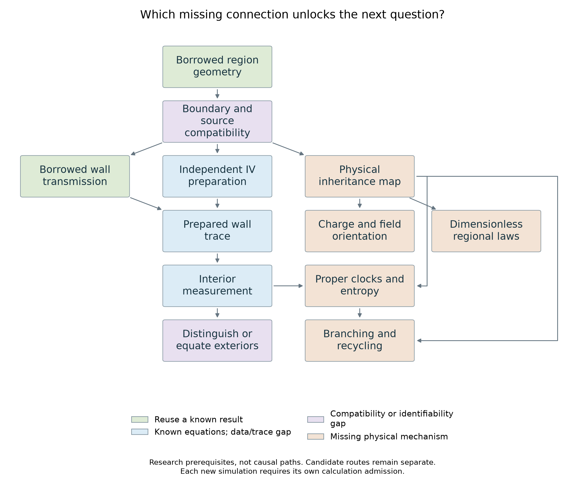

*Figure 40. Research dependencies, distinct from spacetime causal arrows.
The [v8 programme record](../results/development/nsc-cosmological-atlas-v8/programme.json)
names prerequisites, decisions, budgets and stop conditions for eight themes.
Each calculation retains its own domain; arrows do not declare questions solved.*
