# Nested-Space Cosmology

## The Geometry of a Universe

**Douglas Ek**  
Working research manuscript, 22 October 2026

## Abstract

Nested-Space Cosmology develops a mathematical atlas of regions, boundaries,
fields and the world accessible to an interior observer. It combines
attributed geometric constructions with explicit sources, evolution and
observable consequences. Finite and positive infinite operator models
realize an inherited law and retain unresolved surroundings through
Schur reduction. Their physical identification is investigated through
separately specified spacetime and field candidates.

An Einstein/conformal-scalar cap, membrane and exterior provide prepared
field transfer, perturbative gravitational response and a finite-amplitude
onset construction. Longer nonlinear closure remains unresolved. A compact
shared parent demonstrates that changing a global geometric average need
not change a retained observer's signal. Material sphere states support
radially stable horizonless attachments and distinct clock responses in
one dust cosmology. These results have finite domains; their supplied
vacuum scales are not predictions of the observed cosmological constant.

A charged four-form extension relates regional vacuum changes through one
field law and gives a composed finite geometry and a curvature observable.
Adding a declared scalar response now permits a coupled regular
scalar--gravity--membrane preparation. Its physical Dirichlet-to-Neumann
maps reproduce the scalar action by Schur elimination, and its Lorentzian
continuation gives an expanding boundary and an open child cosmology.
For the fixed benchmark, the prepared homogeneous excitation is about
$9.62\times10^{-47}$ in normalized units, far below the earlier assumed
sudden-transfer value $.09375$. The field excitation is concentrated
in the spatial layer. Exact matching and continuation identities accompany
the converged numerical construction; a quantum decay rate is not inferred.

A distinct uniform scalar preparation now admits three sourced regions
on one compact constrained slice. Its third region distinguishes laws
that were equivalent at one interface. A causally protected parent domain
evolves under the same scalar action, supplying a conditional expansion
calculation while the complete two-wall future remains open. A compact
constraint-compatible parent perturbation subsequently develops linear
gravitational density growth. Its transfer is scale and preparation
dependent, giving a joint requirement on vacuum and structure scales.
An operational three-clock relation then eliminates its two free state
amplitudes within the fixed profile family, with independently checked
free-fall and light-propagation effects. A separate controlled frequency
member supplies local gravitational-cooling examples and a mass-selected
coherent core with a sourced initial-atlas embedding; relative phase
with the inherited ambient field changes its geometric mass.

Observer tests remain essential. The exact quiet-cap distance law differs
from a brightness-scale-independent contrast of 596 Pantheon+ light curves
by $-0.1046\pm0.0144$ magnitudes using their published covariance. That
retrospective comparison challenges the quiet limit, while the other
clock and curvature values are conditional calculations. Absolute vacuum
selection, physical preparation producing substantial matter, general
stability and a realistic cosmological and thermal history remain open.
The atlas records both constructive connections and failed identifications
without combining incompatible actions into one claimed theory.

## I. The question and the spherical idea

### 1. A universe viewed from within

An observer measures clocks, fields, curvature and correlations within a
limited domain. Such measurements need not uniquely identify the larger
structure containing that domain. Our question is whether this ambiguity
can become a constructive research programme: assemble possible surroundings,
determine which attachments satisfy their equations, and ask what each permits
an interior observer to experience.

The organizing sequence is **borrow established mathematics, connect compatible
regions, investigate branching and inheritance, calculate local consequences,
then compare with observations**. A universal action tying together all fields
and regions remains an ambitious candidate. It is not a prerequisite for
learning whether a particular boundary can be joined or whether a signal can
reach a particular observer.

A mature atlas would let a reader follow a possible universe from its
surroundings, through its boundaries, into an observer's world and onward
through compatible transitions. It would compare families of histories with
explicit geometry, dynamics and observables. Completion means dependable
coverage of declared model families, including exclusions and observational
degeneracies. Establishing that a family describes our universe is a further
empirical achievement. The present finite connections are steps toward that
destination, not a claim to have reached it.

Read this as an illustrated mathematical atlas. A picture introduces a
geometry; the equations state what it contains and how its regions connect;
a clock, a ray or a spectrum shows what an observer could distinguish.
The route through the book is therefore also a route through other authors'
constructions. Attribution belongs beside the useful equation, with the
assumptions that allow it to enter the map.

Several building blocks guide the new comparison in Sections 10.8--10.17:

| Construction and contributors | What it contributes to the atlas |
| --- | --- |
| Einstein--Straus; matching reviewed by Mars, Mena and Vera | An expanding cosmological parent with exact mass compensation |
| Shiromizu, Maeda and Sasaki; Maartens and Koyama | Equations linking a surrounding bulk to local gravitational sources |
| Garriga and Tanaka | An outside-matter effect with distinct lensing and orbital measurements |
| Mazur and Mottola; Visser and Wiltshire | Material interfaces and stability tools beyond a constant-tension wall |
| Abrikosov; Macpherson and Campbell; Ogure, Yoshida and Arafune | A finite sphere spectrum and localized-fermion material pressure |
| Brown and Teitelboim; Bousso and Polchinski; Hirano | A charged boundary that changes vacuum stress through a common field law |
| Kaloper and Sorbo; Coleman and De Luccia; Dong and Harlow | Scalar response, regular gravitational preparation and an expanding child continuation |
| Morris and Thorne; Easson and Brandenberger | Established throat and black-hole-interior cosmology constructions |

Their primary sources and the actual connections appear with the calculations.
A shared visual motif is an invitation to check compatibility; a joined model
requires compatible actions, sources, orientations and states. The intended
synthesis is a common derivation of expansion, clustering and matter history.
The density fractions and matter--antimatter asymmetry become outputs only
when that common history has been specified and calculated.

The first motif contains two spatially separated black holes in a common
parent, possible unequal children, and one further generation. A separate
motif lets one hole have multiple offspring. These pictures suggest questions;
their arrows do not supply an equation of motion, a formation mechanism or
a communication channel. Figure 1 distinguishes the broad motif from the
specific attachment whose mathematics has been checked.

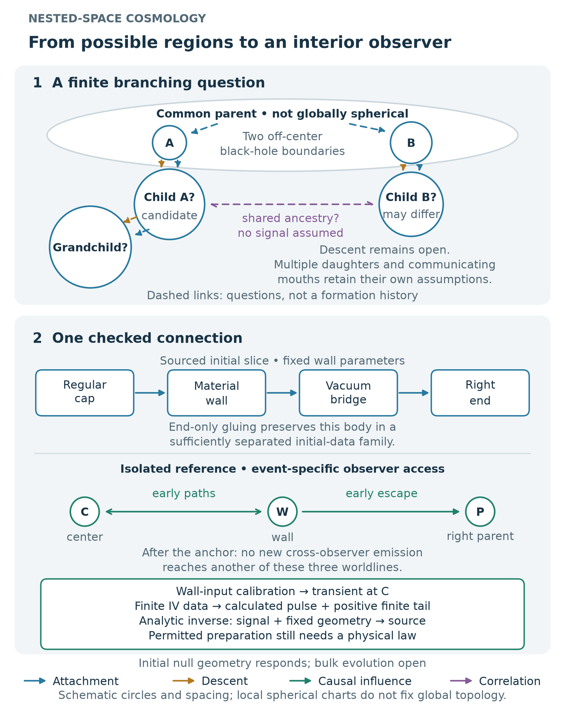

*Figure 1. Possible descent (upper panel) remains hypothetical; the lower
panel shows the checked cap–wall–bridge body and observer/field reference.
Colors distinguish attachment, descent, influence and correlation. Circles
and spacing do not establish an embedding, relative scales or global
spherical topology. The [figure record](figures/geometry-overview.json)
identifies each connection's evidence and status.*

### 2. What spherical geometry means here

There is a useful borrowed energy argument with a precise domain: in Euclidean
space, a ball minimizes boundary area at fixed enclosed volume. A positive
constant isotropic surface tension therefore favors a spherical boundary when
surface energy is the quantity being minimized. Direction-dependent tension
instead selects a Wulff shape; see [Neumayer, 1503.06705v2, Section 1.1](https://arxiv.org/html/1503.06705v2).
This motivates testing rotational symmetry. It does not prove a cosmological
equilibrium, dynamical relaxation or a probability ranking over all geometries.
Gravity, rotation, matter stresses and the actual boundary law must be specified
before importing that variational conclusion into a spacetime model.

A spherical boundary is a two-dimensional surface with area $4\pi R^2$.
A spatial interior may be a three-ball; a closed spatial universe may instead
have three-sphere topology. These are different assertions. Drawing one circle
inside another establishes none of them.

In a locally spherically symmetric spacetime, a useful form is

$$
ds^2=g_{ab}(x)\,dx^a dx^b+R(x)^2d\Omega^2.
$$

Here $g_{ab}$ is a Lorentzian metric on the two-dimensional orbit space and
$R$ is areal radius. We use signature $(-+++)$ for the atlas. Radial
proper distance, areal radius and a diagram's vertical coordinate need not
coincide. In particular, a radial profile is not automatically a surface
that can be embedded in Euclidean three-space.

The physical spherical hypothesis is that useful cosmological regions or
interfaces may admit this structure, exactly or as a controlled approximation.
It is not a theorem inferred from statistical isotropy of observations.
Several off-center holes generally break global spherical symmetry.
We therefore use local spherical charts where justified and an explicitly
nonspherical parent where required. Deviations from symmetry are a question
for each model, rather than a reason to discard the organizing idea.

### 3. One thread through three bodies of work

The continuing question is: **how do a region's fields, boundary and
surroundings shape its state, geometry and measurements?**

| Body of work | What it contributes | Connection still missing |
| --- | --- | --- |
| [Preserved foundation](archive/foundation-v0.26.0/paper/nested-space-cosmology.md) | Spectral inheritance proposal, boundary operators, source and response constructions | A physical inheritance law and common cosmological source completion |
| [Finite spherical companion](finite-regeneration/main.tex) | A finite realization of regional transfer, geometric feedback and memory with declared action and state | Identification with an actual assembled parent–child spacetime |
| [Atlas evidence](../docs/nsc-cosmological-atlas.md) and this living manuscript | Geometric compatibility, a sourced slice, observer access, a calibration response and an evaluated finite exterior preparation | Remote preparation, later evolution, other attachments and observational discrimination |

Their mathematics is complementary. A finite operator's eliminated modes
are not automatically the exterior spacetime beyond a black hole. The atlas
must first identify a field equation, state, clock and matching law before
an operator reduction can acquire that geometric meaning.

The foundation's useful historical calculations remain in their source-bound
edition and owning notes. This manuscript changes the organizing story:
geometry and observer access lead; stronger unifying claims follow only when
their missing connections are supplied. No priority claim is made for junction
conditions, Schur complements, branching processes or the published wall
solutions used below.

## II. Regions, inheritance and the meaning of a connection

### 4. Four arrows that must not be confused

Each region in the atlas carries a geometry, source or state, clock
convention, dimensionless parameters and validity domain. Each connection
states the borrowed mathematics and the additional condition still needed.

| Connection | Mathematical question | What it does not establish by itself |
| --- | --- | --- |
| Descent | Where do a child's initial data originate? | A traversable path |
| Geometric attachment | Which boundaries share admissible metric and source data? | Formation or stability |
| Causal influence | Can an intervention reach an observer within the stated domain? | A nonzero field response without state and coupling |
| Correlation | Which information is shared through state or ancestry? | Communication between siblings |

Two regions may inherit correlated data without ever exchanging a later
signal. An attached interior can lie beyond the causal reach of a specified
parent observer. Conversely, communicating mouths require their own causal
and material assumptions; they cannot be inserted into a disconnected
offspring model as an unlabeled extra arrow.

The multiple-daughter geometry of [Barrabès and Frolov
(hep-th/9511136v1)](https://arxiv.org/html/hep-th/9511136v1), the charged
semiclassical multi-mouth route of [Emparan et al.
(2012.07821v2)](https://arxiv.org/html/2012.07821v2), and quantum-state
coupling distributions discussed by [Giddings and Turiaci
(2004.02900v2)](https://arxiv.org/html/2004.02900v2) remain separate library
entries. A state's coupling distribution is not itself a signal exchanged
between its branches. Their source cards and unresolved connections are
recorded in the [mathematical library](../docs/arxiv-studies.md).

### 5. A precise finite inheritance construction

<!-- nsc-claim:finite-normalized-inheritance -->

Evidence: [exact finite record](../results/development/nsc-nested-qualities-v1.json),
[frozen snapshot](nested-quality-evidence/snapshot.json), and
[proof and domain](../docs/nsc-nested-qualities.md).

The foundation proposes an inherited normalized law,
$\mathcal T_\Theta^*\mathbb D_\Theta=\mathbb D_\Theta$.
One controlled meaning is available without postulating an infinite cosmos.
Fix a Hermitian $d$-dimensional matrix $H$, a nonzero link $B$, a
positive scale ratio $\Omega$, and a finite depth $N$. For regional labels
$j=0,\ldots,N-1$, define a block Hermitian matrix by the following entries
where their indices exist:

$$
(J_{m,N})_{jj}=\Omega^{m+j}H,\qquad
(J_{m,N})_{j,j+1}=\Omega^{m+j}B.
$$

The lower off-diagonal blocks are the adjoints. Let $U_m$ consistently
relabel the equal-sized regional frames. Then

$$
J_{m+1,N}=\Omega U_mJ_{m,N}U_m^\dagger,
$$

$$
\Omega^{-1}U_m^\dagger J_{m+1,N}U_m=J_{m,N}.
$$

Each block acquires the same extra factor, so the identity follows directly.
For fixed depth,

$$
\mathrm{spec}(\Omega^{-m}J_{m,N})=\mathrm{spec}(J_{0,N}).
$$

This is a finite realization of normalized inheritance under chosen scaling
data. It does not derive $\Omega$, establish a physical transition through
a horizon, or show that the universe selects this law. Changing $N$
changes the boundary problem and can change the dressed spectrum.
The finite identity is not a proof of cosmic natural selection.

The shared law also does not fix identical states. A fermionic covariance
$0\leq C\leq I$ evolves as

$$
C(t)=e^{-iJt}C(0)e^{iJt}.
$$

Regional occupations and cross correlations can differ under the same $J$.
Thus “same laws,” “same state,” and “same observed constants” require separate
arguments. A physical transition would have to determine the relevant state
and dimensionless data, rather than obtaining them from the normalization
identity alone.

Douglas's proposed geometric interpretation is that an approximately spherical
region can be the resolved envelope of finer nested structure. Repeated
transitions preserve the inherited law while changes of depth, state and
surroundings compound in the measured response. The next section's nested
reduction provides a finite calculator for that compounding. The following
theorem extends this to an infinite operator and a derived mode-count
scaling relation. Its spacetime geometry, physical scale ratios and
observer resolution remain calculation targets in the
[atlas programme](../docs/nsc-cosmological-atlas.md#working-geometric-hypothesis-inheritance-through-resolution).

### 5.1. An infinite inherited law with a controlled local response

Take a rooted tree with $b\geq2$ children per vertex, an inherited
positive Hermitian $d\times d$ matrix $H$, link $B$, and $\Omega>1$.
At depth $n$, the diagonal block is $\Omega^nH$ and the block to each
child is $\Omega^nB$; reverse links are adjoints. Set

$$
h=\lambda_{\min}(H),\qquad c=\sqrt{b/\Omega}\,\|B\|,\qquad h>2c.
$$

On square-summable regional fields specify the finite-energy form domain

$$
\mathcal Q=\left\{u:\sum_v\Omega^{|v|}\|u_v\|^2<\infty\right\}.
$$

**Theorem.** The corresponding positive closed form defines a self-adjoint
finite-energy realization $D$ with compact inverse. Every isolated child
subtree is $\Omega D$ after relabeling, so normalized inheritance holds
at unlimited depth. Its root response, for $\lambda\geq0$, satisfies

$$
R(\lambda)=\left[H+\lambda I-
\frac{b}{\Omega} B R(\lambda/\Omega)B^\dagger\right]^{-1}.
$$

For $\gamma=(h+\sqrt{h^2-4c^2})/2$ and $r=c^2/\gamma^2<1$, this response
is unique in the positive class
$R(\lambda)\leq(\gamma+\lambda)^{-1}I$. Retaining depths $0,\ldots,N$ gives

$$
0\leq R_N(\lambda)\leq R(\lambda),\qquad
\|R(\lambda)-R_N(\lambda)\|\leq r^{N+1}/\gamma.
$$

If $B$ is invertible, every added generation increases the response
strictly. The eigenvalue-counting exponent is

$$
\lim_{E\to\infty}\frac{\log N_D(E)}{\log E}
=\frac{\log b}{\log\Omega}.
$$

**Proof.** Let $S$ multiply depth-$n$ coordinates by $\Omega^{n/2}$, and
let $C$ have diagonal $H$ and child blocks $\Omega^{-1/2}B$.
Cauchy--Schwarz bounds the child-sum map by $c$, hence
$(h-2c)I\leq C\leq(\|H\|+2c)I$. The form
$q[u]=\langle Su,CSu\rangle$ is closed on $\mathcal Q$, with a norm
equivalent to the complete graph norm of $S$. Its operator has

$$
D^{-1}=S^{-1}C^{-1}S^{-1},\qquad
\operatorname{Dom}(D)=\{u\in\mathcal Q:CSu\in\mathcal Q\}.
$$

The diagonal entries of $S^{-1}$ tend to zero, with finite multiplicity
at each depth, so the inverse is compact. This selects the finite-energy
Friedrichs realization; essential self-adjointness under other possible
conditions at infinity is not assumed.

Relabeling a child multiplies every block and its closed form by
$\Omega$. Its root inverse is therefore
$\Omega^{-1}R(\lambda/\Omega)$. Eliminating the $b$ children yields the
recursion, including all descendant responses. Finite-support fields
are a form core. The variational expression for
$\langle f,(D+\lambda I)^{-1}f\rangle$ is the supremum of
$2\operatorname{Re}\langle f,u\rangle-q[u]-\lambda\|u\|^2$ over that
domain. Successive finite-depth restrictions increase to this supremum,
proving Loewner and norm convergence of the root matrices.

Since $h-c^2/\gamma=\gamma$, every Schur denominator is bounded below
by $(\gamma+\lambda)I$. The inverse identity bounds the outgoing
difference of two responses by $c^2/(\gamma+\lambda)^2$ times their
incoming difference. Its uniform factor $r<1$ proves uniqueness in
the stated class. Iterating $N+1$ times from a zero terminal response
gives the depth error. Inverse order and positive congruence give
monotonicity, strictly when $B$ is invertible.

Finally, the form bounds compare $D$ with positive constant multiples of
$S^2$. The eigenvalue $\Omega^n$ of $S^2$ has multiplicity $db^n$.
Min--max bounds $N_D(E)$ between geometric sums at constant multiples
of $E$, proving the exponent. This completes the proof. The
[full domain argument and calculator](../docs/nsc-infinite-inheritance.md)
give its detailed implementation.

For a second-order spectral interpretation,
$d_s=2\log b/\log\Omega$; a first-order interpretation instead uses the
counting exponent itself. These are spectral dimensions of this operator.
A spacetime or embedding dimension requires its own geometric construction.

For $H=3$, $B=1$, $b=3$, $\Omega=4$, the exact static response is

$$
R(0)=\frac{2}{3+\sqrt{6}},\qquad
D_{\mathrm{eff}}(0)=\frac{3+\sqrt{6}}{2}=2.724744871391589.
$$

Thus the inherited coefficient3 changes by $-0.275255128608411$.
Depths0 through6 give $R_6(0)=0.367006802721088$, with analytic depth
bound $3.94041\times10^{-8}$; the closed-form difference is
$3.54235\times10^{-8}$. Rounding is separate from this bound. The
second-order spectral dimension is $\log3/\log2=1.584962500721156$.
Four small controls compare full finite trees, noncommuting links,
branch/scale factors, the exact scalar root and spectral bounds.
They support the calculator; the infinite result follows from the proof.
A metric-dependent action and physical source identification remain
needed to connect this response to cosmological Lambda.

### 5.2. Physical measure, pressure and a measurable nesting ratio

An inherited canonical operator does not alone specify the physical measure.
For an explicit three-dimensional lift, give each depth-$n$ edge length
$Lq^n$ and section $Aq^{2n}$, with $0<q<1$. Half of each incident edge's
volume supplies the vertex kinetic weight; the root has a fixed parent
port. Direct expansion gives

$$
m_0=\frac{AL}{2}(q^{-3}+b),\quad
H=\frac{A(b+q^{-1})}{Lm_0},\quad
B=-\frac{A}{Lm_0q^{3/2}},\quad\Omega=q^{-2}.
$$

The positive margin is $A(\sqrt{b}-q^{-1/2})^2/(Lm_0)$, so Section5.1
applies for $bq\ne1$. Its physical static root compliance is

$$
\chi_0=\frac{R(0)}{m_0}=\frac{L}{A\max(b,q^{-1})}.
$$

Under a common spatial dilation, $L\mapsto aL$ and $A\mapsto a^2A$.
Thus $M(a)=a^3M_0$, $K(a)=aK_0$, $D(a)=a^{-2}D_0$, and
$\chi(a)=\chi_0/a$. The length-only action instead has $\chi(a)=a\chi_0$;
the same operator scaling can conceal different physical measures. The
owned radial spatial metric $h=r^2(Q^2dx^2+d\Omega^2)$ supplies the volume
scaling directly: $\int r^3Q\phi_i\phi_jdx$ scales as $a^3$ and
$\int(r/Q)\phi'_i\phi'_jdx$ as $a$ at fixed $Q$.

**Pressure proposition.** Declare the kinetic-plus-gradient action

$$
S_\phi=\frac12\int dt\left[
\frac{a^3}{N}\dot\phi^TM_0\dot\phi-Na\phi^TK_0\phi\right].
$$

Let $T_0=\pi^TM_0^{-1}\pi/2$, $G_0=\phi^TK_0\phi/2$ and
$V=a^3V_c$. Its energy at fixed canonical data is
$E=a^{-3}T_0+aG_0$. Lapse and scale variation, or direct Legendre
transformation followed by $p=-\partial E/\partial V$, gives

$$
\rho=\frac{E_{\rm kin}+E_{\rm grad}}{V},\qquad
p=\frac{E_{\rm kin}-E_{\rm grad}/3}{V}.
$$

Both energies are nonnegative. For every nonzero finite-energy state,

$$
\rho+p>0,\qquad \rho+3p=4E_{\rm kin}/V\geq0.
$$

The form domain is preserved by multiplication by these positive scale
factors, so the proof also holds for the infinite hierarchy. Source-free
Hamiltonian evolution gives $\dot\rho+3H(\rho+p)=0$ in homogeneous proper
time. This sector cannot be a nonzero vacuum source. If it alone sources
a flat Einstein cosmology without a supplied volume term, it predicts
$q_{\rm dec}=2E_{\rm kin}/(E_{\rm kin}+E_{\rm grad})\in[0,2]$.
The full atlas's gravitational correlations and nonminimal terms require
their own metric variation; this proposition does not replace them.

**Dynamic root observable.** With zero initial data and a known compact
root force, measure the root field in proper time. Its Laplace response is
$\chi(s)=R(s^2)/m_0$. Differentiating the exact Schur equation at zero gives

$$
Z(s)=\chi(s)^{-1}=\chi_0^{-1}+\mu_*s^2+O(s^4),\qquad
\mu_*=\frac{m_0}{1-r/\Omega}.
$$

Independently, summing the entire static profile's kinetic weight gives
$\mu_*=m_0/(1-q/b)$ for $bq>1$ and $m_0/(1-bq^3)$ for $bq<1$.
Consequently the response scale $\tau_*^2=\chi_0\mu_*$ obeys

$$
\frac{\tau_*^2}{L^2}=\frac{q^{-3}+b}{2(b-q)}\quad(bq>1),
$$

$$
\frac{\tau_*^2}{L^2}=\frac{q^{-2}+bq}{2(1-bq^3)}\quad(bq<1).
$$

For $b=3$, $q=1/2$ and $q=2/5$ give the same static compliance
$L/(3A)$ but different dimensionless dynamic values: $2.2$ and
$3.581730769230769$. The expression is strictly decreasing in $q$ on
the admitted branches, so an independently known $b,L$ and calibrated
force permit a unique nesting-ratio inference. An unknown source or length
would restore degeneracy. The scale $\tau_*$ is a response coefficient,
not a first-arrival time.

The [derivation and independent checks](../docs/nsc-infinite-inheritance.md#a-calibrated-observable-that-distinguishes-the-nested-geometries)
include the profile sum, differentiated Schur recursion, an explicit
$O(s^4)$ Laplace remainder bound and root-work accounting. These are
predictions of the stated geometric action, with no observational
calibration. A compatible cap--wall/parent metric and its gravitational
source remain necessary for a cosmological Lambda prediction.

### 5.3. A response shape that recovers the nesting ratio

<!-- nsc-claim:scale-free-inherited-response -->

For the scalar volume action above, let mu_k denote the kth root spectral
moment and set g=b*abs(B)^2. Direct multiplication on two inherited levels
gives

$$
\mu_1=H,\quad \mu_2=H^2+g,\quad
\mu_3=H^3+gH(2+\Omega).
$$

All moments exist because every finite power of D applied to the root
has finite support. The positive root spectral measure yields

$$
R(\lambda)=\lambda^{-1}-\mu_1\lambda^{-2}
+\mu_2\lambda^{-3}-\mu_3\lambda^{-4}+\epsilon(\lambda),
\qquad 0\leq\epsilon(\lambda)\leq\mu_4\lambda^{-5},
$$
$$
\mu_4=(H^2+g)^2+gH^2(1+\Omega)^2+\Omega^2g^2.
$$

For the wave response, lambda=s^2. Write an unknown constant gain and
uniform clock factor into its measured coefficients beta2, beta4, beta6,
beta8 multiplying s^-2, s^-4, s^-6, s^-8. Then

$$
\Theta=\frac{\beta_2\beta_6}{\beta_4^2},\qquad
\Psi=\frac{\beta_2^2\beta_8}{\beta_4^3},\qquad
\Omega=\frac{\Psi-1}{\Theta-1}-2,\qquad q=\Omega^{-1/2}.
$$

Gain, root kinetic normalization and uniform clock calibration cancel.
At b=3, q=1/2 gives (Theta,Psi)=(49/25,169/25); q=2/5 gives
(617/242,13343/968). The recovered ratios are exactly 1/2 and 2/5, despite
the equal static compliance. At fixed b, Theta alone is strictly
monotone in q; the pair determines q even without a known b.

There is also a held-out consequence. The fifth coefficient beta10 must
obey the parameter-free relation

$$
\Upsilon=\frac{\beta_2^3\beta_{10}}{\beta_4^4}
=\Theta^2+(\Theta-1)(1+\Omega)^2+\Omega^2(\Theta-1)^2.
$$

A positive tree with altered child--grandchild links can retain the first
four response coefficients and violate this fifth one. The relation thus
tests continuation of the inherited law at the next level, using a
quantity not used in the inversion.

This is a conditional inverse of the specified transfer function. An
arbitrary unknown force spectrum does not cancel. Finite noisy data need
their own coefficient errors. The [complete proof and controls](../docs/nsc-infinite-inheritance.md#a-scale-free-inverse-of-the-inherited-geometry)
keep these requirements explicit. This connects the inherited operator
to an observable relationship, with its physical atlas identification
still to be established. The [compact calculation and source hashes](../results/summaries/nsc-compositional-proofs-v1.json)
retain these exact model examples alongside the separately scoped atlas
composition below.

### 6. What an unresolved surrounding region can leave locally

Split a specified operator into retained and complementary blocks $A,D$
with link $B$. For an admissible complex spectral parameter $z$, elimination
gives the usual self-energy

$$
\Sigma(z)=B(zI-D)^{-1}B^\dagger.
$$

The retained resolvent is $[zI-A-\Sigma(z)]^{-1}$.
Nested elimination is associative when the required inverses exist.
For the finite inherited chain its normalized recurrence is

$$
\Gamma_j(x)=xI-H-\Omega^{-1}B
\Gamma_{j+1}(x/\Omega)^{-1}B^\dagger.
$$

The factor $1/\Omega$ is essential. This is borrowed finite linear
algebra applied to the declared family, not an additional force law.
To interpret $\Sigma$ as a cosmological exterior response requires a
physical operator, field state and boundary map. Sections 14–15 give a separate
finite Hilbert-space realization of this reduction, without identifying its
complementary modes with a cosmological exterior.

### 6.1. The local effective Lambda target

<!-- nsc-claim:target-local-effective-lambda -->

The intended cosmological target is a local effective $\Lambda$ arising
from inherited Schur memory: surrounding structure that a region does not
resolve contributes through $\Sigma(z)=B(zI-D)^{-1}B^\dagger$ to its
local response. A vacuum-form local gravitational part would be written
$T^{\mathrm{eff}}_{\mu\nu}=-(\Lambda_{\mathrm{eff}}/\kappa_4)g_{\mu\nu}$,
with $\kappa_4=8\pi G$. Identifying the physical exterior operator, its
state and boundary map, and obtaining that local part from the causal
response remain the missing connections. The finite Schur identity fixes
the reduction; it does not yet provide a measured cosmological value.
The [Schur-memory owner](../docs/schur-memory.md) keeps this target and
its retained spectral and geometric dictionary.

### 6.1.1. The current scalar's classical vacuum projection

<!-- nsc-claim:atlas-classical-vacuum-trace -->

The current cap-wall candidate allows a direct first calculation of this
target. Its action fixes a real massless conformal scalar and independent
regional vacuum terms. Contracting the complete improved scalar stress gives

$$
T^\phi{}^\mu{}_\mu
=\phi(\Box-\mathcal R_J/6)\phi=0,
\qquad \mathcal R_J=4\Lambda_0.
$$

Consequently its additional smooth classical trace projection is
$\Delta\Lambda_{\mathrm{classical}}L_{\mathrm{ref}}^2=0$, including nonzero
on-shell pulses. The scalar still carries stress, mass and flux. The cap
baseline $\Lambda_{0,-}\ell^2=3(H\ell)^2=3$ is a supplied input, while
$\Lambda_{0,+}=0$ outside. The scalar calculation does not derive that
baseline. Distributional wall stress and geometric averaging are separate
operations.

The [exact calculation record](../results/summaries/nsc-atlas-effective-vacuum-v1.json)
binds the symbolic expressions and their producer. The
[calculation and frame check](../src/recursive_horizons/nsc_atlas_effective_vacuum.py)
also recover the same Jordan curvature from the Einstein-frame potential.
Independent [metric-jet checks](../tests/test_nsc_atlas_effective_vacuum.py)
evaluate the implemented nonlinear equations at zero and nonzero amplitude.
The [scientific owner](../docs/schur-memory.md) gives the complete derivation.

### 6.1.2. A conditional quantum contribution and its physical scale

<!-- nsc-claim:atlas-quantum-vacuum-trace -->

As an explicit extension, import one quantized real four-dimensional
massless conformal scalar with a Hadamard bulk state and locally covariant
renormalization. This uses quantum field theory; it does not derive quantum
statistics from the atlas. The local trace coefficient follows from the
[scalar heat-kernel formula](https://arxiv.org/pdf/hep-th/0306138), equation
(4.28), and [conformal anomaly](https://arxiv.org/pdf/hep-th/9308075),
equations (15)-(16). Substituting $E=-\mathcal R/6$ cancels its
$\mathcal R^2$ term. On either smooth quiet region,

$$
\langle T^\mu{}_{\mu}\rangle
=\frac{\hbar}{2880\pi^2}
(\mathcal R_{\mu\nu\rho\sigma}^2-\mathcal R_{\mu\nu}^2).
$$

The scheme-dependent $\Box\mathcal R$ term vanishes because the quiet
scalar curvatures are constant. Finite volume and Newton counterterms
remain supplied renormalized coefficients. Direct curvature contractions
give $(\mathrm{Riemann}^2,\mathrm{Ricci}^2)=(24H^4,36H^4)$ in the cap
and $(48M^2/R^6,0)$ outside.

Set $h=H\ell$, $m=M/\ell$, $r=R/\ell$ and
$\zeta=\kappa_4\hbar/\ell^2$. With
$\Delta\Lambda_{\mathrm{tr}}=-\kappa_4\langle T^\mu{}_{\mu}\rangle/4$,

$$
\Delta\Lambda_{\mathrm{tr},-}\ell^2
=\frac{\zeta h^4}{960\pi^2},\qquad
\Delta\Lambda_{\mathrm{tr},+}\ell^2
=-\frac{\zeta m^2}{240\pi^2r^6}.
$$

At the supplied $h=1$, $m=2/5$, $r=11/20$, the coefficients of
$\zeta$ are $0.0001055428996274352$ and $-0.002440241780407079$.
For the independently declared P001 fiducial $\ell=10000\,\mathrm m$,
restoring SI units gives $\zeta=8\pi G\hbar/(c^3\ell^2)$ and

| Quiet trace projection | $\Delta\Lambda_{\mathrm{tr}}\ell^2$ | Standard uncertainty from $G$ alone |
| --- | ---: | ---: |
| Cap | $6.92929\times10^{-81}$ | $1.5573\times10^{-85}$ |
| Exterior at the reference wall radius | $-1.60211\times10^{-79}$ | $3.6006\times10^{-84}$ |

These use [CODATA 2022 constants](https://physics.nist.gov/cuu/pdf/wall_2022.pdf).
The length is a fiducial input; the quoted uncertainty is not a total
theoretical or observational error band. The exterior term varies with
radius. A constant cap trace alone does not establish a stress proportional
to its metric, since the material wall need not preserve state symmetry.

There is a necessary test of whether this term can generate the cap scale
without supplying a volume term. Put $X=(H\ell)^2$ and
$\lambda_0=\Lambda_0\ell^2$. The semiclassical constant-curvature trace
equation requires

$$
3X=\lambda_0+\frac{\zeta X^2}{960\pi^2}.
$$

At $\lambda_0=0$ its roots are $X=0$ and $X=2880\pi^2/\zeta$.
The nonzero root has $H^2\ell_P^2=360\pi$, outside the controlled
small-curvature semiclassical regime. Thus this one-scalar contribution
does not generate a nonzero small-curvature de Sitter cap by itself.
The [same exact record](../results/summaries/nsc-atlas-effective-vacuum-v1.json)
retains the coefficients, SI inputs and necessary trace condition. No
cosmological observation selected these values.

### 6.1.3. The quantum interface and the remaining exterior reduction

<!-- nsc-claim:atlas-quantum-interface -->

The wall contributes its own local operator data. The existing scalar
matching $[\phi]=0$, $[n\phi]=k\phi$ identifies the transmittal coefficient
$U_\Sigma=k$. In the inward-normal convention of the
[transmittal heat-kernel theorem](https://arxiv.org/html/hep-th/0101105v1),
$L^+=-K_+$ and $L^-=K_-$. Their sum is $kI$, so the second surface
coefficient is proportional to $\operatorname{tr}(kI)/3-k=0$.

Keeping every curvature term in the fourth coefficient gives the local
surface polynomial

$$
a_4^\Sigma(1)=\int_\Sigma\sqrt{|\gamma|}\,q_\Sigma\,d^3y,
\qquad q_\Sigma\ell^3
=-\frac{b(b^2+3h^2)}{1440\pi^2}
=-\frac{7}{720\pi^2},\quad b=k\ell=2,
$$

at $h=1$. This evaluates the imported Riemannian polynomial on the quiet
wall's Lorentzian contractions. A joint Lorentzian quantum state and its
interface stress have not been constructed. The
[Gauss and Euler-boundary checks](../docs/schur-memory.md#quantum-interface-the-actual-transmission-law)
agree with the [recorded coefficient](../results/summaries/nsc-atlas-effective-vacuum-v1.json).
It is a surface invariant; obtaining its metric variation requires the
full off-shell operators and their renormalized coefficients.

The physical Schur connection must use the exterior conformal wave
operator with this transmission law. For boundary field
$\varphi=\phi|_\Sigma$, let $\mathcal N_\pm$ map it to the corresponding
outward normal derivative. The homogeneous matching equation is
$(\mathcal N_-+\mathcal N_++U_\Sigma)\varphi=0$; incoming initial data
add a drive. In real time these are causal history operators. Their
retarded response and the joint state's symmetric two-point function are
needed for the effective stress. A coefficient multiplying a boundary
field quadratic form alone does not supply a metric volume term.

### 6.1.4. The exterior scalar response on the quiet wedge

<!-- nsc-claim:atlas-exterior-schur-metric -->

The physical exterior reduction begins with the quiet Schwarzschild wedge
and the prepared source already fixed by the characteristic problem. The
outward Robin response on the exterior side of the wall is

$$
B_+\phi=\mathcal N_+\phi+\frac{K_+}{3}\phi.
$$

For the original unit-amplitude source, zero bottom data and the prepared
wall trace, the boundary pairing is

$$
\frac{1}{\varepsilon^2}\int\phi\,B_+\phi\,d\Sigma
=0.3703318455512892.
$$

The response at the wall is therefore nonzero. A compact Weyl variation
supported in the smooth cap, with the interface, exterior geometry and
characteristic data held fixed, does not move that boundary integrand. The
on-shell improved scalar trace remains zero, so this variation adds

$$
\Delta\Lambda_{\mathrm{Schur,cl,local}}L_{\mathrm{ref}}^2=0.
$$

The retarded map is causal. It is not in general equal to its adjoint, so
the single-history pairing is not by itself a variational action for a
metric stress. The [exterior response record](../results/summaries/nsc-atlas-exterior-schur-metric-v1.json)
binds the pairing, the zero bulk variation and the quadrature diagnostics.
The [Schur-memory owner](../docs/schur-memory.md) states the domain: a quiet
finite wedge, not a whole-geometry reduction, a quantum state, or a
cosmological value. The supplied cap input $\Lambda_{0,-}\ell^2=3$ is
unchanged.

### 6.1.5. Parent response, slice fit and a separate contracting geometry

<!-- nsc-claim:atlas-parent-metric-response -->

Eliminating the whole quiet body, as seen from its right Schwarzschild end,
is a different operation from the cap-centre scalar map. On the static tube
$R/\ell=4$, with $M/\ell=0.4$, proper boundary time and the outward normal,
Minkowski subtraction gives, in geometrized units $G=c=1$,

$$
E=R\left(1-\sqrt{1-\frac{2M}{R}}\right),
\qquad E/\ell=0.4222912360003365.
$$

The ADM mass is $M$, not this finite-radius energy. The accompanying surface
pressure is a stress on the tube. It is not a bulk pressure and not a
four-dimensional vacuum density. For dilute, slow, conserved bodies whose
separations are large compared with their tubes, the leading parent action is

$$
S_{\mathrm{body}}=-\sum_i M_i\int d\tau_i.
$$

Its homogeneous metric variation has zero bulk pressure and density scaling
as $a^{-3}$. A
general on-shell energy $E(V)$ at fixed particle number and entropy obeys
$\rho=E/V$ and $p=-dE/dV$. Vacuum form would require $E$ proportional to
$V$ as a consequence of that action. Prescribing a growing population or a
time-dependent mass by hand is exchange through the tube, not that
variation. No parent population, source state or controlled interaction
correction is supplied. The
[gravitational reduction record](../results/summaries/nsc-atlas-gravitational-reduction-v1.json)
contains the tube value and the dust-versus-extensive identities.

<!-- nsc-claim:atlas-geometric-slice-average -->

The isolated initial slice from the regular centre through the wall and
bridge to $R_{\mathrm{cut}}/\ell=4$ can be averaged in the hypersurface-normal
clock. Use the sign convention

$$
K_{ij}=-\frac{1}{2}\mathcal L_n h_{ij},\qquad
\theta=-h^{ij}K_{ij}.
$$

The scalar fit absorbs the variance $Q$ and the mean three-curvature into

$$
\kappa_4\rho_g=-(Q+\langle{}^{(3)}R\rangle)/2,\qquad
\kappa_4 p_g=-Q/2+\langle{}^{(3)}R\rangle/6.
$$

The trace projection and vacuum-form residual are

$$
\Lambda_{g,\mathrm{tr}}=\frac{Q-\langle{}^{(3)}R\rangle}{4},
\qquad\Lambda_{g,\mathrm{tr}}\ell^2=0.030775890732,
$$
$$
(3Q+\langle{}^{(3)}R\rangle)\ell^2=1.80095618027.
$$

The fit is therefore not vacuum. It is a scalar reduction of one slice, not
the average of a four-dimensional stress tensor, and the domain is not the
causal past of the cap centre. A $K=0$ connector added to repeated copies
increases the vacuum volume and does not remove the defect inside the
retained bodies. The
[slice-average record](../results/summaries/nsc-atlas-geometric-average-v1.json)
keeps the wall distribution, both bridge branches and the normal clock.
The shared parent geometry and its observer domain remain absent.

<!-- nsc-claim:atlas-nested-geometric-average -->

The two-level initial geometry in Section 10.2 makes this test at an
actual additional boundary, with the same outer mass and retention sphere.
Both membranes obey $k\ell=2$; cap and host have the supplied $H\ell=1$.
Including both wall curvature distributions gives

$$
\Lambda_{g,\mathrm{tr}}\ell^2=-0.0153506330754,\qquad
(3Q+\langle{}^{(3)}R\rangle)\ell^2=2.11796240047.
$$

The geometric density and pressure again fail vacuum form. Gauss 64-minus-32
differences in these quantities are $-1.28\times10^{-10}$ and
$-3.91\times10^{-10}$; the integrated Hamiltonian residual is
$-3.33\times10^{-16}$. These are numerical indicators, not total error
bounds. Adding the level changes the physical state and its finite
projection; this comparison is not solely a change of observational
resolution of one fixed state. The
[two-level record](../results/summaries/nsc-atlas-nested-slice-v1.json) and
[average derivation](../docs/schur-memory.md#two-successive-sourced-levels)
close this finite calculation. An evaluated parent and physical observer
reduction remain necessary for the local cosmological target.

<!-- nsc-claim:conformal-geometric-average -->

A second, already evolved geometry supplies a different finite average. Its
metric and action are not those of the cap-wall scalar. In the saved
conformal gauge

$$
ds^2=r^2\left\{Q^2[-dT^2+dx^2]+d\Omega^2\right\},
$$

with $r,Q>0$, zero shift and periodic $S^1\times S^2$ topology. The action
contains the Einstein term, a Weyl auxiliary and a Dirac source. The named
clock is the normal worldline at $x=1$, $d\tau=rQ\,dT$. The reference length
$L_{\mathrm{ref}}=4.80028044552352$ is that observer sphere's areal radius
at $T=0.05$. Write $\nu=N/N_{\mathrm{observer}}$ and use the weighted
moments $Q_\nu,\mathcal R_\nu$ defined in the
[observer-clock derivation](../docs/schur-memory.md#observer-clocks-in-the-geometric-average).
The clock term is

$$
P_\nu=\langle(\partial_{\tau_o}\nu)\theta\rangle
+\langle\nu\,D^2\nu\rangle.
$$

The geometric trace and vacuum defect at $T=0.3$ are

$$
\Lambda_{g,\mathrm{tr}}L_{\mathrm{ref}}^2=-0.5725162917234052,
\qquad
(3Q_\nu+\mathcal R_\nu+2P_\nu)L_{\mathrm{ref}}^2=2.177444644645245.
$$

The domain contracts. The largest four-case deviations,
$4.65\times10^{-9}$ and $1.92\times10^{-8}$, compare stored resolutions.
They are refinement indicators, not a continuum or total-error bound. The
metric identity used for $E$ and $S$ reconstructs an Einstein source from
the geometry. It does not independently verify the matter constraint: the
primary Hamiltonian defect remains about $9\times10^{-6}$ in its source
normalization. No new evolution was run. The negative trace is not a
positive cosmological vacuum response, and the periodic shell is not the
parent of the quiet cap. The
[conformal average record](../results/summaries/nsc-conformal-geometric-average-v1.json)
binds the clock, the reference length and these two numbers.

### 6.1.6. Two observer distances, on two metrics

<!-- nsc-claim:atlas-supernova-distance -->

Scalar volume averages do not by themselves give an observer a distance.
On the exact zero-source quiet cap the luminosity shape is

$$
\frac{D_L}{c/H}=z(1+z).
$$

The comparison retains 596 released Pantheon+ light curves of 545 distinct
supernovae, excluding calibrators and retaining correlated repeat light
curves. The low band is $0.025\leq z_{\mathrm{HD}}<0.075$ (335 curves);
the high band is $0.15\leq z_{\mathrm{HD}}\leq0.25$ (261 curves). Both
lie inside the declared quiet-cap causal domain. For each curve define

$$
y_i=m_{b,i}^{\mathrm{corr}}
-5\log_{10}[z_{\mathrm{HD},i}(1+z_{\mathrm{HEL},i})].
$$

Generalized least squares fits the two band intercepts jointly using the
selected full statistical and systematic covariance. Their high-minus-low
contrast cancels a common brightness and Hubble scale. The quiet prediction
is zero; the measured contrast is

$$
\Delta=-0.1046180474751224\pm0.014373986469318333
\ \mathrm{mag}.
$$

The estimator was frozen before this evaluation. The catalogue itself was
already public, so the test is a retrospective comparison of one quiet
state, not a blind test and not a falsification of a completed
Nested-Space cosmology. No $\Lambda$CDM parameter was fitted, and no
cosmological constant was supplied to improve the residual. The uncertainty
is conditional on the released covariance and standardization, including
its peculiar-velocity treatment. The
[distance-contrast record](../results/summaries/nsc-atlas-distance-contrast-v1.json)
stores the estimator specification, selected-row identity, zero prediction
and this residual.

<!-- nsc-claim:conformal-causal-distances -->

The separate evolving metric also has an explicit null cone. Receiver,
emitters and ideal reflectors sit on fixed-coordinate normal worldlines.
Those worldlines may be accelerated. They are not introduced as
cosmological comoving matter, and a slope of redshift against lookback is
not a measurement of $H_0$. For transparent, photon-conserving geometric
optics, with $N=rQ$, reception $(T_o,x_o)=(0.3,1)$ and past rays
$T_e=T_o-\chi$, $x_e=x_o+\eta\chi$,

$$
1+z=\frac{N_o}{N_e},\qquad
D_A=\frac{r_or_e}{N_o}\int_0^\chi Q(T_o-s,x_o+\eta s)^2\,ds,
$$
$$
D_L=(1+z)^2D_A,\qquad
D_{\mathrm{radar}}=\frac{1}{2}\int_{T_o-2\chi}^{T_o}N(T,x_o)\,dT.
$$

The lapse in these formulae is the full product $rQ$. The three
predeclared lookbacks are $\chi=0.025$, $0.075$ and $0.125$, in both
directions. The longest radar trip begins at $T=0.05$, inside the saved
time interval. At $\chi=0.125$ both directions have the same radar distance
$D_{\mathrm{radar}}/L_{\mathrm{ref}}=0.031382863175331$.

| Side at $\chi=0.125$ | Redshift | $D_L/D_{\mathrm{radar}}$ |
| --- | ---: | ---: |
| Smaller $x$ | $0.0016677447278268254$ | $1.0000739824887968$ |
| Larger $x$ | $-0.007306104080127329$ | $0.991108506097534$ |

The ratios carry no unit. The largest 32/64-point difference is
$3.34\times10^{-16}$. Across the four stored cases the largest deviations
are $2.94\times10^{-10}$ in redshift and $4.84\times10^{-10}$ in the ratio.
Those figures do not bound interpolation or the total model uncertainty.
The method was frozen at `f0f639d` before the rays were evaluated, with no
new gravitational or field solve. The
[light-cone record](../results/summaries/nsc-conformal-lightcone-v1.json)
contains all six rays. Figure 2 shows the three declared lengths; the lines
only connect those samples. This is a finite observer map on one saved
metric, not a full-sky prediction and not a match to the Pantheon+ residual.

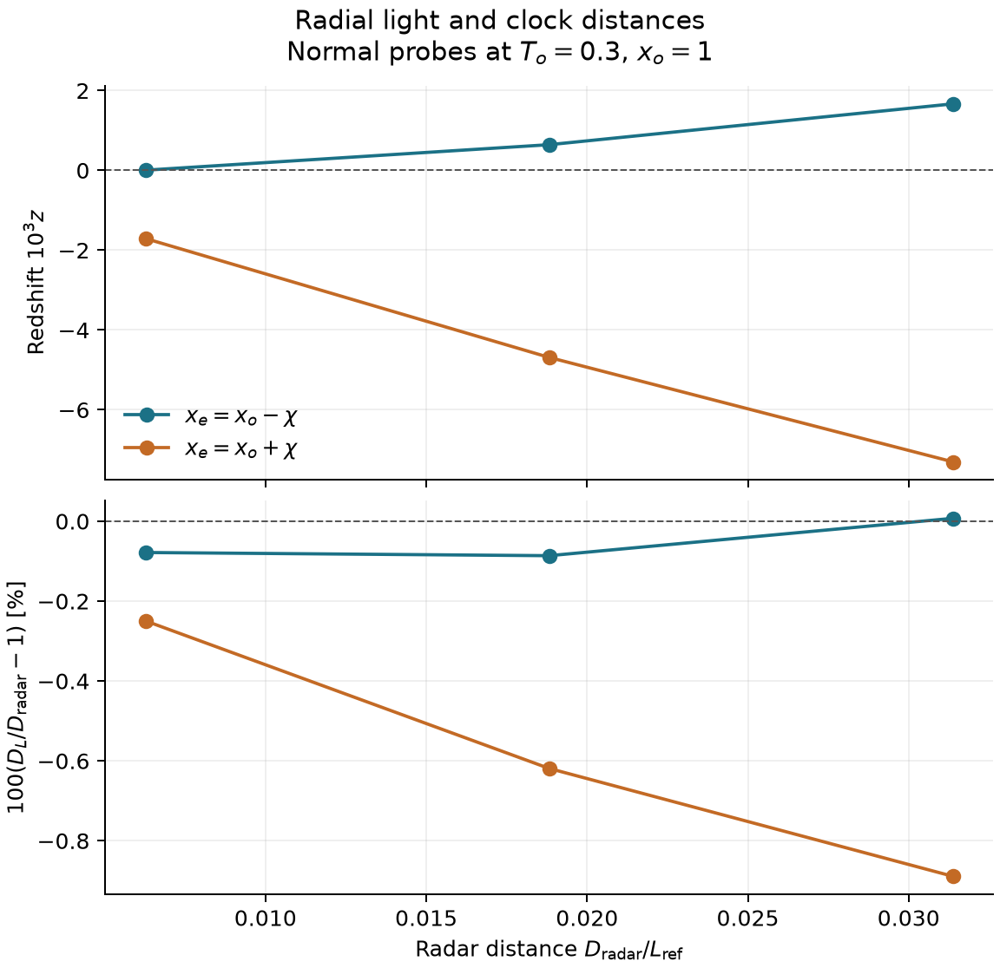

*Figure 2. Three predeclared lookbacks in each radial direction, for the
fixed-coordinate normal probes of the saved conformal metric. Markers are
the declared rays. Lines connect samples and do not fill intermediate
evolution.*

### 6.1.7. The interface required by a common action

<!-- nsc-claim:atlas-common-action-interface -->

The two actions remain alternatives. Importing the literal quiet tension
wall into the Weyl-squared chart is a compatibility question, not a
derivation of either model from the other. With the $(-+++)$ convention,
spacelike normal and $[K_{ab}]=-kh_{ab}$, every singular coefficient in the
linear Weyl tensor cancels. Thus the Weyl-squared term has no squared-delta
coefficient from this pure-trace jump at that algebraic level. The regular Weyl tensor still
steps from the conformally flat cap, where it vanishes, to the Schwarzschild
value. In the orthonormal wall frame, and after a radial boost,

$$
[C_{anbn}]=\frac{M}{R_w^3}\operatorname{diag}(-2,-1,-1).
$$

At $M/\ell=0.4$ and $R_w/\ell=1.5$,

$$
\ell^2[C_{anbn}]
=\operatorname{diag}(-32/135,-16/135,-16/135).
$$

The components have dimension inverse length squared. In a thin-layer limit
that keeps the metric, connection and Weyl curvature bounded and approaching
these one-sided values, the leading Bach double-layer strength is the jump
$[C_{\mu n\nu n}]$. Ordinary tension is a delta-order source and does not
supply that derivative of a delta. The quiet scalar vanishes. A continuous
scalar with bounded one-sided first derivatives does not supply it either.
The Euler and Box-R ledger completes divergences on smooth periodic metrics
and finite time caps. It is not an adjustable source on this timelike wall.

Lower-order products of discontinuous curvature, and a complete junction,
remain unproved. A smooth transition, or an effective interface between
resolutions whose action is actually derived, is still required. The check
is necessary under the stated thin-layer control. It is not a universal
impossibility, and it does not remove the separate P001 Einstein model.
[Reina, Senovilla and Vera](https://arxiv.org/html/1510.05515v1), Sections
3.1--3.2, discuss the hazards of formal quadratic cancellations. Their
generic distributional class is not applied here as a theorem. The direct
tensor calculation is in the
[wall-connection note](../docs/schur-memory.md#the-wall-connection-between-the-two-action-choices),
with the normal-Weyl components exposed by the
[gravitational reduction](../src/recursive_horizons/nsc_atlas_gravitational_reduction.py)
and checked in its
[tests](../tests/test_nsc_atlas_gravitational_reduction.py).

### 6.1.8. One state at two physical resolutions

<!-- nsc-claim:conformal-physical-resolution -->

The inherited law and a state's resolved structure are different mathematical
objects. To calculate a resolution effect, hold the separate conformal
candidate's full state fixed and choose a retained space from its physical
radial Laplacian. On the reference slice $T=0.05$,

$$
\mathcal L=-\Delta_h=-\frac{1}{r^3Q}\partial_x\left(\frac{r}{Q}\partial_x\right),
\qquad \mu L_{\mathrm{ref}}^2\leq1.
$$

The reference ruler remains $L_{\mathrm{ref}}=4.80028044552352$.
The mass and stiffness integrals use the existing 511 geometry variables
and their 2048-point quadrature. Orthonormalizing the selected eigenspace
in the canonical coordinate measure gives a fixed symmetric projector $P$.
Apply it to all six log-canonical variables $a=\log r$, $\pi_a=rp_r$,
$b=\log Q$, $\pi_b=Qp_Q$, and $\chi,p_\chi$. The fermion columns and
occupations remain fully retained. This rule keeps one geometric mode.
The first omitted eigenvalue is $0.4795862384$, above the fixed cutoff
$0.04339770651$. No observed target selects that cutoff or the ruler.

At $T=0.3$, evaluate the same Hamiltonian and its vector field on the full
and filtered states. The difference at fixed canonical environment is

$$
H_{\mathrm{corr}}(z_c;z_e)=H(z_c+z_e)-H(z_c),\qquad
\delta F_c=P X_H(z)-P X_H(Pz).
$$

Here $P$ acts as the identity on the fermions. The exact change of canonical
variables includes the momentum product rule. The four-dimensional vacuum
volume supplies an independently derived comparison direction,

$$
H_\Lambda=8\pi A\Lambda\int r^4LQ\,dx,\qquad A=\frac{1}{16\pi G}.
$$

The owned action uses $R_E=-R_L$ and $-A R_L-2A\Lambda$; its existing
$r^2$ potential is sphere curvature. The displayed $r^4$ weight follows
from the physical volume. Varying before choosing $L=Q$ fixes the lapse
constraint and both momentum forces. This potential changes no coordinate
or fermion rate. Adjoint pullback precedes the nodal canonical change.

The calculation gives $H_{\mathrm{full}}=-1.363\times10^{-11}$,
$H_{\mathrm{coarse}}=1.015478298556$, and unit-volume generator
$231.9284384454$. Their energy projection is

$$
\Lambda_E L_{\mathrm{ref}}^2=-0.100890404750047.
$$

Its force does not reproduce the correlation. Each row below uses that
block's canonical units; the RMS values are not combined across blocks.

| Log-momentum rate | Correlation RMS | Vacuum candidate RMS | Residual RMS |
| --- | ---: | ---: | ---: |
| $\pi_a$ | $0.21206304$ | $0.50773915$ | $0.29567611$ |
| $\pi_b$ | $0.01318283$ | $0.25386957$ | $0.24068675$ |

The residuals are 58.23% and 94.81% of the larger RMS in their respective
rows. The retained $a_T$ and $\chi_T$ correlations are $0.00098884455$ and
$0.67276495$ RMS per coordinate time, where a vacuum potential gives zero.
The unchanged input fermions also acquire a rate difference. The $b_T$
difference, $5.54\times10^{-18}$ RMS, is treated as roundoff.

The original Hamiltonian-constraint maximum is $9.005\times10^{-6}$; the
filtered state's is $25.5817$ in that density normalization. No constraint
reset is performed, and the filtered metric with the retained fine matter
is not a second physical solution. The missing correlation contains
constraint, kinetic and matter response beyond a single volume term.
Fifteen controls include the analytic spectrum under unit rescaling and
independent energy differentiation. The relative eigen residual is
$1.65\times10^{-15}$; replay of the archived prolonged rates differs by at
most $8.72\times10^{-9}$ in a momentum component. These controls do not
bound the continuum or physical model error. Rates use the same conformal
coordinate generator; a matched proper clock, causal elimination, repeated
scale composition and a fractal dimension remain open. The
[fixed-state record](../results/summaries/nsc-conformal-resolution-v1.json)
binds the original state and frozen method `cd00b35`. Its energy coefficient
is a failed vacuum-volume representation of this instantaneous response,
not a derived cosmological constant.

### 6.1.9. A prepared-state change propagated to a photon measurement

The same conformal episode now carries an initial matter variation through
the coupled geometry to two received frequencies. Before prolongation,
apply $U_\epsilon(x)=\exp[i\epsilon f(x)\sigma_2]$ to every original spinor,
with $f(x)=\cos(2\pi x/8)$ and unchanged occupations. This preserves the
initial Gram matrix and paired current cancellation. The radius direction
is obtained by differentiating the original projected constraint level.
The original full constraint defect, $9.97845\times10^{-6}$, remains; a zero
root is not assumed. Initially at $x=1$,
$d\log N/d\epsilon=-0.27203771374589336$.

Evolve the complete state and its derivative together,
$z_T=X_H(z)$ and $u_T=DX_H(z)u$, at the same four RK4 stages. All six
geometry fields and both complex column blocks evolve. The fixed spatial
grid is $n_f=512,n_g=511,n_q=2048$, period 8. The two original time steps
$0.001$ and $0.0005$ take 300 and 600 steps to $T=0.3$. Both baseline
states reproduce their saved histories at $T=0.05$ and $0.3$ within the
declared field-scaled $10^{-8}$ tolerance.

Reception is fixed at $(T_o,x_o)=(0.3,1)$; emission occurs at
$(T_e,x_e)=(0.175,0.875)$ or $(0.175,1.125)$. These are exact step and
quadrature events. The normal observers measure $1+z=N_o/N_e$, $N=rQ$,
so the propagated response is

$$
K=\frac{d\log(1+z)}{d\epsilon}
=\frac{u_{r,o}}{r_o}+\frac{u_{Q,o}}{Q_o}
-\frac{u_{r,e}}{r_e}-\frac{u_{Q,e}}{Q_e},
\qquad \frac{dz}{d\epsilon}=(1+z)K.
$$

| Emitter $x_e$ | Fine $K$ | Fine $dz/d\epsilon$ | Absolute time-step change in $dz/d\epsilon$ |
| --- | ---: | ---: | ---: |
| 0.875 | $-0.0009129945410$ | $-0.0009145171829$ | $1.22\times10^{-13}$ |
| 1.125 | $0.0027692088369$ | $0.0027489767089$ | $1.71\times10^{-13}$ |

These differences are empirical temporal indicators. The inherited spatial
and constraint errors, physical source mechanism and finite-$\epsilon$
range are not bounded by them. At the fine endpoint, the full Hamiltonian
constraint maximum is $8.91\times10^{-6}$ and the weighted constraint
variation norm is $1.09\times10^{-6}$. The Gram and tangent-Gram errors
are $1.63\times10^{-13}$ and $1.68\times10^{-14}$. The sampled Hamiltonian
variation drifts by $8.59\times10^{-12}$, versus $2.76\times10^{-10}$ on the
coarse time step; no uniform-in-time estimate is inferred.

The [initial response](../results/summaries/nsc-conformal-preparation-tangent-v2.json)
and [propagated response](../results/summaries/nsc-conformal-causal-response-v2.json)
bind the original data, frozen method and reproduction command. A stopped
central-difference preflight is preserved; the independent initial Fourier
force check agrees to $6.35\times10^{-9}$ relative error without changing
the force equations. The calculation uses 1736.1875 process-CPU seconds
including that stopped attempt. One 477146-byte ignored checkpoint stores
the final states and derivatives; the published summary stores its hash.
This closes one finite prepared-direction observer calculation. The
metric-dependent reduction still needs to retain the corresponding causal
response and physical state before identifying an effective vacuum term.

### 6.1.10. A constrained gravitational exterior and its validity test

The same local auxiliary action now supplies a linear vacuum exterior
response. This reference has zero Maxwell flux and Dirac field, physical
metric $ds^2=N^2dt^2-a^2dR^2-R^2d\Omega^2$, and flat $N=a=1$, $\chi=0$.
It is not an attachment to the charged periodic episode. Write
$N=1+\epsilon n$, $a=1+\epsilon b$, $\chi=\epsilon c$, and
$k=4\pi A/\alpha$, $\alpha=-4\pi C_W/3$.
Varying before imposing areal gauge retains both constraints. They fix
$kRb+c_R+c/R=kM$, with constant mass perturbation $M$; the full radius
equation then vanishes. Linear Schwarzschild has
$n=-M/R$, $b=M/R$, $c=-12M/R$.

For zero initial perturbation and $M=0$, set $\psi=c/R$. Independent
variation of all five original fields and elimination of the constraints
give

$$
\psi_{tt}-\psi_{RR}+(6/R^2+m^2)\psi=0,
\qquad m^2=\frac{A}{2C_W},
$$

$$
S_{2,\mathrm{bulk}}=K\int
[\psi_t^2-\psi_R^2-(6/R^2+m^2)\psi^2]dt\,dR,
\qquad K=-\frac{8\pi C_W^2}{3A}.
$$

The action weight $K$ is distinct from the normalization of the wave
equation. Radial total derivatives are retained in deriving the face
response; no boundary energy normalization is selected.

On $R\ge R_0$, impose a compatible causal curvature history at $R_0$ and
no incoming perturbation at infinity. For a Laplace parameter $s$ with real
part greater than $\gamma=\sqrt{\mathrm{max}(0,-m^2)}$, the decaying branch
$q=\sqrt{s^2+m^2}$, with positive real part, yields

$$
\frac{\widehat c_R(R_0)}{\widehat c(R_0)}
=-\frac{z^3+2z^2+3z+3}{R_0(z^2+3z+3)},\qquad z=qR_0.
$$

The outward normal of this exterior points toward decreasing $R$. The
lapse and radial metric histories obey the same constraints, so this is
one compatible response column. It is not a choice of three independent
boundary histories or a bulk vacuum density.

The [scalar evaluation](../results/summaries/nsc-vacuum-gravitational-response-v1.json)
keeps the saved $A,C_W$ and independent ruler
$R_0=L_{\mathrm{ref}}=4.80028044552352$. Frozen method `6c68d00` uses one
declared Laplace point, no archive, trajectory, root or fit, and 0.015625
process-CPU seconds:

| Reference quantity | Value |
| --- | ---: |
| $m^2L_{\mathrm{ref}}^2$ | $-614.4717961513472$ |
| $\gamma L_{\mathrm{ref}}$ | $24.788541630183637$ |
| Growth time divided by $L_{\mathrm{ref}}/c$ | $0.04034121954082023$ |
| $K/L_{\mathrm{ref}}^2$ | $-5.754230595887687\times10^{-6}$ |

For $m^2=-\gamma^2$, a compact sine beyond
$\mathrm{max}(R_0,4/\gamma)$ with width $4\pi/\gamma$ has spatial quadratic-form
quotient at most $-9\gamma^2/16$. Every finite inner radius therefore leaves
growing modes in this infinite flat exterior. The retarded map exists in
the stated half-plane, while a stable stationary reduction about this
reference is unavailable. Nine controls include the exact radial solution,
pre-gauge constraints, Schwarzschild mass mode, reduced action and
physical-clock face response.

This tests the local action used nonperturbatively. The
[spherical action owner](../docs/nsc-spherical-action.md) retains a
conditional curvature expansion and an incomplete full spectral/state
contribution. An effective-theory reading needs its cutoff, order reduction
or causal completion specified before promoting this additional mode to a
physical exterior state. The comparison ruler is not a derived ultraviolet
cutoff. The finite periodic computations retain their stated domain; the
actual nested exterior geometry and its physical state remain necessary
for a cosmological Lambda calculation. No coupling was changed to remove
the reference instability.

### 6.1.11. The inherited spectral profile and its gravitational response

The local coefficients have an existing spectral owner. For the fixed
warped compact interval, its matched profile is
$H(u)=h_\Lambda(u)-E_1(u/\mu_B^2)$, where
$\Lambda_{\mathrm{UV}}=\Omega/r_e$ and
$\mu_B=\sqrt{|q|}/r_e$. They are distinct from the observer ruler.
The coefficient account gives $Q_1=\int_0^\infty H(u)\,du$,
$Q_0=H(0)$, $A=Q_1/[6(4\pi)^2]$ and $C_W=-Q_0/[40(4\pi)^2]$.
Compact interval, warp and matching scales are fixed during this external
metric variation.

The flat Euclidean transverse-traceless heat response of
[Alkofer--Saueressig--Zanusso, 1410.7999v2](https://arxiv.org/html/1410.7999v2),
Section II, supplies the linear spectral-profile dependence. With the
existing zero-volume-term normalization, exchanging its integrations gives

$$
\mathcal P_H(x)=x\left[1-\frac{x}{4Q_1}\int_0^1
(1+2v)\sqrt{1-v}\,H(xv/4)\,dv\right],\qquad x=p^2\geq0.
$$

For the owned half-trace action, the quadratic density is
$(A/4)h_{\mathrm{TT}}\mathcal P_H(-\partial^2)h_{\mathrm{TT}}$.
Its first two terms are $x+(2C_W/A)x^2$, exactly matching the local
coefficient account. The [derivation and controls](../docs/schur-memory.md#the-induced-spectral-profile-beyond-the-local-gravitational-polynomial)
retain the spectral-calculus assumptions, unit scaling and an independently
integrated finite proper-time check. The earlier exponential example is
not substituted for this compact profile.

The [single evaluation](../results/summaries/nsc-spectral-gravitational-response-v1.json)
keeps the saved $A,C_W$, $\Lambda_{\mathrm{UV}}=3.973074368754331$,
$\mu_B=2$ and $L_{\mathrm{ref}}=4.80028044552352$. Frozen method
`9b68122` uses $p^2L_{\mathrm{ref}}^2=1$:

| Finite reference quantity | Value |
|---|---|
| $p/\Lambda_{\mathrm{UV}}$ | $0.05243324000377066$ |
| $\mathcal P_H(p^2)/p^2$ | $0.9983741797605584$ |
| Local polynomial divided by $p^2$ | $0.9983725860059594$ |
| Full-profile minus local ratio | $1.5937545990718505\times10^{-6}$ |
| Extra local root divided by $\Lambda_{\mathrm{UV}}^2$ | $1.6893333026263349$ |

Both fixed Jacobi rules, of orders 16 and 32, round to the same normalized
response; their raw correction integrals differ by about $10^{-15}$.
This is an integration indicator, not a zero total error or a bound on
inherited compact spectral errors. Seven controls pass, and the profile's
zero limit recovers $C_W$ within $5.42\times10^{-19}$ absolute. The scalar
application takes 0.1875 process-CPU seconds and stores 4720 bytes without
a raw cache, scale root, trajectory or fit.

The local polynomial's additional root lies above the stored ultraviolet
cutoff. It therefore cannot by itself diagnose the full spectral theory's
stability. This calculation does not locate the full kernel's other poles
or replace the constrained spherical causal map. Curved real-time metric
dependence and the exterior's physical state remain necessary before
identifying an effective cosmological volume term.

### 6.1.12. Flat-reference curvature channels and the relation between motion and lensing

The same fixed-profile functional now has a covariant quadratic-curvature
connection. Reusing [Codello--Zanusso, 1203.2034v2](https://arxiv.org/html/1203.2034v2),
Section 5, and the owned Dirac Clifford traces gives Weyl and scalar
functions $\mathcal F_C(-\nabla^2)$ and $\mathcal F_R(-\nabla^2)$ in the
action $[C\mathcal F_C C+R\mathcal F_R R]/[2(4\pi)^2]$.
The [complete derivation](../docs/schur-memory.md#covariant-curvature-channels-and-a-static-gravitational-observable)
works to second order in curvatures with compact weak perturbations of
Euclidean $\mathbb R^4$, fixed topology and fixed compact data. Euler and
boundary terms are removed only within that domain; a material wall or
strong-curvature attachment needs its own terms.

This is an imported Dirac fixed-profile calculation about flat space. The
numerical slip below is not a consequence of NSC's cap--wall nesting.

The Weyl function recovers Section 6.1.11 through
$a_2(x)=\mathcal P_H(x)/x=1+6x\mathcal F_C(x)/Q_1$. The scalar function is

$$
\mathcal F_R(x)=\frac{1}{72}\int_0^1
\left(1-\frac{5v}{2}\right)\sqrt{1-v}\,[H(xv/4)-H(0)]\,dv.
$$

The constant subtraction changes nothing because its weight integrates to
zero. Thus $\mathcal F_R(0)=0$, while a nonzero-momentum scalar response
remains. Its trace factor is $a_0(x)=1-18x\mathcal F_R(x)/Q_1$.
This correction adds no zero-momentum volume term; the previous vacuum
normalization is still a premise.

For a conserved weak static density perturbation $T_{00}=\rho$, $T_{ij}=0$,
write the physical metric as
$ds^2=(1+2\Phi)dt^2-(1-2\Psi)d\boldsymbol x^2$.
Direct metric and source variation, with source action $+\int\rho\Phi$,
gives the ratios to $\Phi_{\mathrm{GR}}=\Psi_{\mathrm{GR}}=-\rho/(4Ax)$:

$$
G_\Phi=\frac{4}{3a_2}-\frac{1}{3a_0},\qquad
G_\Psi=\frac{2}{3a_2}+\frac{1}{3a_0}.
$$

Slow-motion acceleration measures $-\nabla\Phi$; the null optical index is
$1-\Phi-\Psi$. Consequently the lensing ratio is
$(G_\Phi+G_\Psi)/2=1/a_2$, and gravitational slip is
$\Psi/\Phi=G_\Psi/G_\Phi$. The density normalization cancels from these
relations. This is an external static probe, not a supplied astrophysical
source or the earlier nested-body preparation.

The [one application](../results/summaries/nsc-covariant-spectral-response-v1.json)
keeps the old profile, couplings and reference scale, using frozen method
`9796add` at $p^2L_{\mathrm{ref}}^2=1$:

| Conditional weak-field quantity | Value |
|---|---|
| Scalar trace factor $a_0$ | $0.9999996814199501$ |
| Motion-potential ratio $G_\Phi$ | $1.0021711842538266$ |
| Spatial-potential ratio $G_\Psi$ | $1.0010857514169889$ |
| Lensing-potential ratio | $1.0016284678354077$ |
| Gravitational slip $\Psi/\Phi$ | $0.9989169187321566$ |

Eight controls pass, including independent curvature contractions, pure
gauge, the Einstein density and its flux, heat/profile integration and
direct source variation. The fixed 16/32 rules round to the same response
floats and recover the old TT factor. Their scalar kernels differ by
$3.95\times10^{-16}$; these are integration indicators, not bounds on the
inherited spectrum or physical model. The application takes 0.140625 CPU
seconds and retains 5797 bytes without a trajectory or scale fit.

A real-time response requires its state and closed-time-path variation.
Putting a retarded kernel in an ordinary quadratic action instead produces
its symmetric retarded--advanced average. The static relation therefore
does not supply the actual curved causal exterior, physical length
calibration or a cosmological Lambda. Those remain the connection needed
between the larger geometry and its observer's effective volume response.

### 6.1.13. The actual cap--wall Dirac operator and the missing nested slip

The [cap--wall calculation](../docs/nsc-atlas-dirac-probe.md)
adds a declared massless, minimally coupled probe with no direct surface
spinor interaction to the original classical scalar candidate. It uses the
known quiet reference; P001's unconverged endpoint supplies no controlled
corrected background. In its static cap, let $A=1-H^2r^2$ and
$z=\operatorname{atanh}(Hr)/H$. Rescaling the physical spinor by
$\psi=A^{-1/4}r^{-1}u$ gives

$$
\mathsf{H}_k=-i\sigma_2\partial_z+\sigma_1 W,
\qquad W=\frac{k\sqrt{A}}{r},
\qquad V_\pm=W^2\pm\partial_zW,
\qquad \partial_zW=-\frac{k\sqrt{A}}{r^2}.
$$

At $r/\ell=.5$, the lowest angular channel has
$W\ell=\sqrt3$ and squared potentials
$V_+\ell^2=-.4641016151$, $V_-\ell^2=6.4641016151$.
Flat space at the same radius gives $0$ and $8$ for those potentials.
These are curvature effects. The smooth control continues the same cap
and retains its identical bulk operator.

Nesting changes the material domain. For the common cap-to-exterior normal,
$[K]=-6/\ell$. Continuity of the spinor and its Dirac image gives
$[\partial_n\psi]=-[K]\psi/2=3\psi/\ell$ in a common normal frame.
The smooth-cap control has no jump. The
[reference record](../results/summaries/nsc-atlas-dirac-probe-reference-v1.json)
and ten independent controls verify these operator inputs. The exterior's
usual static coordinate is spacelike at this cut, so it cannot supply a
static joined spectral problem.

No nested $\Psi/\Phi$ or slip difference has yet been calculated. The
loop requires a Dirac two-point state on the joined causal domain,
renormalized bulk/interface response, and a conserved metric source with
its wall displacement and gauge-invariant observer readout. Those inputs
are absent from the classical scalar preparation and the flat profile.
For free fermions the retarded bilinear response already depends explicitly
on its initial covariance through $-i\operatorname{Tr}(C[V(t),V(0)])$;
geometry alone does not select it. The completed result here is the curved
operator/domain connection, not a loop polarization or an NSC slip number.

### 6.1.14. Local Dirac trace on the cap and material wall

The free four-component Dirac determinant and general
[heat-coefficient framework](https://arxiv.org/pdf/hep-th/0306138)
are imported; the spin/statistics contractions and actual curvature are
calculated. In the two quiet smooth regions, where $\Box R=0$,

$$
\frac{\langle T^\mu{}_\mu\rangle}{\hbar c}
=\frac{7R_{\alpha\beta\gamma\delta}R^{\alpha\beta\gamma\delta}
+8R_{\alpha\beta}R^{\alpha\beta}-5R^2}{360(4\pi)^2}.
$$

The [one-sided evaluation](../results/summaries/nsc-atlas-dirac-bulk-trace-v1.json)
therefore gives $-11H^4/(240\pi^2)$ in the cap and
$7M^2/(120\pi^2r^6)$ outside. A flat reference has zero local curvature
trace. These are actual-background terms of the declared quantum probe,
distinct from the flat nonlocal polarization in Section 6.1.12.

At the material wall, integrate a smooth normal curvature jet before
taking a thin limit. The declared class smooths the kinked conformal factor
while the conformal product curvature remains bounded. With one normal
pointing from cap to exterior, put $t=K^\tau{}_\tau$, $b=K^\Omega{}_\Omega$,
$A=R_{\tau\tau}/R$ and $B=(1+R_\tau^2)/R^2$. The Chern scalar is
$\mathcal{B}_3=-8tb^2+8Bt+16Ab$. Direct Lorentz curvature contraction gives
the Euler surface coefficient

$$
\mathcal{E}_\Sigma=-[\mathcal{B}_3]
=4k_{\rm wall}(k_{\rm wall}^2+3H^2)=56/\ell^3.
$$

The exterior mass and wall radius cancel through the signed junction
equations. Pure-trace leading singular terms cancel in both Euler and
Weyl curvature squares; no delta square is evaluated. The
[Euler-wall reference](../results/summaries/nsc-atlas-dirac-euler-wall-v1.json)
then gives

$$
\frac{\langle T^\mu{}_\mu\rangle_{\Sigma,E}}{\hbar c}
=-\frac{77}{720\pi^2\ell^3}\delta_\Sigma.
$$

A smooth continuation of the cap has no such interface coefficient.
The scheme-dependent total derivative, finite interface terms, traceless
stress and quantum preparation remain separate inputs. This one Euler
term is not the complete wall stress. Trace-only projections do not
establish vacuum stress or replace the supplied cap $\Lambda_{0,-}\ell^2=3$.

### 6.1.15. An actual wall radar chart and a finite clock prediction

The [wall-clock construction](../results/summaries/nsc-atlas-dirac-radar-v1.json)
uses the same $H\ell=1$, $k_{\rm wall}\ell=2$, $M/\ell=.4$ and
$.45\le R_{\rm wall}/\ell\le.55$. In each static region take optical
coordinates $u_i=t_i-r_i^*$, $v_i=t_i+r_i^*$. Their wall derivatives are

$$
\frac{du_i}{d\tau}=\frac{1}{\beta_i+\dot{R}},\qquad
\frac{dv_i}{d\tau}=\frac{1}{\beta_i-\dot{R}}.
$$

Inside the exterior horizon the second derivative is negative. Label both
null rays by their wall proper times $U,V$, preserving that orientation.
Then

$$
T=(U+V)/2,\quad x=(V-U)/2,\quad
ds_2^2=C_i(-dT^2+dx^2),\quad
C_i=f_i(r)u_i'(U)v_i'(V)>0.
$$

The cap occupies $V\le U$ and exterior $V\ge U$. The proper-clock range
$0\le U,V\le S$, $S/\ell=.1256873632901$, gives the finite causal diamond
in Figure 3. An analytic conservative bound gives $N=\sqrt{C}\ge.3851891$
throughout that domain. The material wall remains $x=0$, $T=\tau$,
$C=1$; both Israel jumps are retained. This construction uses no spatial
cutoff profile and has no reflecting timelike ends. The earlier wide
coordinate chart's fold remains an unsuccessful construction, without
changing the underlying quiet geometry.

The actual Dirac half-density now has constant characteristic speed:

$$
\xi=C^{1/4}r\psi,\qquad
H_\kappa=-i\sigma_2\partial_x+\sigma_1W_\kappa,\qquad
W_\kappa=\kappa\sqrt{C}/r.
$$

Both $W_\kappa$ and its first derivatives are continuous at the wall.
The density spinor and its spatial derivative are continuous in this
frame, while the physical parallel-normal jump remains $3k_{\rm wall}\psi/2$.

For a finite clock protocol, emit a radial optical phase at wall
$U=\tau(.475)$ and receive at
$(U,V)=(\tau(.475),\tau(.525))$ on a fixed wall-radar-position observer.
The signed radar position is $x/\ell=.0314673818165$ and
$T/\ell=.0584746895099$. The null phase $-U$ and receiver proper clock give
$\omega_{\rm rec}/\omega_{\rm wall}=1/N_{\rm rec}$.

| Quiet geometry with the same radar protocol | $r_{\rm rec}/\ell$ | $N_{\rm rec}$ | $\omega_{\rm rec}/\omega_{\rm wall}$ | $W_1\ell$ |
| --- | ---: | ---: | ---: | ---: |
| Nested cap--wall--exterior | .5068911 | .8668323 | 1.153626 | 1.7101 |
| Smooth cap continuation | .5364941 | .9253385 | 1.080686 | 1.7248 |

For the independently supplied $\ell=10\,{\rm km}$, this radar range is
$314.674$ m. The smooth continuation is a geometric control with the same
observer worldline and clock labels; it is not another matched membrane
solution. These are conditional quiet-background predictions, with no
observed frequency used to tune the geometry. They are not a quantum slip
or an astronomical identification. The optical-map comparison with independent
quadrature differs by $2.11\times10^{-14}$ or less; finite mode propagation and the full
quantum error account are not supplied by this geometry calculation.

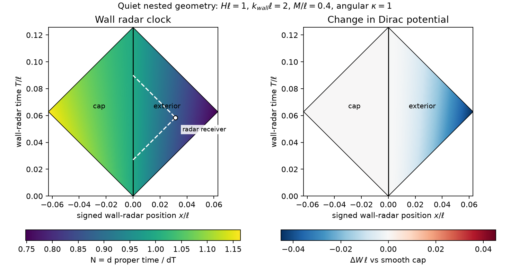

*Figure 3. The finite quiet wall-clock diamond. The material wall is the
vertical line; null edges are causal limits. Left: proper-clock lapse,
with the emitted/reflected radar ray and receiver. Right: the radial
Dirac-potential difference from a smooth continuation of the same cap,
using the same wall clock and probe angular sector. These colors describe
the background geometry, not an evolved quantum state or a metric-loop
response.*

### 6.1.16. Stress vertices and the inherited quantum preparation

The same canonical radial Dirac action now supplies its gravitational
sources. For a full magnetic multiplet let $d=2|\kappa|$,
$f=d/(4\pi)$, $\xi=\sqrt{a}\,r\psi$,
$q_A=-i(\xi^\dagger A\xi_y-\xi_y^\dagger A\xi)/2$ and
$s_1=\xi^\dagger\sigma_1\xi$. Its real Hamiltonian density is
$h=d[N(q_\alpha/a+\kappa s_1/r)-\beta q_I]$. Metric variation at fixed
canonical half-density gives

$$
\rho=\frac{f}{ar^2}(q_\alpha/a+\kappa s_1/r),\qquad
p_r=\frac{fq_\alpha}{a^2r^2},\qquad
p_t=\frac{f\kappa s_1}{2ar^3},\qquad
T^{\hat{0}\hat{1}}=\frac{fq_I}{a^2r^2}.
$$

The [stress and contact calculation](../docs/nsc-atlas-dirac-probe.md#dirac-stress-and-the-actual-gravitational-metric-vertices)
checks the Hilbert energy/flux, complete angular normalization,
four-dimensional covariant conservation and the first/second metric
variations. Finite-mode stress has zero classical trace and transmits
continuously; the anomaly in Section 6.1.14 is retained separately.
Radial ports and first-order time-end variations remain in an integrated
response. No scalar source or flat polarization is substituted.

The radar characteristic equations define the transfer of prepared
incoming data to the middle Cauchy segment. A parent covariance must
include both incoming branches and their cross-correlations. Existing
Gaussian boundary elimination can preserve those terms once the actual
transfer is supplied. Neither the chart nor the common-law relation
chooses a root state. Section 6.1.19 supplies one additional preparation
axiom and establishes its local short-distance class; it is not inferred
from a null-line frequency label alone.

The characteristic transfer and a finite prepared-state mean response
are evaluated next. A compatible baseline preparation, bulk/interface
renormalization conditions and the complete mixed response to a physical
source still separate them from a nested $\Psi/\Phi$ prediction.

### 6.1.17. Prepared Dirac propagation, mean metric and clock

The [actual transfer](../results/summaries/nsc-atlas-dirac-scattering-v1.json)
propagates the canonical chiral field on the wall-clock diamond. With
$P=\eta_+$ and $M=\eta_-$, the equations are
$2P_V=-iW_\kappa M$ and $2M_U=-iW_\kappa P$.
The characteristic cell map is a two-component Cayley unitary in positive
null-flux weights. Direct metric variation gives the ordered matter
response $-i[J_A,J_B]$ for the declared exterior source and later cap
insertion. For one specified first-channel occupation difference its
magnitude changes by about .3774% relative to the smooth-cap control.
This is one matter-response component.

The [mean-clock reference](../results/summaries/nsc-atlas-dirac-mean-clock-v1.json)
then supplies the mean metric needed before a full mixed source/tadpole
calculation. The incoming mode has $P(U,0)=0$ and
$M(0,V)=A b(V)\exp(-12iV/S)$, where $b$ is the stated smooth peak-one
bump centered at $.6S$ with half-width $.3S$: put
$z=(V-.6S)/(.3S)$ and $b=\exp[1-1/(1-z^2)]$ for $|z|<1$,
and zero otherwise. The constant $A$ normalizes its continuum null flux
to one. For a compatible supplied parent
covariance $C_H$, define $\Pi=I-|f\rangle\langle f|$,
$C_{\mathrm{empty}}=\Pi C_H\Pi$ and
$C_n=C_{\mathrm{empty}}+n_{\mathrm{occ}}|f\rangle\langle f|$,
$0\leq n_{\mathrm{occ}}\leq1$. This declared preparation changes one mode's
occupation and removes its cross terms; it selects no root vacuum.
The parent must make the finite-rank modification smooth on this region;
its global preparation remains an assumption.
Both magnetic states of the $\kappa=1$ multiplet have the same radial data.
Other inherited modes cancel between the two states.

Analytically differentiated characteristic equations supply first
derivatives of the propagated field. The same stress vertices then
determine the nonvacuum Misner-Sharp mass one-form. In units $c=\hbar=1$,
with $\kappa_g=8\pi G$ and the cap vacuum mass evaluated at the actual
areal radius,

$$
m_{\rm total}=M_i+\Lambda_i r^3/6+m_i,\qquad
(m_U,m_V)=\frac{\kappa_g r^2}{C}
(t_{UV}r_U-t_{UU}r_V,\ t_{UV}r_V-t_{VV}r_U).
$$

The two wall masses drive the existing signed radius-response equation.
In outgoing EF coordinates, the radial lapse follows from
$\psi_V=\kappa_g r t_{VV}/(2r_V)$ and its proper-wall normalization.
Analytic sensitivity of the ingoing null ray gives $s=\delta r$ and
$z=s_V$, hence $q=\delta\ln C=\psi+z/r_V$. The specified radial phase
and a receiver at fixed proper-wall radar position give
$\delta\ln(\omega_{\mathrm{rec}}/\omega_{\mathrm{wall}})=-q/2$.
No separate bulk metric grid is needed for this first-order supplied source.

The proper-clock labels remain $U=\tau(.475)$ and $V=\tau(.525)$
of the quiet reference. Define

$$
\varepsilon_q=\frac{8\pi\hbar G}{c^3\ell^2},\qquad
\mathcal C_{\rm clock}
=\frac{\delta\ln(\omega_{\rm rec}/\omega_{\rm wall})}
{\varepsilon_q n_{\rm occ}}.
$$

| Geometry and observer protocol | $\mathcal C_{\mathrm{clock}}$, 128 cells | Absolute 64/128 spread |
| --- | --- | --- |
| Nested cap-wall-exterior | -.41780 | 1.12e-5 |
| Smooth cap, shared observer motion | -.39929 | 9.95e-6 |

The smooth cap has no membrane. Its observer worldtube is explicitly
driven along the computed nested wall's areal-radius history. The
coefficient difference is $-.01851197$, about 4.63625% in magnitude,
with a correlated numerical spread $1.23\times10^{-6}$.
This compares the two geometries at common observer motion; it is not
an independently evolving alternative wall model.

The normalized nested mass-path discrepancy decreases from
$1.15\times10^{-6}$ to $2.92\times10^{-7}$; the smooth control also
improves. Orders 8/12 of the piecewise quadrature differ by less than
$5.34\times10^{-15}$ in the clock coefficient. Exact charged-wall and
nonzero-lapse fluid families independently check the reconstruction.
These indicators support the finite calculation; they are not a
rigorous continuum remainder or an observational confidence interval.

For the independently supplied $\ell=10\,\mathrm{km}$, the nominal
prepared-state fractional frequency correction is

$$
\delta\ln(\omega_{\rm rec}/\omega_{\rm wall})
\simeq-2.7430\times10^{-77}n_{\rm occ}
\left(\frac{10\ {\rm km}}{\ell}\right)^2.
$$

The nested resolution spread converts to $7.34\times10^{-82}$ at unit
occupation and that scale. The
[CODATA 2022](https://physics.nist.gov/cuu/Constants/Table/allascii.txt)
uncertainty in $G$ is separate. The length and mode preparation are
inputs, and no astronomical datum selects them.

This finite state-difference result supplies the mean $h_q$ needed in
the later mixed Einstein and source variations. It does not determine
the baseline vacuum, full retarded $\Psi/\Phi$ or a cosmological
$\Lambda$. The finite-amplitude scalar P001 remains unconverged;
its original solver and grids were not changed by this calculation.

### 6.1.18. A conserved compact source and local gravitational tides

A central mass source can be supplied on the same finite annulus, with
its body or inner horizon below the causal domain. The cap and exterior
vacuum functions and dimensionless source mass are

$$
f_-=1-2b/r-H^2r^2,\qquad f_+=1-2M_p(b)/r,\qquad \hat b=b/\ell.
$$

Hold the initial physical wall radius and proper speed fixed, as well
as H and tension. Both signed junction constraints then require
$dM_p/db|_0=\beta_{+,0}/\beta_{-,0}=2755/8587$. Holding the parent mass
fixed would change that speed. No regular body interior or formation
history is supplied by this annular construction.

The same continuum-normalized Dirac occupation difference is propagated
on each member of the mass family. The mean Einstein reconstruction,
stress, wall and observer vary together. Its two mass-flux laws and
wall displacement have an exact triangular solution: since
$d\ln v/d\tau=\mathrm{acc}/v$,

$$
\frac{\rho(\tau)}{v(\tau)}
=\frac{\rho(\tau_0)}{v(\tau_0)}
+\int_{\tau_0}^{\tau}
\frac{\beta_+(\mu-\nu)/(k_{\mathrm{wall}}R^2)+\mu/R}{v^2}\,d\tau'.
$$

Piecewise Gauss integration on the existing field-cell breakpoints
evaluates these primitives. The prefactor v retains the acceleration
term; no constraint residual is canceled. The independent exact
charged and fluid families check this reconstruction.

The [compact-source reference](../results/summaries/nsc-atlas-dirac-mass-response-v3.json)
uses $b/\ell=0,5\times10^{-5},10^{-4}$, the same 64/128 field cells,
and joint wall/bulk quadrature orders 8/12. Its receiver is inside
the cap at $U=.8S,V=.7S$, at fixed proper-wall radar position.
An inward phase -V is emitted at the earlier wall time V. The smooth
SdS continuation shares the nested observer's classical and mean
areal-radius history, without another material wall.

Define

$$
\mathcal C_B=\left.\frac{\partial}{\partial\hat b}
\frac{\delta\ln(\omega_{\mathrm{rec}}/\omega_{\mathrm{wall}})}
{\varepsilon_q n_{\mathrm{occ}}}\right|_{\hat b=0}.
$$

This derivative uses a source present before the window, not a retarded
mass-switching experiment. It includes the background Einstein variation
that a matter-only insertion on fixed geometry would omit.

A second readout uses actual orthonormal curvature. In the specified
radar observer's frame put $A=R_{0r0r}-R_{0\theta0\theta}$ and
$B=R_{r\theta r\theta}-R_{\theta\phi\theta\phi}$. Direct Ricci/Weyl
decomposition gives

$$
w=\frac{b+m_q}{r^3}-\frac{\kappa_g}{6}(\rho_q-p_{rq}+p_{tq}),\qquad
A=-3w-\frac{\kappa_g}{2}(p_{rq}-p_{tq}),\qquad
B=-3w+\frac{\kappa_g}{2}(p_{rq}-p_{tq}).
$$

The fixed vacuum term cancels. At fixed radar labels its first-order
Weyl variation also retains $-3b\,\delta r/r^4$. For nonzero b,
$A_0=B_0=-3b/r^3$. Define the occupied-minus-empty local ratio response
by $\delta(B/A)=\varepsilon_q n_{\mathrm{occ}}\mathcal C_{\mathrm{tid}}$.
The 128-cell results are:

| Geometry and observer | Clock derivative $C_B$ | Tidal coefficient at $b/\ell=10^{-4}$ |
| --- | --- | --- |
| Nested cap-wall-exterior | -.002329216 | -540762.871 |
| Smooth SdS cap, shared motion | -.002329519 | -540765.571 |

The clock-derivative difference is $+3.03553\times10^{-7}$, with a
correlated grid spread $2.58\times10^{-9}$ and a source-step indicator
$5.95\times10^{-10}$. The tidal-coefficient difference is +2.7001584,
about 4.9932 parts per million of the prepared correction, with a
correlated grid spread .0011855. Individual tidal-coefficient grid
spreads are about 14.59. For the supplied $\ell=10\,\mathrm{km}$,
the occupied-minus-empty changes in B/A are $-3.55031184\times10^{-71}$
and $-3.55032957\times10^{-71}$. Their nominal nesting difference is
$+1.77276\times10^{-76}$. The length, source and state are inputs.

All prescribed reference checks pass. The maximum normalized nested
mass-path gap falls from $8.08\times10^{-7}$ to $1.93\times10^{-8}$;
joint quadrature changes the clock coefficient by less than
$4.45\times10^{-15}$. These spreads are diagnostics, not rigorous
remainder bounds or observational confidence intervals. Earlier failed
precision/execution records remain in the scientific owner.

The local ratio is a curvature observable in the stated frame. In a
flat-FLRW Newtonian metric its comoving counterpart compares the radial
trace-free Hessians of $\Psi$ and $\Phi$. Reconstructing those potentials
also requires radial zero-mode and background-split data; below the
exterior horizon one cap FLRW pair does not cover the joined spacetime.
This finite prepared-state result therefore supplies no absolute empty
vacuum ratio, full vacuum $\Psi/\Phi$ or cosmological $\Lambda$.

### 6.1.19. A correlated continuum parent and local vacuum regularity

Specify the parent before evaluating a baseline vacuum. One explicit
alternative is the Dirac ground state on a static product of a radial
line with a sphere of radius $R_0=.45\ell$. In its chiral canonical frame,

$$
\mathsf{H}_{\kappa}(p)=p\sigma_3+\mu\sigma_1,\qquad
\mu=\frac{\kappa}{R_0},\qquad \omega=\sqrt{p^2+\mu^2}.
$$

Fill its negative band for every signed angular sector, including
each magnetic multiplet once. The Fourier measure is $dp/(2\pi)$.
On the two incoming null legs put $a=(\omega-p)/2$ and
$b=(\omega+p)/2$. Their plane phases are $\exp(iaU)$ and $\exp(ibV)$.
The same normalized spinor supplies both amplitudes, so the state has
Hardy diagonal kernels and the cross-leg kernel

$$
C_{+-}(U,V)=-\frac{\mu}{2\pi}
K_0\!\left(|\mu|\sqrt{UV}\right),\qquad U,V>0.
$$

Here $K_0$ is the modified Bessel function. Its normalization follows
independently from the equal-time cylinder Fourier integral. Restricting
the global projector to a finite diamond gives a generally mixed CAR
covariance. Its exact finite compressions retain this cross term; filling
the negative spectrum after truncating an energy matrix selects a
different state.

Use an explicit auxiliary preparation, with fixed physical duration $S$
and a smooth switch $\chi(s)$ supported in $(.1S,S)$, equal to one on
$[.2S,.9S]$. Define

$$
q=\frac{N}{r},\qquad
q_{\mathrm{aux}}=\frac{1}{R_0}
+\chi(U)\chi(V)\left(q-\frac{1}{R_0}\right).
$$

The auxiliary product metric has $r_{\mathrm{aux}}=R_0$ and
$N_{\mathrm{aux}}=a_{\mathrm{aux}}=R_0q_{\mathrm{aux}}$.
Blending q directly preserves its continuous first wall jets. Where the
switches are one this metric is conformal to the physical metric and
the canonical massless spinor is unchanged. This neighborhood includes
the cap detector of Section 6.1.18. The construction assigns a state;
it is not a physical formation history or an Einstein source model.
Stress and clocks still use the physical metric, including its anomaly.

For every angular sector the auxiliary Hamiltonian differs from the
cylinder by a bounded time-dependent potential on a common radial
domain. Its convergent interaction series gives unitary evolution.
The angular direct sum is unitary as well. Moreover,

$$
\{H_{\kappa},\sigma_1\}=2\kappa q_{\mathrm{aux}}
$$

gives a gap at least $|\kappa|q_{\min}$ when
$q_{\mathrm{aux}}\ge q_{\min}>0$.
The prescribed covariance is $C(T)=U(T)C_0U(T)^\dagger$.

**Local regularity proposition.** On an admitted regular patch, this
state is Hadamard on any relatively compact smooth interior neighborhood
inside the matched operator region. Both geometries therefore have a
smooth physical two-point difference on their common cap neighborhood.

The [proof and calculated boundary symbols](../docs/nsc-atlas-dirac-probe.md#local-hadamard-property-for-the-declared-preparation)
make the calculus input explicit. Fold the two sides onto a half-line.
The transparent condition is the allowed space of a constant Hermitian
involution that anticommutes with the normal matrix. It has maximal zero
flux. At real spacelike frequency the decaying-root map is invertible,
uniformly away from glancing, including both angular polarizations.
This verifies the complementing condition for the standard finite-bundle
first-order boundary parametrix. One-sided smoothness supplies its jets.

Normal regularity follows by pairing the unitary field with smooth
tangential tests and transferring tangential derivatives through its
first-order equation. The resulting map from the initial Hilbert space
to every one-sided normal Sobolev space gives smooth normal traces.
Boundary elliptic regularity confines singularities to the compressed
causal cone. Splitting its two orientations then makes the unwanted
component satisfy a smooth inhomogeneous boundary problem with absent
past data; energy uniqueness makes it smooth. Glancing remains inside
the causal cone and does not join its opposite time orientations.
The local CAR and the regular physical conformal map finish the argument.

The existing Weyl projector and transport algebra now receives the actual
radar metric jets through fourth order. Here local p is conjugate to
radar x, with $\omega=\sqrt{p^2+W^2}$; it is not the incoming cylinder
momentum label. In the canonical Pauli frame the first subleading term
is $c_1=-pW_T\sigma_3/(4\omega^3)$.
The first discontinuous wall coefficient enters $c_2$, through
$[W_{xx}]=-6\kappa(M_p-b)/R^4$. This curvature contribution is retained.
At a cap detector the two models share all local subtraction terms.
For a single covariance the fourth-order remainder is qualitatively
of order minus five; the two-state difference is smooth there.

This establishes existence of the local relative stress for this stated
preparation. It does not evaluate it or provide a numerical tail constant.
The full vacuum $\Psi/\Phi$, wall renormalization and physical selection
of the preparation remain separate work. No astronomical measurement
sets this root radius, switch, state or resulting numerical coefficients.

### 6.1.20. Inherited preparation and the cap's local late state

Derive the state transport before choosing another parent benchmark. A
complete ancestral covariance is inherited as $C_c=K C_aK^\dagger$, with
$KK^\dagger=I_c$ for current-normalized restriction and evolution.
Both incoming null branches, their cross-correlation and $I-C_a$ are
transported. A change of null clock carries a square-root Jacobian on
each kernel argument. Finite unitary transport does not select $C_a$.

The actual quiet cap nevertheless selects a local asymptotic state.
Keep $M_-=0$, $H\ell=1$, $M_+/\ell=.4$, $k_{\rm wall}\ell=2$, and the
transparent massless Dirac probe. In $\ell$ units its signed wall obeys

$$
\beta_-=\frac{3R}{4}+\frac{1}{5R^2},\qquad
v^2=\dot R^2=\frac{25R^2}{16}-1+\frac{3}{10R}+\frac{1}{25R^4}.
$$

This positive expanding root reaches $R>1$ in finite wall and central
cap time. In the expanding flat cap chart its regular clock is
$dt/d\tau=(1+v^2)/(\beta_-+Rv)$; at $R=1$ it equals $761/760$.
After that crossing choose a Cauchy ball of physical radius
$H^{-1}<R_B<R_w$. Its conformal future contains a neighborhood of the
central endpoint at $\eta=0$, with a positive spatial margin. The future
timelike wall remains outside that null domain.

**Inherited-state proposition.** Suppose the inherited field state is
Hadamard on a neighborhood of this closed ball. For Gaussian detector
correlations take a gauge-invariant quasifree state. In each fixed
translated central proper-time window, its full four-component two-point
function approaches the conformal de Sitter one. Parent-dependent stress
has a decaying amplitude, rather than a new freely chosen root state.

**Proof.** Set the cut to $t=0$, $a=e^{Ht}$ and $\eta=-H^{-1}e^{-Ht}$.
The conformal field $\psi_{\mathrm{flat}}=a^{3/2}\psi$ satisfies the flat
massless Dirac equation. Subtract the conformal Minkowski two-point
function as a proof reference. Its Cauchy-data difference is smooth.
Cut off both arguments inside a smaller ball still larger than $H^{-1}$
and evolve with the flat Dirac propagator. Finite propagation and the
strict margin extend this smooth difference through a neighborhood of
the virtual endpoint. No condition at a physical infinity is added.

The physical two-point difference is $a^{-3/2}a'^{-3/2}F(\eta,\eta')$,
with $F$ smooth and bounded there, so it decays as $e^{-3HT}$ under a
common time translation $T$. The same-action tetrad stress difference is

$$
\Delta T_{\hat a\hat b}=e^{-4Ht}Q_{\hat a\hat b}(-H^{-1}e^{-Ht}),
\qquad
\left|\Delta T_{\hat a\hat b}-e^{-4Ht}Q_{\hat a\hat b}(0)\right|
\leq \frac{M_1}{H}e^{-5Ht}.
$$

Here $M_1$ bounds the corresponding conformal-time derivative; anomaly
and local curvature ambiguities cancel in the state difference.
The amplitude $Q(0)$ and its bound are inherited data. This proves a
local limit and a finite conditional error, without asserting equal
finite-time states or loss of global unitary information. The
[complete proof and calculator](../docs/nsc-atlas-dirac-probe.md#inheritance-and-the-late-local-cap-state-19-october-2026)
give the wall positivity and domain argument.

On the central geodesic the limiting Dirac kernel's scalar factor is
$[H/(2\sinh(H(s-s'-i0)/2))]^3$. Its imaginary-time antiperiod is
$2\pi/H$. A weak scalar-density detector coupled to $:\bar\psi\psi:$
has a bosonic bilinear kernel with power six, giving, up to one positive
detector constant,

$$
\mathcal R(x)=\frac{x(x^2+1)(x^2+4)}{e^{2\pi x}-1},\qquad
x=\frac{E}{\hbar cH},\qquad
\frac{\mathcal R(x)}{\mathcal R(-x)}=e^{-2\pi x}.
$$

The polynomial follows independently by shifting the Fourier contour
to a nonsingular $\cosh^{-6}$ integral. Late-state translation precedes
the long smooth observation limit; finite switching does not have the
exact stationary ratio. Detector statistics and the conformal/no-hair
mechanism have [prior literature](../docs/arxiv-studies.md#quiet-cap-inherited-state-and-detector-19-october-2026).
The project result connects them to this sourced wall's causal future.

Finally the existing cap trace, $A=-11\hbar cH^4/(240\pi^2)$, now has a
full asymptotic stress interpretation. Homogeneity, isotropy and
conservation give $-\rho+3p=A$ and $d\rho/dt+4H\rho=-HA$.
The radiation constant decays as $a^{-4}$, leaving, at fixed renormalized
classical $\Lambda$ and $G$,

$$
\langle T_{\mu\nu}\rangle_{\rm late}
=-\frac{11\hbar cH^4}{960\pi^2}g_{\mu\nu},\qquad
\delta\Lambda\ell^2=\frac{11}{120\pi}\frac{\ell_P^2}{\ell^2}.
$$

For the supplied $\ell=10$ km ruler this is $7.62221759052\times10^{-80}$;
the temperature is $3.64446440565\times10^{-8}$ K and the stress
e-folding interval is $8.33910237995$ microseconds. At $x=1$ the
detector ratio is $0.00186744273171$. These are conditional model
scales, with no observational calibration. Seven new independent controls
pass, including the separate detector integral and the FLRW Ward identity.

The same smooth cap has the same late state and source: the late
nesting-specific vacuum offset is zero at fixed $H$. This does not
generate the supplied classical cap scale or solve quantum wall
backreaction. Regularity of a fully transmitted inherited state on the
later ball remains a hypothesis. The compact-source $b>0$ cap is not
conformally flat; its finite-time state and $\Psi/\Phi$ require their
own compatible source history and retarded response.

### 6.1.21. Composition and conservation of a nested geometric response

<!-- nsc-claim:atlas-compositional-gravity -->

The next connection runs from a nested geometry to its effective scalar
gravity and expansion test. On one common slice/clock, retain each
region's volume and integrals of theta, theta squared, shear squared,
intrinsic curvature, normal energy and spatial stress trace. Add these
seven moments, with every material interface counted once. If f_i is
its volume fraction and H_i its mean theta/3, the variance identity gives

$$
H_D=\sum_i f_iH_i,\qquad
Q_D=\sum_i f_iQ_i+6\sum_i f_i(H_i-H_D)^2.
$$

Moment addition is associative. The same result therefore follows from
direct integration or successive child-to-parent composition. With the
surface relation C_surface=2*kappa*E_surface retained, summing the local
Hamiltonian preserves the averaged scalar constraint at every level.
Dropping the inter-region variance would violate it. This applies
[established multidomain averaging](https://arxiv.org/html/1002.3912)
to the actual signed atlas and its material walls; it is not a new
spacetime gluing theorem.

For the existing two-level slice, grouping its cap, Kottler host and
Schwarzschild exterior gives

$$
Q_D\ell^2=0.280192255373+0.233947711669
=0.514139967042.
$$

The required between-region term is 45.50% of the total for this grouping.
Its 32/64 quadrature change is -5.02e-11; this is a numerical indicator,
not a certified bound. All wall atoms remain explicit. The initial
material-boundary fluxes in ell^2 units are -2.25902368244,
6.03328027292 and -3.77425659048; they cancel globally. Reynolds transport
adds these fluxes to the individual volume rates. Their contribution to
the derivative of the H weights is .008489878632/ell^2; local H
derivatives remain separate physical inputs. Mean local expansion cannot
silently be used as the expansion of a moving material volume.

For a regular history in the same clock, let R be its mean3-curvature,
P its complete lapse acceleration, and E,S its correspondingly weighted
explicit energy and spatial stress trace. The averaged Hamiltonian and
Raychaudhuri equations give

$$
3H^2=\kappa E-(Q+R)/2,\qquad
3(H_{,t}+H^2)=-\kappa(E+S)/2+Q+P.
$$

Set A=3Q+R+2P and Lambda_trace=(Q-R+2P)/4. Define the explicit-source
balance J=E_dot+3HE+HS. Differentiation now proves

$$
Q_{,t}+R_{,t}+2HA=2\kappa J,\qquad
\Lambda_{{\rm tr},t}=A_{,t}/4+HA-\kappa J.
$$

The corresponding source is

$$
\kappa\rho_g=\Lambda_{\rm tr}-A/4,\qquad
\kappa p_g=-\Lambda_{\rm tr}-A/12.
$$

Pure constant vacuum requires A=0 and J=0 on an interval. A constant
vacuum component plus radiation is also possible: for J=0, the trace
is constant exactly when A_dot+4HA=0. A non-vacuum result at one instant
does not distinguish those histories. Neither missing derivative is
chosen to satisfy this equation.

The same trace and vacuum condition follow independently from expansion:

$$
\Lambda_{\rm tr}=3H^2+\frac{3}{2}H_{,t}-\kappa(E-S)/4,\qquad
A=6H_{,t}+\kappa(3E+S).
$$

On the declared instantaneous normal continuation, H*ell=.092609048739
and H_dot*ell^2=.278302667627 recover the recorded trace -.0153506330754
and vacuum condition 2.11796240047 in ell units. H here is domain volume
expansion; its identification with sky-inferred expansion requires the
missing light-cone calculation. The [full derivation and calculator](../docs/schur-memory.md#from-nested-geometry-to-a-conserved-mean-response)
state the common-clock, source and infinite-resolution conditions.

These proofs establish a composable scalar response and its required
time balance. They do not supply a collective parent metric, a closed
history or a generated cosmological constant. The existing quiet
massless model still has no demonstrated nesting-induced bulk Lambda.
The [compact proof calculation](../results/summaries/nsc-compositional-proofs-v1.json)
binds the source hashes and the finite application; full fields need not
be stored to reproduce it.

### 6.2. The retained local incoming gate

<!-- nsc-claim:local-source-insertion-majorant -->

Evidence: [majorant v7 record](../results/development/nsc-ks-source-operator-majorant-v7.json)
and [gate budget v5 record](../results/development/nsc-ks-gate-budget-v5.json).

The [local incoming source-insertion majorant v7](../docs/nsc-ks-source-operator-majorant-v7.md)
is a separate controlled application. For the fixed switched state law
$C_\Sigma[g]=U_gC_{\mathrm{up}}U_g^\dagger$ on $I=S(1)+[.12,.18]$,
family $(14,1)$ covers **1168/1168 signed rows**, with original weights
counted once and no remaining row keys. Its continuous insertion bounds are

$$
\epsilon_N\leq
3646674054457366029024452496769420151764188105426118876609\,2^{-229}.
$$

$$
\epsilon_\beta\leq
5793343250846686183515013928067141454707331929528967339969\,2^{-230}.
$$

These are approximately $4.226958072607968\times10^{-12}$ and
$3.357610065481873\times10^{-12}$ for this family's source-error
insertion. The physical local gate remains **OPEN**:
`physical_upstream_budget_component` is null. Source quadrature,
numerical field error, value-assembly arithmetic and every other source
family are excluded from these bounds. Complete row coverage in this
family does not supply those missing errors.

The [v5 gate budget](../docs/nsc-ks-gate-budget-v5.md) names nine distinct
components, with total error allocation $2\times10^{-11}$ and residual
reserve $10^{-11}$ against the physical tolerance $3\times10^{-11}$.
Its applicable component bounds remain null; 60 positive and 120 signed
families are declared requirements rather than authenticated coverage.
The gate is neither an existence nor a non-existence certificate and
does not determine $\Lambda_{\mathrm{eff}}$. Its paused campaign does not
invalidate the finite inheritance theorem or the scalar-chain results.
Retired supporting records are cited at
[Zenodo](https://doi.org/10.5281/zenodo.23090015).

## III. A finite map of possible geometries

### 7. Start with two holes, without manufacturing two children

The explicit parent benchmark uses time-symmetric Brill–Lindquist vacuum
initial data,

$$
h_{ij}=\psi^4\delta_{ij},\qquad K_{ij}=0,\qquad
\psi=1+\frac{m_A}{2r_A}+\frac{m_B}{2r_B}.
$$

The recorded choice is $m_A=1$, $m_B=1.5$, separation $d=12$.
It has outer ADM mass $2.5$ and two inner-end masses $1.0625$ and
$1.5625$. These are three asymptotically Euclidean ends of an initial
slice. Extra ends do not by themselves become cosmological children.
The companion hole supplies nonspherical structure, so an exact isolated
Schwarzschild collar cannot simply be assumed at either puncture.
The [parent record](../results/development/nsc-cosmological-atlas-v2/parent.json)
and [owning analysis](../docs/nsc-cosmological-atlas.md) retain the
construction and checks.

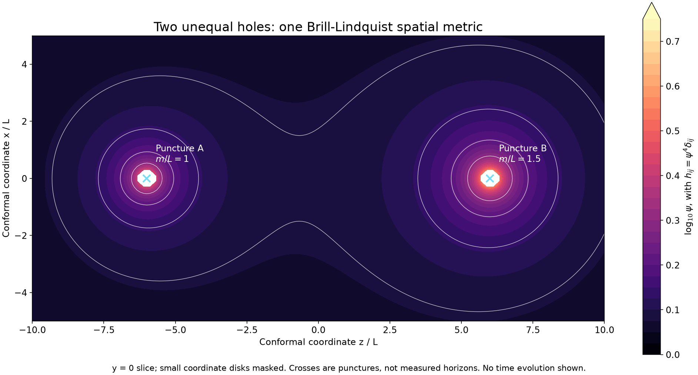

*Figure 4. The explicit two-hole initial-data benchmark. This is a
nonspherical common parent with unequal ends, not a solved evolution that
creates children. Local spherical models must earn an attachment to it or
belong to a separate parent family.*

The alternative parent route imports an existence result instead of
re-solving its gluing equations. [Chruściel, Corvino and Isenberg
(0909.1101v1)](https://arxiv.org/html/0909.1101v1) provide sufficiently
separated scalar-flat bodies with retained interior regions and a common
Schwarzschild outer end. Their more general
[vacuum-end theorem (1004.1355v1)](https://arxiv.org/html/1004.1355v1)
allows appropriate non-time-symmetric ends. These establish separate
families, not a modification that leaves the displayed Brill–Lindquist
data unchanged. No explicit sufficient separation is certified here.

### 8. A failed attachment can sharpen the map

<!-- nsc-claim:atlas-junction-screen -->

Evidence: [radiation junction](../results/development/nsc-cosmological-atlas-v2/junction.json),
[moving-boundary conservation/control](../results/development/nsc-cosmological-atlas-v3/moving-boundary.json),
and [source assumptions](../docs/nsc-atlas-moving-boundaries.md).

The first attachment screen pairs a closed radiation FLRW region with a
vacuum exterior and a pure constant-tension wall. For a comoving boundary,
$a=A\sin\eta$, $t=A(1-\cos\eta)$, and $R=a\sin\chi$.
The junction condition would require, over an interval of changing $R$,

$$
k^2R^4-2\cos\chi\,kR^3+2MR-A^2\sin^4\chi=0.
$$

For nonzero $A\sin\chi$, this cannot be a polynomial identity on that
interval. The recorded $\chi=\pi/3$, $M=0.4A$ test exposes a source
incompatibility, not a failure of all interiors.

Could a moving wall repair the same model? Intrinsic conservation answers
before a new simulation is needed. Fixed pure tension has zero intrinsic
stress divergence, so the Codazzi relation requires zero net normal energy
flux. In the fluid rest frame,

$$
T(U,n)=(\rho+p)\gamma^2v.
$$

A vacuum exterior contributes no flux and radiation has $\rho+p>0$;
therefore $v=0$. Motion alone cannot rescue these assumptions.
This is a compatibility application of an established conservation law.
Allowing a different surface source, exterior state or flux would define
a different candidate requiring its own test.

### 9. A distinct fixed-source wall that does connect

For the next branch, take de Sitter inside and Schwarzschild outside,

$$
f_-=1-H^2R^2,\qquad f_+=1-\frac{2M}{R}.
$$

In $G=c=1$ units let $\kappa=4\pi\sigma>0$, with surface pressure
$P=-\sigma$. The signed angular extrinsic curvatures obey

$$
\beta_--\beta_+=\kappa R,\qquad
\beta_\pm=\epsilon_\pm\sqrt{\dot R^2+f_\pm}.
$$

Here the dot is wall proper time and $\epsilon_\pm$ fixes the normal
orientation. Squaring and then forgetting those signs would lose physical
branches. The useful explicit expressions are

$$
\beta_-=\frac{M}{\kappa R^2}+\frac{\kappa^2-H^2}{2\kappa}R,
$$

$$
\beta_+=\frac{M}{\kappa R^2}-\frac{\kappa^2+H^2}{2\kappa}R,\qquad
\dot R^2=\beta_-^2-f_-.
$$

We hold $H\ell=1$, $\kappa\ell=2$, $M/\ell=0.4$ fixed.
On the tested expanding segment $1.2\leq R/\ell\leq1.8$,
$\beta_->0$ and $\beta_+<0$. The wall proper duration is
$0.3718706103\ell$. Direct unsquared and pressure checks, including a
separate Christoffel-based calculation, agree within the recorded numerical
residuals. The wall's areal-radius rate is not a local three-speed.
This published wall family is classified more fully in
Section 11; the source has not been retuned to make the segment work.

### 10. A sourced initial slice and a conditional common parent

<!-- nsc-claim:atlas-sourced-slice -->

Evidence: [slice constraints](../results/development/nsc-cosmological-atlas-v4/connection-slice.json),
[parent assembly](../results/development/nsc-cosmological-atlas-v4/parent-assembly.json),
[slice derivation](../docs/nsc-atlas-connection-slice.md), and
[end-only gluing argument](../docs/nsc-atlas-connection-gluing.md).

At $R_w=1.5\ell$, the interior is a flat expanding de Sitter cap: a
regular spatial three-ball with $h=dl^2+R^2d\Omega^2$, $R'=1$
and $K^i{}_j=-H\delta^i{}_j$. We use
$K=-\mathcal L_T h/2$, where $T$ is the future unit slice normal.
Define $V=T(R)$. The cap has $V_-=HR$.
Its slice determines the wall boost,

$$
\gamma=\frac{\beta_--HR\dot R}{1-H^2R^2},\qquad
\gamma v=\frac{\dot R-HR\beta_-}{1-H^2R^2}.
$$

The exterior inherits

$$
R'_+=\gamma\beta_+-\gamma v\dot R,\qquad
V_+=\gamma\dot R-\gamma v\beta_+.
$$

At this event $\gamma=1.00926203$, $v=0.13516599$,
$R'_+=-2.02778609$, and $V_+=1.90925372$.
The exterior slice is therefore not time symmetric at the material wall.

A fixed smooth slicing function tapers $V(R)$ to zero at $R_0=\ell$,
before the Schwarzschild throat $2M=0.8\ell$. In the transition,

$$
R'=-\sqrt{f_++V^2},\qquad
K^\theta{}_\theta=-\frac{V}{R},\qquad K^l{}_l=-\frac{dV}{dR}.
$$

These data describe a slice of the same vacuum Schwarzschild spacetime.
They do not interpolate the matter source. Its mass identity is

$$
M=\frac{R}{2}(1+V^2-R'^2).
$$

Where $V=K=0$, the slice continues smoothly through a bridge using
$R=2M\cosh^2u$, with the cap on the negative-$u$ side and the
selected parent end on the positive-$u$ side.

The distributional shell constraints are equally necessary. The surface
energy and radial momentum on this slice are
$E_\Sigma=\sigma\gamma$, $J_\Sigma=\sigma\gamma v$, giving

$$
[R']=-4\pi R E_\Sigma,\qquad [V]=4\pi R J_\Sigma.
$$

Their recorded residuals are below $2\times10^{-15}$ in normalized
units; independent finite-difference bulk residuals are below
$10^{-10}$. These are implementation checks, not a global stability
estimate.

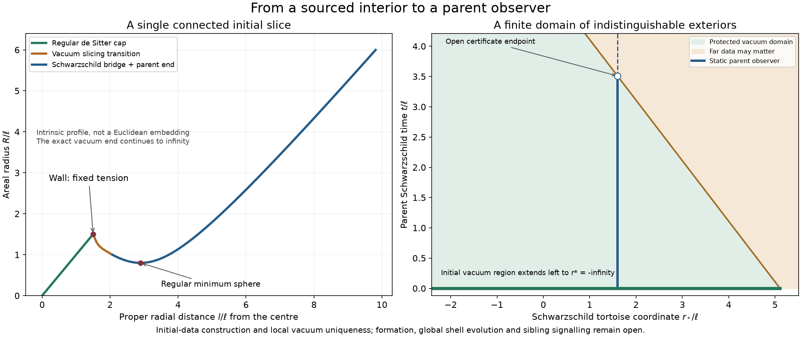

*Figure 5. The verified initial connection. Spatial distances are not ages.
Because $|R'|>1$ on part of the chosen slice, the radius profile should
not be interpreted as a Euclidean surface of revolution. The protected
right-exterior observer interval is a separate causal-domain statement.*

The selected right end of this body $A$, of mass $0.4\ell$, can be
used with the selected right end of an ordinary complete Schwarzschild
bridge $B$, of mass $0.6\ell$, in the imported vacuum-end gluing
theorem. It acts on smooth vacuum ends and preserves an open overlap.
Reattaching unchanged interiors on identical full $(h,K)$ data leaves
the original shell delta source intact and creates no seam source.
We do not apply a smooth global-data corollary directly to a thin shell.

The historical v4 conditional initial-data family has one designated common
parent end **and the untouched other end of $B$**: two asymptotic ends
in total. That second end has not become a cosmological child.
Sufficiently large separation is required but no numerical threshold or
explicit multi-body development has been calculated. The achievement is a
compatible sourced initial connection, not a regular formation history,
a general Einstein–shell evolution theorem or a stable cosmological future.

### 10.1. Two unequal sourced children in the same theory

<!-- nsc-claim:atlas-unequal-sourced-inputs -->

The second body can now carry its own cap and wall. Keep $H\ell=1$,
$k\ell=2$, $\xi=1/6$, quiet field $\phi=0$ and $R_w/\ell=1.5$ for
both bodies. Use masses $M_A/\ell=.4$, $M_B/\ell=.6$, with vacuum
slicing tapers ending at $R_{0,A}/\ell=1$ and $R_{0,B}/\ell=1.3$.
Both stops lie outside their respective throats. The mass changes the
object state; the taper changes the slice, with the action held fixed.

For B the signed factors are $\beta_-=151/120$,
$\beta_+=-209/120$ and $dR/d\tau=\sqrt{40801}/120$.
Its wall stress projections, bulk and shell constraints, geometric mass
and regular bridge pass the same checks as A. Its local normal-frame speed
is $v=.161244881293$, while its areal rate exceeds unity.
Each sourced body has one regular centre and one exact AE end. The
[unequal-input record](../results/summaries/nsc-atlas-unequal-children-v1.json)
reuses A's completed moments and evaluates B once; 42 focused controls pass.

[Chrusciel, Corvino and Isenberg's end theorem](https://arxiv.org/html/1004.1355v1)
therefore accepts two sourced inputs at sufficiently large separation.
Their selected ends become one parent end, without B's former extra end.
An exact quiet local solution neighbourhood can also be patched from the
already known source solutions and an auxiliary smooth vacuum development,
retaining wider identical annuli and trimming staggered cuts inside their
common vacuum neighbourhood. The
[local argument](../docs/nsc-atlas-connection-gluing.md#two-sourced-inputs-and-a-quiet-local-spacetime)
uses smooth vacuum uniqueness only off the walls. It supplies no numerical
separation threshold, uniform evolution interval, evaluated connector or
general uniqueness theorem for matter shells. Their observer clocks and
the cosmological reduction still need that geometry.

### 10.2. A retained grandchild and an explicit second boundary

<!-- nsc-claim:atlas-nested-slice -->

A different input A2 now puts two transitions on one explicit spherical
initial slice. It keeps the same quiet conformal-scalar and membrane law.
The regional metric functions are $f=1-2M/R-H^2R^2$:

| Region, ordered outward | $M/\ell$ | $H\ell$ | Connection |
| --- | ---: | ---: | --- |
| Inner regular cap | 0 | 1 | Centre to inner wall $R/\ell=.8$ |
| Kottler host | .01 | 1 | Left static branch, black-hole throat, right branch and expanding patch to outer wall $R/\ell=1.5$ |
| Outer Schwarzschild region | .4 | 0 | Left branch, throat $R/\ell=.8$, right AE end |

Both positive-tension walls obey the same signed equations,

$$
\beta_-=\frac{f_--f_++(kR)^2}{2kR},\qquad
\beta_+=\beta_--kR,\qquad \dot R^2=\beta_-^2-f_-.
$$

The expanding inner and outer factors are respectively
$(517/640,-507/640)$ and $(727/600,-1073/600)$.
The derivative of the same law gives the temporal Israel jump, while
the mean worldtube curvature satisfies the normal-force condition.
The equal-vacuum inner membrane remains a material source. All supplied
vacuum values and masses are part of this state, not outputs selected by
a cosmological observation.

In each bulk the assigned slicing function gives

$$
R'=\varepsilon\sqrt{f+V^2},\quad
R''=M/R^2-H^2R+VV_R,\quad
K^l{}_l=-V_R,\quad K^\theta{}_\theta=-V/R.
$$

Smooth tapers connect the walls to static bridges and the host's expanding
flat radial profile. Signed $y$ with $R=r_b+y^2$ resolves each minimum.
The host's two horizons are $r_b/\ell=.020008009615388216$ and
$r_c/\ell=.989845863754293$. The expanding profile crosses the latter
with $R'=1$. Both Hamiltonian/momentum constraints and both wall
distributions are retained. The slice ends analytically at its right AE
infinity; $R_{\mathrm{cut}}/\ell=4$ is the finite calculation domain.

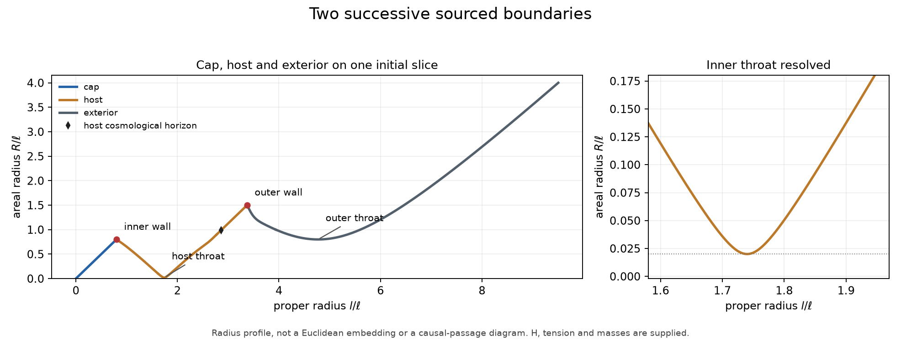

*Figure 6. One initial radial chain with two sourced boundaries. The inset
resolves the host's positive-radius minimum. Proper radius versus areal
radius is not a Euclidean embedding or a causal-passage diagram. The same
membrane law holds at both walls; regional state and slicing data are supplied.*

Explicit regular bulk charts are available. At a simple horizon $C$, let
$\kappa_C=(1-3H^2C^2)/(2C)$ and $R=C+\kappa_Cuw$. Then

$$
ds^2=Fdu^2+2du\,dw+R^2d\Omega^2,\qquad
F=\frac{w^2}{R}\left(\frac{1}{C}+H^2(R-C)\right).
$$

This is the algebraic form of
[Lake's coordinates, equations (5)--(10)](https://arxiv.org/html/gr-qc/0507031v2).
Independent warped-curvature algebra gives $R_{\mu\nu}=3H^2g_{\mu\nu}$;
the radial determinant is $-1$. Finite local charts do not identify
different cosmological regions or remove the $R=0$ singularity.
The single Killing time has $T_l=V/f$ and future normal
$N^T=R'/f$, negative on the left static branch. Section 10.5 now matches
both finite worldtube segments to this same initial slice using regular
overlapping coordinates; a static time alone does not cover the host.

The [two-level calculation](../results/summaries/nsc-atlas-nested-slice-v1.json)
and [slice derivation](../docs/nsc-atlas-connection-slice.md#two-successive-sourced-boundaries)
retain all assumptions and one Gauss 32/64 comparison. Twenty independent
controls pass. Its exact vacuum end can replace A in the end construction,
giving a conditional initial-data family with two unequal sourced children
and a retained grandchild. This establishes finite initial-data composition,
not unlimited generations, formation, stability or inherited detector states.

### 10.3. A central proper-clock and frequency observation

<!-- nsc-claim:atlas-nested-flash -->

Specify a radial inward geometric-optics flash from an ideal frequency
standard comoving with the inner material wall, with negligible backreaction.
The receiver follows the cap centre. Set flat-cap time $t=0$ at emission;
it is the centre's proper time. For $R_w=.8\ell$ and $H\ell=1$, the
null path and wall boost give

$$
t_{\mathrm{rec}}=-H^{-1}\log(1-HR_w)=\ell\log 5,
$$
$$
1+z=\frac{\gamma(1+v)}{1-HR_w}
=\frac{\beta_-+\dot R}{(1+HR_w)(1-HR_w)}
=3.7463933761061194.
$$

Here $\gamma(1+v)$ is the material wall's Doppler factor. Its initial speed
$v=-.280886551267$ is inward relative to the cap frame while its areal radius increases.
The host affects these factors through the junction. The flash stays
inside the wall: its inward radial speed is null, the wall is timelike,
and the expanding wall root persists to every finite cap time.

For the supplied ruler $\ell=10\,\mathrm{km}$, central receipt takes
$53.6850701$ microseconds after the specified emission-time origin.
The [recorded protocol](../results/summaries/nsc-atlas-nested-slice-v1.json)
agrees with independent 80-digit rational evaluation to
$1.45\times10^{-15}$ in the frequency ratio and
$1.30\times10^{-16}$ in $t_{\mathrm{rec}}/\ell$.
These measure roundoff, not input, model or experimental uncertainty.
The [causal derivation](../docs/nsc-atlas-connection-slice.md#a-central-test-flash-protocol)
uses no new field evolution. The source frequency standard and vacuum
scale are explicit inputs. The result supplies a conditional measurable
relation, not an observation of this emitter or an outer-wall signal
through the host bridge.

### 10.4. Radar and a wall clock recover a physical junction

<!-- nsc-claim:atlas-radar-clock-inverse -->

The atlas now has a geometry inverse using an ideal negligible transponder
and a calibrated proper clock on its quiet membrane. A central clock sends
a radial pulse at t_minus and receives its immediate return at t_plus.
The transponder is a test device; the scalar's transparent boundary law
is unchanged. Work inside the static cap, where f=1-H^2*R^2>0 and
the optical radius is r_star=artanh(HR)/H. In central proper time T,
the reflection event obeys t_minus=T-r_star and t_plus=T+r_star.

Let D be half the round-trip interval, Z=dt_plus/dtau the calibrated
wall-clock redshift, K=dt_plus/dt_minus the echo stretch, and
s=d(log Z)/dt_plus its local receiver-time drift. For beta=f*T_tau>0
and v=R_tau, normalization gives beta^2-v^2=f. Thus

$$
Z=\frac{\beta+v}{f}=\frac{1}{\beta-v},\qquad
K=\frac{\beta+v}{\beta-v},\qquad f=K/Z^2.
$$

The Doppler motion cancels. More generally, send and return times are
null coordinates for a radial patch with unique light paths. In their
radar coordinates T=(t_plus+t_minus)/2 and D=(t_plus-t_minus)/2,

$$
ds_2^2=C(T,D)(-dT^2+dD^2),\qquad
1=C\frac{dt_-}{d\tau}\frac{dt_+}{d\tau},\qquad C=K/Z^2.
$$

This measures the radial metric on the transponder worldline even in
a time-dependent geometry, without imposing a gravitational field
equation. Its angular-radius function and off-worldline metric remain
undetermined. The separate quiet-cap inverse may fail while this readout
remains valid; an explicit evolving-metric control checks that case.
For the declared regular vacuum-cap family, put x=sqrt(1-f) and u=artanh(x):

$$
H=\frac{u}{D},\qquad R=\frac{Dx}{u},\qquad
\beta=\frac{Zf+Z^{-1}}{2},\qquad v=\frac{Zf-Z^{-1}}{2}.
$$

The zero-curvature limits are H=0 and R=D. This reconstructs the supplied
cap curvature; it does not generate it. The signed constant-tension
junction has beta=a/R^2+cR, where a=M_host/k and
c=(k^2+H_host^2-H^2)/(2k). Differentiate the null clock and the same
wall dynamics to obtain

$$
\beta_R=Z(s-H^2R),\qquad
c=\frac{\beta_R+2\beta/R}{3},\qquad
a=\frac{R^2(\beta-R\beta_R)}{3}.
$$

For an independently specified host curvature, retain every positive
root of k^2-2ck+H_host^2-H^2=0 and set M_host=ka. An unknown host
curvature leaves a continuous ambiguity; a larger known host curvature
can leave two positive tensions with identical cap-side clock histories.
The ordinary Schwarzschild host and the equal-curvature inner host each
give a unique positive root for the states used here.

The original one-level reference at R/ell=.5 and the nested inner wall
at R/ell=.8 supply the following conditional readouts:

| Readout | One-level reference | Nested inner wall |
| --- | ---: | ---: |
| D/ell | .549306144334055 | 1.09861228866811 |
| Z | 2.62549201161791 | 3.74639337610612 |
| K | 5.16990622730208 | 5.05276679827145 |
| s*ell | -.433158428652097 | 1.06171003724629 |
| Z after .04 ell of receiver time | 2.58466102249367 | 3.90852634473171 |

The first local readout and its derivative recover H*ell=1 and k*ell=2
in both states, with M_host/ell=.4 and .01 respectively. These are
different established states under one membrane law; no common-parent
clock history is assumed. After inference, integrate dt_plus/dR using
only H,a,c to predict the later row without additional calibration.
An independent proper-time evolution agrees within 3.56e-15 in Z, and
an 80-digit quadrature checks the nested result. These are numerical
comparison indicators, not physical error bars.

A changed material law beta_new=beta+.5*(R-R0)^2/ell^2 has exactly the
same first local readout. Its later Z differs by .0002413953 and
.0001163056, while the corresponding short-interval surface density
stays positive. The finite prediction therefore tests continuation of
the constant membrane law. It cannot separate the two tension branches
when their full cap histories agree.

At ell=10km the later receiver interval is **1.33425638079 microseconds**.
For an explicitly assumed independent 100ppm bound on D,Z,K, monotonic
analytic input bounds give the nested Lambda_cap*ell^2 in
[2.99837630274001,3.00162434110127]. This is a synthetic instrument
bound, with float64 endpoint evaluation, not an astronomical measurement,
a total model uncertainty or a new effective cosmological constant.
An uncalibrated beacon or unknown reflection delay restores degeneracy.
The [full proof and domain](../docs/nsc-atlas-radar-clock.md)
and [compact calculation](../results/summaries/nsc-atlas-radar-inverse-v1.json)
bind the source bytes and independent controls. The next section supplies
a finite two-wall host history. A collective parent and the physical
origin of the cap scale remain separate work.

### 10.5. Both walls in one host history

<!-- nsc-claim:atlas-two-wall-history -->

Continue the two walls of Section 10.2 through $0\leq\tau_i/\ell\leq.04$,
retaining all three regional metrics, the common tension and the original
slicing functions. Each $\tau_i=0$ is its own intersection with that
initial slice. Equal elapsed wall proper times do not define simultaneous
events. The scalar stays zero; this continuation supplies the geometry
on which a subsequent field can propagate.

Fix the host bridge at $T=0$ and its tortoise coordinate by
$r_*(.5\ell)=0$. The original oriented slice then determines
$T_l=V/f$ and both wall origins. With $p=T+r_*$ and $q=T-r_*$,

$$
p_l=\frac{1}{R'-V},\qquad q_l=-\frac{1}{R'+V}.
$$

The second expression stays regular through the right cosmological
horizon. At the host black-hole root $r_b$, the Lake chart of Section 10.2
uses $q=-\log(|u|/\ell)/\kappa_b$ and
$R=r_b+\kappa_buw$, where $\kappa_b=f'(r_b)/2$.
Signed bridge coordinate $R=r_b+y^2$ gives leading terms $u=a y$ and
$w=y/(\kappa_ba)$ smoothly through the neck. Their signs identify the two
branches; independently resetting a wall's host clock would lose the
shared embedding.

Let $\beta_h=\beta_+$ at the inner wall and $\beta_h=\beta_-$ at the
outer wall. The signed junction motion and proper normalization give

$$
p_\tau=\frac{1}{\beta_h-\dot R},\qquad
q_\tau=\frac{1}{\beta_h+\dot R}.
$$

The incoming host characteristic has constant $p$ at the inner wall and
constant $q$ at the outer wall. Its intersection with the original slice
defines a source label $l_{\rm foot}$. The arrival maps obey

$$
\frac{d\tau_{\rm inner}}{dl_{\rm foot}}
=\frac{\beta_h-\dot R}{R'-V},\qquad
\frac{d\tau_{\rm outer}}{dl_{\rm foot}}
=-\frac{\beta_h+\dot R}{R'+V}.
$$

The numerator is evaluated at the receiving wall event and the denominator
at the initial foot. These maps convert the original spatial source
labels into arrival proper times. They do not assign emitter-clock
redshifts or ages to whole regions.

At the two distinct endpoint events $\tau_i=.04\ell$, the calculation gives:

| Quantity in $\ell$ units | Inner wall | Outer wall |
| --- | ---: | ---: |
| Wall areal radius | .822921192107 | 1.567950150020 |
| Initial incoming-foot areal radius | .780076707080 | 1.466056964357 |
| Original source-label interval | [.8, .829362369820] | [3.338689615754, 3.372632651397] |

At $\tau_i/\ell=(0,.02,.04)$ the arrival derivatives are
$(1.334617,1.362318,1.391007)$ for the inner wall and
$(-1.143723,-1.178627,-1.214567)$ for the outer wall.
These are three evaluated cuts, not extrema of the derivative.
The largest recorded 32/64 quadrature change is $1.31\times10^{-12}$,
in the arrival derivative. Independent second-order wall evolution agrees
in $T/\ell$ within $3.34\times10^{-16}$; separate null integration
agrees within $3.50\times10^{-15}$. The wall metric-normalization residual
is below $1.14\times10^{-13}$. These are numerical comparison indicators,
without a physical input-uncertainty estimate.

The future orientation has $du\leq0,dw\geq0$ for $F\geq0$.
Throughout these segments the inner wall has $u,w<0$ and the outer wall
has $u,w>0$; the wall-growth bounds preserve these signs over the full
proper-time intervals. Inner-to-outer propagation would require increasing $u$;
outer-to-inner propagation would require decreasing $w$. Neither causal
edge exists through this constructed host patch. This is a domain-specific
result, without an assertion about additional global extensions.

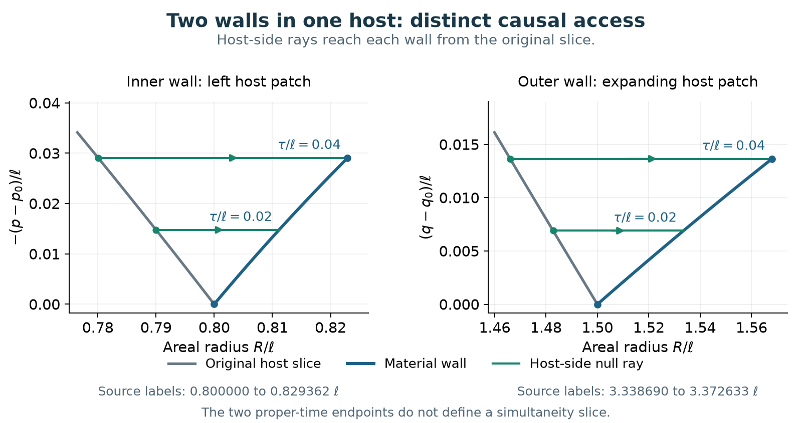

*Figure 7. Two host null-coordinate panels of the common embedding.
Horizontal constant-$p$ and constant-$q$ rays connect the original slice
(grey) to the inner and outer worldtubes (blue), respectively. Displayed
coordinate offsets position each panel; both host origins remain fixed
by one initial slice. The marked endpoints use separate wall proper
clocks and do not define a common time slice. The
[figure record](../docs/figures/nsc-atlas-two-wall-history.json)
binds these views to the finite calculation.*

The [shared-history derivation](../docs/nsc-atlas-connection-slice.md#a-shared-two-wall-history-and-its-characteristic-origins)
and [compact calculation](../results/summaries/nsc-atlas-two-wall-history-v1.json)
retain the common chart convention, signed normalization and finite
comparison indicators. The history locates the next field-transfer
problem. Section 10.6 supplies a transported averaging foliation and its
moving-wall crossings. Neither connection supplies a new field state,
formation mechanism or origin of the regional vacuum values.

### 10.6. The shared parent evolves into a calculable effective source

<!-- nsc-claim:atlas-parent-normal-evolution -->

Evidence: [normal-clock derivation](../docs/nsc-atlas-parent-evolution.md)
and [compact evolving-parent calculation](../results/summaries/nsc-atlas-parent-evolution-v1.json).

Choose freely falling observers initially normal to the original shared
slice. Their proper time defines one simultaneous leaf through both
walls and both bridge minima. Its outer boundary follows the original
$R=4\ell$ normal ray. This is a declared averaging clock on the same
quiet spacetime, with unchanged masses, regional curvatures and membrane
law. It provides the previously missing physical history for the
composition and source-balance equations in Section 6.1.21.

In a smooth regional chart write
$ds^2=-dt^2+A^2dx^2+R^2d\Omega^2$, with $x$ the initial proper-distance
label, $V=R_t$, $B=A_t$ and signed $E=R_x/A$. The complete bulk transport is

$$
R_t=V,\qquad V_t=-\frac{M}{R^2}+H_i^2R,\qquad
A_t=B,\qquad B_t=\left(\frac{2M}{R^3}+H_i^2\right)A.
$$

Initially $A=1$, $B=V_R$. The signed Killing energy $E$ is conserved
on each smooth geodesic segment and satisfies $V^2+f=E^2$. Differentiating
the radial equation proves $R_x=EA$, including the regular $E=0$
bridge limit. The clock therefore crosses horizons without dividing by
$f$ or treating a spatial minimum as a focal point. Intrinsic curvature,
expansion and shear follow independently:

$$
{}^{(3)}R=-\frac{4E_x}{AR}+\frac{2(1-E^2)}{R^2},\quad
\theta=\frac{B}{A}+\frac{2V}{R},\quad
\sigma^2=\frac13\left(\frac{B}{A}-\frac{V}{R}\right)^2.
$$

At a material wall put $U=\gamma N+b s$ and $b=\gamma v$.
The signed Israel law implies the outward spatial jumps
$[V]=kRb$ and $[E]=-kR\gamma$. A normal geodesic crosses in the
direction opposite $b$, so its future crossing data obey

$$
V_{\rm after}=V_{\rm before}-kR|b|,\qquad
A_{\rm after}=A_{\rm before},\qquad
B_{\rm after}=B_{\rm before}+\frac{kA}{|b|}.
$$

The last impulse follows from the radial Jacobi equation:
$R_{NsNs}^{\rm sing}=-k\delta(\eta)$ and $N(\eta)=-b$.
Omitting it would lose the physical membrane curvature. The inner
crossed normals come from the cap; the outer crossed normals come from
the exterior. Both enter the host. Their wall clocks satisfy
$dt/d\tau=\gamma$; they are not reset independently.

The new strip from crossings at time $s$ has proper-volume element

$$
dV(t;s)=4\pi R(t;s)^2A(t;s)\frac{|v(s)|}{A(s;s)}\,ds.
$$

It is added once, together with each wall's curvature, energy and spatial
stress atoms:
$C_W=2\kappa E_W$,
$E_W=4\pi R^2\sigma\gamma$, and
$S_W=4\pi R^2\sigma(\gamma-3/\gamma)$.
The analytic normal map has $A>0$ because $B(0)\geq0$, the smooth
Jacobi coefficient is nonnegative, and each impulse increases $B$.
For the smallest host throat, a first-exit estimate gives
$R\geq r_b-2Mt^2/r_b^2\geq .0150120120\ell>r_b/2$
through $0\leq t/\ell\leq.01$. The cap centre is exact and regular.
The wall rapidity bounds preserve both incoming branches on this interval.
The derivation records the piecewise charts at the transported initial
wall labels; no additional physical shell is introduced there.

Let $C_D$ denote the proper-volume average of intrinsic three-curvature.
Using $L_{\rm ref}=2/k=\ell$, the same scalar effective source gives:

| Normal time $t/\ell$ | $H_D\ell$ | $\Lambda_{g,\rm tr}\ell^2$ | $(3Q+C_D)\ell^2$ |
| ---: | ---: | ---: | ---: |
| 0 | .092609049 | -.0153506330754 | 2.11796240047 |
| .005 | .094009378 | -.0143471868939 | 2.13982145265 |
| .01 | .095427142 | -.0134681818918 | 2.16143093935 |

Here $\Lambda_{g,\rm tr}=(Q-C_D)/4$ is the geometric
trace after retaining the explicit regional and wall sources. Including
those sources gives a different total trace, $.455231112462/\ell^2$ at
the endpoint. Neither scalar alone specifies a vacuum stress tensor.
At the midpoint the actual moment histories give

$$
\Lambda_{g,\rm tr,t}\ell^3\simeq .18865034,\qquad
J\ell^3\simeq .0437522915.
$$

The independently differentiated history satisfies
$Q_t+C_D_t+2H_DA_D=2\kappa J$,
with $A_D=3Q+C_D$. Halving the time-difference
step reduces its residual from $7.22\times10^{-9}$ to
$1.80\times10^{-9}/\ell^3$. The largest 32/64 change in the trace is
$1.28\times10^{-10}/\ell^2$. These are numerical indicators, not
observational uncertainties or a certified error enclosure.

The same inner-wall events supply a received signal. For an inward
test flash with calibrated wall proper frequency,

$$
t_{\rm rec}=t_e-H^{-1}\log(1-HR_W(t_e)),\qquad
1+z=\frac{\beta_-+\dot R_W}{1-H^2R_W^2}.
$$

At $t_e/\ell=0$ and $.01$, the central reception times are
$1.60943791243410\ell$ and $1.64616002849800\ell$, and the redshift
factors are $3.74639337610612$ and $3.89500911178850$.
Differentiating reception time with wall proper time independently
recovers the frequency ratio. Reception uses the established quiet cap
continuation, not an extension of the whole Gaussian foliation to that
later time. Thus one history produces both the evolving effective-source
table and a clock observable. The redshift alone does not measure the
whole average.

There is also a finite-time large-domain conclusion. On the original
outer time-symmetric Schwarzschild end, a geodesic starting at rest at
areal radius $r$ has

$$
R=r-\frac{Mt^2}{2r^2}-\frac{M^2t^4}{12r^5}+O(r^{-8}),\quad
A=1+\frac{Mt^2}{r^3}+\frac{5M^2t^4}{12r^6}+O(r^{-9}).
$$

At fixed bounded regular time, $\theta$, $\sigma^2$ and
intrinsic three-curvature are $O(r^{-6})$. Their proper integrals converge while
volume grows as the cube of the outer cut. All explicit sources remain
confined to the interior and its walls. Hence both geometric and total
effective trace averages tend to zero as the parent domain grows.
The local outer Schwarzschild vacuum contribution also remains zero.

This closes the shared-history-to-effective-source calculation on its
finite domain. It does not generate cosmological Lambda: the source
fails vacuum form, evolves, and dilutes in this isolated AE parent.
The outward connection now requires an actual cosmological domain with
a physically determined nonzero regional volume fraction and compatible
connector/history, followed by its observer light cone. The cap curvature
has not been derived by recovering its supplied value.

### 10.7. A compact parent and the limits of its global average

<!-- nsc-claim:atlas-compact-parent -->

Evidence: [compact-parent derivation](../docs/nsc-atlas-compact-parent.md)
and [complete-domain calculation](../results/summaries/nsc-atlas-compact-parent-v1.json).

The isolated parent's dilution can be removed by constructing a complete
compact domain. Retain its nested centre-to-outer-throat body and attach a
second sourced body on the other sheet of the same Schwarzschild bridge.
The regular completion uses the original one-level cap and membrane on
the right. The nested completion uses another copy of the nested body.
Both retain connector mass $.4\ell$, common tension $k=2/\ell$, regional
$H\ell=1$ or $0$, and $\phi=0$. The two outer walls begin at $1.5\ell$;
each nested interior retains its inner wall at $.8\ell$.

These are different global states in the same piecewise theory. The
interiors differ by their structure, while the connected vacuum has one
mass invariant. There is no ADM mass at infinity in the compact geometry.
No regional vacuum value or measured volume fraction is fitted.

Reflection reverses the right body's radial label and preserves its future
normal. Consequently $(E,V,A,B)$ maps to $(-E,V,A,B)$. Reversing the
side order at its outer wall also gives

$$
\beta_-^{g}=-\beta_+^{loc},\qquad
\beta_+^{g}=-\beta_-^{loc},\qquad
b_g=-b_{loc},\qquad \gamma_g=\gamma_{loc}.
$$

The global jumps remain $[E]=-kR\gamma$ and $[V]=kRb$; the angular
and temporal Israel jumps remain $-k$. At the regular right wall the
global spatial slopes are $2.027786089806$ and $-1$, while the future
wall areal derivative stays $1.650310950872$. The right body has not
been time-reversed.

Both tapers reach the same static vacuum collar at $R=\ell$. In the
bridge coordinate $R=2M+y^2$, the initial geometry is even in $y$,
$E$ is odd, and $V=B=0$. The halves agree on open extensions through
the throat, adding no seam source. The radial interval's two endpoint
spheres collapse regularly to centres, so the underlying manifold is
$S^3$, with three or four material walls and no asymptotic end or
arbitrary outer cutoff.

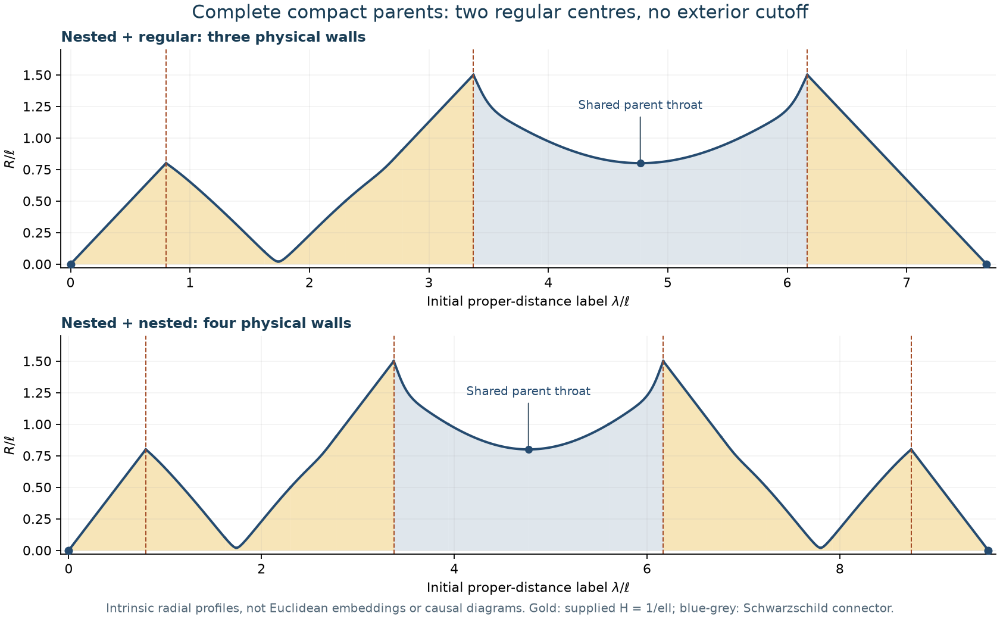

*Figure 8. The two complete compact initial profiles. Both use the same
connector and local membrane law; the lower state contains an additional
right-side descendant. Dashed lines are physical membranes. The radius
is plotted against proper distance, so these are intrinsic profiles rather
than Euclidean embeddings or causal diagrams.*

The normal evolution of Section 10.6 commutes with reflection. Its
positive Jacobi scale and radius bounds apply to each half through
$0\leq t/\ell\leq.01$. Each half contributes its seven moments and
its physical wall atoms once. The common throat has no surface source.
For the symmetric double, extensive moments double and all means stay
unchanged. Different halves require the between-region expansion
variance from Section 6.1.21.

Thus the proper-volume fraction $f_H$ of regions with $H\ell=1$ follows
from the geometry and its evolution. At $t/\ell=.01$,
$L_{\rm ref}=2/k=\ell$ gives:

| Right interior | $f_H$ | $\Lambda_{g,\rm tr}\ell^2$ | $\Lambda_{\rm total,tr}\ell^2$ |
| --- | ---: | ---: | ---: |
| Regular | .48620333 | -1.037400004 | 3.171376758 |
| Nested | .52228729 | -1.219330524 | 3.212316830 |

The total volumes are $71.1461599485\ell^3$ and $76.5242717224\ell^3$.
The total trace has a definite source decomposition,

$$
\Lambda_{\rm total,tr}
=\Lambda_{g,\rm tr}+3H^2f_H
+\frac{\kappa}{4V_D}\sum_W(E_W-S_W).
$$

For the regular completion its terms in $\ell^{-2}$ units are
$-1.037400003975$, $1.458609994750$ and $2.750166766967$.
The value near three therefore includes the supplied cap vacuum and
material-wall stress. The geometric vacuum defects are
$6.6134766493/\ell^2$ and $7.3326745903/\ell^2$; both effective
geometric sources fail vacuum form. Their midpoint trace derivatives
are approximately $1.0245354/\ell^3$ and $1.1843835/\ell^3$.
The actual moment histories satisfy the same source-conservation
identity, with approximately fourfold residual reduction on halving
the time-difference step. The largest 32/64 trace change is below
$1.2\times10^{-9}/\ell^2$, a numerical indicator rather than a
certified or observational uncertainty.

The comparison also proves a local-observability restriction. Adding
the remote nest changes the global total trace by
$.040940072190/\ell^2$ at the endpoint. The entire retained left
geometry and its inner-cap flash remain unchanged:
$1+z=3.895009111788$ at $t_{\rm rec}/\ell=1.646160028498$.

This follows from the actual connector clocks. Set $T=0$ on the
original static bridge and use its standard Kruskal coordinates $U,W$,
with future $dU,dW\geq0$ and

$$
-UW=(R/(2M)-1)e^{R/(2M)}.
$$

The left outer wall has $U>0,W<0$, and the right one has
$U<0,W>0$. Neither can signal the other through the constructed
connector. Their initial inward null fronts would require
$UW\geq15.6040388088$ to meet in the regular completion
($15.6031988754$ in the nested one), whereas the physical connector
has $UW<1$. This concerns those emission events; it is not a claim
that arbitrary future light cones never overlap.

The compact states therefore give different global averages but the
same local cap curvature and clock observation. Compactness removes
AE dilution; an additional causal/state mechanism is needed before a
global average can be identified with a locally measured cosmological
Lambda. The integrated constraint is satisfied by the local identities
and supplies no extra condition selecting the cap $H$ or absolute scale.

There is a separate continuation question. The small host throat starts
with $E=R_t=0$, and its exact quiet inward geodesic obeys
$R_t^2=2M_h/R+H^2R^2-1$. With $R=r_b\sin^2\chi$ and
$a=H^2r_b^2$, its proper lifetime to the classical endpoint is

$$
\tau_b=2r_b\int_0^{\pi/2}
\frac{\sin^2\chi\,d\chi}
{\sqrt{1-a(1+\sin^2\chi+\sin^4\chi)}}.
$$

The result is $.0314434597796\ell$, with analytic bounds
$.031434800637\ell\leq\tau_b\leq.031447397238\ell$.
The curvature contains $48M_h^2/R^6$, so this exact quiet geometry
does not smoothly continue the whole normal foliation through that
event. No physical topology change or claim of a literal infinity in
nature follows.

The spherical Einstein equations make the replacement problem precise.
For geometric mass $m=R(1-|\nabla R|^2)/2$, normal energy density
$\rho$ and radial pressure $p_r$,

$$
\nabla_N\nabla_N R=-\frac{m}{R^2}-\frac{\kappa R}{2}p_r,\qquad
\nabla_N\nabla_N R+\nabla_s\nabla_s R
=-\frac{\kappa R}{2}(\rho+p_r).
$$

At a temporal turn that is also a strict spatial minimum,
$E=R_t=0$ and $m=R/2$. A regular bounce requires
$\kappa p_r<-1/R^2$ and $\rho+p_r<0$.
At the current $r_b$, the pressure threshold is
$\kappa p_r\ell^2<-2497.9987983973$, compared with the supplied
vacuum value $-3$. This is a necessary source condition at that
radius, with compatible density and conservation still required.
It does not construct a bounce or prove that one occurs.

The compact atlas connection and its global-versus-local comparison
are complete on the stated finite domain. A source-derived regular
continuation, cosmological observer history and the origin of the
regional vacuum values remain the next physical questions.

### 10.8. The nested body in an expanding parent

<!-- nsc-claim:atlas-cosmological-parent -->

Evidence: [cosmological attachment and observer derivation](../docs/nsc-atlas-parent-observables.md),
[compact calculation](../results/summaries/nsc-atlas-parent-observables-v1.json)
and [independent checks](../tests/test_nsc_atlas_parent_observables.py).

An atlas needs both its local rooms and the world they inhabit. The
isolated and compact constructions above supply two completions of the
same nested body. A third now attaches its right Schwarzschild exterior
to an expanding dust universe. The new join has no material membrane.
Its geometry is borrowed from Einstein and Straus; the matching formulas
are presented in [Mars, Mena and Vera, Section 2](https://arxiv.org/html/1307.4371#S2).
The connection here is to the already sourced NSC interior and its
observer map.

Keep $M=.4\ell$, the original $L_{\rm ref}=\ell=2/k$, and the
increasing-radius exterior beyond the bridge. Choose the initial
cosmological join at $R_b(0)=4\ell$. With $G=c=1$, the two metrics are

$$
ds_F^2=-d\tau^2+a(\tau)^2(d\chi^2+\chi^2d\Omega^2),
$$

$$
ds_S^2=-f\,dT^2+f^{-1}dR^2+R^2d\Omega^2,\qquad f=1-\frac{2M}{R}.
$$

On the comoving boundary $R_b=a\chi_b$, equality of the angular
extrinsic curvature requires

$$
\sqrt{\dot R_b^2+f_b}=1,\qquad
\dot R_b^2=\frac{2M}{R_b},\qquad \dot T_b=\frac{1}{f_b}.
$$

Both induced metrics equal $-d\tau^2+R_b^2d\Omega^2$.
The boundary is geodesic, with radial acceleration $-M/R_b^2$, so the temporal
extrinsic curvature is also zero on both sides. The full Darmois
conditions hold. The flat dust Friedmann equation gives

$$
M=\frac{4\pi}{3}\rho_d R_b^3,\qquad
H_0^2=\frac{2M}{R_b(0)^3},\qquad
a(\tau)=\left(1+\frac{3}{2}H_0\tau\right)^{2/3}.
$$

This identity supplies the mass accounting. The exterior mass replaces
the dust removed to accommodate the attached interior. Its internal
proper energy is not another exterior mass to add to that equation.
The parent has $H_0\ell=.111803398875$ and
$\rho_d(0)\ell^2=.00149207759149$. The join radius and the dust
assumption are supplied; these values are conditional outputs.

The initial surface also needs a connection. Preserve the old static
collar through $R=\ell$, then set $dT/dR=w(R)\sqrt{2M/R}/f$.
A smoothstep takes $w$ from zero to one by $R=3.5\ell$.
The induced radial metric is $(1-w^2\,2M/R)/f>0$, becomes one near
the join, and satisfies the vacuum constraints. It supplies a spacelike
surface connecting the retained interior to the cosmic clock.
Keeping the old zero-velocity normal at the join instead would select
a different, closed-dust turnaround. The expanding construction changes
the outer slicing explicitly; it does not reinterpret the previous
normal averages or evolve the compact $S^3$ into a different topology.

Now follow a light ray. A static emitter at $R_e=2\ell$ emits at the
Killing time of the boundary's $\tau=0$ event. A comoving observer on
the join receives it. With $v_b=\sqrt{2M/R_b}$ and
$r_*=R+2M\log(R/(2M)-1)$,

$$
\int_0^{\tau_r}\frac{d\tau}{1+v_b(\tau)}
=r_*(R_b(0))-r_*(R_e),\qquad
1+z=\frac{1+v_b(\tau_r)}{\sqrt{f_e}}.
$$

The calculated reception is
$\tau_r/\ell=3.921887982097$, $R_b(\tau_r)/\ell=5.602745333858$,
and $1+z=1.778824923298$. An independent null ODE changes the
arrival by $1.3\times10^{-12}\ell$; a proper-clock derivative checks
the redshift. The experiment lies entirely on the parent side of
the bridge. It transmits no signal from the causally separated cap.
Its longer exterior history does not assert a regular continuation of
the inner throat. Seconds require an independent physical value of $\ell/c$.

The parent decelerates with $q=1/2$ and generates no cosmological
vacuum term. Its initial Ricci scalar divided by four is nevertheless
$.009375/\ell^2$, supplied by dust. The connected geometry therefore
distinguishes expansion, curvature trace and vacuum pressure.

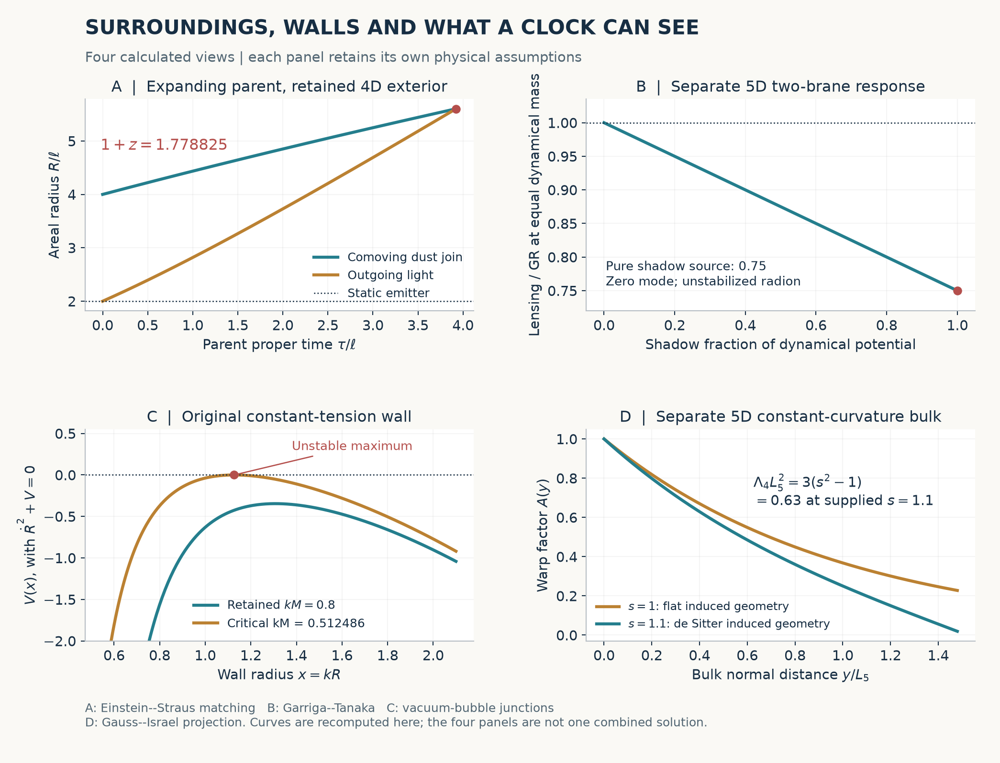

*Figure 9. A: the cosmological join and its received light ray.
B: the attributed two-brane lensing discriminator. C: the existing
constant-tension wall and its unstable critical comparison.
D: a separate bulk geometry inducing positive local curvature.
The curves are regenerated from the stated equations. Panels A and C
belong to the current four-dimensional family; B and D have different
five-dimensional backgrounds and have not been combined into one model.*

### 10.9. Two explicit ways surrounding geometry enters local gravity

<!-- nsc-claim:surrounding-bulk-reference -->

Evidence: [source conventions and geometric checks](../docs/nsc-atlas-parent-observables.md#b-a-surrounding-bulk-can-induce-local-curvature),
[finite examples](../results/summaries/nsc-atlas-parent-observables-v1.json),
[Shiromizu--Maeda--Sasaki](https://arxiv.org/html/gr-qc/9910076v3),
[Maartens--Koyama](https://arxiv.org/html/1004.3962)
and [Garriga--Tanaka](https://arxiv.org/html/hep-th/9911055v3).

The surrounding region can have a different mathematical role from an
ordinary exterior. In a brane construction, an observer occupies a
four-dimensional hypersurface of a five-dimensional bulk. The surface
curvature then depends on how it lies in that bulk. This is a distinct
candidate from the two-sphere membrane of the preceding sections.

For a $Z_2$-symmetric brane with tension $\lambda$, confined matter
$T_{\mu\nu}$ and a bulk cosmological term, the Gauss and Israel
equations yield

$$
G_{\mu\nu}=-\Lambda_4q_{\mu\nu}+\kappa_4^2T_{\mu\nu}
+\kappa_5^4\pi_{\mu\nu}-E_{\mu\nu},
$$

$$
\kappa_4^2=\frac{\kappa_5^4\lambda}{6},\qquad
\Lambda_4=\frac{\Lambda_5}{2}+\frac{\kappa_5^4\lambda^2}{12}.
$$

The full quadratic tensor $\pi_{\mu\nu}$ and the conservation equation
are given in the linked derivation. $E_{\mu\nu}$ is the traceless
projection of bulk Weyl curvature. Direct contraction of the Gauss
equation agrees with this decomposition for the checked tensors,
including momentum flux and anisotropic pressure. That algebra does
not supply a bulk solution for arbitrary matter data.

A vacuum example does supply the whole surrounding metric. Set
$\Lambda_5=-6/L_5^2$ and

$$
ds_5^2=dy^2+A(y)^2ds_{\mathrm{dS}_4}^2,\qquad
A(y)=\cosh(y/L_5)-s\sinh(|y|/L_5),
$$

$$
s=\frac{\kappa_5^2\lambda L_5}{6}>1,\qquad
0\leq |y|<L_5\operatorname{atanh}(1/s).
$$

Both independent bulk sectional curvatures equal $-1/L_5^2$.
The junction fixes the first derivative of $A$ at the brane, giving

$$
\Lambda_4L_5^2=3(s^2-1).
$$

For the declared demonstration $s=1.1$, this is $.63$, with
$H_4L_5=.458257569496$. It is a positive, locally measurable
curvature induced by surrounding geometry and tension. The two inputs
$s,L_5$ have not been selected by inheritance, and $L_5$ is not
identified with the membrane ruler $\ell$.

The source channels can be distinguished. In a homogeneous isotropic
brane, a separately conserved Weyl contribution behaves as radiation,
$p_E=\rho_E/3$ and its density decreases as $a^{-4}$. For confined dust the
quadratic source obeys
$\rho_{\rm quad}=p_{\rm quad}=\rho^2/(2\lambda)$. Neither is the
constant vacuum term in this explicit example.

Garriga and Tanaka give a second, observationally useful construction:
matter on another flat brane affects the observer's metric through a
bulk gravitational response. With two branes and an unstabilized
massless radion, the static zero-mode source tensor is
$T_{\mu\nu}-q_{\mu\nu}T/3$. Its nonrelativistic time and spatial
components have ratio $2:1$. Use the metric convention

$$
ds^2=-(1+2\Phi)dt^2+(1-2\Psi)(dx^2+dy^2+dz^2).
$$

A pure shadow source then has $\Psi/\Phi=1/2$.

Slow orbits determine the dynamical potential, while light deflection
depends on both potentials. The straight-ray integral gives

$$
\alpha=\frac{2(1+\Psi/\Phi)G_4M_{\rm dyn}}{bc^2},\qquad
\frac{\alpha_{\rm shadow}}{\alpha_{\rm GR}}=\frac{3}{4}.
$$

This 25% reduction at the same dynamical mass is their published
discriminator, recovered here from the tensor and ray integral.
It shows what a quantitative outside-matter claim can look like.
For positive-brane observers, mixed sources with common profiles and
shadow potential fraction $f$ give

$$
\gamma_v=\frac{3-e^{-2d/L_5}}{3+e^{-2d/L_5}},\qquad
\frac{\Psi}{\Phi}=(1-f)\gamma_v+\frac{f}{2}.
$$

At $d/L_5=5$, the lensing ratios for $f=0,.5,1$ are
$.99998487$, $.87499243$ and $.75$. This $f$ is not a cosmological
density fraction. A stabilized radion or a different background
requires a new response calculation. In particular, these flat-brane
perturbations have not been grafted onto the detuned de Sitter example.

### 10.10. Can the enclosing wall select the cap curvature?

<!-- nsc-claim:wall-equilibrium-closure -->

Evidence: [signed wall proof and inheritance map](../docs/nsc-atlas-parent-observables.md#d-does-the-actual-wall-select-its-own-cap-scale),
[original wall implementation](../src/recursive_horizons/nsc_atlas_nested_slice.py)
and [symbolic and geometric controls](../tests/test_nsc_atlas_parent_observables.py).
The [compact evidence](../results/summaries/nsc-atlas-parent-observables-v1.json)
records the retained parameters and the critical comparison.

The natural equilibrium question is whether the wall itself determines
$H$, making $\Lambda=3H^2$ an output. The relevant building block is
the published vacuum-bubble dynamics, credited through
[Ansoldi, Guendelman and Shilon](https://arxiv.org/html/0711.2198v1#S3).
First consider the original massless cap-to-Schwarzschild member.
For its constant positive tension,
$p_s=-\sigma$, $k=4\pi G\sigma$ in $c=1$ units, the signed junction
gives the existing radial equation

$$
\dot R^2+V(R)=0,
$$

with potential

$$
V(R)=1-\frac{M^2}{k^2R^4}
-\frac{M(1-H^2/k^2)}{R}
-\frac{(k^2+H^2)^2R^2}{4k^2}.
$$

Write this as $1-A/R^4-B/R-CR^2$, with $A,C>0$.
At a stationary point, $B/R^3=2C-4A/R^6$. Substitution gives

$$
\left.V''\right|_{V'=0}=-\frac{12A}{R^6}-6C<0.
$$

Every static wall in this family is radially unstable. This exact
identity decides the suggested stable-equilibrium closure without
a scan. The full static family, with $u=H^2/k^2$, $x=kR$ and
$\mu=kM$, can be parameterized by

$$
q_*=\frac{u-1+\sqrt{9u^2+14u+9}}{8},\qquad
x^2=\frac{1}{3[(1+u)^2/4-q_*^2]},\qquad
\mu_{\rm crit}=q_*x^3 .
$$

Its signed factors obey $\beta_->0>\beta_+$ and the temporal
Israel condition. Thus the exterior remains on the wormhole branch.
The critical mass decreases with $u\geq0$ from
$\mu_{\rm crit}(0)=16/27$. Our retained $\mu=.8$ exceeds that
ceiling: at fixed $M,k$ it admits no static state at any nonnegative
$H^2$. At the illustrative critical state with $u=.25$,
$\mu=.512485700729$, $x=1.126996043952$ and
$V_{xx}=-3.881941479272$.

The actual nested outer wall has inner Kottler mass $m=.01\ell$.
Its potential replaces $A$ by $(M-m)^2/k^2$ and $B$ by
$M+m-(M-m)u$. The same negative-curvature identity applies.
More strongly, its dimensionless potential is the massless expression
at $k(M-m)=.78$, minus $.04/x$. Since $.78>16/27$, it is
everywhere negative and also has no static root. The massless
critical curve is a comparison bound for this nested wall.

The scale-compatible inheritance map

$$
(R,M,k,H)\longmapsto(aR,aM,k/a,H/a)
$$

preserves $kM$ and $H/k$ for every $a>0$. It transports a
dimensionless model without selecting those invariants.
The full inherited-operator programme may supply additional conditions;
this wall calculation does not yet identify them. The cap radius
$H^{-1}$ and its material wall radius $R$ are different quantities.
The compact average counterexample does not make them equal.

Gravastars provide a useful next building block.
[Mazur and Mottola](https://arxiv.org/html/gr-qc/0109035) place a
material transition layer between a de Sitter core and a Schwarzschild
exterior. [Visser and Wiltshire](https://arxiv.org/html/gr-qc/0310107)
make stability depend explicitly on the thin shell's equation of state.
For a no-flux shell,

$$
\frac{d\sigma}{dR}=-\frac{2(\sigma+p_s)}{R}.
$$

The current $p_s=-\sigma$ is one special case. An inherited material
or state response could supply another and change stability.
That is the connection to derive before using a stable gravastar to
select the cap scale. These published results do not select the
new material law for us.

The classic [Morris--Thorne construction](https://doi.org/10.1119/1.15620)
already relates traversable throats to negative radial null stress.
Section 10.7 applies a related Einstein-equation condition at the
specified dynamical turn; it makes no priority claim for that
requirement. [Easson and Brandenberger](https://arxiv.org/abs/hep-th/0103019)
likewise belongs in the black-hole-interior cosmology family. Each
construction contributes its established mechanism with its premises.

### 10.11. The source law behind a growing mass

<!-- nsc-claim:population-source-balance -->

Evidence: [energy accounting and finite counterexample](../docs/nsc-atlas-parent-observables.md#e-growing-black-hole-masses-and-the-missing-energy-equation),
[calculated balances](../results/summaries/nsc-atlas-parent-observables-v1.json)
and [conservation checks](../tests/test_nsc_atlas_parent_observables.py).

The proposal that black holes supply dark energy makes the source
question especially sharp. For fixed comoving number,
a mass growing as $a^n$ gives a density growing as $a^{n-3}$.
The balance law is

$$
\dot\rho_B+3H(\rho_B+p_B)=Q.
$$

A separately conserved effective component has $Q=0$ and
$w_B=-n/3$. Pressureless mass receiving energy instead has
$p_B=0$ and $Q=nH\rho_B$. The mass law alone does not decide which
description follows from the geometry.

For example, take $\rho_B=.1$ and a pressureless reservoir
$\rho_X=a^{-3}-.1$, in units of the initial total density.
Over $1\leq a\leq2$, both are nonnegative and the transfers cancel.
The total density is $a^{-3}$, total pressure zero and $q=1/2$,
even though the black-hole component has constant density.
This is a homogeneous conservation counterexample, not a microscopic
accretion model. It identifies the equation an inherited coupling must supply.

[Farrah and collaborators](https://arxiv.org/abs/2302.07878) propose
a cosmological mass-growth mechanism; [Ghodla and collaborators](https://arxiv.org/abs/2306.08199)
derive binary-merger consequences of such growth. The atlas includes
both the proposed connection and an independent way of testing it.
Neither supplies an observational validation of the present NSC geometry.

The next selection problem is now explicit: derive an inherited
stress/state law or gravitational reduction, obtain its dimensionless
parameters, and propagate the same solution to expansion, clustering,
lensing and thermal history. The present chapter adds a cosmological
connection, an observable clock relation, useful external mechanisms
and a decided equilibrium question. It does not yet predict the
cosmological density fractions or matter--antimatter asymmetry.

### 10.12. Sourced rooms from an occupied wall spectrum

<!-- nsc-claim:occupied-wall-source -->

Evidence: [state, stress and signed geometry](../docs/nsc-atlas-occupied-wall.md),
[finite calculation](../results/summaries/nsc-atlas-occupied-wall-v1.json)
and [independent controls](../tests/test_nsc_atlas_occupied_wall.py).

The equilibrium question in Section 10.10 asks for a material law.
A finite occupied field supplies one: its energy changes when the
surface changes, and that derivative determines pressure. This connects
the geometric spectrum to a gravitational source before a wall potential
is chosen.

The construction introduces a new surface theory. Its Einstein bulk has
a de Sitter core, a Schwarzschild collar and a zero classical scalar.
The wall carries a positive bare tension and two parity-paired massless
Dirac species:

$$
S_\Sigma=-\sigma_0\int_\Sigma\sqrt{-\gamma}\,d^3y+S_D,
$$

$$
S_D=\sum_{j=1}^{2}\int_\Sigma\sqrt{-\gamma}\,
\overline{\chi}_j\,i\hbar D_\Sigma\chi_j\,d^3y.
$$

Use the conformal reference vacuum and its normal-ordered finite
excitation stress, with specified renormalized tension and no additional
surface-curvature terms. This is a declared effective material candidate.
The original transparent bulk probe has no trapping interaction and is
not reinterpreted as this surface field.

[Macpherson and Campbell](https://arxiv.org/html/hep-ph/9408387)
provide the localized-fermion wall precedent.
[Ogure, Yoshida and Arafune](https://arxiv.org/html/hep-ph/0212332)
calculate its finite spherical occupation and discuss fragmentation.
A finite-thickness realization of the present gravitating surface
theory remains a separate problem.

For one two-component spinor, the positive sphere eigenvalues are
$n/R$, with degeneracy $2n$.
[Abrikosov's spherical Dirac analysis](https://arxiv.org/html/hep-th/0212134)
gives the spectrum and its rotational representations, with attribution
to earlier Newman--Penrose and related work. Fill all angular states
through level $q$ in each of $g=2$ species. The state is isotropic and
has the exact finite sums

$$
N_q=gq(q+1),\qquad
\mathcal A_q=\frac{gq(q+1)(2q+1)}{3},\qquad
E_q=\frac{\hbar c\,\mathcal A_q}{R}.
$$

The negative-energy reference branch is not counted again as occupied
positive particles. Varying the energy with area at fixed occupation gives

$$
\sigma=\sigma_0+\frac{\hbar c\,\mathcal A_q}{4\pi R^3},
\qquad
p=-\sigma_0+\frac{\hbar c\,\mathcal A_q}{8\pi R^3}.
$$

The gas pressure is half its surface energy density. The total obeys
$d(\sigma R^2)/dR+2pR=0$. Its occupied part has zero trace, yet
changes the full stress tensor and the resulting geometry.

This state is transported exactly within the surface theory.
On $-d\tau^2+R(\tau)^2d\Omega^2$, use $d\eta=d\tau/R$ and
rescale the spinor by $R^{-1}$. The resulting Hamiltonian is the same
unit-sphere Dirac operator. Its occupied projectors commute with
the unitary evolution. Number is conserved and energy scales as $1/R$,
without assuming adiabatic motion. This inherits a specified occupation
along a wall; it does not select its initial value.

In $c=1$ units put $k_0=4\pi G\sigma_0$ and
$d=\ell_P^2\mathcal A_q$, with $\ell_P^2=G\hbar/c^3$ when units
are restored. The angular junction is

$$
\sqrt{\dot R^2+f_-}-\epsilon\sqrt{\dot R^2+f_+}
=s(R),\qquad s(R)=k_0R+\frac{d}{R^2}.
$$

Here $f_-=1-H^2R^2$ and $f_+=1-2M/R$.
The ordinary orientation is $\epsilon=+1$; the previous
wormhole-side orientation is $\epsilon=-1$.
For the latter, at a static point with $a=\sqrt{f_-}$ and
$b=\sqrt{f_+}$, implicit differentiation gives

$$
V''=
\frac{-H^2/a^3-2M/(bR^3)-M^2/(b^3R^4)-6d/R^4}
{1/(2a)+1/(2b)}<0.
$$

Thus positive occupation does not stabilize the former wormhole
branch. The ordinary orientation has a different sign in this test.
One exact reference, specified before comparison with observations, is

$$
a=\frac{24}{25},\qquad b=\frac{4}{5},\qquad
H^2R_0^2=\frac{49}{625},\qquad \frac{M_0}{R_0}=\frac{9}{50}.
$$

Both Israel conditions then fix positive components,

$$
k_0R_0=\frac{1}{225},\qquad
\frac{d}{R_0^2}=\frac{7}{45},\qquad
4\pi G R_0\sigma=\frac{4}{25},\qquad
4\pi G R_0p=\frac{11}{150}.
$$

The centre is regular, the wall lies inside the core's static horizon,
and the exterior starts outside $2M$. The resulting room is horizonless.
At fixed mass, curvature, bare tension and occupation, its radial potential has

$$
V=V'=0,\qquad R_0^2V''=\frac{35159}{7200}>0,\qquad
\frac{\omega_{\rm radial}R_0}{c}
=\frac{\sqrt{35159}}{120}=1.562561109916.
$$

This establishes linear radial stability in the mean-stress surface
model. Finite disturbances carry energy and change the exterior mass
at second order. Nonspherical and fragmentation stability are not
established; the localized-fermion literature makes that distinction
essential.

**Fixed couplings, unequal occupied states.**

Choose the finite reference $q_0=1000$, with $N_0=2,002,000$.
The spectral sum and the declared gas compactness give

$$
\frac{R_0}{\ell_P}=\sqrt{\frac{45\mathcal A_{1000}}{7}}
=92651.4435937.
$$

This is a physical ruler for the conditional example, not a predicted
cosmological length. The reference shape and state determine its action
parameters once. Thereafter keep $G,\hbar,\sigma_0,H$ fixed and change
only the occupation.

For geometric shell mass $m_s=k_0R^2+d/R$, the signed static junction gives

$$
M(R,q)=\frac{H^2R^3}{2}
+m_s\sqrt{1-H^2R^2}-\frac{m_s^2}{2R}.
$$

Equilibrium requires $M_R=0$. The positive reference Hessian
$R_0M_{RR}=35159/86400$ gives a locally unique family.
Its exact response to spectral energy is

$$
\frac{dM_{\rm eq}}{d\mathcal A}
=\frac{\ell_P^2\beta_+}{R}.
$$

The extra local energy contributes to the mass measured outside with
its gravitational redshift. This accounts for the interior through
the same mass used in the parent matching.

| q | Radius / R0 | Mass / R0 | Mode / level spacing |
| ---: | ---: | ---: | ---: |
| 999 | .9993406734 | .1796270290 | 1.563237585 |
| 1000 | 1.0000000000 | .1800000000 | 1.562561110 |
| 1001 | 1.0006588232 | .1803733226 | 1.561883618 |

The last column also compares the radial mode to the adjacent surface
level spacing $c/R$. A detector interaction and selection rules are
needed before identifying that spacing with an observed spectral line.

### 10.13. Two physical interiors, one parent, and a central beacon

<!-- nsc-claim:occupied-wall-parent-clocks -->

Evidence: [common parent and null transport](../docs/nsc-atlas-occupied-wall.md#two-unequal-interiors-in-one-evolving-cosmology),
[state and clock results](../results/summaries/nsc-atlas-occupied-wall-v1.json)
and [piecewise null-ODE controls](../tests/test_nsc_atlas_occupied_wall.py).

The same dust matching can now hold two unequal, completely specified
interiors. Set the common parent $H_p(0)R_0/c=.075$ and
$a_p(0)=1$. The exterior mass of each room fixes its comoving
matching sphere:

$$
R_{b,q}(0)=\left(\frac{2M_q}{H_p(0)^2}\right)^{1/3}.
$$

Place the $q=999$ and $q=1001$ centres twelve $R_0$ apart in parent
comoving coordinates. Their matching radii are
$3.997235341585R_0$ and $4.002763442849R_0$, leaving positive
clearance. The two excised spheres stay disjoint as the parent expands.
Each local Darmois match has the same dust density on its outside.
Together they therefore define one shared piecewise Einstein solution.
The wall law and couplings are common; the states, radii and masses differ.

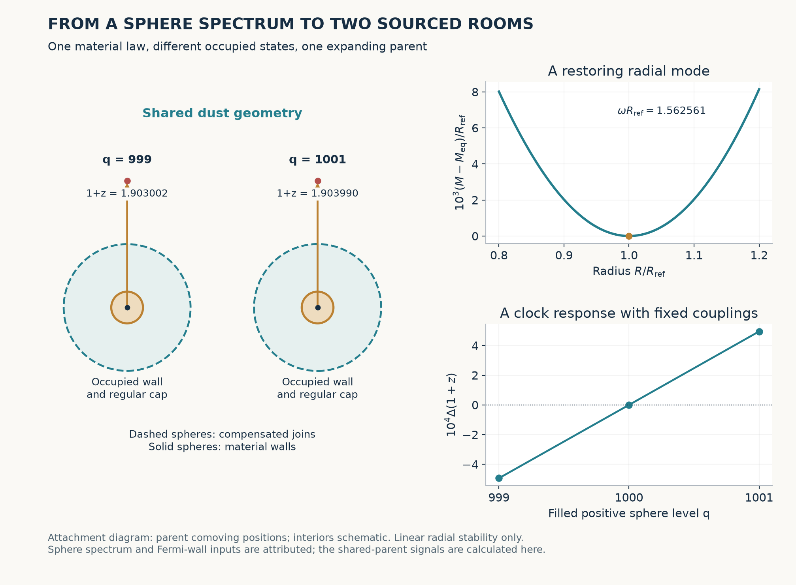

*Figure 10. Two disjoint compensated regions in the same expanding dust
parent. Parent positions are comoving; the interiors are schematic.
The right panels show the reference radial mass minimum and the
clock response to three finite states with unchanged couplings.
The ordinary horizonless attachment and linear radial result are
distinct from black-hole offspring formation and general stability.*

A beacon at each regular centre now crosses the entire connection.
At the static material wall, proper-time matching gives
$dT=(a/b)dt_c$, where $t_c$ is central proper time and $T$
is exterior Killing time. An emission at the Killing time of the
join's initial cosmic event spends

$$
\Delta T_{\rm core}=\frac{a}{bH}\operatorname{atanh}(HR)
$$

inside the core. With $v_b=\sqrt{2M/R_b}$, reception at the
moving dust join satisfies

$$
\int_0^{\tau_b}\frac{d\tau}{1+v_b(\tau)}
=\Delta T_{\rm core}+r_*(R_b(0))-r_*(R).
$$

Continue through the dust to an observer eight $R_0$ away from each
centre in the same comoving direction. Those two rays avoid the
other matching sphere. The explicit dust conformal time determines
the remaining arrival, and the total frequency ratio is

$$
1+z=\frac{a}{b}(1+v_b(\tau_b))
\frac{a_p(\tau_r)}{a_p(\tau_b)}.
$$

| q | Reception time / (R0/c) | 1+z |
| ---: | ---: | ---: |
| 999 | 12.61376979 | 1.903001657 |
| 1000 | 12.61774703 | 1.903495521 |
| 1001 | 12.62172978 | 1.903990397 |

The parent density and observer comoving offsets are the same in all
three calculations. A separate null ODE crosses the core, collar and
dust regions; differentiating reception proper time with respect to
emission proper time independently recovers the redshift.
The saved root comparison is at $3\times10^{-15}R_0$ and the
clock-derivative difference at $1.2\times10^{-11}$.
These are numerical indicators, not a microscopic or observational
error budget.

This connection reaches from a specified finite state to a conserved
surface pressure, a compatible geometry, a common parent and an
observer signal. Its inheritance law transports the occupation but
does not select it. At fixed fundamental constants, copying that
occupation to a scaled radius changes both $k_0R$ and
$\ell_P^2\mathcal A/R^2$. A normalized operator relation alone does
not preserve gravitational compactness.

The supplied cap curvature is still
$\Lambda_{\rm cap}R_0^2=147/625$; the common parent still has zero
cosmological Lambda. Formation, occupation transfer, general stability
and a collective source law remain physical questions. No cosmic
density fraction or matter--antimatter asymmetry is inferred from
this finite state-to-observer proof.

### 10.14. A field law that changes the inherited vacuum

<!-- nsc-claim:charged-vacuum-inheritance -->

Evidence: [action, conservation and composition](../docs/nsc-atlas-flux-transition.md),
[symbolic and numerical record](../results/summaries/nsc-atlas-flux-transition-v1.json)
and [scientific checks](../tests/test_nsc_atlas_flux_transition.py).

The preceding constructions supply their cap vacuum independently.
Brown--Teitelboim's charged-membrane mechanism supplies an alternative:
one field law determines the vacuum change at a boundary. We use the
fixed-flux action in [Bousso--Polchinski](https://arxiv.org/html/hep-th/0004134),
Section 2.1, and the full membrane conditions in
[Hirano](https://arxiv.org/html/1804.09985), Section 2.3.
This is a new declared matter sector, not an extra term calculated from
the original conformal-field Schur response.

With $c=\hbar=1$, $\kappa=8\pi G$, $F=dA$ a four-form, shared membrane
tension $\sigma$ and charge $e$, the action contains

$$
S_{\rm bulk}=\int\sqrt{-g}\left[
\frac{\mathcal R-2\Lambda_b}{2\kappa}-\frac{F^2}{2\,4!}\right]d^4x,
\qquad
S_\Sigma=-\sigma\int_\Sigma\sqrt{-\gamma}\,d^3y+e\int_\Sigma A.
$$

Gravitational and fixed-flux boundary terms complete the action.
Varying before substituting the solution gives

$$
F=f\epsilon,\qquad T^F_{\mu\nu}=-\frac{f^2}{2}g_{\mu\nu},\qquad
\Lambda(f)=\Lambda_b+\frac{\kappa f^2}{2}.
$$

The oriented membrane gives $f_{\rm in}=f_{\rm out}-e$.
Repeating that same law gives the composable sequence

$$
f_n=f_0-ne,\qquad
\Lambda_n=\Lambda_b+\frac{\kappa}{2}(f_0-ne)^2,
$$
$$
\Lambda_{n+1}-\Lambda_n=-\kappa e(f_n-e/2),\qquad
\Lambda_{n+2}-2\Lambda_{n+1}+\Lambda_n=\kappa e^2.
$$

The second difference removes the bare vacuum and parent flux. It does
not quantize the absolute flux, select which transitions occur, or
determine the observed cosmological constant. The action is common;
the state changes. Its relation to the earlier inherited operator is open.

Each vacuum region has
$F_n(r)=1-2M_n/r-\Lambda_n r^2/3$. On the ordinary outward orientation,
$\beta_--\beta_+=kR$, with
$\beta_\pm=\sqrt{\dot R^2+F_\pm}$ and $k=\kappa\sigma/2$.
Both the temporal junction and membrane force must also hold:

$$
[K^a{}_b]=-k\delta^a_b,\qquad
\sigma\overline{K}=e\,\frac{f_{\rm out}+f_{\rm in}}{2}
=\frac{\Lambda_{\rm out}-\Lambda_{\rm in}}{\kappa}.
$$

Our $K_{ab}=+h_a{}^c\nabla_c n_b$ is opposite to Hirano's convention.
The last equation is also the distributional normal conservation law.
Pure vacuum has no tangential flux, and the constant tension obeys
intrinsic wall conservation.

Let $A=(M_{\rm out}-M_{\rm in})/k$ and
$B=(\Lambda_{\rm out}-\Lambda_{\rm in})/(6k)+k/2$. Then

$$
\dot R^2+V(R)=0,\qquad
V=1-\frac{A^2}{R^4}-\frac{2(M_{\rm in}+AB)}{R}
-\left(\frac{\Lambda_{\rm in}}{3}+B^2\right)R^2,
$$
$$
\beta_-=\frac{A}{R^2}+BR,\qquad
\beta_+=\frac{A}{R^2}+(B-k)R.
$$

The signs are retained after using this potential. Given the inner mass
and initial radius/speed, the unsquared equation fixes the outer mass.
That same mass becomes the next wall's inner mass.

### 10.15. Three vacuum regions in one evolving cosmology

<!-- nsc-claim:charged-shared-parent -->

Evidence: [finite continuation and cosmological observer](../docs/nsc-atlas-flux-transition.md#a-composed-finite-geometry-with-calculated-vacuum-changes),
[endpoint values and independent quadratures](../results/summaries/nsc-atlas-flux-transition-v1.json).

Declare $\Lambda_bL_{\rm ref}^2=0$,
$\sqrt{\kappa}f_0L_{\rm ref}=3/2$,
$\sqrt{\kappa}eL_{\rm ref}=1/2$ and $kL_{\rm ref}=1/10$.
Choose initially resting membranes at $R/L_{\rm ref}=.8,.4$
and a regular massless center. These are benchmark inputs, not measurements.

| Region | $\Lambda L_{\rm ref}^2$ | $M/L_{\rm ref}$ |
| --- | ---: | ---: |
| Parent vacuum collar | 1.125 | .01523145571612779 |
| Shared child region | .5 | .01162657748024113 |
| Regular grandchild core | .125 | 0 |

The two vacuum changes are -.625 and -.375 in $L_{\rm ref}^{-2}$.
Both walls satisfy the full junction and charged force law, on one
middle-region clock $0\leq T/L_{\rm ref}\leq.25$. Timelike coordinate
speed bounds keep the inner radius above $.15L_{\rm ref}$ and the
outer radius below $1.05L_{\rm ref}$. Positive collars and bounded
ODE coefficients establish finite continuation. At the endpoint,

$$
R_{\rm outer}/L_{\rm ref}=.82656089965304,\qquad
R_{\rm inner}/L_{\rm ref}=.31785194531276.
$$

Join the outer vacuum to flat dust at $R_b(0)=1.2L_{\rm ref}$, with
the same four-form flux and no added shell. Both Darmois forms give

$$
M_0=\frac{\kappa\rho_mR_b^3}{6},\qquad
H_p^2=\frac{\kappa\rho_m+\Lambda_0}{3},\qquad \rho_m\propto a_p^{-3}.
$$

The exact expanding solution, with $h=\sqrt{\Lambda_0/3}$, is

$$
a_p(\tau)=\left[\cosh(3h\tau/2)
+\frac{H_p(0)}{h}\sinh(3h\tau/2)\right]^{2/3}.
$$

Clock matching puts the displayed endpoint at cosmic time
$.10872542374877L_{\rm ref}$, with $a_p=1.07034528578242$.
This parent accelerates from its declared four-form vacuum.
Inner transitions do not change the outside flux or select its value.

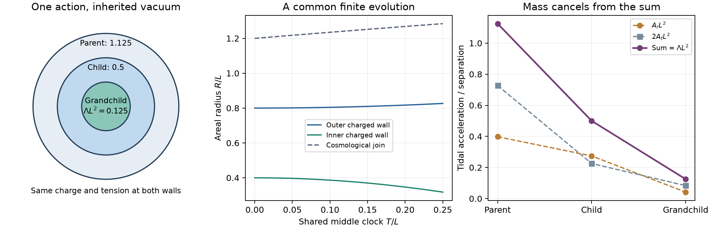

*Figure 11. One shared charged-membrane law gives three vacuum values.
The middle panel uses one common clock and its synchronized cosmological
join. The right panel separates mass and vacuum in free-fall tidal
measurements. The initial-region drawing is not a nucleation history.*

For locally released freely falling probes in each vacuum collar,

$$
\mathcal A_r=\frac{2M}{r^3}+\frac{\Lambda}{3},\qquad
\mathcal A_t=-\frac{M}{r^3}+\frac{\Lambda}{3},\qquad
\mathcal A_r+2\mathcal A_t=\Lambda.
$$

The trace removes the Weyl mass. In SI its measured relative acceleration
per separation is multiplied by $c^2$. A second relation reconstructs
the same vacuum from the flat dust parent's expansion:

$$
\Lambda_0=H_p^2+2\ddot a_p/a_p.
$$

These conditional relations are registered retrospectively as
[NSC-P002](../docs/prediction-register.md#nsc-p002--a-charged-vacuum-transition-and-its-curvature-observable).
Finite instruments and cross-region communication require their own
measurement model; these calculated values are not sky measurements.

Six symbolic identities vanish exactly. Independent 40-digit separated
quadratures reproduce endpoint radii and clocks within
$1.0\times10^{-15}L_{\rm ref}$; two ODE tolerances differ by less than
$3.0\times10^{-12}$ in the normalized state. These are numerical
diagnostics, not model or observational error bars.

This closes the declared finite source-to-geometry-to-observer connection.
Parent flux, charge, bare vacuum, tension and a physical ruler remain
inputs. The supplied two-wall Cauchy data have not been derived from
nucleation. Selecting a formation history and flux sector, with reheating
and observable consequences, is next; refining these trajectories would
not select the cosmological scale.

### 10.16. Preparing the scalar, membrane and geometry together

<!-- nsc-claim:scalar-gravity-preparation -->

Evidence: [coupled preparation and scope](../docs/nsc-atlas-scalar-preparation.md),
[regular geometry and checks](../results/summaries/nsc-atlas-scalar-preparation-v1.json)
and [scientific controls](../tests/test_nsc_atlas_scalar_preparation.py).

A constant four-form alone supplies vacuum stress. To investigate an
evolving component, explicitly add a canonical scalar with

$$
U(\phi,q)=\rho_b+\frac{m^2\phi^2}{2}+\frac{(q+\mu\phi)^2}{2},
\qquad
\omega^2=m^2+\mu^2,\qquad \epsilon=\frac{m^2}{\omega^2}.
$$

The mixing and fixed-flux elimination come from
[Kaloper--Sorbo](https://arxiv.org/html/0811.1989), equations (1)--(3).
The positive mass term is an additional declared choice; their axion
symmetry is not assumed for it. The minimum and residual density are

$$
\phi_*(q)=-\frac{\mu q}{\omega^2},\qquad
\rho_{\rm vac}(q)=\rho_b+\frac{\epsilon q^2}{2}.
$$

A [conditional rapid-transfer calculation](../docs/nsc-atlas-flux-conversion.md)
gave residual density $.125$, excitation $.09375$ and local energy
release $.0625$ for $\epsilon=1/4$, $\omega=20$, $q_p=1.5$,
$e=.5$ and $\rho_b=0$. Its
[conserving homogeneous history](../results/summaries/nsc-atlas-flux-conversion-v1.json)
did not establish the moving boundary that prepares those data.

There is an exact matching obstruction. At a timelike interface, continuity
between a homogeneous child $\phi_c(t)$ and a constant parent requires
$(d\phi_c/dt)(dt_W/d\tau_W)=0$. Since $dt_W/d\tau_W\geq1$, the child cannot
roll there. Its constant value also fails the child field equation when
$U_{\phi,c}-U_{\phi,p}=-\mu e\ne0$. A spatial scalar layer is necessary.

We retain those couplings and constant tension $\sigma=.2$, then use
regular gravitational preparation in the
[Coleman--De Luccia](https://doi.org/10.1103/PhysRevD.21.3305) construction,
with the continuation described by
[Dong--Harlow, Sections 2.1--2.2](https://arxiv.org/html/1109.0011).
Combined scalar, membrane and gravity preparations also appear in
[Bandos, Blanco-Pillado, Sousa and Urkiola, Section 5](https://arxiv.org/html/2306.09412).
Their field-dependent membrane coupling gives a scalar derivative jump;
our constant-tension example retains a continuous normal derivative.
Each cap has a pole-to-wall coordinate $\xi_j$,

$$
ds_E^2=d\xi_j^2+a_j^2d\Omega_3^2,\qquad
\chi_j=\phi_j-\phi_*(q_j),
$$
$$
\chi_j''+3\frac{a_j'}{a_j}\chi_j'=\omega^2\chi_j,\qquad
a_j''=-\frac{\kappa a_j}{3}
\left(\chi_j'^2+\rho_j+\frac{\omega^2\chi_j^2}{2}\right).
$$

Regularity imposes $a_j(0)=0$, $a_j'(0)=1$ and $\chi_j'(0)=0$.
The Hamilton constraint propagates from these poles. The two lengths
and scalar pole values are outputs. At the wall,

$$
a_i=a_o=R_*,\qquad
\chi_i-\chi_o=-\Delta,\qquad \chi_i'+\chi_o'=0,
$$
$$
a_i'+a_o'=\frac{\kappa\sigma R_*}{2},\qquad
\Delta=\frac{\mu e}{\omega^2}.
$$

The parent pole-to-wall derivative points opposite to the common outward
normal. Both caps therefore satisfy the same charged force,

$$
\sigma\overline{K}
=e\left(q_p+\mu\phi_W-\frac{e}{2}\right),
\qquad [K^a{}_b]=-\frac{\kappa\sigma}{2}\delta^a_b.
$$

All field gradients and gravitational effects are retained in the solve.
The converged ordinary-cap branch gives

| Quantity | Normalized value |
| --- | ---: |
| Wall radius $R_*$ | 2.70634531321651 |
| Child pole-to-wall length | 2.86731015671418 |
| Parent pole-to-wall length | 7.07049444470919 |
| Wall field $\phi_W$ | -.0543355679824020 |
| Common normal field derivative | -.215595888249873 |
| Wall normal pressure | .154440177981835 |

The two collocation tolerances change the radius by $3.81\times10^{-12}$.
The independent Hamilton constraint is below $6.9\times10^{-13}$ and
the sampled scalar equation below $2.2\times10^{-9}$.
These are numerical checks of a nonlinear construction, not a
validated interval proof of existence or uniqueness.

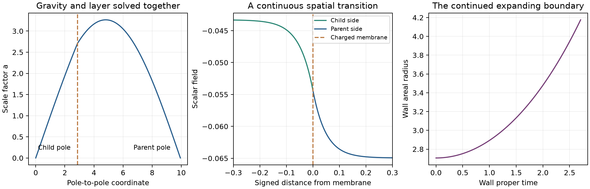

*Figure 12. The scalar transition layer and gravitational caps are solved
together with the membrane. Both field value and common-normal derivative
are continuous. The right panel shows the continued timelike boundary.
Lengths and field values use the declared normalized variables.*

### 10.17. Physical boundary reduction and the prepared child

<!-- nsc-claim:scalar-preparation-schur -->

Evidence: [boundary action and continuation](../docs/nsc-atlas-scalar-preparation.md#a-physical-scalar-boundary-reduction),
[independent action and pole transfer](../results/summaries/nsc-atlas-scalar-preparation-v1.json).

At this solved geometry, the regular scalar maps
$s_j=\chi_j'(L_j)/\chi_j(L_j)$ are actual Dirichlet-to-Neumann coefficients.
Continuity and normal matching determine

$$
\chi_i=-\frac{\Delta s_o}{s_i+s_o},\qquad
\chi_o=\frac{\Delta s_i}{s_i+s_o}.
$$

Integrating $(a^3\chi\chi')'=a^3(\chi'^2+\omega^2\chi^2)$ gives
the scalar excitation action at fixed geometry:

$$
S_\chi=\pi^2R_*^3
\left(s_i\chi_i^2+s_o\chi_o^2\right)
=\pi^2R_*^3\Delta^2\frac{s_i s_o}{s_i+s_o}.
$$

The coefficients are $s_i=19.53870489005$ and $s_o=20.30793503714$,
with Schur coefficient $9.95794752938$. Direct bulk integration and
the boundary expression give $S_\chi=.913188612282$, differing by less
than $2.8\times10^{-13}$. This is a physical elliptic preparation
reduction. It is not yet a retarded memory kernel or an added bulk Lambda.

Continuing one sphere angle gives

$$
ds_L^2=d\xi_j^2+a_j^2
\left(-d\eta^2+\cosh^2\eta\,d\Omega_2^2\right).
$$

The same scalar and junction equations hold. Wall proper time is
$\tau_W=R_*\eta$, and
$R_W=R_*\cosh(\tau_W/R_*)$. At $\eta=1$ the areal radius is
$4.17610904394739$. Scalar energy flux vanishes in the symmetric wall's
rest frame; the spatial layer and its stresses are part of the solution.

Near the child pole, $\xi=i\tau$ produces an open cosmology:

$$
\ddot\chi+3\frac{\dot b}{b}\dot\chi+\omega^2\chi=0,\qquad
\dot b^2=1+\frac{\kappa b^2}{3}(\rho_i+E),
\qquad E=\frac{1}{2}(\dot\chi^2+\omega^2\chi^2).
$$

Its regular data are $b(0)=0$, $(db/d\tau)(0)=1$, $(d\chi/d\tau)(0)=0$ and
the calculated pole value $\chi(0)=\chi_i(0)$. The coordinate origin
has finite curvature. Since $dE/d\tau=-3H(d\chi/d\tau)^2\leq0$ and
$\rho_i>0$, comparison bounds $b$ between open de Sitter solutions
with densities $\rho_i$ and $\rho_i+E_0$. The homogeneous future chart
therefore continues through every finite proper time.

An independent logarithmic-mode calculation determines the small pole
state without subtracting nearly equal field minima:

$$
\chi_i(0)=-6.9370429853\times10^{-25},\qquad
E_0=9.6245130760\times10^{-47}.
$$

This preparation does not realize the earlier assumed excitation $.09375$.
The spatial scalar layer carries energy per membrane area
$.00233741846805$, distinct from the bare tension $.2$. The homogeneous
child remains vacuum dominated, with $E/\rho_i\leq7.70\times10^{-46}$.
The calculation identifies where the excitation resides and prevents
importing the rapid-transfer amplitude into a different prepared state.

Regular Euclidean preparation is a declared state choice. No negative-mode
count, determinant, preferred contour or tunnelling probability has been
derived. A physically specified excited-parent or nonequilibrium
preparation is needed if substantial child matter is claimed. Absolute
vacuum scale, black-hole collapse formation and infinite physical nesting
remain separate questions.

### 10.18. Real parent sources and received energy

<!-- nsc-claim:prepared-parent-transport -->

Evidence: [causal and energy derivation](../docs/nsc-atlas-parent-transport.md),
[compact calculation and independent checks](../results/summaries/nsc-atlas-parent-transport-v1.json).

The small regular pole amplitude is not the transmission coefficient
for energy already present in the parent. Before choosing an excited
parent field, determine which sources can reach the child. Use the
same solved scalar/gravity profiles and membrane. An inward radial
test body starts at parent distance $.3L_{\rm ref}$ from the wall
on $\eta=0$, with supplied local Lorentz factor $\gamma_s$.
There is no direct material interaction with the membrane in this
test-body calculation.

The regular child pole fixes $x$ by $dx=d\xi/a$, with $e^x/\xi$ tending
to one. The conserved radial charge is $K=a_s\gamma_s$. An inward
trajectory requires $K$ greater than the largest $a$ along its path.
Its delay relative to a null ray
fixes the label transmitted across the child cone:

$$
D(K)=\int \frac{|d\xi|}{a}
\left[\frac{1}{\sqrt{1-a^2/K^2}}-1\right],\qquad
L=\exp(\eta_s+x_s+D).
$$

The integral includes the parent cap, membrane and child cap. The
metric and geodesic tangent are continuous at the wall. In the open
child, $b^2|d\chi/ds|=K$. For the vacuum comparison metric
$b=\sinh(h\tau)/h$, $h^2=\kappa\rho_i/3$, the regularized radial
integral has the closed form

$$
e^{I(\tau)}=\frac{2/h}{\coth(h\tau)+
\sqrt{\coth^2(h\tau)+(hK)^{-2}-1}},\qquad
\chi=\ln L-I(\tau).
$$

Hence a finite central arrival exists exactly when

$$
L<\frac{2K}{1+hK}.
$$

Failing this condition does not prevent entry into the child: a body
can remain at positive comoving distance and never reach its center.
For light the bound is $N=\exp(\eta_s+x_s)<2/h$. On the initial
slice, only parent distances below $3.700717257L_{\rm ref}$ can signal
the center, out of a parent cap length $7.070494445L_{\rm ref}$.
This is a specified observer's causal region, not a universal boundary
between different kinds of matter.

At source depth $.3L_{\rm ref}$ the massive threshold is
$\gamma_s=1.290485734$. The primary choice $\gamma_s=2$ yields

$$
\frac{c\tau_r}{L_{\rm ref}}=4.285837228,\qquad
\gamma_r=\sqrt{1+\frac{K^2}{b_r^2}}=1.546392954,\qquad
\frac{E_r}{E_s}=.773196477.
$$

The null control arrives at $3.420193817L_{\rm ref}/c$ with
$1+z=1.294206955$. The massive received speed is $.762773146c$;
arrival is not the production of cold matter. Its energy ratio refers
to two local frames, not a conserved global energy.

For a geometric comparison, replace the parent and membrane with a
single de Sitter space at the same child $h$. Fix the source's initial
areal radius, inward $\gamma_s=2$ and time-symmetric slice, using the
hemisphere nearest the receiver. The embedding control gives reception
at $4.014164210L_{\rm ref}/c$ and $E_r/E_s=.811509668$. The nested
geometry therefore delays reception by $.271673018L_{\rm ref}/c$ and
reduces received energy by $4.721224$ percent relative to that control.
This distinguishes these two supplied source/geometry pairs; unknown
source data or other geometries can retain degeneracies.

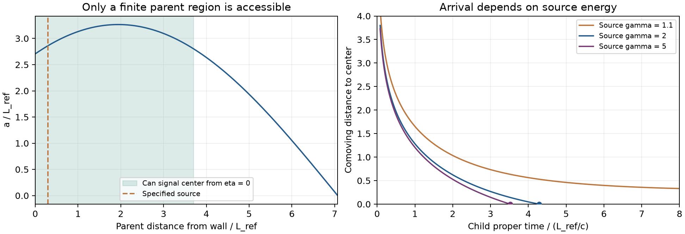

*Figure 13. The left panel identifies the parent region that can signal
the central child from the selected initial slice. The right panel shows
three transmitted massive trajectories. The lowest-energy example enters
the child but misses the center; the other two reach it at finite times.*

An independent de Sitter embedding recovers the zero-wall limit:
for source angle $\theta=h\xi_s$, central access requires
$\gamma_s>1/\cos\theta$ and gives $\gamma_r=\gamma_s\cos\theta$.
Direct integration of the child trajectory agrees with the closed
inverse within $7\times10^{-14}L_{\rm ref}/c$. Two background
tolerances change the primary arrival by $1.06\times10^{-11}$ and
its energy ratio by $8.74\times10^{-13}$. These are numerical checks,
not observational errors. Section 10.17's two de Sitter comparison
metrics bracket the residual homogeneous-background correction; they
do not bound backreaction from a new material population.

A simple collision alternative also has an exact diagnostic. The
[free-passage construction of Giblin, Hui, Lim and Yang](https://arxiv.org/abs/1005.3493)
motivates adding two scalar profiles. On one prescribed metric, with
additive swept flux and continuing prescribed membranes, the present
linear scalar equation gives

$$
\phi_*(q_p-e_L)+\phi_*(q_p-e_R)-\phi_*(q_p)
=\phi_*(q_p-e_L-e_R).
$$

Two equal charges $.5$ from $q_p=1.5$ therefore land on the
$q=.5$ minimum, with vacuum density $.03125$ and no homogeneous
displacement energy there. This control does not solve the interacting
gravitational collision or exclude radiation from deflected walls.
It prevents assigning the instantaneous quench energy to free passage.

The next source must be a finite, constraint-compatible parent field
preparation in the accessible region. Its scalar, metric and membrane
perturbations must be matched together before calculating transmitted
stress, isotropy or clustering. The smooth-wall bulk framework of
[Garriga, Montes, Sasaki and Tanaka](https://arxiv.org/html/astro-ph/9811257)
is useful input; an independently charged membrane requires its own
interface equations. Population normalization and the physical ruler
remain inputs to be supplied. The present result makes the geometric
part of that future source-to-observer calculation explicit.

### 10.19. A finite parent source with its gravitational response

<!-- nsc-claim:finite-parent-scalar-source -->

Evidence: [source, constraint and matching derivation](../docs/nsc-atlas-parent-source.md),
[finite preparations and independent checks](../results/summaries/nsc-atlas-parent-source-v1.json).

The next preparation includes the source's gravity. Retain the action,
charges and tension of Section 10.16, and prescribe a finite compact
scalar displacement in the parent. On the initial slice, the spatial
extrinsic curvature and scalar momentum vanish. This is a time-symmetric
packet, not a purely incoming wave. Its prior formation history is supplied
neither by the regular saddle nor by this Cauchy construction.

Let $h_0$ and $\phi_0$ denote the regular reference data. Solve
$h=\Psi^4h_0$ with $\phi=\phi_0+f+g$, where $f$ is the specified
parent packet and $g$ is a small wall-layer correction. The scalar
Hamiltonian constraint and conformal curvature identity, as in
[Choquet-Bruhat, Isenberg and Pollack, Section 2](https://arxiv.org/html/gr-qc/0610045), give

$$
\Delta_0\Psi=
\frac{\kappa}{8}\left[(\phi_0')^2-(\phi')^2\right]\Psi
+\frac{\kappa U_0}{4}\Psi-\frac{\kappa U}{4}\Psi^5.
$$

Primes use seed proper radial distance. The momentum constraint is
zero. Regularity gives $\Psi'=0$ at both poles; the same material
tension gives, in the common child-to-parent normal convention,

$$
[\Psi]=0,\qquad [\Psi']=\frac{k}{2}(\Psi-\Psi^3),
\qquad k=\frac{\kappa\sigma}{2}.
$$

For a second-order smooth initial corner there is an additional scalar
requirement. If the old field value and
first seed-normal derivative $s$ are retained at the wall, the physical
normal derivative becomes $s/\Psi_W^2$. The scalar wave equation and
the full trace jump $[K]=-3k$ require

$$
[\phi_{;nn}]-3k\phi_n-\mu e=0.
$$

Freezing the old layer after changing the metric violates this condition
unless $\Psi_W=1$ for the stated couplings. A parent-side correction
with $g(0)=g'(0)=0$ and $g''(0)=\lambda$ repairs it precisely when

$$
\lambda=\mu e(\Psi_W^4-1)+2ks(\Psi_W^2-1).
$$

Thus the scalar correction is solved with gravity. It is not an extra
surface impulse or an adjustable energy injection. The finite example
uses $f=A(1-z^2)^6$ for $|z|<1$, with $z=(d-.3)/.12$, and zero
outside. Here $d$ is seed distance into the parent from the wall.
The correction is $g=\lambda d^2(1-d/.08)^6/2$ for $0\le d<.08$,
and zero outside. These profile choices are explicit state data.

The complete instantaneous Israel conditions determine the two normal
wall accelerations. With $B_j=\beta_j/R$, $\beta_j=\partial_nR$ and
$P=e(q_p+\mu\phi_W-e/2)$, they are

$$
\overline{A}=\frac{P}{\sigma}-(B_i+B_o),\qquad
A_i=\overline{A}+\frac{k}{2},\qquad A_o=\overline{A}-\frac{k}{2}.
$$

The radial Einstein equation then gives the initial areal acceleration:

$$
\frac{d^2R}{d\tau_W^2}
=-\frac{m_j}{R^2}-\frac{\kappa R p_{r,j}}{2}+A_j\beta_j,
\qquad m_j=\frac{R}{2}(1-\beta_j^2).
$$

The two sides agree algebraically using the force and Israel conditions.
The scalar acceleration computed from each side agrees only after the
second-normal matching condition is included.

| Amplitude | Proper scalar excess | Wall radius | Initial areal acceleration |
|---|---|---|---|
| 0 | 0 | 2.706345313 | .369501998 |
| .01 | .270536650 | 2.721705563 | .374020762 |
| .02 | 1.112671383 | 2.764905208 | .386385323 |

The table uses the declared normalized units. Proper scalar excess
includes the quadratic excitation and its interference with the original
field, both evaluated on the same sourced metric. It is not a global
conserved energy or an ADM mass. For $A=.02$, $\Psi_W=1.010761098$
and $\lambda=.3779028621$. The radius increases by $2.163800$ percent
and its initial areal acceleration by $4.569211$ percent.

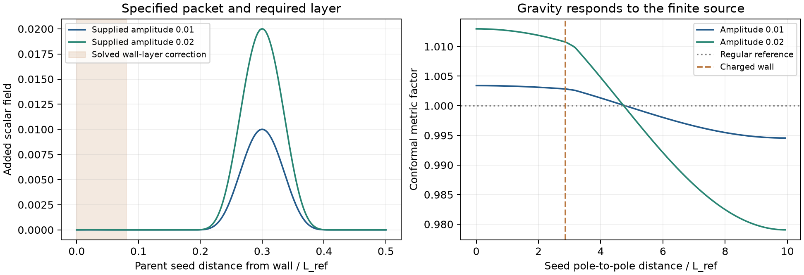

*Figure 14. The specified scalar packet and required narrow wall correction
are accompanied by a jointly solved spatial geometry. The conformal factor
changes on both caps. These are different constrained initial data, not
an instantaneous signal travelling from the packet to the child.*

For this example the shared initial scalar acceleration at the wall is
$.180243894532$. With outward flux $F=-T(n,u)$, its initial value
vanishes and its derivative is $.038036802293$. Positive denotes
child-to-parent exchange. The initial direction therefore does not
establish inward matter deposition; later arrival and transmission of
the parent packet must be evolved.

The deliberately frozen-layer control passes the gravitational constraint
but leaves scalar compatibility residual $-.362064088$. The solved
correction reduces the reported two-sided matching gaps below
$3\times10^{-15}$. Independent mass integration from the two poles gives
$.44414721424740$ and $.96826983393285$, matching the geometric masses
within $7\times10^{-13}$. Direct Hamiltonian residuals remain below
$3\times10^{-8}$, and two tolerances change the wall radius by
$4.36\times10^{-10}$. Five symbolic identities and the zero-source
limit check the construction. These numerical comparisons establish
neither interval-certified existence nor uniqueness.

The result supplies finite source gravity, instantaneous wall matching
and scalar compatibility through second order. It is not a finite-time
evolution or an all-order corner-compatibility theorem. The physical
ruler, preparation history and subsequent transmitted stress remain
open. The bulk vacuum values are unchanged. The next connected problem
is the evolution of these data and the energy delivered through their
moving boundary, followed by the stress required for clustering.

### 10.20. A conditional inward pulse from the excited parent

<!-- nsc-claim:parent-inward-transfer-limit -->

Evidence: [weak-corner preparation and transfer derivation](../docs/nsc-atlas-parent-source.md#a-weak-initial-corner-can-carry-a-real-inward-pulse),
[exact seed and independent massive-field control](../results/summaries/nsc-atlas-parent-source-v1.json).

Smooth second-order compatibility at the initial interface is a choice
of regularity. Its failure does not by itself exclude a finite-energy
weak transient. A different preparation with the same action makes this
distinction useful: put the field uniformly at the child minimum on
the entire time-symmetric slice. The child has no initial excitation;
the parent has excitation density $3/32$ above its own minimum.

The initial densities are $\rho_i=1/8$ and $\rho_p=3/8$. Round Cauchy
caps satisfy the gravitational constraints and instantaneous wall laws
exactly with

$$
B_i=\frac{7}{15},\qquad B_o=\frac{11}{30},\qquad
R_*^2=\frac{1800}{467},\qquad R_*=1.96325997301.
$$

Both poles are regular, and the parent excitation has finite proper
integral $38.30744838$ in normalized units. The initial wall pressure
is $P_0=1/4$ and its areal acceleration is $1/R_*$. This is a turning
instant, not static equilibrium. The parent is an excited scalar
region; its future is not a de Sitter vacuum continuation.

The scalar's initial corner is not twice differentiable in the required
piecewise spacetime sense. Suppose a causal local weak development
exists with continuous scalar value and normal derivative and bounded
one-sided geometric coefficients. Existence of that full coupled
development remains a separate question. With wall proper time $\tau$
and normal coordinate $x$, child $x<0$, the tangent equation is

$$
(\partial_\tau^2-\partial_x^2)\chi=-S H(x),\qquad
S=\mu e=5\sqrt{3}.
$$

The initial field displacement and its time derivative vanish. Retarded
integration in the child portion of the initial cone gives

$$
\chi_i=-\frac{S}{4}(\tau+x)^2\quad(-\tau<x<0).
$$

The corresponding parent expression matches its value and first
derivatives at the wall. Spherical terms, finite wall acceleration and
the massive-field term enter at higher order under the stated bounded
geometry assumptions. Thus the local coupled-development limit is

$$
F_{\rm in}=18.75\tau^2+O(\tau^3),\qquad
\frac{E_{\rm child}}{\mathcal{A}_0}=6.25\tau^3+O(\tau^4),
\qquad \mathcal{A}_0=4\pi R_*^2.
$$

Positive flux here means parent-to-child. It is generated by the
different potential slopes, with the energy initially stored in the
parent. The leading parent-layer energy loss equals the child gain;
there is no separately prescribed incoming waveform. The same
field controls the membrane pressure and gives a geometric relation:

$$
P(\tau)=\frac14-18.75\tau^2+O(\tau^3),\qquad
\sigma\overline{K}=P(\tau),\qquad
\lim_{\tau\to0^+}\frac{P_0-\sigma\overline{K}}{F_{\rm in}}=1.
$$

This links transmitted scalar energy and wall curvature from one source
and one set of couplings. It is a conditional short-time prediction,
not a calculated finite-time cosmological abundance. No remainder
constant for the curved coupled evolution has been established.

As a separate check, the exact planar massive retarded solution gives
inward flux $.001856325865$ and child energy per area
$.000006212608434$ at $t=.01$. Direct integration of the field energy
agrees with the integrated boundary flux and the parent energy loss. Those finite-time numbers
belong to that planar control only. The sharp membrane model also
leaves finite-thickness corrections outside this limit.

In the initially quiet child, the leading edge cannot reach the center
before proper time $2.07981585635L_{\rm ref}/c$, obtained from its
de Sitter domain of dependence. This is a causal front time, not a
detector threshold or received waveform. The next step is a coupled
causal development that tests the nonzero transfer and pressure relation
at finite times. The smooth source of Section 10.19 remains a distinct
preparation control, not a compulsory gate on this weak-corner route.

### 10.21. A one-sided geometric observer and the full mass balance

<!-- nsc-claim:geometric-wall-observer -->

Evidence: [observer and energy derivation](../docs/nsc-atlas-geometric-observer.md),
[coupled reference and independent checks](../results/summaries/nsc-atlas-geometric-observer-v1.json).

An observer relation can be derived without first knowing the incident
waveform. It combines the charged-wall force with the scalar geometrization
approach reviewed by [Krongos and Torre](https://arxiv.org/html/1503.06311).
Their full metric conditions include differential integrability; the local
tests here do not replace them or prove a bulk spacetime exists.

Use child-side geometry, the normal pointing into the parent, and wall
proper time. Write the mixed extrinsic eigenvalues as $A,B,B$, where
$A=n\cdot a$ is normal proper acceleration and $B=n(R)/R$.
These are not generally the areal acceleration or the radius's fractional
rate of increase.
Israel and the material force give

$$
P=\sigma\left(A+2B-\frac{3k}{2}\right),\qquad
\chi_W=\frac{P-P_c}{S},\qquad
\Pi=\frac{\dot P}{S},
$$

where $k=\kappa\sigma/2$, $S=\mu e$ and
$P_c=e(\epsilon q_c+e/2)$. Thus the field and its wall-time derivative
are determined by one-sided geometry once the action parameters are fixed.
No parent-side metric observation is needed for this step.

Gauss and Codazzi supply the normal pressure and inward flux:

$$
\kappa p_n=-\frac{2\ddot R}{R}-\frac{1+\dot R^2}{R^2}+2AB+B^2,
$$
$$
\kappa F_{\rm in}=2\left[\frac{\dot R}{R}(A-B)-\dot B\right].
$$

For the canonical scalar, $Q=2(p_n+U)-\Pi^2$ must be nonnegative
and $F_{\rm in}^2=\Pi^2Q$. When $\Pi\ne0$, its signed normal
derivative is $F_{\rm in}/\Pi$. At $\Pi=0$ only its magnitude is
identified by these observables; the inversion is sensitive to noise near that limit.

An independent bulk tidal contraction must then obey

$$
Y\equiv R_{uu}-\frac{\kappa}{S^2}\dot P^2
=-\Lambda_c-C(P-P_c)^2,\qquad
C=\frac{\kappa\omega^2}{2S^2}
=\frac{\kappa}{2(1-\epsilon)e^2}.
$$

For three distinct pressures on the same wall, the second divided
difference of $Y$ is exactly $-C=-8/3$ in the reference model.
This relation holds on regular finite intervals, beyond the short-time
expansion. Source history has disappeared; the field action has not.

With $S$ and $C$ fixed, two calibration points determine $P_c$ and
$\Lambda_c$ phenomenologically. They must also satisfy the action's
relation between flux, mixing and vacuum; the bare term cannot be
independently retuned. A withheld third value tests the resulting curve.
The synthetic example in the record performs that recovery and detects
a deliberate $.001$ discrepancy. It is not an observational comparison.

The actual regular continuation provides a separate physical model check.
From its wall geometry the inverse recovers
$\phi_W=-.0543355679824$ and $|\Phi|=.215595888250$.
An independent metric calculation gives $R_{uu}=-.149351145558$.
The potential excitation accounts for $.024351145558$, leaving the
declared vacuum $.125$. Interpreting the whole tidal magnitude as vacuum
would therefore overestimate it by about $19.48$ percent in this example.
The continuation has constant $P$; multiple times repeat one point of
the tidal curve rather than supplying several distinct calibration points.

Energy accounting supplies another exact check. For the geometric
Misner--Sharp mass,

$$
m=\frac{R}{2}\left[1+\dot R^2-(BR)^2\right],\qquad
\dot m=\frac{\kappa R^2}{2}
\left[BR F_{\rm in}-\dot R p_n\right].
$$

This is the signed wall-frame form of
[Hayward's energy-supply and work law](https://arxiv.org/html/gr-qc/9710089).
Subtracting $\Lambda_cR^3/6$ leaves an excitation-pressure work term.
On the existing evolved reference the scalar influx is exactly zero,
yet the mass above vacuum grows from $.003668251239$ to $.013477983984$
over $0\le\tau\le2.706345313217$. Independent pressure integration
accounts for the increase $.00980973274508$, agreeing within
$1.8\times10^{-15}$. Enclosed mass growth alone is therefore not an
accretion measurement, even in this explicit coupled nested geometry.

*Figure 15. Left: the solved continuation gains mass with zero scalar
influx; pressure work explains the change. Right: the star is its one
pressure/curvature point. The other markers are explicitly synthetic
calibration and withholding checks, not observed universes or new solutions.*

The observable test requires normal metric information and independent
tidal curvature. Radius or cosmological expansion alone is insufficient.
Its identities are necessary conditions for this action, not a complete
Rainich theorem, a globally reconstructed parent or an empirically selected
cosmology. They supply finite-time diagnostics for the coupled evolution
that remains to be constructed.

### 10.22. What an additional inherited region can identify

<!-- nsc-claim:one-wall-inheritance-ambiguity -->

Evidence: [coupling equivalence and inverse](../docs/nsc-atlas-geometric-observer.md#why-one-wall-cannot-determine-the-inherited-couplings),
[exact identity and numerical controls](../results/summaries/nsc-atlas-geometric-observer-v1.json).

There is a precise reason to extend the atlas beyond one interface.
Two fixed parameter choices in the same scalar/four-form family can
produce identical local classical dynamics while predicting different
consequences for the next charge sector. Keep $\omega=20$, $\kappa=1$,
$\sigma=.2$ and $\rho_b=0$ in both candidates, and choose

$$
(\epsilon,e,q_c)_A=(1/4,1/2,1),\qquad
(\epsilon,e,q_c)_B=(25/28,\sqrt{7}/2,-\sqrt{7}/5).
$$

In each case $q_p=q_c+e$. Let $\delta=3\sqrt{3}/100$. Direct
expansion gives the exact potential identity

$$
U_B\left(\phi+\delta,\sqrt{7}(q-6/5)\right)-U_A(\phi,q)
=3(q-1)(q-3/2).
$$

The difference vanishes for every field value in the original parent
and child sectors. A constant field translation preserves the kinetic
term, and the two models share both vacuum densities, $S=\mu e$,
tension and wall-force law. Their reduced classical scalar/gravity
equations and matching are identical at that interface, including for
mapped time-dependent states. More precision in those observations alone
cannot choose between the two parameter sets.

This equivalence excludes independent charge probes, extra matter
couplings that fix an absolute field origin and quantum preparation
probabilities. It is a statement about the declared classical sector.

One further step of each model's unchanged oriented charge gives

$$
(\Lambda_p,\Lambda_c,\Lambda_g)_A=(9/32,1/8,1/32),\qquad
(\Lambda_p,\Lambda_c,\Lambda_g)_B=(9/32,1/8,49/32).
$$

These are relaxed potential values, not a constructed grandchild
spacetime. Candidate B's next step is upward in ground energy, so the
ordinary descending-cap preparation cannot simply be repeated there.
The distinct prediction nonetheless identifies information that the
first interface cannot supply.

For three comparable ground-vacuum sectors with a common action and
equal oriented charge steps,

$$
D=\Delta^2\Lambda=\kappa\epsilon e^2.
$$

Combining this with the local tidal coefficient $C$ resolves the
mixing and charge magnitude:

$$
e^2=\frac{D}{\kappa}+\frac{\kappa}{2C},\qquad
\epsilon=\frac{D/\kappa}{D/\kappa+\kappa/(2C)}.
$$

Both candidates have $C=8/3$, but $D=1/16$ and $D=25/16$
respectively. The inverse recovers both parameter choices. This is
a test of an inherited-law hypothesis using additional regional
information. It does not prove that constants are inherited, that the
third region exists, or that these regions can all be observed in a
common normalization. The following construction supplies the third
initial region and a protected evolving parent domain.

### 10.23. Three sourced regions on one compact initial slice

<!-- nsc-claim:shared-scalar-initial-atlas -->

The previous ambiguity can now be tested on a physical third initial
region. Keep the scalar/four-form action of Section 10.16, with
$\kappa=1$, $\epsilon=1/4$, $\omega=20$, $e=1/2$, $\sigma=1/5$
and zero bare density. Inside outward, use fluxes $(1/2,1,3/2)$ and
one uniform initial field $\phi_0=-\sqrt{3}/80$, at the grandchild
minimum. Its momentum and spatial gradient vanish. The initial and
ground densities differ:

$$
(U_g,U_m,U_p)=(1,7,21)/32,\qquad
(\rho_{v,g},\rho_{v,m},\rho_{v,p})=(1/32,1/8,9/32).
$$

The supplied radii are 1 and 1.9, and the middle mass constant is .12;
both pole-region constants vanish. These are declared initial data.
The Kottler functions with $\Lambda_j=\kappa U_j$ represent the
instantaneous constraints. They cannot represent the excited scalar's
subsequent vacuum evolution. Reusing the signed Israel equations,

$$
\beta_i=\frac{M_o-M_i}{kR^2}
 +\frac{\kappa(U_o-U_i)+3k^2}{6k}R,\qquad
\beta_o=\beta_i-kR,\quad v^2=\beta_i^2-f_i,
$$

gives two expanding timelike walls. The inner pair of signed beta
values is (1.5625,1.4625), with areal speed 1.204916145077. The outer
pair is (1.148006694367,.958006694367), with speed .841108986073.
An areal speed above one is compatible with timelike normalization.
The same middle mass is used on both boundaries.

The caps have slice extrinsic curvature $L^i{}_j=-H\delta^i{}_j$,
where $H=v/R$ on the corresponding wall. The grandchild sectional
curvature is $-369/256$; the parent's is .022776502368. Between them
choose a quintic interpolation of H whose first two derivatives vanish
at both ends, and put

$$
v_s=RH(R),\quad R_\ell=\sqrt{f_m+v_s^2},\quad
L_r=-v_s',\quad L_\theta=-v_s/R.
$$

Direct substitution proves both smooth Einstein constraints. The
angular jump gives the distributional Hamiltonian source
$-4[\beta]/R=2\kappa\sigma$, and the continuous $L_\theta$ gives
zero surface momentum. Both caps close at regular poles, producing
a compact S3 slice of proper length 20.393422999807. This uses the
standard Einstein-scalar constraints of Choquet-Bruhat, Isenberg and
Pollack (Section 2), together with the material Israel conditions;
their smooth theorem is not a shell-evolution theorem.

The temporal jump is also retained. The pressure relation fixes

$$
\overline{A}=P/\sigma-(B_i+B_o),\qquad [A]=-k.
$$

A positive lapse
collar realizes both one-sided derivatives while taking N=1 on the
walls and near the poles. Its global bounds are .95649 and 1.04549.
Independent acceleration checks use the full moving mass
$m=R(1+v^2-\beta^2)/2$. The detailed construction and exact constraint
proof are in the [shared-slice owner](../docs/nsc-atlas-shared-scalar-slice.md).

The one-sided observer formula at each wall recovers the common field.
After subtracting the excitation, the three ground values are those
of candidate A. More strongly, candidate B from Section 10.22 obeys,
for every integer sector and every real canonical scalar state,

$$
q_n=e_B(3/5-n),\qquad
\rho_B\geq U_{\min,B}(n)=\frac{25}{32}(3/5-n)^2\geq\frac18.
$$

The new grandchild geometry instead requires density 1/32 from its
Hamiltonian constraint. The unavoidable gap is at least 3/32. Thus
changing B's preparation, including its gradients or momenta, cannot
reproduce this geometry under its unchanged law. This is a stronger
inheritance distinction than the previous potential-only comparison.
It is a mathematical rejection on the constructed geometry, not an
astronomical measurement or exclusion of all alternative actions.

The scalar corners remain weak: conditional short-time inward flux
coefficients are 18.75 and 56.25 at the two separate wall proper clocks.
They do not establish a finite interacting evolution. Initial
composition is now explicit; a full weak future remains open. The
[constraint and sector record](../results/summaries/nsc-atlas-shared-scalar-slice-v1.json)
contains the independent checks and exact parameters.

### 10.24. Cosmology in the protected parent domain

<!-- nsc-claim:protected-parent-cosmology -->

The initial parent cap is homogeneous closed-FLRW scalar data with
$a_0=6.626077076100$, $H_0=.442688940038$, ground density 9/32 and
excitation 3/8. Its angular extent from the parent pole is
$\theta_w=2.850764359770$. The smooth homogeneous solution determines
the domain of dependence of these actual cap data. Any causal
completion of the whole atlas must agree there; no completed wall
future is required to calculate this domain.

Writing chi for displacement from the parent minimum gives

$$
\dot\chi=\Pi,\quad \dot\Pi=-3H\Pi-\omega^2\chi,\quad
\dot a=aH,\quad \dot H=a^{-2}-\kappa\Pi^2/2,
$$

$$
E=(\Pi^2+\omega^2\chi^2)/2,\quad
3(H^2+a^{-2})=\kappa(\rho_v+E),\quad \dot E=-3H\Pi^2.
$$

Put $h_{\min}^2=\kappa\rho_v/3$. Because $a_0h_{\min}>1$,
H cannot vanish on the expanding branch; it stays above .266408516441.
The energy decreases, bounding the scalar and H and allowing smooth
continuation at every finite future time. Total future conformal
distance has the explicit bound

$$
\int_0^\infty\frac{dt}{a(t)}
\leq\arcsin\frac{1}{a_0h_{\min}}=.515418396612.
$$

Hence all comoving points with $\theta<2.335345963158$ remain within
the parent domain of dependence for all future proper time. They
occupy at least 90.703557% of the initial parent volume. This is a
sufficient causal bound, not the exact horizon or a construction
of the remaining wall spacetime. The initial lapse collar merely
changes coordinates on the smooth development.

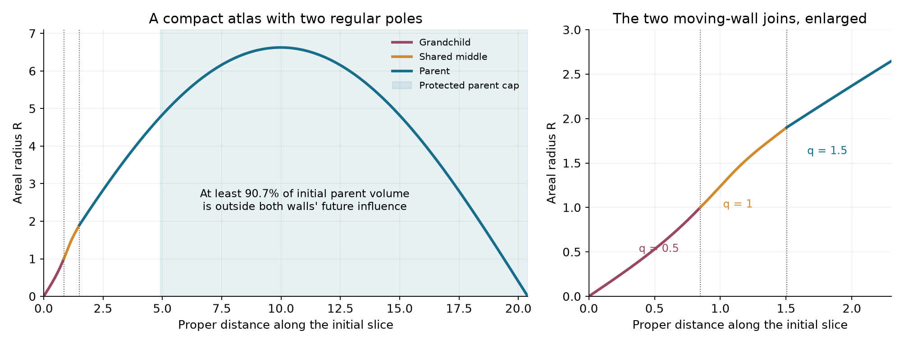

*Figure 16. The compact initial geometry, with the two joins enlarged
at right. Shading marks the sufficient protected parent cap. The
parent contains an evolved scalar source under the same action;
the unshaded interacting wall future remains a separate problem.*

Taking the initial parent curvature radius as the independently
specified reference length gives the conditional inherited value

$$
\Lambda_{\rm parent}L_{\rm ref}^2
=\kappa\rho_v a_0^2=12.348252398928.
$$

This depends on the declared couplings and initial data. It does
not select the measured cosmic Lambda or provide an SI ruler.
Integrating in proper time and independently in expansion e-folds
produces the same one-e-fold endpoint:

| Quantity | Same-source parent value |
| --- | ---: |
| Proper time | 2.888845513139 |
| Scale factor | 18.011544909930 |
| H | .311446897816 |
| Scalar excitation | .018994903671 |
| Integrated scalar expansion work | .356005096325 |
| Comoving scalar energy divided by its initial value | 1.017394237405 |

The excitation is within 1.74% of pressureless dilution across this
interval, which motivates a perturbation calculation but does not
prove clustering. Maximum Friedmann and work residuals are below
$3.3\times10^{-11}$; independent endpoint differences are below
$1.5\times10^{-11}$. The declared numerical comparison tolerance
is $10^{-9}$ in normalized variables, not an interval enclosure
or observational uncertainty.

The [compact evidence](../results/summaries/nsc-atlas-shared-scalar-slice-v1.json)
binds these numbers to the same action, constraints and implementation.
The following calculation tests scalar and metric perturbation growth
on this evolving domain. Its observer transfer and physical scale
remain further connections, while the full wall problem stays explicit.

### 10.25. A constrained parent perturbation that grows

<!-- nsc-claim:inherited-parent-structure -->

Near-pressureless homogeneous dilution does not determine whether a
field develops gravitational structure. We now perturb the same
protected parent, keeping its scalar action and curvature fixed.
The linear equations reuse the general curved-background formalism
of [Hwang and Noh](https://arxiv.org/html/astro-ph/0103244).
In Newtonian gauge the canonical scalar has no linear anisotropic
stress, so both metric potentials equal Phi. Let X be its field
perturbation and Y its proper-time derivative. For S3 scalar harmonics
with $\lambda=n(n+2)$ and $n\geq2$,

$$
\dot X=Y,\qquad
\dot Y=-3HY-(\omega^2+\lambda/a^2)X
 +4\Pi\dot\Phi-2\omega^2\chi\Phi,
$$

$$
\dot\Phi=-H\Phi+\frac{\kappa}{2}\Pi X.
$$

Here chi and Pi are the existing homogeneous parent field and
velocity. Its energy constraint is

$$
C=\left(\frac{\lambda-3}{a^2}-\frac{\kappa\Pi^2}{2}\right)\Phi
 +\frac{\kappa}{2}\left[\Pi Y+(\omega^2\chi+3H\Pi)X\right]=0.
$$

Direct differentiation proves

$$
\dot C=-3HC.
$$

The spatial Einstein
equation and perturbed energy conservation are independently verified.
No step divides by the oscillating scalar velocity; the numerical
evolution passes eighteen ordinary velocity sign changes.
The gauge-invariant comoving density contrast is

$$
\Delta=\frac{\delta\rho+3H\Pi X}{E}
=-\frac{2(\lambda-3)\Phi}{\kappa a^2E}.
$$

Density and metric transfer are therefore connected. The local
lensing-potential combination is $\Phi+\Psi=2\Phi$; an actual
light-cone lensing prediction still needs its observer and source map.

A compact perturbation makes this calculation belong to the actual
atlas. Choose an initial radial potential supported at parent-pole
angle $\theta<1.4$, with its n=0 and n=1 projections removed by two
weighted moments. The explicit C7 profile and normalization are in
the [calculation owner](../docs/nsc-atlas-parent-perturbations.md).
The lowest modes are excluded by preparation, not deemed unphysical;
their special roles are discussed by
[Noh, Hwang and Barrow](https://arxiv.org/html/2003.14108v2).
Since the background starts at zero scalar momentum, choose

$$
X_0=\frac{2(\nabla_\gamma^2+3)\Phi_0}
 {\kappa a_0^2\omega^2\chi_0},\qquad
Y_0=0,\qquad \dot\Phi_0=-H_0\Phi_0.
$$

These data satisfy the linear Hamiltonian and momentum constraints.
They vanish on an open neighborhood of both membranes, preserving
their initial junction and scalar data. The parent causal bound gives

$$
\theta_w-1.4-2\eta_{\rm bound}=.419927566546>0.
$$

Thus the entire packet's causal cone fits inside the protected parent.
S3 harmonics serve as a computational extension, with no imposed
reflecting material boundary. Finite spectral tails are checked
explicitly; the exact initial profile has compact support.

Normalize the initial central contrast to one as a linear response
coefficient. At one e-fold, proper time 2.88884551314, it becomes

$$
\Delta_{\rm center}=1.15188159122.
$$

This is a 15.188159% increase. Multiplication by an example initial
amplitude $10^{-5}$ gives the corresponding linear forecast. It
does not certify the nonlinear remainder at that amplitude. The
contrast oscillates during the interval; endpoint growth is not
monotonic growth. The same field perturbation on a deliberately
fixed metric instead gives .983934130329. That control removes the
gravitational response and is not another coupled Einstein solution.

The packet's final sampled density changes by $2.94\times10^{-9}$
between cutoffs 128 and 256. Independent proper-time and expansion-clock
formulations differ by $8.07\times10^{-11}$ on the retained packet.
The declared numerical comparison tolerance is $10^{-7}$, distinct
from a uniform error bound or physical state uncertainty. The
[compact evidence](../results/summaries/nsc-atlas-parent-perturbations-v1.json)
retains the constraints, state, comparisons and producer hashes.

### 10.26. Inheritance must also supply the structure scale

<!-- nsc-claim:inherited-structure-scale -->

One density history does not fix the initial scalar velocity. For
each harmonic, retain two independent linear columns: a unit initial
density contrast with Y0=0, and a unit initial scalar phase with
$Y_0=\omega\chi_0$ but zero initial density, field displacement and
metric potential. Their one-e-fold density responses are:

| Harmonic n | Density column | Phase column |
| --- | ---: | ---: |
| 2 | 1.15091875 | .00702776 |
| 8 | 1.15226198 | .10801274 |
| 32 | .92380409 | 1.36724676 |
| 128 | -.98302417 | -.98772566 |

The two columns give a transfer map for a specified preparation.
They do not invent the covariance or formation mechanism that
selects it. Shorter modes can be suppressed or reverse sign in
oscillatory evolution, rather than sharing the long-mode growth.

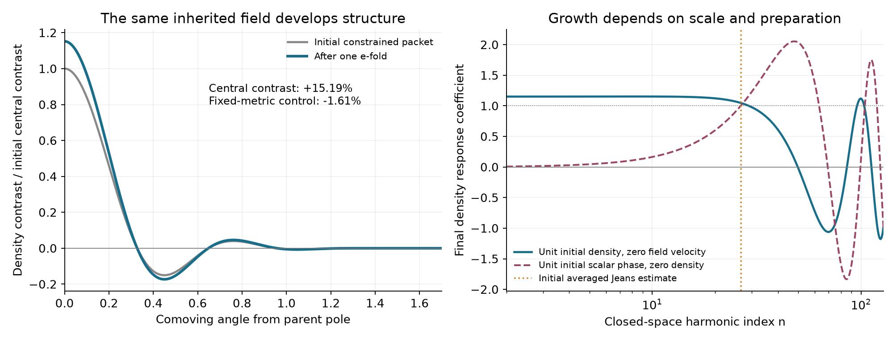

*Figure 17. Left: a compact constrained packet develops a larger
central density contrast under the same inherited source. Right:
the two independent initial-state columns have different scale
responses. The dotted Jeans estimate is a separate averaged
comparison; the evolution itself retains curvature and oscillations.*

[Hwang and Noh's massive-scalar calculation](https://arxiv.org/html/0902.4738)
provides the leading averaged, short-curvature-scale estimate

$$
k_{J,\rm physical}^4=2\kappa E\omega^2,\qquad
\ell_\Lambda=\sqrt{3/\Lambda}.
$$

The actual parent preparation has $E_0/\rho_v=4/3$, giving an
initial Jeans wavelength of $.462258806\ell_\Lambda$. Its
$H_0/\omega=.022134447$ and curvature-to-Jeans squared-wavenumber
ratio .001315002 characterize this comparison's scale separation;
they are not a proved approximation error. The unaveraged transfer
above does not depend on replacing the field by dust.

For this inherited excitation ratio the estimate implies

$$
\frac{\omega}{\sqrt{\Lambda}}
=\frac{\pi^2\sqrt{2/3}}{(\lambda_J/\ell_\Lambda)^2}.
$$

A smaller pressure cutoff therefore requires a larger scalar
frequency relative to the vacuum scale, with a compatible history.
The present benchmark's cutoff is a substantial fraction of its
vacuum radius; it cannot simply be called cold on every smaller
scale. The inherited law has not yet selected the required ratio.

These [calculated responses](../results/summaries/nsc-atlas-parent-perturbations-v1.json)
connect geometry, inheritance, expansion and linear structure.
An unnested model with identical local field and geometric initial
data has the same protected-domain response, so this growth alone
does not uniquely demonstrate nesting. The next physical connection
is a prepared perturbation state and frequency/scale, followed by
the linked density and metric response seen by observers.

### 10.27. What the inherited law leaves to the state

<!-- nsc-claim:finite-parent-state-observability -->

The two independent perturbation columns cannot be replaced by a
unique initial phase without additional physics. After inserting
the metric momentum equation, the linear flow on $(X,Y,\Phi)$ has
matrix trace -4H. Its fundamental matrix therefore obeys

$$
\det U(t,t_0)=\exp[-4N(t)]>0.
$$

Together with the exact constraint propagation, this makes finite
evolution a bijection between the initial and final two-dimensional
constraint spaces. Distinct admissible states cannot become the
same complete state at finite time. Their covariances transform by
U times the initial covariance times U-transpose, rather than being
selected by the deterministic equations. Asymptotic attraction,
open-system elimination, a boundary condition or an actual formation
law remains a separately specified possibility.

The useful next connection can nevertheless proceed: retain the
existing compact spatial profile and its two density/phase amplitudes,
use two operational observations to infer them, and test a third.
This does not select an arbitrary primordial spectrum. It creates
a falsifiable observer relation within a declared preparation family.
The [state-flow identities](../results/summaries/nsc-atlas-parent-clocks-v1.json)
are retained with the observer calculation.

### 10.28. Three freely falling clocks and a withheld prediction

<!-- nsc-claim:three-clock-parent-relation -->

Let $L_{\rm ref}=a_0$ and initialize three ideal test emitters at
proper separations $(.04,.08,.12)L_{\rm ref}$ from the parent pole.
They initially rest relative to the slice normal, emit continuously
at known rest frequencies, and freely fall without backreaction.
The central free-fall receiver observes at fixed proper age
2.251557477076, corresponding to background N=.8. All rays remain
inside the protected parent domain.

Observer terms are essential in relativistic measured quantities;
see [Scaccabarozzi, Yoo and Biern](https://arxiv.org/html/1807.09796).
Here the actual closed-parent metric supplies the calculation.
Holding initial proper distance and receiver age fixed gives

$$
\delta\theta_s(0)=\int_0^s\Phi(0,\theta)d\theta,
\qquad \delta t_o=-\int_0^{t_o}\Phi(t,0)dt.
$$

The source's outward peculiar velocity obeys

$$
\dot v_s+Hv_s=-\frac{\partial_\theta\Phi(t,s)}{a},
\qquad \delta\dot\theta_s=v_s/a.
$$

Along the unperturbed incoming ray, $\theta=\eta_o-\eta(t)$. The perturbed
null equation sets the emission-time correction,

$$
\delta t_e=a_e\left[\frac{\delta t_o}{a_o}
 +2\int_{t_e}^{t_o}\frac{\Phi}{a}dt-\delta\theta_s(t_e)\right].
$$

The measured log-frequency departure from the background is

$$
y=\log\frac{(\nu_o/\nu_e)}{a_e/a_o}
=H_e\delta t_e-H_o\delta t_o+\Phi_e-\Phi_o-v_e
 +2\int_{t_e}^{t_o}\partial_t\Phi\,dt.
$$

The last derivative is partial at fixed position. Source motion,
potential, propagation and clock contributions all enter; no
instantaneous potential difference alone determines the measurement.

Writing $y_i=R_{i1}\alpha+R_{i2}\beta$ for the two retained amplitudes,
the computed response is:

| Initial distance / $L_{\rm ref}$ | Background frequency ratio | Density column | Phase column |
| --- | ---: | ---: | ---: |
| .04 | .840672581087 | .017861103048 | -.000731094396 |
| .08 | .721722111018 | .030644152339 | -.001671366286 |
| .12 | .628648035135 | .038548233209 | -.002804913120 |

The first two rows have nonzero determinant and condition number
169.341 in this amplitude normalization. Eliminating both amplitudes
gives the conditional prediction

$$
y_3=-2.88990465\,y_1+2.94232704\,y_2.
$$

This is [NSC-P003](../docs/prediction-register.md), registered
retrospectively without astronomical data. In the synthetic check,
amplitudes $(10^{-5},-4\times10^{-6})$ give departures
$(1.81535408,3.13126989,3.96701985)\times10^{-7}$. Calibrating only
the first two recovers the amplitudes and predicts the withheld third.

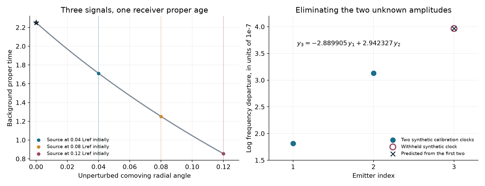

*Figure 18. Left: three emitters on the central past radial light cone;
their initial proper distances and the receiver's proper age are fixed.
Right: a withheld synthetic frequency response agrees with the prediction
from two state calibrations. No observational confirmation is inferred.*

An independent check integrates timelike sources and radial photons
in finite metric deformations, fixing the physical distances and
proper age by direct integration. The null Hamilton equation is

$$
\frac{d\log(-p_t)}{dt}
=\frac{\partial_tA}{2A}-\frac{\partial_tB}{2B},
\qquad A=1+2\Phi,\quad B=a^2(1-2\Phi).
$$

Symmetric metric variations verify the linear clock response;
the mixed-direction derivative differs by $5.23\times10^{-11}$
at variation step .0005. The finite metrics validate the first
variation, not a nonlinear Einstein-scalar solution. Refinement
changes the null weights by $1.35\times10^{-9}$; the retained
coefficient comparison tolerance is $10^{-7}$.

For independent equal frequency-log errors $\sigma_y$, the null residual
has uncertainty $4.243682044\sigma_y$. A full covariance must replace
that example for correlated measurements. Unknown source velocities,
an arbitrary spatial profile or extra fields would add parameters
and need not obey the three-clock relation. The
[derivation](../docs/nsc-atlas-parent-clocks.md) and
[compact evidence](../results/summaries/nsc-atlas-parent-clocks-v1.json)
keep those restrictions explicit. The advance is an operational test
surviving the two unknown state amplitudes, while physical formation
and an unrestricted primordial spectrum remain open.

### 10.29. A profile selected by scalar self-gravity

<!-- nsc-claim:scalar-core-profile-selection -->

The polynomial used for P003 was a specified profile. A physical
selection mechanism is now calculated: a real massive scalar can
concentrate through its own gravity and shed radiation, leaving a
coherent core. Gravitational cooling is established prior work of
[Seidel and Suen](https://arxiv.org/abs/gr-qc/9309015). The stationary
equations are also those studied by
[Moroz, Penrose and Tod](https://doi.org/10.1088/0264-9381/15/9/019),
with time-dependent examples in
[Harrison, Moroz and Tod](https://arxiv.org/html/math-ph/0208046).

The weak-field real-scalar reduction with positive vacuum curvature
is supplied by [Fodor, Forgacs and Mezei](https://arxiv.org/html/1007.0388).
Here its complex envelope represents one classical real field.
It introduces neither a new charged species nor a quantum
state-reduction law. We independently solve the profile and its
finite local evolution, then construct a sourced atlas initial slice.

First distinguish a coupling from a unit convention. At fixed mixing,
fluxes and tension, the common field at the grandchild minimum gives

$$
\phi_0=-\frac{\sqrt{1-\epsilon}\,q_g}{\omega},\qquad
U(\phi_0,q)=\frac{\epsilon q^2}{2}
 +\frac{(1-\epsilon)(q-q_g)^2}{2}.
$$

Thus the initial stress, wall jets and shared geometry do not select
omega. The later dynamics change with it. For weak amplitude zeta,
the local core approximation requires small $\zeta^2$ and

$$
h=\frac{H_\Lambda}{\omega\zeta^2},\qquad
H_\Lambda=\sqrt{\kappa\rho_v/3}.
$$

With zeta=.1 and the same parent vacuum 9/32, omega 20 gives h=1.53093,
outside the small-h approximation. The explicitly different
common-frequency member omega 2000 gives h=.0153093. It is chosen
for this hierarchy, not fitted to data. P003 retains omega 20; the
comparison does not rule out relativistic structures there.
The wall radii remain 1 and 1.9, with common middle mass .12. All
numbers use those same atlas coordinate units, with no selected SI ruler.

In local coordinates $\rho=\omega\zeta r$ and $\tau=\omega\zeta^2t$,

$$
i\partial_\tau\psi=-\frac{1}{2}\Delta\psi
 +(V-h^2\rho^2/2)\psi,\qquad \Delta V=\frac{1}{2}|\psi|^2.
$$

The h=0 nodeless core, with eigenvalue -1/2, satisfies

$$
S''+2S'/\rho+sS=0,\qquad
s''+2s'/\rho+S^2=0,\qquad s(\infty)=-1.
$$

Regularity and decay give $S(0)=1.02149303621$ and radial mass norm
$I=3.50532970334$. The 99%-mass radius is 5.67468871483 in rho.
Its virial identity is checked independently. Scaling the shape
fixes an isolated mass-radius relation,

$$
\mathfrak{M} R_f\omega^2=\frac{I\rho_f}{2},
\qquad \mathfrak{M}=GM.
$$

The core mass and frequency remain inputs; its dimensionless shape
is calculated. In the isolated problem, symmetric decreasing
rearrangement lowers the energy at fixed norm; this is the setting
of [Lieb's minimizing-solution theorem](https://doi.org/10.1002/sapm197757293).
Norm-preserving dilation gives energy $b^2T+bW$ with a finite minimum
at $b=-W/(2T)$. This explains the reference's spherical form and size
without establishing nonspherical stability in the full atlas.
Gaussian and super-Gaussian clouds with equal initial
norm evolve to tau 600. Their late density profiles, averaged over
$500\leq\tau\leq600$ and normalized by remaining mass, differ from the
independent coherent shape by 3.77% and 4.11%, compared with initial
discrepancies near 80%. Residual oscillations remain.

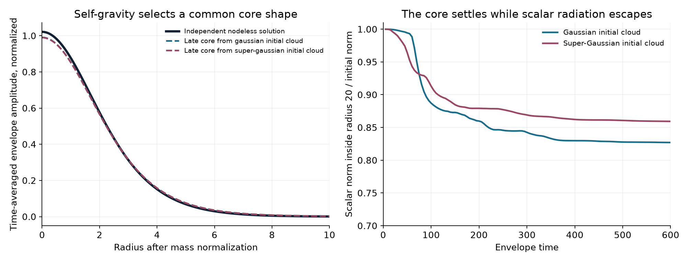

*Figure 19. Left: two distinct initial cloud shapes approach the
independently calculated coherent profile after mass normalization.
Right: scalar norm leaves the central region during relaxation.
This is a finite local envelope calculation, not the full evolving
parent and membrane history.*

The six independent runs use six worker processes. Outgoing current
at radius 20 checks loss from the core independently of the outer
absorber. Fine-run energy-accounting errors stay below $3.4\times10^{-6}$;
moving the outer boundary changes the late inner mass by about .165%.
A free-field control recovers analytic dispersion. The
[compact record](../results/summaries/nsc-atlas-scalar-core-v1.json)
keeps numerical discrepancies distinct from the weak-field, ambient
and relativistic approximations. The original cloud and its energy
are supplied, so this does not generate a primordial seed from nothing.

### 10.30. The coherent core and its inherited environment

<!-- nsc-claim:scalar-core-atlas-admission -->

The Gaussian late inner mass selects a coherent representative with
$\zeta_{\rm core}=.0826621713254$. It is the nodeless representative
of that mass, not the full radiating snapshot. Add its displacement
f to the inherited parent field, and taper its very small tail
smoothly to zero before the material wall. Retain zero scalar
momentum and homogeneous parent slice expansion v=HR.

The gravitational constraint must include the ambient scalar.
Writing $m=M(R)+\kappa U_0R^3/6$, with $U_0=21/32$, gives

$$
\beta^2=1+H^2R^2-\frac{\kappa U_0R^2}{3}-\frac{2M(R)}{R},
$$

$$
M'=\frac{\kappa R^2}{4}\beta^2f'^2
 +\frac{\kappa R^2}{2}U'_0f
 +\frac{\kappa R^2}{4}\omega^2f^2.
$$

The first and last terms are the gradient and quadratic core
contributions. The middle term is coherent interference with the
same inherited field. It cannot be discarded as if the core were
an independently added fluid.

M(0)=0 gives a regular pole. Outside the core M becomes constant;
the unsquared Israel condition then fixes the outer-wall speed and
H. Solving that condition with the mass equation rebuilds the large
parent cap and common middle. Both wall conditions and the middle
seams agree. The positive initial lapse realizes the temporal jets.
Removing the core recovers the same-frequency reference and extrinsic curvature.

| Coherent turning-point phase | Geometric mass offset | Outer-wall areal speed change |
| --- | ---: | ---: |
| Positive relative displacement | .0000957140113 | .000361840526 |
| Opposite relative displacement | .0000494933577 | .000187115382 |

Both have the same isolated leading mass .0000724395411. The exact
potential difference explains the main change:

$$
U(\phi_0+f)-U(\phi_0-f)=2U'_0f.
$$

The cross contribution has magnitude .0000231104644. The gradient
contribution also changes slightly through the metric. The positive-phase
proper slice energy excess is .00241200566080; it is distinct from the
geometric mass converted to energy units. Canonical absolute energy
remains nonnegative even where an excess relative to the background
is negative.

Independent field quadrature and proper-distance integration check
the mass. Sampled Hamilton residuals stay below $2\times10^{-8}$,
with wall and middle residuals near floating precision. The
[source derivation](../docs/nsc-atlas-scalar-core.md) and
[computed admission](../results/summaries/nsc-atlas-scalar-core-v1.json)
specify the complete initial construction.

The changed wall speed compares jointly prepared initial slices;
it is not a wall response propagated by the local cooling run. The
homogeneous reference's future shielding theorem is not asserted
for this new core geometry. A single formation history must also contain the
outgoing radiation, ambient-field interaction and moving walls.
This calculation supplies a profile-selection candidate and its
sourced initial admission. It leaves cloud origin, coupling and
relative-phase selection, nonlinear global evolution and observed
abundance as further physical connections.

## IV. What the observers can reach

### 11. Complete one reference before assigning its causal arrows

<!-- nsc-claim:atlas-causal-access -->

Evidence: [isolated causal completion](../results/development/nsc-cosmological-atlas-v5/causal-map.json),
[observer access](../results/development/nsc-cosmological-atlas-v5/observer-access.json),
and [protected parent interval](../results/development/nsc-cosmological-atlas-v4/causal-window.json).

The wall's isolated spherical completion is the flat-exterior limit of
solution 13 in [Aguirre and Johnson, gr-qc/0508093v2,
Figures 7 and 10](https://arxiv.org/html/gr-qc/0508093v2).
Writing $x=R/\ell$, its expanding branch has

$$
\dot R^2=\frac{25x^2}{16}-1+\frac{3}{10x}+\frac{1}{25x^4}>0.
$$

It starts at a finite proper-past $R=0$ boundary in the Schwarzschild
white-hole sector, crosses $R=2M$ into the left exterior, and crosses the
de Sitter horizon into an expanding interior chart. It reaches arbitrarily
large radius at infinite wall proper time. Its Schwarzschild curvature
$48M^2/R^6$ diverges at the past boundary. The regular cap on the
chosen slice therefore does not imply a regular past formation.
The retained reference also contains the usual future Schwarzschild
black-hole singular boundary.

Choose three clocks. $C$ is the cap center, with de Sitter flat proper
time $t_C$. $W$ carries wall proper time $\tau_W$, set to zero at
$R=1.5\ell$. $P$ is static in the right exterior at
$R_P=1.6\ell$, with proper time
$\tau_P=\sqrt{1-2M/R_P}\,t_{\mathrm{Schw}}$. Their origins coincide
with a selected slice convention; this is not an equality of universe ages.

For the flat de Sitter chart,

$$
\eta=-\ell e^{-t_C/\ell},\qquad R=a r,\qquad a=e^{t_C/\ell}.
$$

Radial null lines have constant $\eta-r$ or $\eta+r$.
At $W_0$, $\eta=-\ell$ and $r=1.5\ell$.
Its inward ray would reach $\eta=0.5\ell$, outside the chart's
future $\eta<0$; hence it never reaches $C$.
A central signal emitted at $t_C=0$ likewise cannot catch the future wall.

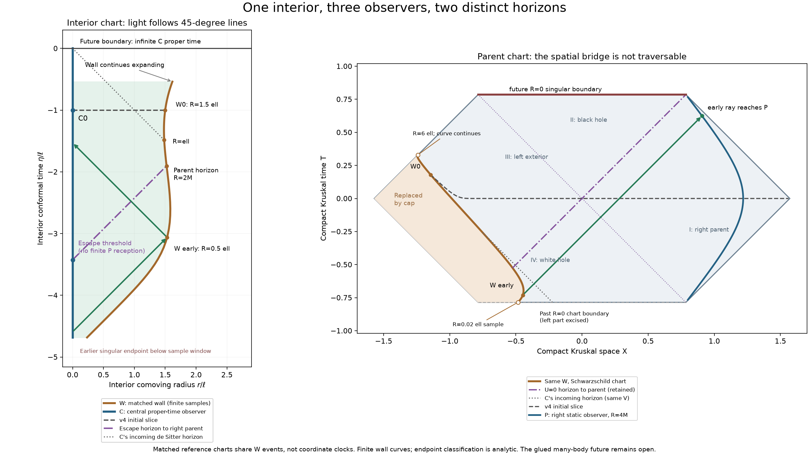

*Figure 20. The isolated reference in joined causal charts. Horizons are
clipped to retained domains; the central cosmological horizon continues
into the Schwarzschild chart along its appropriate constant null coordinate.
The faint past $R=0$ line also shows uncut chart context, part of which is
excised. Open wall endpoints at $R/\ell=0.02$ and $6$ mark finite
plot samples, not physical beginnings or endings.*

| Emission and destination | Result in this reference | Required distinction |
| --- | --- | --- |
| New $C\to W$ or $W\to C$ emission at or after the anchor slice | No future reception | Earlier signals may arrive later |
| Right parent $P\to W$ or $P\to C$ | No future causal route | Left and right exterior regions are different |
| Early $W\to C$, while $R<\ell$ | Allowed | Reception time depends on the emission event |
| Early $C\to W\to P$, crossing while $R<2M$ | Allowed | The limiting horizon ray has no finite parent reception |
| These same arrows in a glued multi-body future | Unresolved | Initial-data gluing does not supply that global future |

For a wall event with interior time $t_W$, the central emission reaching
it and the reception of its inward ray satisfy

$$
t_e=t_W-\ell\ln(1+R/\ell),\qquad
t_r=t_W-\ell\ln(1-R/\ell).
$$

The second relation requires $R<\ell$.
At the early event $R=0.5\ell$, the recorded central emission is
$-1.5242168241\ell$ and inward reception is
$-0.4256045355\ell$. An outward early route through that event reaches
$P$ at its own proper time $+2.5311656510\ell$.
Thus exclusion of **new emissions** after a slice must never be rewritten
as exclusion of all later receptions. Emissions approaching the central
horizon from below can arrive arbitrarily late.

The critical central emission for escape to the right parent is
$t_C=-1.2312944525\ell$. Equality follows the parent horizon and has
no finite parent reception. That horizon extends into the cap along
$\eta-r=\eta_W(2M)-r_W(2M)$; it is not the surface $R=2M$
everywhere. The central observer's de Sitter horizon $\eta+r=0$
is a different boundary. Detailed clock domains and finite checks are
retained in the [observer note](../docs/nsc-atlas-causal-observers.md).

### 12. Different exteriors can be locally indistinguishable

There is also a result that does not require the glued parent's full future.
Retain the exact right Schwarzschild $K=0$ slice for
$2M<R<R_{\mathrm{cut}}$, with $R_{\mathrm{cut}}=10M$.
For a static observer at $R_{\mathrm{obs}}=4M$, the exterior cutoff
cannot influence it within

$$
0<t_{\mathrm{Schw}}<
r_*(R_{\mathrm{cut}})-r_*(R_{\mathrm{obs}}),\qquad
r_*(R)=R+2M\ln(R/(2M)-1).
$$

The observer's proper duration is the right side multiplied by
$\sqrt{1-2M/R_{\mathrm{obs}}}$.
For $M=0.4\ell$, the bound is
$t_{\mathrm{Schw}}<3.5090354889\ell$, or
$\tau_P<2.4812627896\ell$.
The inner optical boundary is at negative infinity, so it introduces no
finite inner cutoff.

Shared smooth vacuum data give the same vacuum development in this domain.
The [owning argument](../docs/nsc-atlas-causal-observers.md) uses standard
Cauchy-development uniqueness, with [Sbierski
(1309.7591v2)](https://arxiv.org/html/1309.7591v2) as a source.
The bound ends a guaranteed interval; it does not predict that a signal
actually arrives then. Matching additional fields and their states requires
additional data.

This supplies one precise atlas of indistinguishable exteriors. Distinct
larger assemblies can share a protected local geometry. The next useful
question is which later measurement or extra state datum separates them.
Failure to distinguish exteriors can be a result, rather than a reason to
add unconstrained parameters until a preferred story appears.

## V. Fields, transfer and finite memory

### 13. A first field that reaches the interior

<!-- nsc-claim:atlas-field-response -->

Evidence: [field-transfer record](../results/development/nsc-cosmological-atlas-v6/field-transfer.json)
and [field-transfer owner](../docs/nsc-atlas-field-transfer.md).

On the fixed de Sitter/Schwarzschild wall, retain $H\ell=1$, $k\ell=2$,
$M/\ell=0.4$ and a real classical massless scalar in its spherical mode,
with conformal coupling $\xi=1/6$ and no additional scalar wall interaction.
For $\chi=R\phi$, the distributional scalar equation gives

$$
[\phi]=0,\qquad [n\phi]=6\xi k\phi,\qquad
[\chi]=0,\qquad [n\chi]=(6\xi-1)k\chi=0.
$$

The conformal interface barrier cancels; the smooth exterior potential
$f_+2M/R^3$ remains. A regular center has
$\chi=F(\eta+r)-F(\eta-r)$. For incoming wall characteristic
$I=(d/d\tau_W+n)\chi$, its exact conditional response is

$$
\phi_C[T(\tau_W)]=\frac{I(\tau_W)}{T'(\tau_W)},\qquad
T=t_W-\ell\log(1-R/\ell),\qquad
T'=\frac{\gamma(1+v_{\rm pec})}{1-R/\ell}>0.
$$

The prescribed wall-clock calibration has half-width $0.03\ell$, duration
stretch $2.63230219$ and normalized extrema $+23.84144800$ and
$-24.46533478$. Its central field vanishes after the received support
through $t_C=0$, conditional on zero incoming data afterward and the
proved no-return interval. These are field amplitudes, not energy fractions.
The calibration does not generate its exterior input.

### 13.1. Where the early signal can originate

<!-- nsc-claim:atlas-field-preparation -->

Evidence: [preparation record](../results/development/nsc-cosmological-atlas-v7/preparation-access.json)
and [preparation owner](../docs/nsc-atlas-field-preparation.md).

Independent data can instead be placed in retained white-hole sector IV.
The ordinary right-parent observer remains causally excluded. Let
$x=R/\ell$, $F(x)=(1-x/0.8)e^{x/0.8}=UV$, $V_a=V_W(0.45)$,
$V_b=V_W(0.55)$ and $U_0=F(0.4)/V_a$. Define $D$ by
$V_a\leq V\leq V_b$ and $U_0\leq U\leq U_W(V)$;
there $0.4\leq R/\ell\leq0.55$. Prescribe zero bottom and cap data and
$g(V)=\varepsilon B[4(V-V_m)/(V_b-V_a)]$ on $U=U_0$, where
$B(z)=(1-z^2)^4$ for $|z|<1$ and zero otherwise. This is a compact
$C^3$ input, independent of any desired central waveform.

With $L(u)=V_a$ below $U_a$ and the inverse wall graph above it,

$$
\chi=g-\int_{U_0}^{U}du\int_{L(u)}^Vdv\,K\chi,\qquad
K=\frac{16M^4}{R^4}e^{-R/(2M)},\qquad \chi_U|_W=0.
$$

The integral operator has analytic uniform-norm bound

$$
q_*=16e^{-1/2}[\sqrt{F(0.4)}-\sqrt{F(0.55)}]^2
=0.13882099234357653<1.
$$

It therefore determines a unique finite transfer. The central arrival
window is $-0.581758951595344\leq T/\ell\leq-0.250230700560700$;
the no-return null-label gap is $2.634591912177392\ell$. Remote physical
generation and data beyond that window remain unspecified.

### 13.2. A prepared pulse leaves a finite scattering tail

<!-- nsc-claim:atlas-prepared-response -->

Evidence: [prepared-response record](../results/development/nsc-cosmological-atlas-v8/prepared-response.json)
and [response owner](../docs/nsc-atlas-prepared-response.md).

For this unchanged input, let $A$ denote the positive integral operator
above. After the compact input ends, its Neumann series gives
$-Ag\leq\chi\leq-(1-q_*)Ag<0$. Hence the determined wall derivative

$$
J=g'(V)-\int_{U_0}^{U_W(V)}K\chi\,dU>0,
\qquad (1-q_*)\mathcal B(V)\leq J(V)\leq\mathcal B(V),
\quad \mathcal B=\int KAg\,dU,
$$

produces a positive central tail on
$-0.340772594886934<T/\ell\leq-0.250230700560700$.
The sampled normalized extrema are $47.29833694$ and $-45.69595941$;
the final field is $0.00129049806$. At the final point,
$J/\varepsilon=0.0008020390045$ lies in the independently evaluated
bracket $[0.0006965878198,0.0008088769160]$.
The 257-to-513 spatial and 129-to-257 geometry comparisons change the
central field by at most $2.79286258\times10^{-7}$ and
$3.40622250\times10^{-8}$. The calculation uses 5,597,264 kernel values
within its ten-million/60-CPU-second limits. These numerical controls
support the finite waveform; the sign follows from the analytic argument.
No permanent memory, continuum enclosure or later decay law is established.

### 13.3. What the signal determines when preparation is unknown

<!-- nsc-claim:atlas-observer-inverse -->

Evidence: [inverse record](../results/development/nsc-atlas-observer-inference-v1/inference.json)
and [inverse owner](../docs/nsc-atlas-observer-inference.md).

In this fixed geometry, put $f=\chi/\varepsilon$,
$h=f(U_W(V),V)$, $\theta=T/\ell$ and $Y=\ell\phi_C/\varepsilon$.
The zero cap fixes the integration constant:

$$
h(V)=\frac12\int_{\theta_a}^{\theta(V)}Y(s)ds,\qquad
f=(I-\mathsf{B})^{-1}Eh,\qquad g(V)=f(U_0,V),
$$
$$
(\mathsf{B}f)(U,V)=\int_U^{U_W(V)}dp\int_{L(p)}^Vdq\,K(p,q)f(p,q).
$$

The operator-norm bound $q_*<1$ gives a bijection between initially
quiet $C^2$ source traces and compatible $C^1$ signed central histories.
For nonzero nonnegative compact sources, the post-input restrictions are
$h<0$, $Y>0$ and $\int_{\theta_a}^{\theta(V)}Yds=2h<0$.
An arbitrary fitted trace need not satisfy them. This analytic source
inverse neither identifies geometry nor reconstructs a source numerically
from sampled or intensity-only data.

### 13.4. The transmitted probe and the wall's stress

<!-- nsc-claim:atlas-scalar-wall-consistency -->

Evidence: [stress record](../results/development/nsc-atlas-scalar-wall-consistency-v1/consistency.json)
and [wall-stress owner](../docs/nsc-atlas-scalar-wall-consistency.md).

Fix canonical kinetic normalization, $\kappa_4=8\pi G$ and
$f(\phi)=1/(2\kappa_4)-\phi^2/12>0$ in the weak-field interpretation.
The full stress includes the nonminimal Einstein term once:

$$
T^\phi_{\mu\nu}=\nabla_\mu\phi\nabla_\nu\phi
-\frac{1}{2}g_{\mu\nu}(\nabla\phi)^2
+\xi[G_{\mu\nu}\phi^2+(g_{\mu\nu}\Box-\nabla_\mu\nabla_\nu)\phi^2].
$$

For the original sufficiently regular traces, $d=[n\phi]=k\phi$ and
$C_{ab}=[K_{ab}]-\gamma_{ab}[K]=2k\gamma_{ab}$ give
$S^\phi_{ab}=\xi(2\phi d\gamma_{ab}-\phi^2C_{ab})=0$ and
$[T^\phi_{na}]=(1-6\xi)k\phi D_a\phi=0$.
Thus no additional scalar surface source or tangential flux jump is
required at quadratic order. The individual fluxes and smooth bulk
gravitational source need not vanish.

### 13.5. The prepared pulse requires gravitational initial data

<!-- nsc-claim:atlas-characteristic-initialization -->

Evidence: [initialization record](../results/development/nsc-atlas-characteristic-initialization-v1/initialization.json)
and [initial-data owner](../docs/nsc-atlas-characteristic-initialization.md).

On the source leg, keep the reference lapse, radius $0.4\ell$, both corner
expansions and affine normalization. Use the affine background radius
$x=R_0(U_0,V)/\ell$, $V(x)=F(x)/U_0$ and
$b(x)=B(4[V(x)-V_m]/(V_b-V_a))$; primes here and in section 13.6 mean
$d/dx$. With $p=b(x)/x$,
$\phi=(\varepsilon/\ell)p+O(\varepsilon^3)$ and
$\alpha=\kappa_4\varepsilon^2/\ell^2$, write
$R/\ell=x+\alpha h+O(\alpha^2)$. The intrinsic constraint forces

$$
h''=-\frac{x}{3}p'^2+\frac{x}{6}pp'',\qquad h(0.4)=h'(0.4)=0.
$$

After the compact trace, $h'<0$ and $h<0$ by the integrated expressions;
$h'$ becomes constant. At $x_b=0.4815042082576364$,
$h=-6.12283354819419$ and $h'=-162.18055362491776$.
Direct integration, integration by parts and the transformed affine
Einstein-frame equation agree. These are initial radius coefficients,
not a mass shift or an evolved wall; no finite amplitude or perturbative
remainder bound is selected.

### 13.6. An invariant mass response on the same initial surface

<!-- nsc-claim:atlas-source-mass -->

Evidence: [source-mass record](../results/development/nsc-atlas-source-mass-v1/mass.json)
and [mass owner](../docs/nsc-atlas-source-mass.md).

With $m=M/\ell=0.4$, the fixed transverse corner datum and scalar equation supply
$d=(a/x-1)/4$, $a=0.8$, and $s'=-(s+dp')/x$, $s(0.4)=0$.
For the geometric mass length, use

$$
\mathfrak{m}=\frac{R}{2}[1-g^{ab}\partial_aR\partial_bR],\qquad
\frac{\mathfrak{m}_J}{\ell}=m+\alpha\mu_J+O(\alpha^2).
$$

The borrowed flux and full conformal frame conversion yield

$$
\mu_E=-\frac14\int_{0.4}^{x}t(a-t)p'(t)^2dt,\qquad
\mu_J=\mu_E+\frac{mp^2}{12}+\frac{x^2p}{3}(s+dp').
$$

After the input, the frame masses agree at the constant negative coefficient
$\mu_J=\mu_E=-28.88319705406449$. Their largest sampled difference
during input is $4.265459834842238$. Independent mixed-radius and improved
stress laws agree. This is a finite source-leg response relative to the
reference mass, not a negative total mass, vacuum future or asymptotic energy.

### 13.7. The scalar adds no normal-force jump

<!-- nsc-claim:atlas-scalar-normal-force -->

Evidence: [normal-force record](../results/development/nsc-atlas-scalar-normal-force-v1/normal-force.json)
and [normal-force owner](../docs/nsc-atlas-scalar-normal-force.md).

The Gauss jump $[G_{nn}]=-2k\bar K$ and complete scalar stress give

$$
[T^\phi_{nn}]=2\xi(6\xi-1)k\bar K\phi^2=0,\qquad
S^{ab}\bar K_{ab}=[T_{nn}].
$$

The cap contribution $G^-_{nn}=-3H^2$ is essential. Fixed vacuum and
material tension therefore require $\delta\bar K=0$ at order
$\varepsilon^2$. This mean-curvature variation includes the bulk metric,
induced metric and wall displacement. It does not require zero displacement
or an unchanged trajectory.

### 13.8. Exterior mass closes from the known wall field

<!-- nsc-claim:atlas-wall-mass-closure -->

Evidence: [analytic closure record](../results/development/nsc-atlas-wall-mass-closure-v1/wall-mass.json)
and [wall-mass owner](../docs/nsc-atlas-wall-mass-closure.md).

On the smooth exterior wall limit in the same $0.45\leq R/\ell\leq0.55$
window, put $s=\tau/\ell$, $x=R/\ell$, $v=dx/ds$, $\beta=\beta_+$,
$w=\chi_W/\varepsilon$, $j=dw/ds$ and $p=w/x$. The two known derivatives
are $A=(j-vp)/x$ and $B=(j-\beta p)/x$. Both null mass fluxes and the
complete conformal endpoint term give

$$
L=\frac{x^2}{2}\left[\beta AB-\frac{v}{2}(A^2+B^2)\right],\qquad
Q=\frac{mp^2}{12}+\frac{x^2p}{6}(vA-\beta B),\qquad
\mu_J(s)=\int_{s_a}^sL(s')ds'+Q(s),\quad Q(s_a)=0.
$$

The original-frame improved stress independently gives
$d\mu_J/ds=L+dQ/ds$. Neither expression divides by $\beta$.
This analytic conditional functional is evaluated with the coupled
quadratic geometry in Sections 13.10--13.12. The wall tail alone supplies
no late mass sign or plateau. Physical preparation selection, the next
scalar amplitude, stability and a finite-amplitude validity bound remain
open. Detailed scalar-chain
derivations belong to their owners; historical supporting calculations
are cited at [Zenodo](https://doi.org/10.5281/zenodo.23090015).

### 13.9. Cap mass and a regular wall displacement functional

<!-- nsc-claim:atlas-cap-wall-response -->

Evidence: [cap-wall record](../results/development/nsc-atlas-cap-wall-response-v1/cap-wall.json),
[model specification snapshot](../results/development/nsc-atlas-cap-wall-response-v1/model-specification.json)
and [cap-wall owner](../docs/nsc-atlas-cap-wall-response.md).
The common [model interface](../src/recursive_horizons/nsc_cosmological_atlas.py)
separates the fixed action, prescribed preparation and unit scale from
derived responses. Its parameters $h=H\ell=1$, $b=k\ell=2$ and
$m=M/\ell=2/5$ remain declared inputs. We retain the same canonical real
massless scalar, conformal coupling, scalar-independent vacuum terms and
constant material tension in the Jordan frame.

Let $r=x+\alpha\rho+O(\alpha^2)$ be the actual wall radius in units of
$\ell$, with $\alpha=\kappa_4\varepsilon^2/\ell^2$ and proper wall time
$s=\tau/\ell$. The two geometric masses have expansions

$$
\frac{\mathfrak{m}_+}{\ell}=m+\alpha\mu_++O(\alpha^2),\qquad
\frac{\mathfrak{m}_-}{\ell}=\frac{h^2r^3}{2}+\alpha\nu_-+O(\alpha^2).
$$

Here $\mu_+$ is the exterior coefficient $\mu_J$ of Section 13.8.
The cap vacuum is evaluated at the actual radius: its total quadratic
mass coefficient on the reference wall is
$\nu_-+3h^2x^2\rho/2$. Holding that vacuum mass constant would omit a
term required by the angular junction. The shared quiet corner fixes
$\mu_+(s_a)=\nu_-(s_a)=\rho(s_a)=0$.

Using the signed normals $\beta_-=\beta_++bx$, define
$B_-=(j-\beta_-p)/x$ with the same $p=w/x$, $j=w_s$ and $A=p_s$
as above. The cap's vacuum-subtracted mass closes as

$$
L_-=\frac{x^2}{2}\left[\beta_-AB_--\frac{v}{2}(A^2+B_-^2)\right]
+\frac{h^2x^2vp^2}{2},
$$
$$
Q_-=\frac{x^2p}{6}(vA-\beta_-B_-)-\frac{h^2x^3p^2}{12},\qquad
\nu_-(s)=\int_{s_a}^sL_-(s')\,ds'+Q_-(s).
$$

Direct differentiation reproduces the Jordan-frame improved-stress law
$\nu_{-,s}=x^2(\beta_-q_--vP_-)/2$. Here $q_-=t_{uN,-}$ and
$P_-=t_{NN,-}$ are the flux and normal pressure of
$t_{ab}=\ell^4T^\phi_{ab}/\varepsilon^2$. The extra vacuum terms
in $L_-$ and $Q_-$ are essential; the exterior's zero-vacuum shortcut
cannot be carried into the cap. The evaluation uses first scalar
derivatives, while covariant Hessians enter the independent transport
check. No derivative of sampled waveform data is used.

For this conformal scalar, $f+3f'^2=1/(2\kappa_4)$ reduces the
scalar-tensor pure-tension junction to the same signed angular law.
With $D=\mu_+-\nu_-$, its linearization gives

$$
\delta\beta_\pm=\beta_{\pm,x}\rho+\frac{D}{bx^2},\qquad
\rho_s=v_x\rho+\frac{\mu_+/x+\beta_+D/(bx^2)}{v}.
$$

The cap expression replaces the numerator by
$\nu_-/x+\beta_-D/(bx^2)$ and agrees exactly. Because $v=x_s>0$
on $x\in[0.45,0.55]$, the equation stays regular through
$\beta_+=0$. Its homogeneous solution is $C v(s)$, a relative
proper-time origin shift removed by the shared quiet event.

The existing scalar junction identities give equal one-sided fluxes and
pressures, $q_+=q_-=q$ and $P_+=P_-=P$. Subtracting the two mass laws
yields $D_s=-bx^3q/2$. Together with the displacement equation, this gives
equal corrections to the dimensionless normal accelerations $a_\pm$ and
zero change in the dimensionless mean extrinsic-curvature trace:

$$
\delta a_+=\delta a_-=\frac{6m\rho}{bx^4}-\frac{2D}{bx^3},\qquad
\delta\overline{K}=0.
$$

Thus the temporal jump and normal-force condition close with the angular
condition and mass transport, without setting $\rho=0$ or adding a freely
chosen cap mass or wall force. These are formal quadratic identities,
checked by independent algebra, not an evaluated displacement curve or
a completed sourced spacetime.

The next connection is the smooth bulk metric on both sides; the exterior
characteristic calculation below supplies its first evolved domain. Geometric
mass alone does not determine the null lapse, the wall's null-coordinate
embedding or the central observer's clock. Their reconstruction must use
the shared wall data and characteristic initial data before calculating
the corrected arrival map and subsequent scalar response. A nonzero
allowed amplitude, a controlled remainder, formation and stability remain
separate questions.

### 13.10. The prepared field drives a smooth exterior metric response

<!-- nsc-claim:atlas-bulk-response -->

Evidence: [metric refinement](../results/development/nsc-atlas-bulk-response-v1/metric/response.json),
[field refinement](../results/development/nsc-atlas-bulk-response-v1/field/response.json),
[derivative-quadrature comparison](../results/development/nsc-atlas-bulk-response-v1/derivative/response.json)
and [bulk-response owner](../docs/nsc-atlas-bulk-response.md), with separate
[geometry](../results/development/nsc-atlas-bulk-response-v1/geometry/response.json),
[source quadrature](../results/development/nsc-atlas-bulk-response-v1/source/response.json)
and [time tolerance](../results/development/nsc-atlas-bulk-response-v1/time/response.json)
comparisons.

The gravitational data of Sections 13.5--13.6 determine a computed smooth
exterior response at quadratic order on $[U_0,U_a]\times[V_a,V_b]$, whose two past null
sides are specified. This rectangle lies inside the retained wedge. Its
final transverse leg $U=U_a$ supplies data for a later extension toward
the moving wall; no exterior metric is continued through the excised cap.

Keep the original null coordinates and fixed Jordan source lapse. With
$r_0=R_0/\ell$, write $r_E=r_0+\alpha H$ and
$\log C_E=\log C_0+\alpha c$ to the retained order. The leading scalar
is $\phi=(\varepsilon/\ell)p$, with both first derivatives obtained
from its characteristic integral equations. The existing smooth exterior
Einstein equations simplify under $y=r_0H$, $z=c+H/r_0$ to

$$
y_{UV}=\frac{C_0}{4r_0^2}y-\frac{C_0}{4}z,\qquad
z_{UV}=-\frac{3C_0}{4r_0^4}y+\frac{C_0}{4r_0^2}z-p_Up_V.
$$

Integrating their right sides in $U$ gives a linear evolution in $V$.
The quiet bottom has $y=z=0$. At $U=U_0$, let $x=r_0(U_0,V)$ and
let $h_{\mathrm{init}}$ denote the original Jordan radius coefficient from
Section 13.5. The source values in the unchanged coordinate gauge are

$$
y_0=xh_{\mathrm{init}}-\frac{x^2p^2}{12},\qquad
z_0=\frac{h_{\mathrm{init}}}{x}-\frac{p^2}{4}.
$$

The frame and affine-parameter corrections must both be retained;
the Einstein-affine radius coefficient alone is not the source value at
fixed original coordinates. Returning to the Jordan metric gives
$h_J=H+r_0p^2/12$ and $c_J=c+p^2/6$, where
$r_J=r_0+\alpha h_J$ and $\log C_J=\log C_0+\alpha c_J$.

At $(U_a,V_b)$, the 65-node metric calculation with 257 field nodes
reports the following dimensionless quadratic coefficients:

| Quantity | Recorded coefficient |
| --- | ---: |
| Radius, $h_J$ | $-5.7131513827$ |
| Logarithmic null lapse, $c_J$ | $-1.5461215575$ |
| Geometric mass, $\mu_J$ | $-28.8833375991$ |

Changing the metric grid from 33 to 65 nodes reduces the largest sampled
mass-transport residual from $1.65\times10^{-6}$ to
$4.31\times10^{-7}$. On the common sampled grid, the changes in
$h_J,c_J,\mu_J$ are respectively at most $1.15\times10^{-7}$,
$3.82\times10^{-6}$ and $1.23\times10^{-6}$. A separate 129/257
field-grid comparison changes these coefficients by at most
$2.14\times10^{-8}$, $9.55\times10^{-8}$ and $5.78\times10^{-7}$;
the 32/64 derivative-quadrature comparison changes them by less than
$7.2\times10^{-15}$. Both null constraints are checked in integral
form, and geometric mass is compared with transport along both null
directions. The radial lapse reconstruction checks the same $U$ constraint
in different variables.

Changing geometry interpolation and source quadrature changes these three
coefficients by less than $7.2\times10^{-15}$ and $1.5\times10^{-13}$
respectively; tightening the time tolerance tenfold changes them by less
than $1.21\times10^{-11}$. Each complete two-solve comparison took
between 17.16 and 21.91 process-CPU seconds within its 120-second budget.

These are finite numerical comparisons, not rigorous error enclosures or
a selected nonzero physical amplitude. They establish a sourced exterior
metric response on the rectangle and provide its transverse radius/lapse
data. Sections 13.11--13.12 continue to the moving wall and cap using the
same source and material junction. The full finite-amplitude sourced
configuration, corrected observer signal and finite-amplitude remainder
have not yet been established.

### 13.11. The same field displaces the wall and changes its exterior clock

<!-- nsc-claim:atlas-wall-evolution -->

Evidence: [field refinement](../results/development/nsc-atlas-wall-evolution-v1/field/response.json),
[radial quadrature](../results/development/nsc-atlas-wall-evolution-v1/radial/response.json),
[clock integration](../results/development/nsc-atlas-wall-evolution-v1/time/response.json)
and the [wall-evolution owner](../docs/nsc-atlas-wall-evolution.md).

The leading field now supplies a computed response on the moving boundary,
with the action, source and quiet corner of Sections 13.5--13.10 unchanged.
Extending its first-derivative evaluator to the retained wedge requires the
correct lower endpoint: a column with $U>U_a$ begins where it meets the wall.
At that event $\chi_U=0$, while $p_U=-p r_{0,U}/x$ is generally nonzero.
Both derivatives are obtained from the integral equations of the original
field solution.

Define the areal-null lapse $Z=C/(2r_U)$. The Einstein-frame mass and
logarithmic lapse coefficients follow radial constraints at fixed $V$:

$$
\mu_E=\mu_{E,0}-\int_{U_0}^{U}\frac{r_0^2r_{0,V}}{C_0}p_U^2\,dq,
\qquad
\zeta_E=\zeta_{E,0}+\int_{U_0}^{U}\frac{r_0}{2r_{0,U}}p_U^2\,dq.
$$

Their source constants are already fixed by the characteristic data.
At the wall, frame conversion gives $\mu_+^{\mathrm{radial}}=\mu_{E,W}+Q_+$
and $\zeta_{J,W}=\zeta_{E,W}+p^2/4$. The independent timelike mass
functionals of Section 13.9 determine $\mu_+$ and $\nu_-$, and hence the
quiet-anchored displacement $\rho$. The radial and timelike mass values are
compared, rather than equated by the numerical implementation.

The exterior embedding also follows from these data. Write
$V_W=V_0(1+\alpha\eta)$, with $s$ the original Jordan wall proper time,
$d=v-\beta_+>0$, and $Z_0=-2a/V_0$, $a=2m$. Expanding
$V_{W,s}=1/[Z_J(r_{W,s}-\beta_+)]$ gives

$$
\eta_s=\frac{1}{2ad}\left[
\zeta_{J,W}+\frac{\rho_s-\delta\beta_+}{d}\right],
\qquad \eta(s_a)=0.
$$

The background lapse is evaluated at the moved $V_W$ in this expansion.
The equation stays regular through the zero of the signed $\beta_+$.

At the final reference radius $x=0.55$, the 257-node field calculation gives:

| Dimensionless quadratic coefficient | Recorded value |
| --- | ---: |
| Exterior mass, $\mu_+$ | $-28.8834223256$ |
| Cap excess mass, $\nu_-$ | $17.7590784205$ |
| Wall displacement, $\rho$ | $-5.2868390417$ |
| Exterior clock ratio, $\eta=V_1/V_0$ | $-0.8178125677$ |

For example, the radius expansion is $r_W=0.55+\alpha\rho+O(\alpha^2)$;
the tabulated number is its coefficient, with no finite $\alpha$ selected.
The cap excess subtracts its vacuum mass at the actual wall radius.

Changing the leading field from 129 to 257 nodes reduces the largest sampled
mass-path discrepancy from $6.49\times10^{-7}$ to $1.63\times10^{-7}$.
The maximum changes at nine common time cuts in $\mu_+,\nu_-,\rho,\eta$
are respectively $3.38\times10^{-7}$, $2.09\times10^{-7}$,
$3.64\times10^{-8}$ and $3.57\times10^{-9}$. Doubling the clock panels
from 8 to 16 changes $\eta$ by at most $2.41\times10^{-8}$.
The radial 2/4-point comparison changes it by less than $1.35\times10^{-13}$.
The angular jump, two forms of the displacement equation and clock
normalization are checked on the same trajectories.

The [32/64 field-derivative comparison](../results/development/nsc-atlas-wall-evolution-v1/derivative/response.json)
leaves the eight reported comparison quantities identical in this run.
Separate [geometry](../results/development/nsc-atlas-wall-evolution-v1/geometry/response.json),
[source](../results/development/nsc-atlas-wall-evolution-v1/source/response.json)
and [ODE tolerance](../results/development/nsc-atlas-wall-evolution-v1/ode/response.json)
comparisons change them by less than $5.64\times10^{-11}$,
$2.85\times10^{-14}$ and $8.25\times10^{-13}$ respectively. All seven
comparisons completed within their individual 120 process-CPU-second budgets.
An [independent rectangle overlap](../results/development/nsc-atlas-wall-overlap-v1/response.json)
finds mass and lapse differences of at most $4.08\times10^{-7}$ and
$1.30\times10^{-6}$ against the mixed metric solver. Different radial
quadratures expose error that a shared-rule constraint residual can cancel;
that residual alone is not a total metric error estimate.

These computations connect the sourced exterior and the two-sided mass
functionals to an actual wall displacement and exterior null embedding at
quadratic order. Their numerical differences are refinement diagnostics.
Section 13.12 supplies the cap metric and central arrival correction.
The next scalar waveform and finite-amplitude remainder remain to be
calculated.

### 13.12. The cap geometry changes the central arrival clock

<!-- nsc-claim:atlas-cap-response -->

Evidence: [field refinement](../results/development/nsc-atlas-cap-response-v1/field/response.json),
[radial integration](../results/development/nsc-atlas-cap-response-v1/radial/response.json),
[further radial refinement](../results/development/nsc-atlas-cap-response-v1/radial_fine/response.json),
[ray integration](../results/development/nsc-atlas-cap-response-v1/ray/response.json),
[further ray refinement](../results/development/nsc-atlas-cap-response-v1/ray_fine/response.json),
[wall-time integration](../results/development/nsc-atlas-cap-response-v1/time/response.json),
[geometry](../results/development/nsc-atlas-cap-response-v1/geometry/response.json),
[derivative quadrature](../results/development/nsc-atlas-cap-response-v1/derivative/response.json),
[centre quadrature](../results/development/nsc-atlas-cap-response-v1/centre_order/response.json),
[centre threshold](../results/development/nsc-atlas-cap-response-v1/centre_radius/response.json)
and the [cap derivation](../docs/nsc-atlas-cap-response.md).

The same prepared wall trace fixes the leading regular field in the cap.
With $A_0=1-r^2$, $r_*=\mathrm{atanh}\,r$ and
$f(q(V))=\chi_W(V)/\varepsilon$, where $q$ is the existing central
arrival map,

$$
p(T,r)=\frac{f(T+r_*)-f(T-r_*)}{r},\qquad p(T,0)=2f'(T).
$$

The reflected term remains in the interior. Both profile derivatives and
stable centre evaluations come from the existing field's continuum
integral equations. The fixed cap vacuum transforms to a quadratic
potential $H^2\phi^2$ in the Einstein frame; it is retained in the metric.

For the polar-areal metric
$ds_E^2/\ell^2=-e^{2\alpha\delta_E}A\,dT^2+A^{-1}dr^2+r^2d\Omega^2$,
write $A=A_0-2\alpha\nu_E/r$. The radial constraints give

$$
\nu_{E,r}=\frac{r^2}{4}
\left(\frac{p_T^2}{A_0}+A_0p_r^2\right)+\frac{r^2p^2}{2},
\qquad
\delta_{E,r}=\frac{r}{2}\left(p_r^2+\frac{p_T^2}{A_0^2}\right).
$$

Regularity fixes $\nu_E(T,0)=0$. Taking $T$ to be Jordan central proper
time fixes $\delta_E(T,0)=-p(T,0)^2/12$. These constants require no new
source history. At the wall the Jordan excess is
$\nu_J=\nu_E-r^2A_0pp_r/6-r^3p^2/12$; its endpoint term agrees with
$Q_-$, while the independent radial $\nu_E$ agrees with $\int L_-ds$.
The scalar equation gives the corresponding mass-conservation identity.

Let the cap wall time be $T_W=T_0+\alpha T_1$ and its Einstein radius
be $x+\alpha e$, where $e=\rho-xp_W^2/12$. The material normalization
fixes $T_1$ from the same mass, lapse and wall displacement. The inward
null equation then gives the central arrival coefficient at fixed wall
proper time:

$$
\Delta_C=T_1+\frac{e}{A_0(x)}
+\int_0^x\left[\frac{2\nu_E}{rA_0^2}-\frac{\delta_E}{A_0}\right]_{T=q_0-r_*(r)}dr,
\qquad q_0=T_0+r_*(x).
$$

The integral is regular at the centre. At a fixed exterior null label,
the moved emission event adds the correction

$$
\left.\Delta_C\right|_V=\Delta_C-q_{0,s}\frac{V_1}{V_{0,s}},
\qquad T_C(V)=q_0(V)+\alpha\left.\Delta_C\right|_V+O(\alpha^2).
$$

At the final reference wall event, the primary 257-node calculation with
16-point radial/ray rules and 16 cap clock panels gives:

| Dimensionless quadratic coefficient | Recorded value |
| --- | ---: |
| Cap Einstein excess mass, $\nu_E$ | $17.7590647726$ |
| Cap lapse, $\delta_E$ | $103.4370285720$ |
| Wall cap-time shift, $T_1$ | $-8.4727761614$ |
| Central arrival at fixed wall proper time, $\Delta_C$ | $-128.0670033577$ |
| Central arrival at fixed exterior label | $-130.3664151052$ |

The maximum radial/timelike cap-mass discrepancy is
$2.52\times10^{-9}$ over the recorded cuts and cap clock quadrature
nodes. Changing the field from 129 to 257 nodes changes the fixed-label
arrival coefficient by at most $6.42\times10^{-7}$. The clock convention
matters: the final exterior-label shift alone contributes $2.2994117476$
to the difference between the two arrival coefficients.

The 8/16 ray refinement changes the arrival coefficient by at most
$2.31\times10^{-5}$; the further 16/32 ray comparison with 129 field
nodes changes it by $1.84\times10^{-9}$. At that fixed field resolution,
129/257 geometry knots change it by $1.06\times10^{-8}$, and moving
the stable-centre threshold from $10^{-4}$ to $10^{-3}$ changes it by
$9.53\times10^{-10}$. Doubling the centre quadrature changes it by
$7.11\times10^{-15}$; doubling the differentiated-integral quadrature
leaves the saved coefficients equal at floating-point precision.
The coarser 8/16 radial comparison changes the arrival coefficient by
$6.30\times10^{-3}$; a separate 16/32 radial comparison at 129 field
nodes reduces that sensitivity to $1.97\times10^{-9}$. The 8/16 cap
time-panel comparison changes it by $1.92\times10^{-5}$, exceeding
the field and finer radial/ray sensitivities. Its two time integrations
reuse identical reference rays, with fresh and reused work recorded
separately. These differences do not form a rigorous total error bound.

The metric ray integrand has both mass and lapse terms. With
$D=\delta_E-2\nu_E/(rA_0)$, the radial constraints independently give
$D_r=2\nu_E(1-3r^2)/(r^2A_0^2)-rp^2/A_0$ and the integrand is
$-D/A_0$. Positive cap mass does not fix its sign. The records preserve
signed quadrature contributions and sampled extrema; at the final primary
cut the ray integral is $-112.0145129711$.

The comparisons retain explicit fixed settings. Geometry, cap derivative,
centre and further-radial/ray controls use 129 field nodes to fit their complete
pairs within the declared budget; the main field comparison uses both
129 and 257. Refinement differences are numerical sensitivity estimates.
No finite $\alpha$ is selected, and this metric null-arrival correction
does not include the order-$\varepsilon\alpha$ scalar amplitude. Its
perturbed wave equation and source continuation are specified in the next
section. Propagating that correction and establishing finite-amplitude
control remain the next physical connection.

### 13.13. Geometry supplies an outgoing scalar boundary correction

<!-- nsc-claim:atlas-scalar-boundary -->

Evidence: [field refinement](../results/development/nsc-atlas-scalar-boundary-v1/field/boundary.json),
[radial integration](../results/development/nsc-atlas-scalar-boundary-v1/radial/boundary.json),
[ray integration](../results/development/nsc-atlas-scalar-boundary-v1/ray/boundary.json),
[further radial refinement](../results/development/nsc-atlas-scalar-boundary-v1/radial_fine/boundary.json),
[further ray refinement](../results/development/nsc-atlas-scalar-boundary-v1/ray_fine/boundary.json)
and the [scalar-metric derivation](../docs/nsc-atlas-scalar-metric-response.md).

Keep the same prescribed reduced-field input exactly on the original
anchored source and write $\chi/\varepsilon=c_0+\alpha c_1+O(\alpha^2)$.
Conformal covariance preserves $\chi$ between the two frames. In cap null
coordinates normalized to the central clock, $c_0=f(q_+)-f(q_-)$ and
the computed metric gives

$$
\partial_-\partial_+\widetilde{c}_1=-K_1c_0,\qquad
K_1=\frac{A_0}{4}\left[
\frac{2\nu_E}{r^3}-\frac{p^2}{3}
-\frac{p_T^2}{6A_0}+\frac{A_0p_r^2}{6}\right].
$$

The retained wall interval has $q_{-,W}<q_a$. Its outgoing homogeneous
correction is quiet, so the returning derivative is determined before
the incoming correction is solved:

$$
J_-=-\int_{q_a}^{q_{+,W}}K_1(q_{-,W},q)f(q)\,dq.
$$

Combining the reduced-field transmission laws with the moved wall event
then fixes the exterior areal derivative,

$$
c_{1,r,W}=\frac{2q_{-,0,s}}{d}J_-
-\left(e-\frac{vV_1}{V_{0,s}}\right)\frac{2mw}{x^3d^2},
\qquad d=v-\beta_+,\qquad e=\rho-\frac{xp_W^2}{12}.
$$

Here $w=c_{0,W}$ and $q_{-,0,s}=(\beta_--v)/(1-x^2)$.
The two terms are cap backscatter and the displacement pullback. At
$x=0.55$, the primary 257-node field calculation gives
$J_-=-1.8223975002$, a backscatter term $-2.9736230746$ and a
displacement term $-0.5062222284$, hence $c_{1,r,W}=-3.4798453030$.
The outgoing correction is therefore nonzero for this prepared pulse;
the leading zero-outgoing boundary condition cannot be reused at this order.

Over nine common wall cuts, changing the field from 129 to 257 nodes
changes $c_{1,r,W}$ by at most $1.73\times10^{-6}$. Radial order 8/16
changes it by $3.99\times10^{-7}$ and ray order 8/16 by
$3.26\times10^{-3}$. Separate 16/32 controls at 129 field nodes
reduce these changes below $1.17\times10^{-10}$ and
$1.31\times10^{-10}$ respectively. In the primary calculation,
independent integrations in incoming label and radius agree in $J_-$
within $5.59\times10^{-11}$. These are numerical sensitivity checks,
not a rigorous total error enclosure.

The boundary samples provide a determined input for the exterior forced
equation. The following calculation resolves its interpolation and
propagates the exterior correction. No new physical preparation mechanism
or nonzero finite-amplitude validity range is asserted.

### 13.14. The exterior scalar correction propagates on the computed geometry

<!-- nsc-claim:atlas-scalar-evolution -->

Evidence: [mass-moment comparison](../results/development/nsc-atlas-profile-moment-v1/moment.json),
[clock-resolved boundary](../results/development/nsc-atlas-lift-clock-v1/clock.json),
[forcing cache](../results/development/nsc-atlas-forcing-cache-v1/cache.json),
[scalar evolution](../results/development/nsc-atlas-scalar-evolution-v1/evolution.json)
and the [conservative equation](../docs/nsc-atlas-scalar-evolution.md).

Pull the exterior areal coefficient back to the reference null coordinates:
$y(U,V)=c_1(r_0(U,V),V)$. The same metric and first scalar jets determine
the known flux $F$ and density $G$ in
$y_{UV}+K_0y=F_U-G$. The original prescribed source has the determined
areal-coordinate pullback $g_1=-H_{E,\mathrm{src}}c_{0,r}|_{\mathrm{src}}$.
It is retained after the compact leading input; setting it to zero would
change the preparation continuation.

Let $B_U=b_{\mathrm{out}}$, where $b_{\mathrm{out}}=r_{0,U}c_{1,r}|_W$ is the
outgoing boundary derived above, and choose $B=0$ below the initial wall
coordinate. Then $z=y-g_1-B$ has zero source and bottom data and
$z_U|_W=0$. Its conservative evolution is

$$
z_V=F(U,V)-F(U_0,V)
-\int_{U_0}^{U}[K_0(z+g_1+B)+G]\,dU.
$$

The fixed-$U$ discretization clips inactive nodes to the moving wall.
The terminal $z$ state has no extra advection term, while the reconstructed
wall derivative includes the lift transport:

$$
\frac{dy_W}{dV}=g_1'(V)+z_V|_W+U_W'(V)b_{\mathrm{out}}(U_W(V)).
$$

A cumulative pre-arrival cap-mass moment agrees with independent radial
integration within $2.50\times10^{-9}$ at the retained samples and makes
the boundary evaluation economical. Its local Hermite lift initially
exposes a clock interpolation error. Refining the exterior clock from
16 to 32 panels reduces the withheld boundary discrepancy from
$1.73\times10^{-6}$ to $5.75\times10^{-8}$, below the unchanged target.
The lift uses 41 training knots and 40 withheld queries. The exterior
forcing cache independently compares 17/33 time knots against 32 withheld
times, including radial midpoint queries.

Four evolutions then hold the physical source, 129-node leading field and
257-knot reference geometry fixed:

| Numerical comparison | Maximum $y_W$ change | Maximum $dy_W/dV$ change |
| --- | ---: | ---: |
| 17/33 forcing times, 129 correction nodes | $1.755\times10^{-3}$ | $1.326\times10^{-4}$ |
| 65/129 correction nodes, 33 forcing times | $6.984\times10^{-6}$ | $9.317\times10^{-5}$ |
| Relative tolerance $2\times10^{-6}/2\times10^{-7}$, fine cache/grid | $3.728\times10^{-9}$ | $3.956\times10^{-8}$ |

The finer sampled peak is $0.2679995064$; the terminal coefficient is
$0.2194607242$. The cache-time change is 0.655% of that peak, the grid
change 0.00261%, and the ODE change much smaller. Source-value,
source-rate and wall-flux defects vanish. Manufactured moving-wall
solutions independently check the integration signs, source subtraction
and material derivative. The four evolutions take 5.9375 process-CPU
seconds and 950,926 scalar kernels using the saved inputs.

This is a formal exterior cubic scalar response for the declared
preparation. Sampled refinement differences are not uniform bounds.
The central readout additionally requires reflected cap forcing and the
observer-clock pullback; no finite amplitude or remainder is fixed here.

### 13.15. Reflected cap transport gives the central scalar correction

<!-- nsc-claim:atlas-central-scalar -->

Evidence: [central derivation](../docs/nsc-atlas-central-scalar-response.md),
[radial comparison](../results/development/nsc-atlas-central-scalar-v1/central.json)
and [incoming-ray comparison](../results/development/nsc-atlas-central-ray-v1/ray.json).

Write the dimensionless Jordan central proper time as $T=\tau_C/\ell$ and put
$u=T-\mathrm{atanh}\,r$, $q=T+\mathrm{atanh}\,r$.
The leading reduced field is $c_0=f(q)-f(u)$. Unlike the outgoing wall
ray, an incoming ray to the centre can contain both profile terms. Its
metric and forcing therefore use the full reflected field.

Write $c_N$ for the central-clock null correction. Let $a(q)$ be the
outgoing label of the wall event with incoming label $q$, and write
$J(q)=c_{N,u}|_W$. Its wall value is

$$
H(q)=y_W(V(q))-C(q)f'(q),\qquad C=\Delta C_{\mathrm{fixed}\,V}.
$$

The forced cap equation is $c_{N,uq}=-K_1c_0$. Differentiating
the wall value gives $c_{N,q}|_W=H'-a'J$; integrating inward
and imposing regular reflection at $u=q$ then yields

$$
p_{1,C}(T)=2H'(T)-2a'(T)J(T)-I_C(T),
\qquad
I_C(T)=\int_0^{x(T)}W_1(T-\mathrm{atanh}\,r,r)
 [f(T)-f(T-2\mathrm{atanh}\,r)]\,dr,
$$
$$
W_1=\frac{2\nu_E}{r^3}-\frac{p^2}{3}
-\frac{p_T^2}{6(1-r^2)}+\frac{(1-r^2)p_r^2}{6}.
$$

Here $x(T)$ is the radius of the wall event whose incoming label is $T$.
The factor two follows from regular reflection. The wall derivative uses
$y_{W,s}=V_{0,s}\,dy_W/dV$ and the differentiated optical constraint for
$C_s$. These include the arrival-rate and arrival-shift contributions at
fixed central time; adding another shift would count that pullback twice.
The cap's cubic frame term cancels its central lapse pullback. This last
cancellation is an algebraic check, not a second evolved solution.

The formal observable is

$$
\frac{\ell\phi_C(T)}{\varepsilon}
=p_0(T)+\alpha p_{1,C}(T)+O(\alpha^2),\qquad p_0=2f'(T).
$$

Five cuts lie strictly inside the retained arrival interval. With incoming
radial and ray orders both 32, they give:

| Central time $T$ | Leading $p_0$ | Cubic coefficient $p_{1,C}$ |
| --- | ---: | ---: |
| $-0.54363418$ | $0$ | $3.49\times10^{-137}$ |
| $-0.46546305$ | $42.21372894$ | $3395.219$ |
| $-0.42507962$ | $-0.265835912$ | $-34413.869$ |
| $-0.38358521$ | $-40.14663419$ | $4369.585$ |
| $-0.29640937$ | $0.00127167605$ | $1454.355$ |

The 16/32 radial comparison changes the coefficient by at most
$1.098\times10^{-5}$; the independent 16/32 incoming-ray comparison
changes it by $5.285\times10^{-5}$. Passing the existing exterior
cache, grid and ODE comparisons through the same cap algebra changes it
by $1.155\times10^{-4}$, $1.667\times10^{-4}$ and
$5.958\times10^{-8}$ respectively. These are separate sampled
sensitivities, not a combined uncertainty enclosure. The leading field
uses 129 nodes and the reference geometry 257 knots. Compatible saved
cap and wall data are reused; no new wall, cap-clock or exterior evolution
is performed. The radial pair takes 27.9375 process-CPU seconds and the
ray successor 50.046875 seconds, each within its own 120-second and
30-million-kernel budget.

The quiet sample remains below $3.49\times10^{-137}$. Positive-radius
centre samples retain the potential separately from its analytic
$K_1=O(r^2)$ limit. The radial-32/ray-16 travel integral reproduces the
previous cap calculation within $1.43\times10^{-14}$; changing to ray
order 32 moves it by $5.21\times10^{-10}$. Manufactured controls check
the optical derivative, integration sign, reflection factor and clock
conversion independently of this physical run.

The coefficient is large for this preparation, particularly near the
leading field's zero crossing. Its size neither selects a finite amplitude
nor bounds the omitted term. The [exact nonlinear equations](../docs/nsc-atlas-finite-amplitude.md)
now specify the next connection. The same action fixes the canonical
Einstein potential and wall tension:

$$
\widehat{V}_\pm=3h_\pm^2\cosh^4(\Psi/\sqrt{6}),\qquad
\sigma_E=\sigma\cosh^3(\Psi/\sqrt{6}).
$$

An exact source-leg constraint admits a nonzero small-amplitude interval
with positive radius and conformal factor. Extending that control through
the bulk, moving interface and regular centre, with a quantitative
remainder for this observable, remains open. The following calculation tests
the coupled equations on the original window without assuming that estimate.

### 13.16. A nonlinear coupled window and its unresolved accuracy

<!-- nsc-claim:atlas-nonlinear-background -->

Evidence: [six-case evolution](../results/development/nsc-atlas-background-evolution-v1/background.json),
[source and runtime manifest](../results/development/nsc-atlas-background-evolution-v1/manifest.json),
[preceding transport comparison](../results/development/nsc-atlas-compatible-evolution-v1/compatible.json)
and [figure record](../docs/figures/nsc-atlas-background-evolution.manifest.json).
The [finite-amplitude owner](../docs/nsc-atlas-finite-amplitude.md#carrying-a-characteristic-background-and-evolving-its-correction)
specifies the equations, gauge, source and discrete representation.

The original compact preparation now drives a simultaneous cap, moving wall
and exterior calculation at $\alpha=0.00012983127142551443$ and at its
normalized zero-amplitude limit. The source label spans
$0.4\leq x\leq0.4815042083$, corresponding to reference wall radii
$0.45\leq R\leq0.55$. This window ends before the signal reaches the
centre. The action, source, wall tension and reference gauge are held fixed;
the amplitude is selected by the source-only bound, not an observed output.
Each amplitude uses 16 cells with 256 steps, 32 cells with 256 steps and
32 cells with 512 steps, retaining 129 common history cuts.

The cap carries a reflected characteristic background

$$
\chi_{\mathrm{can},0}(T,r)=F_{\mathrm{bg}}(T+\operatorname{atanh}r)
           -F_{\mathrm{bg}}(T-\operatorname{atanh}r),
$$

and evolves corrections to its conservative cell integrals. Here
$\chi_{\mathrm{can}}=r\Psi/\sqrt{\alpha}$ is the normalized canonical reduced field;
the transmitted invariant field $c$ differs from it at finite amplitude.
One cap primitive determines the common wall field. The full incoming
correction remains evolved, and total fields, including all cross terms,
source the cap metric. The $C^2$ quintic profile uses 65 alternating cuts
of the previous zero-case wall history and its first jets. The 64 withheld
cuts give maximum value and first-jet discrepancies $1.808\times10^{-5}$
and $0.01439$. Interpolation curvature is a computational choice, not an
independent physical second derivative.

An independent characteristic pullback from each new zero-case wall trace
tests cap propagation. Its 32-cell primitive discrepancy falls from
$0.380945$ to $0.000890490$ with linear interpolation, or from
$0.381936$ to $0.000836671$ with PCHIP. The remaining discrepancy is
comparable to the $0.00133$ interpolation sensitivity. Zero-case outgoing
$p-q$ remains exactly zero, and its spurious pre-arrival centre field is
below $3.9\times10^{-15}$. These checks distinguish accurate incoming
transport from an identity imposed by the cap primitive.

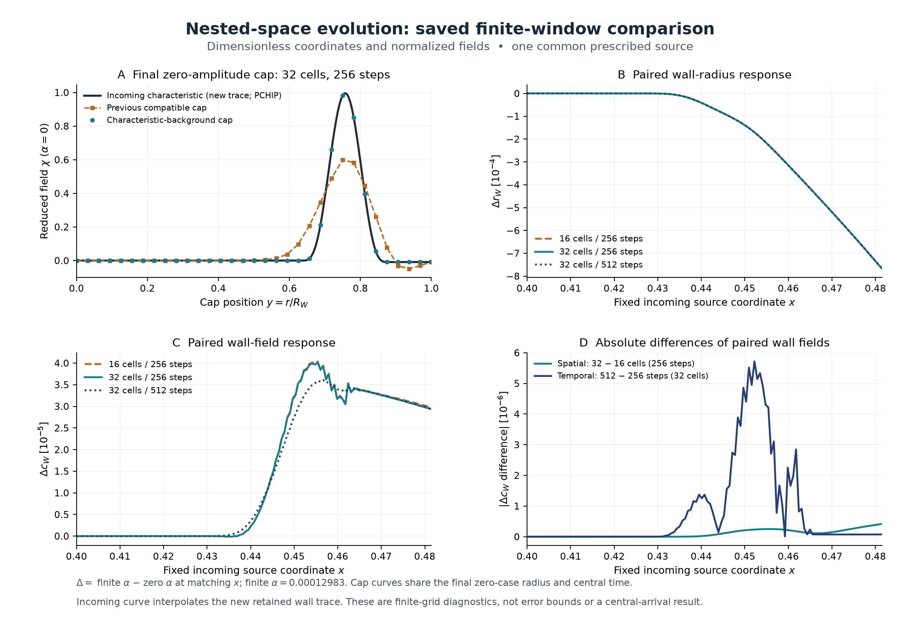

*Figure 21. Saved finite-window comparisons. A: the previous and current
zero-case cap primitives, with an independent incoming characteristic
pullback from the new wall trace. B and C: finite-minus-zero wall radius
and scalar histories. D: absolute spatial and temporal changes of the
paired scalar response. The comparisons neither bound the continuum error
nor extend to central arrival.*

Define each response as the finite-minus-zero history at the same source
label. In the table, spatial differences compare 16/32 cells at 256 steps;
temporal differences compare 256/512 steps at 32 cells. Endpoint values use
the 32-cell, 512-step pair. Here $L=\log C$, $T$ is the central coordinate
clock, $s$ is Einstein proper wall time and $c$ is the normalized invariant
wall scalar.

| Quantity | Endpoint response | Maximum spatial difference | Maximum temporal difference |
| --- | ---: | ---: | ---: |
| Radius $r$ | $-7.67297\times10^{-4}$ | $1.57484\times10^{-7}$ | $7.56646\times10^{-9}$ |
| Log lapse $L$ | $-6.48536\times10^{-3}$ | $1.92145\times10^{-6}$ | $5.58556\times10^{-8}$ |
| Central clock $T$ | $-1.27928\times10^{-3}$ | $8.00326\times10^{-7}$ | $1.10009\times10^{-8}$ |
| Wall clock $s$ | $-1.19742\times10^{-4}$ | $4.54211\times10^{-8}$ | $6.59243\times10^{-10}$ |
| Wall scalar $c$ | $2.94167\times10^{-5}$ | $4.18041\times10^{-7}$ | $5.71668\times10^{-6}$ |

Geometry and clock spatial differences are below 0.063% of their fine
response peaks, and time differences below 0.001%. The scalar time
difference is instead 15.83% of its fine peak $3.61049\times10^{-5}$.
Its small endpoint time difference, $7.42\times10^{-8}$, therefore does
not characterize the history. The finite outgoing characteristic also
changes by 12.41% of its fine peak under spatial refinement. Frozen
cap radial order-4/8 comparisons change the wall mass coefficient by at
most $3.00\times10^{-8}$ and the lapse by $2.29\times10^{-11}$; this
quadrature sensitivity does not explain the scalar time difference.

Independent exterior constraint maxima $(E_{\bar U},E_x)$ decrease from
$(7.88\times10^{-4},0.01312)$ to
$(5.48\times10^{-4},0.008783)$, but remain nonzero. The source-array
$E_x$ defect remains $0.001303$, and final 32-cell, 256-step wall kinematic defects in
$(r,L,c)$ are approximately $(-0.0003125,0.007739,-0.000119)$.
Constructed scalar flux agreement near roundoff does not remove these
independent derivative defects. Thus the integrated geometric responses
are reproducible within the tested comparisons, while scalar time
resolution, exterior constraints and wall slopes still require correction.

Creation and authentication use 228.9375 process-CPU seconds and
43,551,872 charged points within a shared 600-second, 100-million-point
allowance. The manifest binds 66 inputs and producers. Authentication
reconstructs saved diagnostics without source integration or time
evolution. No continuum error enclosure, converged nonlinear spacetime,
central-arrival waveform, formation mechanism or stability result follows
from this window.

### 13.17. Profile-knot phase and a finer temporal comparison

<!-- nsc-claim:atlas-ssprk3-refinement -->

Evidence: [128/256-step histories](../results/development/nsc-atlas-ssprk3-evolution-v1/ssprk3.json),
[512-step comparison](../results/development/nsc-atlas-ssprk3-refinement-v1/refinement.json),
[source-bound manifest](../results/development/nsc-atlas-ssprk3-refinement-v1/manifest.json)
and [figure record](../docs/figures/nsc-atlas-ssprk3-refinement.manifest.json).
The [time-contribution derivation](../docs/nsc-atlas-finite-amplitude.md#isolating-the-scalar-time-contribution)
retains the background chain, physical wall flux and frame conversion separately.

The same spatial operators and physical inputs now use the three-stage
SSPRK3 method at 128, 256 and 512 steps, always with 32 cells. The last
comparison adds only the missing midpoint data: the original 513 rows
are preserved exactly, and the same source snapshot supplies 512 new
midpoints. Direct reference-gauge quadrature at orders 32 and 64 differs
by at most $1.99\times10^{-13}$ across its values and jets. The source
geometry still uses its inherited Hermite approximation; its residuals
are retained. Neither the physical preparation nor the 65-knot
computational cap profile is refitted.

The latter profile is $C^2$, with possible jumps in its third derivative.
An exact local model explains why the position of a knot inside a step
matters. For a prescribed path with
$B(x)=A(x-x_*)_+^3/6$ and $\theta=(x_*-x_0)/h\in[0,1]$, the
SSPRK3-weighted background-chain defect is

$$
\mathcal R_B=B(x_0+h)-B(x_0)
-\frac{h}{6}\{B'(x_0)+4B'(x_0+h/2)+B'(x_0+h)\}.
$$

$$
\mathcal R_B=\frac{Ah^3}{12}(1-2\theta)\min(\theta,1-\theta)^2.
$$

It vanishes at an endpoint or midpoint and has largest magnitude
$|A|h^3/324$ at phases $1/3$ and $2/3$. For a smooth increasing wall
label $\zeta(x)$ crossing a profile knot, the leading coefficient is
$A=[F_{\mathrm{bg}}''']\zeta_x^3$. This local quadrature identity does
not prescribe the coupled stage trajectory or identify its entire error.
In particular, shifting the crossing phase on refinement can change the
sign and size of a difference without a fixed observed convergence order.

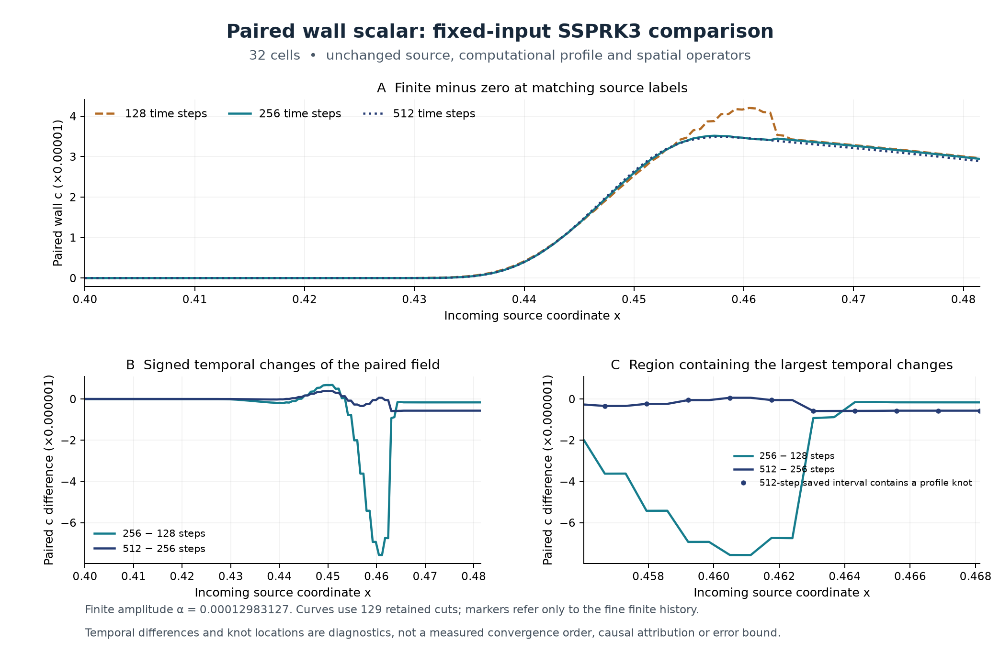

*Figure 22. A: finite-minus-zero wall scalar at 128, 256 and 512 time
steps. B: signed changes between successive histories. C: the region
containing their largest changes; dots mark fine finite-history saved
intervals containing a profile knot. These endpoint brackets do not
reconstruct internal-stage paths or assign causation.*

The paired scalar maximum time difference falls from
$7.57345\times10^{-6}$ for 128/256 steps to $5.84100\times10^{-7}$
for 256/512 steps. The latter occurs at saved cut 99 and is 1.67616%
of the fine peak $3.48476\times10^{-5}$. The difference ratio, 12.966,
is a measured quotient, not a convergence order. The final scalar change
is $-5.66081\times10^{-7}$, so an endpoint alone does not characterize
the history. All entries below use finite minus zero at common labels.

| Quantity | 512-step endpoint response | Maximum 256/512-step difference |
| --- | ---: | ---: |
| Radius $r$ | $-7.67296891\times10^{-4}$ | $6.62412\times10^{-11}$ |
| Log lapse $L$ | $-6.48536218\times10^{-3}$ | $6.54539\times10^{-10}$ |
| Central coordinate clock $T$ | $-1.27927881\times10^{-3}$ | $1.38604\times10^{-10}$ |
| Wall proper clock $s$ | $-1.19741847\times10^{-4}$ | $1.09942\times10^{-11}$ |
| Wall scalar $c$ | $2.88661471\times10^{-5}$ | $5.84100\times10^{-7}$ |

The earlier SSPRK2 extrapolant $(4\Delta c_{512}-\Delta c_{256})/3$
agrees with the new 256-step history within $5.60381\times10^{-8}$,
but with the new 512-step history only within $5.92862\times10^{-7}$.
The closer earlier agreement therefore does not certify the true error.
Independent finite constraint maxima remain approximately
$(5.55\times10^{-4},0.008769)$ for $(E_{\bar U},E_x)$.
The unchanged computational profile's pre-support contribution also remains
a separate representation issue: fine cap-integral leakage is about
$1.66\times10^{-7}$ even though the wall scalar leakage falls to
$1.25\times10^{-9}$. Spatial defects, profile support, central arrival
and a uniform finite-amplitude remainder remain open.

The two new histories and their validation use 174.90625 process-CPU
seconds and 33,604,170 points, within 300 seconds and 50 million points.
Their manifest binds 86 inputs and producers. A separate authentication
uses 1,418,330 points, reconstructs midpoint data and two final stages,
and replays no source integration or trajectory.

### 13.18. A common exterior derivative and a mixed accuracy result

<!-- nsc-claim:atlas-operator-comparison -->

Evidence: [fixed-input spatial comparison](../results/development/nsc-atlas-spatial-refinement-v1/spatial.json),
[same-grid operator comparison](../results/development/nsc-atlas-operator-comparison-v1/operator.json)
and [source-bound manifest](../results/development/nsc-atlas-operator-comparison-v1/manifest.json).
The [common-derivative construction](../docs/nsc-atlas-finite-amplitude.md#a-common-second-order-departure-derivative)
specifies the discrete change and its limited consistency and stability controls.

The preceding 32/64-cell comparison at 512 SSPRK3 steps changes the paired
wall scalar by at most $2.69431\times10^{-7}$, or 0.775% of the fine
peak. This does not resolve the whole field: adjacent-summed cap integrals
still differ by about 7% of the corresponding old 32-cell paired peak,
and their physical radial cells move differently. The successor holds
64 cells, 512 steps, both amplitudes, source data, reference gauge and
computational cap profile fixed. It replaces the first-order exterior
departure derivative with a quadratic stencil. One derivative supplies
both the radial first jets and transport on the moving coordinate grid.
No boundary derivative is replaced by a value demanded by the wall law.

The independent constraints use saved field differences and analytic vacuum
jets, rather than the evolution stencil. Write
$E_a=r_{aa}-L_a r_a+r\Psi_a^2/2$ for $a=\bar U,x$.
The outgoing diagnostic retains the actual source curvature through
$\mathcal R_x=E_x-r_{\mathrm{src}}E_{x,\mathrm{src}}/r$.
All entries below concern the finite-amplitude history on the same 8,001
interior diagnostic points.

| Diagnostic | First-order derivative | Quadratic derivative |
| --- | ---: | ---: |
| Maximum absolute $E_{\bar U}$ | $3.53518\times10^{-4}$ | $3.64417\times10^{-4}$ |
| Root-mean-square $E_{\bar U}$ | $6.20959\times10^{-5}$ | $2.24521\times10^{-5}$ |
| Maximum absolute $\mathcal R_x$ | $4.93833\times10^{-3}$ | $3.21118\times10^{-3}$ |
| Root-mean-square $\mathcal R_x$ | $1.14164\times10^{-3}$ | $2.98901\times10^{-4}$ |

At the final wall event, the kinematic mismatches in $(r,L,c)$ change from
$(-1.54418\times10^{-4},3.75664\times10^{-3},-6.02063\times10^{-5})$
to $(4.70092\times10^{-6},-1.74363\times10^{-4},2.84633\times10^{-6})$.
The maximum method change in the paired wall scalar is
$1.81989\times10^{-7}$, or 0.524% of its new peak
$3.47257\times10^{-5}$. Paired geometry and clock changes are each
below 0.018% of their respective new peaks. These are sensitivities to
the chosen derivative, not bounds on the continuum solution.

The improved average residual and wall slopes do not settle wall curvature.
Independent backward-stencil estimates of the wall
$E_{\bar U}$ peak increase from $4.87\times10^{-4}$ and
$4.49\times10^{-4}$ to $6.67\times10^{-4}$ and
$7.73\times10^{-4}$ at native width. The first estimate uses three nodes
for first derivatives and four for second derivatives; the other uses
five for both. Their maxima of the native-minus-double-width
differences are $3.58\times10^{-4}$ and $6.06\times10^{-4}$.
The source Hermite curvature remains a one-sided trace at saved knots;
its nonzero constraint is retained, not replaced by the source ODE target.
The cap's characteristic-pullback discrepancy remains comparable to its
interpolation sensitivity, and pre-support cap-integral leakage remains
about $3.34\times10^{-7}$. The wall responses are comparatively stable
under this method change, while local derivative accuracy remains unresolved.
Neither a junction failure nor a converged coupled spacetime follows.
Central arrival and a uniform finite-amplitude remainder remain open.

The two new histories and authentication use 256.25 process-CPU seconds
and 55,398,966 charged points within 450 seconds and 80 million points.
The manifest binds 104 files. Separate authentication uses 4,040,624 points
and reconstructs saved fields, diagnostics and two final stages without
source integration or trajectory replay.

### 13.19. A finite-amplitude onset solution

<!-- nsc-claim:atlas-finite-onset-existence -->

Evidence: [exact reference gauge](../results/summaries/nsc-atlas-reference-gauge-bound-v1.json),
[quiet initial anchor](../results/summaries/nsc-atlas-reference-initial-bound-v1.json),
[actual source bounds](../results/summaries/nsc-atlas-source-forcing-bound-v1.json),
and [conditional tube receipt](../results/summaries/nsc-atlas-coupled-tube-bound-v1.json).
The [complete construction and continuation argument](../docs/nsc-atlas-finite-amplitude.md#finite-cell-continuation-assembly)
supplies the mathematical connection between those inputs and existence.

**Finite-cell result.** With the same action, signed material-wall laws,
original compact C3 source and exact quiet initial data, the cap, wall and
exterior admit a compatible regional solution on

$$
x_L=\frac{475452113650795}{1125899906842624},\qquad
x_R=\frac{3809352257986645}{9007199254740992},
$$

$$
0\leq\alpha\leq
\frac{4789928473501569}{36893488147419103232}
\simeq 1.2983\times10^{-4}.
$$

Here $x$ is the fixed affine source label. The cell is approximately
$[0.4222863,0.4229231]$; it is not the complete earlier
wall-radius window. Native fields are C3, native radius is C4, and the
polar cap metric is C2. The centre remains a regular quiet de Sitter core.
Local uniqueness holds in the stated regular class and fixed gauges.

The construction first integrates the outgoing mixed equations, then solves
the existing wall ODE, transports incoming jets from their actual entry,
and reconstructs each field from the same frozen forcing. This preserves
field primitives and common wall values at every iteration. Exponential
weights control the long exterior prefix; a cap strip based on its
spacelike initial data has short characteristic lengths. Weighted
derivative bounds and moving-entry estimates give a local contraction.
The resulting wall laws and exact initial/source data propagate both
incoming Einstein constraints.

Two ordered Volterra/transport derivative pairs give C2 first jets from
the actual C3 source. Their finite bounds and continuity moduli remain
uniform on the declared interval. The physical cap clock is constructed
from the normalized radius-gradient flow. Its Jacobian stays nonzero;
the transformed lapse is fixed by that flow and the quiet central clock.
Restart slices keep their actual curved shape in the original null
coordinates. Separate estimates for old radii and radii newly enclosed
by the wall keep these slices inside the constructed domains.

On every initial subinterval, the same interval majorants improve all
ten assumed departure bounds strictly; their largest ratio is below 0.516.
The positive travel gap keeps the core quiet. A first exit through the
field bounds, regularity, coordinates or quiet overlap is therefore
excluded, and the positive source-label rate carries the solution to $x_R$.

For the bounds below, $f=\Psi/\sqrt{\alpha}$ denotes the normalized canonical
scalar, with its continuous normalized limit at $\alpha=0$. The reduced
canonical fields are $X=rf$ outside and $\chi=rf$ in the polar cap; these
differ from the invariant reduced field $c=r\sinh(af)/a$ used in the native
construction, where $a$ is the nonnegative root of $6a^2=\alpha$.
In the cap, $z=\operatorname{atanh}r$,
$\beta=Ae^\delta/(1-r^2)$ and $E^\pm=\chi_T/\beta\pm\chi_z$.
The quantities $J_r,J_L,J_X$ are integrated transverse-jet departures.
All departures use the exact vacuum reference and the same fixed exterior
wall and source labels. The resulting dimensionless bounds include:

| Quantity | Strict upper bound |
| --- | ---: |
| Integrated radius-jet departure $J_r$ | $5.662\times10^{-9}$ |
| Integrated log-lapse-jet departure $J_L$ | $7.183\times10^{-8}$ |
| Integrated canonical-field-jet departure $J_X$ | $1.474\times10^{-10}$ |
| Absolute wall-to-central-clock departure $\Delta T$ | $7.061\times10^{-9}$ |
| Absolute incoming cap field $E^+$ | $0.002061$ |
| Absolute outgoing cap field $E^-$ | $3.639\times10^{-19}$ |
| Absolute cap reduced field $\chi$ | $3.129\times10^{-6}$ |
| Absolute exterior radius-jet departure $\Delta r_U$ | $1.451\times10^{-6}$ |
| Absolute exterior log-lapse-jet departure $\Delta L_U$ | $4.224\times10^{-5}$ |
| Absolute exterior canonical-field jet $X_U$ | $2.098\times10^{-9}$ |

The exact interval endpoints are retained in the receipt. That immutable
record reports a conditional bound, not existence by itself; the separate
construction and continuation argument supplies existence. Symbolic
controls check the field primitives, wall tangents, differentiated equations
and coordinate identities. No new physical trajectory is used in this proof.
These bounds do not certify the saved numerical histories, a perturbative
remainder, central arrival, formation or observational agreement.

### 13.20. Amplitude dependence on the onset cell

<!-- nsc-claim:atlas-onset-parameter-response -->

Evidence: [source and comparison-chart regularity](../docs/nsc-atlas-finite-amplitude.md#source-data-and-regularity-in-the-fixed-comparison-charts),
[coupled linear inverse](../docs/nsc-atlas-finite-amplitude.md#coupled-linear-inverse-on-the-complete-comparison-domain),
[first quotient with one coordinate derivative](../docs/nsc-atlas-finite-amplitude.md#convergence-of-the-first-quotients-with-one-coordinate-derivative),
and [second quotient and Taylor estimate](../docs/nsc-atlas-finite-amplitude.md#second-amplitude-derivative-and-quadratic-onset-remainder).
The [source-bound record](../results/summaries/nsc-atlas-source-forcing-bound-v1.json)
and [conditional tube record](../results/summaries/nsc-atlas-coupled-tube-bound-v1.json)
retain the numerical input bounds; the linked derivation supplies the
parameter theorem. Neither record evaluates its Taylor constant.

**Amplitude result.** On exactly the source cell and coupling interval of
Section 13.19, the normalized solution has a continuous first amplitude
derivative into C1 comparison jets and a continuous second amplitude
derivative into C0 comparison jets. At the interval endpoints, derivatives
are one-sided. The wall radius and anchored central clock are included.

The comparison uses the original source label $x$. The exterior has the
fixed interval $0\leq\bar U\leq W(x)$; the complete cap uses
$r=r_c+\eta(R(x,\alpha)-r_c)$, $0\leq\eta\leq1$, with a fixed radius $r_c$
in the quiet core. This keeps all radii enclosed by the wall, including
those already present at the initial event. Each solution retains its
own clock $T(x,\alpha)$ and the actual coordinate Jacobians. In particular,
$T$ labels the wall's polar slice by the anchored central proper clock;
it is not the arrival time of a later signal at the centre.

Let $\mathcal U(\alpha)$ collect the normalized comparison state and write
$\mathcal U_1=\partial_\alpha\mathcal U$ and
$\mathcal U_2=\partial_\alpha^2\mathcal U$. Exact finite differences first
give Lipschitz dependence into C0. Uniform spatial C2 bounds and continuity
moduli then give continuity into C2 by second differences. The first
parameter quotients converge into C1 in the order outgoing exterior
derivative, cap gradients, incoming exterior derivative. The cap's radial
constraints express the radial derivatives of its propagation coefficients
without extra field-gradient unknowns. Actual inherited initial data and
the wall corner identity are retained at each restart.

For a cap transport equation
$(\partial_x-\sigma\partial_\eta)w=\mathcal R$, its second variation has
the same coupled linear operator as the first. Put
$v_1=(\mathcal U_1,1)$, including variation of the explicit parameter.
The known second-order forcing is

$$
2D\sigma[v_1]\,\partial_\eta w_1
+D^2\sigma[v_1,v_1]\,\partial_\eta w
+D^2\mathcal R[v_1,v_1].
$$

The factor two comes from varying the transport speed and the field
gradient separately. Convergence of the first quotients in C1 controls
this forcing in C0. The bounded coupled inverse and a finite sequence of
compatible time slabs give convergence of the actual second quotients,
not just a formal differentiated equation. The exterior, radial mass,
lapse, wall and clock equations participate in the same limit. No fourth
source derivative is used, and no C1-valued second derivative of all jets
is asserted.

For a specified normalized state component, wall radius or anchored clock
$O$, define the output-specific finite constant

$$
M_{2,O}=\sup_{0\leq\alpha\leq\alpha_{\max}}
\|\partial_\alpha^2 O(\alpha)\|_{C^0}.
$$

Twice integrating in amplitude gives

$$
\boxed{\|O(\alpha)-O(0)-\alpha O_1(0)\|_{C^0}
\leq \frac{1}{2} M_{2,O}\alpha^2.}
$$

This is an analytic quadratic remainder on the onset domain. The general
state constant is finite; Section 13.21 supplies explicit remainder bounds
for selected geometric outputs by a positive comparison. It also identifies
their first coefficients by matching the source, gauge and quiet initial
data. Errors in the older numerical histories require their own bounds.
The normalized fields have the stated amplitude derivatives. The physical
scalar $\Psi=\sqrt{\alpha}f$ is not asserted to be twice differentiable in
$\alpha$ at zero. The quiet core, original source and coupling interval are
unchanged. Continuation through central arrival and an error bound for the
observer waveform remain separate steps.

### 13.21. Uniform geometric remainders and signed endpoint response

<!-- nsc-claim:atlas-onset-geometric-signs -->

Evidence: [first geometric coefficients](../results/summaries/nsc-atlas-onset-geometry-bound-v1.json),
[geometric](../results/summaries/nsc-atlas-geometric-departure-bound-v1.json),
[canonical scalar](../results/summaries/nsc-atlas-scalar-departure-bound-v1.json)
and [normalized cap](../results/summaries/nsc-atlas-cap-departure-bound-v1.json)
first-difference bounds, [quadratic source remainders](../results/summaries/nsc-atlas-source-remainder-bound-v1.json),
[complete geometric remainder](../results/summaries/nsc-atlas-geometric-remainder-bound-v2.json),
and [Jordan material-radius conversion](../results/summaries/nsc-atlas-jordan-radius-bound-v1.json).
The [comparison and frame derivation](../docs/nsc-atlas-finite-amplitude.md#uniform-quadratic-geometric-comparison-on-the-original-onset)
connects these compact certificates.

Keep exactly the source cell, action, quiet data and coupling interval of
Section 13.19. All quantities here are dimensionless. The outputs are the
Einstein areal radius $R_E$, the material Jordan areal radius $R_J$, and
the wall's centre-anchored polar-slice label $T_W$. Their first coefficients
are the actual derivatives of the constructed solution at $\alpha=0$.
They coincide with the continuum source, mass, lapse, wall and clock
functionals after the source-label event shift is included. This
identification does not assign an error bound to a saved numerical history.

**Uniform comparison.** For each retained geometric component $G$, the
calculation supplies an explicit constant $C_G$ such that

$$
\|G(\alpha)-G(0)-\alpha G_1(0)\|_{C^0}
\leq\alpha^2 C_G.
$$

The radius estimate covers the retained exterior, including the wall;
the clock and material-radius estimates cover their wall histories on this
cell. The source supplies four quadratic remainders. Uniform first
differences of the canonical scalar and normalized cap mass and lapse
bound the remaining nonlinear terms. Half second derivatives of the exact
bulk and signed wall maps are enclosed over the full certified state box,
with the radius-kernel cross term and scalar kinetic product retained.

After division by $\alpha^2$, the three coupled geometric bounds obey
$y\leq My+f_2$, with the same positive matrix as the first-difference
comparison. Its weighted norm is below $0.146$, so
$y\leq(I-M)^{-1}f_2$. The remaining outputs follow from its dependent rows.
This uses one rational three-by-three solve and interval algebra, with no
new field evolution or grid scan.

**Material frame and event identification.** With the normalized canonical
field $f=X/R_E$ of Section 13.19, the exact conversion is

$$
R_J=R_E\cosh\!\left(\sqrt{\alpha/6}\,f\right),\qquad
\mathcal F=\operatorname{sech}^2\!\left(\sqrt{\alpha/6}\,f\right)>0.
$$

The invariant Jordan trace $c=R_E f\operatorname{sinhc}(\sqrt{\alpha/6}\,f)$
is a different variable at finite amplitude. For a fixed target $\alpha$,
join $(0,R_0,X_0)$ to $(\alpha,R_\alpha,X_\alpha)$ by an affine segment.
Its directions are the actual difference quotients, bounded by the
certified first-difference constants. At the expansion base the frame map
has state partials one and zero, and explicit alpha derivative
$X_0^2/(12R_0)$. Therefore the Einstein radius remainder enters with
coefficient one; the frame half-Hessian adds at most
$1.604501\times10^{-23}$ to $C_{R_E}$. The conformal factor has certified
lower bound $0.9999999999999999$ on the whole comparison.

The first Jordan coefficient at fixed source label is

$$
R_{J,1}|_x=\rho+2a_{\mathrm{ref}}v(v-\beta_+)\eta_{\mathrm{emb}},
\qquad a_{\mathrm{ref}}=4/5.
$$

Here $\rho$ is the Jordan radius coefficient at fixed wall proper time,
$v$ is the reference proper-time radial velocity, and
$\eta_{\mathrm{emb}}$ is the exterior embedding coefficient defined by
$V_W=V_0(1+\alpha\eta_{\mathrm{emb}})+O(\alpha^2)$.
Its interval includes both signs and is retained in the conversion;
$\eta_{\mathrm{emb}}$ is distinct from the cap chart coordinate of Section 13.20.

**Endpoint result.** The following are outward-rounded bounds. The last
column gives the shift from the vacuum reference at $x_R$ and
$\alpha=\alpha_{\max}$, divided by $10^{-18}$.

| Output | Upper bound for $C_G$ | Endpoint shift / $10^{-18}$ |
| --- | ---: | --- |
| Einstein wall radius $R_E$ | $6.067430\times10^{-17}$ | $[-2.138954,-1.008091]$ |
| Material wall radius $R_J$ | $6.067431\times10^{-17}$ | $[-1.235768,-0.09856682]$ |
| Anchored wall clock $T_W$ | $1.145597\times10^{-15}$ | $[-2.635641,-1.410894]$ |

For a first-coefficient upper endpoint $U_G<0$, the criterion
$\alpha_{\max}C_G<-U_G$ makes the sign strict at every positive admitted
amplitude. The exact ratio is below $1.038\times10^{-5}$ for the material
radius and $1.369\times10^{-5}$ for the clock. Hence

$$
R_J(\alpha,x_R)-R_J(0,x_R)<0,\qquad
T_W(\alpha,x_R)-T_W(0,x_R)<0
\quad(0<\alpha\leq\alpha_{\max}).
$$

The clock retains the same Einstein-polar slicing and equals physical
Jordan central proper time on the quiet core. Its value assigned to the
wall event is neither wall proper time nor the arrival time of a received
central signal. The reference wall is expanding: these inequalities are
sourced differences at the same input label, not absolute contraction or
an evaporation law. The preparation is still prescribed characteristic
data; no physical emitter, SI scale or observational calibration is selected.

The geometric and material-frame certificates retain exact rational
endpoints, producer commits and input hashes. Seventeen targeted controls,
separate rational audits and independent Grok derivation/code reviews
check the identities, finite boxes, matrix closure, frame conversion and
strict inequalities. The audits authenticate the saved results without
rerunning a field solution. Continuation to central arrival, numerical
trajectory error, preparation selection and observational comparison
retain their separate requirements.

### 13.22. The completed full-label numerical trial

<!-- nsc-claim:atlas-fixed-endpoint-trial -->

All three original fixed-grid runs reach the common incoming-label event
$x=0.4815042082576364$, $V=1$, at
$\alpha=0.00012983127142551443$. The observable is the Jordan material-wall
areal radius, measured by intrinsic area or equatorial proper circumference
on that cross-section. The ruler $\ell=10\,\mathrm{km}$ is a declared input;
it is not an inferred astrophysical scale. This event differs from the
fixed wall-proper-time event used by the historical perturbative coefficient.

| Cap/exterior cells | Jordan radius (m) | Actual mass-gap maximum | Wall-flux maximum |
| --- | ---: | ---: | ---: |
| 2/32 | 5492.322036563843 | 0.00232832534 | 2.24045303 |
| 4/64 | 5492.322058752734 | 0.00237798075 | 2.19447899 |
| 8/128 | 5492.322035897825 | 0.00240631809 | 2.14212668 |

The fine value is $5492.322035897825\,\mathrm m$. The full grid spread is
$22.8549$ micrometres; the fine-centred resolution interval is
$[5492.322013042916,5492.322058752734]\,\mathrm m$, with the same spread
as its half-width. Common input error and errors beyond this grid family
are not included. This is not a confidence interval or a continuum error
bound. The successive pair differences, $22.19$ and $22.85$ micrometres,
do not contract. The grids are nonuniform and their time steps change too,
so no convergence order is inferred.

The wall-flux maximum decreases 4.39%, while the actual mass maximum grows
3.35%. Each residual uses its recorded normalization. The matched-mass
maximum rises slightly then falls on the fine grid. These mixed results
keep the finite-amplitude extension of NSC-P001 an **unconverged numerical
estimate**. The earlier onset theorem retains its shorter domain; the full
endpoint solution is not certified. The coarse evolution completed, but
its auxiliary accumulated-transport summary failed and remains unavailable.

The [completed comparison](../results/summaries/nsc-atlas-fixed-endpoint-comparison-v1.json)
and [saved-cut decomposition](../results/summaries/nsc-atlas-fixed-endpoint-gap-diagnostic-v1.json)
bind the original producer, three inputs and all nine common cuts. The fine
cut at $x=0.45094013016102275$ has physical mass residual
$-0.0007620291372472$, split into strong/weak trace contribution
$-0.0005505985471954$ and balance contribution $-0.0002114305900518$.
Their sum agrees to $1.62\times10^{-17}$. The latter is the explicit
background time-projection remainder up to its stored identity defect.
At the endpoint the fine flux is $-0.5466500011$, compared with
$-0.00965372325$ on the coarse grid: a smaller all-stage maximum does not
mean every cut improves. The saved cuts cover only 19.3%, 25.1% and 31.7%
of the actual-mass envelopes. No maximizing state was saved, so this split
does not locate or uniquely explain that unseen peak. The remaining
connection is the represented field's strong/weak and time-projection
coupling to the wall. The radius, local measurement protocol and qualified
range are recorded in [NSC-P001](../docs/prediction-register.md).

The [active-region diagnosis](../results/summaries/nsc-atlas-endpoint-active-resolution-v1.json)
uses the original onset label $q_a$ and history time
$T_h=T+T_{\mathrm{offset}}$. Before central arrival the retained field
is zero for $z<q_a-T_h$. At every active saved cut that front lies in
the final cell on all three levels. The full outer widths are $.80,.73,.66$;
the clipped endpoint widths are $.56458,.52678,.48898$. The active layer
is never bisected. Added inner cells lie below the retained background's
front; this is not a statement about the unarchived evolved departures.
The spaces change inner knots and do not form a halved-h cap refinement.
Their unresolved wall/time projections need not improve monotonically.
The sampled absolute integral of the actual mass residual also grows
5.11%, excluding denser maximum sampling as the sole explanation.
Seven front/partition controls pass; the read-only calculation uses
.015625 CPU seconds with no field evaluation or evolution. The missing
maximum states still prevent unique attribution of those peaks. Check
the active-region wall trace and affine transport before another grid.

The subsequent [direct PDE check](../results/summaries/nsc-atlas-wall-pointwise-rhs-v1.json)
uses a separately archived evolved stage of the same numerical method.
The complete weak bulk loads agree with the direct field equation to
$2.4\times10^{-9}$, while its pointwise density-force defect is $5.09915$.
The [boundary-lift decomposition](../results/summaries/nsc-atlas-wall-boundary-lift-v1.json)
supplies $5.15013$ of that defect, with the remaining projection contribution
$-.0509851$. At the same frozen geometry the three endpoint evaluation
gains grow $72.6963\to79.7052\to87.2537$. Only the coarse evolved load was
archived; the other gains are operator controls, not new evolutions or a
reconstruction of the missing maxima.

This isolates a finite boundary-projection mechanism at an actual evolved
state. The production split coupling remains unresolved. A
[shared-action manufactured control](../results/summaries/nsc-atlas-collar-field-v1.json)
now recovers a represented scalar and its proper-time velocity over the
quiet wall strip, including original GHY and canonical conversion. Its
normalized field/velocity errors are $6.71\times10^{-12}$ and
$7.11\times10^{-11}$; energy plus metric/input work closes to
$1.75\times10^{-15}$. Its prescribed quiet geometry and manufactured
forcing do not repair or certify the finite-amplitude P001 evolution.

### 14. A separate finite model with geometric feedback

<!-- nsc-claim:finite-transfer-memory -->

Evidence: [focused companion snapshot](finite-regeneration/evidence/snapshot.json),
[finite episode](../results/development/nsc-spherical-conformal-episode-v2.json),
[local response](../results/development/nsc-conformal-local-response-v2.json),
and [memory controls](../results/development/nsc-conformal-memory-control-v1.json).

The finite companion supplies another part of the programme: fields
transfer between selected regions while the same declared action evolves
the geometry. It uses a periodic radial chart, positive chart variables
and antiperiodic spinors. In the present signature convention its metric is

$$
ds^2=r^2[-L^2dt^2+Q^2(dx+\beta\,dt)^2+d\Omega^2].
$$

The physical lapse is $rL$ and radial scale is $rQ$.
Conformal gauge has $L=Q$, $\beta=0$; the reduced field Hamiltonian
is $H=\sigma_2P+\kappa Q\sigma_1$.
Here $\kappa=1$ labels the retained angular block and is independent of
the wall-tension parameter used in the atlas.
Six prepared Gaussian fermion columns determine

$$
C=\Phi\,\mathrm{diag}(0.75,0.75,0.5,0.5,0.25,0.25)\Phi^\dagger,
\qquad \Phi^\dagger\Phi=I_6.
$$

This is a finite admissible state with $0\leq C\leq I$ and
$\mathrm{Tr}\,C=3$. Unoccupied retained bands are part of the
preparation, not a derived physical vacuum. The action coefficients,
magnetic sector, clock and cutoff are recorded inputs.

Four matched discretizations, using 256/512 field modes and time steps
0.001/0.0005, reach coordinate $T=0.3$ without resetting the state.
The reported transfer and curvature comparisons have sub-percent refinement
indicators in their stated observables. The finite evolution supplies a
same-action example, not a continuum error theorem, an eternal engine or
the creation of new universes. Collars of this periodic geometry are
regions of one evolving model.

Its local reduction keeps the original first two mode columns and eliminates
their Hilbert-space complement. That complement includes modes with support
inside and outside the spatial observation window. Consequently it is not
the parent end of Section 10, and its Hamiltonian cannot be transferred to
the wall model without a field-theoretic identification.

### 15. Memory is a consequence of elimination, not an added reservoir

For a time-dependent Hermitian block Hamiltonian with retained block $A(t)$,
coupling $B(t)$ and complementary block $D(t)$, let $U_E(t,s)$
propagate $D$. Eliminating the complementary amplitude gives

$$
y(t)=U_E(t,t_*)y_*-
i\int_{t_*}^{t}U_E(t,s)B^\dagger(s)x(s)\,ds,
$$

$$
\dot x(t)=-iA(t)x(t)-iB(t)U_E(t,t_*)y_*-
\int_{t_*}^{t}K(t,s)x(s)\,ds,
$$

$$
K(t,s)=B(t)U_E(t,s)B^\dagger(s).
$$

The memory kernel, actual initial complementary drive and initial cross
correlations all matter. If $R_A,R_E$ denote the corresponding solution
maps, the retained covariance is

$$
C_A=R_A C_{AA}R_A^\dagger+R_E C_{EE}R_E^\dagger+
R_A C_{AE}R_E^\dagger+R_E C_{EA}R_A^\dagger.
$$

The companion uses the actual evolved state at $t_*=0.2$, then compares
the reduced and full histories through $t=0.3$. The selected occupations
change from approximately $(0.10557448,0.10557464)$ to
$(0.03214496,0.03226900)$. The maximum reduced/full occupation
discrepancy is $6.35\times10^{-6}$, compared with a physical-model
change of about $0.07343$.

| Conditional omission control | Maximum occupation effect | Its separate numerical reference discrepancy |
| --- | --- | --- |
| Omit the memory term | 0.0168185 | $2.20\times10^{-6}$ |
| Omit the actual initial complementary drive | 0.0485412 | $1.66\times10^{-5}$ |
| Omit initial cross correlations | 0.0920614 | $1.23\times10^{-5}$ |

These controls hold the generated geometry fixed. They are not separately
coupled physical evolutions; in particular, deleting the memory term is a
diagnostic alteration, not a new Hermitian theory. They demonstrate why an
interior description must retain the appropriate history and state
information. The next bridge to the atlas would derive such a regional
Hamiltonian and state from a particular matched spacetime and field, rather
than labeling these finite modes as universes.

## VI. What the map can ask next

### 16. Constants, spectral scales and physical inheritance

<!-- nsc-claim:target-constants -->

**Open physical target.** A shared normalized operator can preserve
dimensionless spectral relationships while regional clocks and absolute
frequency units differ. To turn this into a statement about constants,
the attachment must specify clocks, rods, fields and the transition of their
dimensionless parameters. Useful comparisons include
$\alpha$, mass ratios, and $Gm^2/(\hbar c)$.
A numerical change caused solely by unit rescaling is not a changing law.

Successive inheritance maps also need compatible output and input spaces:
the first transition must supply data on which the next law is defined.
Drawing another nested sphere does not establish this composition.

The atlas wall parameters $H\ell$, $M/\ell$ and $\kappa\ell$
are declared inputs, not values inherited from a parent calculation.
Physical inheritance might preserve a law while changing states, select
among admissible states, or alter an effective environment. These
possibilities need different maps and should remain distinguishable.

The foundation also contains a scalar-link construction whose invariant
sector has the ordinary Dirac relation
$E^2=|\mathbf p|^2+\Phi^2$. It is a useful benchmark relating a
coupling to a gap. It does not derive the observed particle species,
nuclear masses or their interactions. Particles are not assumed to be
little universes. A particle interpretation requires the appropriate field
representation, observables and dynamics, not resemblance between a spectral
scale and a cosmological radius.

### 17. Wavelength, preparation and the role of light speed

The derived scales

$$
\ell_P=\sqrt{\frac{\hbar G}{c^3}},\qquad t_P=\frac{\ell_P}{c}
$$

are defined combinations of constants, as tabulated by
[NIST CODATA](https://physics.nist.gov/cuu/Constants/).
Dimensional construction alone does not establish a smallest physical
wavelength or an indivisible spatial cell. A claimed minimum would need
a model of probes, observables and gravitational backreaction.
Minimal-length scenarios themselves distinguish limits on resolution,
distance products and other quantities; see
[Hossenfelder, 1203.6191v2, Sections 5.3–6](https://arxiv.org/html/1203.6191v2).

Absolute zero refers to thermodynamic temperature and the limiting thermal
state, not to an endpoint of allowed wavelengths; see
[NIST's temperature definition](https://www.nist.gov/si-redefinition/kelvin/kelvin-thermodynamic-temperature).
A relation between a regional temperature and a spectral scale requires a
specified state and Hamiltonian. Changing a temperature unit supplies neither.

A horizon is not automatically a reflecting cavity wall or a prohibition
on longer-wavelength modes. A particle-like exterior description likewise
requires an additional quantum state and measurement model; exterior mass,
spin and charge alone do not establish that description. Quantum observables
can have continuous as well as discrete spectra. A detector event or a wave
crest is not a general definition of a particle.

Separately, $T=0$ in an evolution record names a prepared state and a clock
origin. It is not the short-wavelength endpoint of a spectrum.
An ultraviolet cutoff, an initial time and a spatial boundary have different
mathematical roles.

A local freely falling observer's null-cone speed, coordinate propagation
rate, group velocity, phase velocity and a reduced response delay are also
different quantities. A varying coordinate speed near a horizon is not
evidence that the local causal constant changes. Claims about different
regional $c$'s require an operational, dimensionless comparison and a
consistent theory. [Ellis and Uzan, gr-qc/0305099v2](https://arxiv.org/html/gr-qc/0305099v2)
explain why the distinct roles often assigned the symbol $c$ should be
separated. The present atlas uses conventional local null cones; its clock
conversion and delayed response do not change that local law.

### 18. Dark gravitational effects require a stress and an observable

<!-- nsc-claim:target-dark-sector -->

**Open physical target.** The unexplained gravitational and expansion
phenomena motivating the project must be investigated after an exterior
model supplies consequences. A prescribed fraction, including “95%,” is
not inserted as an exterior abundance or a target that chooses the map.

Clustering and lensing require a stress or effective gravitational response
with the right spatial, temporal and scale dependence. Accelerated
expansion requires a separate background and perturbation analysis.
Antimatter and clock arrows require still other data.
The calibration scalar pulse has no calculated energy flux or backreaction and
leaves no persistent central field in its certified interval. It supplies
none of these dark components.

The foundation's Schur response and the library's shadow-matter and
brane examples remain conditional starting points. A successful next
connection would carry an actual source/state through the admitted geometry
into a gauge-invariant gravitational observable. It would then either
distinguish that exterior from alternatives or demonstrate a stated
degeneracy. Fitting a freely chosen incident waveform cannot supply that
discrimination.

### 19. Matter, antimatter and orientation

<!-- nsc-claim:target-antimatter -->

**Open physical target.** “Inside” and “outside” are geometric labels.
Charge conjugation transforms fields and their gauge representations.
Changing radial orientation or the sign of a chart coordinate does not,
by itself, convert matter into antimatter. A proposed boundary identification
must say which field components and charges it matches and whether the
source, state and conserved currents permit it.

A real wave's sign change is not charge conjugation. CPT symmetry is also
distinct from time reversal alone; neither supplies an entropy arrow.

The library preserves distinct CPT, black-mirror and torsion-production
proposals. They cannot be combined by assigning one side of every sphere
to antimatter. A useful next test would choose one actual attachment,
write its field transformation and determine whether it selects a charge
asymmetry from the stated initial data. The current real scalar has no
particle–antiparticle charge degree of freedom and cannot settle this.

### 20. Time, recycling and the next generation

<!-- nsc-claim:target-continuation -->

**Open physical target.** A continuing child needs a domain beyond a
single initial slice and a source whose evolution remains meaningful there.
The present wall reference has a singular past; the gluing theorem supplies
initial data only. Neither is a proof that an astrophysical collapsing
black hole forms the mapped cap, or that the cap is stable under disturbances.
Regular background curvature and perturbative stability are separate tests.

Proper times can be compared along specified worldlines with a matching
convention. Cross-universe ages cannot be read from unrelated coordinate
times or unrecorded clock origins. Expansion, entropy increase, causal
orientation and an observer's records may all participate in an arrow of
time, but a clock conversion alone establishes none of those thermodynamic
claims.

<!-- nsc-claim:target-recursion -->

**Open physical target.** Finite-depth inheritance and periodic regional
transfer do not prove cosmic recycling or an eternal source. A new
generation requires an identified transition, source/state transfer and
entropy accounting. Multiple holes motivate multiple possible offspring;
they do not require equal children or communication between siblings.

Known branching mathematics should be borrowed. In the finite-type
illustration used by [Altenberg, 1302.1293v2](https://arxiv.org/html/1302.1293v2),
an offspring law determines a mean matrix $N_{ij}$; conditional expected
populations evolve by $N^n$. Its long-time conclusions require the stated
branching and spectral hypotheses. The unresolved physics is the transition
law and its admissible parameter/state inheritance. Choosing that law to
favor an intended cosmic population would assume the result.
No infinite-generation computation is needed before one such transition
has been established.

Conformal cyclic cosmology remains a separate possible continuation, with
its own conformal matching and matter assumptions. It is not identified
with black-hole offspring or communicating mouths by a scale analogy.

### 21. Measurements that could decide between maps

<!-- nsc-claim:target-measurement -->

**Open physical target.** A discriminating prediction must survive changes
of units, chart labels and unspecified initial data. The protected vacuum
interval proves a finite geometric degeneracy. The scalar inverse in
Section 13.3 determines the preparation for a fixed geometry and supplies
preparation-class exclusions. It does not establish equivalence between
two physical exterior models. Both results identify what information the
next observer comparison must supply.

The next admissible calculations therefore have concrete decisions:

| Missing connection | Finite decision | What it would unlock |
| --- | --- | --- |
| Onset existence to a controlled observer response | Can the finite-amplitude solution be extended through central arrival with a controlled perturbative remainder? | A finite-amplitude prediction for the interior observer |
| Preparation-restricted observer inference | Does the source reconstructed from a measured trace satisfy an independently justified preparation law in each candidate? | A discriminating response-range test or an explicit equivalence class |
| Alternative coupling or source | Does a fixed minimal-coupling or sourced model leave a distinguishable tail? | A comparison of interior response mechanisms |
| Physical regional Hamiltonian | Does a chosen matched field yield the required reduction and initial covariance? | Memory with an identified geometric exterior |
| Stability or formation of an attachment | Do fixed-source disturbances or collapse data remain in the claimed domain? | A stronger cosmological interpretation |
| Dimensionless inheritance | Which transition quantities are preserved or changed? | A meaningful comparison of constants across regions |

These are candidates, not a compulsory queue. Each proposed calculation
must state what is borrowed, what is missing, what it decides, what it
unlocks, its finite domain and budget, and the outcome that stops or
redirects it. The [existing admission owner](../docs/prior-art-and-open-claim.md)
keeps that rule. A failed attachment remains visible, while another
geometric route can proceed under its own assumptions.

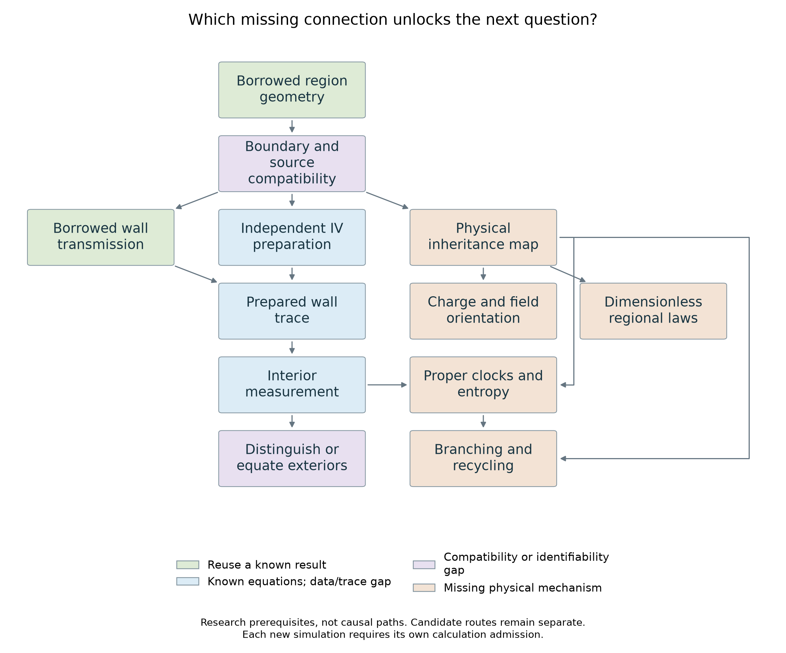

*Figure 23. Research dependencies, distinct from spacetime causal arrows.
The [v8 programme record](../results/development/nsc-cosmological-atlas-v8/programme.json)
names prerequisites, decisions, budgets and stop conditions for eight themes.
Each calculation retains its own domain; arrows do not declare questions solved.*

The current result is a continuous mathematical story at a deliberately
finite scale: an exterior can be attached on a sourced slice; an isolated
completion determines observer access; a specified field state gives an
interior waveform; independent finite exterior data now predict a pulse
and a positive finite scattering tail; and finite regional reduction explains how unresolved
degrees of freedom can retain memory in another fully stated model.
The new inverse shows how a complete finite signal selects its preparation
within a fixed geometry, and why physical source restrictions must accompany
any comparison of maps.
The quadratic stress check now connects that preparation to compatible local
wall conditions. Its characteristic constraint requires a nonzero initial
radius correction under the declared corner and null normalization;
transverse constraint transport then supplies an invariant geometric mass coefficient
on that same surface. The vanishing normal-stress jump adds a necessary
condition on their later wall matching. Known field traces also determine
an analytic exterior-side wall-mass functional without a new field solve.
Subtracting the cap vacuum at the actual radius now supplies the other
mass functional and the quiet-anchored wall displacement equation.
The temporal and normal conditions agree with their common mass transport.
The prepared field now drives an evolved exterior radius and lapse on a
finite characteristic rectangle, with mass-transport and null-constraint
checks. The retained-wedge evaluation now compares independent radial and
timelike mass paths, computes the two-sided wall displacement and fixes its
exterior clock correction. Radial cap reconstruction now also fixes the
central proper clock and a corrected null-arrival map, with independent
cap-mass transport and numerical controls. The formal exterior scalar
correction is now propagated with independent numerical comparisons.
Reflected cap transport now also reconstructs its central coefficient at
five fixed proper times. A nonlinear cap, wall and exterior calculation
now also completes the original pre-arrival window. Its six-case comparison
substantially reduces leading cap transport error and resolves integrated
geometry and clock changes within the tested refinements. Scalar time
sensitivity and independent constraint and wall-slope defects prevent a
converged-solution claim. With the source and spatial operators fixed,
SSPRK3 temporal refinement reduces the paired scalar change to 1.68%
of its fine peak; computational profile-knot phase prevents interpreting
a single difference quotient as an observed order. Spatial constraints
and the profile's support defect remain separate. A fixed-resolution change
to a common quadratic exterior derivative reduces average constraint
residuals and the final wall kinematic mismatch; its paired scalar change
is 0.524% of the new peak. The slightly larger incoming-constraint maximum
and worse, width-sensitive wall-curvature estimates keep local accuracy
unresolved. Separately, Section 13.19 establishes a finite-amplitude onset
solution and its certified departure bounds. Section 13.20 establishes
its first and second amplitude derivatives. Section 13.21 identifies the
first geometric coefficients, supplies uniform quadratic remainders and
proves negative material-radius and anchored-clock corrections at the onset
endpoint throughout the admitted positive-amplitude range. Errors in the
older numerical histories, continuation through central arrival and the
observer waveform remain separate open questions.
The longer three-grid trial in Section 13.22 is complete and remains
unconverged. Its mass residuals have not contracted. A separate full-mass, lapse
and rate check on
[one older saved stage](../results/summaries/nsc-atlas-independent-cap-mass-lapse-v1.json)
reproduces a nonzero temporal mass residual there. That stage is not the
maximum over the completed v4 trial. The qualified radius range is now in
NSC-P001; the full endpoint closure remains open. Sections 6.1.4--6.1.8 record the
observer calculations that use completed geometries instead. Sections
10.1--10.3 now add two unequal sourced inputs, finite grandchild composition
and an inner-wall flash with a specified central receiver.
The remaining work is to connect those statements physically where their
domains presently differ.

## Appendix A. Evidence, attribution and preserved mathematics

This living manuscript draws from source-bound atlas records without changing
their historical bytes. Record residuals and refinement comparisons are
reported at their declared scope; floating-point quadrature agreement is
not a rigorous error bound. The overview producer reads existing records
and renders their relationships without launching a new physics calculation.

| Result family | Owning derivation and preserved evidence |
| --- | --- |
| Finite inheritance and nested reduction | [Proof](../docs/nsc-nested-qualities.md); [snapshot](nested-quality-evidence/snapshot.json) |
| Two-hole parent and radiation attachment screen | [Atlas v2](../docs/nsc-cosmological-atlas.md); [manifest](../results/development/nsc-cosmological-atlas-v2/manifest.json) |
| Signed moving wall and gluing literature | [Atlas v3](../docs/nsc-cosmological-atlas.md); [manifest](../results/development/nsc-cosmological-atlas-v3/manifest.json) |
| Sourced slice and vacuum observer domain | [Atlas v4](../docs/nsc-atlas-connection-slice.md); [manifest](../results/development/nsc-cosmological-atlas-v4/manifest.json) |
| Unequal sourced bodies and finite grandchild composition | [End assembly](../docs/nsc-atlas-connection-gluing.md); [unequal bodies](../results/summaries/nsc-atlas-unequal-children-v1.json) and [two-level geometry/observer](../results/summaries/nsc-atlas-nested-slice-v1.json) |
| Fixed-state physical resolution | [Canonical split and vacuum-volume comparison](../docs/schur-memory.md#physical-resolution-of-one-fixed-geometry); [finite record](../results/summaries/nsc-conformal-resolution-v1.json) |
| Full-label three-grid trial | [Observable and status](../docs/prediction-register.md); [comparison](../results/summaries/nsc-atlas-fixed-endpoint-comparison-v1.json) and [saved-cut split](../results/summaries/nsc-atlas-fixed-endpoint-gap-diagnostic-v1.json) |
| Isolated causal completion and clocks | [Atlas v5](../docs/nsc-atlas-causal-classification.md); [manifest](../results/development/nsc-cosmological-atlas-v5/manifest.json) |
| Classical incoming state and scalar transfer | [Atlas v6](../docs/nsc-atlas-field-transfer.md); [manifest](../results/development/nsc-cosmological-atlas-v6/manifest.json) |
| Finite exterior preparation and research dependencies | [Preparation](../docs/nsc-atlas-field-preparation.md); [programme](../docs/nsc-cosmological-atlas.md); [v7 manifest](../results/development/nsc-cosmological-atlas-v7/manifest.json) |
| Evaluated exterior preparation and finite tail | [Response](../docs/nsc-atlas-prepared-response.md); [v8 manifest](../results/development/nsc-cosmological-atlas-v8/manifest.json) |
| Fixed-model source inverse and preparation exclusions | [Proof](../docs/nsc-atlas-observer-inference.md); [record](../results/development/nsc-atlas-observer-inference-v1/inference.json) |
| Conformal probe surface stress and tangential flux | [Derivation](../docs/nsc-atlas-scalar-wall-consistency.md); [record](../results/development/nsc-atlas-scalar-wall-consistency-v1/consistency.json) |
| Characteristic gravitational initialization | [Constraint and frame check](../docs/nsc-atlas-characteristic-initialization.md); [record](../results/development/nsc-atlas-characteristic-initialization-v1/initialization.json) |
| Geometric mass on the prepared null surface | [Mixed geometry and stress checks](../docs/nsc-atlas-source-mass.md); [record](../results/development/nsc-atlas-source-mass-v1/mass.json) |
| Conformal scalar normal-force compatibility | [Projection and force sign](../docs/nsc-atlas-scalar-normal-force.md); [record](../results/development/nsc-atlas-scalar-normal-force-v1/normal-force.json) |
| Exterior wall-mass functional | [Both fluxes and full frame conversion](../docs/nsc-atlas-wall-mass-closure.md); [record](../results/development/nsc-atlas-wall-mass-closure-v1/wall-mass.json) |
| Cap mass and wall displacement functional | [Vacuum subtraction and junction closure](../docs/nsc-atlas-cap-wall-response.md); [record](../results/development/nsc-atlas-cap-wall-response-v1/cap-wall.json) |
| Smooth exterior metric response | [Characteristic evolution and radial checks](../docs/nsc-atlas-bulk-response.md); [metric](../results/development/nsc-atlas-bulk-response-v1/metric/response.json), [field](../results/development/nsc-atlas-bulk-response-v1/field/response.json) and [derivative](../results/development/nsc-atlas-bulk-response-v1/derivative/response.json) comparisons |
| Moving wall and exterior clock | [Mass paths, displacement and clock](../docs/nsc-atlas-wall-evolution.md); [field](../results/development/nsc-atlas-wall-evolution-v1/field/response.json), [radial](../results/development/nsc-atlas-wall-evolution-v1/radial/response.json) and [clock-time](../results/development/nsc-atlas-wall-evolution-v1/time/response.json) comparisons |
| Smooth cap and central null clock | [Regular centre, metric and arrival map](../docs/nsc-atlas-cap-response.md); [field](../results/development/nsc-atlas-cap-response-v1/field/response.json), [radial](../results/development/nsc-atlas-cap-response-v1/radial/response.json) and [further ray](../results/development/nsc-atlas-cap-response-v1/ray_fine/response.json) comparisons |
| Exterior cubic scalar correction | [Conservative evolution](../docs/nsc-atlas-scalar-evolution.md); [clock lift](../results/development/nsc-atlas-lift-clock-v1/clock.json), [forcing cache](../results/development/nsc-atlas-forcing-cache-v1/cache.json) and [propagated response](../results/development/nsc-atlas-scalar-evolution-v1/evolution.json) |
| Central cubic scalar correction | [Reflected transport and clock pullback](../docs/nsc-atlas-central-scalar-response.md); [radial comparison](../results/development/nsc-atlas-central-scalar-v1/central.json) and [incoming-ray comparison](../results/development/nsc-atlas-central-ray-v1/ray.json) |
| Nonlinear coupled pre-arrival window | [Exact model and characteristic background](../docs/nsc-atlas-finite-amplitude.md); [six-case result](../results/development/nsc-atlas-background-evolution-v1/background.json) and [manifest](../results/development/nsc-atlas-background-evolution-v1/manifest.json); scalar time sensitivity and pointwise constraints remain unresolved |
| Fixed-input SSPRK3 temporal refinement | [Profile-knot and chain identities](../docs/nsc-atlas-finite-amplitude.md); [128/256 histories](../results/development/nsc-atlas-ssprk3-evolution-v1/ssprk3.json), [512 comparison](../results/development/nsc-atlas-ssprk3-refinement-v1/refinement.json) and [manifest](../results/development/nsc-atlas-ssprk3-refinement-v1/manifest.json); finite temporal differences, without an error enclosure |
| Same-grid exterior derivative comparison | [Common derivative and independent diagnostics](../docs/nsc-atlas-finite-amplitude.md#a-common-second-order-departure-derivative); [64-cell baseline](../results/development/nsc-atlas-spatial-refinement-v1/spatial.json), [operator comparison](../results/development/nsc-atlas-operator-comparison-v1/operator.json) and [manifest](../results/development/nsc-atlas-operator-comparison-v1/manifest.json); smaller average residuals and wall kinematic mismatch, with unresolved constraint maxima and wall curvature |
| Finite-amplitude onset solution and parameter dependence | [Construction and continuation](../docs/nsc-atlas-finite-amplitude.md#finite-cell-continuation-assembly), [parameter theorem](../docs/nsc-atlas-finite-amplitude.md#second-amplitude-derivative-and-quadratic-onset-remainder); [original source bound](../results/summaries/nsc-atlas-source-forcing-bound-v1.json) and [strict tube](../results/summaries/nsc-atlas-coupled-tube-bound-v1.json) |
| Uniform geometric remainder and material-radius sign | [Full comparison](../docs/nsc-atlas-finite-amplitude.md#certified-finite-amplitude-endpoint-signs), [frame and clock interpretation](../docs/nsc-atlas-finite-amplitude.md#certified-jordan-radius-endpoint-comparison); [geometric certificate](../results/summaries/nsc-atlas-geometric-remainder-bound-v2.json) and [material-radius certificate](../results/summaries/nsc-atlas-jordan-radius-bound-v1.json) |
| Finite spherical transfer, feedback and memory | [Companion](finite-regeneration/main.tex); [frozen build/evidence](finite-regeneration-manifest.json) |
| Foundation boundary, spectral and source constructions | [Archived v0.26.0](archive/foundation-v0.26.0/paper/nested-space-cosmology.md); [research inventory](../docs/research-inventory.md) |

The archived foundation retains, among other strands, its full-spinor
boundary maps, scalar-link Dirac benchmark, source and work ledgers,
curved spectral constructions and explicitly limited black-universe
benchmarks. Their theory, state and domain remain with their owning notes.
An RN pressure diagnostic is not promoted to mechanical balance, a reached
inner horizon is not promoted to central regularity, and stopped numerical
runs without completed summaries supply no new physical conclusion.
These distinctions preserve useful work without making historical routes
mandatory.

The [arXiv library](../docs/arxiv-studies.md) records paper versions,
reading depth, reusable equations, assumptions and unresolved connections.
It includes the sources for the supplementary multiple-daughter,
multi-mouth, CPT, torsion and regular-interior branches. A bounded search
cannot certify that no one has already closed an apparent gap.
The [paper guide](../docs/papers.md) locates the unchanged atlas working
drafts and the focused companion. Calculations, programming and drafting
for these finite records and for
this synthesis used OpenAI Codex/ChatGPT and xAI Grok. The author's
responsibility includes the interpretations and synthesis here; borrowed
results retain their source attribution and are not presented as new laws.
