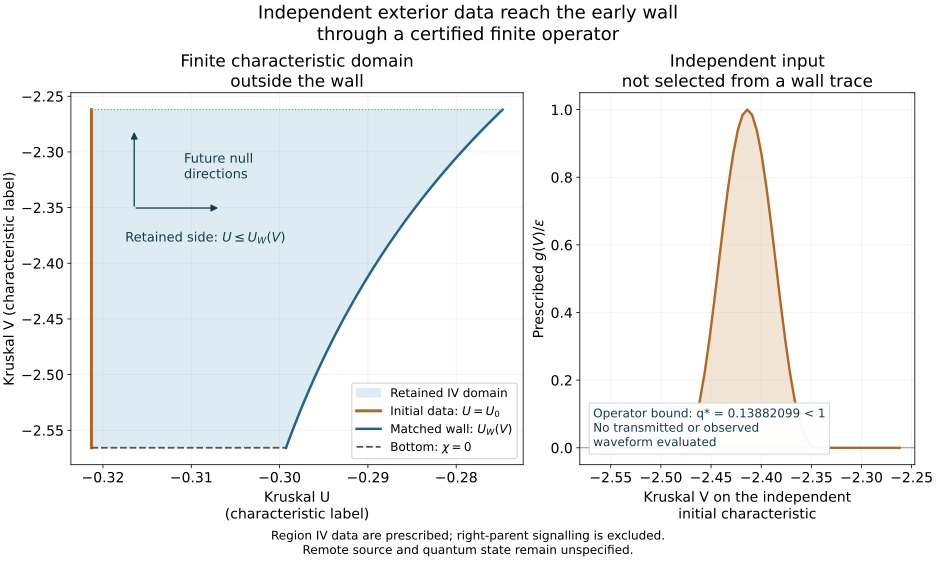
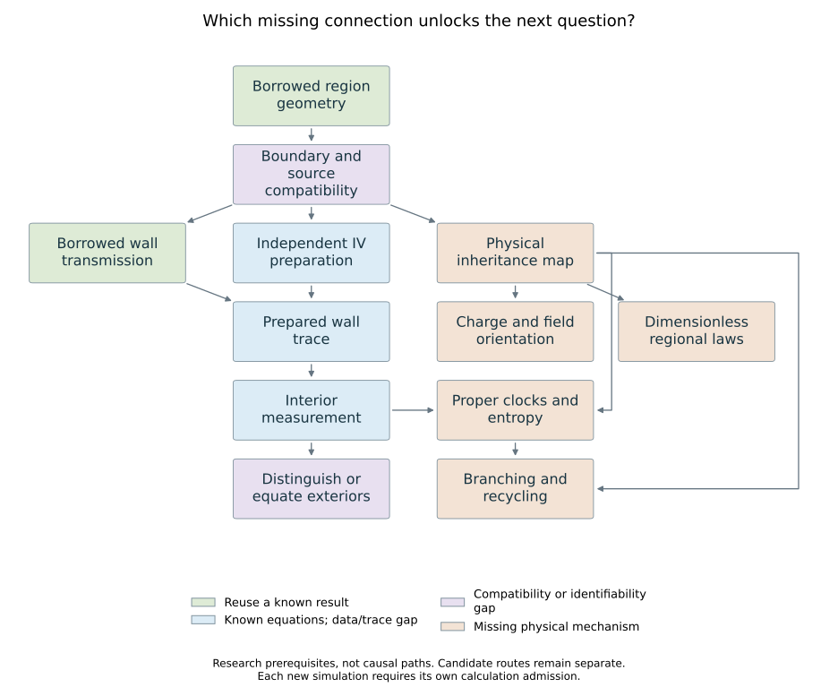

# An independent preparation and a finite transfer operator

The new entry specifies compact C3 data g(V) on a finite retained-IV
characteristic U=U0, with a compatible zero bottom characteristic. The datum
is chosen independently of a desired wall trace. This is a linear classical
initial-boundary problem on the existing isolated geometry; the right parent
observer's causal exclusion is unchanged.

The interior cap is initialized with zero data at wall radius R/ell=0.45.
This is a separate finite preparation from the v6 pulse and its earlier cap.
Connecting both preparations requires an additional no-earlier-incoming-history
assumption; this bundle does not assert that connection.

Borrowed characteristic equations and the matched wall give a finite transfer
operator with analytic contraction bound **q*=0.138820992344<1**. This establishes
existence and uniqueness in the declared finite domain. It does not evaluate
a new transmitted waveform, prepare an astrophysical source, select a quantum
vacuum or establish cosmological recurrence. The previously computed v6 pulse
remains its own conditional wall-input result, with all earlier routes retained.

| Observer or surface | Access in this record | Missing connection or limit |
|---|---|---|
| Independent IV characteristic | Supplies g(V) to the retained finite wedge | Physical production of the prescribed data is not modelled |
| Wall W | Receives a uniquely defined trace through the certified operator | The transmitted waveform has not been evaluated |
| Interior centre C | Existing early wall-to-centre transfer can be composed in its clock domain | No new central waveform or detector response is claimed |
| Right static parent P | No P-to-W or P-to-C signal in this isolated reference | Spatial connection does not reopen the excluded causal route |
| Other children or exterior models | Their original candidate branches remain available | No new sibling signalling or physical inheritance map is added |

The recorded wall interval is R/ell in [0.45,0.55]. The lower radius bound,
finite proper-time arrival interval and regular-centre no-return margin belong
to [preparation-access.json](preparation-access.json). Outside that domain the
argument must be re-established. A characteristic label is not an observer's age.

The eight questions are spheres, inside/outside, quantum fields, barriers,
regional scales, charge, time and branching. The diagram shows research
prerequisites; it does not add physical connections. The useful next calculation
must close a named gap or distinguish alternatives. Recomputing a known identity
without new data, compatibility or an observable does not advance this map.

[programme.json](programme.json) records those dependencies, reading boundaries
and stopping rules. [atlas.json](atlas.json) retains all nine prior scenarios
and appends this finite preparation. [manifest.json](manifest.json) authenticates
the source and output bytes. The scientific owner is
[field preparation](../../../docs/nsc-atlas-field-preparation.md); the one living
[paper](../../../paper/nested-space-cosmology.md) remains the manuscript.
