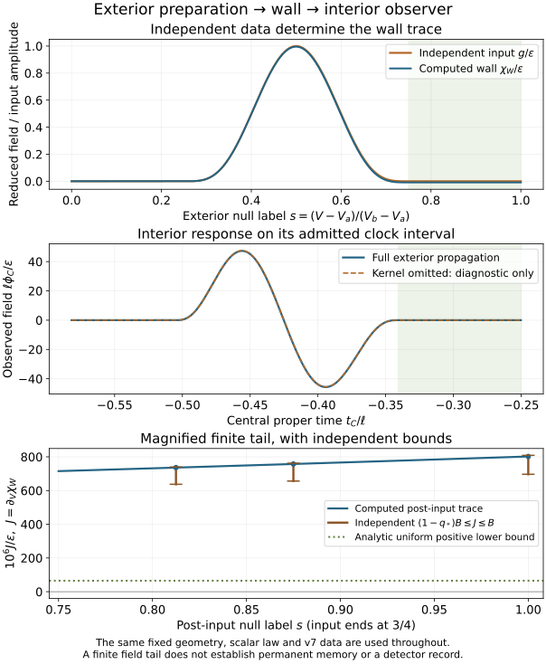

# An independently prepared signal reaches the interior observer

The v7 exterior datum now determines a computed wall characteristic and a
central classical waveform. Geometry, coupling, input profile, zero initial
cap at R/ell=0.45 and the wall interval [0.45,0.55] remain fixed. The designated
right parent remains causally excluded. Source generation and quantum-state
selection remain open. All ten earlier scenarios are preserved.

The existing Volterra norm bound is q*=0.138820992344<1. Product integration and
the borrowed DOP853 method evaluate that operator on the retained domain;
the exterior kernel is never evaluated inside the excised cap. The observer
map is the existing phi_C[T(tau)]=I(tau)/Tprime(tau).

The finite response has sampled extrema -45.6959594
and 47.2983369 in ell phi_C/epsilon. Omitting the
kernel changes the waveform by at most 0.265952121
on the recorded samples. That omission is a diagnostic, not a second physical
spacetime or an observer-equivalence result.

After the input ends, the fixed kernel and data imply a positive wall derivative
J on the remaining window. The analytic floor is
J/epsilon >= 6.53246206386e-05. Independent integration
gives the more informative brackets below; its 32/64-order differences are
numerical diagnostics, not rigorous enclosures.

| Normalized null label s | (1-q*) B / epsilon | Computed J / epsilon | B / epsilon | B 32/64 difference |
|---:|---:|---:|---:|---:|
| 0.8125 | 0.0006371321074 | 0.0007361136575 | 0.0007398370162 | 4.37e-17 |
| 0.875 | 0.0006563785613 | 0.0007575130409 | 0.0007621859747 | 5.31e-17 |
| 1 | 0.0006965878198 | 0.0008020390045 | 0.000808876916 | 7.18e-17 |

Field-grid maximum waveform differences are
[1.11704166272375e-06, 2.792862581202371e-07]; the 129/257 geometry-knot
comparison differs by 3.406e-08.
The independent observer-area identity differs by
2.505e-10. Refinement is not a rigorous
continuum error bound. Complete tolerances and finite budgets are recorded in
[prepared-response.json](prepared-response.json).

The positive finite-window field tail does not establish permanent memory,
a detector record, energy density or late-time asymptotics. The upper observer
time is a domain exit: no zero tail or continuation to t_C=0 is inferred.
The next question is whether another independently specified, compatible
preparation can be distinguished by this observer; that comparison is open.

[atlas.json](atlas.json) and [programme.json](programme.json) scope the completed
connection and keep the other routes open. [preparation-access.json](preparation-access.json)
retains the v7 preparation certificate. The scientific owner is
[prepared response](../../../docs/nsc-atlas-prepared-response.md); the living
[paper](../../../paper/nested-space-cosmology.md) remains the manuscript.
